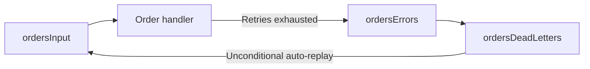
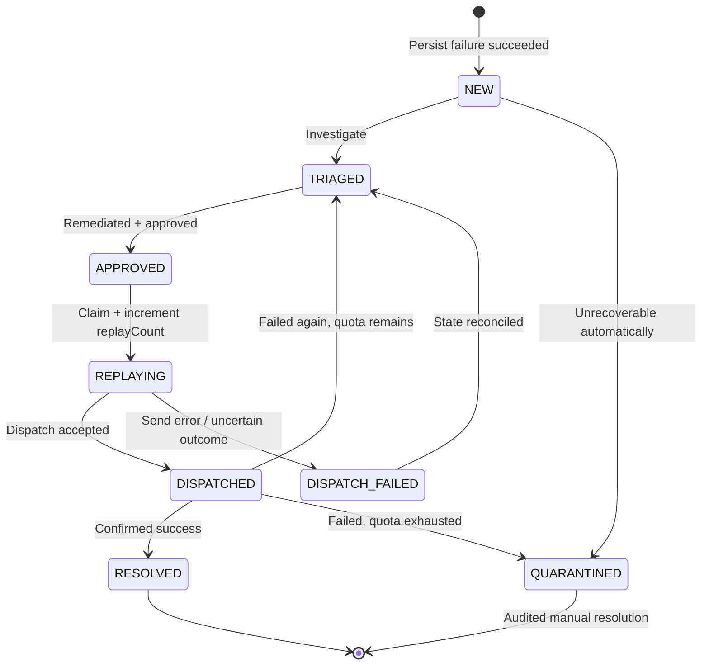

# Preventing Infinite Dead Letter Loops

In the **SPRING_INTEGRATION_PATTERN** module, Spring Integration helps implement **Enterprise Integration Patterns** such as Router, Filter, Transformer, Splitter, Aggregator, Gateway, retry, error channel, and correlation. These loosely coupled messaging flows can handle failures by routing failed messages to a **Dead Letter Channel (DLC)**. However, if the DLC automatically pushes messages back into the original flow, or if failures inside the error flow itself get routed back to the same error-handling path, a message can **loop infinitely**.

This lesson explains the types of loops, how to cap retry/redelivery/replay, how to design the dead-letter branch as a controlled terminal sink, how to persist state durably, plus Spring Integration examples and test scenarios. The goal is not only avoiding hung consumers: the system must also **preserve failure data, avoid duplicate side effects, and support investigation and controlled replay**.

## 1. How Do Dead Letter Loops Form?

Suppose an order-processing system receives `OrderCreated`. The payment service is down, so the message is retried and then sent to dead letter. If a component listens to the DLC and forwards it right back to `ordersInput`, the same message keeps failing, returning to the DLC, and getting replayed without end.



That cycle can multiply API calls, fill up logs, burn CPU, and trigger business actions twice if one call actually succeeded while its response was lost.

### Four Loops Often Confused With Each Other

| Loop | Source of Repetition | Risk | Control Mechanism |
| --- | --- | --- | --- |
| **Handler retry** | `RequestHandlerRetryAdvice` or HTTP client re-invoking handler | Retrying unrecoverable errors, increasing load | Exception-aware retry policy, `maxAttempts`, backoff |
| **Broker redelivery** | Broker/consumer re-delivers on rollback, NACK, missing ACK, or restart | Same message delivered to handler across multiple cycles | Redelivery limit, ACK/NACK policy, adapter-aligned broker DLQ |
| **Dead-letter replay** | A job or operator replays an isolated message | Replaying the same failure infinitely | Approval, durable replay limit, quarantine, idempotency |
| **Error-flow recursion** | DLC persistence handler fails; error handler routes error back to itself | Floods the error channel, masks root cause | Independent fallback, alerting, block recursive handling |

All four can occur together. For instance, the handler retries 3 times per delivery, the broker redelivers 4 times, and a job replays from the DLC for 5 rounds. Without managing the total budget, the impact on the target service far exceeds the "retry 3 times" limit the team thought they set.

**Do not use a single `retryCount` field for all four layers.** Keep `handlerAttempts`, `deliveryCount`, `replayCount`, and DLC persistence failures strictly separate.

## 2. Principles That Make a DLC a True Stopping Point

A loop-safe design must uphold these invariants:

1. **The dead-letter branch never automatically calls input.** By default, a dead letter is persisted in an awaiting-investigation state; no flow routes directly from the DLC back to the source.
2. **In-handler retry is bounded.** Transient errors retry with backoff; permanent data errors go straight to the error flow per policy.
3. **Broker redelivery has its own limit.** When integrating RabbitMQ, JMS, or Kafka, verify the specific adapter/consumer mechanics; do not extrapolate broker limits from Spring Integration retry settings.
4. **Replay requires approval conditions and a quota.** Replay only after the root cause is fixed, within the business deadline, by an authorized actor, and before `replayCount` hits the cap.
5. **State and counters are persisted durably.** Headers or in-memory variables can be lost on restart; they are insufficient to protect replays across processes.
6. **Replay must be idempotent.** A re-sent message must never re-execute a business side effect that already succeeded earlier.
7. **When DLC persistence fails, an independent incident path is needed.** Never endlessly send write errors back into the failing DLC itself; alert and use source recovery/redelivery mechanisms.

In real systems, not every error belongs in a DLC. For instance, a shared misconfiguration causing every request to fail may require **pausing the consumer and alerting**, rather than piling up dead letters.

## 3. Separating Retry, Redelivery, and Replay Into Three Budgets

Consider an example with these business assumptions:

- Each delivery at the handler is allowed **at most 2 invocations**, consisting of the initial call and one retry.
- The broker or consumer is governed by its own delivery policy.
- Each dead-letter record may be **replayed at most 2 times** after approval, with the counter stored in a database.
- When the second replay still fails, the record moves to `QUARANTINED` for manual handling.

Comparison table:

| Counter | Scope | Must Survive Restarts? | Who Owns It? |
| --- | --- | --- | --- |
| `handlerAttempts` | One advice cycle of a single endpoint | Usually no, though telemetry is needed | Spring Retry + instrumentation |
| `deliveryCount` | Number of times the broker delivered the message | Depends on broker/adapter | Broker, consumer, redelivery config |
| `replayCount` | Number of replay cycles from the DLC | **Yes** | Repository / replay workflow |
| `persistFailureCount` | Failures persisting/committing dead letters | Should have metrics/audit | Store and operations |

`SimpleRetryPolicy(2)` means the handler is called at most **2 times**, not initial attempt plus 2 retries. When the broker redelivers, retry advice can start a new cycle. When replayed from the DLC, the new message can also start a new retry cycle: cap replay cycles with an independent policy.

### Do Not Use Headers as the Sole Source of Truth

A message carrying header `replayCount = 1` is helpful for correlating the new run with the old record. However, if a consumer restarts, a message is copied, or a client injects headers, that value can be wrong. A **durable repository** must define the approved replay cycle and current counter. When creating a replay message, the application reads the counter from the repository and sets the internal header; at untrusted ingress boundaries, overwrite or strip client-supplied control headers.

## 4. Designing Dead Letter States and Quarantine

A queue having only "message present" and "empty" states is not enough for safe replay. Maintain a lifecycle for each **dead-letter record**:

| State | Meaning | Next Action |
| --- | --- | --- |
| `NEW` | Message just failed and was persisted | Investigate root cause |
| `TRIAGED` | Classified with a known remediation | Fix data or downstream system |
| `APPROVED` | Authorized for replay after eligibility checks | Claim atomically then replay |
| `REPLAYING` | A worker holds execution ownership for one replay | Track dispatch and outcome |
| `DISPATCHED` | Replay message sent/accepted at entry point | Await final business result |
| `RESOLVED` | Evidence of business completion or valid compensation | Close lifecycle |
| `QUARANTINED` | Exhausted limit or requires manual intervention | No automatic replay |
| `DISPATCH_FAILED` | Uncertain whether replay entered target flow | Investigate and reconcile before retrying |

`DISPATCHED` **does not mean** the business operation succeeded. Especially in asynchronous flows, `send()` returning true only proves acceptance at the send point, depending on channel and adapter types.



The critical property is that **every automatic path terminates after a finite number of steps**. From `QUARANTINED`, there is no automatic transition to `APPROVED` or `REPLAYING`. If business rules allow an operator-approved exception, record an audit trail under a separate exception policy.

## 5. Spring Integration Example: Bounded Retry, Dead Letter as Terminal Sink

This example uses **Java 17+, Spring Integration 6.x, and Spring Retry**. An `ordersInput` flow calls `OrderHandler`; if the target service fails, `RequestHandlerRetryAdvice` tries at most 2 times. After retries, `ErrorMessageSendingRecoverer` sends an `ErrorMessage` to `ordersErrors`. The error flow transforms it into a record and **persists to the store**, with no automatic edge looping back to `ordersInput`.

The `DemoDeadLetterStore` below holds data **in memory purely for observation and testing**. Section 6 presents the persistence model required for production.

```java
package demo.integration;

import java.time.Instant;
import java.util.List;
import java.util.Map;
import java.util.UUID;
import java.util.concurrent.CopyOnWriteArrayList;
import java.util.concurrent.atomic.AtomicInteger;

import org.springframework.beans.factory.annotation.Qualifier;
import org.springframework.context.annotation.Bean;
import org.springframework.context.annotation.Configuration;
import org.springframework.integration.channel.DirectChannel;
import org.springframework.integration.config.EnableIntegration;
import org.springframework.integration.dsl.IntegrationFlow;
import org.springframework.integration.handler.advice.ErrorMessageSendingRecoverer;
import org.springframework.integration.handler.advice.RequestHandlerRetryAdvice;
import org.springframework.messaging.Message;
import org.springframework.messaging.MessageChannel;
import org.springframework.messaging.MessageHandlingException;
import org.springframework.messaging.MessagingException;
import org.springframework.messaging.support.ErrorMessage;
import org.springframework.retry.backoff.FixedBackOffPolicy;
import org.springframework.retry.policy.SimpleRetryPolicy;
import org.springframework.retry.support.RetryTemplate;

@Configuration
@EnableIntegration
public class LoopSafeDeadLetterConfiguration {

    // Only the controlled replay component may create this header.
    public static final String REPLAY_COUNT = "internalReplayCount";
    public static final String REPLAY_OF = "replayOf";
    public static final int MAX_REPLAYS = 2;

    @Bean
    MessageChannel ordersInput() {
        return new DirectChannel();
    }

    @Bean
    MessageChannel ordersErrors() {
        return new DirectChannel();
    }

    @Bean
    DemoDeadLetterStore deadLetterStore() {
        return new DemoDeadLetterStore();
    }

    @Bean
    OrderHandler orderHandler() {
        return new OrderHandler();
    }

    @Bean
    RequestHandlerRetryAdvice ordersRetry(
            @Qualifier("ordersErrors") MessageChannel errors) {
        var retryable = Map.<Class<? extends Throwable>, Boolean>of(
                TemporaryOrderException.class, true);

        // 2 total handler invocations; traverse cause chain.
        var retryPolicy = new SimpleRetryPolicy(
                2, retryable, true, false);

        var backoff = new FixedBackOffPolicy();
        backoff.setBackOffPeriod(100);

        var template = new RetryTemplate();
        template.setRetryPolicy(retryPolicy);
        template.setBackOffPolicy(backoff);

        var advice = new RequestHandlerRetryAdvice();
        advice.setRetryTemplate(template);
        advice.setRecoveryCallback(
                new ErrorMessageSendingRecoverer(errors));
        return advice;
    }

    @Bean
    IntegrationFlow ordersFlow(
            OrderHandler handler, RequestHandlerRetryAdvice ordersRetry) {
        return IntegrationFlow.from("ordersInput")
                .handle(handler, "process",
                        spec -> spec.advice(ordersRetry))
                .get();
    }

    @Bean
    IntegrationFlow ordersRecoveryFlow(DemoDeadLetterStore store) {
        return IntegrationFlow.from("ordersErrors")
                .<ErrorMessage, DeadLetterRecord>transform(
                        LoopSafeDeadLetterConfiguration::toDeadLetter)
                .handle(store, "save") // Terminal point of the error flow
                .get();
    }

    private static DeadLetterRecord toDeadLetter(ErrorMessage error) {
        Throwable failure = error.getPayload();
        Message<?> original = error.getOriginalMessage();

        // Some error sources only keep failedMessage inside the exception.
        if (original == null) {
            for (Throwable current = failure;
                    current != null; current = current.getCause()) {
                if (current instanceof MessagingException me
                        && me.getFailedMessage() != null) {
                    original = me.getFailedMessage();
                    break;
                }
            }
        }

        Throwable cause = failure;
        while (cause.getCause() != null) {
            cause = cause.getCause();
        }

        Object countHeader = original == null ? null
                : original.getHeaders().get(REPLAY_COUNT);
        int replayCount = countHeader instanceof Integer n && n >= 0
                ? n : 0;

        boolean replayable = original != null
                && original.getPayload() instanceof String
                && cause instanceof TemporaryOrderException
                && replayCount < MAX_REPLAYS;

        String status = replayable ? "NEW" : "QUARANTINED";
        String reasonCode = cause instanceof TemporaryOrderException
                ? "RETRY_EXHAUSTED" : "UNCLASSIFIED_FAILURE";

        Object eventId = original == null ? null
                : original.getHeaders().get("eventId");
        Object correlationId = original == null ? null
                : original.getHeaders().get("correlationId");
        Object replayOf = original == null ? null
                : original.getHeaders().get(REPLAY_OF);

        return new DeadLetterRecord(
                UUID.randomUUID().toString(),
                eventId == null ? null : eventId.toString(),
                correlationId == null ? null : correlationId.toString(),
                original != null && original.getPayload() instanceof String s
                        ? s : null,
                replayCount,
                replayOf == null ? null : replayOf.toString(),
                reasonCode,
                status,
                Instant.now());
    }

    public static class OrderHandler {
        private final AtomicInteger attempts = new AtomicInteger();

        public void process(Message<String> message) {
            attempts.incrementAndGet();
            if (message.getPayload().startsWith("FAIL-")) {
                throw new MessageHandlingException(
                        message, "Temporary downstream error",
                        new TemporaryOrderException("Service unavailable"));
            }
            // In production: execute an idempotent operation.
        }

        public int attempts() {
            return attempts.get();
        }
    }

    public static class TemporaryOrderException
            extends RuntimeException {
        public TemporaryOrderException(String message) {
            super(message);
        }
    }

    public static class DemoDeadLetterStore {
        private final List<DeadLetterRecord> records =
                new CopyOnWriteArrayList<>();

        public void save(DeadLetterRecord record) {
            records.add(record);
        }

        public List<DeadLetterRecord> snapshot() {
            return List.copyOf(records);
        }
    }

    public record DeadLetterRecord(
            String deadLetterId,
            String eventId,
            String correlationId,
            String originalPayload,
            int replayCount,
            String replayOf,
            String reasonCode,
            String status,
            Instant failedAt) {}
}
```

### Reading How the Flow Avoids Loops

- The error flow ends with `.handle(store, "save")`, with no `.channel("ordersInput")`.
- The retry advice caps **2 attempts per delivery**, including the first attempt; then it calls the recoverer.
- The mapper records `replayCount` and `replayOf` to distinguish initial failures from replay failures.
- If a message has `replayCount >= MAX_REPLAYS`, the new record is marked `QUARANTINED`. No worker automatically replays this record.
- If the original message is missing or the root cause is not a recognized transient error, the record also enters `QUARANTINED` rather than auto-replaying.
- `DemoDeadLetterStore` is a terminal sink for testing; it **does not persist durably** and provides no approval workflow.

**Important limitation:** Reading the counter from a header in the example only illustrates metadata propagation. In production, **never trust headers from external senders**; obtain the approved replay count from a durable store. If the source message is not a `String`, use a schema-aware serializer and preserve the raw payload; never rely on `String.valueOf(byte[])`.

Additionally, a synchronous `DirectChannel` normally throws exceptions back to the caller if no advice/error handling is configured. With the recovery callback here, errors are routed intentionally to `ordersErrors`. Naming a bean `errorChannel` or `ordersDeadLetters` does not make every exception flow there automatically.

## 6. Stopping Infinite Replays With Durable Counters and Atomic Claims

To stop multiple processes or operators from replaying the same record, the counter must live in a database/state store and be updated **atomically** before dispatch. Merely checking `if (replayCount < 2)` in Java and incrementing after sending is insufficient: two workers can both read `1` and both replay.

A minimal PostgreSQL schema:

```sql
CREATE TABLE dead_letters (
    dead_letter_id UUID PRIMARY KEY,
    flow_id VARCHAR(80) NOT NULL,
    event_id VARCHAR(128),
    correlation_id VARCHAR(128),
    payload_text TEXT,
    schema_version VARCHAR(32),
    reason_code VARCHAR(80) NOT NULL,
    replay_of UUID,
    replay_count INTEGER NOT NULL DEFAULT 0
        CHECK (replay_count >= 0),
    status VARCHAR(24) NOT NULL DEFAULT 'NEW',
    approved_by VARCHAR(128),
    claimed_by VARCHAR(128),
    claimed_at TIMESTAMPTZ,
    failed_at TIMESTAMPTZ NOT NULL,
    updated_at TIMESTAMPTZ NOT NULL DEFAULT NOW()
);

CREATE INDEX idx_dead_letters_flow_status
    ON dead_letters (flow_id, status, failed_at);

CREATE INDEX idx_dead_letters_event_id
    ON dead_letters (event_id);
```

**Replay approval** runs as a separate business action: verify the root cause is fixed, the schema is still valid, the message has an idempotency key, and the actor has permission. Only once status is `APPROVED` may a worker claim it:

```sql
-- Single atomic statement: only one worker transitions APPROVED -> REPLAYING.
-- :dead_letter_id, :max_replays, :worker_id are bind parameters.
UPDATE dead_letters
SET status = 'REPLAYING',
    replay_count = replay_count + 1,
    claimed_by = :worker_id,
    claimed_at = NOW(),
    updated_at = NOW()
WHERE dead_letter_id = :dead_letter_id
  AND status = 'APPROVED'
  AND replay_count < :max_replays
RETURNING dead_letter_id, flow_id, event_id, correlation_id,
          payload_text, replay_count;
```

If the statement returns no row, **do not dispatch**: another worker may have claimed the record, it may not be approved, or it already hit the limit. With `replay_count = 1` and `max_replays = 2`, the second claim returns `replay_count = 2`. If it fails again, the error flow records status `QUARANTINED` as shown in section 5.

**Do not limit by attempt count alone:** add business deadlines, system-wide attempt budgets, circuit breaker state, target maintenance windows, and replay permissions. If a message was replayed with an uncertain outcome, never decrement `replay_count` to try again before investigating.

### Why Are Claiming and Auditing Needed?

A job can crash after updating to `REPLAYING` before sending, or crash after sending before marking `DISPATCHED`. Without a receipt/trace, you cannot be sure whether the send happened. You must:

- Keep `claimed_at`, `claimed_by`, a `dispatchId`, and status history for investigation.
- Implement lease/reconciliation for records stuck in `REPLAYING` too long; **never auto-replay just because a lease expired**.
- Define idempotency for both the business handler and replay-outcome recording.
- Where possible, use a transactional outbox to write the replay command and state change in one transaction; a separate publisher emits the command to the broker in a retryable way.
- Distinguish "dispatched" from "business processing succeeded" in the UI and metrics.

## 7. Manual Replay: Accepting Only Approved Records

The Java snippet below illustrates an **orchestrator invoked by a controlled admin operation**, not an automatic consumer reading `deadLetters` and pushing back to input. `ReplayRepository.claimApproved(...)` is an application interface to implement with the atomic query from section 6.

```java
package demo.integration;

import java.util.Optional;
import java.util.UUID;

import org.springframework.messaging.Message;
import org.springframework.messaging.MessageChannel;
import org.springframework.messaging.support.MessageBuilder;

public final class ApprovedReplayDispatcher {

    private static final int MAX_REPLAYS = 2;
    private final ReplayRepository repository;
    private final MessageChannel ordersInput;

    public ApprovedReplayDispatcher(
            ReplayRepository repository, MessageChannel ordersInput) {
        this.repository = repository;
        this.ordersInput = ordersInput;
    }

    public DispatchResult dispatch(UUID deadLetterId, String operatorId) {
        // Atomic claim; do not send if not APPROVED or quota exhausted.
        Optional<ReplayClaim> claimed = repository.claimApproved(
                deadLetterId, MAX_REPLAYS, operatorId);

        if (claimed.isEmpty()) {
            return DispatchResult.REJECTED;
        }

        ReplayClaim record = claimed.get();

        // Demo payload is String; real environments need schema/version.
        Message<String> replay = MessageBuilder
                .withPayload(record.payloadText())
                .setHeader("eventId", record.eventId())
                .setHeader("correlationId", record.correlationId())
                .setHeader(
                        LoopSafeDeadLetterConfiguration.REPLAY_COUNT,
                        record.replayCount())
                .setHeader(
                        LoopSafeDeadLetterConfiguration.REPLAY_OF,
                        record.deadLetterId().toString())
                .build();

        try {
            if (!ordersInput.send(replay)) {
                repository.markDispatchUncertain(
                        deadLetterId, "CHANNEL_REJECTED");
                return DispatchResult.UNCERTAIN;
            }
            repository.markDispatched(deadLetterId);
            // DISPATCHED means accepted for sending; not yet RESOLVED.
            return DispatchResult.DISPATCHED;
        } catch (RuntimeException failure) {
            // Production path must write safe audit/trace and reconcile state.
            repository.markDispatchUncertain(
                    deadLetterId, "DISPATCH_EXCEPTION");
            return DispatchResult.UNCERTAIN;
        }
    }

    public enum DispatchResult {
        REJECTED, DISPATCHED, UNCERTAIN
    }

    public record ReplayClaim(
            UUID deadLetterId,
            String eventId,
            String correlationId,
            String payloadText,
            int replayCount) {}

    public interface ReplayRepository {
        Optional<ReplayClaim> claimApproved(
                UUID id, int maxReplays, String operatorId);

        void markDispatched(UUID id);

        void markDispatchUncertain(UUID id, String reasonCode);
    }
}
```

This snippet assumes the caller already **authenticated/authorized** `operatorId`, the repository uses transactions for claiming, and the payload schema was validated before sending. This is a **design fragment**, without repository or admin UI implementations. In real applications, check that payload is non-null and `flowId` matches allowed entry points; prevent a `notifications` record from entering `ordersInput`.

Note on dispatch failures: `ordersInput.send(...)` can return true even when the handler fails and the recovery flow persists **a new dead letter**. That does not confirm business success. If `markDispatched(...)` or `markDispatchUncertain(...)` also fails, investigation data must not be lost; reconcile using `dispatchId`, `eventId`, and source traces.

### Linking the New Dead Letter to the Previous Replay

When a replay fails, create a new record with:

- A new `deadLetterId` for the new failure.
- `replayOf` pointing to the record that was approved for replay.
- The incremented `replayCount` from durable storage.
- The `eventId`/idempotency key **kept stable** to prevent duplicate actions.
- `reasonCode` and `failedAt` reflecting the new failure.

Then update the original record according to the actual outcome: needs re-triage, resolved, or quota exhausted and quarantined. **Never mark `RESOLVED` just because a new dead-letter record was created or because `send` returned true.**

## 8. Preventing the Error Handler From Creating a New Error Loop

Another dangerous loop occurs **inside the error flow itself**. For example:

1. The business handler fails → sends `ErrorMessage` to `ordersErrors`.
2. The error-receiving flow attempts to write to the DLC database.
3. The database is down → the persistence handler throws an exception.
4. Misconfiguration routes that exception back into `ordersErrors` itself.
5. The error keeps looping, hiding the original failure.

Separate **business failures** from **dead-letter persistence failures**. When DLC persistence fails, never swallow the exception and ACK the source as if it succeeded. Choose a fallback mechanism aligned with the source contract:

| Source Type | Required Investigation / Recovery Strategy |
| --- | --- |
| Synchronous inbound HTTP | Return a traceable error; caller decides whether to retry with idempotency |
| JMS/RabbitMQ with transactions/redelivery | Rollback/NACK per config, with bounded redelivery and broker DLQ when appropriate |
| Kafka | Use the adapter's error handler/recoverer and explicit offset/DLT policy; never assume an error channel auto-commits or publishes to a DLT |
| Internal poller | Pause/throttle and alert; ensure source data is not marked complete |
| Batch job | Record error state and sufficient checkpoints to resume unfinished parts |

If a **secondary failure channel** is needed, it must lead to an independent alerting/storage path capable of handling write failures; never loop it back into the main error flow. Fallback configuration must also be bounded and tested when both primary and fallback are unavailable.

Also distinguish an in-memory `QueueChannel` from a broker DLQ: a channel in Spring Integration does not guarantee persistence on its own. If the source already ACKed while the dead letter sits only in memory, the message can be lost on restart.

## 9. Idempotency Stops Loops From Causing Duplicate Side Effects

Replay limits reduce repetitions; **idempotency** protects business state when a message is still redelivered, even due to network or broker glitches.

Payment example: a request to the payment gateway was accepted, but the response timed out. A retry or replay may send the same request again. The handler should use a business idempotency key such as `paymentRequestId` or `orderId + operationType`. Before performing the side effect, check prior completion state or pass the same key to an idempotency-aware API.

| Key | Used For | Limitation |
| --- | --- | --- |
| `MessageHeaders.ID` | Tracing one specific Spring Message | A newly constructed replay message may get a new ID |
| `eventId` | Identifying a business event across retry/redelivery/replay | Source must supply it reliably |
| `deadLetterId` | Identifying a single failure record | Unsuitable as a deduplication key for business execution |
| `replayOf` | Linking a new record to the prior isolation | For auditing, does not replace idempotency |
| `correlationId` | Linking Router/Splitter/Aggregator branches | May represent an entire group, not necessarily unique per operation |

With **Splitter/Aggregator**, a failed record may be one fragment of a group. Replaying fragments carelessly can cause the Aggregator to receive duplicates or encounter an expired group. Preserve `correlationId`, `sequenceNumber`, `sequenceSize` if present, and group state, and define whether replay runs at fragment or group level. With **Gateway**, if the initial request timed out, asynchronous replay needs an explicit reply contract for the caller.

## 10. Testing to Prove Messages Have a Stopping Point

Tests must verify **messages do not loop indefinitely**, not merely observe a single failure. With section 5's configuration, JUnit 5 + Spring Test + AssertJ can verify two key cases:

```java
package demo.integration;

import static org.assertj.core.api.Assertions.assertThat;

import org.junit.jupiter.api.Test;
import org.springframework.beans.factory.annotation.Autowired;
import org.springframework.beans.factory.annotation.Qualifier;
import org.springframework.messaging.MessageChannel;
import org.springframework.messaging.support.MessageBuilder;
import org.springframework.test.context.junit.jupiter.SpringJUnitConfig;

@SpringJUnitConfig(LoopSafeDeadLetterConfiguration.class)
class LoopSafeDeadLetterConfigurationTest {

    @Autowired
    @Qualifier("ordersInput")
    MessageChannel input;

    @Autowired
    LoopSafeDeadLetterConfiguration.OrderHandler handler;

    @Autowired
    LoopSafeDeadLetterConfiguration.DemoDeadLetterStore store;

    @Test
    void retryStopsAndRecordStaysInTerminalStore() {
        int before = handler.attempts();
        int storedBefore = store.snapshot().size();

        boolean accepted = input.send(
                MessageBuilder.withPayload("FAIL-42")
                        .setHeader("eventId", "evt-42")
                        .setHeader("correlationId", "order-42")
                        .build());

        assertThat(accepted).isTrue();
        assertThat(handler.attempts() - before).isEqualTo(2);
        assertThat(store.snapshot()).hasSize(storedBefore + 1);

        var record = store.snapshot().get(storedBefore);
        assertThat(record.eventId()).isEqualTo("evt-42");
        assertThat(record.replayCount()).isZero();
        assertThat(record.status()).isEqualTo("NEW");
        // No flow in the configuration automatically routes records back to input.
    }

    @Test
    void lastApprovedReplayFailureIsQuarantined() {
        int before = handler.attempts();
        int storedBefore = store.snapshot().size();

        // Test injects internal headers to simulate the final replay;
        // production must read values from the claimed repository record.
        input.send(MessageBuilder.withPayload("FAIL-43")
                .setHeader("eventId", "evt-43")
                .setHeader(
                        LoopSafeDeadLetterConfiguration.REPLAY_COUNT, 2)
                .setHeader(
                        LoopSafeDeadLetterConfiguration.REPLAY_OF, "older-record")
                .build());

        assertThat(handler.attempts() - before).isEqualTo(2);
        assertThat(store.snapshot()).hasSize(storedBefore + 1);

        var record = store.snapshot().get(storedBefore);
        assertThat(record.replayCount()).isEqualTo(2);
        assertThat(record.replayOf()).isEqualTo("older-record");
        assertThat(record.status()).isEqualTo("QUARANTINED");
    }
}
```

**Test limitations:** These snippets illustrate the API and were not executed in a repository during authoring. The tests prove the handler stops after the configured attempts and the new record enters quarantine; proving the system does not loop across restarts requires integration tests with a real database and broker.

### Suggested Test Matrix

| Scenario | Expectation |
| --- | --- |
| Transient failure on first run, handler keeps failing | Exact `maxAttempts`, one dead letter written for the cycle |
| Permanent data error | No extra retries if policy forbids |
| Message redelivered by broker | Respects redelivery policy; dedupe/idempotency holds |
| Newly created dead letter | Status `NEW`, **no automatic replay** |
| Two workers claim one `APPROVED` record | At most one worker claims successfully |
| `replayCount` already at limit | Not dispatched; record quarantined/investigated |
| Crash after claim before dispatch | Reconcilable via logs/dispatch ID; no blind auto-replay |
| Crash after dispatch before status update | No duplicate side effects thanks to idempotency |
| Replayed handler fails again | New record links `replayOf` and keeps incremented counter |
| DLC database rejects write | Alert raised and rollback/redelivery or recovery path runs |
| Error handler also throws exception | No recursive loop back into the same error channel |
| Splitter/Aggregator has a failing fragment | Preserves correlation/sequence; does not replay wrong scope |
| Target service recovers | Approved replay succeeds with verified final outcome |

If tests run in parallel or reuse one `ApplicationContext`, the demo store may contain records from earlier tests; the tests above compare before/after sizes instead of assuming an empty store. Against a real store, use isolated fixtures and test transactions.

## 11. Monitoring and Operating Loops

Even with circuit breakers or replay limits, observability is needed to catch **unwanted loops**. Track:

| Suggested Metric | Explanation |
| --- | --- |
| `handler_attempts_total` by flow/component | Handler invocations; spots retry storms |
| `broker_redelivery_total` | Messages redelivered from source |
| `dead_letter_created_total` by reasonCode | Message isolation rate |
| `dead_letter_quarantined_total` | Messages hitting the stopping condition |
| `replay_claim_rejected_total` | Claims rejected due to state, contention, or quota exhaustion |
| `replay_dispatched_total` | Attempts accepted for dispatch; not equivalent to success |
| `replay_resolved_total` | Attempts with verified final completion |
| `dead_letter_persist_failed_total` | Error-storage failures needing immediate alert |

These are **illustrative metric names**, not metrics generated automatically by Spring Integration. Use low-cardinality labels like `flowId`, `component`, and `reasonCode`; never put `eventId`/payload/exception messages into metric labels. Use trace IDs and correlation in access-controlled logs to investigate individual messages.

A telltale signal: new dead letters rise rapidly while `replay_dispatched_total` increases and `replay_resolved_total` stays flat. When that happens, pause replays, verify whether the root cause persists, and reconcile the actual state of already-sent requests.

## 12. Common Mistakes

| Mistake | Consequence | How to Avoid |
| --- | --- | --- |
| Wiring DLC directly back to `ordersInput` | Failing messages loop infinitely | Use a terminal store; replay only via approved paths |
| Capping only `SimpleRetryPolicy` | Broker or replay can still loop | Separate budgets per layer |
| Storing `replayCount` only in headers | Restarts or copied messages lose the counter | Use durable state and atomic claiming |
| Checking then incrementing `replayCount` after dispatch | Two workers replay the same record | Increment atomically before dispatch |
| Assuming `send() = true` means business success | Marks `RESOLVED` prematurely | Track final business completion |
| Using `deadLetterId` as idempotency key | Each replay gets a new error ID; actions still duplicate | Use a stable business key |
| Error flow routing errors back to its own error channel | Error recursion, resource exhaustion | Independent fallback and alerting |
| Treating in-memory `QueueChannel` as durable | Messages lost on restart | Database/broker with proper transactions and confirms |
| Replaying without correlation and schema | Wrong branch or undecodable payload | Persist standard metadata, version, and entry point |
| Replaying endlessly because "the service recovered" | Can cause new errors or duplicate side effects | Enforce idempotency, quotas, approvals, and monitoring |

## 13. Self-Check Questions

1. Why is `RequestHandlerRetryAdvice` with `maxAttempts=2` insufficient by itself to prove a message cannot loop infinitely?
2. How does broker redelivery differ from DLC replay? Why are two separate counters needed?
3. What happens if a job unconditionally moves messages from `ordersDeadLetters` back to `ordersInput`?
4. Why can `replayCount` in a header not serve as the sole source of truth?
5. Two workers both see `replayCount=1` and both try to replay a second time. How does atomic SQL claiming prevent this?
6. Once `DISPATCHED`, if the handler sends the message back into the DLC, which status reflects the actual result?
7. Why does a payment timeout require idempotency even when replay is strictly capped at two attempts?
8. If a `REPLAYING` record is stuck due to a process crash, should it be re-sent immediately? Which traces should be checked?
9. When the dead-letter store cannot write and the error handler also throws, how should the incident path be designed?
10. In a flow with Splitter/Aggregator, why must fragment replay preserve `correlationId` and sequence metadata?
11. Which test cases prove `QUARANTINED` acts as a controlled stopping point?
12. What problem is suggested if `replay_dispatched_total` climbs quickly while `replay_resolved_total` stays flat?

## References

- [Spring Integration Reference — Error Handling](https://docs.spring.io/spring-integration/reference/error-handling.html): `ErrorMessage`, error channels, and error execution models.
- [Spring Integration Reference — Provided Advice Classes](https://docs.spring.io/spring-integration/reference/handler-advice/classes.html): `RequestHandlerRetryAdvice`, recovery callbacks, and handler advice.
- [Spring Integration Reference — Message Channels](https://docs.spring.io/spring-integration/reference/channel.html): `DirectChannel`, `QueueChannel`, and message delivery semantics.
- [Spring Retry API — SimpleRetryPolicy](https://docs.spring.io/spring-retry/docs/current/apidocs/spring.retry/org/springframework/retry/policy/SimpleRetryPolicy.html): exception classification, `maxAttempts`, and cause traversal.
- [Spring Retry API — RetryTemplate](https://docs.spring.io/spring-retry/docs/current/apidocs/spring.retry/org/springframework/retry/support/RetryTemplate.html): retry execution cycle and recovery.

> **Key Takeaway:** Preventing infinite dead-letter loops requires **an explicit stopping point in the error flow**, **independent limits for retry, broker redelivery, and replay**, **durable counters and state**, **atomic claiming**, **idempotency**, and **quarantine once quota is exhausted**. A dead letter should only re-enter processing through a controlled replay operation, approved by a person or policy, with verified final outcomes.
