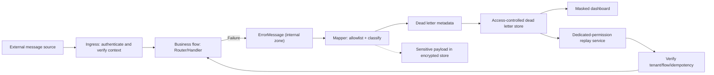

# Access Control and Sensitive Data

In the **SPRING_INTEGRATION_PATTERN** module, Spring Integration helps implement **Enterprise Integration Patterns** (EIP) such as Router, Filter, Transformer, Splitter, Aggregator, and Gateway as loosely coupled, extensible message flows. Retry, error channel, and Dead Letter Channel (DLC) branches retain failed messages for investigation, testing, and replay. However, **failed messages often contain far more sensitive data than normal operational views should expose**: business payloads, headers, tokens, recipient addresses, payment details, query parameters, or exception messages.

The lesson **"Access Control and Sensitive Data"** explains how to design secure dead letters from the moment an error occurs until data deletion. The focus is on **data minimization, role- and scope-based access control, payload/exception protection, auditing every sensitive action, and controlling replay**.

> **Principle:** A dead letter is a record for *diagnosis and recovery*, not a blanket copy of the entire `Message` or `Throwable`. Store only data required for the defined purpose, and allow only authorized principals to access the right records and actions.

## 1. Why Are Dead Letters a High Security Risk?

Suppose a flow receives a `PaymentRequested` event, transforms it via a Transformer, and calls a payment gateway. After several timeouts, the handler emits an `ErrorMessage` to the error channel. If the entire `ErrorMessage.toString()` is persisted, the record or logs may contain:

- Payload: customer ID, email address, invoice details, payment info, or profile data.
- Headers: `Authorization`, cookies, API keys, trace metadata, and internal routing objects.
- Exception message: URLs with query strings, table/column names, query parameters, external responses, or credentials.
- Stack trace: classes, method names, and file paths—useful for debugging, yet revealing internal structure.
- Correlation/context: order ID or user ID; certain identifiers may constitute personal data depending on the system.

Dead letters are sometimes retained longer than transient processing data and may be read by dashboards, support teams, replay jobs, search tools, or log aggregators. Every place receiving a copy is a surface that must be protected.

### Trust Boundaries



Data arriving from external systems in `MessageHeaders` **does not automatically become trustworthy**. Client-supplied `tenantId`, `flowId`, `errorChannel`, or `replayApproved` headers can be spoofed. Access-control context must be attached/verified at ingress or resolved from a trusted internal source.

## 2. Classifying Data Before Persisting

A storage policy should answer: **which fields are required for replay, which are only needed for triage, and which must never be stored in the DLC?**

| Data Category | Example | Recommended Handling |
| --- | --- | --- |
| Technical identifiers | `deadLetterId`, `flowId`, `reasonCode`, failure timestamp | Store in the record for search and operations |
| Business identifiers | `eventId`, `correlationId`, `orderId` | Store only when truly needed; prefer opaque identifiers where possible |
| Replay payload | Order JSON, customer data | Prefer encrypting in a dedicated store; keep an opaque reference and schema version in DLC |
| Personal data | Email, phone number, address, profile | Keep out of searchable metadata and logs; restrict payload read permissions |
| Payment information | Card numbers, payment auth data | Never copy casually into DLC; comply with applicable data-protection policies |
| Secrets/credentials | Bearer tokens, cookies, API keys, private keys | Never persist in dead letters; exclude from logs, dashboards, and metrics |
| Exception | Class name, message, stack trace, cause chain | Store error codes and safe summaries; keep detailed traces in an access-controlled store |
| Internal headers | `replyChannel`, `errorChannel`, channel objects | Never serialize live objects or restore them directly on replay |
| Broker metadata | Topic, partition, offset, delivery tag | Keep only what audit needs; do not treat as ACK/replay authority |
| Encrypted payload | Ciphertext with key metadata | Protect keys, decryption permissions, logs, and backups; never store keys alongside data |

**Data minimization** does not mean discarding data required for recovery. If business rules require replaying from the initial payload, store that payload in a protected form with a reference and version. What to avoid is copying the same plaintext payload into five places: the DLC table, logs, metrics, traces, and incident notifications.

### Before and After Normalization

Dangerous record:

```json
{
  "payload": {
    "email": "person@example.invalid",
    "paymentToken": "sensitive-value"
  },
  "headers": {
    "Authorization": "Bearer sensitive-token",
    "errorChannel": "internal-channel-object"
  },
  "exceptionMessage": "Request failed with token sensitive-token"
}
```

Safer metadata record:

```json
{
  "deadLetterId": "8d7241d0-6512-4dcc-a4f3-c6f2f1527014",
  "flowId": "orders",
  "tenantId": "tenant-verified-42",
  "eventId": "evt-1024",
  "correlationId": "corr-1024",
  "payloadRef": "object-opaque-8741",
  "schemaVersion": "2",
  "reasonCode": "DOWNSTREAM_TIMEOUT",
  "status": "NEW",
  "failedAt": "2026-11-21T08:00:00Z"
}
```

These values are **illustrative**. `payloadRef` must point to a separate store that enforces authentication/authorization on read; **never store long-lived pre-signed URLs or bearer tokens as persistent references**. Even without plaintext payloads, metadata like `tenantId` or `eventId` must still be subject to access controls and retention limits.

## 3. `ErrorMessage` and Exceptions: Extract Right Details, Avoid Blanket Logging

In Spring Integration, when errors are dispatched via an error channel, the framework typically uses `org.springframework.messaging.support.ErrorMessage`. **The payload of `ErrorMessage` is a `Throwable`**, while the message linked to the failure may reside in:

- `ErrorMessage.getOriginalMessage()`;
- `MessagingException.getFailedMessage()` along the exception cause chain.

Neither is guaranteed to be non-null. Nor is `failedMessage` guaranteed to be the initial message entering the system: it may already have passed through a Transformer before the handler failed.

This affects security in two ways. On one hand, extracting the message preserves `eventId`, correlation, and replay data. On the other hand, calling `error.getPayload().toString()` or serializing `originalMessage.getHeaders()` wholesale leaks unintended data into the DLC.

| Practice | Problem | Safer Practice |
| --- | --- | --- |
| `logger.error("{}", error)` everywhere | Can log unmasked stack traces and failure payloads | Log `reasonCode`, `flowId`, `deadLetterId`, trace ID |
| `String.valueOf(original.getPayload())` | Can leak data or fail to preserve raw bytes | Schema-aware serializer; encrypted store or payload reference |
| `headers.toString()` | Exposes tokens, channel objects, client-supplied data | Allowlist specific approved headers |
| `Throwable.getMessage()` in searchable column | Can contain sensitive data from dependencies | Stable error code and sanitized summary |
| Serializing the entire `Throwable` | Version coupling, size bloat, and data leakage | Store error classification / controlled trace reference |
| Rebuilding replay routes from old `errorChannel` header | Can misroute after restarts or upgrades | Build a fresh message and route via trusted configuration |

For example, a synchronous `Gateway` may throw exceptions back to the caller; a `DirectChannel` does not automatically send every error to the global `errorChannel`. With pollers or async handlers that configure an error handler, the framework can emit `ErrorMessage` per config. Using `RequestHandlerRetryAdvice` and `ErrorMessageSendingRecoverer` lets the recovery callback explicitly route end-of-cycle errors to a designated channel. In all cases, **having an `ErrorMessage` does not replace filtering and authorization before persistence**.

## 4. Access Control by Role, Action, and Data Scope

Enforcing permissions only in a dashboard UI is insufficient: users or services can still call APIs, query databases, or trigger replay jobs. Authorization checks must run **at the service layer and data layer**, on every request and every record.

A combined model might use:

- **RBAC** (*Role-Based Access Control*): which roles may list records, read payloads, approve replays, execute replays, or delete/set retention.
- **ABAC** (*Attribute-Based Access Control*): restrict access to allowed `tenantId`, `flowId`, environment, business domain, and record status.
- **Least privilege**: automated services hold only the permissions they truly need, e.g., writing DLC records—not implicitly decrypting and replaying.
- **Separation of duties**: for high-risk operations, replay approvers and replay executors can be distinct principals or roles.

### Illustrative Permission Matrix

| Role | View Masked Metadata | Read Raw Payload | Approve Replay | Execute Replay | Manage Keys / Delete |
| --- | --- | --- | --- | --- | --- |
| Flow operator | Yes, for owned flows | Only with special grant | Per business policy | Per role | No |
| Incident analyst | Yes, per scope | Temporary, with rationale and audit | Usually no | Usually no | No |
| Replay service | Only metadata needed to run | Reads payload by approved reference and scope | Never self-approves | Yes, for approved records | No |
| Auditor | Reads metadata and audit logs in scope | Usually masked data only | No | No | No |
| Security / data steward | Views evidence per scope | Via dedicated approval flow | Per workflow | Not by default | Appropriate admin rights |
| Error-writing service | Writes new records | No bulk read needed | No | No | No |

This table is a suggested design; actual permissions depend on organizational requirements and identity systems. **Approving** and **executing** a replay are distinct actions; DLC read access must never implicitly grant payload modification or replay rights.

### Enforcing Tenant and Flow Scope

An API fetching a dead letter by ID is vulnerable to **IDOR** (*insecure direct object reference*) if it runs only:

```sql
SELECT * FROM dead_letters WHERE dead_letter_id = ?;
```

Even with hard-to-guess IDs, callers could access records belonging to another tenant/flow if they obtain or guess an ID. Queries must be scoped by **authenticated, authorized context**, for example after the service verifies flow permission:

```sql
SELECT dead_letter_id, flow_id, tenant_id, event_id,
       correlation_id, reason_code, status, failed_at
FROM dead_letters
WHERE dead_letter_id = ?
  AND tenant_id = ?
  AND flow_id = ?;
```

Both tenant and flow parameters must come from verified auth context, **not merely from client-supplied query parameters or headers**. Use bound parameters to prevent SQL injection. Row-level security, data partitioning, or restricted DB roles can add defense in depth.

## 5. Java Example: Mapper Keeping Only Allowlisted Metadata

This example uses **Java 17+ and Spring Messaging/Spring Integration 6.x**. We design `SafeDeadLetterMapper` accepting an `ErrorMessage` and a `TrustedContext` verified at ingress or resolved from an internal state store.

`TrustedContext` must be created by trusted code: `tenantId` from verified source identity, `flowId` from flow configuration, and `payloadRef` issued by a protected payload store. In this example, the mapper **does not copy payload, `Authorization` headers, exception messages, or stack traces** into the dead letter.

```java
package demo.integration;

import java.net.SocketTimeoutException;
import java.time.Instant;
import java.util.Objects;
import java.util.UUID;
import java.util.concurrent.TimeoutException;

import org.springframework.messaging.Message;
import org.springframework.messaging.MessagingException;
import org.springframework.messaging.support.ErrorMessage;

public final class SafeDeadLetterMapper {

    // Only a trusted ingress/context service may create this record.
    public record TrustedContext(
            String tenantId, String flowId, String payloadRef) {
        public TrustedContext {
            Objects.requireNonNull(tenantId, "tenantId");
            Objects.requireNonNull(flowId, "flowId");
            // payloadRef may be null if payload persistence failed;
            // replayability must then be classified in a separate service.
        }
    }

    public record SafeDeadLetterRecord(
            String deadLetterId,
            String tenantId,
            String flowId,
            String payloadRef,
            String originalMessageId,
            String eventId,
            String correlationId,
            String reasonCode,
            Instant failedAt) {}

    public SafeDeadLetterRecord map(
            ErrorMessage error, TrustedContext context) {
        Objects.requireNonNull(error, "error");
        Objects.requireNonNull(context, "context");

        Message<?> source = findSource(error);
        Throwable root = rootCause(error.getPayload());

        // Do not use source.getPayload(), headers.toString(),
        // Throwable.getMessage(), or stack trace as record values.
        String reasonCode = source == null
                ? "SOURCE_CONTEXT_MISSING"
                : classify(root);

        return new SafeDeadLetterRecord(
                UUID.randomUUID().toString(),
                context.tenantId(),
                context.flowId(),
                context.payloadRef(),
                source == null || source.getHeaders().getId() == null
                        ? null : source.getHeaders().getId().toString(),
                safeOpaqueHeader(source, "eventId"),
                safeOpaqueHeader(source, "correlationId"),
                reasonCode,
                Instant.now());
    }

    private static Message<?> findSource(ErrorMessage error) {
        if (error.getOriginalMessage() != null) {
            return error.getOriginalMessage();
        }
        for (Throwable current = error.getPayload();
                current != null; current = current.getCause()) {
            if (current instanceof MessagingException messaging
                    && messaging.getFailedMessage() != null) {
                return messaging.getFailedMessage();
            }
        }
        return null;
    }

    private static Throwable rootCause(Throwable throwable) {
        Throwable current = throwable;
        while (current.getCause() != null) {
            current = current.getCause();
        }
        return current;
    }

    private static String classify(Throwable throwable) {
        if (throwable instanceof SocketTimeoutException
                || throwable instanceof TimeoutException) {
            return "DOWNSTREAM_TIMEOUT";
        }
        if (throwable instanceof IllegalArgumentException) {
            // Illustrative only: production requires stable business error codes.
            return "VALIDATION_ERROR";
        }
        return "UNCLASSIFIED_FAILURE";
    }

    private static String safeOpaqueHeader(
            Message<?> source, String name) {
        if (source == null) {
            return null;
        }
        Object value = source.getHeaders().get(name);

        // Accept only opaque identifier strings with length/character limits.
        // Matching the regex does NOT prove the header source is trusted.
        if (value instanceof String s
                && s.matches("[A-Za-z0-9][A-Za-z0-9._:-]{0,127}")) {
            return s;
        }
        return null;
    }
}
```

The crucial design choice here is **field-level allowlisting**. `eventId`/`correlationId` headers are retained only as opaque identifiers; if in a real system those headers could hold emails, phone numbers, or client-chosen free text, map them to internal IDs or omit them from metadata. A regex checks syntax only; **it is not a personal-data classifier**.

For replay, store payloads in a separate store using a serializer matching the data type and `schemaVersion`. If payloads are `byte[]` or DTOs, preserve exact bytes/schema; `String.valueOf(payload)` cannot reliably restore data. If `payloadRef` is missing or the object has passed retention, the record suffices only for investigation and cannot be automatically replayed.

### Do Not Let the Mapper Read Tenant From Untrusted Messages

Suppose a message carries header `tenantId = "tenant-B"`, while the authenticated source belongs to `tenant-A`. The mapper above **ignores** the `tenantId` header; it uses `TrustedContext.tenantId()`. Ingress must verify the true tenant, propagate it via a controlled mechanism, and block external overrides. In asynchronous flows, a thread-bound `SecurityContext` may vanish across channel hops or restarts; pass verified context explicitly and securely rather than assuming `ThreadLocal` follows the message.

### Integrating the Mapper Into a Recovery Flow

The following configuration snippet shows exactly where filtering belongs:

```java
package demo.integration;

import org.springframework.context.annotation.Bean;
import org.springframework.context.annotation.Configuration;
import org.springframework.integration.channel.DirectChannel;
import org.springframework.integration.config.EnableIntegration;
import org.springframework.integration.dsl.IntegrationFlow;
import org.springframework.messaging.MessageChannel;
import org.springframework.messaging.support.ErrorMessage;

@Configuration
@EnableIntegration
public class SecureDeadLetterFlowConfiguration {

    @Bean
    MessageChannel ordersRecoveryErrors() {
        return new DirectChannel();
    }

    @Bean
    IntegrationFlow secureDeadLetterFlow(
            SafeDeadLetterMapper mapper,
            TrustedContextResolver resolver,
            SecureDeadLetterStore store) {
        return IntegrationFlow.from("ordersRecoveryErrors")
                .<ErrorMessage,
                  SafeDeadLetterMapper.SafeDeadLetterRecord>transform(
                    error -> mapper.map(error, resolver.resolve(error)))
                .handle(store, "save")
                .get();
    }

    public interface TrustedContextResolver {
        SafeDeadLetterMapper.TrustedContext resolve(ErrorMessage error);
    }

    public interface SecureDeadLetterStore {
        void save(SafeDeadLetterMapper.SafeDeadLetterRecord record);
    }
}
```

`TrustedContextResolver` and `SecureDeadLetterStore` are **application-implemented interfaces**, not built-in Spring Integration beans. The resolver must fetch context from a trusted source, and the store must persist metadata with proper permissions and transactions. This snippet also requires declaring beans for the mapper, resolver, and store and wiring error sources into `ordersRecoveryErrors` (e.g., via `RequestHandlerRetryAdvice`'s recovery callback). It illustrates the data-protection boundary, not a complete application.

**Note on exceptions inside the error flow:** if the resolver or store fails, never dump the entire `ErrorMessage` into logs or loop back into the same error flow infinitely. Use safe alerting, rollback/redelivery, or an independent fallback per source type, and never acknowledge successful persistence when the transaction fails.

## 6. Service-Layer Access Control Before Reading or Replaying

To illustrate combining roles and scopes, the class below enforces action-level permissions and verifies tenant/flow scope. `Actor` must be built from verified authentication identity, never directly from client-supplied JSON, bodies, or headers.

```java
package demo.integration;

import java.util.Objects;
import java.util.Set;

public final class DeadLetterAccessGuard {
    private DeadLetterAccessGuard() {}

    public enum Permission {
        READ_SUMMARY,
        READ_SENSITIVE_PAYLOAD,
        APPROVE_REPLAY,
        EXECUTE_REPLAY,
        DELETE_RECORD
    }

    public record Actor(
            String tenantId,
            Set<String> allowedFlows,
            Set<Permission> permissions) {}

    public record RecordScope(
            String tenantId,
            String flowId) {}

    public static void require(
            Actor actor, RecordScope record, Permission action) {
        Objects.requireNonNull(actor);
        Objects.requireNonNull(record);
        Objects.requireNonNull(action);

        boolean allowed =
                Objects.equals(actor.tenantId(), record.tenantId())
                && actor.allowedFlows() != null
                && actor.allowedFlows().contains(record.flowId())
                && actor.permissions() != null
                && actor.permissions().contains(action);

        if (!allowed) {
            // Error returned to client does not reveal whether tenant/flow exists.
            throw new SecurityException("Access denied");
        }
    }
}
```

In list/read APIs, check `READ_SUMMARY` first and **return only permitted fields**. To inspect an encrypted payload, check `READ_SENSITIVE_PAYLOAD` at both the decryption endpoint and the payload store. Permission to view tenant A's metadata never grants reading tenant B's payload simply by knowing a `payloadRef`.

This guard is a simplified illustration; production systems must integrate standard authentication/authorization, auditing, token scopes, checks at every entry point, and optionally database row-level security or data partitioning in case an API misses a guard.

## 7. Durable Storage, Encryption, and Key Management

Encryption is a protective layer, **not a substitute for access control or data minimization**. At minimum, consider:

1. **In transit:** use appropriate TLS between the application, broker, database, object storage, and error-handling services.
2. **At rest:** enable encryption on storage backends (database volumes, object storage, backups). For highly sensitive data, consider application-level envelope encryption with centrally managed keys.
3. **Key management:** use a KMS or equivalent, separating decryption permissions from metadata query permissions; never commit or store keys in source code, YAML examples, headers, or the DLC.
4. **Tenant/flow isolation:** choose appropriate key scopes, permissions, and retention. Read access to metadata must not imply decryption permission.
5. **Backups/replicas:** dead-letter data in backups remains sensitive; apply matching protection and deletion cycles.
6. **Persistence failures:** when the store cannot write, propagate the failure to the source's recovery/ACK mechanism; never silently treat `send()` to an in-memory `QueueChannel` as durable storage.

### Sample Metadata Table

PostgreSQL example; the original payload resides in object storage with separate access control.

```sql
CREATE TABLE dead_letters (
    dead_letter_id UUID PRIMARY KEY,
    tenant_id VARCHAR(128) NOT NULL,
    flow_id VARCHAR(80) NOT NULL,
    original_message_id VARCHAR(80),
    event_id VARCHAR(128),
    correlation_id VARCHAR(128),
    payload_ref VARCHAR(256),
    schema_version VARCHAR(32),
    reason_code VARCHAR(80) NOT NULL,
    status VARCHAR(24) NOT NULL DEFAULT 'NEW',
    replay_count INTEGER NOT NULL DEFAULT 0,
    failed_at TIMESTAMPTZ NOT NULL,
    retention_until TIMESTAMPTZ NOT NULL
);

CREATE INDEX idx_dead_letters_scope
    ON dead_letters (tenant_id, flow_id, status, failed_at);

CREATE INDEX idx_dead_letters_retention
    ON dead_letters (retention_until);
```

`payload_ref` must be an opaque identifier that cannot by itself bypass permission checks. The store must persist metadata and payload/reference with appropriate guarantees; if writes across systems do not share a transaction, handle partial failures using an outbox or reconciliation mechanism.

### Retention Periods and Deletion Rights

Dead letters must not become an indefinite data archive. Establish explicit policies for:

- **Retention by data type and flow:** transient events, orders, notifications, and sensitive records may have distinct requirements.
- **Deletion / legal hold:** honor valid deletion requests, legal holds, or evidence preservation rules where applicable; do not delete arbitrarily mid-investigation.
- **Copy cleanup:** delete payload objects, metadata, search indices, related logs, and backups per retention workflows.
- **Post-replay cleanup:** once status reaches `RESOLVED`, keep only fields needed for audit; delete raw payloads once purpose/retention expires.
- **Encryption keys:** rotate keys and revoke access per procedure; do not assume key rotation alone erases all data copies.

These rules depend on applicable data-protection policies and legal/business obligations, and should be codified in flow-specific configuration and tests.

## 8. Replay Is a Privileged Action, Not Just a Data Read

DLC records can represent payment requests, account creation, or outbound emails. Because replay can **trigger new side effects**, it demands stricter authorization than viewing metadata.

A secure replay workflow:

1. **Authenticate the actor or service** and verify `APPROVE_REPLAY`/`EXECUTE_REPLAY` on the exact tenant and flow.
2. **Verify record state** (e.g., `APPROVED`), business deadline, replay count, and that the root cause is resolved.
3. **Atomic claim** with replay caps so two workers cannot replay the same record simultaneously.
4. **Fetch payload from the protected store**, checking decryption permission, checksum, schema version, and data origin.
5. **Construct a fresh message** with allowlisted business headers; strip `Authorization`, `replyChannel`, `errorChannel`, credentials, and stale routing headers.
6. **Enforce idempotency** via a business key such as `eventId` or `orderId + operationType` to prevent duplicate side effects.
7. **Send to the trusted entry point** of the flow, record audit logs, and track business outcome; `send() = true` does not prove processing succeeded.
8. **Update final state only** upon proper confirmation. If the outcome is uncertain, investigate before replaying again.

### Scope-Checked Claim Pattern

Inside an authenticated, permission-checked replay service, execute an atomic query:

```sql
UPDATE dead_letters
SET status = 'REPLAYING',
    replay_count = replay_count + 1
WHERE dead_letter_id = :id
  AND tenant_id = :authenticated_tenant
  AND flow_id = :authorized_flow
  AND status = 'APPROVED'
  AND replay_count < :max_replays
RETURNING dead_letter_id, payload_ref, schema_version, replay_count;
```

Tenant, flow, limits, and execution authority must be determined by the trusted service. If the query returns no rows, **do not dispatch**. When multiple systems are involved, handle cases where the update succeeded but publish failed, or publish succeeded before an app crash; use outbox and reconciliation to avoid unintended duplicate sends.

**Do not store original bearer tokens for replay.** If downstream calls require credentials, the replay service must obtain fresh credentials via its own authorization mechanism; old tokens may have expired or been revoked.

## 9. Auditing Without Duplicating Sensitive Data

Viewing payloads, exporting, approving replays, executing replays, editing payloads, and deleting records must all produce an audit trail. However, audit logs themselves become a leak vector if they copy raw contents.

A well-structured audit event can include:

| Field | Example | Purpose |
| --- | --- | --- |
| `actorId` or service principal | `svc-replay-orders` | Who acted |
| `action` | `READ_METADATA`, `VIEW_PAYLOAD`, `APPROVE_REPLAY`, `EXECUTE_REPLAY` | What was done |
| `deadLetterId` | Record identifier | Target object |
| `tenantId/flowId` | Verified scope | Detect cross-scope access |
| `decision` | `ALLOW` / `DENY` | Track authorization outcomes |
| `reason/approvalId` | Approved ticket/request ID | Justify sensitive actions |
| `timestamp/traceId` | Timestamp, trace | Investigation and reconciliation |

Audit records must **not** contain decrypted payloads, `Authorization` headers, session cookies, or raw exception strings. For critical workflows, audit logs must restrict modification/deletion and enforce appropriate retention.

### Metrics and Alerts

Track signals such as:

- `dead_letter_created_total{flow,reason}`: error volume by flow and reason code.
- `dead_letter_payload_access_total{flow,action,result}`: payload reads and allow/deny outcomes.
- `dead_letter_replay_total{flow,result}`: replay attempts and outcomes.
- `dead_letter_security_denied_total{action}`: denied access attempts.
- `dead_letter_store_failed_total{flow}`: persistence failures requiring urgent action.
- Age of unhandled records, records past retention, and "break-glass" action counts.

These metric names are **suggestions**, not auto-generated by Spring Integration. Never put `eventId`, email addresses, tokens, or payloads in labels; use trace IDs in protected logs to locate specific records.

## 10. Testing Data Leaks and Access Controls

Tests must prove **what is not leaked** and **who is denied access**, beyond just verifying that a handler routes to a channel.

### Unit Tests for the Safe Mapper

JUnit 5 and AssertJ example using the mapper from section 5:

```java
package demo.integration;

import static org.assertj.core.api.Assertions.assertThat;

import org.junit.jupiter.api.Test;
import org.springframework.messaging.MessagingException;
import org.springframework.messaging.support.ErrorMessage;
import org.springframework.messaging.support.MessageBuilder;

class SafeDeadLetterMapperTest {

    private final SafeDeadLetterMapper mapper = new SafeDeadLetterMapper();

    private final SafeDeadLetterMapper.TrustedContext trusted =
            new SafeDeadLetterMapper.TrustedContext(
                    "tenant-verified-A", "orders", "opaque-object-42");

    @Test
    void excludesSensitivePayloadHeadersAndExceptionMessage() {
        var original = MessageBuilder
                .withPayload("{\"paymentToken\":\"SECRET-PAYLOAD\"}")
                .setHeader("Authorization", "Bearer SECRET-HEADER")
                .setHeader("tenantId", "tenant-attacker-supplied")
                .setHeader("eventId", "evt-42")
                .setHeader("correlationId", "order-42")
                .build();

        var error = new ErrorMessage(
                new IllegalStateException("token=SECRET-EXCEPTION"),
                original);

        var record = mapper.map(error, trusted);

        assertThat(record.tenantId()).isEqualTo("tenant-verified-A");
        assertThat(record.flowId()).isEqualTo("orders");
        assertThat(record.payloadRef()).isEqualTo("opaque-object-42");
        assertThat(record.eventId()).isEqualTo("evt-42");
        assertThat(record.correlationId()).isEqualTo("order-42");

        // toString() is a simple check on the record;
        // production must also test JSON serializer, JDBC, logs, and tracing.
        assertThat(record.toString()).doesNotContain(
                "SECRET-PAYLOAD",
                "SECRET-HEADER",
                "SECRET-EXCEPTION",
                "tenant-attacker-supplied");
    }

    @Test
    void recoversSafeMetadataFromMessagingException() {
        var failed = MessageBuilder.withPayload("private payload")
                .setHeader("eventId", "evt-43")
                .build();

        var error = new ErrorMessage(
                new MessagingException(failed, "credential=SECRET"));

        var record = mapper.map(error, trusted);

        assertThat(record.eventId()).isEqualTo("evt-43");
        assertThat(record.toString()).doesNotContain(
                "private payload", "credential=SECRET");
    }

    @Test
    void missingOriginalMessageStillProducesSafeMetadata() {
        var error = new ErrorMessage(
                new IllegalStateException("Bearer SECRET-TOKEN"));

        var record = mapper.map(error, trusted);

        assertThat(record.originalMessageId()).isNull();
        assertThat(record.reasonCode())
                .isEqualTo("SOURCE_CONTEXT_MISSING");
        assertThat(record.toString()).doesNotContain("SECRET-TOKEN");
    }
}
```

### Unit Tests for Access Control

```java
package demo.integration;

import static org.assertj.core.api.Assertions.assertThatThrownBy;
import static demo.integration.DeadLetterAccessGuard.*;

import java.util.Set;

import org.junit.jupiter.api.Test;

class DeadLetterAccessGuardTest {

    @Test
    void cannotReadAcrossTenants() {
        Actor actor = new Actor(
                "tenant-A", Set.of("orders"), Set.of(Permission.READ_SUMMARY));

        assertThatThrownBy(() -> require(
                actor,
                new RecordScope("tenant-B", "orders"),
                Permission.READ_SUMMARY))
                .isInstanceOf(SecurityException.class);
    }

    @Test
    void metadataAccessDoesNotGrantReplayOrRawPayloadRead() {
        Actor actor = new Actor(
                "tenant-A", Set.of("orders"), Set.of(Permission.READ_SUMMARY));

        RecordScope record = new RecordScope("tenant-A", "orders");

        assertThatThrownBy(() -> require(
                actor, record, Permission.EXECUTE_REPLAY))
                .isInstanceOf(SecurityException.class);

        assertThatThrownBy(() -> require(
                actor, record, Permission.READ_SENSITIVE_PAYLOAD))
                .isInstanceOf(SecurityException.class);
    }

    @Test
    void cannotReadAnotherFlowInSameTenant() {
        Actor actor = new Actor(
                "tenant-A", Set.of("orders"), Set.of(Permission.READ_SUMMARY));

        assertThatThrownBy(() -> require(
                actor,
                new RecordScope("tenant-A", "notifications"),
                Permission.READ_SUMMARY))
                .isInstanceOf(SecurityException.class);
    }
}
```

These are **illustrative code and test examples**, not executed in a repository during authoring. In real integrations, test against Spring Security (or the chosen auth stack), database, object storage, key management, and APIs.

### Recommended Integration Test Matrix

| Scenario | Expectation |
| --- | --- |
| `ErrorMessage` contains tokens in payload, header, and exception | Token never appears in metadata, API responses, logs, or metrics |
| User views metadata for an authorized flow | Sees only masked/permitted fields |
| Metadata-only user calls payload read API | Denied, audited, no sensitive contents in error response |
| Tenant A user requests Tenant B record even with known ID | Denied or returns response without leaking existence |
| Replay service lacks `APPROVED` or hits quota | Does not dispatch; decision audited |
| Two workers claim the same record | At most one worker claims successfully |
| `ErrorMessage` lacks original/failed message | Safe metadata persisted or error raised per policy, no NPE |
| Resolver cannot verify tenant/flow | Refuses writing to wrong scope; safe alert |
| Encrypted payload store / KMS unavailable | Does not bypass decryption permissions; safe recovery path runs |
| DLC store fails to save | Does not falsely ACK when message preservation is required |
| Retention expires | Data and copies deleted per policy, event audited |
| Export or break-glass | Requires elevated permission, rationale, and audit |

## 11. Common Mistakes

| Mistake | Consequence | Fix |
| --- | --- | --- |
| Serializing entire `ErrorMessage` or `Throwable` | Leaks payload, headers, and stack trace | Map to minimal schema and safe error codes |
| Allowing on-call operators to read raw payloads by default | Broadens access to personal data | Default to metadata only; grant scoped payload access |
| Using external `tenantId` header for authorization | Cross-tenant reads or replays | Resolve from verified, authenticated context |
| Enforcing permissions only in the web UI | APIs, jobs, or SQL bypass checks | Enforce at service and data store layers |
| Treating `payloadRef` as a shareable URL | Anyone with the URL can read contents | Opaque reference, auth on payload read, no long-lived signed URLs |
| Assuming encryption replaces authorization | Principals with broad decryption rights still read data | Separate query and decryption permissions; manage KMS |
| Copying all headers across replay | Reuses stale tokens, misroutes, or leaks data | Build a new message with allowlisted headers |
| Putting raw exception messages in metric labels | High cardinality, information leakage | Use stable `reasonCode` values |
| Failing to separate replay approval from execution | Easy to replay dangerous events | Separate permissions, audit, limits, and idempotency |
| No retention policy for DLQ and backups | Retains sensitive data too long | TTL/retention and scoped deletion workflows |
| Swallowing errors when DLC write fails | Loses messages while reporting success | Propagate failure/rollback and alert independently |

## 12. Self-Check Questions

1. Why can a Dead Letter Channel hold more sensitive data than a typical business dashboard?
2. What does `ErrorMessage.getPayload()` hold? How do you locate the failed message without serializing the entire `Throwable`?
3. If a message arrives from tenant A but header `tenantId` says tenant B, which value should the system trust? Why?
4. Why is `String.valueOf(payload)` insufficient for persisting and replaying all payload types?
5. Why should `payloadRef` be an access-checked opaque identifier rather than a long-lived pre-signed URL?
6. What is the difference between `READ_SUMMARY`, `READ_SENSITIVE_PAYLOAD`, `APPROVE_REPLAY`, and `EXECUTE_REPLAY`?
7. When a request supplies only `deadLetterId`, which scopes must the service verify to prevent IDOR?
8. Why is database-level encryption insufficient if an API permits uncontrolled decryption?
9. Should operators see raw `exception.getMessage()` and full stack traces in the dashboard? What should replace them?
10. Why must payload copies, search indices, and backups also be deleted under retention policies?
11. What must be checked before replaying a message that timed out after a payment call to avoid duplicate side effects?
12. Which tests prove that tokens in payloads, headers, and exceptions do not leak into records, APIs, and logs?

## References

- [Spring Integration Reference — Error Handling](https://docs.spring.io/spring-integration/reference/error-handling.html): `ErrorMessage`, error channels, and error-emission mechanics.
- [Spring Integration Reference — Provided Advice Classes](https://docs.spring.io/spring-integration/reference/handler-advice/classes.html): `RequestHandlerRetryAdvice` and `ErrorMessageSendingRecoverer`.
- [Spring Framework API — ErrorMessage](https://docs.spring.io/spring-framework/docs/current/javadoc-api/org/springframework/messaging/support/ErrorMessage.html): API for retrieving the original message.
- [Spring Framework API — MessagingException](https://docs.spring.io/spring-framework/docs/current/javadoc-api/org/springframework/messaging/MessagingException.html): API for retrieving the failed message.
- [OWASP Cheat Sheet Series — Logging](https://cheatsheetseries.owasp.org/cheatsheets/Logging_Cheat_Sheet.html): data to exclude from logs and access controls.
- [OWASP Cheat Sheet Series — Authorization](https://cheatsheetseries.owasp.org/cheatsheets/Authorization_Cheat_Sheet.html): object- and action-level authorization principles.

> **Key Takeaway:** A secure Dead Letter Channel requires **filtering data before persistence**, **isolating sensitive payloads**, **verifying tenant and flow from trusted sources**, **per-action authorization**, **auditing every view, approval, and replay**, and **managing encryption, keys, retention, and deletion**. Retries and dead letters aid recovery when business processing fails; they must never become a shortcut for reading personal data or re-executing requests outside authorized scope.
