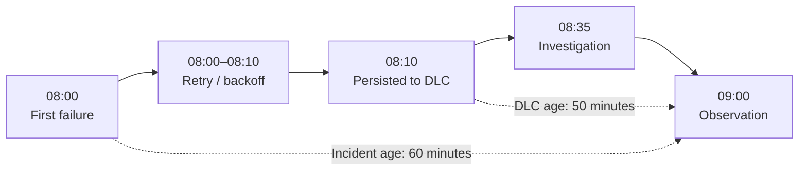
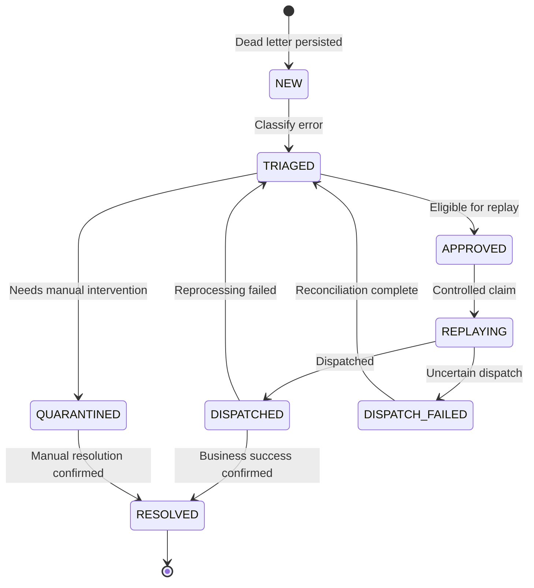
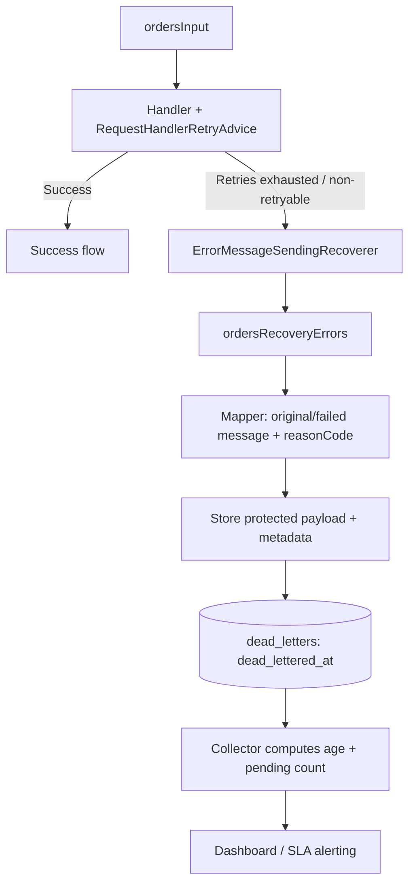

# Monitoring Message Age in Dead Letter

In the **SPRING_INTEGRATION_PATTERN** module, we build loosely coupled messaging flows using Spring Integration and **Enterprise Integration Patterns**: Router, Filter, Transformer, Splitter, Aggregator, Gateway, retry, error channel, and correlation. When a message can no longer be processed after the designed steps, it can be routed to a **Dead Letter Channel (DLC)** for retention, investigation, and controlled replay.

However, **persisting a failed message does not mean the incident is resolved**. If a record sits in dead letter too long, business requests may expire, customers wait for outcomes, or a silent bug accumulates a backlog. Therefore, we must monitor **dead-letter message age** alongside pending counts and processing states.

This lesson focuses on defining timestamps, computing age, measuring backlog per flow, configuring alerts, exposing metrics via SQL/Micrometer, testing time boundaries, and handling scenarios like retries, replays, sensitive data, or clock skew.

## 1. When Does "Message Age" Start Counting?

A message may pass through several timestamps:

| Milestone | Example Field Name | Meaning |
| --- | --- | --- |
| Source event created | `eventOccurredAt` | When the business event happened |
| Inbound adapter received message | `receivedAt` | When the system ingested it |
| Handler failed first time | `firstFailedAt` | When the first failure was detected |
| Retries ended and isolation decided | `failureDecidedAt` | When policy decided not to continue automatic processing |
| **Persisted to dead-letter store** | **`deadLetteredAt`** | Start timestamp for **age in DLC** |
| Operator triaged/approved | `triagedAt` / `approvedAt` | Human review timestamp |
| Replay executed | `replayedAt` | When replay ran; does not prove success yet |
| Processing completed | `resolvedAt` | Timestamp when final outcome was confirmed |
| Deadline to handle | `dueAt` | Deadline per business/SLA policy |

**Recommended convention:** age in DLC = **current observation time − `deadLetteredAt`** for still-open records. That measures how long the record has been waiting in the dead-letter store.

Two other metrics also matter, though they **do not mean the same thing**:

- **Incident age since start** = now − `firstFailedAt`. This measures total impact duration, including retries and waiting before DLC persistence.
- **Time-to-dead-letter latency** = `deadLetteredAt − firstFailedAt`. This shows how long retries, backoff, or error handling took before the message was isolated.

For example, a message fails first at 08:00, retries for 10 minutes, and enters the DLC at 08:10. At 09:00, **DLC age is 50 minutes**, whereas total time since first failure is **60 minutes**. If dashboards mix the two definitions, SLA alerts become inconsistent.

### Timeline Illustration



Some projects use `enqueuedAt` instead of `deadLetteredAt`; what matters is a **consistent definition**. Do not use `MessageHeaders.TIMESTAMP` or the source event creation time as a substitute for DLC persistence time unless the data contract explicitly mandates it. Message timestamps can be regenerated after Transformers or replays.

## 2. Which Messages Should Have Their Age Tracked?

To compute "oldest pending message," define **which states still represent unresolved work**.

An illustrative lifecycle:



This example treats `NEW`, `TRIAGED`, `APPROVED`, `REPLAYING`, `DISPATCHED`, `DISPATCH_FAILED`, and `QUARANTINED` as **unresolved**. Only `RESOLVED` or an appropriately approved `DISCARDED` leaves the pending backlog.

| State | Included in Unresolved Backlog? | Alert on Age? |
| --- | --- | --- |
| `NEW` | Yes | Yes, awaiting triage |
| `TRIAGED` | Yes | Yes, awaiting root-cause fix |
| `APPROVED` | Yes | Yes, awaiting replay |
| `REPLAYING` | Yes | Yes, though allow claim/dispatch window |
| `DISPATCHED` | Yes if final confirmation is absent | Yes, based on processing SLA |
| `DISPATCH_FAILED` | Yes | Yes, needs send reconciliation |
| `QUARANTINED` | Yes | Yes, though give it a separate dashboard and manual SLA |
| `RESOLVED` | No | Track time-to-resolution in historical reports |
| `DISCARDED` (approved) | No | Audit discard decision; exclude from open backlog |

**State is determined by business outcome.** A message dispatched into another channel can still fail downstream; never mark `RESOLVED` just because `send()` returned `true`.

If `QUARANTINED` holds records waiting for long-running manual review, they can dominate the oldest-age position and hide fresh `NEW` items. Provide **two views**: age of the **entire unresolved backlog** and age per state group (awaiting triage, awaiting replay, quarantined).

## 3. Metrics to Monitor Together

"Oldest age" alone does not tell the whole story. For each `flowId` or operational owner, measure:

| Metric | Definition | Question Answered |
| --- | --- | --- |
| `dead_letter_pending` | Count of unresolved records | How many messages need handling? |
| **`dead_letter_oldest_age_seconds`** | Current age of the open record with earliest `deadLetteredAt` | Which message has waited the longest? |
| `dead_letter_age_p50_seconds` | Median age of the open backlog | How long is a typical message waiting? |
| `dead_letter_age_p95_seconds` | 95th percentile age of the backlog | Is a significant portion aging out? |
| `dead_letter_overdue_total` | Open records exceeding flow threshold | How many records are breaching SLA? |
| `dead_letter_created_total` | New messages entering DLC over time | Is error inflow accelerating? |
| `dead_letter_resolved_total` | Messages resolved over time | How fast is backlog draining? |
| `dead_letter_persist_failed_total` | Failures writing to DLC | Is there risk of losing failed messages? |
| `dead_letter_monitor_healthy` | Whether the latest metric collection succeeded | Should we trust the displayed numbers? |

These metric names are **design suggestions**, not built-in Spring Integration metrics.

### Why Pair Age With Volume?

Consider two flows:

- Flow A has **1** message aged 90 minutes: possibly a single unresolved edge case.
- Flow B has **20,000** messages aged at most 12 minutes, growing rapidly every minute: possibly a widespread outage or severely stalled pipeline.

If alerts fire only when age exceeds 60 minutes, Flow B goes unnoticed while backlog explodes. Therefore, monitor **oldest age, total count, inflow rate, resolution rate, and current state**.

When backlog is **0**, display `pending=0` and `oldestAge=0` or "N/A", but distinguish that from **no data because the query failed**. Dashboards must never turn a failed query into an "all clear" state.

## 4. Designing Timestamps and Dead Letter Storage Schema

Failure records can be persisted durably in PostgreSQL. The illustrative schema below supports age tracking, flow/status grouping, and correlation tracing.

```sql
CREATE TABLE dead_letters (
    dead_letter_id UUID PRIMARY KEY,
    flow_id VARCHAR(80) NOT NULL,
    event_id VARCHAR(128),
    correlation_id VARCHAR(128),
    payload_ref VARCHAR(256),
    reason_code VARCHAR(80) NOT NULL,
    status VARCHAR(24) NOT NULL DEFAULT 'NEW',
    first_failed_at TIMESTAMPTZ,
    dead_lettered_at TIMESTAMPTZ NOT NULL DEFAULT CURRENT_TIMESTAMP,
    triaged_at TIMESTAMPTZ,
    replayed_at TIMESTAMPTZ,
    resolved_at TIMESTAMPTZ,
    replay_count INTEGER NOT NULL DEFAULT 0
        CHECK (replay_count >= 0),
    retention_until TIMESTAMPTZ,
    CHECK (
        first_failed_at IS NULL
        OR first_failed_at <= dead_lettered_at
    )
);

-- Speed up age queries for unresolved records.
CREATE INDEX idx_dead_letter_open_flow_time
ON dead_letters (flow_id, dead_lettered_at)
WHERE status IN (
    'NEW', 'TRIAGED', 'APPROVED', 'REPLAYING',
    'DISPATCHED', 'DISPATCH_FAILED', 'QUARANTINED'
);

CREATE INDEX idx_dead_letter_pending_status_time
ON dead_letters (flow_id, status, dead_lettered_at);
```

Use `TIMESTAMPTZ` to store absolute instants; format in the viewer's timezone when displaying. In Java, `Instant` is the right type to represent points in time. Store timezone/offset separately if UI business rules need it, while computing age using absolute instants.

Here `dead_lettered_at` defaults to the **database** clock on INSERT. If the application writes timestamps from its own clock, monitor clock skew across nodes. In PostgreSQL, `CURRENT_TIMESTAMP` reflects transaction start time; if a transaction stays open a long time, the timestamp may precede commit time. If commit-time accuracy is needed, consider `clock_timestamp()` or a dedicated commit-time mechanism with a consistent definition.

**Important limitation:** The constraint `first_failed_at <= dead_lettered_at` only fits when both fields share a trusted clock source. If `firstFailedAt` comes from another system with skewed clocks, validate before inserting or use a looser constraint to avoid rejecting dead-letter writes. Never let a non-critical timestamp check drop failed messages.

### Does Replay Reset Message Age to 0?

**Do not automatically reset the original record's age.** On replay, the original dead-letter record keeps `deadLetteredAt` to measure backlog duration and audit history. If replay fails, the application can either:

- Create a **new** dead letter with its own `deadLetteredAt` and `replayOf` pointing to the prior record.
- Or update status/history on the same record under the chosen model, while **preserving the initial DLC timestamp** and storing `lastFailedAt` separately.

If creating a new record per failure, dashboards should also track **root incident age** based on `firstFailedAt`/`rootDeadLetteredAt` so a multi-day issue does not look only minutes old after each replay.

## 5. SQL Queries for Age and Backlog by Flow

With the schema above, SQL can compute age directly in the database using a single clock source.

### 5.1. Oldest Message and Pending Count

```sql
SELECT
    flow_id,
    COUNT(*) AS pending_count,
    MIN(dead_lettered_at) AS oldest_dead_lettered_at,
    GREATEST(
        0,
        FLOOR(EXTRACT(
            EPOCH FROM (CURRENT_TIMESTAMP - MIN(dead_lettered_at))
        ))
    )::BIGINT AS oldest_age_seconds
FROM dead_letters
WHERE status IN (
    'NEW', 'TRIAGED', 'APPROVED', 'REPLAYING',
    'DISPATCHED', 'DISPATCH_FAILED', 'QUARANTINED'
)
GROUP BY flow_id
ORDER BY oldest_age_seconds DESC;
```

**How to read it:** `MIN(dead_lettered_at)` finds the earliest timestamp among open records. The difference between query time and that timestamp is the **maximum age of the current backlog**. `GREATEST(0, …)` prevents negative numbers from skewed or future timestamps; however, also emit a separate alert for anomalous timestamps.

When a flow has **zero pending records**, it will not appear in the `GROUP BY` result. Dashboards must merge with the list of known flows to show 0 rather than treating a missing row as an error. Conversely, if the database query fails, **do not** return 0 without alerting on data freshness.

### 5.2. Age by Status and SLA-Breaching Counts

Suppose you want to see open messages older than 15 minutes and 60 minutes. These thresholds are illustrative, not universal SLAs across all flows.

```sql
SELECT
    flow_id,
    status,
    COUNT(*) AS pending_count,
    MIN(dead_lettered_at) AS oldest_at,
    COUNT(*) FILTER (
        WHERE dead_lettered_at <= CURRENT_TIMESTAMP
              - INTERVAL '15 minutes'
    ) AS older_than_15m,
    COUNT(*) FILTER (
        WHERE dead_lettered_at <= CURRENT_TIMESTAMP
              - INTERVAL '60 minutes'
    ) AS older_than_60m
FROM dead_letters
WHERE status IN (
    'NEW', 'TRIAGED', 'APPROVED', 'REPLAYING',
    'DISPATCHED', 'DISPATCH_FAILED', 'QUARANTINED'
)
GROUP BY flow_id, status
ORDER BY flow_id, status;
```

Separating `QUARANTINED` distinguishes long-lived manual backlogs from newly arriving failures. When `REPLAYING` counts rise and claim duration grows, check `claimedAt` and worker health rather than only looking at DLC entry time.

### 5.3. Age Percentiles p50/p95

Percentiles help when one very old message inflates the max while thousands of other messages are handled on time.

```sql
SELECT
    flow_id,
    percentile_cont(0.50) WITHIN GROUP (
        ORDER BY EXTRACT(
            EPOCH FROM (CURRENT_TIMESTAMP - dead_lettered_at)
        )
    ) AS age_p50_seconds,
    percentile_cont(0.95) WITHIN GROUP (
        ORDER BY EXTRACT(
            EPOCH FROM (CURRENT_TIMESTAMP - dead_lettered_at)
        )
    ) AS age_p95_seconds
FROM dead_letters
WHERE status IN (
    'NEW', 'TRIAGED', 'APPROVED', 'REPLAYING',
    'DISPATCHED', 'DISPATCH_FAILED', 'QUARANTINED'
)
GROUP BY flow_id;
```

Percentile queries over very large datasets can be expensive. Run them periodically at an appropriate interval, partition by time, or maintain summary tables. Avoid running full-table scans every time a client opens a dashboard.

### 5.4. Querying Priority Work Queue

```sql
SELECT dead_letter_id, flow_id, event_id, correlation_id,
       reason_code, status, dead_lettered_at,
       CURRENT_TIMESTAMP - dead_lettered_at AS waiting_duration
FROM dead_letters
WHERE flow_id = :authorized_flow
  AND status IN ('NEW', 'TRIAGED', 'APPROVED', 'QUARANTINED')
ORDER BY dead_lettered_at ASC
LIMIT 100;
```

`:authorized_flow` must be verified against caller permissions; in multi-tenant systems, add a `tenant_id` filter and enforce authorization at the service/database layer. Never include payloads, tokens, or raw exception messages in age-monitoring screens.

## 6. Connecting Dead Letter Timestamp to a Spring Integration Error Flow

In Spring Integration, do not infer DLC persistence time from when `ErrorMessage` was created. Error handling may occur later due to retries, backoff, or channel hops. If the goal is **age in the store**, record `dead_lettered_at` when the record enters the **durable store**.

A typical flow:



Illustrative configuration snippet using **Spring Integration 6.x**:

```java
package demo.integration;

import org.springframework.context.annotation.Bean;
import org.springframework.context.annotation.Configuration;
import org.springframework.integration.channel.DirectChannel;
import org.springframework.integration.config.EnableIntegration;
import org.springframework.integration.dsl.IntegrationFlow;
import org.springframework.messaging.MessageChannel;
import org.springframework.messaging.support.ErrorMessage;

@Configuration
@EnableIntegration
public class DeadLetterAgeFlowConfiguration {

    @Bean
    MessageChannel ordersRecoveryErrors() {
        return new DirectChannel();
    }

    @Bean
    IntegrationFlow ordersErrorFlow(DeadLetterArchive archive) {
        return IntegrationFlow.from("ordersRecoveryErrors")
                .<ErrorMessage>handle((error, headers) -> {
                    archive.persist("orders", error);
                    return null;
                })
                .get();
    }

    // Provided by the application: implement durable persistence of
    // protected payload, record, and dead_lettered_at.
    public interface DeadLetterArchive {
        void persist(String flowId, ErrorMessage error);
    }
}
```

This snippet requires a `DeadLetterArchive` bean implementation and an input endpoint routing errors to `ordersRecoveryErrors`, such as via `RequestHandlerRetryAdvice` with `ErrorMessageSendingRecoverer`. The dedicated channel is only the **transport path for `ErrorMessage`**; the database is what preserves data.

When implementing `persist(...)`:

1. Recover the relevant message from `ErrorMessage.getOriginalMessage()` or `MessagingException.getFailedMessage()`; tolerate cases where none is found.
2. Persist necessary metadata: `flowId`, `eventId`, `correlationId`, `reasonCode`, `status = NEW`.
3. Persist payload via an appropriate serializer/schema while protecting sensitive data; metadata stores only `payloadRef` if needed.
4. Set `firstFailedAt` from a trusted source if available; **do not fabricate the first failure time** when only recovery time is known.
5. Let the database generate `dead_lettered_at` on INSERT, ensuring the write is processed/committed per the source ACK contract.
6. If persistence fails, never swallow the exception and falsely ACK the source message as handled.

Do not store failed payloads only in a default `QueueChannel` and treat it as durable; data can be lost on process restart. If using RabbitMQ/Kafka/JMS broker DLQs, DLQ entry time and metadata extraction depend on the adapter/broker; measure the actual timestamps of that mechanism.

## 7. Java Example: Safe, Clock-Testable Age Calculation

Separating time math from query code makes it easy to test edge cases like future messages from clock skew and exact SLA threshold boundaries.

```java
package demo.integration;

import java.time.Clock;
import java.time.Duration;
import java.time.Instant;
import java.util.Objects;

public final class DeadLetterAge {
    private DeadLetterAge() {}

    // Only for OPEN records. Do not use to measure
    // total lifetime of RESOLVED records.
    public static Duration since(Clock clock, Instant deadLetteredAt) {
        Objects.requireNonNull(clock, "clock");
        Objects.requireNonNull(deadLetteredAt, "deadLetteredAt");

        Duration elapsed =
                Duration.between(deadLetteredAt, clock.instant());

        // Clamp negative values so dashboards do not show negative age.
        // Separate metric is needed to detect clock skew / invalid timestamps.
        return elapsed.isNegative() ? Duration.ZERO : elapsed;
    }

    public static boolean overdue(
            Clock clock, Instant deadLetteredAt, Duration threshold) {
        Objects.requireNonNull(threshold, "threshold");
        if (threshold.isNegative() || threshold.isZero()) {
            throw new IllegalArgumentException(
                    "SLA threshold must be positive");
        }
        return since(clock, deadLetteredAt).compareTo(threshold) >= 0;
    }
}
```

For example, if current time is 10:00 UTC and a message was persisted at 09:10 UTC, `since(...)` returns 50 minutes. With a 30-minute SLA, `overdue(...)` returns `true`. A message recorded at 10:05 UTC displays age 0, yet must also be flagged as an **anomalous future timestamp** to investigate root cause.

Draw timestamps from a single trusted clock source. If the database supplies `dead_lettered_at`, SQL age computation using the database's `CURRENT_TIMESTAMP` is best for high-consistency dashboards/alerts. Java `Clock` is convenient for application logic and unit tests; monitor clock drift between the database and JVM nodes.

## 8. Exporting Metrics With Micrometer for a Fixed Flow List

Spring Integration integrates with Micrometer/Actuator for flow observability. The example below registers gauges for each **preconfigured** flow:

- Unresolved message count.
- Oldest age in the backlog.
- Success status of the most recent metric query.

This example uses `JdbcTemplate`, `MeterRegistry`, and `@Scheduled`. Required dependencies typically include Spring JDBC, Micrometer, and Spring Context/Scheduling; in Spring Boot, use the corresponding starters.

```java
package demo.integration;

import java.sql.Timestamp;
import java.time.Clock;
import java.time.Duration;
import java.time.Instant;
import java.util.LinkedHashMap;
import java.util.List;
import java.util.Map;
import java.util.concurrent.atomic.AtomicInteger;
import java.util.concurrent.atomic.AtomicReference;

import io.micrometer.core.instrument.Gauge;
import io.micrometer.core.instrument.MeterRegistry;
import org.springframework.dao.DataAccessException;
import org.springframework.jdbc.core.JdbcTemplate;
import org.springframework.scheduling.annotation.Scheduled;

public final class DeadLetterAgeMonitor {

    private record Snapshot(
            long pendingCount, Instant oldest, Instant sampledAt) {}

    private static final class FlowState {
        final AtomicReference<Snapshot> snapshot =
                new AtomicReference<>(new Snapshot(0, null, null));
        final AtomicInteger healthy = new AtomicInteger(0);
    }

    private final JdbcTemplate jdbc;
    private final Clock clock;
    private final Map<String, FlowState> flowStates = new LinkedHashMap<>();

    public DeadLetterAgeMonitor(
            JdbcTemplate jdbc, MeterRegistry registry, Clock clock,
            List<String> knownFlows) {
        this.jdbc = jdbc;
        this.clock = clock;

        // Flow list is centrally managed so we do not create
        // unbounded metric labels from incoming message data.
        for (String flow : knownFlows) {
            FlowState state = new FlowState();
            flowStates.put(flow, state);

            Gauge.builder("dead.letter.pending", state,
                    s -> s.snapshot.get().pendingCount())
                .tag("flow", flow)
                .register(registry);

            Gauge.builder("dead.letter.oldest.age", state, s -> {
                Snapshot snapshot = s.snapshot.get();
                if (snapshot.pendingCount() == 0 || snapshot.oldest() == null) {
                    return 0.0;
                }
                return (double) Math.max(0L,
                        Duration.between(
                                snapshot.oldest(), clock.instant())
                            .getSeconds());
            })
                .baseUnit("seconds")
                .tag("flow", flow)
                .register(registry);

            Gauge.builder("dead.letter.monitor.healthy", state,
                    s -> s.healthy.get())
                .tag("flow", flow)
                .register(registry);

            Gauge.builder("dead.letter.monitor.last.success", state, s -> {
                Instant at = s.snapshot.get().sampledAt();
                return at == null ? 0.0 : (double) at.getEpochSecond();
            })
                .baseUnit("seconds")
                .tag("flow", flow)
                .register(registry);
        }
    }

    @Scheduled(fixedDelay = 30_000)
    public void refresh() {
        for (Map.Entry<String, FlowState> item : flowStates.entrySet()) {
            String flowId = item.getKey();
            FlowState state = item.getValue();

            try {
                Snapshot latest = jdbc.queryForObject("""
                    SELECT COUNT(*) AS pending_count,
                           MIN(dead_lettered_at) AS oldest_at
                    FROM dead_letters
                    WHERE flow_id = ?
                      AND status IN (
                        'NEW', 'TRIAGED', 'APPROVED', 'REPLAYING',
                        'DISPATCHED', 'DISPATCH_FAILED', 'QUARANTINED'
                      )
                    """,
                    (rs, rowNum) -> {
                        Timestamp ts = rs.getTimestamp("oldest_at");
                        return new Snapshot(
                                rs.getLong("pending_count"),
                                ts == null ? null : ts.toInstant(),
                                clock.instant());
                    },
                    flowId);

                if (latest == null) {
                    state.healthy.set(0);
                    continue;
                }
                state.snapshot.set(latest);
                state.healthy.set(1);
            } catch (DataAccessException ex) {
                // Keep last snapshot; healthy=0 signals stale data.
                // Log/alert separately with safe error codes in deployment.
                state.healthy.set(0);
            }
        }
    }
}
```

Enabling the scheduler and registering the monitor:

```java
package demo.integration;

import java.time.Clock;
import java.util.List;

import io.micrometer.core.instrument.MeterRegistry;
import org.springframework.context.annotation.Bean;
import org.springframework.context.annotation.Configuration;
import org.springframework.jdbc.core.JdbcTemplate;
import org.springframework.scheduling.annotation.EnableScheduling;

@Configuration
@EnableScheduling
public class DeadLetterAgeMonitoringConfiguration {
    @Bean
    Clock deadLetterClock() {
        return Clock.systemUTC();
    }

    @Bean
    DeadLetterAgeMonitor deadLetterAgeMonitor(
            JdbcTemplate jdbc, MeterRegistry registry, Clock deadLetterClock) {
        return new DeadLetterAgeMonitor(
                jdbc, registry, deadLetterClock,
                List.of("orders", "notifications"));
    }
}
```

Key details to understand:

- `@Scheduled(fixedDelay = 30_000)` updates the snapshot periodically, **never querying the database directly on every metric scrape**.
- The age gauge uses `Clock` to advance between refreshes; values can lag slightly if a record is resolved before the next refresh.
- If the query fails, `healthy = 0` and the snapshot keeps the old value. Dashboards must alert on **stale metrics** instead of reading old numbers as live state.
- When backlog is empty, `pending = 0`, `oldestAge = 0` in this example. Final metric and series names depend on the registry/exporter; Prometheus typically normalizes them with underscores.
- `flow` is a configured list, never taken arbitrarily from clients. Never attach `eventId`, `orderId`, or payloads as metric labels.

**Accuracy note:** this example uses the application clock to advance age from a database timestamp; clock drift between the JVM and database can skew age. For SLA decisions with major business consequences, compute from one consistent clock (such as the SQL in section 5) and monitor clock skew. Also add a timeout/alert when the monitor stops refreshing within the expected window.

## 9. Alerting by SLA/SLO and Priority

SLAs should not be inferred from storage time alone. Distinguish:

- **Error-handling SLA:** maximum acceptable time to investigate/recover a message.
- **Operational SLO:** internal quality target, e.g., most dead letters resolved within a given window.
- **Business deadline:** point after which the business action is no longer valid, even if the support SLA has not expired.

Illustrative thresholds (**must be tuned per flow**):

| Flow | Warning | Critical | Primary Action |
| --- | --- | --- | --- |
| `orders` | Oldest pending ≥ 15 minutes | ≥ 60 minutes | Investigate payment/order flow; prioritize impact mitigation |
| `notifications` | ≥ 30 minutes | ≥ 120 minutes | Check notification delivery deadlines and backlog |
| `inventory` | ≥ 10 minutes | ≥ 30 minutes | Check inventory sync and order placement behavior |
| Quarantine | Per manual review SLA | Breached dedicated review limit | Escalate to designated owner |

Alerts should require **non-empty backlog** and a **healthy monitor**. If `dead_letter_monitor_healthy = 0` or the last refresh is stale, raise a separate **missing-data alert**. Never let metric collection failures mask real backlogs.

Illustrative alert logic in pseudocode:

```text
IF monitor_healthy == false OR snapshot_is_stale:
    ALERT "Unable to collect dead letter age"
ELSE IF pending_count > 0 AND oldest_age_seconds >= critical_seconds:
    ALERT "Dead letter critically overdue"
ELSE IF pending_count > 0 AND oldest_age_seconds >= warning_seconds:
    WARN "Dead letter approaching or past SLA"
ELSE:
    OK
```

Also threshold on **backlog growth rate** and **rate of messages entering the DLC**. A flow generating 10,000 errors in 2 minutes must be detected early even when the oldest message is only 2 minutes old.

### Do Not Equate Backlog Age With Business Validity

A 90-minute-old record might still be valid to replay after verification; a 5-minute-old price update might already be past its deadline. Replay scheduling must check both `deadLetteredAt` and `businessDeadline`, schema, idempotency, and root cause. **Never auto-replay or auto-delete based solely on age metrics.**

## 10. Replay, Retention, and Historical Age

Age tracking remains meaningful across the entire lifecycle:

1. **On creation:** record trusted `deadLetteredAt`, flow, and reason code.
2. **On triage:** record `triagedAt` and owner; measure time from dead-lettering to triage.
3. **On replay approval:** check deadline and replay cap; never reset `deadLetteredAt` to "wipe out age debt."
4. **On dispatch:** record `replayedAt`; `DISPATCHED` is not yet success.
5. **On confirmed completion:** record `resolvedAt`; resolution duration = `resolvedAt − deadLetteredAt`. If it fails again, link to prior history.
6. **On retention expiry:** enforce deletion/masking rules per policy; ensure overdue backlogs are handled properly without deleting unresolved records prematurely.

Some systems need two distinct metrics:

- **Current backlog age:** `now − deadLetteredAt` on unresolved records.
- **Actual resolution time:** `resolvedAt − deadLetteredAt` on completed records, for historical SLO evaluation.

If you only track days since the last record edit, triaging or changing status makes an old stuck message look brand new. **Never use `updatedAt` instead of `deadLetteredAt` when calculating dead-letter age.**

### Retention Is Not a Backlog Fix

TTL/retention may delete very old records from the store, dropping `oldestAge` and `pendingCount`, yet that does not mean the incident was fixed. Before deleting or archiving, verify deletion permissions, business state, evidence requirements, and replay impact. If audit trails must outlive sensitive payloads, retain minimal metadata under a dedicated policy.

## 11. Testing Age Calculations, Boundaries, and Observability

This lesson prioritizes testing time rules with a fixed clock. Example using **JUnit 5, AssertJ, and Java 17+**:

```java
package demo.integration;

import static org.assertj.core.api.Assertions.assertThat;
import static org.assertj.core.api.Assertions.assertThatThrownBy;

import java.time.Clock;
import java.time.Duration;
import java.time.Instant;
import java.time.ZoneOffset;

import org.junit.jupiter.api.Test;

class DeadLetterAgeTest {
    private final Clock clock = Clock.fixed(
            Instant.parse("2026-11-21T10:00:00Z"),
            ZoneOffset.UTC);

    @Test
    void calculatesAgeFromTimeEnteredDeadLetter() {
        Instant deadLetteredAt = Instant.parse("2026-11-21T09:10:00Z");

        assertThat(DeadLetterAge.since(clock, deadLetteredAt))
                .isEqualTo(Duration.ofMinutes(50));
    }

    @Test
    void considersExactThresholdOverdue() {
        Instant deadLetteredAt = Instant.parse("2026-11-21T09:30:00Z");

        assertThat(DeadLetterAge.overdue(
                clock, deadLetteredAt, Duration.ofMinutes(30)))
                .isTrue();

        assertThat(DeadLetterAge.overdue(
                clock, deadLetteredAt, Duration.ofMinutes(60)))
                .isFalse();
    }

    @Test
    void clampsFutureTimestampToZeroButRequiresMonitoringClockSkew() {
        Instant future = Instant.parse("2026-11-21T10:05:00Z");

        assertThat(DeadLetterAge.since(clock, future))
                .isEqualTo(Duration.ZERO);
    }

    @Test
    void refusesZeroOrNegativeThreshold() {
        Instant timestamp = clock.instant();

        assertThatThrownBy(() -> DeadLetterAge.overdue(
                clock, timestamp, Duration.ZERO))
                .isInstanceOf(IllegalArgumentException.class);
    }
}
```

These tests verify the arithmetic, not integration with repositories, scheduling, metric export, dashboards, and alerts. While authoring this Markdown, **tests were not executed in a repository**.

### Integration Test Matrix to Add

| Scenario | What Must Be Verified |
| --- | --- |
| Empty DLC | Pending = 0; oldest = 0 or N/A; collector still reports healthy |
| 3 messages in the same flow aged 5, 10, and 60 minutes | Oldest = 60 minutes, pending = 3 |
| Oldest message transitions to `RESOLVED` | Oldest shifts to the next open message |
| Message in `QUARANTINED` | Still in actionable backlog; grouped in separate alert view |
| Message in `DISPATCHED` without final outcome | Does not auto-transition to resolved |
| DLC entry timestamp in the future | Does not yield negative age; triggers anomalous-timestamp alert |
| Worker restarts mid-retry | Already-persisted record's `deadLetteredAt` stays unchanged |
| Old record replayed and fails again | New record links to history; does not mask root incident age |
| Database query fails | Health metric = 0; does not report "backlog cleared" |
| Dashboard sees a flow with no SQL rows | Displays 0 for configured flows |
| Flow with millions of records | Queries/indexes/polling do not overload the database |
| Clock skew between database and JVM nodes | Skew is measured and alerted |
| User lacks permissions on flow/tenant | Cannot view overdue messages outside authorized scope |
| Payload contains sensitive data | Never appears in metric labels, alerts, or dashboard summaries |
| DLC store fails to write | Write-error alert fires; source is not falsely ACKed if preservation is required |

## 12. Common Mistakes When Monitoring Message Age

| Mistake | Consequence | Fix |
| --- | --- | --- |
| Measuring from `eventOccurredAt` but calling it "DLC age" | Misleading SLA reporting | Use `deadLetteredAt` for DLC age; track incident age separately |
| Using `updatedAt` across triage/replay | Age artificially resets to 0 | Keep DLC entry timestamp immutable |
| Measuring only dead-letter count | Misses old stuck messages | Measure pending + oldest + age percentiles |
| Measuring only oldest age | Misses rapid backlog surges | Track creation/resolution rates and total pending |
| Failing to filter resolved states | Oldest age climbs forever even after fixes | Define the open-state set explicitly |
| Excluding `QUARANTINED` from all reports | Drops items needing manual intervention | Show total backlog plus a separate quarantine group |
| Query fails yet dashboard shows pending = 0 | False-normal alerts | Track health/freshness metrics and missing-data alerts |
| Storing local time as strings | Breaks across timezones/formats | Store instants/`TIMESTAMPTZ` and format at display |
| Ignoring clock skew | Negative ages or mis-timed alerts | Sync clocks and alert on future timestamps |
| Full-table scan on every scrape | Overloads the database | Use indexes, polling/summary tables, sensible intervals |
| Using `eventId` as a metric label | High cardinality, data leaks | Allow only controlled flow/status/reasonCode labels |
| Auto-deleting records past SLA | Loses evidence and replay ability | Separate SLA alerts from retention policies |

## 13. Self-Check Questions

1. How do `deadLetteredAt`, `firstFailedAt`, and `eventOccurredAt` differ? When should each be used?
2. A message fails at 08:00, retries until 08:10, and enters the DLC. At 09:00, what are its DLC age and incident age?
3. If a record is in `DISPATCHED` without business confirmation, should it be excluded from the backlog?
4. Why monitor both `dead_letter_pending` and `dead_letter_oldest_age_seconds`?
5. When a flow has no open records, what does `GROUP BY flow_id` return, and what should the dashboard do?
6. Why must a metric-collection error never be turned into a backlog value of 0?
7. What happens if you use `MessageHeaders.TIMESTAMP` after a Transformer to calculate DLC age?
8. When a message is replayed and fails again, how do you preserve the root incident age?
9. How do `CURRENT_TIMESTAMP` and `TIMESTAMPTZ` help when computing age in PostgreSQL?
10. When quarantine oldest age stays high for days, what extra view should be added?
11. Once the oldest message is resolved, how does `oldestAge` change?
12. Why are age metrics alone insufficient to decide whether a payment or price-update event may be replayed?
13. Which boundary tests require `Clock.fixed(...)`?
14. How do you prevent alerts from exposing payloads, exception messages, or customer data?

## References

- [Spring Integration Reference — Error Handling](https://docs.spring.io/spring-integration/reference/error-handling.html): `ErrorMessage`, error channels, and error-handling flows.
- [Spring Integration Reference — Provided Advice Classes](https://docs.spring.io/spring-integration/reference/handler-advice/classes.html): retry advice, recovery callbacks, and `ErrorMessageSendingRecoverer`.
- [Spring Integration Reference — Message Channels](https://docs.spring.io/spring-integration/reference/channel.html): channel semantics and message destinations.
- [Micrometer Documentation — Gauges](https://docs.micrometer.io/micrometer/reference/concepts/gauges.html): gauges and registration/observation.
- [Spring Framework Reference — Task Execution and Scheduling](https://docs.spring.io/spring-framework/reference/integration/scheduling.html): `@Scheduled` and enabling scheduling.
- [PostgreSQL Documentation — Date/Time Functions and Operators](https://docs.postgresql.org/docs/current/functions-datetime.html): `CURRENT_TIMESTAMP`, `EXTRACT(EPOCH …)`, and interval math.

> **Key Takeaway:** Dead-letter message age should be measured from **when the message actually entered durable DLC storage**, computed only over records **without a final outcome**, and paired with **backlog count, state, metric freshness, and flow-specific thresholds**. Use a consistent clock source, preserve timestamps across replays, test SLA boundaries, and alert both when messages age out and when the monitoring system itself fails.
