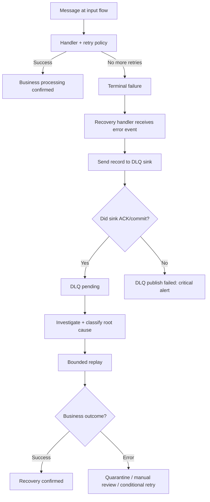
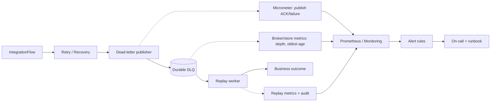

# Integrating Dead Letter With Alerting in Spring Integration

## 1. Why Having a DLQ Alone Is Not Enough for Safe Operations

In a messaging integration system, when a handler fails repeatedly, we typically route the message to a **dead-letter queue (DLQ)** so the main flow does not stall. This preserves failure evidence and creates an opportunity to fix or replay later. However, **having a DLQ does not mean you have incident detection**.

For example, an order flow passes through `Gateway → Filter → Router → Service Activator → outbound adapter`. The inventory service breaks at 09:00; retries exhaust their limit and messages move to the DLQ. The main flow consumer keeps running, yet nobody notices until 10:00 that thousands of requests have been quarantined. If **writing to the DLQ also fails**, messages may not even be safely preserved.

The lesson **"Integrating Dead Letter With Alerting"** belongs to the **Dead letter** chapter of the `SPRING_INTEGRATION_PATTERN` module. The module's goal is to implement Enterprise Integration Patterns with Spring Integration in a loosely coupled, extensible, testable, and observable way across Router, Filter, Transformer, Splitter, Aggregator, Gateway, retry, error channel, and correlation branches.

After this lesson, you will be able to:

1. Distinguish **handler error**, **terminal failure**, **DLQ publish requested**, **DLQ persisted**, **DLQ backlog**, and **actually confirmed recovery**.
2. Choose appropriate metrics, logs, traces, and audit events to bring the DLQ into an alerting system.
3. Instrument Micrometer at the exact boundary of dead-letter publishing/persistence without incrementing success counters prematurely on enqueue or recovery callback invocation.
4. Write PromQL/Prometheus alert rules for DLQ arrival rate, DLQ write failures, backlog age, and replay failure rate.
5. Design an alert-response runbook: triage, mitigation, investigation, root-cause fix, bounded replay, and outcome verification.
6. Test success paths, retry exhaustion, DLQ write failures, message redelivery, and duplicate side effects.

## 2. Six Distinct Milestones a Failed Message Can Pass Through



| Milestone | Definition | Must Not Infer |
| --- | --- | --- |
| **Attempt failed** | A single handler invocation threw an exception | The business operation has terminally failed |
| **Terminal failure** | A processing cycle ended after the retry policy or was classified non-retryable | The dead letter has been saved |
| **Recovery event observed** | Error flow received `ErrorMessage` or recovery callback ran | Broker/store has ACKed |
| **DLQ publish acknowledged** | DLQ system confirmed persistence per storage contract | Replay consumer has processed it successfully |
| **DLQ pending** | Record still waiting in the DLQ per source-of-truth data | Can be computed accurately from callback counts |
| **Recovery confirmed** | Reprocessing/reconciliation reached the defined business success milestone | Resending through a channel is sufficient |

**Key point:** a dashboard might show `retry_exhausted=100`, `dlq_published=90`, and `dlq_pending=90`. The gap of 10 could be publisher failures, mismatched measurement points, or delayed arrivals. It **does not automatically prove** 10 messages were lost, yet it certainly warrants investigation, especially if messages require durable retention.

### An Error Channel Is Not Automatically a DLQ

In Spring Integration, `errorChannel` is a `MessageChannel` used to receive `ErrorMessage` along a configured error-handling path. For a synchronous handler, exceptions can propagate back to the caller; for pollers, executors, or asynchronous adapters, errors may be published to the corresponding error channel. **Not every exception is automatically sent to the global `errorChannel`.**

An in-memory `QueueChannel` receiving `ErrorMessage` only creates a **process-local queue** that can be lost on restart. To qualify as a recovery DLQ, you need a durable store such as a broker, database, or object storage with a retention contract, access controls, replay capability, and explicit ACK rules.

## 3. Observability and Alerting Architecture for a DLQ

The design should separate **error handling**, **dead-letter persistence**, **telemetry collection**, and **alerting**:



Principles:

- **Source of truth for `DLQ pending`** is the broker/store, not a counter manually incremented/decremented in one JVM.
- **Source of truth for `published`** requires an ACK/commit event from the sink per contract.
- **Source of truth for `recovered`** is the business outcome or downstream commit, not `channel.send()`.
- Metrics can lose series when a service dies. Therefore, monitor **scrape errors, missing metrics, broker health**, and silent message starvation too.
- Logs and audits carry business correlation for tracing; metric tags use only a finite label set.

### Difference Between DLQ and Filter Discard

A `Filter` can drop valid messages per business rules, such as events outside synchronization scope. That is `REJECTED` or `DISCARDED`, not inherently a system error. Conversely, a DLQ retains messages that cannot be processed under retry/recovery policies. If an organization stores validation rejects in a shared error store, clearly separate `reasonCode` and recovery paths; do not lump every discard into "production errors."

## 4. Minimum Metrics and How to Interpret Them

| Suggested App Metric | Type | Actual Measurement Point | Used to Alert On |
| --- | --- | --- | --- |
| `app.eip.retry.terminal.failures` | Counter | Determined not to continue processing in current cycle | Detect unrecoverable business/technical failures immediately |
| `app.eip.dlq.publish.requested` | Counter | Publisher begins attempting to save dead letter | Track write pressure on DLQ |
| `app.eip.dlq.publish.acked` | Counter | Broker/store confirms per contract | Accepted DLQ inflow |
| `app.eip.dlq.publish.failed` | Counter | Publish/persist operation failed | **High-priority alert** |
| `app.eip.dlq.publish.duration` | Timer | Publish start → ACK/error | Detect slow sink |
| `app.eip.dlq.pending` | Gauge | Waiting records per broker/store | Backlog exceeding processing capacity |
| `app.eip.dlq.oldest.pending.age` | Gauge, seconds | Age of oldest pending record via trusted timestamp | Prevent forgotten messages |
| `app.eip.dlq.replay.started` | Counter | Worker begins a replay attempt | Backlog processing throughput |
| `app.eip.dlq.replay.outcomes` | Counter | `success`, `error`, or `skipped` after each attempt | Measure replay quality |
| `app.eip.dlq.recovery.confirmed` | Counter | Business completion proven | Track recovery progress |
| `app.eip.dlq.quarantined` | Counter | Message isolated due to permanent/unknown failure | Detect poison messages |

**These are illustrative application metric conventions**, not a claim that Spring Integration generates all of these names automatically. Micrometer offers general handler/channel telemetry; broker clients expose their own metrics; if equivalent meters already exist, verify semantics and avoid double counting.

### Units and Measurement Sources

Counters are cumulative event counts, so use `rate()`/`increase()` in Prometheus; they can reset to 0 after restarts. Gauges reflect **current state** and can move up or down. Timers fit operation latency; they do not measure the age of records still waiting. When using histograms, evaluate series cardinality cost across labels.

Do not use naive arithmetic:

```text
dlq_pending = total_published - total_replayed_success
```

Because there may be failed replays, in-flight items, TTL/retention expirations, manual deletions, quarantined records, redeliveries, multiple consumers/partitions, and metric resets. For reconciliation, use actual store state rather than subtracting two counters from one instance.

### Tags to Control

| Tag | Example | Appropriate? |
| --- | --- | --- |
| `flow` | `orders`, `payments` | Yes, stable identifier |
| `stage` | `reserveStock`, `publishOrder` | Yes, fixed endpoint set |
| `destination` | `ordersDlq`, `manualReview` | Yes, logical name |
| `reason` | `timeout`, `validation`, `dependency`, `other` | Yes if normalized via allowlist |
| `outcome` | `success`, `error`, `skipped` | Yes, fixed enum set |
| `messageId`, `orderId`, `traceId`, `correlationId` | Per-message unique values | **No** |
| `payload`, `exception.getMessage()`, URL with token | Unbounded or sensitive data | **No** |

A counter tagged with `reason=timeout` is useful; attaching exception messages containing UUIDs or usernames causes **high cardinality** and potential data leaks.

## 5. Spring Integration Example: From Exhausted Retries to Monitored Publisher

This example uses Java 17, Spring Integration 6.x, Spring Retry 2.x, and Micrometer. `RequestHandlerRetryAdvice` retries a handler; once retries are exhausted, `ErrorMessageSendingRecoverer` sends an `ErrorMessage` to `terminalErrorEvents`. Another handler converts the failure into a record and persists it via the `DeadLetterStore` interface.

**Illustrative scope:** `DeadLetterStore` is an interface whose contract is *returning only after persistence is confirmed*. This lesson does not claim an in-RAM implementation is a durable DLQ. In production, swap in an appropriate JDBC/broker adapter and record ACKs strictly per the adapter's contract.

### 5.1. Dead-Letter Record and Publisher

```java
import java.time.Clock;
import java.time.Instant;
import java.util.Objects;

import io.micrometer.core.instrument.Counter;
import io.micrometer.core.instrument.MeterRegistry;
import io.micrometer.core.instrument.Timer;
import org.springframework.messaging.Message;
import org.springframework.messaging.MessageHandler;
import org.springframework.messaging.MessagingException;
import org.springframework.messaging.support.ErrorMessage;

// This is filtered metadata; the payload used for replay must be kept
// via a permission-checked reference or separate safe format.
record DeadLetterRecord(
        String sourceEventId,
        String processingCycleId,
        String stage,
        String reasonCode,
        Instant occurredAt) {

    String stableFailureKey() {
        // Re-delivering the same failure cycle does not create a second logical record.
        return sourceEventId + ":" + processingCycleId + ":" + stage;
    }
}

interface DeadLetterStore {
    // Contract: return only after durable ACK/commit is received.
    // Must guarantee idempotency by stableFailureKey().
    void persist(DeadLetterRecord record);
}

final class MonitoredDeadLetterPublisher implements MessageHandler {
    private final DeadLetterStore store;
    private final Clock clock;
    private final MeterRegistry meterRegistry;
    private final Counter requested;
    private final Counter acknowledged;
    private final Counter failed;
    private final Timer duration;

    MonitoredDeadLetterPublisher(
            DeadLetterStore store, MeterRegistry meters, Clock clock) {
        this.store = store;
        this.clock = clock;
        this.meterRegistry = meters;
        requested = meters.counter("app.eip.dlq.publish.requested",
                "flow", "orders", "destination", "ordersDlq");
        acknowledged = meters.counter("app.eip.dlq.publish.acked",
                "flow", "orders", "destination", "ordersDlq");
        failed = meters.counter("app.eip.dlq.publish.failed",
                "flow", "orders", "destination", "ordersDlq");
        duration = Timer.builder("app.eip.dlq.publish.duration")
                .description("Duration from publish start to ACK/error")
                .tags("flow", "orders", "destination", "ordersDlq")
                .register(meters);
    }

    @Override
    public void handleMessage(Message<?> event) {
        requested.increment();
        Timer.Sample sample = Timer.start(meterRegistry);
        try {
            if (!(event instanceof ErrorMessage error)) {
                throw new IllegalArgumentException(
                        "Dead-letter publisher requires ErrorMessage");
            }

            Throwable failure = error.getPayload();
            Message<?> source = error.getOriginalMessage();
            if (source == null
                    && failure instanceof MessagingException messagingError) {
                source = messagingError.getFailedMessage();
            }
            if (source == null) {
                throw new IllegalArgumentException(
                        "Unable to determine original message");
            }

            String sourceEventId =
                    source.getHeaders().get("sourceEventId", String.class);
            String processingCycleId =
                    source.getHeaders().get("processingCycleId", String.class);
            if (sourceEventId == null || processingCycleId == null) {
                throw new IllegalArgumentException(
                        "Missing dead-letter dedup/correlation keys");
            }

            // Normalize reason into a finite set; do not store raw exception text.
            String reason = "handler_error";
            DeadLetterRecord record = new DeadLetterRecord(
                    sourceEventId, processingCycleId,
                    "reserveStock", reason, clock.instant());

            // If persist throws or is not yet ACKed, do not increment acknowledged.
            store.persist(record);
            acknowledged.increment();
        } catch (RuntimeException exception) {
            failed.increment();
            throw exception;
        } finally {
            sample.stop(duration);
        }
    }
}
```

**Limitations to understand:**

- `acknowledged` is only valid if `store.persist()` truly honors the stated contract. With async brokers, the send call often returns before ACK; update the counter in the callback/future **after ACK**.
- Re-sending the same record can trigger two `publish requested` increments; `stableFailureKey()` lets the sink deduplicate. In practice, enforce a unique key/transaction in the store; never rely on RAM variables across restarts.
- If `store.persist()` committed but the ACK back to the publisher was lost, the caller may throw and `failed` increments even though data was saved. Reconcile using the stable key instead of assuming record loss.
- `reasonCode=handler_error` in the example is a generic bucket. Production needs a tested classifier for timeout, validation, dependency, serialization errors, etc., while keeping labels bounded.
- `processingCycleId` should be generated **once when a processing cycle begins** and remain stable across retries within that cycle. An intentional replay opening a new cycle must record lineage back to `sourceEventId` and the prior failure.
- The illustrative record holds only metadata and is not yet sufficient to replay payloads. For replay, add `securedPayloadReference` or a normalized, protected payload along with schema version.

### 5.2. Creating the Flow and Attaching RetryAdvice

```java
import java.time.Clock;

import io.micrometer.core.instrument.MeterRegistry;
import org.springframework.beans.factory.annotation.Qualifier;
import org.springframework.context.annotation.Bean;
import org.springframework.context.annotation.Configuration;
import org.springframework.integration.annotation.EnableIntegration;
import org.springframework.integration.channel.DirectChannel;
import org.springframework.integration.dsl.IntegrationFlow;
import org.springframework.integration.handler.advice.ErrorMessageSendingRecoverer;
import org.springframework.integration.handler.advice.RequestHandlerRetryAdvice;
import org.springframework.messaging.MessageChannel;
import org.springframework.messaging.MessageHandler;
import org.springframework.retry.backoff.FixedBackOffPolicy;
import org.springframework.retry.policy.SimpleRetryPolicy;
import org.springframework.retry.support.RetryTemplate;

@Configuration
@EnableIntegration
class DeadLetterAlertingConfiguration {

    @Bean("ordersInput")
    MessageChannel ordersInput() {
        return new DirectChannel();
    }

    @Bean("terminalErrorEvents")
    MessageChannel terminalErrorEvents() {
        // This is a synchronous error channel, not a durable DLQ.
        return new DirectChannel();
    }

    @Bean
    RequestHandlerRetryAdvice orderRetryAdvice(
            @Qualifier("terminalErrorEvents") MessageChannel errors) {
        RetryTemplate retry = new RetryTemplate();
        retry.setRetryPolicy(new SimpleRetryPolicy(3));
        FixedBackOffPolicy backoff = new FixedBackOffPolicy();
        backoff.setBackOffPeriod(20L); // Demo; production needs SLO and jitter.
        retry.setBackOffPolicy(backoff);

        RequestHandlerRetryAdvice advice = new RequestHandlerRetryAdvice();
        advice.setRetryTemplate(retry);
        advice.setRecoveryCallback(new ErrorMessageSendingRecoverer(errors));
        return advice;
    }

    @Bean
    MonitoredDeadLetterPublisher monitoredDeadLetterPublisher(
            DeadLetterStore store, MeterRegistry registry) {
        return new MonitoredDeadLetterPublisher(
                store, registry, Clock.systemUTC());
    }

    @Bean
    IntegrationFlow processOrders(RequestHandlerRetryAdvice orderRetryAdvice) {
        MessageHandler handler = message -> {
            if (message.getPayload().toString().startsWith("FAIL:")) {
                throw new IllegalStateException("Simulated dependency failure");
            }
            // In production: success processing must have its own ACK/commit milestone.
        };
        return IntegrationFlow.from("ordersInput")
                .handle(handler, endpoint -> endpoint.advice(orderRetryAdvice))
                .get();
    }

    @Bean
    IntegrationFlow persistTerminalFailures(
            MonitoredDeadLetterPublisher publisher) {
        return IntegrationFlow.from("terminalErrorEvents")
                .handle((MessageHandler) publisher)
                .get();
    }
}
```

For payloads starting with `FAIL:`, the handler throws, the advice retries up to three times total, and then the recoverer publishes `ErrorMessage` to the terminal-handling channel. The publisher receives the error and calls the store. On success, `publish.acked` increments; on failure, `publish.failed` increments and the exception propagates to the existing handling mechanism.

**Note:** `SimpleRetryPolicy(3)` in the example retries generic exceptions; production must classify retryable vs. non-retryable errors, bound total elapsed time, and handle wrapped exceptions. On a synchronous error path, if the publisher fails it can propagate an exception to the caller; do not assume the caller will keep and resend the message. Design rollback/outbox/fallback storage/alerting so losing the DLQ sink never silently drops messages.

### 5.3. Dependencies

```groovy
dependencies {
    implementation("org.springframework.boot:spring-boot-starter-integration")
    implementation("org.springframework.boot:spring-boot-starter-actuator")
    implementation("org.springframework.retry:spring-retry")

    // Only when exporting metrics to Prometheus.
    runtimeOnly("io.micrometer:micrometer-registry-prometheus")

    testImplementation("org.springframework.boot:spring-boot-starter-test")
    testImplementation("org.springframework.integration:spring-integration-test")
}
```

In a Spring Boot application, `MeterRegistry` is typically auto-configured when compatible dependencies are present. When running plain Spring configuration, provide `SimpleMeterRegistry` in tests or an appropriate registry in the application.

## 6. Collecting Backlog and Oldest Message Age

Publisher metrics only show **write attempts and observed ACKs**. They do not tell you how many records remain in the store.

| DLQ Source | Where to Get Depth/Backlog? | Oldest Age |
| --- | --- | --- |
| RabbitMQ/AMQP | Queue ready/unacked and broker/consumer metrics | Trusted timestamp or broker/plugin age metric |
| Kafka | Consumer group lag per partition; not automatically equal to classified pending DLQ records | Based on offset/timestamp of pending events and appropriate metadata source |
| JDBC DLQ table | `COUNT` of records with `PENDING` status in DB | `now - MIN(created_at)` of PENDING records |
| S3/object store | Records partitioned/indexed by processing status | Metadata/index of pending records |
| In-RAM `QueueChannel` | `getQueueSize()` on that instance | Requires separate enqueue timestamp; does not survive restart |

For brokers or stores shared across instances, use a **centralized metric source**. Do not sum queue depth across pods if those pods are reading the same backend queue, as that double-counts. If a consumer has fetched a message without ACKing yet, `ready` may drop while unfinished work has not; account for unacked/in-flight messages too.

### Formula for a JDBC Store

Assume the DLQ table has explicit `status` and `created_at` columns:

```sql
SELECT COUNT(*) AS pending_count,
       EXTRACT(EPOCH FROM (CURRENT_TIMESTAMP - MIN(created_at)))
         AS oldest_pending_age_seconds
FROM dead_letter_record
WHERE status = 'PENDING';
```

When the queue has no pending records, `MIN(created_at)` returns `NULL`; the exporter must interpret the missing value cleanly (e.g., age gauge = 0 alongside pending = 0), rather than turning it into a negative number or infinite timestamp. For large tables, use proper indexes, caching/sampling, and sensible polling intervals; avoid running full-table scans every few seconds if it overloads the DB.

**Do not substitute** the original failure time for the time the record entered the DLQ unless the dashboard explicitly states that definition. A message may retry for a long time before a dead letter is stored; the two ages answer two different questions.

## 7. Configuring Alerts: DLQ Write Errors, Inflow, Backlog, and Oldest Age

At least **four alert groups** are needed because each catches a different kind of failure:

| Signal | Illustrative Condition | Suggested Severity | First Action |
| --- | --- | --- | --- |
| **DLQ publish failed** | Error saving a record requiring durability | Critical when message loss is possible; SLA-dependent | Check broker/store, fallback, transactions, and publisher retries |
| **DLQ inflow rising** | Dead-letter rate sustainedly high or ratio up vs. baseline | Warning/Critical by impact | Check error types, recent releases, dependencies, and traffic |
| **DLQ pending too large** | Depth exceeds processing capacity or climbs continuously | Warning | Check replay workers and root causes |
| **Oldest pending age exceeds SLO** | Record unhandled past committed timeframe | Warning/Critical | Inspect oldest record, quarantine status, and owner |
| High replay error rate | Many replayed messages fail | Warning/Critical | Pause batch replay, fix root cause before continuing |
| Telemetry absent | Cannot scrape exporter or metrics disappeared | Monitoring alert | Check monitoring pipeline before assuming backlog is 0 |

**Thresholds must reflect each flow's SLO, processing capacity, and operating schedule.** A system pushing validation errors to a DLQ may have steady inflow without an incident; a zero-loss payment flow may need to page immediately on a single DLQ publisher failure.

### 7.1. PromQL Measuring DLQ Inflow

With the Micrometer Prometheus registry, Counter `app.eip.dlq.publish.acked` typically exports as `app_eip_dlq_publish_acked_total`. Verify exact names at `/actuator/prometheus` before creating rules:

```promql
sum by (flow, destination) (
  rate(app_eip_dlq_publish_acked_total[5m])
)
```

Count messages ACKed by the DLQ over 15 minutes:

```promql
sum(increase(app_eip_dlq_publish_acked_total{
  flow="orders",destination="ordersDlq"
}[15m]))
```

For a terminal-failure ratio, the denominator must have consistent boundaries and units. Using raw `handler attempts` as the denominator lets retries artificially depress the ratio. Use logical operations entering the flow or processing count at the right business milestone, while also displaying absolute volume.

### 7.2. Reference Prometheus Alert Rules

The configuration below is **illustrative only**, assuming gauges are exported from the DLQ backend. Thresholds must be adjusted to your SLO; do not deploy verbatim:

```yaml
groups:
  - name: spring-integration-dead-letter
    rules:
      - alert: OrdersDLQPublishFailed
        expr: |
          sum(increase(app_eip_dlq_publish_failed_total{
            flow="orders",destination="ordersDlq"
          }[5m])) > 0
        for: 1m
        labels:
          severity: critical
          team: integration
        annotations:
          summary: "Failed to persist orders dead letter"
          description: "Check sink, ACK, and fallback; risk of losing failure traces."

      - alert: OrdersDLQBacklogHigh
        expr: |
          sum(app_eip_dlq_pending{
            flow="orders",destination="ordersDlq"
          }) > 200
        for: 10m
        labels:
          severity: warning
          team: integration
        annotations:
          summary: "Orders DLQ backlog exceeded threshold"

      - alert: OrdersDLQOldestPendingTooOld
        expr: |
          max(app_eip_dlq_oldest_pending_age_seconds{
            flow="orders",destination="ordersDlq"
          }) > 900
        for: 5m
        labels:
          severity: warning
          team: integration
        annotations:
          summary: "Oldest orders dead letter waited over 15 minutes"

      - alert: OrdersDLQInflowSpike
        expr: |
          sum(rate(app_eip_dlq_publish_acked_total{
            flow="orders",destination="ordersDlq"
          }[5m])) > 0.1
        for: 10m
        labels:
          severity: warning
          team: integration
        annotations:
          summary: "Orders DLQ receiving over 6 records per minute sustained"
```

Explanation: `for: 10m` requires the condition to remain true across that duration; it does not mitigate missing metrics. When metrics disappear, expressions often produce no series to alert on, so add a dedicated alert for **missing telemetry**.

Scrape alert example:

```promql
up{job="orders-integration"} == 0
```

If a system emits `pending` only when the queue is non-empty, do not use `absent()` as a missing-telemetry alert without knowing the exporter's contract. Check `up`, a heartbeat, or a continuously present backend metric.

### 7.3. Replay Failure Rate

If `app.eip.dlq.replay.outcomes` is recorded exactly once per **completed replay attempt**:

```promql
sum(rate(app_eip_dlq_replay_outcomes_total{
  flow="orders",outcome="error"
}[10m]))
/
clamp_min(
  sum(rate(app_eip_dlq_replay_outcomes_total{
    flow="orders",outcome=~"success|error"
  }[10m])),
  0.000001
)
```

Pair this with a minimum sample-size condition, such as at least 20 replay attempts in the window, before escalating severity. `skipped` should be shown separately when duplicates/idempotency already handled it earlier; whether `skipped` counts as success must be defined by the business contract.

### 7.4. SLOs and Alert Prioritization

Not every event entering the DLQ should page an on-call engineer. An effective tiering approach:

- **P0/P1:** unable to durably persist DLQ for a zero-loss flow; evidence of duplicate side effects; backlog breaching critical SLO.
- **P2:** abnormal DLQ inflow spike, oldest age approaching threshold, replay throughput falling behind.
- **Ticket / daily digest notifications:** classified validation errors that can be handled on schedule without operational disruption.

Note that thresholds are **illustrative**; severity cannot be decided without knowing the system's reliability contract.

## 8. Runbook When an Alert Fires

An actionable alert must identify **the owner, signal, dashboard, mitigation steps, and recovery verification criteria**.

### Step 1 — Identify the Alert Type

| Alert | First Question |
| --- | --- |
| Publish failed | Was the terminal message rolled back or saved to fallback? Did the sink ACK? |
| Inflow rising | Are failures concentrated in one handler, route, build version, or dependency? |
| Pending growing | Are DLQ consumers running? Is anyone triaging/reconciling records? |
| Oldest age high | Which record is stuck—due to a poison message, approval policy, or lack of capacity? |
| High replay error | Was the root cause actually fixed? Is there a replay storm or downstream overload? |

### Step 2 — Assess Blast Radius

Check total record count, oldest age, failing flow and stage, when the spike started, and recent releases. Cross-check **retry attempts**, **terminal errors**, **DLQ ACK**, **broker health**, **downstream latency**, and SLOs.

For a specific message, use `sourceEventId`, `flowExecutionId`, original message ID, or business correlation to look up audits/logs/traces. **Never put these IDs into Prometheus labels or public logs.**

### Step 3 — Stop the Bleeding

Situational mitigations:

1. Throttle producers or open a circuit breaker while a dependency is down to avoid continuously generating more failed messages.
2. Pause batch replays if replaying is amplifying errors or causing duplicate side effects.
3. When the DLQ sink loses connectivity, use transaction rollback, outbox, durable fallback storage, or pause intake per design; **never ACK/drop messages** just to keep throughput moving.
4. If a faulty Router/Transformer config was just rolled out, consider rolling back **after** checking schema compatibility and messages still in queues.

### Step 4 — Remediate the Root Cause

Group errors by category:

- **Transient:** timeouts, 503s, broker/connectivity; replay only after dependency stabilizes.
- **Permanent:** invalid schema/validation; fix data or route to manual review—do not retry endlessly.
- **Uncertain outcome:** external API may have committed before ACK was lost; **reconcile before replaying** to avoid double-charging or deducting inventory twice.
- **Poison message:** message deterministically throws due to data/logic; isolate, assign an owner, and avoid creating a new DLQ loop.

### Step 5 — Safe Replay

- Pick a small batch, preserving lineage of the original source event and failure record.
- Keep the business idempotency key intact across retries/replays; if replaying under a new deployment, record both original and replay rule versions.
- Enforce rate limits, max concurrency, backoff, retry budget, and stop conditions.
- Measure `replay.started` and `replay.outcomes` at the right milestones; increment `recovery.confirmed` only when business commit/ACK is proven.
- Do not delete DLQ records before obtaining an outcome or following an explicit manual-resolution policy.

### Step 6 — Verify and Post-Incident Review

Verify inflow has dropped, backlog and oldest age are recovering, replay success is rising, publish errors are zero, and no duplicate side effects occurred. Document the incident timeline, root cause, rule/flow version, affected operation count, and preventive actions. If data loss occurred, reconcile against the upstream source rather than relying solely on a zero gauge.

## 9. Auditing, Correlation, and DLQ Information Security

To pinpoint root causes accurately, a dead-letter record should include **application-defined** fields:

```json
{
  "eventType": "DEAD_LETTER_CONFIRMED",
  "deadLetterRecordId": "dlq-7092",
  "sourceEventId": "src-event-8841",
  "flowExecutionId": "flow-7294",
  "flowName": "orders",
  "stage": "reserveStock",
  "flowDefinitionVersion": "orders-flow/3.2.0",
  "routingPolicyVersion": "routing-orders/r17",
  "errorCode": "dependency_timeout",
  "attemptCount": 3,
  "recordedAt": "2026-11-21T09:20:00Z",
  "payloadReference": "secured-object-ref-91"
}
```

This is a **JSON sample**, not a record automatically emitted by Spring Integration. `payloadReference` must obey access controls, retention, encryption, and deletion policies. Keep only necessary headers; avoid storing tokens, passwords, sensitive raw request bodies, or stack traces containing PII. Emit separate audit events for `DLQ_PUBLISH_FAILED`, `REPLAY_REQUESTED`, `REPLAY_STARTED`, `REPLAY_FAILED`, and `RECOVERY_CONFIRMED` when business traceability requires it.

**Message ID is not an idempotency key by default.** A message's ID can change when transformed or replayed. To prevent duplicate side effects, use a stable business operation key and enforce it where side effects commit. Correlation/tracing aids investigation; it does not by itself guarantee exactly-once effects.

### Versioning Cuts Investigation Time

If DLQ inflow spikes right after a rollout, storing `flowDefinitionVersion`, `routingPolicyVersion`, or `deploymentRevision` from **when the message actually ran** lets you compare which Router/Filter branch changed. Do not overwrite past records with the current version as if it were the version that originally failed. When replaying under a new version, keep both the original version and the replay version.

## 10. Testing Alerting Paths and DLQ Write Failures

### 10.1. Integration Test With a Test-Only In-RAM Store

To verify metric instrumentation, tests can use a fake `DeadLetterStore`. This is a **test double**, not a durable DLQ:

```java
import java.util.concurrent.ConcurrentHashMap;
import java.util.concurrent.ConcurrentMap;

import io.micrometer.core.instrument.MeterRegistry;
import io.micrometer.core.instrument.simple.SimpleMeterRegistry;
import org.springframework.context.annotation.Bean;
import org.springframework.context.annotation.Configuration;

final class InMemoryDeadLetterStore implements DeadLetterStore {
    private final ConcurrentMap<String, DeadLetterRecord> entries =
            new ConcurrentHashMap<>();

    @Override
    public void persist(DeadLetterRecord record) {
        entries.putIfAbsent(record.stableFailureKey(), record);
    }

    int size() {
        return entries.size();
    }
}

@Configuration
class DeadLetterTestBeans {
    @Bean
    InMemoryDeadLetterStore testDeadLetterStore() {
        return new InMemoryDeadLetterStore();
    }

    @Bean
    MeterRegistry testRegistry() {
        return new SimpleMeterRegistry();
    }
}
```

Test sending a message that fails after three attempts and asserting the publisher is invoked:

```java
import static org.assertj.core.api.Assertions.assertThat;

import org.junit.jupiter.api.Test;
import org.springframework.beans.factory.annotation.Autowired;
import org.springframework.beans.factory.annotation.Qualifier;
import org.springframework.messaging.MessageChannel;
import org.springframework.messaging.support.MessageBuilder;
import org.springframework.test.context.junit.jupiter.SpringJUnitConfig;
import io.micrometer.core.instrument.MeterRegistry;

@SpringJUnitConfig(classes = {
        DeadLetterAlertingConfiguration.class,
        DeadLetterTestBeans.class
})
class DeadLetterAlertingTest {

    @Autowired
    @Qualifier("ordersInput")
    MessageChannel input;

    @Autowired
    InMemoryDeadLetterStore store;

    @Autowired
    MeterRegistry meters;

    @Test
    void publishesOneTerminalFailureAfterRetryExhaustion() {
        input.send(MessageBuilder.withPayload("FAIL:order-42")
                .setHeader("sourceEventId", "event-42")
                .setHeader("processingCycleId", "cycle-1")
                .build());

        assertThat(store.size()).isEqualTo(1);
        assertThat(meters.get("app.eip.dlq.publish.requested")
                .tags("flow", "orders", "destination", "ordersDlq")
                .counter().count()).isEqualTo(1.0);
        assertThat(meters.get("app.eip.dlq.publish.acked")
                .tags("flow", "orders", "destination", "ordersDlq")
                .counter().count()).isEqualTo(1.0);
        assertThat(meters.get("app.eip.dlq.publish.failed")
                .tags("flow", "orders", "destination", "ordersDlq")
                .counter().count()).isZero();
    }
}
```

This test verifies the recovery/metrics path in a demo context; it does **not** prove sending to a broker or receiving a durable ACK. Separate integration tests are needed with a real broker/database, transactions/ACKs, and replay mechanics. If failure happens before the recoverer builds an `ErrorMessage` or if the original message is missing, tests must detect the failure explicitly rather than recording a false success.

### 10.2. Test Matrix

| Scenario | Expectation |
| --- | --- |
| Handler succeeds on first try | No terminal event; DLQ does not increment |
| Handler fails transiently then succeeds on retry | Attempt errors increment; DLQ ACK does **not** increment |
| Retries exhausted / non-retryable | Terminal event emitted; publisher called per policy |
| DLQ store commits and returns ACK | `publish.acked +1`; backlog increases per source of truth |
| DLQ store throws before commit | `publish.failed +1`, `acked` unchanged; fallback/rollback runs |
| Store commits but ACK is lost | `failed` may increment while record exists; reconcile by stable key |
| Dead-letter record published twice | Store deduplicates by stable failure key; no logical duplicate |
| DLQ consumer stops | Pending/oldest age rises even while publisher still ACKs |
| DLQ empty | Pending = 0, oldest age interpreted cleanly, no false alerts |
| Scrape/exporter stops | Missing-telemetry alert fires independently of DLQ depth |
| Replay succeeds after root-cause fix | `recovery.confirmed` increments at business commit |
| Replay fails again | No infinite loop; quarantine/redrive limit enforces stop |
| Replay after timeout on already-committed API | Idempotency/reconcile prevents duplicate side effects |
| Intentional Filter discard | Not accidentally counted as a terminal failure |
| Splitter/Aggregator | Distinguishes message fragments from business operations; stable correlation |
| Multiple pods processing shared DLQ | Backlog is not double-counted per instance |
| Payload/headers contain PII | Never exposed in metric tags; access-controlled audits |

### 10.3. Testing Alert Rules and Runbooks

Do not test only publisher code. Test time-series behavior accounting for counter resets on restart, missing metrics, scrape latency, and alert `for` windows. With Prometheus, you can use `promtool test rules` with synthetic series samples during project QA/testing.

Essential game-day drills: simulate DLQ broker disconnect; stop consumers; inject a poison message; accelerate replay to trigger downstream failures; shut down the telemetry exporter. Each drill must verify alerts reach the right owner, dashboards reflect state, and safe pause/restart procedures work.

## 11. Common Mistakes When Coupling DLQ With Alerting

1. **Alerting solely on exception counts.** One business operation may fail two attempts and succeed on the third; it should not count as two dead letters.
2. **Treating a send to `errorChannel` as successful DLQ storage.** The channel may live only in RAM without persistence/ACK.
3. **Incrementing `dlq.acked` before receiving the sink's ACK.** If connectivity drops, dashboards falsely report the message is safe.
4. **Watching only DLQ inflow while ignoring oldest age.** A dead consumer stops producing new DLQ entries while old records sit unattended.
5. **Watching only queue depth.** Low depth does not mean a healthy DLQ if telemetry is missing or records were lost on restart.
6. **Using a single JVM variable to track cluster-wide backlog.** Multiple instances and shared brokers cause undercounting or double-counting.
7. **Paging on a single DLQ event for every flow.** Causes alert fatigue; tune thresholds and severity to SLOs.
8. **Not alerting on DLQ publisher failures.** This is a secondary failure path and can cause loss of recovery evidence.
9. **Replaying as "send succeeded = recovered."** The message can fail again or duplicate downstream.
10. **Infinite replays.** Poison messages create a DLQ/retry loop, driving up load and cost.
11. **Missing idempotency.** A lost ACK can cause a replay to charge money or reserve stock twice.
12. **Putting IDs/payloads into metric labels.** Causes high cardinality and data-leak risks.
13. **No runbook or owner.** Alerts fire repeatedly with nobody knowing how to respond, eventually getting muted or ignored.
14. **Not testing alerts for missing metrics.** A dead system can look like "zero errors."

## 12. Production Readiness Checklist for DLQ Alerting

- [ ] Distinguish terminal failure, recovery event, publish requested, DLQ ACK, pending, and recovery confirmed.
- [ ] DLQ sink has a durable storage contract, idempotent storage key, retention, and replay support.
- [ ] `publish.requested`, `publish.acked`, `publish.failed`, and duration metrics are instrumented at the exact boundaries.
- [ ] Depth and oldest age are sourced from the real broker/store, not inferred from JVM counters.
- [ ] Alerts cover publish failure, inflow spike, backlog, oldest age, replay failure, and missing telemetry.
- [ ] Thresholds and `for` durations are tuned to SLOs, volume, and realistic recovery capacity.
- [ ] Alerts specify owner, severity, dashboard link, and an actionable runbook.
- [ ] Error taxonomy uses a bounded code set; no sensitive data in logs or labels.
- [ ] Correlation, flow/route version, original event ID, and attempt lineage are captured in access-controlled audits.
- [ ] Replay enforces rate limits, stop conditions, idempotency, redrive caps, and manual quarantine.
- [ ] Alerts are tested for broker/store outages, stopped consumers, lost ACKs, missing metrics, and duplicates.
- [ ] Incident drills and DLQ/backlog reconciliation are practiced rather than treating depth = 0 as sole proof.

## 13. References

- [Spring Integration — Error Handling](https://docs.spring.io/spring-integration/reference/error-handling.html)
- [Spring Integration — Handler Advice / Retry](https://docs.spring.io/spring-integration/reference/handler-advice/classes.html)
- [Spring Integration — Message Channels](https://docs.spring.io/spring-integration/reference/channel.html)
- [Spring Integration — Metrics and Management](https://docs.spring.io/spring-integration/reference/metrics.html)
- [Spring Retry Reference](https://docs.spring.io/spring-retry/reference/)
- [Micrometer Reference — Counters](https://docs.micrometer.io/micrometer/reference/concepts/counters.html)
- [Micrometer Reference — Gauges](https://docs.micrometer.io/micrometer/reference/concepts/gauges.html)
- [Prometheus — Alerting Rules](https://prometheus.io/docs/prometheus/latest/configuration/alerting_rules/)
- [Prometheus — PromQL Functions](https://prometheus.io/docs/prometheus/latest/querying/functions/)

> **Key Takeaway:** A DLQ is only useful when failed messages are **actually persisted**, backlogs are **observed**, alerts **reach the right owner**, and recovery is **confirmed by business outcomes**. Measure terminal failures, DLQ ACKs, publish failures, pending/oldest age, and replay outcomes explicitly; pair those signals with runbooks, audits, and idempotency to catch incidents early without turning the DLQ into a forgotten dumping ground.
