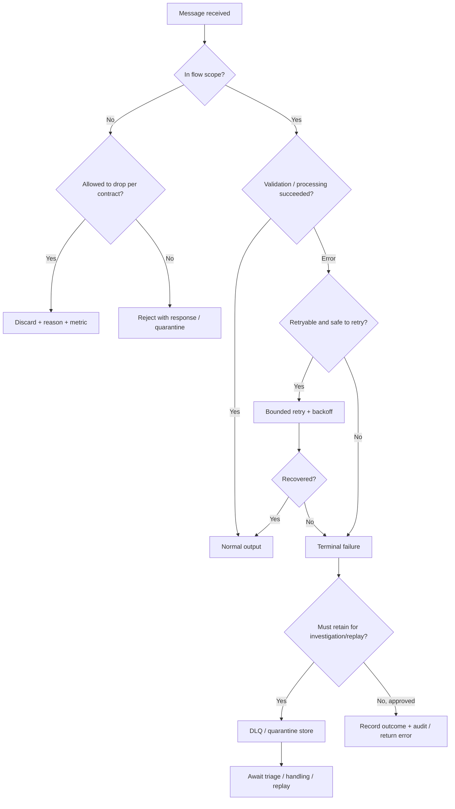

# Distinguishing Dead Letter From Discard in Spring Integration

## 1. Both Mean "Do Not Continue," Yet Their Meanings Are Completely Different

In an integration flow, a message not appearing at the output can happen for several reasons:

- A `Filter` intentionally drops an event outside synchronization scope.
- A `Router` finds no matching branch, chooses a fallback branch, or sends the message to `nullChannel`.
- An `Aggregator` is still waiting for all fragments; the message has **not yet** been released as output, rather than being dropped.
- A handler encounters an error, exhausts retries, and the message moves to a **dead-letter queue (DLQ)** for investigation and recovery.
- A broker rejects or dead-letters a message due to retry policies, TTL, or queue limits.

Lumping every case into a single "dropped messages" metric makes it impossible to distinguish **intended design behavior** from an incident requiring action. This is the root of many misunderstandings around reliability, SLAs, and alerting.

The lesson **"Distinguishing Dead Letter From Discard"** belongs to the **Dead letter** chapter of the `SPRING_INTEGRATION_PATTERN` module. Within the goal of implementing Enterprise Integration Patterns (EIP) with Spring Integration to build loosely coupled, extensible flows, this lesson focuses on the boundary between **rule-based discarding** and **isolating messages that failed processing**. Examples tie into Router, Filter, Transformer, Splitter, Aggregator, Gateway, retry, error channel, and correlation, alongside per-branch test strategies.

After this lesson, you will be able to:

1. Explain the differences between `discard`, `dead letter`, `error channel`, `nullChannel`, and `quarantine`.
2. Determine when a message is intentionally discarded versus when it must be retained for reconciliation/replay.
3. Configure `Filter.discardChannel`, router/default routes, and retry/recovery without confusing dispatched messages with successfully processed messages.
4. Separate accepted/rejected/failed/DLQ-acknowledged metrics while preserving correlation and processing reasons.
5. Write Java DSL and integration tests verifying each outcome across distinct channels.
6. Design proper operational behavior when poison messages, lost ACKs, replays, or discard branches fail.

## 2. Defining Three Core Concepts Clearly

### 2.1. Discard: A Message Is Dropped According to Policy

**Discard** is a decision not to continue processing a message on the normal branch. For example:

- Dropping `HEARTBEAT` events because the flow only synchronizes `ORDER_CREATED`.
- Dropping a duplicate row under an `Idempotent Receiver` policy.
- Not forwarding a message outbound when a Filter determines it fails business criteria.
- Routing the message to `businessDiscards` to count rejection reasons or store minimal audit records.

Discard **is not inherently an error**. What matters is that policy specifies whether the message may be dropped, whether a trace must be recorded, and whether the producer must be notified of rejection.

### 2.2. Dead Letter: Isolating a Message That Cannot Be Processed Under Current Policy

A **dead letter** is a message that could not complete through the normal processing path and is moved to a separate place for investigation, remediation, manual handling, or replay. For example:

- An adapter calling an inventory API keeps timing out; retries are exhausted.
- A message has an incompatible schema, yet business rules forbid dropping it; it must be quarantined for data migration.
- A consumer rejects a poison message and the broker moves it to a DLQ/DLT per configuration.

A DLQ can be a broker queue, DLT topic, database table, or dedicated store. **An in-RAM channel does not automatically become durable dead-letter storage.** Recoverability depends on the destination store's write policy, ACKs, transactions, retention, idempotency, access control, and replay mechanisms.

### 2.3. Error Channel: A Transport Path for Error Events

In Spring Integration, `errorChannel` is a `MessageChannel` dedicated to `ErrorMessage` instances emitted when the corresponding error-handling mechanism activates. It can be wired to its own subscribers/handlers. An `ErrorMessage` holds the exception and may carry the related message, however:

- Not every exception reaches `errorChannel` automatically: synchronous exceptions may propagate back to the caller; asynchronous pollers/adapters have their own error-publishing mechanics.
- Successfully sending an `ErrorMessage` to a channel confirms **channel dispatch per channel contract**, not that a dead letter has been persisted to a broker/database.
- An error flow can handle, alert, compensate, or intentionally ignore an error **without** creating a DLQ record.

### Quick Comparison

| Criterion | Discard | Dead Letter | Error Channel |
| --- | --- | --- | --- |
| Core decision | No need to continue the message on a branch | Cannot process normally; requires isolation/recovery | Delivers error info to an error handler |
| Necessarily an error? | **No** | Usually an unhandled failure or data needing intervention | An error event occurred; follow-up depends on the flow |
| Keeps payload? | Policy-dependent; may just count | Usually needs enough data or a reference to investigate/replay | `ErrorMessage` holds exception; original payload varies by context |
| Replayed? | Not the default goal | Usually needs replay/repair/manual review | No built-in replay |
| Durable? | Not by default | Only when the store/broker is configured for durability | Not by default |
| Key metric | Rejected decision / discard observed | Terminal failure / DLQ ACK / backlog | Error event / handler outcome |
| Completion point | Rejection decision and discard action per contract | Error record persisted, followed by separate recovery | Error handler invoked; further errors still possible |

## 3. Decision Tree: Discard, Return Error, or Dead-Letter?



**Concrete examples:**

| Message / Situation | Appropriate Policy | Reason |
| --- | --- | --- |
| `HEARTBEAT` arrives at an orders-only flow | Filter discard | Outside consumer domain; intentionally dropped |
| Order already processed with identical idempotency key | Drop duplicate or return cached result | Do not re-run side effects; keep audit/counter |
| Payload missing required field for a critical transaction | Quarantine/DLQ or explicit error rejection | Cannot silently lose business data |
| Inventory API returns transient 503 | Bounded retry with backoff | Recoverable error, provided retrying side effects is safe |
| Inventory API keeps failing after retries | DLQ or durable state awaiting recovery | Needs detection, investigation, and replay |
| Message already processed, broker redelivers after lost ACK | Idempotent receiver / inbox | Duplicate delivery, not inherently a dead letter |
| Aggregator group missing fragments | Pending group, separate timeout/expiry | No output yet does not mean discard or DLQ |
| Consumer actively calls `nack(requeue=false)` with broker DLX | Broker-level dead-letter | Driven by broker policy, not directly by Filter |

Where zero data loss is mandatory, even validation rejects may need to be saved in **quarantine** for correction. The classification boundary depends on the **business contract**, not merely exception names or channel names.

## 4. Discard in Spring Integration Filter

### 4.1. Filter Without a Configured Discard Channel

A `MessageFilter` decides whether a message proceeds via a selector/predicate. In Java DSL:

```java
IntegrationFlow flow = IntegrationFlow.from("ordersInput")
        .filter(String.class, payload -> payload.startsWith("ORDER:"))
        .channel("ordersAccepted")
        .get();
```

If the predicate returns `true`, the message moves to `ordersAccepted`. If it returns `false` and throwing on rejection is not requested, the message is **intentionally dropped** from the flow. No dead-letter record appears automatically. If you need to count rejections, measure inside the predicate/Filter or route messages to a discard channel with a consumer.

Do not use `inputChannel.send(message) == true` as proof that a message **passed the Filter**: on a `DirectChannel`, `send()` can succeed because the message was dispatched to the Filter, even if the Filter decided to drop it.

### 4.2. Filter With a Discard Channel

```java
IntegrationFlow flow = IntegrationFlow.from("ordersInput")
        .filter(String.class,
                payload -> payload.startsWith("ORDER:"),
                endpoint -> endpoint.discardChannel("businessDiscards"))
        .channel("ordersAccepted")
        .get();
```

In this configuration, messages failing the predicate go to `businessDiscards`. The discard channel can connect to a handler that increments a counter, writes an audit log, sends a rejection reply, or stores records needing analysis. **It is not a DLQ** merely because "discard" appears in its name.

If `businessDiscards` is a `QueueChannel`, messages wait for a consumer; if it is a `DirectChannel`, delivery to the subscriber is usually synchronous. Neither by itself guarantees data has been committed to a durable store.

### 4.3. Filter Throwing an Exception on Rejection

When business rules require rejection **to be treated as an error visible to callers or error handling**, configure:

```java
IntegrationFlow flow = IntegrationFlow.from("ordersInput")
        .filter(String.class,
                payload -> payload.startsWith("ORDER:"),
                endpoint -> endpoint.throwExceptionOnRejection(true))
        .channel("ordersAccepted")
        .get();
```

This is an **alternative** to the discard channel configuration above. With `throwExceptionOnRejection(true)`, the Filter can throw `MessageRejectedException` when the predicate returns `false`. How that exception propagates depends on the channel/endpoint, poller, and error handling. Throwing an exception **does not automatically** turn a rejected message into a DLQ record.

**Do not enable "throw exception" just to get metrics:** if it is a normal business discard, turning it into an exception can trigger unnecessary retries, waste reprocessing effort, or pollute incident metrics. Define the proper outcome first.

## 5. Router, `nullChannel`, and Cases Commonly Confused With Dead Letter

### 5.1. Router Finds No Matching Branch

A Router forwards messages to one or more channels based on a routing key. When no branch matches, behavior depends on mappings, `defaultOutputChannel`, `resolutionRequired`, and related options. You cannot equate "no matching route" with "DLQ."

Example routing unsupported event types to a default channel dedicated to business decisions:

```java
IntegrationFlow flow = IntegrationFlow.from("eventsInput")
        .route(String.class,
                payload -> payload.startsWith("ORDER:")
                        ? "orders" : "unsupported",
                spec -> spec
                        .channelMapping("orders", "ordersChannel")
                        .channelMapping("unsupported", "unsupportedEvents"))
        .get();
```

`unsupportedEvents` is a **routing decision**, not a DLQ. If unsupported events are allowed to be dropped, this branch's handler can count, log the reason, and finish. If the event violates a contract and must be fixed, the application can send it to a quarantine store. Tag the reason clearly so alerts do not lump it together with downstream timeouts.

### 5.2. `nullChannel`

`nullChannel` in Spring Integration is a channel that consumes messages when the application **deliberately wants no further processing**. It acts like an output sink for intentional dropping rather than a DLQ store.

```java
IntegrationFlow flow = IntegrationFlow.from("auditSideInput")
        .filter(String.class,
                payload -> payload.startsWith("AUDIT:"))
        .channel("nullChannel")
        .get();
```

The example above routes messages passing the Filter into `nullChannel` to stop further processing; record metrics/logs **before** terminating if you need to count consumed messages. Do **not** expect to replay or read messages back from `nullChannel`.

### 5.3. An Unreleased Aggregator Is Not a Discard

An Aggregator can hold fragments in a `MessageGroupStore` until release conditions are met. Input count exceeding output count does not necessarily reflect discards. When timeout/expiry hits, a group may be discarded or released partially per release policy; that specific decision needs `groupExpired`/`partialReleased` metrics and rules for late arrivals.

### 5.4. Publish–Subscribe Where One Branch Drops the Message

In a `PublishSubscribeChannel`, a message can be delivered to multiple subscribers. If subscriber A intentionally discards while subscriber B succeeds, **you cannot classify the entire operation as a dead letter**. Track outcomes per subscriber/branch, correlation, and each branch's business contract.

## 6. Dead Letter After Retry and Error Handling

Technical failure example:

```text
ordersInput
  -> validateAndRoute
  -> reserveStockHandler
        -> attempt 1: timeout
        -> attempt 2: timeout
        -> attempt 3: timeout
  -> terminal error event
  -> DLQ publisher
  -> durable storage ACK
  -> pending investigation / replay
```

Points to distinguish:

1. `RequestHandlerRetryAdvice` retries the handler per configured retry policy; retries must be safe with side effects, bound attempts/backoff, and classify errors.
2. When retries are exhausted, `RecoveryCallback` can publish an `ErrorMessage` to a channel via `ErrorMessageSendingRecoverer`.
3. **Recovery callback invoked** is only an error-handling milestone. To be called "DLQ persisted," the publisher must receive an ACK/commit from the broker/store per contract.
4. If DLQ persistence fails, apply rollback, outbox, fallback storage, or raise an explicit error; never silently drop the message like a business discard.
5. On replay, re-sending the message does not prove business recovery. Increment `recoveryConfirmed` only after the defined business success milestone.

### Discard and Dead Letter Can Share Storage Technology

A broker might host two queues:

```text
business-discard-audit  ->  tracks intentionally discarded events
orders-dead-letter      ->  stores unprocessable transactions awaiting recovery
```

Both queues can run on RabbitMQ or Kafka, yet their **operational semantics differ**. The business-discard queue can purge on an analytics retention schedule; the DLQ may require replay guarantees, approval workflows, idempotency, reconciliation, and compliance-aligned retention.

## 7. Complete Java DSL Example: Three Outcomes on Three Channels

This example uses Java 17, Spring Integration 6.x, Spring Retry 2.x, and Micrometer. We process three payloads:

- `HEARTBEAT`: out of scope → **business discard**.
- `ORDER:OK-42`: valid, handler completes → **processed**.
- `ORDER:FAIL-43`: valid, yet handler always throws → retries exhausted → **terminal error event**.

The example uses `QueueChannel` solely to test routing paths; **there is no durable DLQ storage yet**. This is intentional to highlight the difference between receiving an `ErrorMessage` and persisting a dead letter.

### 7.1. Counters for Filter Decisions and Handler Invocations

```java
import io.micrometer.core.instrument.MeterRegistry;

final class FlowDecisionMetrics {
    private final MeterRegistry meters;

    FlowDecisionMetrics(MeterRegistry meters) {
        this.meters = meters;
    }

    boolean accepts(String payload) {
        String outcome;
        try {
            boolean accepted = payload.startsWith("ORDER:");
            outcome = accepted ? "accepted" : "rejected";
            meters.counter("app.eip.filter.decisions",
                    "flow", "orders",
                    "stage", "acceptOrderEvents",
                    "outcome", outcome).increment();
            return accepted;
        } catch (RuntimeException error) {
            meters.counter("app.eip.filter.decisions",
                    "flow", "orders",
                    "stage", "acceptOrderEvents",
                    "outcome", "error").increment();
            throw error;
        }
    }

    String process(String order) {
        meters.counter("app.eip.handler.attempts",
                "flow", "orders", "stage", "reserveStock").increment();
        if (order.startsWith("ORDER:FAIL")) {
            throw new IllegalStateException("Dependency temporarily unavailable");
        }
        return "PROCESSED:" + order;
    }
}
```

In this example, `filter.decisions` counts **Filter evaluations**, not unique business operations. `handler.attempts` counts every handler call, including retries. It does not by itself indicate whether side effects committed. In real business logic, never retry a non-idempotent side effect without protection.

### 7.2. Flow and Recovery Channel Configuration

```java
import io.micrometer.core.instrument.MeterRegistry;
import org.springframework.beans.factory.annotation.Qualifier;
import org.springframework.beans.factory.annotation.Bean;
import org.springframework.beans.factory.annotation.Configuration;
import org.springframework.integration.annotation.EnableIntegration;
import org.springframework.integration.channel.DirectChannel;
import org.springframework.integration.channel.QueueChannel;
import org.springframework.integration.dsl.IntegrationFlow;
import org.springframework.integration.handler.advice.ErrorMessageSendingRecoverer;
import org.springframework.integration.handler.advice.RequestHandlerRetryAdvice;
import org.springframework.messaging.MessageChannel;
import org.springframework.messaging.PollableChannel;
import org.springframework.retry.backoff.FixedBackOffPolicy;
import org.springframework.retry.policy.SimpleRetryPolicy;
import org.springframework.retry.support.RetryTemplate;

@Configuration
@EnableIntegration
class DiscardVersusDeadLetterConfiguration {

    @Bean
    FlowDecisionMetrics flowDecisionMetrics(MeterRegistry registry) {
        return new FlowDecisionMetrics(registry);
    }

    @Bean("ordersInput")
    MessageChannel ordersInput() {
        return new DirectChannel();
    }

    @Bean("acceptedInput")
    MessageChannel acceptedInput() {
        return new DirectChannel();
    }

    @Bean("businessDiscards")
    PollableChannel businessDiscards() {
        return new QueueChannel();
    }

    @Bean("processedOrders")
    PollableChannel processedOrders() {
        return new QueueChannel();
    }

    @Bean("terminalErrorEvents")
    PollableChannel terminalErrorEvents() {
        // Only for testing ErrorMessage, NOT a durable DLQ.
        return new QueueChannel();
    }

    @Bean
    RequestHandlerRetryAdvice demoRetryAdvice(
            @Qualifier("terminalErrorEvents")
            PollableChannel terminalErrorEvents) {
        RetryTemplate template = new RetryTemplate();
        template.setRetryPolicy(new SimpleRetryPolicy(3));
        FixedBackOffPolicy backoff = new FixedBackOffPolicy();
        backoff.setBackOffPeriod(0L); // Demo; production needs proper backoff.
        template.setBackOffPolicy(backoff);

        RequestHandlerRetryAdvice advice = new RequestHandlerRetryAdvice();
        advice.setRetryTemplate(template);
        advice.setRecoveryCallback(
                new ErrorMessageSendingRecoverer(terminalErrorEvents));
        return advice;
    }

    @Bean
    IntegrationFlow filterOrderEvents(FlowDecisionMetrics metrics) {
        return IntegrationFlow.from("ordersInput")
                .filter(String.class, metrics::accepts,
                        endpoint -> endpoint.discardChannel("businessDiscards"))
                .channel("acceptedInput")
                .get();
    }

    @Bean
    IntegrationFlow processAcceptedOrders(
            FlowDecisionMetrics metrics,
            RequestHandlerRetryAdvice demoRetryAdvice) {
        return IntegrationFlow.from("acceptedInput")
                .handle(String.class,
                        (payload, headers) -> metrics.process(payload),
                        endpoint -> endpoint.advice(demoRetryAdvice))
                .channel("processedOrders")
                .get();
    }
}
```

Because the application defines multiple `PollableChannel` beans, the example uses `@Qualifier("terminalErrorEvents")` to inject the exact recovery channel. Avoid placing multiple accidental competing subscribers on a `DirectChannel` input; in this example, each input channel has exactly one consuming flow.

`SimpleRetryPolicy(3)` means **at most three handler invocations**, including the initial attempt—not three retries plus the initial attempt. In flows with real side effects, classify retryable errors and guard with idempotency/transactions; this example intentionally throws before any side effect.

### 7.3. Three Messages, Three Outcomes

```text
Input: HEARTBEAT
  -> Filter false
  -> businessDiscards queue
  -> NO terminal ErrorMessage

Input: ORDER:OK-42
  -> Filter true
  -> handler success
  -> processedOrders queue

Input: ORDER:FAIL-43
  -> Filter true
  -> handler throws 3 times per RetryAdvice
  -> terminalErrorEvents receives ErrorMessage
  -> NO automatic broker/database DLQ
```

Expected evaluation counts in the example:

| Metric | Value |
| --- | ---: |
| `filter.decisions{outcome=rejected}` | 1 |
| `filter.decisions{outcome=accepted}` | 2 |
| `handler.attempts` | 4 (1 succeeded, 3 failed) |
| Messages in `businessDiscards` | 1 |
| Messages in `processedOrders` | 1 |
| `ErrorMessage` in `terminalErrorEvents` | 1 |
| Dead-letter record ACKed in durable store | **None yet** in this example |

If the recoverer handles failure by sending an `ErrorMessage` and returning normally, `ordersInput.send(...)` can still return `true`. That proves the flow accepted/dispatched the message, **not** that the entire order succeeded.

### Illustrative Dependencies

```groovy
dependencies {
    implementation("org.springframework.boot:spring-boot-starter-integration")
    implementation("org.springframework.boot:spring-boot-starter-actuator")
    implementation("org.springframework.retry:spring-retry")

    testImplementation("org.springframework.boot:spring-boot-starter-test")
    testImplementation("org.springframework.integration:spring-integration-test")
}
```

In plain Spring tests, provide `SimpleMeterRegistry` via a dedicated bean. Spring Boot Actuator can auto-configure `MeterRegistry` when matching dependencies and configuration are present.

## 8. From a Terminal Error Channel to a Real DLQ

To replace the in-RAM `terminalErrorEvents` with a replay-capable error path, attach a separate consumer/handler writing to a **durable store**:

```text
RequestHandlerRetryAdvice
      |
      v
ErrorMessageSendingRecoverer
      |
      v
terminalErrorEvents
      |
      v
deadLetterPublisher
      |
      v
JDBC/Kafka/RabbitMQ/S3 store (ACK/commit)
      |
      v
DLQ pending -> triage -> replay -> business confirmed
```

A business record might look like:

```json
{
  "eventType": "DEAD_LETTER_RECORDED",
  "sourceEventId": "order-event-43",
  "processingCycleId": "cycle-1",
  "flow": "orders",
  "stage": "reserveStock",
  "reasonCode": "dependency_unavailable",
  "attemptCount": 3,
  "flowVersion": "orders-flow/3.2.0",
  "recordedAt": "2026-11-21T10:00:00Z",
  "payloadReference": "secure-object-ref-43"
}
```

This is an **illustrative application schema**, not a built-in Spring Integration DLQ format. When persisting, preserve enough metadata to reconcile and replay without spreading payloads, access tokens, or PII into metric tags. `payloadReference` must enforce access controls and retention; if a copy of the payload is stored, encrypt it and follow data policies.

### Distinguishing Milestones Along the DLQ Path

| Event | When to Increment Counter? |
| --- | --- |
| `terminal_failure_total` | When a processing cycle ends in failure per retry/rejection policy |
| `dead_letter_publish_requested_total` | When starting to send the failure record to the sink |
| `dead_letter_publish_acked_total` | After a **reliable ACK/commit** from broker/database |
| `dead_letter_publish_failed_total` | Persistence failed or no ACK received per contract |
| `dead_letter_pending` | Gauge reading broker/store state directly |
| `dead_letter_replay_started_total` | Starting a replay attempt; not yet success |
| `recovery_confirmed_total` | Business operation actually completed/reconciled after replay |

If storage commits but the ACK is lost, the publisher may see an error even though the record exists. Use a **stable failure key + idempotent storage** so retries do not create logical duplicates and state can be reconciled.

## 9. Metrics, Logs, and Alerts Must Separate Both Categories

### 9.1. Suggested Metric Set

| Metric | Type | Unit to Remember |
| --- | --- | --- |
| `app.eip.filter.decisions{outcome=accepted|rejected|error}` | Counter | Predicate evaluations |
| `app.eip.discard.observed` | Counter | Messages observed by the discard branch consumer |
| `app.eip.discard.audit.persisted` | Counter | Discard audits durably persisted, if any |
| `app.eip.handler.attempts` | Counter | Handler invocations, including retries |
| `app.eip.retry.terminal.failures` | Counter | Processing cycles ending in final failure |
| `app.eip.dlq.publish.acked` | Counter | Sink accepted/committed dead letter |
| `app.eip.dlq.publish.failed` | Counter | Failures persisting dead letter |
| `app.eip.dlq.pending` | Gauge | Backlog from broker/store |
| `app.eip.dlq.oldest.age` | Gauge | Age of oldest pending record |
| `app.eip.recovery.confirmed` | Counter | Recoveries confirmed by business logic |

These names are **application metric design suggestions**, not guaranteed built-in Spring Integration meters. If the broker/client/framework already exposes equivalent meters, check semantics and avoid double-counting.

### 9.2. Bounded Tags

You can use `flow`, `stage`, `outcome`, `reasonCode`, and `route` from small, controlled sets. **Never** put `messageId`, `orderId`, `correlationId`, `traceId`, exception messages, or payloads into metric labels, as they explode cardinality and risk leaking data.

For discards, reasons might include `not_subscribed`, `duplicate`, or `unsupported_event_type`. For DLQ, reasons might include `timeout`, `dependency_error`, `invalid_schema`, or `retry_exhausted`. Keep the reason catalog finite and consistent; do not classify every `validation rejected` as a technical failure.

### 9.3. Illustrative PromQL

With the Micrometer Prometheus registry, Counter `app.eip.filter.decisions` typically exports as `app_eip_filter_decisions_total`. Always check actual exported metric names before querying.

Rejection ratio over valid Filter evaluations:

```promql
sum(rate(app_eip_filter_decisions_total{
  flow="orders",outcome="rejected"
}[5m]))
/
clamp_min(
  sum(rate(app_eip_filter_decisions_total{
    flow="orders",outcome=~"accepted|rejected"
  }[5m])),
  0.000001
)
```

Rate of records ACKed by the DLQ:

```promql
sum(rate(app_eip_dlq_publish_acked_total{
  flow="orders"
}[5m]))
```

Prioritize alerts when **DLQ persistence fails**, DLQ backlog/oldest age breaches SLO, or replays fail repeatedly. A rising Filter rejection rate may signal a data-quality shift rather than an infrastructure incident. A system intentionally dropping heartbeats by design should not page continuously.

## 10. Testing All Three Branches With JUnit

The test below uses section 7's configuration and `SimpleMeterRegistry`. It verifies message routing and the distinction between business discard and terminal error.

```java
import static org.assertj.core.api.Assertions.assertThat;

import io.micrometer.core.instrument.MeterRegistry;
import io.micrometer.core.instrument.simple.SimpleMeterRegistry;
import org.junit.jupiter.api.Test;
import org.springframework.beans.factory.annotation.Autowired;
import org.springframework.beans.factory.annotation.Qualifier;
import org.springframework.context.annotation.Bean;
import org.springframework.context.annotation.Configuration;
import org.springframework.messaging.Message;
import org.springframework.messaging.MessageChannel;
import org.springframework.messaging.PollableChannel;
import org.springframework.messaging.support.ErrorMessage;
import org.springframework.messaging.support.MessageBuilder;
import org.springframework.test.annotation.DirtiesContext;
import org.springframework.test.context.junit.jupiter.SpringJUnitConfig;

@SpringJUnitConfig(classes = {
        DiscardVersusDeadLetterConfiguration.class,
        DiscardVersusDeadLetterTest.TestRegistry.class
})
@DirtiesContext(classMode = DirtiesContext.ClassMode.AFTER_EACH_TEST_METHOD)
class DiscardVersusDeadLetterTest {

    @Configuration
    static class TestRegistry {
        @Bean
        MeterRegistry registry() {
            return new SimpleMeterRegistry();
        }
    }

    @Autowired
    @Qualifier("ordersInput")
    MessageChannel input;

    @Autowired
    @Qualifier("businessDiscards")
    PollableChannel discards;

    @Autowired
    @Qualifier("processedOrders")
    PollableChannel processed;

    @Autowired
    @Qualifier("terminalErrorEvents")
    PollableChannel errors;

    @Autowired
    MeterRegistry meters;

    @Test
    void businessDiscardIsNotDeadLetter() {
        assertThat(input.send(MessageBuilder.withPayload("HEARTBEAT")
                .build())).isTrue();

        Message<?> discarded = discards.receive(1_000);
        assertThat(discarded).isNotNull();
        assertThat(discarded.getPayload()).isEqualTo("HEARTBEAT");
        assertThat(processed.receive(0)).isNull();
        assertThat(errors.receive(0)).isNull();

        assertThat(decisions("rejected")).isEqualTo(1.0);
    }

    @Test
    void successfulOrderGoesToProcessedChannel() {
        assertThat(input.send(MessageBuilder.withPayload("ORDER:OK-42")
                .build())).isTrue();
        Message<?> result = processed.receive(1_000);
        assertThat(result).isNotNull();
        assertThat(result.getPayload()).isEqualTo(
                "PROCESSED:ORDER:OK-42");
        assertThat(discards.receive(0)).isNull();
        assertThat(errors.receive(0)).isNull();
    }

    @Test
    void exhaustedRetryProducesErrorMessageNotBusinessDiscard() {
        assertThat(input.send(MessageBuilder.withPayload("ORDER:FAIL-43")
                .build())).isTrue();

        Message<?> terminal = errors.receive(1_000);
        assertThat(terminal).isInstanceOf(ErrorMessage.class);
        assertThat(discards.receive(0)).isNull();
        assertThat(processed.receive(0)).isNull();
        assertThat(meters.get("app.eip.handler.attempts")
                .tags("flow", "orders", "stage", "reserveStock")
                .counter().count()).isEqualTo(3.0);
    }

    private double decisions(String outcome) {
        return meters.get("app.eip.filter.decisions")
                .tags("flow", "orders",
                      "stage", "acceptOrderEvents",
                      "outcome", outcome)
                .counter().count();
    }
}
```

Because Spring Test may cache contexts, the example uses `@DirtiesContext` to isolate queue and registry state across tests. In larger projects, reset test fixtures in a controlled way to avoid repeatedly recreating contexts. This sample test illustrates each branch, **not asserting that a durable DLQ persisted a record**. End-to-end tests need a real broker/database and ACK/commit verification.

### Additional Test Matrix

| Scenario | Expectation |
| --- | --- |
| Filter accepts | Output arrives on expected branch; `rejected` does not increment |
| Filter rejects normally | Discard event emitted or dropped per config; no terminal DLQ created |
| Filter uses `throwExceptionOnRejection` | Exception handled per policy; not silently counted as a discard audit |
| Filter predicate throws exception | Recorded as `error` outcome, **not** a valid `rejected` decision |
| Discard channel has no subscriber / is full | Error or blocking behavior matches channel type; no false persisted audit |
| Router has no matching mapping | Default/error outcome per config; do not assume auto-DLQ |
| `nullChannel` | Intentionally consumes message; cannot be replayed |
| Handler fails once, succeeds on retry | No dead letter; attempt count reflects retries |
| Handler exhausts retries | Terminal error emitted; DLQ ACK recorded only after sink ACK |
| DLQ publisher fails | Alert/rollback/fallback runs; not silently discarded |
| Broker ACKed, replay not yet run | Pending remains; `recovery.confirmed` has not incremented |
| Same message replayed twice | Idempotency prevents re-executing side effects |
| Aggregator group incomplete | Group stays pending; not counted as discard |
| Splitter yields 10 fragments, 2 dropped by Filter | Counts 2 rejected fragments, not 2 failed orders |
| Concurrent consumers handle same business event | Deduplication/idempotency does not rely on RAM |
| Metrics collector disconnects | Missing metrics are not treated as zero failures |

## 11. Retry, Replay, and Correlation Do Not Turn Discard Into DLQ

### Retrying a Discard Decision

If a Filter returns `false` because a message is out of scope, **there is no error to retry**. Passing such messages through retry advice wastes resources and can create loops. If a Filter fails during evaluation due to a dependency failure, that is an **evaluation error**, not a valid `rejected` result.

### Retrying Side Effects

If a handler committed a side effect before losing the ACK, retries can duplicate the side effect. A DLQ isolates failed messages after errors, yet **does not solve idempotency**. On replay, preserve the business operation key so the target can return the prior outcome instead of re-executing.

### Correlation Across Fan-Out / Fan-In

After a Splitter, one order may produce multiple fragments. Dropping two fragments in a Filter does not necessarily mean two **orders** were discarded. An Aggregator holding messages in an unreleased group is not a dead letter. To understand operation-level outcomes, track correlation IDs, group release/timeout state, and business completion milestones.

### Replay Can Change Policy

A message dead-lettered under flow version `3.1` might be replayed under flow version `3.2` after a fix. Audits should retain both original and replay versions, plus old and new routes. If a message was legitimately discarded under an old rule and later needs processing, that is **intentional reprocessing from storage/audit**, not a "DLQ replay" unless the message was actually persisted in a DLQ.

## 12. Runbook When Many Messages "Stop Moving Forward"

When dashboards show input exceeding output:

1. **Check units:** is ingress counting operations or fragments? Is output counting completed messages or merely enqueues?
2. **Inspect Filters:** how many accepted/rejected/error? Is there a `discardChannel`? Are filter rules accurate?
3. **Inspect Routers:** did selected branches, default outputs, or mappings change across flow/rule versions?
4. **Inspect queues and Aggregators:** are messages queued or groups unreleased? Did timeouts/expiries trigger?
5. **Inspect retries:** how many attempts and terminal failures? Did any side effects commit before timeouts?
6. **Inspect error channels:** are there `ErrorMessage` instances, active subscribers, and accurate classifications?
7. **Inspect the real DLQ:** check ACKs, backlog, oldest pending age, publisher failures, retention, and replay jobs.
8. **Reconcile correlation:** use source event/business IDs in audits/logs/traces—never put dynamic IDs in metric tags.
9. **Choose action:** valid discard → do not replay; validation needing repair → quarantine/repair; transient failure → bounded replay; uncertain outcome → reconcile before retrying.
10. **Verify after remediation:** confirm completed operations per business contract, not merely queue depth returning to 0.

Following this order avoids a common mistake: seeing unequal input and output counts and concluding "the DLQ swallowed messages," when most messages were either properly dropped by a Filter or still waiting in an Aggregator.

## 13. Common Mistakes

1. **Treating every Filter rejection as a dead letter.** Rejections can be normal business behavior.
2. **Treating `discardChannel` as a durable DLQ.** The channel might live in memory or connect to a no-op handler.
3. **Equating `errorChannel` with a DLQ.** An error channel transports error events without providing retention/replay.
4. **Treating `send() == true` as successful processing.** It only reflects the dispatch contract at call time.
5. **Routing critical errors straight to `nullChannel` so flows don't fail.** Loses data and breaks reconciliation.
6. **Retrying out-of-scope rejected messages.** Wastes load and skews metrics.
7. **Throwing exceptions for every business discard.** Inflates error rates and triggers wrong retries/DLQs.
8. **Assuming routing to DLQ means safely persisted.** Always wait for contract ACKs/commits and handle publisher errors.
9. **Persisting error records without enough data to replay.** Missing payloads/references/schemas/correlation renders a DLQ useless.
10. **Conflating handler attempts with failed logical operations.** Retries can produce multiple exceptions for one eventually successful operation.
11. **Ignoring fragments vs. groups.** Splitter/Aggregator alter message counts and completion points.
12. **Replaying without idempotency.** DLQ replays can trigger duplicate charges, shipments, or DB writes.
13. **Using message IDs or trace IDs as Prometheus labels.** Causes high cardinality and leaks data.
14. **Alerting only on DLQ arrivals while ignoring publisher failures or oldest age.** Fails to notice unpersisted errors or forgotten messages.

## 14. Production Readiness Checklist

- [ ] Clearly specify which messages are **allowed to be discarded**, which **need error rejection**, and which **must go to quarantine/DLQ**.
- [ ] Filter has accepted/rejected/error counters at the exact boundary; do not use input minus output as absolute rejections.
- [ ] Discard channels, default routes, and `nullChannel` document clear outcomes and audit policies.
- [ ] Error handling distinguishes synchronous vs. asynchronous exceptions and real `errorChannel` subscribers.
- [ ] Retries are bounded, classify transient vs. permanent errors, and are safe with side effects.
- [ ] Dead-letter store enforces ACK/commit, retention, access control, replay, and idempotency keys.
- [ ] Metrics separate discard observed, terminal failure, DLQ publish acked/failed, pending, and recovery confirmed.
- [ ] Alerts specify owners/runbooks for DLQ publisher failures, backlog, oldest age, and replay failures.
- [ ] Business correlation is kept in logs/traces/audits; dynamic IDs are never used as metric tags.
- [ ] For Splitter/Aggregator, reconcile using the right unit (fragment/group/operation).
- [ ] Test Filter drops, discard handler errors, exhausted retries, DLQ failures, late/replayed messages, and uncertain outcomes.
- [ ] Never claim "DLQ handled it" merely because an `ErrorMessage` appeared on a channel.

## 15. References

- [Spring Integration Reference — Filtering Messages](https://docs.spring.io/spring-integration/reference/filter.html)
- [Spring Integration Reference — Routers](https://docs.spring.io/spring-integration/reference/router.html)
- [Spring Integration Reference — Error Handling](https://docs.spring.io/spring-integration/reference/error-handling.html)
- [Spring Integration Reference — Message Channels](https://docs.spring.io/spring-integration/reference/channel.html)
- [Spring Integration Reference — Handler Advice and Retry](https://docs.spring.io/spring-integration/reference/handler-advice/classes.html)
- [Spring Integration Reference — Aggregator](https://docs.spring.io/spring-integration/reference/aggregator.html)
- [Spring Integration Reference — Metrics and Management](https://docs.spring.io/spring-integration/reference/metrics.html)
- [Enterprise Integration Patterns — Dead Letter Channel](https://www.enterpriseintegrationpatterns.com/patterns/messaging/DeadLetterChannel.html)
- [Enterprise Integration Patterns — Message Filter](https://www.enterpriseintegrationpatterns.com/patterns/messaging/Filter.html)

> **Key Takeaway:** **Discard** is a decision not to continue a message under defined rules; **dead letter** is an isolation mechanism for messages needing error handling, reconciliation, or replay; **error channel** is merely a transport path for error events. Separating these three concepts, recording metrics at exact boundaries, and testing the full ACK/commit path enable a Spring Integration system to drop out-of-scope data cleanly without ever losing genuinely failed transactions.
