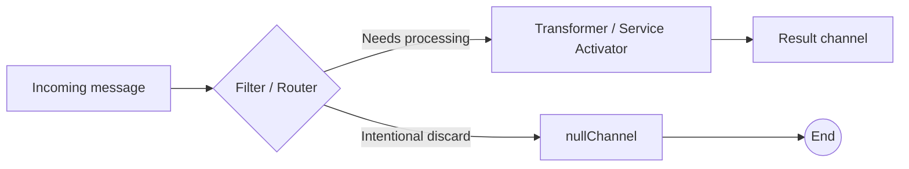

# Null Channel: Intentionally Discarding Messages in Spring Integration

## 1. Learning Objectives

In enterprise integration flows, not every message entering the system needs to trigger a processing task or produce a response. Some messages are technically valid but carry no business value: duplicate records already processed, events used solely for connection checks, or data excluded by an explicit rule. The **Null Channel** serves as an endpoint for cases where you want to **actively discard a message** from the processing flow.

This lesson is part of the `SPRING_INTEGRATION_PATTERN` module, which applies Enterprise Integration Patterns with Spring Integration to build loosely coupled, extensible flows where each branch can be tested and monitored.

After this lesson, you will be able to:

- Explain what a Null Channel is and distinguish intentional message discarding from processing errors.
- Use Spring Integration's built-in `nullChannel` to terminate a **Router** branch or receive messages discarded by a **Filter**.
- Write and test a Java DSL flow with observable output for retained messages.
- Evaluate the impact of discarding messages on a **Gateway**, **retry/error channel** mechanisms, and a **Splitter/Aggregator** with message correlation.
- Design observability to track discarded message counts without turning the Null Channel into a data store.

## 2. What Is a Null Channel?

Spring Integration provides a special `MessageChannel` bean named **`nullChannel`**. When a message is sent to this channel, the channel accepts and **discards the message** without forwarding it to any business consumer. This is the Enterprise Integration Patterns (EIP) implementation of the *Null Channel*, similar to the concept of a "black hole" for messages.

A Null Channel is useful when a flow has decided that a message **requires no further processing**. That decision should reside in a component with clear responsibility, typically a `Filter` or `Router`; the Null Channel is simply the termination point for the outcome of that decision.



Key characteristics to remember:

| Property | Meaning |
| --- | --- |
| Channel name | `nullChannel` is the standard name provided by Spring Integration infrastructure once integration configuration is enabled. |
| Behavior | Messages sent to the channel are discarded; this channel produces no outbound messages. |
| Scope | Used as a termination point for a flow branch or as a channel receiving discarded messages. |
| Return value of `send` | A successful send only indicates that the channel accepted the send operation; it does **not** mean business logic processed the message. |
| Storage | It is not a queue, repository, dead-letter queue, or channel for re-reading messages. |

**Note:** A Null Channel does not mean a `null` payload. A message in Spring Messaging requires a valid payload; sending a real message to `nullChannel` is different from having a handler return `null` (how handler output is handled depends on the endpoint type).

## 3. When Should You Use It and When Should You Not?

Use a Null Channel when **the discard rule is agreed upon** and having no further processing step is the intended outcome. For example:

- An application receives a `PING` event from a partner and intentionally discards it after verifying connectivity at the appropriate layer.
- A `Router` separates events by type, routing out-of-scope events to `nullChannel`.
- A `Filter` receives empty messages or messages failing a condition and forwards discarded messages to `nullChannel` to express design intent clearly.

Do not send a message to a Null Channel if its failure reason is unknown, if it needs investigation, or if it must be retried. Those cases typically require an `errorChannel`, retry, a dead-letter queue, or a traceable quarantine/storage channel.

| Scenario | Appropriate Choice | Reason |
| --- | --- | --- |
| "Heartbeat" notification with no business action | Router → `nullChannel` | The intent to ignore is explicit. |
| Data fails a filter condition and is allowed to be dropped | Filter → `nullChannel` | Clarifies the destination of the discarded branch. |
| Temporary error connecting to an external system | Retry and/or `errorChannel` | Error handling is required; work must not be silently lost. |
| Malformed schema message needing investigation | Error/quarantine channel | Payload and root cause must be preserved for remediation. |
| Record must be audited by regulation | Write audit record before ending | The Null Channel itself retains no records. |

## 4. Hands-On Example: Filter Discarding Empty Messages

Suppose an application receives text strings. Non-blank strings go to `acceptedChannel`; whitespace-only strings are discarded according to a business rule. We create a `DirectChannel` to receive input and a `QueueChannel` so we can inspect retained messages.

With Spring Boot, you can use the `spring-boot-starter-integration` dependency (and `spring-boot-starter-test` for testing); if configuring Spring Framework directly, include the corresponding Spring Integration libraries and enable `@EnableIntegration`. The following example focuses on the Spring Integration Java DSL:

```java
import org.springframework.context.annotation.Bean;
import org.springframework.context.annotation.Configuration;
import org.springframework.integration.channel.DirectChannel;
import org.springframework.integration.channel.QueueChannel;
import org.springframework.integration.config.EnableIntegration;
import org.springframework.integration.dsl.IntegrationFlow;
import org.springframework.messaging.MessageChannel;
import org.springframework.messaging.PollableChannel;

@Configuration
@EnableIntegration
public class IntakeFlowConfig {

    @Bean
    public MessageChannel intakeInput() {
        return new DirectChannel();
    }

    @Bean
    public PollableChannel acceptedChannel() {
        return new QueueChannel();
    }

    @Bean
    public IntegrationFlow intakeFlow() {
        return IntegrationFlow.from("intakeInput")
            .filter(String.class,
                text -> !text.isBlank(),
                filter -> filter.discardChannel("nullChannel"))
            .channel("acceptedChannel")
            .get();
    }
}
```

Step-by-step flow behavior:

1. Send `"Order 123"` to `intakeInput`. The filter returns `true`, and the message reaches `acceptedChannel` where a consumer can receive it.
2. Send `"   "` to `intakeInput`. The filter returns `false`, and the message is forwarded to `nullChannel` and ends.
3. There are no processing steps after `nullChannel`. On the discarded branch, the system also does not produce any business reply from this message.

Depending on policy, a `Filter` can drop rejected messages without declaring a `discardChannel`. Configuring `discardChannel("nullChannel")` here is helpful because readers of the code see **an explicitly specified discard destination**. If rejections need to be detected as errors, consider configuring the Filter's `throwExceptionOnRejection` option instead of defaulting to discarding the message.

### Testing the Behavior

Using JUnit 5, Spring Test, and AssertJ, we test both branches. `QueueChannel` helps verify that the valid branch produces output and the discarded branch does not.

```java
import org.junit.jupiter.api.Test;
import org.springframework.beans.factory.annotation.Autowired;
import org.springframework.beans.factory.annotation.Qualifier;
import org.springframework.messaging.Message;
import org.springframework.messaging.MessageChannel;
import org.springframework.messaging.PollableChannel;
import org.springframework.messaging.support.MessageBuilder;
import org.springframework.test.context.junit.jupiter.SpringJUnitConfig;

import static org.assertj.core.api.Assertions.assertThat;

@SpringJUnitConfig(IntakeFlowConfig.class)
class IntakeFlowTest {

    @Autowired
    @Qualifier("intakeInput")
    MessageChannel input;

    @Autowired
    @Qualifier("acceptedChannel")
    PollableChannel accepted;

    @Test
    void acceptsMessageWithContent() {
        boolean sent = input.send(
            MessageBuilder.withPayload("Order 123").build());

        Message<?> result = accepted.receive(1_000);
        assertThat(sent).isTrue();
        assertThat(result).isNotNull();
        assertThat(result.getPayload()).isEqualTo("Order 123");
    }

    @Test
    void discardsWhitespaceOnlyMessage() {
        boolean sent = input.send(
            MessageBuilder.withPayload("   ").build());

        assertThat(sent).isTrue();
        assertThat(accepted.receive(100)).isNull();
    }
}
```

In the second test, `send(...)` can still return `true`: the message was accepted into the flow and discarded **according to the rule**. Relying solely on the return value of `send(...)` will not tell you whether the message reached the target system. In an environment with multiple concurrent messages, verify output counts, correlation IDs, or per-branch metrics rather than simply waiting for any message.

## 5. Placing a Null Channel After a Router

If discarding depends on **message type** rather than a boolean condition, a Router is often easier to read. For example: a system receives two event types, `IGNORE` and `PROCESS`.

```java
@Bean
public IntegrationFlow routeEvents() {
    return IntegrationFlow.from("eventInput")
        .route(String.class,
            event -> event.startsWith("IGNORE:") ? "DROP" : "KEEP",
            router -> router
                .channelMapping("DROP", "nullChannel")
                .channelMapping("KEEP", "workChannel"))
        .get();
}
```

This Router example assumes `eventInput` and `workChannel` are already declared in the application configuration. Messages starting with `IGNORE:` go to `nullChannel`; remaining messages go to `workChannel` for further processing. In real-world projects, the routing key should be based on an event type or a field defined in the contract, avoiding treating an arbitrary string as a reliable business label.

Do not route all unrecognized values to `nullChannel` merely to avoid a "no route found" error. If a new event type might carry important data, set up a monitoring channel or an explicit rejection mechanism.

## 6. Interactions with Other EIPs

### Gateway and Request/Reply Flows

A **Gateway** can send a message and wait for a reply. If the request goes to `nullChannel`, that branch **produces no reply**. A Gateway waiting for a response may time out or receive different outcomes depending on the method signature and timeout configuration. Therefore:

- Only use a Null Channel for requests where the contract allows **no result**.
- If the client must receive an ACK or a "discarded" status code, build an **explicit reply** before ending the request instead of expecting the Null Channel to generate one.
- Test timeouts and caller behavior for both the processed branch and the discarded branch.

### Retry and Error Channel

`nullChannel` does not represent an error. A successful send to it does not automatically trigger retries, nor does it create an `ErrorMessage` on `errorChannel`. If calling an API or writing to a database throws an exception, let the retry/error handling mechanism process it according to policy. Only move a message to the Null Channel **after** a business decision determines that the message can be permanently discarded.

### Splitter, Aggregator, and Correlation

In a `Splitter → Filter/Router → Aggregator` flow, discarding a child message can cause the Aggregator to wait indefinitely for an incomplete group, especially when `sequenceSize` describes the entire original part count. Before discarding a child message, clearly determine:

- Does the Aggregator rely on `correlationId`, `sequenceNumber`, `sequenceSize`, or a custom release strategy?
- Does the group have a timeout, expiration, or partial-group handling mechanism?
- Should filtering happen **before the Splitter**, should aggregation rules be adjusted, or should a "skipped" result be emitted instead of losing a part entirely?

The Null Channel only handles the message in the current branch; it **does not automatically update** correlation group state in the Aggregator.

## 7. Observability and Operational Safety

A message sent to the Null Channel cannot be retrieved from the channel. For production flows, record sufficient information **before the point of discard**, depending on data sensitivity and operational requirements:

| What to Observe | Recommended Implementation |
| --- | --- |
| Number of discarded messages | Counter by `reason`, `flow`, and event type; avoid high-cardinality labels such as individual message IDs. |
| Why it was discarded | Structured logs or audit events at the Filter/Router, with standardized reason codes. |
| Which flow is discarding abnormally often | Dashboards or alerts on discard ratio relative to received message count. |
| Need for investigation or reprocessing | Save messages to a quarantine channel/process before terminating, per data requirements. |

An appropriate log contract example might include `flow=order-intake`, `reason=blank-content`, `traceId=<correlation-id>`, `decision=discard`. Do not log full payloads if they contain personal data, secrets, or payment information. Enabling framework-level logging, if available, **does not replace** business auditing.

A short checklist before taking a discard branch to production:

1. The discard rule can be expressed as a clear condition with an assigned owner.
2. The discard branch does not cause a Gateway to wait unexpectedly for a reply or an Aggregator to hang a group.
3. Transient errors still route through appropriate retry/error channels.
4. Tests cover retained messages, discarded messages, and edge cases.
5. Sufficient metrics or audit logs exist to detect abnormal discard rates.

## 8. Hands-On Exercise

**Scenario:** A system receives shipping events including `SHIPMENT_CREATED`, `SHIPMENT_UPDATED`, `PING`, and `UNKNOWN`. Design a Spring Integration flow with the following behavior:

1. Send `SHIPMENT_CREATED` and `SHIPMENT_UPDATED` to the shipping processing channel.
2. Route `PING` to `nullChannel`, while incrementing a `reason=heartbeat` counter.
3. Send `UNKNOWN` to a quarantine channel for investigation; do not discard it automatically.
4. Write at least three tests verifying each branch and one test ensuring `PING` does not appear in business output.

**Hint:** Use a `Router` on the `eventType` header, and only declare a mapping to `nullChannel` for the `PING` value. Consider where to record the metric so it only counts messages that actually enter the discard branch.

## 9. Key Takeaways

**Null Channel is an intentional termination point.** It helps systems build loosely coupled message flows with clear processing branches that are easy to extend using Filter or Router. Use it when discarding a message is a valid, designed outcome; and always verify its impact on Gateways, retries, error channels, and correlation before going to production.
