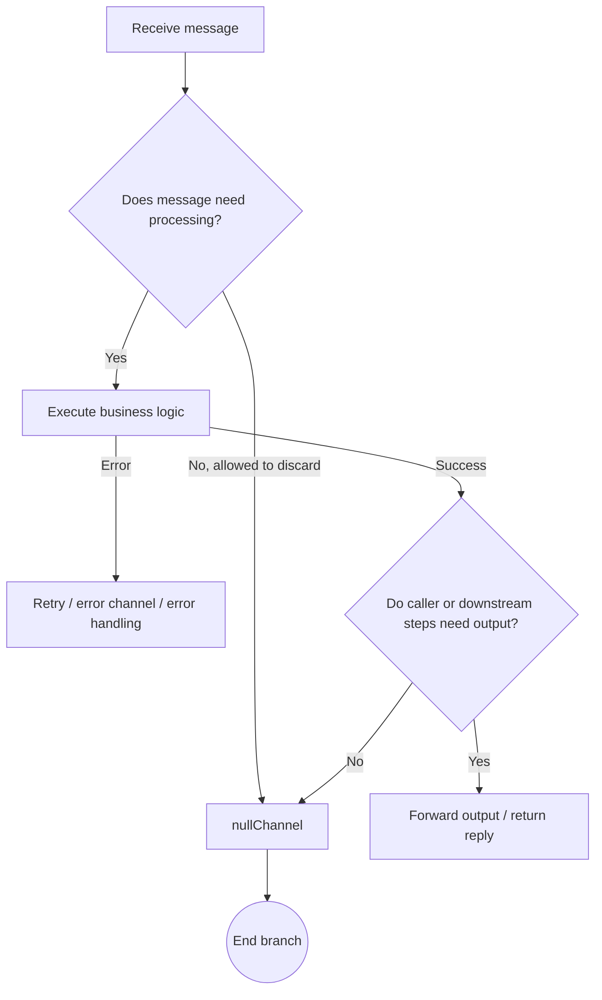
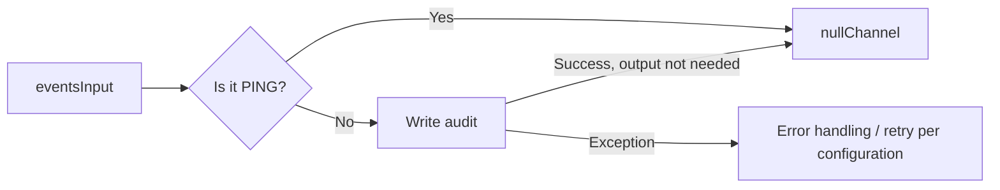

# When Discarding Output Is Valid Behavior in Spring Integration

## 1. Objectives and Context

In the `SPRING_INTEGRATION_PATTERN` module, we implement **Enterprise Integration Patterns** with Spring Integration to build loosely coupled, extensible message flows that can be tested and monitored. An important design decision for any flow is: **which outputs must be forwarded, and which outputs are allowed to terminate right here?**

Not every message needs a downstream recipient. For example, a system may receive a heartbeat solely to verify connectivity; or a consumer may have successfully written an event to an audit store with no other party needing a return value. When business rules allow it, **discarding output** is a valid flow outcome, not an error requiring recovery.

After this lesson, you will be able to:

- Determine the conditions under which messages or outputs can be intentionally discarded.
- Distinguish between **discarding a message before processing** and **discarding output after successful processing**.
- Configure `nullChannel` in the Spring Integration Java DSL and test a branch that emits no reply.
- Avoid losing errors, violating reply obligations, or breaking Splitter/Aggregator correlation.
- Place metrics and audits in the right places to know **why** a message was discarded.

## 2. What Does Discarding Output Mean?

In Spring Integration, `nullChannel` is a special channel with a standard bean name. Messages sent to it are accepted and **not forwarded to any business consumer**. A Null Channel is not a queue, repository, or place to retrieve previously discarded messages.

The term *discard* is commonly used in two closely related contexts with different decision points:

| Context | When to Discard? | Example |
| --- | --- | --- |
| **Discard message** | Before executing the business branch, after a Filter/Router decides the message needs no processing. | A `PING` heartbeat is sent directly to `nullChannel` by a Filter. |
| **Discard output** | After a step completes its work and produces output that no consumer needs. | A Service Activator has saved the audit record; the resulting message is sent to `nullChannel`. |

What they share is **actively terminating a branch**. The difference is that the second case is only valid if the previous step's business obligation has been fulfilled and no result is required by the caller or downstream components.

> Do not interpret "successfully sent to `nullChannel`" as "business processing succeeded." The channel only accepts and drops the message. Business status must be established at the exact place where the work is performed.

### Decision Diagram



Both branches leading to `nullChannel` must originate from **a valid decision**; the error branch follows its own error-handling policy.

## 3. Criteria for a Valid Discard

A discard decision should satisfy all of the following questions:

1. **Is there a clear business rule?** For example: drop only `PING`, events already processed per an idempotency key, or notifications marked `AUDIT_ONLY`.
2. **Are there any remaining obligations to fulfill?** If data must be persisted, state updated, or another event emitted, that step must complete before discarding output.
3. **Is anyone waiting for a reply?** A request/reply Gateway, synchronous API, or downstream component might depend on a result.
4. **Is traceability or recovery needed?** If the message belongs to a flow that requires investigation, reconciliation, or reprocessing, it must not be permanently dropped without a trace.
5. **Does discarding cause a missing part in correlation?** For example, an Aggregator waiting for all child messages emitted by a Splitter.
6. **Is the decision observable?** Metrics or audits must indicate the count and reason for discarding; `nullChannel` itself stores none of that information.

| Scenario | Can Discard? | Condition |
| --- | --- | --- |
| Recognized heartbeat requiring no further processing | Yes | No obligation to generate a business reply. |
| Event successfully audited; output is merely an intermediate value | Yes | The flow interface is one-way and no consumer is waiting. |
| Duplicate event confirmed by idempotency key | Possibly | Policy allows dropping duplicates with decision logging; if the caller requires an ACK, the contract must be satisfied. |
| HTTP call to partner timed out | No | This is an error/indeterminate condition requiring retry or error handling. |
| Event with an unrecognized schema version | Usually no | Should be rejected, quarantined, or monitored to avoid losing new data. |
| One part in a group awaited by an Aggregator | Must evaluate carefully | Requires an appropriate release strategy/timeout or a different filtering approach. |

## 4. Example: Discarding Heartbeats and Discarding Output After Auditing

Suppose a flow receives shipping events. `PING` only checks connectivity and should be discarded immediately. Remaining events must be audited; once auditing succeeds, no further consumer needs the Service Activator's output.



### Java DSL Configuration

This example uses Java 17 and the Spring Integration Java DSL. With Spring Boot, you can add `spring-boot-starter-integration`; tests use JUnit 5, Spring Test, and AssertJ. `AuditStore` below is an in-memory illustration: in real implementations, replace it with a repository or adapter with an appropriate transaction policy.

```java
import java.util.List;
import java.util.concurrent.CopyOnWriteArrayList;

import org.springframework.context.annotation.Bean;
import org.springframework.context.annotation.Configuration;
import org.springframework.integration.channel.DirectChannel;
import org.springframework.integration.config.EnableIntegration;
import org.springframework.integration.dsl.IntegrationFlow;
import org.springframework.messaging.MessageChannel;

@Configuration
@EnableIntegration
public class AuditOnlyFlowConfig {

    public record IntegrationEvent(String eventId, String type) {}

    public static class AuditStore {
        private final List<IntegrationEvent> events =
            new CopyOnWriteArrayList<>();

        public void save(IntegrationEvent event) {
            events.add(event);
        }

        public List<IntegrationEvent> snapshot() {
            return List.copyOf(events);
        }

        public void clear() {
            events.clear();
        }
    }

    @Bean
    public AuditStore auditStore() {
        return new AuditStore();
    }

    @Bean
    public MessageChannel eventsInput() {
        return new DirectChannel();
    }

    @Bean
    public IntegrationFlow auditOnlyFlow(AuditStore store) {
        return IntegrationFlow.from("eventsInput")
            .filter(IntegrationEvent.class,
                event -> !"PING".equals(event.type()),
                filter -> filter.discardChannel("nullChannel"))
            .handle(IntegrationEvent.class, (event, headers) -> {
                store.save(event);
                return event; // Internal output no longer needed by anyone
            })
            .channel("nullChannel")
            .get();
    }
}
```

**Why is this example valid?**

- The Filter sends `PING` to `nullChannel` because heartbeats are defined as outside the business scope requiring auditing.
- For normal events, `store.save(event)` happens **before** the output goes to `nullChannel`. The output event is discarded because there are no subsequent processing steps.
- If `store.save(event)` throws an exception, the handler returns no output and routing to `nullChannel` does not occur. The exception must be handled by the configured error/retry mechanism or propagated to the caller if using a synchronous channel.
- Because `eventsInput` is a `DirectChannel`, sending the message and invoking the handler happen on the calling thread in this example. With asynchronous channels, a successful `send(...)` may only confirm that the message entered the system, not that the audit save completed.

If a Service Activator genuinely does not need to produce output, you can design a one-way handler returning `void` and end the flow at the handler. In that case, adding `nullChannel` is **unnecessary**. Placing `.channel("nullChannel")` as shown is useful when a handler already emits an intermediate result but the contract explicitly permits discarding that result. Do not try returning `null` from a transformer/handler merely to simulate this channel; reply emission and reply requirements depend on the endpoint, so express intent clearly in the flow design.

## 5. Testing: Business Success and No Reply

When testing output discarding, checking `input.send(...) == true` alone is insufficient. You must verify that **the side effect completed** and **no reply was emitted** when the flow's contract is one-way. The example below uses a `QueueChannel` as an observable reply channel in the test:

```java
import org.junit.jupiter.api.BeforeEach;
import org.junit.jupiter.api.Test;
import org.springframework.beans.factory.annotation.Autowired;
import org.springframework.beans.factory.annotation.Qualifier;
import org.springframework.integration.channel.QueueChannel;
import org.springframework.messaging.MessageChannel;
import org.springframework.messaging.support.MessageBuilder;
import org.springframework.test.context.junit.jupiter.SpringJUnitConfig;

import static org.assertj.core.api.Assertions.assertThat;

@SpringJUnitConfig(AuditOnlyFlowConfig.class)
class AuditOnlyFlowTest {

    @Autowired
    @Qualifier("eventsInput")
    MessageChannel input;

    @Autowired
    AuditOnlyFlowConfig.AuditStore store;

    @BeforeEach
    void resetAudit() {
        store.clear();
    }

    @Test
    void pingIsDiscardedBeforeAudit() {
        var event = new AuditOnlyFlowConfig.IntegrationEvent("h-1", "PING");

        assertThat(input.send(MessageBuilder.withPayload(event).build()))
            .isTrue();
        assertThat(store.snapshot()).isEmpty();
    }

    @Test
    void businessEventIsAuditedButDoesNotProduceReply() {
        var event = new AuditOnlyFlowConfig.IntegrationEvent(
            "evt-42", "DELIVERED");
        var replyChannel = new QueueChannel();

        assertThat(input.send(MessageBuilder.withPayload(event)
            .setReplyChannel(replyChannel)
            .build())).isTrue();

        assertThat(store.snapshot()).containsExactly(event);
        assertThat(replyChannel.receive(100)).isNull();
    }
}
```

Limitations of this example: the test uses a `DirectChannel` and a simple in-memory store, so it verifies synchronous behavior. With a database, broker, or asynchronous executor, you must test commit timing, retries, and message acknowledgment mechanics specific to each adapter. You should also add a test for audit write failure to ensure exceptions **are not interpreted as a successful discard**.

## 6. Distinguishing Valid Discard from Swallowing Errors

`nullChannel` does not replace `errorChannel`. A technical error must be classified and handled according to policy: bounded retries, routing errors to an error flow, persisting data for reprocessing, or reporting failure to the caller.

Contrast examples:

```text
RIGHT:  event.type == PING     → discard per policy → nullChannel
RIGHT:  audit write succeeded  → output not needed  → nullChannel
WRONG:  audit write failed     → catch Exception    → nullChannel
WRONG:  unrecognized payload   → send all to nullChannel by default
```

If you catch `Exception` and send the message to Null Channel to suppress error reporting, the system may report success even though business work was not completed. When designing a *best-effort* branch that is genuinely allowed to fail, explicitly document the loss-tolerance policy, metrics, and operational procedures; that is a business reliability decision, not a property provided by Null Channel itself.

### Retry and Error Channel

- For synchronous endpoints, exceptions can propagate back to the sender; configured interceptors/advice or retry mechanisms will determine retry behavior.
- For asynchronous endpoints, errors may surface in the corresponding error-handling flow. Verify the actual `errorChannel` and how `ErrorMessage` is sent by the adapter/channel in use.
- After exhausting retry attempts, messages should be saved for reconciliation or moved to dead-letter/quarantine if required by policy. Never automatically route all failures to Null Channel.

## 7. Impact on Gateway, Correlation, and Other Patterns

### Request/Reply Gateway

A Gateway may wait for a reply from the flow. If the request is dropped by a Filter or an output is sent to `nullChannel`, **Null Channel produces no response**. A waiting caller may time out, receive `null`, or exhibit different behavior depending on the gateway method signature and `replyTimeout`/`requiresReply` settings.

Only design discards for one-way interactions or contracts that permit no reply. If an API requires an ACK or an "ignored" result, produce an explicit reply, such as `IGNORED`, before ending the corresponding flow. Do not rely on `nullChannel` as a default ACK mechanism.

### Splitter and Aggregator

If a Splitter emits `N` child messages and one branch sends some messages to `nullChannel`, the Aggregator may never see all `N` messages. This is especially dangerous when the release strategy depends on the initial `sequenceSize` and `sequenceNumber`.

The solution depends on the business contract: filter before the Splitter, redesign the group release condition, use group timeouts, or emit a correlated "ignored" result if the Aggregator genuinely needs to track the number of processed parts. `nullChannel` does not update correlation groups on behalf of the application.

### Transformer, Router, and Filter

- **Filter:** expresses a testable discard condition; `discardChannel("nullChannel")` explicitly states the destination of rejected messages.
- **Router:** routes message types permitted to be dropped to `nullChannel`; unrecognized types require a dedicated branch instead of a default drop.
- **Transformer/Service Activator:** when producing output that downstream does not need, route the output to `nullChannel` if the contract allows; avoid using a `null` return value as an ambiguous signal of success.

## 8. Observability: Knowing Exactly What Was Discarded

A flow allowed to discard messages still requires monitoring. Record information **at the decision point or immediately before termination**:

| Metric or Log | Usage |
| --- | --- |
| `messages_discarded_total{flow,reason}` | Counts intentionally discarded messages, e.g., `reason=heartbeat` or `reason=duplicate`. |
| `audit_completed_total{flow}` | Counts successfully completed side effects, independent of messages sent to `nullChannel`. |
| `audit_failed_total{flow}` | Detects failures needing retry/investigation; do not merge into discard counts. |
| `traceId`, `eventId`, `decision` | Traces from input message to processing decision; avoid logging sensitive payloads. |

Metric labels should have low cardinality (event type, flow, standardized reason). Do not use each `eventId` as a metric label, as this can cause time-series cardinality explosion. If full per-event auditing is required, use an appropriate log store or storage; Null Channel provides no replay or lookup capability.

**Transaction note:** If you must guarantee that "work is only considered complete once data is persisted," base completion on transaction commit or target system acknowledgment. Incrementing counters before a successful write can produce inaccurate metrics. Sending a message to `nullChannel` does not guarantee commit or exactly-once delivery.

## 9. Design Exercise

**Scenario:** An application receives four event types: `PING`, `AUDIT_ONLY`, `ORDER_CREATED`, and `UNKNOWN`.

1. `PING`: discard immediately via `nullChannel` and increment a `reason=heartbeat` counter.
2. `AUDIT_ONLY`: write an audit record; after a successful write, discard the output since there are no remaining consumers, and record a success metric.
3. `ORDER_CREATED`: route to order processing and emit results according to the downstream contract.
4. `UNKNOWN`: send to quarantine for investigation instead of silently dropping.
5. Write tests for all four branches, plus a test simulating an audit write failure to prove that no "false success" occurs.

**Open question:** If `ORDER_CREATED` arrives via a request/reply Gateway, what would you do so the caller receives a valid response when that event has already been processed (duplicate)? Why should you not send it to `nullChannel` by default?

## 10. Key Takeaways

Discarding output is valid behavior **when required work is complete, no mandatory consumer remains for the result, and the decision is observable and testable**. Use `nullChannel` to express a clear termination point for a Spring Integration branch; keep retry, error handling, Gateway replies, and correlation aligned with the business contract of the entire flow.
