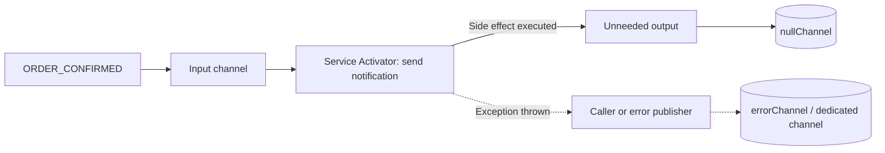
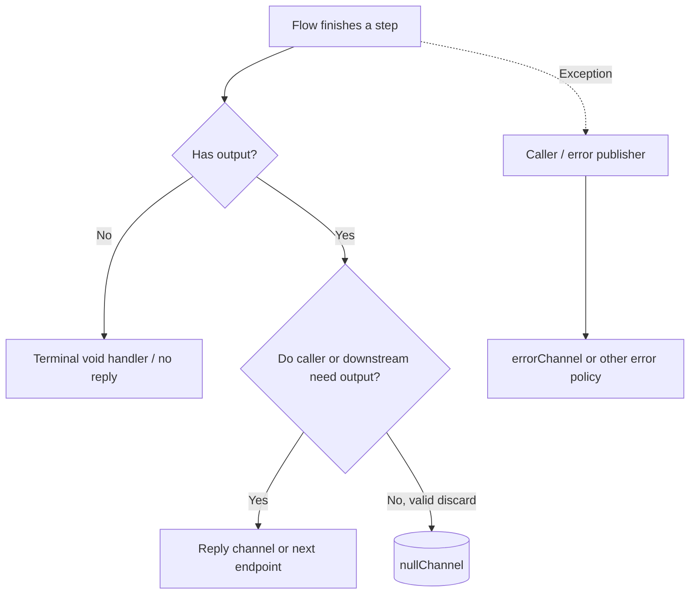
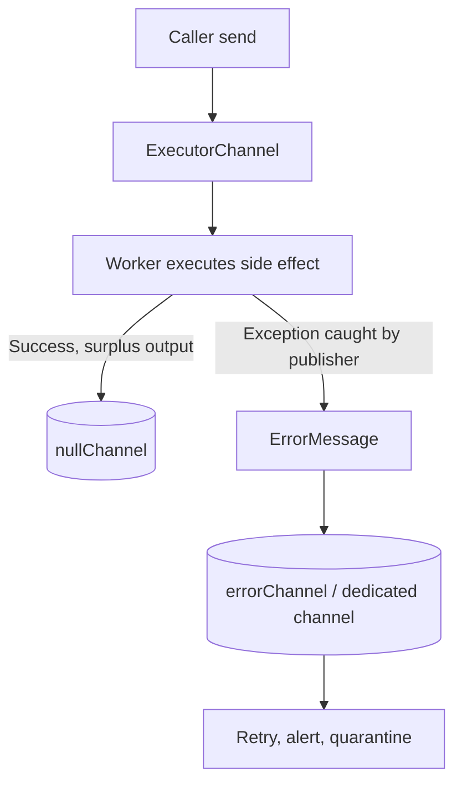

# Using Null Channel for One-Way Flows in Spring Integration

## 1. Context and Objectives

In the `SPRING_INTEGRATION_PATTERN` module, we apply **Enterprise Integration Patterns** (EIP) with Spring Integration to create loosely coupled, extensible, testable, and observable message flows. Many flows use Router, Filter, Transformer, Splitter, Aggregator, Gateway, retry, and Error Channel, yet not every flow needs to produce a **result message**.

For example, a service receives an `ORDER_CONFIRMED` event to send a notification or write a statistics record. The sender only wants to **hand off the work**; it does not require the system to return a business message. This is a form of **one-way flow**. If an intermediate endpoint still produces a reply that has no recipient, we can **actively route that result to `nullChannel`**.

In Spring Integration, `nullChannel` is a special destination channel used to **consume and intentionally discard messages**. It behaves like a "bit bucket": data sent to it will not be forwarded to another business handler.

After this lesson, you will be able to:

- Explain what a one-way flow is and distinguish it from request-reply via a Gateway.
- State clearly what `nullChannel` does and what it **does not guarantee**.
- Choose between a handler that ends without output and routing a reply to `nullChannel`.
- Write a Java DSL `IntegrationFlow` with a valid side effect, then explicitly discard the reply.
- Write JUnit tests verifying that the side effect occurs while no business reply is emitted.
- Distinguish valid discards from errors that should go to `errorChannel`, retry, or quarantine.
- Apply this concept alongside Router, Filter, Splitter/Aggregator, and asynchronous flows.

## 2. What Does a One-Way Flow Mean?

A **one-way flow** is a flow where the caller **does not require a business reply** from the receiver. It commonly appears in scenarios such as:

| Scenario | What Does One-Way Mean? | What Still Must Be Guaranteed? |
| --- | --- | --- |
| Emitting an event to update statistics | No need to send back the updated counter value. | Updates must have appropriate verification or error reporting mechanisms. |
| Sending email/notifications from an event | Caller does not wait for a `Message<?>` result from the send step. | Delivery status, retry/rate limiting, and error handling must be designed. |
| Writing an independent audit record | No need to return the audit object to the event source. | Audits may require durable storage and separate confirmation. |
| Receiving heartbeats | Processing result can be discarded when confirmed unnecessary. | Must not accidentally drop heartbeats that are mandatory to monitor. |

**One-way does not mean asynchronous.** A flow on a `DirectChannel` can run synchronously without producing a reply. Conversely, a flow running on an `ExecutorChannel` might still need to emit a completion event or job status later.

**One-way also does not mean "no error handling needed."** If a side effect fails, a synchronous call may throw an exception; a poller or asynchronous adapter may require an error publisher to send an `ErrorMessage` to an Error Channel.

### Illustrative Diagram



The **success** branch can discard output; the **error** branch still requires its own policy. Never use the same route to "swallow" both results and exceptions.

## 3. What Does nullChannel Do?

When Spring Integration infrastructure is enabled, the application typically has a built-in channel bean named `nullChannel`. This is a special destination endpoint: messages sent to it are **accepted and ignored**, rather than forwarded to a downstream business handler.

```text
Message with output value
         |
         v
  channel("nullChannel")
         |
         v
     flow ends
```

| Property | Behavior to Understand |
| --- | --- |
| Conventional name | `nullChannel`, distinct from the Java `null` value. |
| Sending a message to the channel | The message is accepted to be **discarded** by design; there is no downstream business consumer. |
| Reply message | `nullChannel` produces no reply for the caller. |
| Successful send | `send()` may return `true` because the channel accepted the message to drop it; this does not mean upstream business logic succeeded. |
| Retry | Does not automatically replay discarded messages. |
| Error handling | Does not replace `errorChannel` or throwing exceptions. |
| Storage | Not a durable queue, audit store, or dead-letter store. |

The name `nullChannel` sometimes leads beginners to confuse it with "returning `null`" or "sending a `null` payload." In Spring Messaging, a normal `Message` requires a valid payload; **discarding output** and **producing a `null` payload** are two different concepts.

### How Does nullChannel Differ from errorChannel and Dead-Letter?

| Mechanism | Purpose | When to Use? |
| --- | --- | --- |
| `nullChannel` | **Intentionally** discard a message. | Output is no longer needed, and discarding is accepted by business rules. |
| `errorChannel` | Deliver an `ErrorMessage` when an error publisher emits a failure. | Failures need to be observed, classified, or recovered. |
| Dead-letter/quarantine | Persist failed messages for investigation and possible replay. | Invalid payloads, retries exhausted, manual intervention required. |
| Reply channel | Send results back to the requester. | Request-reply, where a Gateway is waiting for a return value. |

If a business rule states that an event must not be lost, do **not** send that event to `nullChannel` just to make the flow end "quietly."

## 4. When Is nullChannel Actually Needed?

There are two valid ways to terminate a one-way flow:

**Approach A — Handler produces no output.** A Service Activator with a `void` method (or a one-way handler) completes its side effect and emits no reply. When there is no output to clean up, adding `nullChannel` is usually **unnecessary**.

```java
@ServiceActivator(inputChannel = "notificationInput")
public void sendNotification(String orderId) {
    notificationService.sendForOrder(orderId);
    // No business message returned.
}
```

Here, `notificationService` is a business component defined by the application. The example only illustrates a one-way contract style; if the method throws an exception, the application still must handle errors according to the execution boundary.

**Approach B — Endpoint produces output, but the output is not needed.** A Transformer, Service Activator, or Gateway adapter may produce a reply such as `"ACK"`, an intermediate result, or an execution status. When the business contract confirms this reply is **not needed**, setting the output channel to `nullChannel` clearly expresses the termination point.

```java
return IntegrationFlow.from("notificationInput")
    .handle(String.class, (payload, headers) -> {
        notificationService.sendForOrder(payload);
        return "NOTIFICATION_ACCEPTED"; // Internal reply does not need to be sent.
    })
    .channel("nullChannel")
    .get();
```

The snippet above illustrates the DSL portion inside a Spring configuration; `notificationService` must be provided by the application. `.channel("nullChannel")` specifies **the destination of the reply** produced by the handler, not a destination for exceptions.

### Decision Tree



Do not force all one-way flows through `nullChannel` just for uniformity. If an endpoint is already a terminal handler with no output, adding a discard step is redundant.

## 5. Java DSL Example: Send Notification Then Intentionally Discard Reply

We build a flow that receives `ORDER_CONFIRMED` and records that a notification request was issued. The handler returns an internal confirmation string to demonstrate the **has output** case, then routes it to `nullChannel` because the caller does not request a reply.

This example uses Java 17, the Spring Integration Java DSL, and `@EnableIntegration`. With Spring Boot, you can use `spring-boot-starter-integration`, and `spring-boot-starter-test` for JUnit 5/Spring Test/AssertJ.

```java
import java.util.List;
import java.util.concurrent.ConcurrentLinkedQueue;

import org.springframework.context.annotation.Bean;
import org.springframework.context.annotation.Configuration;
import org.springframework.integration.channel.DirectChannel;
import org.springframework.integration.config.EnableIntegration;
import org.springframework.integration.dsl.IntegrationFlow;
import org.springframework.messaging.MessageChannel;

@Configuration
@EnableIntegration
public class OneWayNullChannelConfig {

    public static class NotificationRecorder {
        private final ConcurrentLinkedQueue<String> delivered =
            new ConcurrentLinkedQueue<>();

        public void deliver(String orderId) {
            // Simulate a technical error to prove nullChannel does not swallow errors.
            if ("FAIL".equals(orderId)) {
                throw new IllegalStateException("Notification provider failed");
            }
            delivered.add(orderId);
        }

        public List<String> snapshot() {
            return List.copyOf(delivered);
        }

        public void clear() {
            delivered.clear();
        }
    }

    @Bean
    public NotificationRecorder notificationRecorder() {
        return new NotificationRecorder();
    }

    @Bean
    public MessageChannel notificationInput() {
        return new DirectChannel();
    }

    @Bean
    public IntegrationFlow notificationOneWayFlow(
            NotificationRecorder recorder) {

        return IntegrationFlow.from("notificationInput")
            .handle(String.class, (orderId, headers) -> {
                recorder.deliver(orderId);
                // A request-reply handler produces an intermediate output.
                return "NOTIFICATION_SENT_FOR_" + orderId;
            })
            // Reply exists but is not used by the business contract.
            .channel("nullChannel")
            .get();
    }
}
```

### Step-by-Step Trace

1. The caller sends a message containing `orderId` to `notificationInput`.
2. `DirectChannel` dispatches the message synchronously to the handler.
3. `recorder.deliver(orderId)` simulates the notification-sending side effect.
4. The handler produces the string `NOTIFICATION_SENT_FOR_<orderId>` as an internal reply.
5. The output is routed to `nullChannel` and ends. No business reply is sent back to the caller.

Just because a handler returns a confirmation string does not mean the sender has to receive it. The contract of this example is **one-way event delivery**; the intermediate reply is intentionally discarded.

**A note on reliability:** In this example, `NotificationRecorder` stores data in memory for easy testing; it is not a real email delivery system. With a real provider, a "request accepted" response does not necessarily mean "email delivered"; if the system needs delivery status, persist/propagate that status via an appropriate mechanism rather than discarding all result signals.

## 6. Testing a One-Way Flow: Side Effect Occurs, No Reply

Tests must verify two things **independently**:

1. Work was performed according to the contract: the recorder received `orderId`.
2. No business reply was sent to a caller's reply channel.

A `QueueChannel` used as a test reply channel confirms it receives no message after output is routed to `nullChannel`.

```java
import org.junit.jupiter.api.BeforeEach;
import org.junit.jupiter.api.Test;
import org.springframework.beans.factory.annotation.Autowired;
import org.springframework.beans.factory.annotation.Qualifier;
import org.springframework.integration.channel.QueueChannel;
import org.springframework.messaging.MessageChannel;
import org.springframework.messaging.support.MessageBuilder;
import org.springframework.test.context.junit.jupiter.SpringJUnitConfig;

import static org.assertj.core.api.Assertions.assertThat;
import static org.assertj.core.api.Assertions.assertThatThrownBy;

@SpringJUnitConfig(OneWayNullChannelConfig.class)
class OneWayNullChannelConfigTest {

    @Autowired
    @Qualifier("notificationInput")
    MessageChannel notificationInput;

    @Autowired
    OneWayNullChannelConfig.NotificationRecorder recorder;

    @BeforeEach
    void reset() {
        recorder.clear();
    }

    @Test
    void handlesOneWayEventAndDiscardsReply() {
        QueueChannel replies = new QueueChannel();

        boolean accepted = notificationInput.send(
            MessageBuilder.withPayload("order-42")
                .setHeader("eventId", "evt-42")
                .setReplyChannel(replies)
                .build());

        assertThat(accepted).isTrue();
        assertThat(recorder.snapshot()).containsExactly("order-42");
        assertThat(replies.receive(0)).isNull();
    }

    @Test
    void nullChannelDoesNotHideFailureInSynchronousHandler() {
        assertThatThrownBy(() -> notificationInput.send(
            MessageBuilder.withPayload("FAIL").build()))
            .satisfies(failure ->
                assertThat(rootCause(failure))
                    .isInstanceOf(IllegalStateException.class)
                    .hasMessage("Notification provider failed"));

        assertThat(recorder.snapshot()).isEmpty();
    }

    private static Throwable rootCause(Throwable failure) {
        Throwable current = failure;
        int depth = 0;
        while (current.getCause() != null && depth++ < 32) {
            current = current.getCause();
        }
        return current;
    }
}
```

The first test proves that **side effect and output are two separate concerns**: the work is recorded, and the reply is not sent back to `replies`. The second test causes the handler to throw an exception before returning a reply: `nullChannel` **cannot** hide an exception thrown by a synchronous handler upstream of it.

These tests only verify the Java DSL in a synchronous context with `DirectChannel`. Do not infer that sending to `nullChannel` provides durable ACKs, crash recovery, or confirmed email delivery from a real provider.

## 7. Null Channel and Gateway: Pay Special Attention to the Reply Contract

A Gateway is typically used when the caller expects request-reply behavior. If the caller invokes a method expecting a return value, but the flow sends all output to `nullChannel`, the Gateway may **never receive a reply** and wait until timeout (depending on contract and configuration).

```text
Gateway calls and waits for reply --> flow processes --> nullChannel
          |
          +--> No business reply to return
```

This can be a **design flaw** if the API expects a `PaymentResult`, transaction confirmation status, or additional data.

If the task is truly one-way, express it directly in the contract, for example:

```java
@MessagingGateway
public interface NotificationGateway {
    @Gateway(requestChannel = "notificationInput")
    void notifyOrder(String orderId);
}
```

This example shows a Gateway with a `void` method that does not require a business reply. `@MessagingGateway` and `@Gateway` belong to `org.springframework.integration.annotation`, and the interface must be registered via gateway scanning configuration or an appropriate bean. `void` only describes a no-return-value contract; it does **not** mean asynchronous work has definitely succeeded.

**Separate two kinds of signals:**

- **Request acceptance:** the channel/adapter accepted the message.
- **Business completion:** the task completed properly, which may require transactions, completion events, or state persistence.

When using a one-way Gateway with an executor or broker, the caller may receive an acceptance signal before the task finishes. Do not interpret that signal as confirmation that payment, email delivery, or inventory updates succeeded.

## 8. Null Channel in Router, Filter, and Other Integration Flows

### 8.1. Router: Valid Discard Branch

A Router can route an event type allowed to be skipped to `nullChannel`. For example, internal heartbeats requiring no further processing:

```text
Inbound events --> Router
                    |--> ORDER_CONFIRMED --> notificationFlow
                    |--> HEARTBEAT_ALLOWED --> nullChannel
                    |--> UNKNOWN --> quarantine or error flow
```

The discard route must be defined by a **specific business policy**; do not use `nullChannel` as a default sink for any message you do not know how to handle. If a Router cannot find a target for an important message, you need fail-fast behavior, quarantine, or an appropriate investigation mechanism.

### 8.2. Filter: Intentionally Discarded Output

A Filter can reject messages based on a filter condition. If rejection is valid, the message can be discarded without producing an error. When you need to distinguish discard reasons and count occurrences, you can configure a discard channel or record metrics before forwarding to `nullChannel`, depending on how the flow is organized.

Do not treat every Filter rejection as an error; likewise, do not treat every message dropped by a Filter as harmless if business rules require alerting on malformed data.

### 8.3. Transformer and Service Activator

If a Transformer produces a transformed payload with no remaining consumer, sending its output to `nullChannel` destroys the transformed data. Before doing so, make sure the result truly has no further business significance.

For a terminal Service Activator with `void` output, `nullChannel` is **unnecessary** just to prove it is one-way. Use `nullChannel` primarily when an emitted output needs to be explicitly discarded.

### 8.4. Splitter and Aggregator

If a Splitter generates child messages and you discard some of them via `nullChannel`, a downstream Aggregator may **never receive enough parts** to satisfy its release strategy. For example, splitting an order into 5 items, dropping the 3rd item while `sequenceSize` remains 5; the group may wait until timeout.

If dropping items is a valid policy, redesign the release condition, adjust correlation logic, or emit an appropriate status result. **`nullChannel` does not automatically update group state** and does not notify the Aggregator that an item was discarded.

## 9. Asynchronous Boundaries and Errors in One-Way Flows

In a synchronous `DirectChannel`, exceptions from a handler can propagate back to `send(...)` as shown in the test above. However, if a flow switches to an `ExecutorChannel`, a `QueueChannel`/poller, or an adapter with its own worker, the send call can finish before the side effect occurs.



`nullChannel` handles **valid output that should be discarded**; it does not replace error paths. A handler throwing an exception on a worker thread may need an error publisher to create an `ErrorMessage` and send it to `errorChannel` or a dedicated error channel. Never assume every worker exception automatically reaches the global `errorChannel`; this depends on the endpoint/adapter and configuration.

When an adapter uses a broker, check **ack/nack, transactions, and redelivery**. If a message is already ACKed before the side effect actually completes, discarding output via `nullChannel` will not help recover the message when processing fails.

### Retry Does Not Mean Replaying from nullChannel

`nullChannel` does not keep a copy for replay. If retries are required, retry decisions must happen **before the discard point** or rely on a suitably reliable replay source. For operations with side effects (payments, sending notifications, writing data), an idempotency key or deduplication mechanism is needed.

## 10. Observing One-Way Flows: Measure Success, Discard, and Failure

Intentional reply discarding must not turn the flow into a "black box." Measure **inputs**, **side-effect completion**, **discarded outputs**, and **failures** separately:

| Metric / Log | Purpose |
| --- | --- |
| `oneway_messages_received_total{flow}` | Number of requests entering the one-way flow. |
| `oneway_side_effect_success_total{flow}` | Number of business operations completed successfully. |
| `oneway_outputs_discarded_total{flow,reason}` | Number of outputs intentionally discarded. |
| `oneway_failures_total{flow,type}` | Number of business/technical failures. |
| `oneway_recovery_total{flow,result}` | Outcomes of retries or quarantine storage. |
| `eventId`, `correlationId` in logs | Trace requests and asynchronous processing if applicable. |

Do not infer "side effect succeeded" from the count of messages entering `nullChannel` if the pipeline has separate error-publishing or confirmation mechanisms. When reporting discarded counts, measure at the **discard decision point**; do not assume you can attach a business subscriber to `nullChannel` to audit every message.

Do not use `eventId` as a metric label because it can create excessive time-series cardinality. Avoid logging full payloads, tokens, payment details, or personal data. If per-task tracing is required, use an audit store or appropriately governed trace logs.

## 11. Common Mistakes

| Mistake | Consequence | How to Prevent |
| --- | --- | --- |
| Sending all output to `nullChannel` because the recipient is unknown | Important business results may be lost. | Clearly define the contract of each output before discarding. |
| Using `nullChannel` as a sink for `ErrorMessage` | Masks errors; no retry/quarantine. | Use `errorChannel` and an error flow with a clear owner. |
| Treating `send() == true` as async task success | Reports false success before the worker executes. | Separate accepted, completed, failed, and retry states. |
| Gateway expects a reply while output is discarded | Caller may wait until timeout. | Use a `void` Gateway for one-way contracts or emit an actual reply. |
| Dropping part of Splitter output without considering Aggregator | Correlation group may wait with missing parts. | Design release strategy/timeouts and policies for skipped parts. |
| Expecting to replay messages sent to `nullChannel` | No durable data exists for replay. | Persist work in a broker/database/quarantine before discarding if needed. |
| Adding a discard channel after an already terminal `void` handler | Adds unnecessary complexity. | End the flow with the no-output handler. |

## 12. Hands-On Exercise

**Scenario:** A system processes `ORDER_PAID` events to send notifications, update statistics, and write audit records. No party expects a business reply back to the event publisher.

1. Choose which cases should terminate with a `void` handler and which cases should have a handler produce an intermediate reply and send it to `nullChannel`. Explain why.
2. Write an `IntegrationFlow` using `.channel("nullChannel")` after a handler returning `String`. Test that the side effect occurs while a `QueueChannel` used as a reply channel receives no result.
3. Make the handler throw `IllegalStateException`; prove that `nullChannel` does not turn that error into a successful outcome on a `DirectChannel`.
4. Move a branch onto an executor, comparing when `send()` returns versus when the side effect completes. Design an error publisher and bounded retries.
5. Create a Router with `ORDER_PAID`, `HEARTBEAT_ALLOWED`, and `UNKNOWN`; only route `HEARTBEAT_ALLOWED` to `nullChannel` when business rules allow it.
6. Split an order into multiple items with a Splitter, validly discard one item, and design how the Aggregator avoids waiting indefinitely.
7. Propose metrics and audit fields that distinguish "request received," "processed successfully," and "output discarded."

**Self-check questions:** Is `nullChannel` the same as Java's `null` value? If a reply goes to `nullChannel`, what will a Gateway waiting for a reply receive? Why is a one-way flow not necessarily an asynchronous flow? Why must Error Channel and retries remain separate from the discard point?

## 13. Key Takeaways

**Use `nullChannel` for a one-way flow when you intentionally want to discard a valid output and no one needs a business reply.** If a terminal handler already produces no output, `nullChannel` is not required. It is a message termination point, not an error handler, retry scheduler, or durable store. When implementing EIPs with Spring Integration, keep one-way contracts, error paths, correlation, side-effect testability, and observability distinct so the simplicity of a one-way flow never turns into silent data loss.
