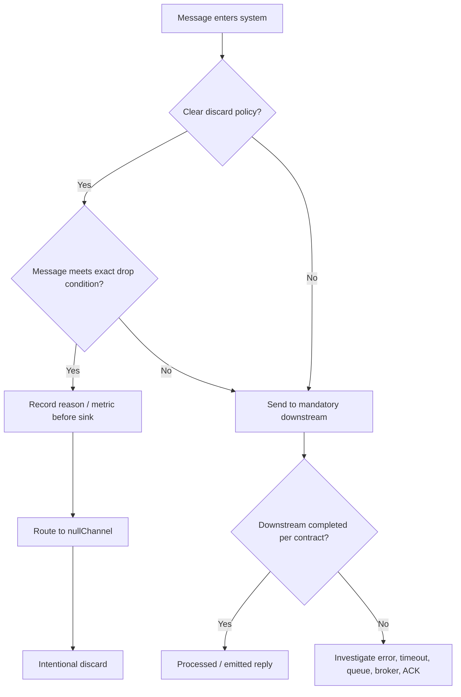
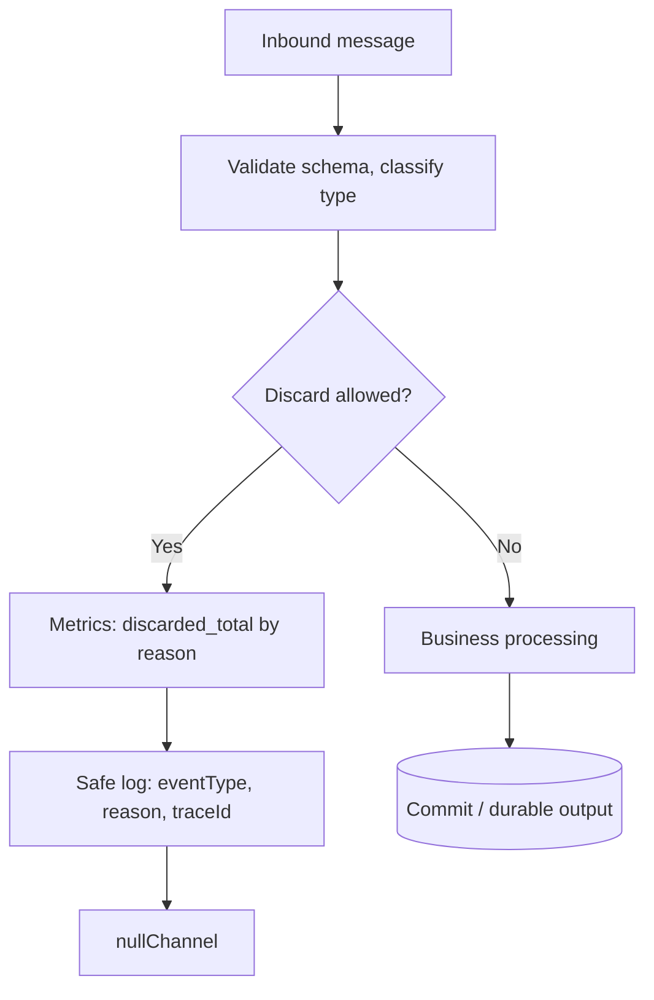
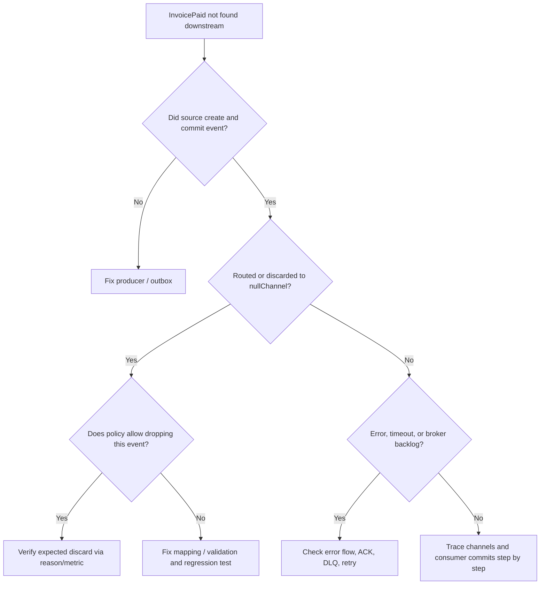

# Distinguishing Null Channel from Message Loss

## 1. The Problem: Is a Missing Downstream Message an Error or Intentional?

In the **SPRING_INTEGRATION_PATTERN** module, we practice *Enterprise Integration Patterns* with Spring Integration to build loosely coupled, extensible, and observable message flows. Router, Filter, Transformer, Splitter, Aggregator, Gateway, retry, error channel, and correlation are combined to handle diverse processing needs. One very small yet easily misunderstood component is **`nullChannel`**.

Suppose a system receives two types of messages:

- `HeartbeatReceived` is emitted every second solely for connectivity checks. After updating the required connection state, the application **does not want to process** the heartbeat payload any further.
- `PaymentSettled` confirms payment settlement. This message must be recorded, update the ledger, and emit a subsequent event. If dropped, the system could lose business data.

Both cases can show **no message at downstream steps**, yet their nature is completely different: the first case is **intentional discard**, while the second case could be **unintended message loss**.

> **Principle:** `nullChannel` is an **explicitly designated destination for consuming and discarding messages**. It is not a place to "recover" failed messages, holds no backlog, and does not guarantee that business processing succeeded. To distinguish intentional discarding from message loss, you must know **the message contract, routing decisions, and traces at each boundary**.

### Learning Objectives

After this lesson, you will be able to:

1. Explain accurately how `NullChannel` handles `send()`, `receive()`, and logging.
2. Distinguish "routed to `nullChannel`" from "no subscriber," "Filter rejection," "missing Gateway reply," "broker delivery failure," and "swallowed exception."
3. Specify a safe discard destination in a Filter, Router, or at the end of an integration flow.
4. Identify places where `nullChannel` must **not** be used: payments, mandatory audits, retry/DLQ, and errors needing investigation.
5. Write tests and design logs/metrics to prove a message was discarded by policy rather than vanishing for unknown reasons.

## 2. What Is `NullChannel` Technically?

Spring Integration provides a special channel named **`nullChannel`** (a bean registered by default by the framework in an application context configured with Integration). Its implementation type is `org.springframework.integration.channel.NullChannel`, which acts like `/dev/null` on an operating system:

- Accepts messages sent to it and **discards them**.
- `send(Message<?>)` returns `true`; this is an acknowledgment of the **channel contract**, not confirmation of business processing.
- It also implements `PollableChannel`, yet `receive()` or `receive(timeout)` returns `null`: there are no messages to retrieve.
- Typically logs messages only at **DEBUG** level. It does not imply that a mandatory audit record was saved.
- It is not a queue, broker topic, Dead Letter Queue, or `MessageStore`.

The Javadoc describes this fundamental behavior as a "sink" that accepts any message and discards it. No consumer needs to subscribe to `nullChannel` for a send to be accepted.

### 2.1. A Simple Experiment: `send=true`, `receive=null`

```java
import org.springframework.integration.channel.NullChannel;
import org.springframework.integration.support.MessageBuilder;
import org.springframework.messaging.Message;

NullChannel sink = new NullChannel();
Message<String> message = MessageBuilder.withPayload("HEARTBEAT").build();

boolean acceptedByChannel = sink.send(message);
Message<?> readable = sink.receive(0);

System.out.println(acceptedByChannel); // true
System.out.println(readable);          // null
```

This snippet requires no Spring context and illustrates the class's essence. In a real integration flow, use the **built-in `nullChannel` bean**; do not declare another bean with the same name.

If you replace `HEARTBEAT` with `PAYMENT_SETTLED`, `send=true` and `receive=null` remain identical. Therefore, **never use the return value of `send()` as proof of payment completion, audit persistence, or event publication**.

### 2.2. Different from Java `null` or Payloadless Messages

Three similarly named concepts do not share the same meaning:

| Concept | Interpretation |
| --- | --- |
| `nullChannel` | A **specific channel** that consumes and discards messages sent to it. |
| Java `null` from a service method | A handler may **produce no reply**; no new message is emitted from a `null` result. |
| `receive() == null` on a `PollableChannel` | No message returned; on `NullChannel` this is intentional behavior, whereas on `QueueChannel` it may simply mean the queue is empty or timed out. |

You cannot take a `Message` object with a `null` payload under the normal Spring Messaging contract and treat it as "sending to null channel." In some protocols such as Kafka, *tombstones*/null values carry specific semantics; they are **not equivalent** to Spring Integration's `NullChannel`.

### 2.3. Special Note on Reactive Payloads

In Spring Integration versions with Reactive Streams support, if the payload sent to `nullChannel` is an `org.reactivestreams.Publisher`, the channel **may immediately subscribe** to trigger the reactive stream and discard emitted data; `onError` errors from the publisher are logged at WARN level. Thus, do not assume sending a `Mono` or `Flux` here has zero interaction: subscribing can trigger the publisher's logic, including side effects if the pipeline contains any.

## 3. Map: Different "Missing Message" Symptoms

| Symptom | Where Did the Message Go? | Intentional? | How to Verify |
| --- | --- | --- | --- |
| Router/Filter routes to `nullChannel` | Sent to sink and dropped | Yes, if policy is clearly defined | Check route/discard config, tests, and counters before the sink. |
| Filter returns `false`, no discard channel | Dropped by Filter per configuration | Possibly, though easily lacks a trace | Check predicate, log level, error/discard policy. |
| Router cannot find channel | Usually resolution/delivery error per config | Usually no | Check exceptions, `resolutionRequired`, mappings, and default route. |
| `DirectChannel` has no subscriber | May throw dispatch/delivery error | No | Check lifecycle, subscribers, sender error logs. |
| `QueueChannel.receive(timeout)` returns `null` | Message not retrieved within timeout | Insufficient evidence | Check queue depth, poller, timing, and transactions. |
| Gateway receives no reply | Request received no valid reply before deadline | Usually no, except one-way contracts | Check `replyChannel`, Filter, `replyTimeout`, error handling. |
| Broker disconnect / consumer ACKed too early | Message may not have arrived or can no longer be redelivered | No | Reconcile publisher confirms, offsets/ACKs, DB commits, DLQ. |
| Process crash with in-memory-only message storage | Non-durable state may be lost | No | Fault-injection restart, store/backlog/recovery tests. |
| `ErrorMessage` routed to `nullChannel` | Error dropped, possibly uninvestigated | Only if an explicit decision exists | Check `errorChannel`/error flow and monitoring contract. |

The key point is that **a single symptom does not prove a single cause**. Failing to see a message in the output is not enough to conclude it went to `nullChannel`; you must trace back through the message channels, endpoints, and ingress source.

## 4. Decision Flowchart: Valid Drop or Accidental Loss?



Examples that both yield no output:

```text
HEARTBEAT(eventId=hb-42)
  -> Filter: not business event
  -> discarded_reason=EXPECTED_HEARTBEAT
  -> nullChannel
  -> No output: MATCHES contract

PAYMENT_SETTLED(eventId=pay-42)
  -> Router: defaultOutputChannel=nullChannel  // misconfigured requirement
  -> No ledger update: BUSINESS ERROR even though send() may be true
```

**Intent can only be verified from the defined contract**, not inferred from the technical path. If an important business message falls into the sink due to a wrong key, the code still runs "as configured," yet the system behaves incorrectly.

## 5. Reasonable Case: Dropping Telemetry or Heartbeats Not Needed Downstream

An application may allow dropping heartbeats after connection state has been updated in the appropriate place. The following example uses a `@Filter` annotation to forward only **business events** to the processing channel; rejected heartbeats are explicitly sent to `nullChannel`.

### 5.1. Channel and Filter Configuration

```java
import org.springframework.context.annotation.Bean;
import org.springframework.context.annotation.Configuration;
import org.springframework.integration.channel.DirectChannel;
import org.springframework.integration.channel.QueueChannel;
import org.springframework.integration.config.EnableIntegration;
import org.springframework.messaging.MessageChannel;

@Configuration
@EnableIntegration
public class TelemetryFlowConfig {

    @Bean
    public MessageChannel telemetryInput() {
        return new DirectChannel();
    }

    @Bean
    public QueueChannel actionableTelemetry() {
        return new QueueChannel();
    }
}
```

```java
import org.springframework.integration.annotation.Filter;
import org.springframework.messaging.Message;
import org.springframework.stereotype.Component;

@Component
public class TelemetrySelection {

    @Filter(
        inputChannel = "telemetryInput",
        outputChannel = "actionableTelemetry",
        discardChannel = "nullChannel")
    public boolean keepBusinessEvent(Message<?> message) {
        return !"HEARTBEAT".equals(message.getHeaders().get("eventType"));
    }
}
```

This example uses a `DirectChannel` input and a `QueueChannel` output for observation in tests. When receiving header `eventType=HEARTBEAT`, the Filter returns `false` and sends the message to `nullChannel`; other events go to `actionableTelemetry`. **Important assumption:** messages are already validated at the ingress boundary; an event missing `eventType` should not automatically be treated as a business event as in this simple predicate in production. Add validation if required by the schema.

In a real environment, `actionableTelemetry` must have a consumer/poller, capacity policy, and appropriate queue cleanup. The default `QueueChannel` in the example does not automatically guarantee persistence across restarts.

### 5.2. Do Not Use NullChannel in Place of Recording the Decision

In the example above, `nullChannel` only debug-logs the message if logging configuration allows it. If you need to know how many heartbeats were dropped, **measure before sending to the sink**. You can use:

- Counting messages classified as `HEARTBEAT` at the Filter step or discard flow.
- Structured logging with `eventType` and a `reasonCode` containing no sensitive data.
- A dedicated `discardChannel` with a Service Activator that records metrics and terminates the flow, or forwards to `nullChannel` after recording.

Do not make `nullChannel` responsible for auditing because it has no store or replay. If losing metrics is also unacceptable, those metrics must have an independent, durable pipeline.

## 6. Dangerous Case: Router Using NullChannel as Default Branch

A Router can be configured with `defaultOutputChannel="nullChannel"` to **drop** messages when no route is determined. For best-effort logs/telemetry, that may be an acceptable policy. For payments, orders, refunds, or mandatory audits, this is usually an anti-pattern.

```java
// ANTI-PATTERN: important transaction is dropped if provider is unknown.
return IntegrationFlow.from("incomingPayments")
        .route("headers['paymentProvider']", route -> route
                .channelMapping("CARD", "cardRequests")
                .channelMapping("BANK", "bankRequests")
                .defaultOutputChannel("nullChannel"))
        .get();
```

If a message arrives with header `paymentProvider=EWALLET` after integrating a new partner, the Router can send it to the sink per the default configuration. No business error forces the system to process or alert on it.

### 6.1. Fixed Design: Unsupported Routes Must Be Observable

```java
// Send unmapped keys to a purposeful error-handling branch.
return IntegrationFlow.from("incomingPayments")
        .route("headers['paymentProvider']", route -> route
                .channelMapping("CARD", "cardRequests")
                .channelMapping("BANK", "bankRequests")
                .defaultOutputChannel("unsupportedPaymentRequests"))
        .get();
```

`unsupportedPaymentRequests` needs an actual subscriber: for example, a Service Activator marking `UNSUPPORTED_PROVIDER`, recording a reason code, emitting a contracted error, or routing to manual review. Simply creating a channel with no consumer will still result in delivery errors.

**Important note on Router configuration:** `defaultOutputChannel` is only one piece. `resolutionRequired`, `channelKeyFallback`, channel mappings, and `ignoreSendFailures` affect how a Router handles nonexistent channels or send failures. Since Spring Integration 6.0, configuring a default output channel also adjusts the default `channelKeyFallback` behavior. Never assume "every routing failure falls into the default channel"; test each kind of invalid key and invalid channel against the library version in use.

## 7. Filter Rejection: Discard, Fail, or Route to a Business Branch?

A Filter does not necessarily send messages to `nullChannel` when the predicate returns `false`. Behavior depends on configuration:

| Filter Configuration | When Predicate Returns `false` | When to Use |
| --- | --- | --- |
| No `discardChannel`, no throw | Message is dropped; since Spring Integration 6.1, logs WARN for default drops | Only when the drop policy is clear and default logging is acceptable. |
| `discardChannel="nullChannel"` | Message is intentionally dropped, suppressing Filter's default drop warning | Telemetry not needed, observed elsewhere if necessary. |
| `discardChannel="rejectedMessages"` | Message moves to another consumer | When rejection reporting, reason persistence, or investigation is required. |
| `throwExceptionOnRejection=true` | Throws `MessageRejectedException`; if a discard channel exists, the message may still be sent there before throwing | Invalid data requiring fail-fast and explicit error handling. |

For example, with a payment command that must be authenticated, never silently discard rejected commands:

```java
import org.springframework.integration.annotation.Filter;
import org.springframework.messaging.Message;
import org.springframework.stereotype.Component;

@Component
public class PaymentInputValidation {

    @Filter(
        inputChannel = "paymentInput",
        outputChannel = "validatedPaymentCommands",
        throwExceptionOnRejection = "true")
    public boolean hasRequiredCommandId(Message<?> message) {
        Object commandId = message.getHeaders().get("commandId");
        return commandId instanceof String id && !id.isBlank();
    }
}
```

Here, `paymentInput` and `validatedPaymentCommands` must be declared and wired to the proper consumers. When `commandId` is missing, the exception signals an input error; the error flow or caller must have a response policy. Do not turn an invalid financial command into "accepted and ignored."

**Distinguish validation from business policy:** a customer declined for credit can be a **valid business outcome**, not necessarily a technical exception. In that case, emit `Rejected(reasonCode)`, update state, and route to the response branch; do not use `nullChannel` to "hide" rejection decisions.

## 8. Gateway: Intentional One-Way vs. Lost Reply

`Gateway` converts Java calls into request/reply interactions in the messaging system. You must distinguish **methods not expecting a reply** from **methods requiring a reply that gets lost**.

### 8.1. `void` Methods: Downstream Results Can Be Intentionally Discarded

Since Spring Integration 5.4, when a gateway method returns `void`, the framework can set the `replyChannel` header to the `nullChannel` bean if no reply channel is explicitly provided. This fits the **one-way** contract: the caller does not expect a return payload.

```java
import org.springframework.integration.annotation.Gateway;
import org.springframework.integration.annotation.MessagingGateway;

@MessagingGateway
public interface OneWayCommandGateway {

    @Gateway(requestChannel = "oneWayCommandInput")
    void submitHeartbeat(String heartbeat);
}
```

However, **`void` does not mean asynchronous sending or durable delivery**. If the flow uses a `DirectChannel`, the handler can still run synchronously within the call; exceptions can also propagate to the caller. Do not use a `void` method as proof that a command was persisted to a broker or database.

### 8.2. Methods Requiring a Reply: Filter Drops Will Leave the Caller Waiting

Consider a gateway:

```java
@MessagingGateway
public interface PaymentQueryGateway {

    @Gateway(requestChannel = "paymentQueries",
             replyTimeout = 3_000L)
    PaymentStatus query(PaymentQuery request);
}
```

`PaymentQuery` and `PaymentStatus` are business types to be defined in the project. If a downstream Filter drops the request or a Service Activator returns Java `null`, no reply returns to the gateway. The gateway may exhaust `replyTimeout` and return `null`, or throw `MessageTimeoutException` if configured with `errorOnTimeout` accordingly. If a synchronous handler **is blocking on the same thread**, `replyTimeout` alone may not bound total handler execution time; configure timeouts at the adapter/client and use asynchronous design where appropriate.

In particular, never fix a "lost reply" by routing output to `nullChannel`: that intentionally **removes the reply** instead of resolving the missing result. If business rules require a response, return `NOT_FOUND`, `REJECTED`, a structured error, or handle it via an error channel per contract.

### 8.3. When to Route an Unneeded Reply to the Sink?

A flow that produces a technical result not needed by the caller can terminate with `nullChannel`. For instance, after recording telemetry, a Transformer may produce a useless intermediate value. Routing that result to the sink to avoid reply channel resolution errors is reasonable **if upstream is not waiting for a reply**. Do not use the sink to "work around" a Gateway with a mandatory return type.

## 9. NullChannel Is Not errorChannel, DLQ, or MessageStore

| Component | Role | Retained for Later Processing? |
| --- | --- | --- |
| `nullChannel` | Terminates and discards messages sent to it | **No** |
| `errorChannel` | Receives `ErrorMessage` for processing by an error flow | **No guarantee** of durability from channel name alone; depends on topology. |
| `discardChannel` | Destination chosen by Filter/Aggregator or other components when discarding messages | **Depends on target channel**: could be `nullChannel`, queue, service, or adapter. |
| `QueueChannel` | Temporarily buffers messages waiting for poller/consumer | May live in RAM; durable only if configured with a suitable store. |
| Broker durable queue/topic | Stores messages per broker contract | Supports redelivery within durability/retention/ACK configuration. |
| Dead Letter Queue | Holds failed messages after retry policy | Requires consumer, retention, and replay/investigation procedures. |
| `JdbcChannelMessageStore` | Stores messages for supported channels | Does not provide fan-out and does not replace transactions/outbox. |

Usually, you should not set `errorChannel="nullChannel"` just to "stop seeing exceptions." Doing so can make critical technical failures vanish from observability systems. If a specific error type is genuinely safe to ignore, apply a **conditional policy**, count errors by type, and then terminate; do not drop all errors on the same channel indiscriminately.

### 9.1. Async Error Handling Does Not Guarantee Redelivery

With a synchronous `DirectChannel`, exceptions usually propagate back to the sender. When a flow traverses an `ExecutorChannel`, poller, inbound adapter, or broker listener, errors can occur on another thread and go to `errorChannel`/an error flow. Even after receiving an `ErrorMessage`, the original business message does not automatically gain redelivery. You must examine source ACK/offset handling, transactions, retry/DLQ, and idempotent processing.

### 9.2. "No Logs Seen" Does Not Prove NullChannel Did Not Receive It

`NullChannel` logs at DEBUG level; if logging is at INFO/WARN, you will not see DEBUG lines. Conversely, enabling DEBUG across the entire application can expose payloads or generate excessive volume. Use structured metrics/logs **before sending to the sink**, with clear reason codes, rather than leaving DEBUG enabled long-term.

## 10. Java DSL: Ending a Flow After Intentional Logging

The Java DSL `log()` operator uses a `WireTap` mechanism; by itself, it is not necessarily a terminal consumer. Since Spring Integration 6.0, the documentation recommends using `nullChannel()` after `log()` at the end of a flow when no reply is needed.

```java
import org.springframework.context.annotation.Bean;
import org.springframework.context.annotation.Configuration;
import org.springframework.integration.config.EnableIntegration;
import org.springframework.integration.dsl.IntegrationFlow;
import org.springframework.integration.handler.LoggingHandler;

@Configuration
@EnableIntegration
public class TerminalDebugFlowConfig {

    @Bean
    public IntegrationFlow debugOnlyFlow() {
        return IntegrationFlow.from("debugOnlyInput")
                .log(LoggingHandler.Level.INFO,
                     "app.telemetry.terminal",
                     message -> message.getHeaders().getId())
                .nullChannel();
    }
}
```

This example is an **observe-and-terminate flow**; it produces no business result. `debugOnlyInput` is the entry point registered by the flow; a producer can send messages to it. If logs are mandatory audit evidence, do not use a logger + null channel as a permanent persistence mechanism. Switch to an audit sink with persistence and dedicated delivery guarantees.

### An Anti-Pattern to Avoid

```java
// DANGEROUS if businessEvent must produce results for downstream.
return IntegrationFlow.from("paymentConfirmed")
        .log(LoggingHandler.Level.INFO, "payments")
        .nullChannel();
```

Although the log says "payment seen," no handler updates the ledger or emits the next command. If upstream expects a reply, the flow also risks causing timeouts. This is a **message dropped by configuration**, yet it is **lost business processing** due to misconfigured routing.

## 11. Measuring Discards: Count Before the Sink and Record Reasons Explicitly

Instead of using `nullChannel` without a trace, classify and measure before the termination point:



Recommended log/metric fields:

| Field | Meaning | Notes |
| --- | --- | --- |
| `eventType` | Type of discarded message | Bounded set of values. |
| `discardReason` | E.g., `EXPECTED_HEARTBEAT`, `DUPLICATE_NOOP` | Never use `UNKNOWN` to mask widespread errors. |
| `component` | Endpoint deciding the discard | Helps locate the exact Router/Filter config. |
| `flow` | Integration flow | Helps monitor per service. |
| `traceId` / `correlationId` | Traces a single execution | Put in controlled logs, not high-cardinality metric labels. |
| `eventId` | Dedupe/audit if needed | Do not use as metric label; sensitive data must be masked. |

Example of application-emitted structured logs:

```text
event=message_classified flow=telemetry type=HEARTBEAT decision=DISCARD reason=EXPECTED_HEARTBEAT
event=message_discarded  flow=telemetry type=HEARTBEAT channel=nullChannel
event=message_routed     flow=payments  type=PAYMENT_SETTLED target=ledgerInput
event=message_committed  flow=payments  type=PAYMENT_SETTLED result=LEDGER_UPDATED
```

This is **not Spring Integration's default log format**. For mandatory events, a "routed" log does not replace a "committed" confirmation. Distinguish **received**, **routed**, **processed**, and **durably confirmed** milestones.

### 11.1. Do Not Count Sending to the Sink as Successful Delivery

If a dashboard tracks `messages_sent_total` and increments it whenever `send()` returns `true`, messages sent to `nullChannel` also increment that metric. Therefore, name such metrics after **channel send results**, and do not use them as business indicators like `payments_completed_total`. Only increment business metrics when state transitions and commits complete per contract.

## 12. Testing to Distinguish Discard from Delivery Failure

The test goal is to prove three independent things: **policy drops the right messages**, **messages requiring processing reach downstream**, and **events requiring replies are not swallowed by the sink**.

### 12.1. Testing `NullChannel` Class Behavior

```java
import static org.junit.jupiter.api.Assertions.*;
import org.junit.jupiter.api.Test;
import org.springframework.integration.channel.NullChannel;
import org.springframework.integration.support.MessageBuilder;

class NullChannelContractTest {

    @Test
    void sendTrueDoesNotMeanMessageCanBeReadBack() {
        NullChannel channel = new NullChannel();

        assertTrue(channel.send(
                MessageBuilder.withPayload("EVENT").build()));
        assertNull(channel.receive(0));
    }
}
```

This test verifies the **sink contract**, not a successful business workflow.

### 12.2. Integration Test: Only Heartbeats Are Dropped

```java
import static org.junit.jupiter.api.Assertions.*;
import org.junit.jupiter.api.Test;
import org.springframework.beans.factory.annotation.Autowired;
import org.springframework.beans.factory.annotation.Qualifier;
import org.springframework.integration.channel.QueueChannel;
import org.springframework.integration.support.MessageBuilder;
import org.springframework.messaging.Message;
import org.springframework.messaging.MessageChannel;
import org.springframework.test.context.junit.jupiter.SpringJUnitConfig;

@SpringJUnitConfig(classes = {
        TelemetryFlowConfig.class,
        TelemetrySelection.class
})
class TelemetryDiscardTest {

    @Autowired
    @Qualifier("telemetryInput")
    MessageChannel input;

    @Autowired
    @Qualifier("actionableTelemetry")
    QueueChannel processed;

    private Message<String> message(String type) {
        return MessageBuilder.withPayload("sample")
                .setHeader("eventType", type)
                .build();
    }

    @Test
    void heartbeatIsDeliberatelyDiscarded() {
        assertTrue(input.send(message("HEARTBEAT")));
        assertNull(processed.receive(0)); // Valid per policy, not broker loss.
    }

    @Test
    void businessEventIsNotSilentlyLost() {
        assertTrue(input.send(message("ALERT")));
        Message<?> delivered = processed.receive(1_000);
        assertNotNull(delivered);
        assertEquals("ALERT", delivered.getHeaders().get("eventType"));
    }
}
```

This test uses the `TelemetryFlowConfig` and `TelemetrySelection` beans from section 5; it requires Spring Integration, Spring Test, and JUnit 5. Having `processed.receive(0) == null` in the heartbeat case **is only valid when the Filter configuration and policy under test are known**; an "empty queue" condition alone does not prove the heartbeat went to `nullChannel`. To verify the **discard path** precisely, you can substitute a test `QueueChannel` or add a counter/trace at the discard decision point; do not infer a sink destination solely from downstream absence.

### 12.3. Minimum Recommended Test Suite

| Test | Input | Expected Outcome to Verify |
| --- | --- | --- |
| Explicit sink | Send directly to `NullChannel` | `send()` returns `true`, `receive()` returns `null`. |
| Heartbeat valid to drop | `eventType=HEARTBEAT` | Does not reach business output; discard reason recorded as designed. |
| Business event requiring processing | `eventType=ALERT` | Produces output/commit, does not fall into sink. |
| Missing eventType | Header absent | Validation or error path per contract, does not fall into wrong branch. |
| Unsupported router key | `paymentProvider=EWALLET` | `unsupportedPaymentRequests` branch receives message and responds clearly. |
| Payment command missing ID | Missing `commandId` | Filter throws/routes to error flow; does not mark false success. |
| Gateway requiring reply | Valid request but downstream returns nothing | Controlled timeout/error; never treat sink as valid reply. |
| One-way gateway | `void` method, downstream emits reply | Unneeded reply can be discarded per contract. |
| Async handler error | Adapter throws exception on worker | `errorChannel`/error flow captures it; not lost in DEBUG logs. |
| Restart before commit | Non-durable message | System recovers or alerts according to delivery contract. |

For broker-based scenarios, you must test **publisher confirms, consumer acknowledgments, transactions, and redelivery**, not just Spring channel unit tests. Cases requiring zero message loss need crash/restart tests with the actual broker and storage.

## 13. Diagnostic Workflow When a "Message Disappears"

Suppose a consumer reports not receiving `InvoicePaid`. Investigation should follow this order:

1. **Identify IDs and contract**: `eventId`, `commandId`, `correlationId`, whether the event is mandatory or best-effort, and whether discarding is allowed.
2. **Inspect flow ingress**: did the adapter actually receive the message, parse the payload, and parse headers? What about the source's publisher confirm/ACK?
3. **Check each endpoint**: did a Filter return `false`? Which key did the Router select? Is `defaultOutputChannel=nullChannel` or `discardChannel=nullChannel` set?
4. **Distinguish send from handle**: what does `send=true` actually mean for that channel type? Did the downstream consumer process and commit it?
5. **Check threads/errors**: synchronous `DirectChannel` or asynchronous `ExecutorChannel`/poller? Did the error appear on the sender's stack or on `errorChannel`?
6. **Check deadlines**: do the Gateway, handler, transport, and callback have different timeouts? Did the reply arrive after the Gateway already returned?
7. **Check store/broker**: does the queue still hold messages, did offset/ACK advance too early, or did TTL/retention/DLQ evict the message?
8. **Recover and prevent recurrence**: fix mapping/predicates, add regression tests, add discard-reason metrics, and use outbox/inbox if business durability is required.



**Never set every Router default to `nullChannel` just to "stop error alerts."** That turns configuration mistakes into silent data loss and makes investigations far harder.

## 14. Coordinating with Other EIPs Without Hiding Data Loss

| EIP or Mechanism | Risk if `nullChannel` Is Misused | Alternative Design |
| --- | --- | --- |
| Router | New mappings not updated; messages fall into default sink | Explicit unsupported branch and routing key monitoring. |
| Filter | Business rejections turned into silent discards | `rejectedMessages` + reason code or exception per contract. |
| Transformer | Returns `null` or emits no reply; caller confuses with sink | Validate output and set `requiresReply` when a result is mandatory. |
| Splitter | Some child messages dropped; Aggregator waits forever for sequence | `SKIPPED` convention, adjusted release strategy, or expiry handling. |
| Aggregator | Incomplete group / wrong correlation; output never appears | Trace `correlationId`, release policy, and group timeout. |
| Gateway | Reply dropped or never emitted | Configure reply timeout and error handling; mandatory replies must have a contract. |
| Retry | Errors swallowed before retries can take effect | Retry only selected technical errors; enforce idempotency. |
| Error channel | Critical errors sent into the sink | Error flow that classifies, audits/retries/DLQs, and alerts. |
| Durable messaging | Temporary destination in RAM only; crashes lose messages | Durable broker/outbox/inbox and ACK after commit. |

Legitimate **NullChannel** cases usually sit at the edges of a flow or on discard branches with clear contracts: temporary data no longer needed, replies from a one-way gateway, or low-value events intentionally filtered out. It should never replace state transitions, business events, error monitoring, or a replayable queue.

## 15. Hands-On Exercise: Designing a Verifiable Discard Policy

A system emits three event types: `Heartbeat`, `InventorySyncRequested`, and `PaymentSettled`. A team configured a Router with `nullChannel` as its default route and is now reporting missing inventory sync and payment commands.

Complete the following tasks:

1. Classify which events are allowed to be discarded and which must be processed and tracked. Specify "discard before/after which step" for `Heartbeat`.
2. Create a Filter that discards only `Heartbeat`; events missing a type or having an unsupported type must go to validation/error flows rather than being accepted by default.
3. Add `discardReason=EXPECTED_HEARTBEAT` and a counter metric for discarded heartbeats before `nullChannel`.
4. Fix the Router to map the two business events to their respective adapters/handlers; add an `unsupportedEvents` branch and a consumer that logs structured errors.
5. Write a unit test proving `NullChannel.send()` returns `true` even though `receive()` is always `null`.
6. Write an integration test verifying `Heartbeat` does not reach business output while `PaymentSettled` is recorded through the right handler.
7. Configure a Gateway returning processing status for inventory sync commands; intentionally make the Filter return `false` and measure the timeout, explaining why routing to the sink is not a solution.
8. Simulate an asynchronous adapter failure; inspect the error flow and define retry/DLQ rules with an explicit policy.
9. Simulate a crash between DB commit and publishing `PaymentSettled`; propose a transactional outbox and idempotent consumer to avoid event loss.
10. Build a dashboard separating `discarded_total{reason="EXPECTED_HEARTBEAT"}` from committed transactions and alert if `PaymentSettled` ever enters the sink.

**Self-Assessment Questions**

- Why does `send() == true` on `NullChannel` not prove successful delivery?
- What is the difference between `nullChannel` and `QueueChannel.receive() == null`?
- Why is a Filter dropping a message by policy different from losing a message due to a consumer crash?
- When is a `@Gateway` returning `void` compatible with replies going to `nullChannel`?
- If a Router has `defaultOutputChannel=nullChannel`, why must you also check `resolutionRequired` and key mappings?
- Why does sending an error to `errorChannel` not automatically make a message durable?
- When do you need a discard flow with auditing and a DLQ instead of sending directly to `nullChannel`?
- If a message is intentionally discarded, yet it was discarded for the **wrong business type**, is that still valid behavior?

## 16. References

- [Spring Integration Reference — Special Channels](https://docs.spring.io/spring-integration/reference/6.4/channel/special-channels.html): `nullChannel`, `errorChannel`, DEBUG logging, and reactive behavior.
- [Spring Integration Javadoc — NullChannel](https://docs.spring.io/spring-integration/docs/6.5.0/api/org/springframework/integration/channel/NullChannel.html): `send()`/`receive()` contract and implementation class.
- [Spring Integration Reference — Filter](https://docs.spring.io/spring-integration/reference/filter.html): `discardChannel`, `throwExceptionOnRejection`, and WARN logging when Filter drops messages without a discard channel (since 6.1).
- [Spring Integration Reference — Common Router Parameters](https://docs.spring.io/spring-integration/reference/router/common-parameters.html): `defaultOutputChannel`, `channelKeyFallback`, `resolutionRequired`, and `ignoreSendFailures`.
- [Spring Integration Reference — Messaging Gateways](https://docs.spring.io/spring-integration/reference/gateway.html): one-way gateways, `replyChannel`, `replyTimeout`, and no-reply behavior.
- [Spring Integration Reference — Java DSL log() Operator](https://docs.spring.io/spring-integration/reference/dsl/java-log.html): using `log()` and `nullChannel()` at the end of a flow.
- [Spring Integration Reference — Error Handling](https://docs.spring.io/spring-integration/reference/error-handling.html): synchronous/asynchronous errors, global error channel, and error flows.

> **Key Takeaway:** **Sending to `nullChannel` is a configured discard, not a guarantee that the message was processed successfully.** A "missing message" can be caused by a Filter, Router, Gateway, callback, broker, timeout, or crash. To avoid confusion, classify messages by contract, route critical events through proper error/retry/persistence paths, and record reasons/metrics **before** any intentional discard point.
