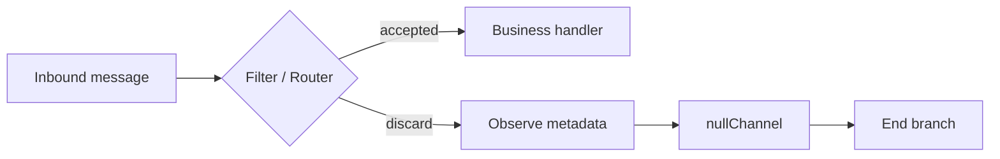
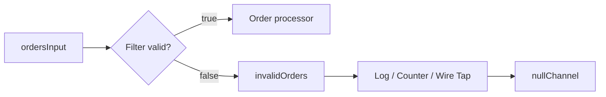
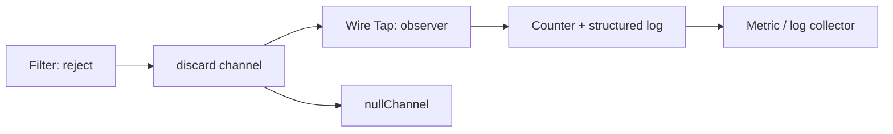
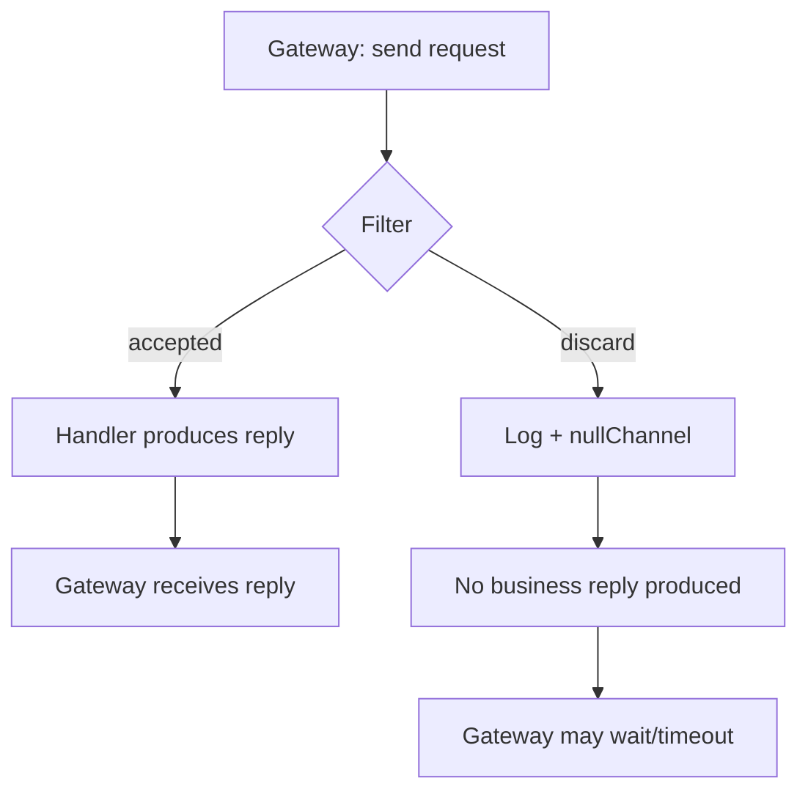

# Observing Messages Before Discarding

In an integration flow, not every message needs to reach the final business processing step. A Filter may reject invalid data, a Router may determine that a message requires no further processing, or a branch may exist solely to "consume" an unused reply. Spring Integration provides **`nullChannel`** as a destination that receives messages and intentionally ignores them. However, if you drop messages without recording the **reason** and **count**, operators cannot distinguish an intentional design decision from a data-loss bug.

This lesson belongs to the **Null channel** chapter of the **SPRING_INTEGRATION_PATTERN** module. The module focuses on implementing Enterprise Integration Patterns with Spring Integration to build loosely coupled, extensible message flows—practicing Router, Filter, Transformer, Splitter, Aggregator, Gateway, retry, error channel, and correlation while testing and monitoring branches. Here, the goal is **observing messages before discarding** without turning logs into a business transport path or distorting what discarding means.

After this lesson, you will be able to:

- Distinguish intentional discards, Filter rejections, processing errors, and accidental message loss.
- Place `LoggingHandler`, `.log(...)`, or a Wire Tap **before** `nullChannel` to record metadata safely.
- Count message discard decisions with a Micrometer Counter without relying on log line counts.
- Preserve request correlation, group/sequence metadata, and reason codes when messages enter a discard branch.
- Understand impacts on request/reply Gateways, retries, error channels, sensitive data, and multi-instance deployments.
- Design tests to ensure the discard branch terminates properly without masking errors or losing important messages.

## 1. Null Channel Is a Termination Point, Not a Repository

`nullChannel` is a special channel in Spring Integration used like a "black hole": **messages sent to it are not forwarded for business processing**. It is useful when dropping a message is intentional, such as messages needing no reply, intermediate results no longer needed, or event types classified as valid to skip.



Several things **must not be inferred** from using `nullChannel`:

| Misconception | Reality |
| --- | --- |
| "Sent to nullChannel means saved for replay" | `nullChannel` is not a queue, database, or dead-letter store |
| "Null channel will emit alerts for every dropped message" | You must design separate logs, metrics, and alerts |
| "Discard equals successful business processing" | It only means ending a branch according to current policy |
| "Message no longer in flow means original payload was valid" | Filter may have rejected it as invalid or Router dropped it as irrelevant |
| "nullChannel can replace errorChannel" | Error handling and discarding serve different purposes |
| "Just put a logger after nullChannel" | There is no downstream step after the termination point to observe that message |
| "Discard means rolling back the inbound transaction" | Ack, commit, retry, and responses depend on the inbound adapter/gateway and transactions |

Use `nullChannel` when stopping further processing is a **clearly defined business/technical decision**. If a payment order or financial event fails due to an exception, you typically need error handling/recovery or a DLQ—not pushing it straight into `nullChannel` to "make errors go away."

## 2. Scenarios Where You Should Observe Before Discarding

| Scenario | Can Discard? | What Should You Observe? |
| --- | --- | --- |
| Filter rejects a message outside processing scope | Yes, if contract allows skipping | `event=filtered_out`, `reasonCode`, source |
| Duplicate event already deduplicated per business rules | Yes, if confirmed already processed | `event=duplicate_ignored`, controlled ID |
| Heartbeat/notification needing no downstream step | Yes, if purely an auxiliary signal | Count, notification type |
| Router sends a message type to an "ignored" branch | Yes, if it is a designed branch | `route=ignored` and reason code |
| Processing result requires no reply | Yes, when protocol and caller expect no response | "result intentionally ignored" milestone if needed |
| Retries exhausted, message still needs processing | Usually **no** | Needs error channel, recovery, DLQ, or durable storage |
| Unparseable payload carrying business value | Must not silently drop | Persist/route errors per data policy |
| Child message of a Splitter awaited by an Aggregator | Very cautious | Check impact on correlation, release, and timeout |

In production, the exact same figure of "100 messages discarded" can be completely normal (100 dropped heartbeats) or a severe incident (100 lost payment requests). **Reason codes and flow names** matter just as much as the Counter.

### Distinguishing Filter Discard from nullChannel

A `Filter` can drop a message by not forwarding it when the predicate returns `false`. You can configure `discardChannel` to route rejected messages to another branch. **Returning false from a Filter does not automatically log anything or send a message to nullChannel**; the path depends on the Filter configuration.

Use `discardChannel` to control the path of rejected messages, then explicitly observe them before sending them into `nullChannel`:



This design does not require business handlers to read logs to know a message was dropped; the discard branch remains an explicit message flow.

## 3. Choosing the Right Observation Point in the Flow

A logger can be placed before a Filter, on the discard branch, or after a Transformer. Each position carries **different semantics**.

| Observation Point | What Is Known for Certain? | What Cannot Be Concluded? |
| --- | --- | --- |
| Before Filter | Message reached the input | Whether the Filter will reject or accept it |
| After Filter on valid branch | Message passed the predicate | Does not count rejected messages |
| On Filter's `discardChannel` | Message was selected for the discard branch | Not certain whether logging/metrics or the final sink completed |
| Before `nullChannel` | Message is about to reach the termination point | Does not prove database/queue/transaction committed |
| After `nullChannel` | No downstream flow exists to observe normally | Do not use this position expecting to receive messages back |

Therefore, use the event **`discard_selected`** at the point where a message enters the discard branch, and only use **`discard_completed`** if the application genuinely has a place confirming those exact semantics. In most cases, a Counter for "discard decisions made" is clearer than a Counter for "messages lost."

### Prefer Stable Reason Codes

Do not build dashboards by parsing sentences like `"Order missing details, skip!"`. Use fixed codes:

```text
INVALID_INPUT
NOT_RELEVANT
DUPLICATE_IGNORED
UNSUPPORTED_EVENT
EXPIRED_BY_POLICY
```

These codes should come from actual validation conditions, not guessed from the payload inside a logger. A Filter branch with a single specific predicate should use a code matching the primary reason for that predicate.

## 4. Logging Safely Before nullChannel with Java DSL

The Java 17+ snippet below is the simplest example: a message is routed to an intentional discard channel, logs selected metadata, and then goes to `nullChannel`.

```java
import org.springframework.context.annotation.Bean;
import org.springframework.context.annotation.Configuration;
import org.springframework.integration.channel.DirectChannel;
import org.springframework.integration.dsl.IntegrationFlow;
import org.springframework.integration.handler.LoggingHandler;
import org.springframework.messaging.MessageChannel;

@Configuration
class SimpleDiscardFlowConfig {

    @Bean
    MessageChannel ignoredEvents() {
        return new DirectChannel();
    }

    @Bean
    IntegrationFlow ignoredEventFlow() {
        return IntegrationFlow.from("ignoredEvents")
                .log(LoggingHandler.Level.INFO,
                        "app.integration.discard",
                        message -> "event=discard_selected"
                                + " reasonCode=NOT_RELEVANT"
                                + " messageId=" + message.getHeaders().getId())
                .channel("nullChannel")
                .get();
    }
}
```

Explanation:

1. A message entering `ignoredEvents` is considered a message **already selected for discard by upstream policy**. This example does not yet show how that decision was made.
2. `.log(...)` creates a logging point in the `IntegrationFlow`; the category `app.integration.discard` allows configuring its log level independently.
3. The log expression extracts only the message ID and an application-defined reason code, never printing `message.toString()` or the payload.
4. `.channel("nullChannel")` terminates the business message path; it does not automatically store, send to a DLQ, or retry.
5. The `INFO` log line above is an **observation milestone**. When that logger level is disabled, the discard still happens. Even when the logger receives the message, the logging backend may sample or drop records.

**Limitation:** the `key=value` pattern is human-readable text, not necessarily discrete JSON fields. If you want true structured logging, use SLF4J's fluent `addKeyValue(...)` with a suitably configured backend/JSON encoder.

Do not write:

```java
// Bad for security, cost, and observability:
.log(LoggingHandler.Level.INFO, "app.discard", m -> m.toString())
.channel("nullChannel")
```

Because `Message.toString()` can contain payloads and metadata unsuitable for storage in a logging system.

## 5. Filter and Intentional Discard Flow

The following example combines a Filter, an observed discard branch, and a business handler. This is an illustrative **one-way** flow; no caller needs to wait for a reply.

```java
import java.util.concurrent.atomic.AtomicInteger;

import org.springframework.context.annotation.Bean;
import org.springframework.context.annotation.Configuration;
import org.springframework.integration.channel.DirectChannel;
import org.springframework.integration.dsl.IntegrationFlow;
import org.springframework.integration.handler.LoggingHandler;
import org.springframework.messaging.MessageChannel;
import org.springframework.stereotype.Service;

record OrderCommand(String orderId, int itemCount) { }

@Service
class OrderHandler {

    public void process(OrderCommand order) {
        // Real business processing here.
    }
}

@Configuration
class FilterAndDiscardConfig {

    @Bean
    MessageChannel ordersInput() {
        return new DirectChannel();
    }

    @Bean
    MessageChannel invalidOrders() {
        return new DirectChannel();
    }

    @Bean
    IntegrationFlow ordersFlow(OrderHandler orderHandler) {
        return IntegrationFlow.from("ordersInput")
                .filter(OrderCommand.class, order -> order.itemCount() > 0,
                        spec -> spec.discardChannel("invalidOrders"))
                .handle(orderHandler, "process")
                .get();
    }

    @Bean
    IntegrationFlow invalidOrderDiscardFlow() {
        return IntegrationFlow.from("invalidOrders")
                .log(LoggingHandler.Level.INFO,
                        "app.integration.discard",
                        m -> "event=discard_selected"
                                + " reasonCode=EMPTY_ORDER"
                                + " messageId=" + m.getHeaders().getId())
                .channel("nullChannel")
                .get();
    }
}
```

**How the flow works:**

- When `itemCount > 0`, the Filter forwards the message to `OrderHandler`.
- When `itemCount <= 0`, the Filter routes the message to `invalidOrders`, and that branch logs it and ends at `nullChannel`.
- `nullChannel` does not decide valid vs. invalid: that condition belongs to the Filter.
- Processing of valid orders does not depend on whether the `discard_selected` log was written.

The code uses a simple predicate and assumes an order with 0 items is permitted to be skipped. In real products, an invalid order request may need a **validation error** rather than being discarded. If it is a request/reply from a Gateway or HTTP, define an explicit response contract (see Section 8).

### Why Record a Reason Instead of Just "Discarded"?

Some messages are irrelevant and should be skipped; others have bad data and need feedback sent to the source. Logging the same `discarded` event for all cases leaves dashboards unable to distinguish normal traffic shifts from inbound data errors.

You can split `invalidOrders`, `duplicateEvents`, and `unsupportedEvents` using a Router/Filter and assign dedicated reason codes. When each branch has one fixed reason, the logger never needs to inspect the payload to infer a `reasonCode`.

## 6. Counting Discard Decisions with a Counter, Logging for Investigation

Counting via log lines is unreliable: `INFO` may be turned off, logs may be sampled, async appenders may drop lines, a message may be logged multiple times, or collectors may lag. To know **how many messages entered the discard branch**, use a Counter at the selection point.

A suitable architecture:



For conditions determined in the flow, use Micrometer:

```java
import io.micrometer.core.instrument.Counter;
import io.micrometer.core.instrument.MeterRegistry;

Counter selectedForDiscard = Counter
        .builder("integration.discard.selected")
        .description("Messages selected for intentional discard")
        .tag("flow", "orders")
        .tag("reason", "empty_order")
        .register(meterRegistry);

// At the point observing the selected decision:
selectedForDiscard.increment();
```

The snippet above assumes an existing `meterRegistry` of type `MeterRegistry`. The name `integration.discard.selected` is an **application-defined metric name**, not a built-in Spring Integration metric. When exported to Prometheus, the registry may convert it to match backend naming syntax.

If you need Counters for multiple reasons, only use a `reason` tag with a bounded set of values; never use emails, payloads, or request IDs as metric labels.

### Clearly Distinguish "Selected" from "Completed"

A Counter placed in a Wire Tap before `nullChannel` measures that **the observer processed the selected-for-discard event**, not a durable receipt proving the message was deleted. If sending to `nullChannel` or the observer fails, how the Counter increments and how exceptions travel depend on the topology. For strict guarantees, design explicit measurement points/ACK contracts rather than inferring from logs.

A single message may pass through the Filter multiple times due to retries/redeliveries; the "selected" Counter can increment multiple times for the same business item. If you need to count **unique messages**, you need an identity/dedup store and a specific time-window rule. You cannot solve this simply by putting `messageId` as a metric tag.

## 7. Wire Tap: Observing Without Turning Loggers into Business Handlers

A `Wire Tap` copies/routes messages to a side branch, commonly used for logging or gathering metrics. The business branch proceeds to the sink; the observation branch can use SLF4J, Micrometer, or tracing.

This example uses the SLF4J 2.x fluent API to log key-value pairs. It does **not** use message content as instructions for downstream steps.

```java
import io.micrometer.core.instrument.Counter;
import io.micrometer.core.instrument.MeterRegistry;

import org.slf4j.Logger;
import org.slf4j.LoggerFactory;
import org.springframework.context.annotation.Bean;
import org.springframework.context.annotation.Configuration;
import org.springframework.integration.channel.DirectChannel;
import org.springframework.integration.dsl.IntegrationFlow;
import org.springframework.messaging.Message;
import org.springframework.messaging.MessageChannel;

@Configuration
class ObservedDiscardFlowConfig {

    private static final Logger LOG =
            LoggerFactory.getLogger("app.integration.discard");

    @Bean
    MessageChannel discardInput() {
        return new DirectChannel();
    }

    @Bean
    MessageChannel discardObservation() {
        return new DirectChannel();
    }

    @Bean
    IntegrationFlow discardSinkFlow() {
        return IntegrationFlow.from("discardInput")
                .wireTap("discardObservation")
                .channel("nullChannel")
                .get();
    }

    @Bean
    IntegrationFlow discardObserverFlow(MeterRegistry registry) {
        Counter count = Counter.builder("integration.discard.selected")
                .tag("flow", "orders")
                .tag("reason", "not_relevant")
                .register(registry);

        return IntegrationFlow.from("discardObservation")
                .handle(message -> {
                    count.increment();

                    LOG.atInfo()
                            .addKeyValue("event", "integration.discard_selected")
                            .addKeyValue("reasonCode", "NOT_RELEVANT")
                            .addKeyValue("messageId",
                                    message.getHeaders().getId())
                            .addKeyValue("requestCorrelationId",
                                    safeRequestId(message))
                            .log("message intentionally discarded");
                })
                .get();
    }

    private static String safeRequestId(Message<?> message) {
        Object value = message.getHeaders().get("requestCorrelationId");
        if (value instanceof String id
                && id.matches("[A-Za-z0-9_-]{1,64}")) {
            return id;
        }
        return "missing";
    }
}
```

**Conditions for this example to make sense:**

1. `discardInput` only receives messages that already have a **valid discard decision** from upstream. If a source sends every message directly here, the code will discard everything.
2. `.wireTap("discardObservation")` forwards the message to the observer branch; `.channel("nullChannel")` continues sending the original message to termination.
3. The `Counter` in the observer measures observed events selected for discard. If the goal is to measure decisions right at the Filter, place the Counter at the Filter or the first receiving branch rather than relying solely on the observer.
4. `DirectChannel` runs the observer branch synchronously in this model; if the observer throws an exception or is slow, it can affect the main send path. Production code must bound errors and latency in the observer.
5. `addKeyValue(...)` creates structured fields in the SLF4J 2.x API; producing standalone JSON fields requires a supporting encoder/backend and testing.
6. `safeRequestId` only checks a specific header; it is better to assign an ID at ingress and propagate it throughout the flow.
7. Neither a Counter nor a log causes a message to be business-processed or turns into a replayable backup.

**Note:** Wire Tap does not by default mean observation "cannot fail." If you need to decouple latency, you can use an asynchronous channel or bounded queue; in return, you must define queue-full policies (block, drop observation events, or fail) and monitor lost observation events. Never treat it as a durable audit source.

## 8. Request/Reply Gateways and the Risk of Waiting for a Response

It is easy to make the mistake of routing a message from a **request/reply Gateway** to `nullChannel` and assuming the Gateway will automatically interpret it as "done, return success."



`nullChannel` does not automatically generate a business reply corresponding to the request. If a Gateway is waiting for a reply and no branch sends one, the caller may time out or receive an outcome determined by Gateway configuration (e.g., timeout handling per contract). Therefore:

- For request validation, return a **structured rejection result** to the caller.
- For asynchronously processed requests, return an early acknowledgment once the work has genuinely been accepted per contract.
- If no response is needed, use an appropriate **one-way** protocol from the start.
- Never route messages to `nullChannel` just to "silence" timeouts without revisiting business semantics.

For HTTP, for example, an invalid request may need status 400 or 422; a rate-limited request may need 429. Do **not** assume Spring Integration generates these status codes automatically when a Filter sends a message to `nullChannel`. Adapters/controllers and error/reply mappings must be explicitly designed.

### Reply Channel and Error Channel Are Not Like nullChannel

A message's `replyChannel` pertains to where replies are sent; `errorChannel` pertains to the error-handling route when a component publishes an error message; `nullChannel` is strictly a sink that consumes messages without forwarding. Put `nullChannel` only in the right channel context to avoid unintended discards.

## 9. Correlation, Splitter, and Aggregator Before Discarding

In a flow where a request is split into multiple parts by a Splitter, child messages may carry `correlationId`, `sequenceNumber`, and `sequenceSize` headers. This metadata is useful for investigating which message was dropped. However, discarding an element can cause the Aggregator to **never satisfy its release condition** if that condition requires all parts.

Example:

```text
requestCorrelationId=req_42
Split: 3 child messages
  #1 -> processed
  #2 -> Filter reject -> nullChannel
  #3 -> processed
Aggregator requires sequenceSize=3
=> Risk of waiting forever or timing out because #2 is missing
```

Do not just look at a `discard_selected` log and assume it is a valid state. You must determine:

- Is dropping one part allowed while still completing the group?
- Does the release strategy require all `sequenceSize` members?
- Should a placeholder result be emitted or should the grouping policy be adjusted?
- Is there a timeout and a channel for handling incomplete groups?
- Can one request have **multiple** distinct correlation groups across nested Splitter stages?

A safe log on a child message's discard branch might look like:

```json
{
  "event": "integration.discard_selected",
  "flow": "orderFulfillment",
  "stage": "itemFilter",
  "requestCorrelationId": "req_42",
  "messageId": "0f54b60a-7f0f-4b2d-9a12-c96e8d739612",
  "groupRef": "group_8",
  "sequenceNumber": 2,
  "sequenceSize": 3,
  "reasonCode": "INVALID_ITEM"
}
```

This is an **example schema**, not data automatically logged by Spring Integration. Do not derive `groupRef` directly from `correlationId.toString()` if it is an object or contains restricted data. Replace it with a policy-checked identifier.

### Request ID Differs from Group Correlation ID

`requestCorrelationId` is an application-assigned ID for tracing an entire request; `MessageHeaders.ID` is the ID of a specific message; the Splitter/Aggregator `correlationId` header groups parts together and may differ from the request ID. When logging errors or discards on child messages, keep these IDs distinct for their intended purposes rather than overwriting them into a single shared field.

## 10. Discard, Retry, Error Channel, and DLQ Are Separate Branches

| Behavior | Purpose | When to Choose? |
| --- | --- | --- |
| `nullChannel` | Terminates a message/branch **intentionally** | The message truly needs no further processing |
| `discardChannel` | Receives messages rejected by a Filter | When an explicit rejection-handling path is needed |
| Retry advice | Retries recoverable operations | Transient failures with bounded attempts/backoff |
| `errorChannel` | Handles `ErrorMessage` when a component emits an error | Diagnostics and recovery per configuration |
| Dead-letter queue/store | Retains messages needing investigation or replay | When critical messages fail terminally |
| Quarantine channel | Isolates suspicious/unparseable messages | When evidence must be preserved or await review |
| Audit store | Persists trails requiring durability | When required by business or compliance policy |

A common mistake is handling exceptions by sending the original message to `nullChannel` so the flow stops reporting errors. That only **masks incidents** if business logic still expects the message to be processed. Separate valid drops from terminal failures.

For example, a Filter dropping an out-of-scope `heartbeat` notification can use `nullChannel`. But when an outbound Gateway call to a payment service fails after retries, you must specify rollback, error responses, DLQ, compensation, or another recovery mechanism; never silently discard it.

**Never assume** synchronous errors on a `DirectChannel` automatically go through an error channel; the error path depends on the endpoint, advice, poller, and error-publishing setup. `nullChannel` does not convert exceptions into `ErrorMessage` or guarantee proper retry semantics.

## 11. Protecting Data Before Logging Discarded Messages

A rejected message does not mean it is safe to log: invalid data may contain raw user input, tokens, payment details, or huge payloads. Even the discard reason could originate from untrusted content.

**Log using an allowlist**:

- `event` and `reasonCode` as application-controlled enum values.
- `flow`, `stage`, and `route` from a controlled catalog.
- `requestCorrelationId` validated for format, length, and origin.
- `messageId` or needed sequence metadata, not derived from raw payloads.
- `payloadType` or safely measured payload size if helpful.
- Classified `errorCode`, not the verbatim `Throwable.getMessage()`.

**Avoid logging**:

```java
// Risk of exposing payload and headers:
logger.info("Discarded {}", message);

// Risk of printing secrets in exception message / stack trace:
logger.error("Failed to discard", exception);

// Risk of emitting arbitrary data from external sources:
logger.info("Discard reason {}", message.getPayload().toString());
```

Even with a JSON encoder, serializing the entire payload or `MessageHeaders` can still leak sensitive information. Select safe fields at the point where logs are created; collector-side redaction is only an additional layer of defense.

If you must investigate an unparseable message, persist a durable record into quarantine/DLQ under security controls rather than dumping everything into logs. **`nullChannel` cannot recover a discarded payload.**

## 12. Controlling Observation Cost in Production

If a Filter discards thousands of messages per second, writing an INFO record for **every** dropped message can create a new bottleneck. Combine:

| Signal | Purpose | Recommended Policy |
| --- | --- | --- |
| Counter by `reasonCode` | Aggregate discard decision counts | Record continuously, low cardinality labels |
| Counter by `flow`/`stage` | Identify branches with sudden discard spikes | Enum labels, never message IDs |
| Safe structured logs | Investigate specific cases | INFO for important events, DEBUG/sampling for high volume |
| Trace/span attributes | See which stages a message traversed | Subject to instrumentation and trace sampling |
| Queue/backlog gauge | Detect clogged discard/quarantine branches | Monitor closely if buffered |
| Error channel metrics | Separate discards from processing errors | Count terminal failures separately |

**Log sampling must never become business message sampling.** When log volume must be reduced, sample at the observer or logger—never Filter out 95% of messages before the business handler just to reduce log ingest.

With a synchronous `Wire Tap`, the observer still incurs CPU/I/O cost and can affect latency. If moved to an executor or queue, define buffer-full policies (block, drop observation events, or handle errors) and monitor dropped observation events. Counters inside an asynchronous observer can also miss events if the observer falls behind or stops running.

Never treat log line counts as an exact total discard count; one message may be logged multiple times due to retries, or skipped due to log levels, sampling, or appender drops.

## 13. Testing the Discard Branch with Real Messages

Instead of testing only a `FilterPredicate` function, send messages through a `MessageChannel` and verify **both the accepted branch and the discard branch**. Use synthetic canary data to detect leaks.

Example sending messages into `ordersInput` when `FilterAndDiscardConfig` is configured:

```java
import org.springframework.messaging.support.MessageBuilder;

// Valid order: must reach OrderHandler.
ordersInput.send(MessageBuilder
        .withPayload(new OrderCommand("ORD-42", 3))
        .setHeader("requestCorrelationId", "req_42")
        .build());

// Invalid order: must go to invalidOrders then nullChannel.
ordersInput.send(MessageBuilder
        .withPayload(new OrderCommand("ORD-43", 0))
        .setHeader("requestCorrelationId", "req_43")
        .build());
```

This illustrates a call in a test environment with an injected `ordersInput` variable; to verify output, you can use a fake handler counting `process` invocations and a test appender capturing logs under category `app.integration.discard`.

| Scenario | Outcome to Verify |
| --- | --- |
| Filter accept | Handler runs; no discard event for that message |
| Filter reject | Handler does not run; discard branch receives the message |
| INFO log enabled | `discard_selected` event appears with correct reason code and message ID |
| INFO log disabled | Business flow still discards per policy, independent of logging |
| Payload contains fake token | Token does not appear in logs, even with DEBUG enabled |
| Observer throws error | Understand impact on synchronous flow; prevent logger from altering business outcome |
| Observer uses executor/queue | Plan exists for full queues; measure observer loss |
| Gateway waiting for reply | Produces response/error/timeout **per contract**, never hangs indefinitely |
| Child message #2 discarded | Aggregator handles missing part per release/timeout policy |
| Retry/redelivery of same message | Counter interpreted as decision count, not unique IDs |
| Message truly needing replay | Not sent to nullChannel; uses DLQ/quarantine |
| Two instances with same Filter | Counters can be aggregated by flow/reason and distinguish instances/IDs |
| Error channel emits ErrorMessage | Real errors are not swallowed as silent discards |

### JUnit 5: Testing the Safe Log Formatting Utility

Extract log field selection into a utility for unit testing. The following example illustrates `SafeDiscardView` returning a string containing only allowed metadata:

```java
import org.springframework.messaging.Message;

final class SafeDiscardView {

    static String format(Message<?> message, String reasonCode) {
        Object raw = message.getHeaders().get("requestCorrelationId");
        String requestId = raw instanceof String id
                && id.matches("[A-Za-z0-9_-]{1,64}")
                ? id : "missing";

        return "event=discard_selected"
                + " reasonCode=" + reasonCode
                + " requestCorrelationId=" + requestId
                + " messageId=" + message.getHeaders().getId();
    }
}
```

```java
import static org.junit.jupiter.api.Assertions.assertFalse;
import static org.junit.jupiter.api.Assertions.assertTrue;

import org.junit.jupiter.api.Test;
import org.springframework.messaging.support.MessageBuilder;

class SafeDiscardViewTest {

    @Test
    void doesNotLeakSensitivePayload() {
        String secret = "FAKE_TOKEN_DO_NOT_LOG_123";

        var message = MessageBuilder
                .withPayload("raw-input secret=" + secret)
                .setHeader("requestCorrelationId", "req_42")
                .build();

        String log = SafeDiscardView.format(message, "NOT_RELEVANT");

        assertTrue(log.contains("reasonCode=NOT_RELEVANT"));
        assertTrue(log.contains("requestCorrelationId=req_42"));
        assertFalse(log.contains(secret));
        assertFalse(log.contains("raw-input"));
    }

    @Test
    void RejectsUntrustedCorrelationHeader() {
        var message = MessageBuilder.withPayload("ignored")
                .setHeader("requestCorrelationId", "bad\nFORGED-ERROR")
                .build();

        String log = SafeDiscardView.format(message, "NOT_RELEVANT");

        assertTrue(log.contains("requestCorrelationId=missing"));
        assertFalse(log.contains("FORGED-ERROR"));
    }
}
```

This method deliberately does not validate `reasonCode` itself because the example assumes values come from internal constants/enums. If reason codes originate from external input, constrain them against an allowlist before calling. The unit tests above do **not** replace integration tests for the Filter, Wire Tap, and `nullChannel`.

### Additional Evaluation Criteria

- After discarding, the message does not trigger downstream Service Activators.
- Toggling log levels does not alter business outcomes.
- Counters reflect **actual instrumented events** and are not mistaken for unique message counts.
- No unexplained exceptions or timeouts occur on synchronous paths.
- Policy-discarded events and terminal errors are monitored separately.
- No secrets or raw payloads appear in collector output.

## 14. Incident Analysis: Sudden Spike in Discards

Suppose a dashboard shows `integration.discard.selected{reason="empty_order"}` jumping 10x after a deployment. Investigation steps:

1. Check whether inbound message volume to the Gateway/ingress changed.
2. Check the `selected/received` ratio over a window and compare with business throughput.
3. Confirm where the Counter measures: Filter decision, discard channel, or Wire Tap; check whether retries/redeliveries are incrementing it multiple times.
4. Search structured logs by `event=integration.discard_selected`, `reasonCode`, and a representative `requestCorrelationId`.
5. Use traces, if available, to check whether a Transformer/Filter altered payload structure or schema formatting.
6. Review post-deploy Filter predicates, source schemas, business contracts, and routing lists.
7. If this is a critical data error, **stop silently discarding**; notify the source, quarantine, or roll back per policy.
8. After remediation, verify discard and error rates return to expected levels. Reconcile Group/Aggregator item counts if applicable.

**A high discard rate is not always a bug.** Upstream may simply be sending more irrelevant message types that the system is properly filtering out. Conversely, a low rate does not prove zero data loss if an error occurred in an adapter before the Filter. Always correlate with received, success, error, queue lag, and business context.

## 15. Hands-On Exercise: Observing an Intentional Skip Branch

**Scenario:** A Gateway receives `OrderEvent` messages. A Router sends `OrderCreated` and `OrderPaid` to business handlers; `DiagnosticHeartbeat` notifications need no further processing. A Filter drops messages lacking sufficient information to proceed, while important failed messages must never be silently dropped.

Requirements:

1. Clearly define which cases are **allowed to be discarded** and which errors must go through recovery or a DLQ. Create a table of `reasonCode` values and corresponding actions.
2. Create an `ignoredEvents` channel and a branch that logs safe metadata before `nullChannel`; use `.log(...)` or `Wire Tap`.
3. Use a Filter with `discardChannel` for valid message rejections. Record a Counter for reject decisions without mixing them into terminal failures.
4. Preserve `requestCorrelationId` across Router/Transformer; if a Splitter is present, safely record group/sequence metadata when items are discarded.
5. Add an experimental request/reply Gateway; verify that when the discard branch is chosen, the caller receives a defined outcome rather than waiting unexpectedly.
6. Trigger a real failure inside a Service Activator. Verify error channel/retries work as configured; never use `nullChannel` to swallow exceptions.
7. Run with INFO logging enabled/disabled, and with both synchronous and asynchronous Wire Taps; measure overhead and lost observation events when the queue is full.
8. Send a payload containing canary `FAKE_TOKEN_DO_NOT_LOG_123`, verifying that logs/traces/metrics do not contain the token.
9. Simulate a 10x spike in heartbeats; verify discard Counters increase as expected while business error counts do not rise.
10. Compare total received, processed, selected-for-discard, rejected, and failed using **the same counting unit**, noting cases where retries/redeliveries prevent simple additive totals.

**Acceptance criteria:** operators know which messages **were selected for discard**, why, and at which stage without logging raw payloads; business handlers never receive discarded messages; callers receive contract-compliant responses; failed critical messages have durable error-handling paths; and changes in discard rates can be investigated via logs, metrics, and traces.

### Self-Check Questions

1. Why cannot `nullChannel` be considered a dead-letter queue?
2. Does placing a logger after `nullChannel` help observe just-discarded messages? Why or why not?
3. How does `Filter.discardChannel` differ from `nullChannel`?
4. Why is `event=discard_selected` clearer than `event=processing_succeeded` on a skip branch?
5. What does a Counter placed inside a Wire Tap measure, and what does it fail to prove?
6. Why can a request/reply Gateway time out if one branch sends messages to `nullChannel`?
7. Why can discarding a child message prevent an Aggregator from releasing a group?
8. Under what circumstances is dropping a heartbeat valid while dropping a payment command is dangerous?
9. When INFO logging is off or a collector drops logs, which metric should still reflect discard counts?
10. Why can a redelivered message cause a Counter to increment multiple times?
11. Should exception text or payloads be used as a `reasonCode`/metric label?
12. How do you ensure an observation branch does not accidentally break or slow down the business flow?

## 16. References

- [Spring Integration Reference — Null Channel](https://docs.spring.io/spring-integration/reference/channel/null-channel.html): special role of `nullChannel`.
- [Spring Integration Reference — Message Filter](https://docs.spring.io/spring-integration/reference/filter.html): Filter, discard channel, and message rejection behavior.
- [Spring Integration Reference — Java DSL Logging](https://docs.spring.io/spring-integration/reference/dsl/java-log.html): the `.log(...)` operator in `IntegrationFlow`.
- [Spring Integration Reference — Logging Channel Adapter](https://docs.spring.io/spring-integration/reference/logging-adapter.html): `LoggingHandler` and log selection strategies.
- [Spring Integration Reference — Wire Tap](https://docs.spring.io/spring-integration/reference/channel/wire-tap.html): message observation branch.
- [Spring Integration Reference — Error Handling](https://docs.spring.io/spring-integration/reference/error-handling.html): `ErrorMessage`, error channel, synchronous/asynchronous errors.
- [Spring Integration Reference — Gateway](https://docs.spring.io/spring-integration/reference/gateway.html): request/reply and timeouts.
- [Spring Integration Reference — Splitter](https://docs.spring.io/spring-integration/reference/splitter.html) and [Aggregator](https://docs.spring.io/spring-integration/reference/aggregator.html): correlation, sequence, and release strategy.
- [Micrometer — Counters](https://docs.micrometer.io/micrometer/reference/concepts/counters.html): Counter semantics and usage in observability.
- [OWASP Logging Cheat Sheet](https://cheatsheetseries.owasp.org/cheatsheets/Logging_Cheat_Sheet.html): avoiding sensitive payloads and preventing log injection.

**Key Takeaway:** `nullChannel` is an **intentional termination point**. To know which messages were selected for discard, observe **before sending to nullChannel**, using meaningful `reasonCode` values, allowed metadata, and Counters at the exact decision point. Never rely on logs as proof of durable delivery; never let a discard choice mask exceptions, drop Gateway replies, or leave an Aggregator waiting for missing messages.
