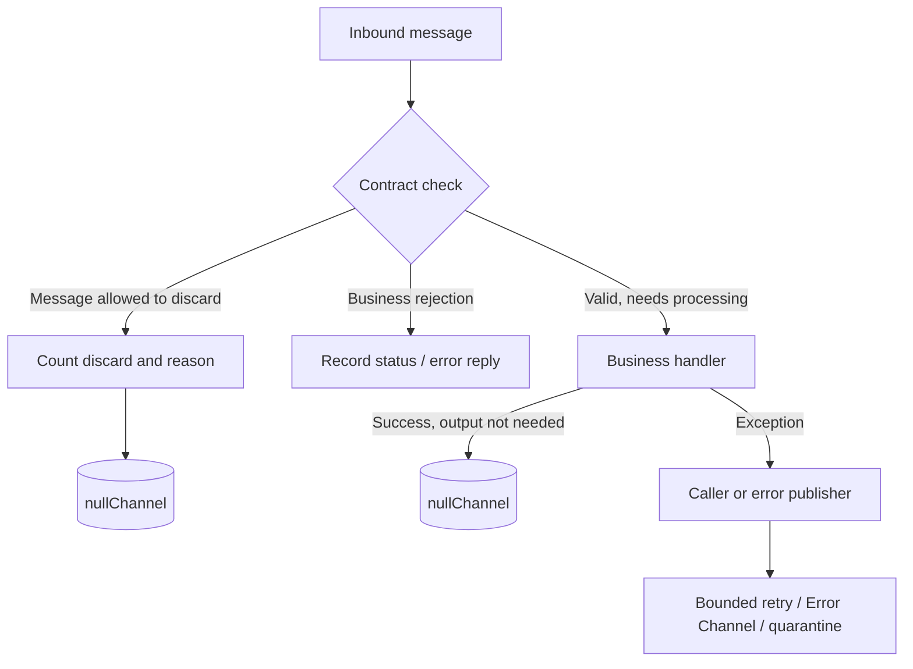
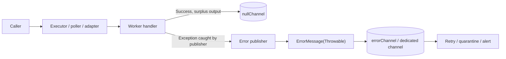

# Never Use Null Channel to Hide Errors in Spring Integration

## 1. Context and Objectives

In the `SPRING_INTEGRATION_PATTERN` module, we practice **Enterprise Integration Patterns** with Spring Integration to design loosely coupled, extensible, testable, and observable message flows. A flow using Router, Filter, Transformer, Splitter, Aggregator, or Gateway often has different termination branches. Not every message needs further processing: a valid heartbeat or an unused intermediate reply can be intentionally ignored.

Spring Integration provides a channel named **`nullChannel`** to receive and **discard messages**. This mechanism is useful when the discard point is clearly defined by a business contract. Conversely, if an application sends failed messages, rule-violating data, or failure events to `nullChannel` simply so the flow stops reporting errors, that is **swallowing failures**. Consequences can include data loss, callers receiving incorrect status, retries not occurring, and insufficient information left for investigation.

After this lesson, you will be able to:

- Explain the difference between a **valid discard**, a **business rejection**, and a **technical exception**.
- Distinguish `nullChannel`, `errorChannel`, reply channel, and dead-letter/quarantine.
- Spot error-hiding configurations, especially when combining Router, Filter, Service Activator, and Gateway.
- Write Java DSL that routes only **valid, unneeded outputs** to `nullChannel`.
- Test that invalid data and backend failures still raise exceptions in synchronous flows.
- Determine the `ErrorMessage` delivery path for asynchronous endpoints without assuming every exception automatically reaches a global channel.
- Design logging, metrics, retries, correlation, error states, and data stores for recovery.

## 2. Null Channel Is a Discard Point, Not a Recovery Mechanism

A message sent to `nullChannel` is accepted to **terminate that message's path**. No downstream business handler consumes messages from this channel, no queue retains them for later attempts, and `nullChannel` generates no business result of its own.

| Component | Purpose | Automatically Retries / Persists? |
| --- | --- | --- |
| `nullChannel` | Discards messages when that is an accepted outcome. | No. |
| `errorChannel` | Receives `ErrorMessage` actually published by an error publisher. | Does not automatically retry or persist durably. |
| Reply channel | Delivers replies back to requester/Gateway. | Depends on channel type and contract, not by default. |
| Dead-letter/quarantine | Retains failed messages for investigation or controlled replay. | Only when backed by an appropriate store/adapter. |
| Retry advice | Retries operations according to policy. | Bounded by configuration; does not replace state persistence. |

`nullChannel` **is not the same as Java `null`**. A handler may produce no output; in that case, placing `nullChannel` is not necessarily required. Only when a handler produces output and the contract confirms that output is unneeded is routing that output to `nullChannel` appropriate.

### A Data-Loss Scenario

```text
Inbound ORDER_PAID
   |
   +--> validate data --> missing paymentId
                                  |
                                  v
                             nullChannel
                                  |
                                  v
                    No one knows the order failed
```

Here, the message suffers from a critical data error. Sending it straight to `nullChannel` hides the violated contract. The proper approach may be to **throw an exception**, return an error response, record an `INVALID` status, or send it to quarantine with diagnostic metadata, depending on processing boundaries and business requirements.

## 3. Three Types of Outcomes That Must Be Distinguished

A production flow should distinguish at least three decision categories:

| Outcome | Example | Appropriate Handling |
| --- | --- | --- |
| **Valid discard** | Allowed heartbeat, verified duplicate already processed, unused internal reply. | Can record metrics and route to `nullChannel`. |
| **Business rejection** | Expired order, quantity exceeds limit, missing required field. | Return rejection outcome, update status, or quarantine; never silently discard. |
| **Technical failure** | Backend timeout, database unavailable, unexpected mapping error. | Throw/bounded retry, emit `ErrorMessage` via configured publisher, or durably record failure. |

A **business rejection** does not have to be a Java exception. For example, `OUT_OF_STOCK` can be a valid business outcome: the caller receives `ReservationRejected` instead of the flow crashing technically. Still, **important rejection outcomes must not be discarded without an accountable destination**.

The decision lies in **the inbound and outbound contracts**, not in wanting the pipeline to run without stack traces.

### Safe Routing Diagram



Both arrows pointing to `nullChannel` carry an **explicit discard reason**: dropping a permitted event or dropping **output after work succeeds**. Exceptions and important rejections follow separate paths.

## 4. Ways Errors Get Accidentally Hidden

### 4.1. Routing Every Unknown Router Branch to nullChannel

```text
Router(type)
  ORDER_CREATED  --> orderFlow
  HEARTBEAT      --> nullChannel
  UNKNOWN        --> nullChannel  // Dangerous if UNKNOWN violates the contract
```

For `UNKNOWN`, distinguish an event type permitted to be dropped from a new message type recently introduced by a producer that the consumer does not yet support. When no rule exists for `UNKNOWN`, the safer option is **fail-fast or routing to quarantine for triage**. If discarded by default, the system can silently lose batches of transactions after a schema change.

### 4.2. Filter Dropping Invalid Messages Without Leaving a Trace

A `Filter` can drop messages that fail a condition. This is fine when the filter only drops heartbeats or verified duplicates. But if the filter silently drops messages missing `orderId`, downstream will have no idea malformed input arrived.

To distinguish policies, use a discard channel/flow capable of recording **rejection reasons**, or separate validation steps with explicit rejection outcomes. `discardChannel` and `nullChannel` are not the same concept: a discard channel is **the configured target when a Filter rejects**; only when you wire it to `nullChannel` are messages completely dropped.

### 4.3. Catching Exceptions and Returning a Fake Result

```java
// Anti-pattern: returns success ACK even though business logic actually failed.
try {
    paymentClient.capture(paymentId);
    return "PAYMENT_OK";
} catch (RuntimeException failure) {
    log.warn("Payment failed", failure);
    return "PAYMENT_OK"; // Hides failure; downstream may update incorrectly.
}
```

Sending that fabricated `PAYMENT_OK` string to `nullChannel` **does not make the design any safer**: the failure was already swallowed upstream. If the caller requires no reply, record the failed state or let an appropriate error publisher handle the exception; never turn failure into success.

### 4.4. Routing ErrorMessage to nullChannel to "Clean Up Logs"

```text
Handler exception
    --> ErrorMessage
         --> nullChannel
              --> No retry, no alert, no quarantine
```

This is a very risky choice if the error relates to work that needed to be performed. The global `errorChannel` may have a logging subscriber, yet emitting a log line is not proof of recovery. Actively sending `ErrorMessage` to `nullChannel` can eliminate even the error signal itself.

If a failure **has already been fully handled** by another workflow, you may terminate the error path after confirming the required state. However, never use `nullChannel` as a default policy for all exceptions.

## 5. Java DSL Example: Discarding Only Valid Heartbeats and Successful Outputs

We build a flow receiving `Event(id, kind, simulateRemoteFailure)`. A Router inspects `kind`:

- `HEARTBEAT`: permitted by business rules to drop, records the reason, and sends the **internal confirmation output** to `nullChannel`.
- Other types: proceed through the order-processing handler; valid `ORDER` events are processed and their internal reply is discarded.
- Unsupported `kind`: the handler **throws `InvalidEventException`**, rather than sending unrecognized messages to `nullChannel`.
- Backend failure: the handler **throws `RemoteUnavailableException`** so a synchronous caller receives the error or an error publisher at the appropriate boundary handles it.

This example uses Java 17 and the Spring Integration Java DSL. With Spring Boot, you can use `spring-boot-starter-integration`; tests use JUnit 5, Spring Test, and AssertJ (e.g., via `spring-boot-starter-test`).

```java
import java.util.List;
import java.util.concurrent.ConcurrentLinkedQueue;

import org.springframework.context.annotation.Bean;
import org.springframework.context.annotation.Configuration;
import org.springframework.integration.channel.DirectChannel;
import org.springframework.integration.config.EnableIntegration;
import org.springframework.integration.dsl.IntegrationFlow;
import org.springframework.messaging.MessageChannel;

@Configuration
@EnableIntegration
public class SafeNullChannelConfig {

    public record Event(
        String id, String kind, boolean simulateRemoteFailure) {}

    public static class InvalidEventException extends RuntimeException {
        public InvalidEventException(String message) {
            super(message);
        }
    }

    public static class RemoteUnavailableException extends RuntimeException {
        public RemoteUnavailableException(String message) {
            super(message);
        }
    }

    public static class Probe {
        private final ConcurrentLinkedQueue<String> discarded =
            new ConcurrentLinkedQueue<>();
        private final ConcurrentLinkedQueue<String> processed =
            new ConcurrentLinkedQueue<>();

        public void recordDiscard(String id) {
            discarded.add(id);
        }

        public void recordSuccess(String id) {
            processed.add(id);
        }

        public List<String> discardedIds() {
            return List.copyOf(discarded);
        }

        public List<String> processedIds() {
            return List.copyOf(processed);
        }

        public void clear() {
            discarded.clear();
            processed.clear();
        }
    }

    @Bean
    public Probe safeNullProbe() {
        return new Probe();
    }

    @Bean
    public MessageChannel eventsInput() {
        return new DirectChannel();
    }

    @Bean
    public MessageChannel heartbeatDiscardChannel() {
        return new DirectChannel();
    }

    @Bean
    public MessageChannel businessWorkChannel() {
        return new DirectChannel();
    }

    @Bean
    public IntegrationFlow classifyEvents() {
        return IntegrationFlow.from("eventsInput")
            .route(Event.class,
                event -> "HEARTBEAT".equals(event.kind())
                    ? "DROP" : "PROCESS",
                router -> router
                    .channelMapping("DROP", "heartbeatDiscardChannel")
                    .channelMapping("PROCESS", "businessWorkChannel"))
            .get();
    }

    @Bean
    public IntegrationFlow discardAllowedHeartbeats(Probe probe) {
        return IntegrationFlow.from("heartbeatDiscardChannel")
            .handle(Event.class, (event, headers) -> {
                if (event.id() == null || event.id().isBlank()) {
                    throw new InvalidEventException("Heartbeat id is required");
                }
                probe.recordDiscard(event.id());
                return "HEARTBEAT_IGNORED"; // Internal output.
            })
            .channel("nullChannel")
            .get();
    }

    @Bean
    public IntegrationFlow processBusinessEvents(Probe probe) {
        return IntegrationFlow.from("businessWorkChannel")
            .handle(Event.class, (event, headers) -> {
                if (!"ORDER".equals(event.kind())) {
                    throw new InvalidEventException(
                        "Unsupported event kind: " + event.kind());
                }
                if (event.simulateRemoteFailure()) {
                    throw new RemoteUnavailableException(
                        "Order backend temporarily unavailable");
                }

                probe.recordSuccess(event.id());
                return "ORDER_PROCESSED"; // No caller needs a reply.
            })
            .channel("nullChannel")
            .get();
    }
}
```

### Reading the Flow Branch by Branch

1. `classifyEvents` sends only **`HEARTBEAT`** to `heartbeatDiscardChannel`; all other kinds must be processed or validated.
2. `discardAllowedHeartbeats` validates that the heartbeat has a valid ID, records an observation, and builds an internal reply; only then does it discard the reply at `nullChannel`.
3. `processBusinessEvents` checks the contract **before** performing side effects and before any discard point.
4. Valid `ORDER` events are recorded as successful; the string `ORDER_PROCESSED` goes to `nullChannel` because the flow is one-way.
5. `INVALID` events and backend errors throw exceptions in the handler. Because the example uses a synchronous `DirectChannel`, exceptions propagate back to the `eventsInput.send(...)` call; no success output is generated to discard.

**Key point:** The example uses `nullChannel` on both the heartbeat branch and the success branch, **yet never uses it to handle exceptions**. Whether the caller receives an exception depends on execution boundaries; the example deliberately chooses synchronous execution for clear testing.

## 6. Testing: Valid Discard vs. Failure

The tests use a `QueueChannel` as a test reply channel to confirm no business reply is emitted. At the same time, they verify that validation errors and backend failures are **not** swallowed.

```java
import org.junit.jupiter.api.BeforeEach;
import org.junit.jupiter.api.Test;
import org.springframework.beans.factory.annotation.Autowired;
import org.springframework.beans.factory.annotation.Qualifier;
import org.springframework.integration.channel.QueueChannel;
import org.springframework.messaging.MessageChannel;
import org.springframework.messaging.support.MessageBuilder;
import org.springframework.test.context.junit.jupiter.SpringJUnitConfig;

import static org.assertj.core.api.Assertions.assertThat;
import static org.assertj.core.api.Assertions.assertThatThrownBy;

@SpringJUnitConfig(SafeNullChannelConfig.class)
class SafeNullChannelConfigTest {

    @Autowired
    @Qualifier("eventsInput")
    MessageChannel eventsInput;

    @Autowired
    SafeNullChannelConfig.Probe probe;

    @BeforeEach
    void reset() {
        probe.clear();
    }

    @Test
    void validHeartbeatIsDiscardedWithoutBusinessReply() {
        QueueChannel replies = new QueueChannel();
        var heartbeat =
            new SafeNullChannelConfig.Event("hb-101", "HEARTBEAT", false);

        assertThat(eventsInput.send(
            MessageBuilder.withPayload(heartbeat)
                .setReplyChannel(replies)
                .build())).isTrue();

        assertThat(probe.discardedIds()).containsExactly("hb-101");
        assertThat(probe.processedIds()).isEmpty();
        assertThat(replies.receive(0)).isNull();
    }

    @Test
    void malformedHeartbeatIsRejectedInsteadOfDiscarded() {
        var heartbeat =
            new SafeNullChannelConfig.Event("", "HEARTBEAT", false);

        assertThatThrownBy(() -> eventsInput.send(
            MessageBuilder.withPayload(heartbeat).build()))
            .satisfies(thrown -> assertThat(
                hasCause(thrown, SafeNullChannelConfig.InvalidEventException.class))
                .isTrue());

        assertThat(probe.discardedIds()).isEmpty();
    }

    @Test
    void successfulOrderDiscardsOnlyUnneededOutput() {
        QueueChannel replies = new QueueChannel();
        var order =
            new SafeNullChannelConfig.Event("order-102", "ORDER", false);

        assertThat(eventsInput.send(
            MessageBuilder.withPayload(order)
                .setReplyChannel(replies)
                .build())).isTrue();

        assertThat(probe.processedIds()).containsExactly("order-102");
        assertThat(probe.discardedIds()).isEmpty();
        assertThat(replies.receive(0)).isNull();
    }

    @Test
    void unsupportedEventDoesNotSilentlyDisappear() {
        var invalid =
            new SafeNullChannelConfig.Event("evt-103", "UNKNOWN", false);

        assertThatThrownBy(() -> eventsInput.send(
            MessageBuilder.withPayload(invalid).build()))
            .satisfies(thrown -> assertThat(
                hasCause(thrown, SafeNullChannelConfig.InvalidEventException.class))
                .isTrue());

        assertThat(probe.discardedIds()).isEmpty();
        assertThat(probe.processedIds()).isEmpty();
    }

    @Test
    void backendFailureIsNotConvertedToSuccess() {
        var event =
            new SafeNullChannelConfig.Event("order-104", "ORDER", true);

        assertThatThrownBy(() -> eventsInput.send(
            MessageBuilder.withPayload(event).build()))
            .satisfies(thrown -> assertThat(
                hasCause(thrown,
                    SafeNullChannelConfig.RemoteUnavailableException.class))
                .isTrue());

        assertThat(probe.processedIds()).isEmpty();
        assertThat(probe.discardedIds()).isEmpty();
    }

    private static boolean hasCause(
            Throwable failure, Class<? extends Throwable> type) {
        Throwable current = failure;
        int hops = 0;
        while (current != null && hops++ < 32) {
            if (type.isInstance(current)) {
                return true;
            }
            current = current.getCause();
        }
        return false;
    }
}
```

These tests verify **the data path and exception behavior of a synchronous flow**. They do not prove that an email was sent, a database transaction committed, or a broker ACKed at the right moment; those contracts require testing with real integration components.

Note that JUnit must use **assertions appropriate for exceptions wrapped by Spring Integration**: when a handler throws an error, the framework may wrap `InvalidEventException` or `RemoteUnavailableException` inside a `MessagingException`. Therefore, the test searches the cause chain rather than checking only the outermost exception class.

## 7. Asynchronous Boundaries: Avoid False Success

The example above uses `DirectChannel`, so exceptions propagate to the caller. In a real flow, input may pass through an `ExecutorChannel`, a `QueueChannel` with a poller, or an inbound adapter with its own listener. In those cases, `send(...) == true` may only indicate that the channel **accepted the message**, not that the worker processed it successfully.



**Never assume** every exception on a worker thread reaches the global `errorChannel`. Error delivery depends on the specific poller, adapter, channel, or error handler. The `errorChannel` header is only used when the error-emitting component actually supports and reads it; the header does not automatically catch Java exceptions.

To avoid hiding errors in asynchronous flows:

1. Register an **error publisher** at the proper processing boundary (poller/adapter/executor) per its contract.
2. Route `ErrorMessage` to an accountable error flow; never point the default error channel to `nullChannel`.
3. Record final states such as `SUCCEEDED`, `FAILED`, or `PENDING_REVIEW` based on **actual execution outcomes**, not on `send()` return values.
4. Bound retries, use backoff/idempotency, and move to quarantine when needed.
5. Write tests that trigger real exceptions in the worker, verifying that the error message is observed and no false success outcome occurs.

If a handler catches and manually publishes an error, avoid simultaneously rethrowing the same exception to another auto-publisher without deduplication. Otherwise, a single failure could be counted or retried twice.

## 8. Error Flow After Failure: Never Default to nullChannel as the Endpoint

An error flow should enforce **an explicit policy** rather than merely "reducing logs":

| Error / State | Appropriate Action | What to Verify |
| --- | --- | --- |
| Malformed schema payload | Reject and store triage information appropriately. | Source identifier, reason, and schema version are present. |
| Backend 503 or connection reset | Bounded retries, backoff, timeouts. | Idempotency and shared retry budget exist. |
| Payment timeout with unknown status | Reconcile transaction before retrying. | No duplicate charges created. |
| Retries exhausted | Record `FAILED` or move to quarantine/DLQ. | Durably saved; failure outcome not swallowed. |
| Failure inside error handler | Secondary error policy, alert, circuit break/stop. | No infinite error-publishing loop. |

If an error flow **has durably persisted the failure and successfully handed off responsibility**, it can end without throwing further exceptions. This differs from **discarding `ErrorMessage` before confirming handling**. The criterion is that **recovery responsibility was fulfilled per contract**, not that a log line was emitted or `send()` returned `true`.

### ErrorMessage and Error Context

An `ErrorMessage` carries a `Throwable` payload. `ErrorMessage.getOriginalMessage()` may contain the message provided by the publisher. With `MessagingException`, `getFailedMessage()` may indicate the message at the failing step. Both values may be missing or differ after a Transformer/Splitter.

When writing to quarantine or sending alerts, preserve `eventId`, `correlationId`, endpoint name, error type, retry count, and final status if available. Do **not** treat the headers of `ErrorMessage` itself as a complete copy of business headers. Avoid logging full sensitive payloads, tokens, or payment details.

## 9. Gateway, Filter, Router, and Splitter/Aggregator

### Gateway and Reply Contracts

A `Gateway` returning a value expects a reply or an exception per contract. If the flow sends output to `nullChannel`, the Gateway may receive no reply and wait until timeout. Never use `nullChannel` to avoid returning `PaymentDeclined`, `ValidationError`, or an important business outcome.

For a `void`-returning `Gateway` or fire-and-forget model, no business reply is expected, yet you still need an error-handling strategy and real outcome confirmation when the contract requires it. **One-way does not mean errors are allowed to disappear.**

### Filter and Router

If a Filter drops a duplicate message after an idempotency check, discarding can be valid. If a Filter rejects a schema-invalid message, produce an error outcome or route to investigation. Similarly, a Router should only send unsupported message types to `nullChannel` if the business contract **explicitly permits dropping them**; never turn `defaultOutputChannel="nullChannel"` into a way to hide every unrecognized branch.

### Splitter, Aggregator, and Correlation

Suppose a Splitter breaks an order into 5 parts. If the 3rd part encounters an error and is routed to `nullChannel`, the Aggregator may receive only 4 parts and wait until timeout because the group never meets its release condition. `nullChannel` **does not signal an error** or update group state.

Proper design must distinguish parts **validly excluded** from parts that **failed**. For failed parts, you can retry individually, terminate the group in a failed state, apply conditional timeouts/partial results, or compensate. Preserve `correlationId`, `sequenceNumber`, and `sequenceSize` where appropriate so the error flow can identify the exact group.

## 10. Observability: Discard, Reject, and Failure Must Have Separate Metrics

If a metric only records `messages_sent_to_nullChannel_total`, you cannot tell whether the flow dropped valid noise or accidentally discarded critical data. Track **decisions** and **outcomes**:

| Metric/Log | Meaning |
| --- | --- |
| `messages_received_total{flow}` | Inbound message count. |
| `messages_discarded_intentionally_total{flow,reason}` | Messages dropped per contract. |
| `messages_business_rejected_total{flow,reason}` | Business rejection outcomes. |
| `message_processing_failed_total{flow,error_type}` | Actual technical failures. |
| `error_messages_published_total{flow,channel}` | `ErrorMessage` instances published to error flows. |
| `message_recovery_total{flow,result}` | Retry/quarantine/recovery outcomes. |
| `message_completion_total{flow,status}` | Completed tasks and final status. |

These metrics are examples of **application-defined metric names**; they do not appear automatically just by using `nullChannel`. Measure discards at **the decision point** before the message is dropped; never rely on registering a business subscriber on `nullChannel` to perform auditing.

Keep `reason` and `error_type` within a standardized set of values. Never use per-message `eventId`, `orderId`, or `correlationId` as high-cardinality metric labels; those IDs belong in structured logs/traces under data protection controls.

### A Useful Alerting Rule

If `messages_discarded_intentionally_total` spikes abnormally right after deploying a new version, inspect Router/Filter changes and input schemas. A rising discard rate can signal **data loss caused by a wrong rule**, even when zero Java exceptions occur.

Likewise, if `message_processing_failed_total` rises while `error_messages_published_total` stays at 0 in an async flow expected to have a publisher, inspect the error-catching boundary and target channel.

## 11. Anti-Error-Hiding Checklist Before Deployment

| Question | Acceptance Condition |
| --- | --- |
| Why is the message sent to `nullChannel`? | A business rule explicitly defines this as a valid discard or unused output. |
| What if data violates the schema? | There is a reject/error/quarantine path; no default silent discard. |
| Does the handler have `catch` blocks? | Never returns fake success; errors reach caller/publisher or persist state. |
| Are `send()` success and task completion separated? | Yes, especially across executors/queues/brokers. |
| Is the error publisher configured at the right endpoint? | Integration tests actually trigger exceptions and observe `ErrorMessage`. |
| Where does a message go after retries are exhausted? | Has a failure outcome or durable store, never vanishes. |
| Is a Gateway waiting for a business reply? | If so, required replies are never sent to `nullChannel`. |
| Does an Aggregator depend on discarded parts? | Explicit release/timeout/failure strategy exists. |
| Can discard decisions be traced? | Metrics/logs exist with standardized reasons and no exposed sensitive payloads. |

## 12. Hands-On Exercise

**Scenario:** An application processes `ORDER_CREATED`, `ORDER_PAID`, `HEARTBEAT`, and a new event type `ORDER_REFUNDED`. The current consumer version does not yet support `ORDER_REFUNDED`. One branch runs synchronously, while the notification branch runs on an executor.

1. Write a Router that allows only `HEARTBEAT` to enter `nullChannel`; when receiving `ORDER_REFUNDED`, propose how to return an error or quarantine instead of silently dropping it.
2. Run the `SafeNullChannelConfig` configuration: verify heartbeats are discarded and internal outputs of successful orders are not sent back to the reply channel.
3. Test `InvalidEventException` and `RemoteUnavailableException` from `DirectChannel`: verify the caller sees the root cause in the cause chain.
4. Create a `Filter` dropping duplicate events already processed by an idempotency key; add metrics and explain why this is a valid discard.
5. Move the business handler onto an `ExecutorChannel`; design an appropriate error publisher and test that backend failures are published to a dedicated error channel.
6. Simulate a Splitter item failing mid-way. Explain why routing that item to `nullChannel` can cause the Aggregator to wait forever; propose a timeout or failure strategy.
7. Write an alert rule for abnormal discard spikes following a schema change deployment.
8. Design a flow for exhausted retries: save the failed message to quarantine and record a `FAILED` status per contract; never mark success merely because logging succeeded.

**Self-Check Questions:** Can any message that needs no reply be sent to `nullChannel`? If a handler throws an exception before `.channel("nullChannel")`, what happens in a synchronous flow? Why does `errorChannel` not automatically retry? How do you prove a message was discarded due to valid policy rather than misconfiguration?

## 13. Key Takeaways

**`nullChannel` is a tool for intentionally ending a message's path, not a tool for hiding exceptions.** Only discard when the contract confirms the message or output needs no further processing. For invalid data, business rejections, or technical failures, provide error reporting, terminal statuses, bounded retries, or quarantine as required. In Spring Integration, keeping these outcomes separate ensures Router, Filter, Gateway, Splitter/Aggregator, and Error Channel operate transparently, stay testable, and never lose data silently.
