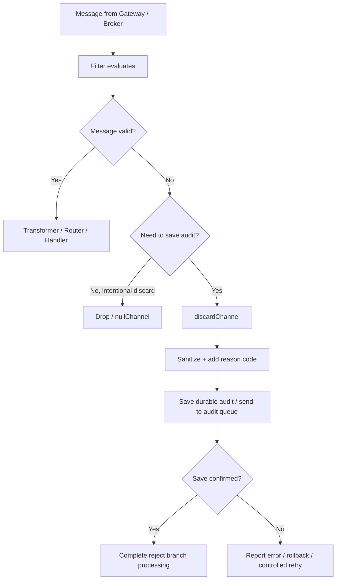
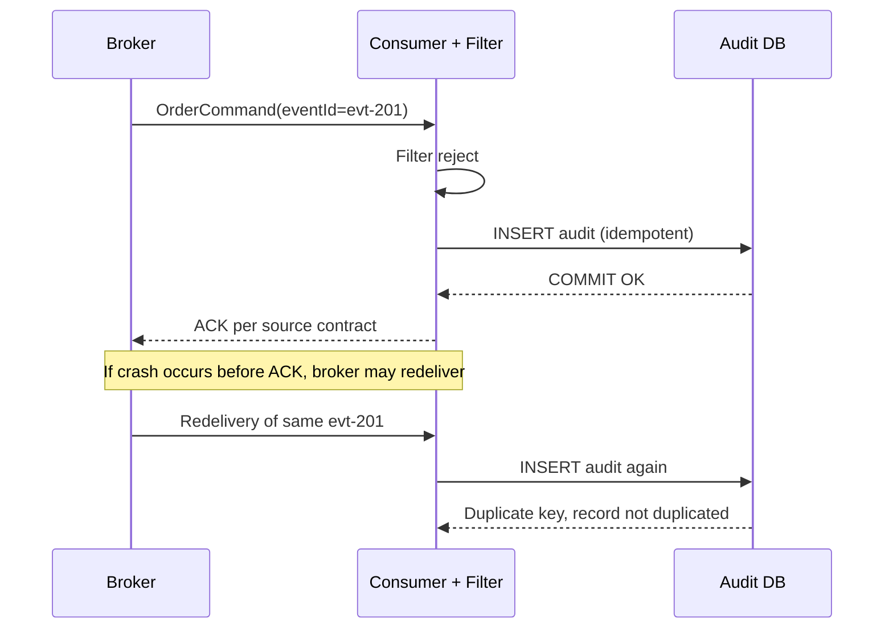

# Choosing a Discard Channel When Auditing Is Required in Spring Integration

## 1. The Problem: Should a Rejected Message Leave a Trace?

In an order-intake system, a message may pass through a **Filter** to check quantity, a **Transformer** to normalize data, and a **Router** to send it to the appropriate processing branch. A command with `quantity = -3` must not deduct inventory. If the Filter simply drops the message without recording anything, operators will struggle to explain why an order never appeared in the system. Yet if you persist **every** dropped message—including heartbeats or irrelevant events—the audit store can become overloaded and retain unnecessary data.

That is why you must decide between:

- **Intentionally ignoring** by not forwarding the message or sending it to `nullChannel`.
- **Routing rejected messages to a discard channel** to record audits, gather statistics, or handle later.
- **Throwing an error** so the caller or inbound adapter decides on rollback, rejection, or redelivery.

This lesson **"Choosing a Discard Channel When Auditing Is Required"** belongs to the **Null channel** chapter of the `SPRING_INTEGRATION_PATTERN` module. The module teaches Enterprise Integration Patterns with Spring Integration to build loosely coupled, extensible message flows—combining Router, Filter, Transformer, Splitter, Aggregator, Gateway, retry, error channel, and correlation, while testing and monitoring branches.

After this lesson, you will be able to:

1. Distinguish `nullChannel`, a Filter's `discardChannel`, an error channel, and a broker dead-letter queue.
2. Choose appropriate behavior for each type of rejected message, especially when auditing is required.
3. Build Java DSL flows with clear acceptance and audit branches.
4. Preserve `eventId`/`correlationId` and rejection reasons without storing excessive sensitive data.
5. Check durability, transactions, acknowledgments, redelivery, and deduplication.
6. Write JUnit 5 tests proving rejected messages do not reach the main handler while still producing an audit record.

## 2. `nullChannel` and Discard Channel Do Not Serve the Same Purpose

Spring Integration provides a special channel named `nullChannel`, implementing the **Null Channel** pattern: messages sent to it are accepted and ignored, with no downstream business subscriber processing them further. It is useful when a message **has finished processing** or **needs no further action**.

Meanwhile, `discardChannel` is a **configuration property of Message Filter**: when the selector returns `false`, the Filter can send the original message to an application-chosen channel. That channel can be a `DirectChannel` to an audit recorder, a queue for a dedicated worker, or `nullChannel` itself if you genuinely want to drop it.

| Criterion | `nullChannel` | Filter with Audit `discardChannel` |
| --- | --- | --- |
| Primary purpose | Accept and ignore the message | Route rejected messages to another branch |
| Further business processing? | No | Yes, depending on the discard channel's subscriber |
| Automatically saves history? | **No** | **No**; requires a concrete recorder/persistence |
| States why the message was dropped? | No | Can compute/attach it, though not auto-generated in detail |
| Reports error when handling fails? | Not an error-handling tool | Depends on channel type, subscriber, and exceptions |
| Suitable for auditing? | No, if used as the sole source of evidence | Yes, if the audit branch is durably designed |
| Equivalent to a broker DLQ? | No | No |

**Common confusion:** When a Filter has no `discardChannel` configured, messages failing the condition simply do not proceed. In outcome this resembles a "drop," yet you should not assume the Filter **sent the message to the `nullChannel` bean**. If you want an explicit path for unneeded messages, you can explicitly specify `nullChannel` as the target.

## 3. Overview Flow: Choosing Between Ignoring and Auditing



This diagram represents **the design decision**. A Filter typically has one criterion and one discard channel; if you need both "drop" and "audit" outcomes across **multiple rejection reasons**, separate the Filters/Routers, add a classification branch before discarding, or use an audit handler that decides the action. Never assume the Filter API automatically selects multiple discard channels per reason.

### Decision Matrix

| Case | What to Prefer | Why |
| --- | --- | --- |
| Heartbeat or irrelevant event permitted to be dropped | `nullChannel`/intentional drop | No need to keep per-message records |
| Validation failure needing explanation to users | `discardChannel` + audit/rejection result | Provides evidence, error code, correlation |
| Event from unauthorized tenant needing security trace | Access-controlled audit branch | Supports investigation while avoiding storing raw secrets/payloads |
| Duplicate already-processed message needing metrics | Dedup + metric; audit per policy | No need to duplicate every payload |
| Poison message repeatedly causing consumer rollback | Reject channel/DLQ or durable quarantine | Prevents infinite hot redelivery loops |
| Filter rejects due to temporary maintenance | May need defer/queue instead of discard | Not a final validation failure; needs replay |
| Handler fails calling dependency after Filter | Error/recovery channel, not Filter's discard channel | Cause is not predicate rejection |

A good rule of thumb: **if operators must answer "where did this message go and why?", never use `nullChannel` as the sole evidence store.**

## 4. What Filter Actually Provides

`MessageFilter` uses a `MessageSelector` or predicate to decide accept vs. reject. Accepted messages continue down the flow; rejected messages can be sent to a discard channel if configured.

Simple example:

```java
record OrderCommand(
        String tenantId, String eventId,
        String orderId, int quantity) {}

boolean isValid(OrderCommand order) {
    return order.orderId() != null
            && !order.orderId().isBlank()
            && order.quantity() > 0;
}
```

If you only write:

```java
.filter(OrderCommand.class, this::isValid)
```

messages failing the condition **are not forwarded to the next handler**; there is no durable audit mechanism yet. To persist rejection reasons, add a dedicated branch:

```java
.filter(OrderCommand.class, this::isValid,
        spec -> spec.discardChannel("orderDiscardAudit"))
```

**Filter sends the rejected message; it does not automatically create an `ErrorMessage` containing a stack trace or validation error table.** To get a `reasonCode` such as `INVALID_QUANTITY`, an audit step must classify it, or an upstream enrichment/validation step must attach the needed metadata.

### `throwExceptionOnRejection` Changes the Contract

If configured with `throwExceptionOnRejection(true)`, the Filter can throw `MessageRejectedException` when a message is not accepted. When both a discard channel and throw-on-rejection are set, both the discard branch and the exception can occur; the system risks writing an audit record yet rolling back/redelivering the same message. Test the ordering and how the source handles errors—do not assume automatic "audit then ack."

## 5. Spring Integration Java DSL Example: Separate Filter and Audit Flow

Suppose order events must have a stable `eventId`; the Filter flow decides whether a message is valid, the business handler receives only valid messages, and the audit sink receives rejected messages.

```java
import org.springframework.context.annotation.Bean;
import org.springframework.context.annotation.Configuration;
import org.springframework.integration.channel.DirectChannel;
import org.springframework.integration.dsl.IntegrationFlow;
import org.springframework.messaging.Message;
import org.springframework.messaging.MessageChannel;

record OrderCommand(String tenantId, String eventId,
                    String orderId, int quantity) {}

interface OrderProcessor {
    void process(OrderCommand order);
}

interface DiscardAuditSink {
    void record(Message<OrderCommand> rejectedMessage);
}

class OrderValidationRules {
    boolean valid(OrderCommand order) {
        return order.orderId() != null
                && !order.orderId().isBlank()
                && order.quantity() > 0;
    }

    String reason(OrderCommand order) {
        if (order.orderId() == null || order.orderId().isBlank()) {
            return "INVALID_ORDER_ID";
        }
        if (order.quantity() <= 0) {
            return "INVALID_QUANTITY";
        }
        return "UNSPECIFIED_REJECTION";
    }
}

@Configuration
class OrderDiscardConfiguration {

    @Bean
    MessageChannel orderInput() {
        return new DirectChannel();
    }

    @Bean
    MessageChannel orderDiscardAudit() {
        return new DirectChannel();
    }

    @Bean
    OrderValidationRules orderValidationRules() {
        return new OrderValidationRules();
    }

    @Bean
    IntegrationFlow validateOrders(OrderValidationRules rules,
                                    OrderProcessor processor) {
        return IntegrationFlow.from("orderInput")
                .filter(OrderCommand.class, rules::valid,
                        spec -> spec.discardChannel("orderDiscardAudit"))
                .handle(processor, "process")
                .get();
    }

    @Bean
    IntegrationFlow recordRejectedOrders(DiscardAuditSink sink) {
        return IntegrationFlow.from("orderDiscardAudit")
                .handle(sink, "record")
                .get();
    }
}
```

In a real application, you must provide beans implementing `OrderProcessor` and `DiscardAuditSink`. Using `DirectChannel` for both branches makes execution **synchronous**: an exception from the audit subscriber can propagate back to the sending thread, allowing the source to decide on rollback if required by contract. However, a propagated exception **does not prove on its own** that database/broker transactions rolled back; that still depends on the inbound adapter and transaction manager.

### Flow of Three Messages

| Input | `rules.valid` | Action | `OrderProcessor` Calls |
| --- | --- | --- | ---: |
| `orderId=O-10, quantity=2` | `true` | Forwarded to `processor.process` | 1 |
| `orderId="", quantity=2` | `false` | Sent to `orderDiscardAudit` | 0 |
| `orderId=O-12, quantity=-1` | `false` | Sent to `orderDiscardAudit` | 0 |

For rejected messages, the audit flow can use `OrderValidationRules.reason(...)` to derive the error code. Never use a free-form exception message as a business code because it changes easily and is hard to aggregate.

## 6. Designing an Investigable Audit Record

An audit record must answer **which message, rejected where, by which rule, when, and whether it was finally saved**. Recommended fields:

| Field | Role |
| --- | --- |
| `tenantId` | Isolates data scope and access permissions |
| `eventId` | Stable event identity across retries/redeliveries |
| `correlationId` | Links Gateway, Router, Splitter/Aggregator to the audit |
| `endpointId` | Identifies the Filter/rule that rejected the message |
| `reasonCode` | Structured code: `INVALID_QUANTITY`, `MISSING_ORDER_ID`, etc. |
| `rejectedAt` | Timestamp recorded on the server |
| `schemaVersion` or fingerprint if needed | Supports schema evolution and detects key reuse |
| `source`/`deliveryId` if present | Reconciles with broker, topic, partition, offset |
| `status` | `RECORDED`, `PENDING_REVIEW`, `RESOLVED` per workflow |

**Do not assume `MessageHeaders.ID` is a durable event ID.** Messages may be recreated when a broker redelivers or a Transformer constructs a new message. Use the producer's `eventId` or an identity stabilized by the adapter contract.

### Audit Events Should Have Their Own Data Type

Rejected messages may contain sensitive or oversized payloads. Instead of storing the raw message verbatim, map to a minimal audit DTO:

```java
record DiscardAuditEvent(
        String tenantId,
        String eventId,
        String correlationId,
        String endpointId,
        String reasonCode) {}
```

Record timestamps where persistence receives the event; optionally include a one-way fingerprint if data policy allows. Never write tokens, payment details, full personal addresses, or secrets to audits/logs merely because they exist in the payload.

### Rejection Reasons Must Not Rely on Inconsistent Guessing

If a Filter uses one rule and the audit recorder recomputes with a different rule version, `reasonCode` can mismatch. There are two approaches:

1. **Share a single immutable validation service** between the Filter and audit recorder, storing `ruleVersion` as well if needed.
2. **Evaluate/attach a `ValidationResult` once** at a step before the Filter (Transformer/Header Enricher), and have the Filter act on that result. The audit flow reads that same result from the normalized header or payload.

If choosing the second approach, separate technical headers from client-supplied data: never trust a `validationPassed=true` header sent by an untrusted source. `ValidationResult` must be computed within the application's trust boundary.

## 7. Durable Audit Example with a Database

`DirectChannel` only guarantees synchronous subscriber execution; it **does not persist** messages. For audits to survive restarts, persist a record in a database.

Illustrative PostgreSQL schema:

```sql
CREATE TABLE rejected_order_audit (
    tenant_id     VARCHAR(100) NOT NULL,
    event_id      VARCHAR(150) NOT NULL,
    endpoint_id   VARCHAR(100) NOT NULL,
    reason_code   VARCHAR(100) NOT NULL,
    correlation_id VARCHAR(150),
    rejected_at   TIMESTAMPTZ NOT NULL DEFAULT CURRENT_TIMESTAMP,
    PRIMARY KEY (tenant_id, event_id, endpoint_id)
);
```

A primary key on `tenantId + eventId + endpointId` enables **idempotent auditing** when a broker redelivers a message after the record has committed. If a single event can be validly rejected multiple times under different versions, extend the identity or use a history model; never arbitrarily overwrite every rejection and lose prior traces.

Illustrative Spring JDBC recorder:

```java
import org.springframework.jdbc.core.JdbcTemplate;
import org.springframework.messaging.Message;
import org.springframework.stereotype.Service;
import org.springframework.transaction.annotation.Transactional;

@Service
class JdbcDiscardAuditSink implements DiscardAuditSink {

    private final JdbcTemplate jdbc;
    private final OrderValidationRules rules;

    JdbcDiscardAuditSink(JdbcTemplate jdbc, OrderValidationRules rules) {
        this.jdbc = jdbc;
        this.rules = rules;
    }

    @Override
    @Transactional
    public void record(Message<OrderCommand> message) {
        OrderCommand order = message.getPayload();
        Object correlationHeader = message.getHeaders().get("correlationId");
        String correlationId = correlationHeader == null
                ? null : correlationHeader.toString();

        jdbc.update("""
                INSERT INTO rejected_order_audit
                    (tenant_id, event_id, endpoint_id,
                     reason_code, correlation_id)
                VALUES (?, ?, ?, ?, ?)
                ON CONFLICT DO NOTHING
                """,
                order.tenantId(),
                order.eventId(),
                "order-validation",
                rules.reason(order),
                correlationId);
    }
}
```

**Conditions for this example to make sense:** `tenantId`/`eventId` must have valid, stable values even when the business payload is rejected; the transaction manager must be properly configured for `JdbcTemplate`; and the method must execute through a Spring bean/proxy for `@Transactional` to take effect. If even the event ID or tenant ID cannot be read, use a **separate quarantine procedure** relying on trusted source identity (e.g., topic/partition/offset or broker message ID where appropriate)—never try inserting `NOT NULL` columns and swallowing the error.

The example uses `ON CONFLICT DO NOTHING` for duplicate deliveries, which **does not yet handle** the same key carrying a different payload. Production systems may store a fingerprint and flag conflicting events instead of treating both as the same rejection.

## 8. Audit, Transactions, Acknowledgments, and Failure Windows

A Filter decision rejecting a message **is not an error by default**. If the discard flow returns normally, an inbound consumer may treat processing as complete and **ack/commit** per configuration. That is proper if the audit was durably persisted; it is dangerous if the audit only sits in an in-memory buffer.

### Synchronous Branch with Audit Recorder



Committing the DB before ack still has a redelivery window; idempotent auditing prevents duplicate writes. If you **ack the broker before the audit commits**, a crash can lose the rejection record. Choose boundaries carefully and test against the real adapter.

### When the Audit Recorder Fails

| Scenario | Without Explicit Handling | Solution |
| --- | --- | --- |
| JDBC audit DB unavailable | Record does not exist, yet message may be acked | Let error propagate to consumer or route to durable queue |
| `DirectChannel` has no subscriber | Sending discard may throw error | Verify flows/subscribers on startup and in tests |
| `ExecutorChannel` or async queue | Sender finishes before audit actually writes | Define separate guarantees for enqueue, persistence, and ack |
| Audit DB shares a rollback-only TX | `INSERT` executes and then rolls back | Isolate transactions appropriately or use outbox/quarantine |
| Broker redelivers same event | May write multiple records and trigger duplicate alerts | Unique constraints, deduplication, and intentional history |

**There is no automatic multi-resource atomic commit** just from putting `@Transactional` on the audit recorder. Which resources/transactions govern broker message receipt, audit DB writes, and broker acks still depends on JMS/JTA/XA, transaction synchronization, the inbound adapter, and propagation.

### When Can Asynchronous Auditing Be Used?

Asynchronous auditing reduces latency on the main path, but distinguish:

- In-memory-only `QueueChannel`: not a durable queue.
- Persistent broker queue with proper publish confirms/transactions: provides a more reliable handoff, though still requires retries, dedup, and an audit consumer.
- Transactional outbox: records the intent to emit an audit in the same transaction as business data/processing markers, with a publisher emitting after commit. It can **redeliver duplicates** after a crash; the audit consumer must still be idempotent.

If compliance requires durable proof for every rejection before acking, never pick fire-and-forget just for speed.

## 9. When Should `nullChannel` Be Used?

`nullChannel` fits **explicit termination**—an intentional end point for a branch needing neither downstream data nor detailed auditing.

Example:

```java
import org.springframework.context.annotation.Bean;
import org.springframework.integration.dsl.IntegrationFlow;

@Bean
IntegrationFlow ignoredHeartbeatFlow() {
    return IntegrationFlow.from("ignoredHeartbeatInput")
            .channel("nullChannel")
            .get();
}
```

The application must declare `ignoredHeartbeatInput`; `nullChannel` is the built-in special channel in Spring Integration. For heartbeats, only use this approach when skipping is explicitly permitted and no per-message evidence retention is required.

Another example is a Router branch dedicated to messages needing no processing. However, never assign a Router's **default output channel** to `nullChannel` if unroutable messages actually indicate a misconfiguration that must be caught. Distinguish "intentionally unneeded" from "don't know how to handle."

### Distinguishing Intentional Drops from Failures

- **Messages irrelevant to the application**: dropping can be reasonable, paired with aggregate metrics.
- **Malformed messages requiring a client response**: discard/audit/validation outcomes are more appropriate.
- **Valid messages failing downstream**: use error/retry/recovery flows; never drop into `nullChannel` to hide exceptions.
- **Messages awaited by an Aggregator**: dropping one part can prevent the group from ever completing; requires timeout/failure or partial-result policies.

## 10. `discardChannel`, `errorChannel`, DLQ, and Wire Tap

These concepts are often lumped together as "error channels," yet their semantics differ:

| Mechanism | Typical Data Received | Origin | Purpose |
| --- | --- | --- | --- |
| Filter `discardChannel` | **Original message rejected by selector** | Message Filter | Rejection handling, auditing, compliance |
| `errorChannel` / recovery channel | `ErrorMessage` wrapping `Throwable` | Error handler, exception flow, recoverer | Incident analysis/notification |
| Broker DLQ/DLT | Original message or copy with broker/adapter error metadata | Reject, delivery limit, dead-letter publisher | Retain failed messages for investigation/replay |
| `WireTap` | Copy of message passing through a channel | Channel interceptor/tap | Flow observation, telemetry, or supplementary audit |
| `nullChannel` | Message routed directly to it | Flow/Router/Service Activator | Intentional termination, no further processing |

**Wire Tap does not replace Filter discard auditing.** A tap on the input sees both valid and invalid messages and does not automatically know the selector rejected a message. To audit only rejected messages, place the tap on the discard channel itself or handle it directly in the audit flow.

If the tap sends asynchronously, never assume auditing is durable when the main branch finishes. A log statement or metric from a Wire Tap does not satisfy business evidence retention requirements.

### `throwExceptionOnRejection` Can Trigger Both Discard and Error

For a Filter with both `discardChannel` and `throwExceptionOnRejection(true)`, the message can be sent to the audit flow **and then** the rejection exception is thrown outward. If the inbound adapter rolls back and redelivers, another rejection may record the audit again. This requires testing duplicates, transactions, and callback ordering—not merely asserting a queue count.

## 11. Data Protection and Audit Storage Costs

Storing audits does not mean storing raw payloads forever. The goal is enough data to trace, without creating a second sensitive data warehouse:

1. **Data minimization:** Store only necessary IDs, event types, reason codes, endpoints, and correlation IDs.
2. **Access control:** Restrict who can view rejection records; keep credentials out of logs.
3. **Retention:** Set retention periods per operational/compliance needs; avoid keeping data indefinitely.
4. **Integrity:** Include unique keys, status, timestamps, and change trails if audit records are further processed.
5. **Availability:** Monitor audit DB/queue backlogs, alert on write failures, and maintain retry policies.
6. **Sampling:** Telemetry can be sampled for low-value messages; **never sample** event types whose contract requires complete recording.
7. **Right-to-delete / data regulations:** Design to minimize identifying data and handle deletion/retention obligations under applicable regulations.

Never protect an "invalid" message less than a "valid" one; rejected data can still contain PII, tokens, or unsanitized content.

## 12. JUnit 5: Proving Discards Are Audited and Not Business-Processed

This is a broker-independent flow test using `DirectChannel` and an in-memory recorder to observe Filter behavior. The test demonstrates:

- Valid messages reach only the business handler.
- Invalid messages are not processed by the business handler but enter the audit sink.
- `correlationId` from the message is preserved when sent to the discard channel.
- If the audit sink throws an error on the synchronous branch, the sender observes the exception instead of assuming auditing succeeded.

```java
import java.util.ArrayList;
import java.util.List;
import java.util.concurrent.atomic.AtomicInteger;

import org.junit.jupiter.api.BeforeEach;
import org.junit.jupiter.api.Test;
import org.springframework.beans.factory.annotation.Autowired;
import org.springframework.beans.factory.annotation.Qualifier;
import org.springframework.context.annotation.Bean;
import org.springframework.context.annotation.Configuration;
import org.springframework.integration.channel.DirectChannel;
import org.springframework.integration.dsl.IntegrationFlow;
import org.springframework.messaging.Message;
import org.springframework.messaging.MessageChannel;
import org.springframework.messaging.support.MessageBuilder;
import org.springframework.test.context.junit.jupiter.SpringJUnitConfig;

import static org.junit.jupiter.api.Assertions.*;

@SpringJUnitConfig(classes = DiscardAuditFlowTest.Config.class)
class DiscardAuditFlowTest {

    @Autowired
    @Qualifier("inputOrders")
    MessageChannel input;

    @Autowired
    FakeProcessor processor;

    @Autowired
    FakeAuditSink audit;

    @BeforeEach
    void reset() {
        processor.calls.set(0);
        audit.received.clear();
        audit.fail = false;
    }

    @Test
    void invalidMessageIsAuditedButNotProcessed() {
        OrderCommand invalid =
                new OrderCommand("tenant-a", "evt-101", "", -1);

        input.send(MessageBuilder.withPayload(invalid)
                .setHeader("correlationId", "checkout-55")
                .build());

        assertEquals(0, processor.calls.get());
        assertEquals(1, audit.received.size());
        Message<OrderCommand> rejected = audit.received.get(0);
        assertEquals("evt-101", rejected.getPayload().eventId());
        assertEquals("checkout-55",
                rejected.getHeaders().get("correlationId"));
    }

    @Test
    void validMessageIsProcessedWithoutDiscard() {
        OrderCommand valid =
                new OrderCommand("tenant-a", "evt-102", "O-102", 3);

        input.send(MessageBuilder.withPayload(valid).build());

        assertEquals(1, processor.calls.get());
        assertTrue(audit.received.isEmpty());
    }

    @Test
    void auditFailurePropagatesInSynchronousFlow() {
        audit.fail = true;
        OrderCommand invalid =
                new OrderCommand("tenant-a", "evt-103", "", 2);

        assertThrows(RuntimeException.class, () ->
                input.send(MessageBuilder.withPayload(invalid).build()));

        assertEquals(0, processor.calls.get());
    }

    record OrderCommand(String tenantId, String eventId,
                        String orderId, int quantity) {}

    static class FakeProcessor {
        final AtomicInteger calls = new AtomicInteger();

        public void process(OrderCommand command) {
            calls.incrementAndGet();
        }
    }

    static class FakeAuditSink {
        final List<Message<OrderCommand>> received = new ArrayList<>();
        volatile boolean fail;

        public void record(Message<OrderCommand> message) {
            if (fail) {
                throw new IllegalStateException("audit store unavailable");
            }
            received.add(message);
        }
    }

    @Configuration
    static class Config {
        @Bean
        MessageChannel inputOrders() {
            return new DirectChannel();
        }

        @Bean
        MessageChannel rejectedOrders() {
            return new DirectChannel();
        }

        @Bean
        FakeProcessor fakeProcessor() {
            return new FakeProcessor();
        }

        @Bean
        FakeAuditSink fakeAuditSink() {
            return new FakeAuditSink();
        }

        @Bean
        IntegrationFlow mainFlow(FakeProcessor processor) {
            return IntegrationFlow.from("inputOrders")
                    .filter(OrderCommand.class,
                            cmd -> cmd.orderId() != null
                                    && !cmd.orderId().isBlank()
                                    && cmd.quantity() > 0,
                            spec -> spec.discardChannel("rejectedOrders"))
                    .handle(processor, "process")
                    .get();
        }

        @Bean
        IntegrationFlow auditFlow(FakeAuditSink audit) {
            return IntegrationFlow.from("rejectedOrders")
                    .handle(audit, "record")
                    .get();
        }
    }
}
```

In this example, Spring Test and JUnit Jupiter are declared in test dependencies; the Filter, handlers, and channels are Spring Integration beans. Because the flow runs synchronously on `DirectChannel`, assertions are checked immediately after `send(...)` returns. `FakeAuditSink` uses an `ArrayList` only because the test is single-threaded; when testing concurrency, switch to thread-safe structures or verify records directly in a database.

**Limitations of these three tests:** They prove message routing **within the Spring context**, not audit DB durability, broker acks, redelivery, or atomicity between DB and broker. Separate integration tests are needed for those guarantees.

## 13. Integration Tests: No Lost Audits and No Duplicate Writes

To verify a real audit contract, run a database and message broker in an appropriate test environment (such as Testcontainers), implement a real JDBC/broker recorder, and observe transactions/acks.

| Scenario | Outcome to Assert |
| --- | --- |
| Valid message | Business handler is invoked; no rejection audit appears |
| Invalid message, audit DB write succeeds | One audit row with right `eventId`/reason; business handler does not run |
| Audit DB fails before commit | Failure is not acked as saved; source handles exception per contract |
| Crash after audit DB commit, before broker ack | Redelivery may occur; unique key prevents duplicate rows |
| Two consumers reject the same event | Only one audit row if dedup is required; no "SELECT then INSERT" race |
| Same `eventId` with different payload | Flag conflict per fingerprint/rule rather than silently ignoring |
| `throwExceptionOnRejection(true)` with discard | Ordering of audit, rollback, and redelivery matches design |
| `ExecutorChannel` or async audit queue | Sender acks per chosen guarantee; never claim DB commit on mere enqueue |
| Missing or invalid `eventId`/tenant ID | Route to quarantine using trusted source identity |
| Splitter has one invalid part | Audit retains `partId`/`correlationId`; Aggregator does not wait forever |
| Sensitive data in payload | Audit stores only allowed fields; logs do not leak raw payloads |

In particular, crash-window tests must inspect **committed state** using an independent transaction/connection after the handler finishes; never conclude solely from an "audit saved" log line.

### When Valid Messages Also Need Decision Auditing

A discard channel only sees **rejected messages**. If you must audit **every accept and reject decision**, add complementary auditing on the accepted branch as well (an audit event or shared decision-logging step)—do not expect a discard channel alone to record everything.

## 14. Retry, Circuit Breaker, and Gateway Impact on Discard Decisions

### Retry

Transient audit DB errors can be retried with bounded backoff. However, if retries wrap **the entire Filter**, each attempt may rerun the selector and re-record the audit. Use unique keys and proper transactions; never retry permanent validation errors forever.

### Circuit Breaker

If a remote audit service fails continuously, a Circuit Breaker can open to avoid thread exhaustion. Yet an **OPEN breaker is not a valid reason to lose a mandatory audit**. When an audit cannot be written, defer/buffer into durable storage or roll back per contract; only skip if data policy permits.

### Gateway

Synchronous Gateways typically expect a reply. A Filter dropping a message without an error/reply strategy can leave callers seeing only timeouts, even though the message was rejected by validation. Design the rejection branch to return `INVALID_REQUEST` with a reason code, or throw an exception translated by the Gateway into a meaningful result. If it merely records an audit and returns normally, confirm the reply contract matches.

### Splitter/Aggregator

Discarding one part can prevent an Aggregator from ever receiving the complete sequence. You need timeout/partial-result rules, invalid-part notifications, or group status updates. Never just send a part to `nullChannel` and expect the Aggregator to know it was excluded.

## 15. Observability: Audit and Discard Must Be Measured Separately

Suggested metrics (not exported by default by the framework):

- `filter_rejections_total` by endpoint and reason group.
- `intentional_discards_total` for message types allowed to be dropped without individual records.
- `audit_record_success_total` / `audit_record_failure_total`.
- `audit_pending_backlog` and oldest pending record age, when using queues/outbox.
- `audit_duplicate_detected_total`, `audit_conflict_total`.
- `broker_redelivery_total` and count of messages rejected to DLQ.
- `audit_processing_latency` and lag from rejection to durable storage.

Metric labels should include `endpoint`, standardized `reasonCode`, `outcome`, and `tenantTier` if applicable. Never put `eventId`, `orderId`, correlation IDs, or payloads into high-cardinality labels; those IDs belong in access-controlled logs/traces.

Example structured log:

```text
event=evt-501 stage=order-filter result=REJECTED reason=INVALID_QUANTITY
event=evt-501 stage=discard-audit result=RECORDED audit_key=tenant-a/evt-501
event=evt-502 stage=order-filter result=ACCEPTED
event=evt-503 stage=heartbeat-filter result=INTENTIONALLY_IGNORED
```

Never log `result=RECORDED` merely because an async send method was called; that result must match the durability guarantee actually achieved by the application.

## 16. Common Pitfalls

| Mistake | Consequence | Fix |
| --- | --- | --- |
| Using `nullChannel` for rejections requiring audits | Loss of event trail | Discard flow + durable recorder |
| Assuming `discardChannel` persists messages by itself | Audits vanish after restart | Implement DB or persistent queue |
| Treating discard messages as `ErrorMessage` | Wrong cast; no expected exception | Read original message; generate structured `reasonCode` |
| Using only `MessageHeaders.ID` for dedup | Redelivery may generate a new ID | Use stable source event ID/identity |
| Using `SELECT` before `INSERT` without a unique key | Concurrent consumers write duplicate audits | Unique constraint + atomic operation |
| Writing audits async and acking immediately without durable handoff | Crash loses audits | Establish durable handoff before ack |
| Writing audits inside a rollback-only transaction | Audit record vanishes upon rollback | Separate transaction/persistence as appropriate |
| Setting `throwExceptionOnRejection` without considering redelivery | One invalid message audited repeatedly | Dedup, classify permanent errors, delivery limit |
| Recomputing reasons using a different rule than Filter | Audit reports wrong cause | Share `ValidationResult`/rule version |
| Storing full payloads in logs/audits | Sensitive data exposure, storage bloat | Data minimization and retention |
| Using Wire Tap before Filter to audit rejections | Logs valid messages too | Tap discard channel or audit explicit outcomes |
| Dropping Splitter parts into `nullChannel` | Aggregator waits forever for missing parts | Timeout/failure/partial-result policy |

## 17. Hands-On Exercise

Design an `OrderCreated → Filter → Transformer → Router` flow. The Filter accepts messages when `quantity > 0` and `orderId` is non-blank. For valid messages, the Router picks the inventory branch; for invalid messages, configure `discardChannel("orderDiscardAudit")` to a JDBC audit recorder. Define `reasonCode`, `eventId`, `correlationId`, and a unique constraint on the audit table.

Complete at least the following scenarios:

1. Send one valid command and one invalid command; verify only the valid command reaches the business handler.
2. Send an invalid command with a correlation ID header; verify the audit record contains the exact identifier and reason.
3. Shut down the audit DB in a test; ensure messages are not falsely acked as audited, and test rollback/error paths.
4. Have the broker redeliver the same event after DB audit commit but before ack; verify only one audit row exists.
5. Enable `throwExceptionOnRejection` in a separate flow; test its impact on discarding and redelivery.
6. Create a heartbeat flow allowed to drop via `nullChannel`; verify no out-of-policy audits are written while aggregate metrics still update.
7. Test with a Splitter/Aggregator when one part is rejected by the Filter; design group states with timeout/failure signals.
8. Test a payload containing sensitive fields; ensure audits store minimal data without exposing raw sensitive values.

**Completion criteria:** every message requiring auditing has a durable, traceable record; messages permitted to drop do not waste storage; discards are never confused with errors/DLQs; rollbacks and redeliveries neither duplicate audits nor lose rejections; and Router, Gateway, and Splitter/Aggregator branches have clear terminal states.

## References

- [Spring Integration — Message Filter](https://docs.spring.io/spring-integration/reference/filter.html): selectors, `discardChannel`, and `throwExceptionOnRejection`.
- [Spring Integration — Channels](https://docs.spring.io/spring-integration/reference/channel.html): channel types, `DirectChannel`, and `nullChannel`.
- [Spring Integration — Error Handling](https://docs.spring.io/spring-integration/reference/error-handling.html): `ErrorMessage` and `errorChannel`.
- [Spring Integration — Advising Filters](https://docs.spring.io/spring-integration/reference/handler-advice/advising-filters.html): interaction of discards with advice chains.
- [Spring Integration — Transactions](https://docs.spring.io/spring-integration/reference/transactions.html): transaction boundaries and synchronization.
- [Spring Integration — Testing](https://docs.spring.io/spring-integration/reference/testing.html): testing message flows and endpoints.
