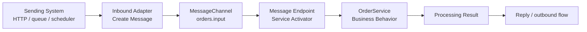
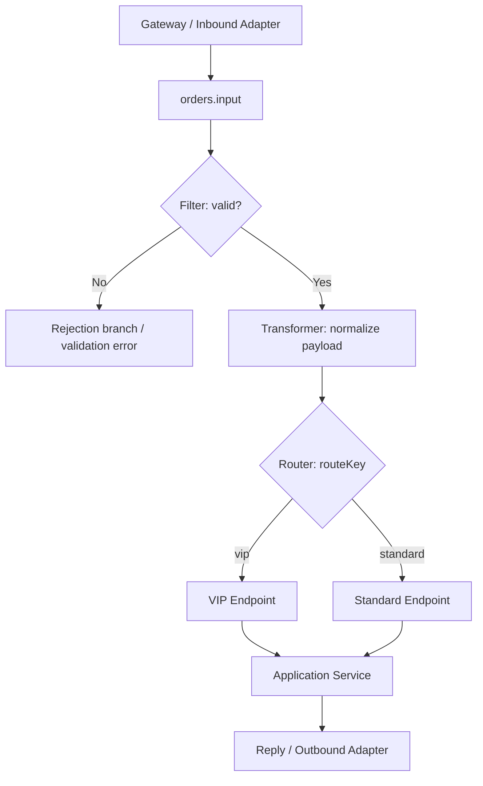

# Message Endpoint Turns a Message into Application Behavior

## 1. Endpoint Is the Meeting Point Between the Messaging System and the Application

In a message-based integration model, a **Message** contains a payload and headers; a **MessageChannel** transports messages between components. However, a channel by itself does not decide whether an order should be confirmed, an invoice should be generated, or data should be transformed. A **Message Endpoint** is the component that receives or emits messages at the boundary of a processing step, connecting the messaging mechanism to the **application behavior** to be executed.

For example, when a sales system receives an `OrderCreated` event: the message is sent to `orders.input`, the endpoint receives the message, reads the required payload and metadata, invokes `OrderApplicationService.accept(...)`, and then produces a reply or the next event. The endpoint keeps the business layer from having to manage channel subscriptions, queue polling, or reply message construction itself.

In the **Endpoint** chapter of the **SPRING_INTEGRATION_PATTERN** module, we learn how to implement *Enterprise Integration Patterns* with Spring Integration to build loosely coupled, easily extensible message flows: Router, Filter, Transformer, Splitter, Aggregator, Gateway, retry, error channel, and correlation, while testing and observing processing branches. Understanding Endpoint is the foundation for composing those patterns into a working flow.



Diagram distinguishing the roles:

| Concept | Responsibility | Example |
| --- | --- | --- |
| **Message** | Carries data and context | `Message<OrderCreated>` with `tenantId` |
| **MessageChannel** | Connects sending and receiving steps | `orders.input`, `orders.validated` |
| **Message Endpoint** | Receives/emits messages to trigger a processing step | Service Activator calling `OrderService` |
| **Application Service** | Executes business rules | Confirming an order, persisting data, calculating discounts |

**Do not equate an endpoint with an HTTP endpoint:** An HTTP controller is one way an application receives requests. In Spring Integration, the Message Endpoint concept is broader, encompassing a handler consuming messages on a channel, an adapter talking to a broker/file/API, or a Gateway turning a method call into a message.

## 2. From Message to Business Invocation

A Message Endpoint typically goes through these conceptual steps:

1. **Receive** a message via an appropriate channel or source mechanism.
2. **Read/map** the payload and headers into parameters of the handler or business service.
3. **Execute** the behavior: persist data, perform calculations, call a service, or orchestrate an EIP pattern.
4. **Handle the result**: emit a reply, send the next message, end a one-way flow, or route errors through the configured mechanism.

Suppose we have these payloads:

```java
record OrderCreated(String orderId, long totalVnd) {}
record OrderReceipt(String orderId, String status) {}
```

The incoming message contains:

```text
payload = OrderCreated("ORD-001", 650_000)
headers = {
    "tenantId": "store-hcm",
    "eventId": "evt-order-001",
    "traceId": "trace-4a"
}
```

The endpoint can convert the payload into an `OrderCreated` argument and extract `tenantId` from the header; the application service receives meaningful parameters and returns `OrderReceipt("ORD-001", "ACCEPTED")`. If the endpoint is used in a request-reply flow, that result can become the payload of the reply message.

The key point is the **boundary of responsibility**. The handler does the work of connecting the message to the business logic; the business object should not be forced to know channel names, `replyChannel`, `errorChannel`, or polling schedules unless there is a specific requirement.

### 2.1. Should an Endpoint Handle the Whole Message or Only the Payload?

Spring Integration supports multiple ways to define a handler:

- Receiving `Message<OrderCreated>` directly when you need to read headers, payload, or general technical metadata.
- Receiving `OrderCreated` with parameters mapped from headers via annotations.
- In Java DSL, using a handler with the signature `(payload, headers) -> result`.

Example with `@ServiceActivator`:

```java
import org.springframework.integration.annotation.ServiceActivator;
import org.springframework.messaging.handler.annotation.Header;
import org.springframework.messaging.handler.annotation.Payload;
import org.springframework.stereotype.Component;

@Component
class OrderMessageEndpoint {
    private final OrderApplicationService applicationService;

    OrderMessageEndpoint(OrderApplicationService applicationService) {
        this.applicationService = applicationService;
    }

    @ServiceActivator(inputChannel = "orders.input")
    public OrderReceipt accept(
            @Payload OrderCreated command,
            @Header("tenantId") String tenantId) {
        return applicationService.accept(command, tenantId);
    }
}

interface OrderApplicationService {
    OrderReceipt accept(OrderCreated order, String tenantId);
}
```

`@ServiceActivator` causes Spring Integration to register an endpoint listening on `orders.input`; the framework maps the message to the method parameters. When the method returns a result, the reply is handled according to the flow configuration, output channel, and/or the message's reply channel information. If the handler does not need to emit a reply, you can design a `void` method or a handler returning `null` according to the corresponding contract.

If `tenantId` is required and the message lacks this header, it must be treated as an input error with a defined error-return path; do not assume custom headers are always present.

## 3. Common Endpoint Types

“Endpoint” describes a **connection role** with the messaging system. The following patterns serve different responsibilities:

| Type | Purpose | Data Direction | Example |
| --- | --- | --- | --- |
| **Service Activator** | Connects a message to an application processing method | Channel → business logic → reply (if any) | Calling `OrderService.accept` |
| **Inbound Channel Adapter** | Ingests external data/events as messages | External source → channel | Polling a directory, receiving data from a scheduled source |
| **Outbound Channel Adapter** | Emits messages to an external destination, usually without waiting for a flow reply | Channel → external system | Writing a file, sending an event to a destination |
| **Messaging Gateway** | Bridges application calls across the messaging boundary; can be request-reply | Method call ↔ channel | `orderGateway.submit(order)` |
| **Message Handler / EIP endpoint** | Executes the behavior of Filter, Router, Transformer, Splitter, Aggregator... | Channel → processing → channel | Filter checking an order; Router selecting a branch |

Some adapters/gateways have both inbound and outbound directions depending on the protocol. The practical distinction is **who initiates the call**, **where messages enter/exit**, and **whether a result needs to be returned to the caller**.

### 3.1. Service Activator — from Message to Application Method

Service Activator is the most classic example of a Message Endpoint. It passes the payload or entire message to a method, receives the result (if any), and continues the flow.

Applications commonly apply this pattern for steps such as creating an invoice, writing to a database, calculating points, validating a customer, or calling an internal service. Service Activator does not automatically provide transactions, retries, deduplication, or durability; those are concerns that must be configured in the infrastructure and business logic.

### 3.2. Channel Adapter — Boundary with Data Sources/Sinks

An **Inbound Channel Adapter** turns external data into an appropriate message and sends it to a channel; an **Outbound Channel Adapter** does the reverse. For example:

```text
[Read CSV file] -> [Inbound Adapter] -> orders.raw
orders.raw -> [Transformer] -> orders.validated
orders.validated -> [Outbound Adapter] -> [Send to broker]
```

The adapter must manage protocol specifics (serialization, connections, ACK, polling, format conversion...). Keeping business logic inside the application service lets you swap adapters without rewriting order processing rules.

### 3.3. Messaging Gateway — Method Interface Instead of Channel API

A Gateway hides the details of building messages, sending to channels, and receiving replies behind an interface:

```java
import org.springframework.integration.annotation.Gateway;
import org.springframework.integration.annotation.MessagingGateway;
import org.springframework.messaging.handler.annotation.Header;
import org.springframework.messaging.handler.annotation.Payload;

@MessagingGateway
interface OrderGateway {
    @Gateway(requestChannel = "orders.input")
    OrderReceipt submit(
            @Payload OrderCreated command,
            @Header("tenantId") String tenantId);
}
```

With proper gateway discovery configuration (such as `@IntegrationComponentScan`), the application calls `orderGateway.submit(...)` like a regular Java method. The framework creates a request message, sends it into the flow, tracks the reply, and returns `OrderReceipt`. **A Gateway returns a result only when an appropriate reply arrives**; if the flow does not send a reply, you must explicitly specify a timeout or choose a one-way contract (`void`).

## 4. How Is an Endpoint Triggered?

An endpoint consuming messages can receive data **when a message arrives** or **when a poller fetches a message**. The consumption mechanism affects latency, execution threads, load pressure, and transactions.

### 4.1. Event-driven Consumer

The endpoint is attached to a `SubscribableChannel` such as `DirectChannel`; when a producer sends a message, the channel dispatches it to a subscriber according to its semantics. With `DirectChannel`, the handler usually runs synchronously on the sending thread, so exceptions and existing transactions can propagate within the same call context.

```text
producer.send(message)
    -> DirectChannel
        -> Event-driven Endpoint
            -> handler executes
    <- send completes or raises an error
```

With an executor-backed channel, the handler may run on a different thread. “Event-driven” does not mean “always synchronous,” and a channel does not store messages persistently by default.

### 4.2. Polling Consumer

With a `PollableChannel` such as `QueueChannel`, the endpoint does not subscribe for immediate delivery; it requires a **poller** to periodically fetch messages. A poller lets you limit the interval and number of messages per poll, or coordinate advice/transactions depending on the infrastructure.

```text
producer -> QueueChannel --(poll every 1 second)--> Polling Endpoint -> handler
```

Java DSL configuration example for a polling consumer (independent of other examples):

```java
import org.springframework.context.annotation.Bean;
import org.springframework.context.annotation.Configuration;
import org.springframework.integration.channel.QueueChannel;
import org.springframework.integration.config.EnableIntegration;
import org.springframework.integration.dsl.IntegrationFlow;
import org.springframework.integration.dsl.Pollers;
import org.springframework.messaging.PollableChannel;

@Configuration
@EnableIntegration
class BatchEndpointConfig {
    @Bean("batch.orders")
    PollableChannel batchOrders() {
        return new QueueChannel();
    }

    @Bean
    IntegrationFlow batchOrdersFlow(BatchOrderService service) {
        return IntegrationFlow.from("batch.orders",
                spec -> spec.poller(
                    Pollers.fixedDelay(1_000).maxMessagesPerPoll(10)))
                .handle(OrderCreated.class, (order, headers) -> {
                    service.process(order);
                    return null; // End one-way processing.
                })
                .get();
    }
}

interface BatchOrderService {
    void process(OrderCreated order);
}
```

This code creates an in-memory `QueueChannel`, which **does not guarantee data survives after the application stops**. In production deployments, if recoverability is needed, you must choose a durable storage source (broker, message store...) and configure appropriate acknowledgement, retry, or transaction handling.

| Property | Event-driven via `DirectChannel` | Polling via `QueueChannel` |
| --- | --- | --- |
| Processing trigger | When the message is sent | When the poller receives the message |
| Timing/latency | Usually close to send time | Depends on interval and backlog |
| Thread | Usually the sender's thread | Thread used by the scheduler/poller |
| Load throttling | Depends on the channel and consumer | Adjust poll interval, messages per poll |
| Durability guarantee | Not built in | An in-memory queue does not have it either |
| Transaction | Can participate in an existing transaction | Can add transaction advice to the poller if the source supports it |

**Note:** A broker's message-driven adapter may invoke an endpoint in an event-driven manner while running on its own consumer thread. Do not infer synchronous/asynchronous behavior from the name “inbound adapter” alone; verify the actual source and channel.

## 5. Building a Complete Flow with Java DSL

We will build an illustrative flow following the principle: **Gateway receives a command from application code → channel → Filter → Service Activator → reply**. The business logic sits behind an interface, making it easy to mock in tests and swap implementations when needed.

Suppose we have two records:

```java
record OrderCreated(String orderId, long totalVnd) {}
record OrderReceipt(String orderId, String status) {}
```

Business service:

```java
interface OrderApplicationService {
    OrderReceipt accept(OrderCreated command, String tenantId);
}
```

Flow configuration:

```java
import org.springframework.context.annotation.Bean;
import org.springframework.context.annotation.Configuration;
import org.springframework.integration.annotation.IntegrationComponentScan;
import org.springframework.integration.channel.DirectChannel;
import org.springframework.integration.config.EnableIntegration;
import org.springframework.integration.dsl.IntegrationFlow;
import org.springframework.messaging.MessageChannel;

@Configuration
@EnableIntegration
@IntegrationComponentScan
class OrderIntegrationConfig {

    @Bean("orders.input")
    MessageChannel ordersInput() {
        return new DirectChannel();
    }

    @Bean
    IntegrationFlow orderFlow(OrderApplicationService service) {
        return IntegrationFlow.from("orders.input")
                .filter(OrderCreated.class,
                        order -> order.totalVnd() > 0,
                        spec -> spec.throwExceptionOnRejection(true))
                .handle(OrderCreated.class, (order, headers) -> {
                    String tenantId = (String) headers.get("tenantId");
                    if (tenantId == null || tenantId.isBlank()) {
                        throw new IllegalArgumentException(
                                "tenantId is required");
                    }
                    return service.accept(order, tenantId);
                })
                .get();
    }
}
```

Combined with `OrderGateway` from the previous section, the call:

```java
OrderReceipt receipt = gateway.submit(
        new OrderCreated("ORD-001", 650_000L), "store-hcm");
```

is converted into a message with payload `OrderCreated` and header `tenantId`. The Filter verifies that the amount is positive. The Service Activator (the `.handle(...)` handler) reads the payload/headers and invokes `OrderApplicationService.accept`. The return value is turned into a reply, and the Gateway returns `OrderReceipt` to the caller.

**If you want to use `@ServiceActivator` from section 2.1 instead of `.handle(...)`, choose only one registration approach for the same behavior.** Registering both consumers on the same `DirectChannel` can cause messages to be dispatched to one of the two subscribers according to the channel's strategy, leading to unpredictable results.

### 5.1. Role of Filter, Router, and Transformer in a Flow

Endpoints are not only for calling an application service. EIP patterns are also implemented by components that consume messages and produce new messages or route messages:



A Filter can **discard** messages per policy or throw an exception upon rejection, depending on configuration. A Router selects recipients based on payload or headers; a Transformer creates a new payload/type; a Service Activator invokes business logic. Messages are typically kept independent between steps, though which exact headers are forwarded should be tested at every boundary.

## 6. Endpoints and One-Way / Request-Reply Exchange Styles

Two common outcome styles:

| Style | Example | Key Contract |
| --- | --- | --- |
| **One-way / fire-and-forget** | Receive an event, then log it or send further messages | Whether ACK is needed, where failures are stored |
| **Request-reply** | Gateway calls fee calculation and waits for the calculated amount | Reply must return to the right place, timeout and exception behavior |

In a request-reply flow, a message can carry `replyChannel` to indicate the response destination. With a synchronous gateway, a temporary reply channel may be arranged by the framework. If a handler returns `null` or a route sends the message down a branch that produces no result, the waiting gateway may time out. For one-way flows, `void` or a handler that produces no reply is appropriate, but you must **define when the producer considers the work successful**.

For example, “successfully called `send(...)`” does not necessarily mean “the invoice has been saved” if the channel/consumer processes asynchronously. Similarly, HTTP 202 Accepted only reflects request acceptance under the API contract and does not confirm that downstream business work has finished.

### 6.1. Correlation in Multi-Branch Flows

When a Splitter divides an order into multiple parts for processing, each part must carry context so the Aggregator knows they belong to the same group. `correlationId`, `sequenceNumber`, and `sequenceSize` commonly appear in split/aggregate flows; the aggregating endpoint must have appropriate correlation and release strategies.

An application service should receive appropriate business IDs, while the endpoint is responsible for resolving orchestration metadata at the messaging boundary. When replaying messages, `MessageHeaders.ID` may change; deduplication keys must rely on stable business IDs or event IDs.

## 7. Errors, Retry, and Transactions at an Endpoint

Endpoints are where business or infrastructure errors frequently arise: order not found, database timeout, payment API returning 503, invalid payload. **Depending on the channel and endpoint type**, errors may be thrown back to the caller or published as an `ErrorMessage` to an error channel.

| Scenario | Behavior to Consider |
| --- | --- |
| Handler on `DirectChannel` throws an exception | Usually propagates the error to the sending thread; Gateway may observe the exception |
| Handler runs on an executor or poller | Exception occurs on the processing thread; configure a separate error handler/error channel |
| Validation error | Reject immediately with a clear explanation; avoid pointless retries |
| Transient timeout | Bounded retry, backoff, exception classification |
| Retries exhausted | Recovery with durable failed-message storage, alerting, and replay mechanism |
| External API call succeeds then DB write fails | DB transaction does not roll back external side effects by default |

In Spring Integration, you can apply **advice** to an endpoint to add retry, transactions, or logging. For instance, `RequestHandlerRetryAdvice` combined with Spring Retry helps re-invoke a handler on specified errors; a poller can integrate transaction advice if the source/resource supports it. Still, you must separate:

1. **Retry:** re-invoking a recoverable operation.
2. **Transaction:** protecting consistency across participating transactional resources.
3. **Idempotency:** preventing duplicate business execution when a message is redelivered or retried.
4. **Recovery:** retaining enough data to investigate, replay, or compensate.

Suppose an endpoint sends a charge command to an external system, the external system collects the payment, but the response times out. Blind retrying could charge the customer twice. You need a `paymentId` or idempotency key supported by the payment system, along with a status lookup process before replaying.

Do not confuse “error sent to an error channel” with “message safely stored.” An in-memory `DirectChannel` or `PublishSubscribeChannel` does not create dead-letter storage on its own; you must design a persistence layer, broker, or target handler.

## 8. Designing Loosely Coupled and Extensible Endpoints

An Endpoint should have a clear responsibility: **receive the right message type, map data, trigger one behavior, and publish an observable result or error**. Separating responsibilities allows infrastructure changes with minimal impact on business logic.

### 8.1. Define Contracts at the Boundary

For each endpoint, specify:

- **Input contract:** what payload type, which headers are required, what validation applies?
- **Output contract:** what reply payload type, one-way or request-reply, are follow-up events emitted?
- **Error contract:** which errors return to the caller, which are retried, which go to recovery?
- **Concurrency and ordering:** can multiple consumers receive concurrently? Is ordering by business key required?
- **Idempotency:** based on `eventId`, `orderId`, or which ID?
- **Timeout / SLA:** how long before the gateway or producer treats the result as missing?

### 8.2. Avoid Mixing Protocol Logic into Business Logic

A maintainable design pattern:

```text
HTTP / Broker / File
   -> Adapter (read and map)
   -> Channel
   -> Endpoint (validation, routing, call service)
   -> Application Service (business rules)
   -> Repository / external client
```

If the business service only processes Java objects like `OrderCreated`, it can be invoked from an HTTP, batch, or messaging endpoint without knowing which channel is used. Conversely, if the service calls `MessageChannel.send()` directly in many places, business logic becomes tightly coupled to messaging orchestration; consider abstracting event emission behind a port/interface for easier testing.

### 8.3. Do Not Infer Delivery Semantics from the Endpoint

An event-driven endpoint + `DirectChannel` is convenient for synchronous flows, but does not provide durability on process crash. A polling endpoint + `QueueChannel` can buffer load, but an in-memory queue can also lose data. Reliability is the combined result of **source adapter, persistence, ACK/NACK, retry, idempotency, and transactions**, not an inherent property of the `@ServiceActivator` annotation.

## 9. Testing Endpoints: Behavior, Headers, Errors, and Branching Flows

Useful tests must prove that a message triggered the **right application behavior**, in addition to checking that a message reached a channel.

| Scenario | How to Test | Expected Result |
| --- | --- | --- |
| Valid message with `tenantId` | Call Gateway and mock `OrderApplicationService` | Service receives the right `OrderCreated` and `tenantId`; caller receives receipt |
| Payload with `totalVnd <= 0` | Invoke flow with invalid data | Filter rejects; service is not called |
| Missing required header | Send message without `tenantId` | Clear error or rejection branch per policy |
| Handler throws exception in synchronous flow | Have mock service simulate an error | Gateway receives error per contract; no success reply |
| Poller has not run yet | Send multiple messages to `QueueChannel` | Handler processes periodically; backlog may remain |
| Multi-branch Router | Attach `routeKey` to each message | Only the matching consumer processes the message |
| Splitter + Aggregator | Send multiple parts with the same correlation ID | Results are grouped per correlation and release strategy |
| Retry or message replay | Resend the same `eventId` | Does not mutate business state a second time if flow guarantees idempotency |
| Message crosses an external adapter | Inspect after serialize/deserialize | Payload and contracted headers remain semantically intact |

Example **unit test** for the adapter method of `OrderMessageEndpoint` in section 2.1 (JUnit 5 + Mockito):

```java
import static org.junit.jupiter.api.Assertions.assertEquals;
import static org.mockito.Mockito.*;

import org.junit.jupiter.api.Test;

class OrderEndpointContractTest {
    @Test
    void endpointMapsPayloadAndHeaderToBusinessService() {
        OrderApplicationService service =
                mock(OrderApplicationService.class);
        OrderCreated command = new OrderCreated("ORD-001", 650_000L);
        OrderReceipt receipt = new OrderReceipt("ORD-001", "ACCEPTED");

        when(service.accept(command, "store-hcm")).thenReturn(receipt);

        OrderMessageEndpoint endpoint = new OrderMessageEndpoint(service);
        OrderReceipt actual = endpoint.accept(command, "store-hcm");

        assertEquals(receipt, actual);
        verify(service, times(1)).accept(command, "store-hcm");
    }
}
```

This unit test verifies that the endpoint method calls business logic with the right arguments and returns the expected result; **it does not verify Spring's Message/headers mapping mechanism**. To test the full flow, you must boot a Spring Test context containing `OrderIntegrationConfig`, the Gateway, and a mocked service bean, then call `gateway.submit(command, "store-hcm")`. Only then are the channel, Filter, header mapping, and reply verified.

For polling consumers and brokers, integration tests need to control polling timeouts/intervals and verify data after consumer processing. For retries, use a stub that produces controlled errors to verify invocation counts and the recovery path.

### 9.1. Observing Endpoints in Production

Track at minimum: inbound/outbound message counts, successes/failures, handler processing duration, retry counts, queue depth, oldest queued message age, and quarantined message counts. Include `traceId`, `correlationId`, and `eventId` to trace a request across multiple endpoints. Avoid logging sensitive payloads or tokens.

For Routers, monitor traffic per branch; for Filters, distinguish policy-rejected messages from processing errors; for Aggregators, track incomplete groups or groups that have timed out.

## 10. Hands-on Exercise and Checklist

**Exercise:** Build an `OrderCreated` ingestion flow in Spring Integration:

1. Create `OrderGateway.submit(order, tenantId)` to send requests to `orders.input`.
2. Add a Filter checking `totalVnd > 0`; define what result should be returned when a message is rejected.
3. Add a Service Activator calling `OrderApplicationService.accept(...)` and returning `OrderReceipt`.
4. Add `routeKey` to separate standard and priority orders, verifying the right service is called.
5. Create an independent consumer polling a `QueueChannel`; compare threads, processing timing, and potential data loss if the process stops.
6. Simulate the service throwing an exception; determine what the Gateway receives, when an error channel is needed, and where errors are stored durably.
7. Send two messages with the same `eventId`; propose a strategy to prevent duplicate data writes.

Before deploying a real endpoint to production, answer: **Which channel does the endpoint receive data from? Which application behavior does it trigger? What are the input/output contracts? Does it process synchronously or via polling? Who is responsible for retry, transactions, ACK, idempotency, and error observability?**

A well-designed **Message Endpoint** creates a clean boundary between *message transport mechanics* and *application behavior*. When payload, headers, channels, consumption style, and outcome contracts are clearly defined, Spring Integration can compose EIP patterns into flexible flows that remain easy to test, extend, and troubleshoot.
