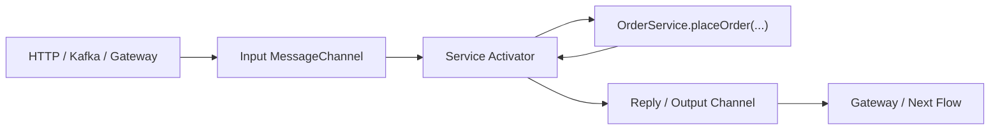
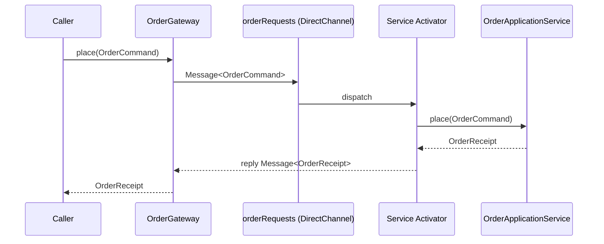
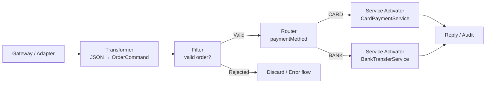
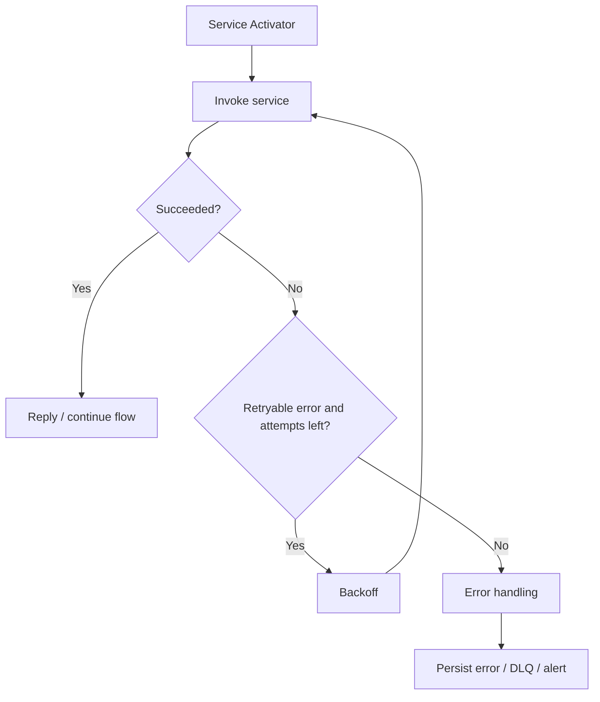
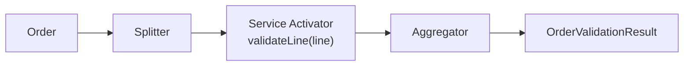

# Service Activator Invoking a Service Method in Spring Integration

> **Chapter:** Endpoint  
> **Lesson:** Service Activator Invoking a Service Method  
> **Scope:** Enterprise Integration Patterns with Spring Integration, targeting loosely coupled, extensible message flows that can combine Router, Filter, Transformer, Splitter, Aggregator, Gateway, retry, error channel, and correlation.

## 1. Problem: Introducing a Business Call into a Message Flow

Suppose a system receives order messages from an HTTP API, RabbitMQ, or another application. After validating the data, the flow needs to invoke an order-processing method on a Java service. If each inbound adapter directly calls the service and handles the result itself, wiring logic gets duplicated in many places.

**Service Activator** is a *Message Endpoint* pattern in Enterprise Integration Patterns (EIP). It connects the messaging infrastructure to a business processing method: it receives a `Message` from a channel, invokes the corresponding service method, and, if there is a result, turns that result into a reply or forwarding message.



Architectural significance: the service method can work with plain Java objects such as `OrderCommand` and `OrderReceipt`, while Spring Integration handles receiving the message, mapping parameters, invoking the method, and routing the result. This reduces transport coupling in business logic.

**Learning objectives:** after this lesson, you will be able to create a Service Activator using Java DSL or annotations, understand how payloads/headers flow into a service method, distinguish one-way processing from request-reply, configure appropriate error/retry handling, and test the entire behavior through channels.

## 2. Where Does Service Activator Fit in the Spring Integration Model?

Three components to distinguish:

| Component | Role | Example |
| --- | --- | --- |
| **Message** | Holds payload and headers | `Message<OrderCommand>` |
| **Message Channel** | Transfers messages between endpoints | `DirectChannel`, `ExecutorChannel`, `QueueChannel` |
| **Message Endpoint** | Receives messages and performs a behavior | Service Activator, Transformer, Filter, Router |

A Service Activator is a **consumer endpoint**: it consumes messages from an input channel and drives the invocation of Java logic. It is not synonymous with the service bean. The service bean merely provides the method to invoke; the endpoint is the integration component that wires that bean into the message flow.

Example:

```text
Message<OrderCommand>
  payload = OrderCommand("ORD-2048", 1250000)
  headers = {traceId: "trace-123", sourceSystem: "checkout"}

            |
            v

Service Activator
  invokes OrderApplicationService.place(OrderCommand)

            |
            v

OrderReceipt("ORD-2048", "ACCEPTED")
            |
            v
Message<OrderReceipt> / reply
```

In a typical flow, Spring Integration uses its message-handling and parameter-mapping framework to invoke the target method. You do not have to manually write `payload = message.getPayload()` at every endpoint.

### Is Service Activator the Same as Transformer?

Both can return a new object, but their design intents differ:

- **Transformer:** converts data representations, such as JSON → DTO or `OrderCommand` → `PaymentRequest`.
- **Service Activator:** triggers a business behavior or system integration, such as persisting an order, checking credit limits, or calling a payment API.
- **Filter:** decides whether to allow a message to proceed or drop it.
- **Router:** decides which branch/channel a message goes to.
- **Gateway:** brings an API or method call into a message flow, optionally waiting for a reply.

If a service's sole job is changing payload format, using a Transformer conveys intent more clearly. If the job is executing a business use case, Service Activator is the natural choice.

## 3. Two Ways to Declare a Service Activator

Spring Integration supports two common styles:

1. **Java DSL:** declare a flow with `IntegrationFlow` and use `.handle(...)` to invoke a service method.
2. **Annotation:** annotate a method with `@ServiceActivator` and specify `inputChannel` (along with `outputChannel` when appropriate).

Both use the same message endpoint model. Choose one style consistently within each flow; if multiple consumers subscribe to the same channel, behavior may depend on the channel's message dispatch mechanism and not every handler will receive a copy.

In the examples below, Java 17 records are used to represent data. You can replace them with POJOs in projects using another Java version.

## 4. Complete Java DSL Example: Receiving a Command and Returning a Result

We will build a synchronous flow:



The example places data types and configuration in package `example.integration`.

### 4.1. Business Data

```java
package example.integration;

import java.math.BigDecimal;

public record OrderCommand(String orderId, BigDecimal amount) {}

public record OrderReceipt(String orderId, String status) {}
```

In a standard Java project, each `public record` is placed in a `.java` file with the same name.

### 4.2. Pure Java Service

```java
package example.integration;

import java.math.BigDecimal;

public class OrderApplicationService {

    public OrderReceipt place(OrderCommand command) {
        if (command.orderId() == null
                || command.orderId().isBlank()
                || command.amount() == null
                || command.amount().compareTo(BigDecimal.ZERO) <= 0) {
            throw new IllegalArgumentException(
                "Order ID and amount must be valid");
        }

        // In a real app: check inventory, save the order,
        // or call a business system with timeout/idempotency.
        return new OrderReceipt(command.orderId(), "ACCEPTED");
    }
}
```

This service does not need to know about `MessageChannel`, `IntegrationFlow`, or how the system receives events. It simply enforces the business rule of taking `OrderCommand` and returning `OrderReceipt`.

### 4.3. Flow and Service Activator Configuration

```java
package example.integration;

import org.springframework.context.annotation.Bean;
import org.springframework.context.annotation.Configuration;
import org.springframework.integration.annotation.IntegrationComponentScan;
import org.springframework.integration.channel.DirectChannel;
import org.springframework.integration.config.EnableIntegration;
import org.springframework.integration.dsl.IntegrationFlow;
import org.springframework.messaging.MessageChannel;

@Configuration
@EnableIntegration
@IntegrationComponentScan
public class OrderIntegrationConfiguration {

    @Bean
    public MessageChannel orderRequests() {
        return new DirectChannel();
    }

    @Bean
    public OrderApplicationService orderApplicationService() {
        return new OrderApplicationService();
    }

    @Bean
    public IntegrationFlow orderFlow(
            OrderApplicationService orderApplicationService) {

        return IntegrationFlow.from("orderRequests")
            .handle(orderApplicationService, "place")
            .get();
    }
}
```

The key part is:

```java
.handle(orderApplicationService, "place")
```

It creates an endpoint that invokes the `place(...)` method on the `orderApplicationService` bean when a message arrives. Because the method returns `OrderReceipt`, the framework can produce a reply to send to the appropriate reply channel.

In the example, the flow ends at the Service Activator; when the Gateway sends a request carrying the `replyChannel` header, the reply can return to the Gateway without declaring a separate output channel in the flow. This is a common synchronous request-reply pattern.

### 4.4. Defining the Messaging Gateway

```java
package example.integration;

import org.springframework.integration.annotation.MessagingGateway;

@MessagingGateway(defaultRequestChannel = "orderRequests")
public interface OrderGateway {
    OrderReceipt place(OrderCommand command);
}
```

`@IntegrationComponentScan` enables discovering gateway interfaces within the scanned package scope. In a Spring Boot application, Spring configuration and component scan scope are typically already set up; still ensure the gateway resides in a scanned package.

The caller interacts only with the interface:

```java
OrderReceipt receipt = orderGateway.place(
    new OrderCommand("ORD-2048", new BigDecimal("1250000"))
);

// receipt.orderId() = "ORD-2048"
// receipt.status()  = "ACCEPTED"
```

In this call snippet, `orderGateway` is a Spring-injected bean and `BigDecimal` is imported from `java.math.BigDecimal`.

### 4.5. Why Does the Gateway Receive the Result?

The Gateway sends a message containing the `OrderCommand` payload and reply routing information in Spring Integration internal headers. The endpoint calls `place`, receives `OrderReceipt`, and emits the appropriate reply; the Gateway waits for the reply and converts it into the return value of `place(...)`.

Because `DirectChannel` is used, the call chain typically executes directly on the sending thread. If the service throws an exception, the synchronous call can receive the error according to the flow's mechanism. If the service is too slow, the caller blocks until completion or the configured timeout expires.

**Key point:** Service Activator does not make a call asynchronous on its own. Synchronous or asynchronous behavior depends on the channel, executor, Gateway, and endpoints in the flow.

## 5. Declaring with the @ServiceActivator Annotation

If you prefer placing configuration directly on the method, you can use `@ServiceActivator`.

### One-Way Example

```java
package example.integration;

import org.springframework.integration.annotation.ServiceActivator;
import org.springframework.stereotype.Component;

@Component
public class AuditService {

    @ServiceActivator(inputChannel = "auditInput")
    public void recordAudit(String event) {
        System.out.println("Audit: " + event);
    }
}
```

When a message arrives on the `auditInput` channel, the endpoint invokes `recordAudit` with a `String` payload. Because the method returns `void`, it performs one-way processing and does not generate a business reply.

The application must declare or provide the `auditInput` channel and enable the appropriate Spring Integration infrastructure. This snippet is a **separate illustrative flow**, not registered in parallel onto the `orderRequests` channel from the Java DSL example in section 4.

### Request-Reply Example via Annotation

```java
package example.integration;

import org.springframework.integration.annotation.ServiceActivator;
import org.springframework.stereotype.Component;

@Component
public class OrderEndpoint {

    private final OrderApplicationService service;

    public OrderEndpoint(OrderApplicationService service) {
        this.service = service;
    }

    @ServiceActivator(inputChannel = "orderRequests")
    public OrderReceipt place(OrderCommand command) {
        return service.place(command);
    }
}
```

This is an **alternative** to `.handle(orderApplicationService, "place")` in the DSL example. If you use this annotation, remove the `.handle(...)` consumer on the same channel from the sample configuration so only one endpoint handles requests.

Another option is using `outputChannel` when replies must be routed to a specific channel, such as `@ServiceActivator(inputChannel = "in", outputChannel = "out")`. When a Gateway expects a reply on a specific path, request-reply correlation must be designed consistently; do not arbitrarily forward results to another channel and still expect the Gateway to receive them automatically.

### Choosing DSL or Annotation?

| Java DSL | Annotation |
| --- | --- |
| Easy to see the entire flow in one configuration | Endpoint sits close to the handling method |
| Convenient for expressing Filter → Router → Service Activator order | Less boilerplate for simple endpoints |
| Can attach advice, channels, and endpoint options inside the flow | Easy to combine with existing service beans |
| Fits multi-branch flows with many components | Fits endpoint structures organized by feature |

There is no mandatory rule forcing every endpoint to use the same declaration style, but avoid registering duplicate consumers on the same `DirectChannel` when you expect only one handler to receive a message.

## 6. What Parameters Can a Service Method Accept?

A major advantage of Service Activator is that the service method does not have to accept `Message<?>`. The framework can convert the payload and required metadata into parameters.

### 6.1. Receiving the Payload Directly

```java
public OrderReceipt place(OrderCommand command) {
    return new OrderReceipt(command.orderId(), "ACCEPTED");
}
```

This is the easiest to read, easiest to test, and least infrastructure-coupled form. Prefer it when business logic only needs the payload.

### 6.2. Receiving Payload and Header

```java
import org.springframework.messaging.handler.annotation.Header;
import org.springframework.messaging.handler.annotation.Payload;

public OrderReceipt place(
        @Payload OrderCommand command,
        @Header(name = "sourceSystem", required = false) String source) {

    String origin = source == null ? "unknown" : source;
    // Use origin for audit or business decisions if trusted.
    return new OrderReceipt(command.orderId(), "ACCEPTED");
}
```

`@Payload` explicitly indicates the parameter comes from the payload. `@Header` extracts a header by name; `required = false` allows the header to be absent. When header data is untrusted, validate it at the security boundary before using it for authorization or tenant routing.

### 6.3. Receiving the Whole Message

```java
import org.springframework.messaging.Message;

public OrderReceipt place(Message<OrderCommand> message) {
    OrderCommand command = message.getPayload();
    String traceId = message.getHeaders()
        .get("traceId", String.class);

    return new OrderReceipt(command.orderId(), "ACCEPTED");
}
```

This approach is useful when many headers and technical metadata are needed, though it couples the method to Spring Messaging. You can keep an adapter endpoint accepting `Message` and pass normalized payload/metadata to a pure Java business service.

### 6.4. Returning a Message with Custom Headers

```java
import org.springframework.messaging.Message;
import org.springframework.messaging.support.MessageBuilder;

public Message<OrderReceipt> place(Message<OrderCommand> request) {
    OrderReceipt receipt = new OrderReceipt(
        request.getPayload().orderId(), "ACCEPTED");

    return MessageBuilder.withPayload(receipt)
        .copyHeaders(request.getHeaders())
        .setHeader("processingStage", "order-accepted")
        .build();
}
```

When returning a constructed `Message<?>`, the developer can explicitly add output headers. Be careful with copying all headers: `replyChannel`, `errorChannel`, security headers, or transport-specific headers have their own lifecycles; do not forward all of them to external brokers or systems. In many cases, letting the framework construct the reply from the payload and configuring a Header Enricher and header mapper at the appropriate boundary is easier to control.

### 6.5. Method Selection Rules

Avoid multiple overloads with the same name and nearly identical parameter sets that make method resolution hard to predict. With DSL `.handle(service, "place")`, use a clear method name and a single signature matching the expected message.

If the payload arrives from JSON or a message broker, ensure it has already been converted to `OrderCommand` before invoking the method; Spring cannot automatically infer arbitrary payload conversions without an appropriate converter/transformer.

## 7. Return Values: Reply, One-Way, and No Reply

A Service Activator can return different kinds of values:

| Method Return Value | Typical Behavior | Notes |
| --- | --- | --- |
| `OrderReceipt` | Creates a reply with the receipt as payload | Requires a reply path if caller waits for a result |
| `Message<OrderReceipt>` | Emits the message constructed by the method | Full control over headers and reply destination |
| `void` | Produces no reply from the return value | Suitable for one-way tasks |
| `null` | No reply from the invocation | Request-reply Gateway may wait until timeout; depends on requires-reply config |

Example with a `void` method:

```java
public void sendEmail(EmailCommand command) {
    emailClient.send(command);
}
```

A one-way email-handling endpoint can use this form. If the caller is a Gateway declaring `EmailReceipt sendEmail(...)` and expecting a result, a `void` method or returning `null` breaks the request-reply contract.

Rule: **explicitly define whether the flow is one-way, request-reply, or event-driven**, then design the Gateway signature, output channel, reply timeout, and error handling accordingly.

### A Service Result Does Not Automatically Mean “Business Complete”

If a Service Activator returns `OrderReceipt("ACCEPTED")` before an asynchronous step performs payment, `ACCEPTED` must only mean “accepted for processing” under the system contract. Do not treat that result as proof of successful payment unless backed by evidence from actual processing.

## 8. Combining Service Activator with Filter, Transformer, and Router

A flow implementing multiple EIPs can place a Service Activator after normalization and branching steps.



Simple DSL example: a Filter selects orders with a positive amount before invoking the service.

```java
@Bean
public IntegrationFlow validatedOrderFlow(
        OrderApplicationService service) {

    return IntegrationFlow.from("validatedOrderInput")
        .filter(OrderCommand.class,
            command -> command.amount() != null
                && command.amount().signum() > 0)
        .handle(service, "place")
        .get();
}
```

This flow is **independent** of `orderRequests` in section 4 and requires declaring an appropriate `validatedOrderInput` channel. With a Filter, if no discard channel or exception behavior is configured, messages failing the condition may be dropped from the flow and a Gateway waiting for a reply will not receive the expected result. Designing rejection behavior is part of the API contract.

In a real flow:

- **Transformer** converts the payload into a DTO accepted by the service method.
- **Filter** checks message admission criteria; it does not replace deep business validation.
- **Router** directs the message to one of several specialized services.
- **Service Activator** executes the business operation on the chosen branch.
- **Header Enricher** attaches source, tenant, or correlation metadata for tracing and routing.

## 9. Which Thread Does Service Activator Run On?

Service Activator usually runs on the thread determined by the **channel dispatching the message**.

| Input Channel | Thread Executing Service Method | Consequence |
| --- | --- | --- |
| `DirectChannel` | Usually the sender's thread | Exceptions can return to sender; thread-bound transactions may be shared |
| `ExecutorChannel` | Usually a worker thread from `TaskExecutor` | Sender may continue early; asynchronous error handling required |
| `QueueChannel` | Poller/receiver thread | Latency depends on poll schedule and queue depth |
| Broker adapter | Thread managed by listener container/adapter | Acknowledgement, retry, and delivery follow the transport |

Example:

```java
return IntegrationFlow.from("ordersInput")
    .channel("ordersAsync")      // ExecutorChannel bean
    .handle(orderService, "place")
    .get();
```

In the example above, `ordersAsync` must be a declared `ExecutorChannel` using an appropriate executor. Switching to a worker thread can break automatic propagation of transactions, MDC, security context, or values stored in the sender thread's `ThreadLocal`.

**Note for Gateway:** if a Gateway method requires a reply, it still waits for the reply or times out even when an `ExecutorChannel` sits mid-flow. Switching threads does not automatically change the synchronous contract of the Gateway method.

### A Single Service Activator Can Receive Multiple Messages Concurrently

If the input uses multiple workers, concurrent calls to the same singleton service bean can occur in parallel. Do not store per-message processing state in shared instance fields without explicit synchronization. Prefer stateless beans and local variables inside methods.

## 10. Exceptions, Retry, and Error Channel

Service Activator is where business or integration errors can arise:

- Wrong payload type or missing required data.
- Service throws an exception due to a business rule, such as credit limit exceeded.
- Database or external API times out, returns an error, or is temporarily unavailable.
- Reply fails to reach the expected destination due to channel/Gateway configuration.

Distinguish **data errors** from **transient retryable errors**. For example: an invalid `orderId` should return a business error; a timeout calling a payment provider can be retried with an idempotency key and a bounded attempt count.

### Synchronous Errors

```text
Gateway → DirectChannel → Service Activator
                              |
                              +--> throws exception
                                     |
                                     v
                                 caller receives error
                                 (per flow configuration)
```

In the basic synchronous model, exceptions from the handler are typically propagated back to the sender as message flow exceptions. The API layer can translate them into an appropriate HTTP status or business response.

### Asynchronous Errors

```text
Gateway/Producer → ExecutorChannel → worker → Service Activator
                       |
                 send accepted
                                         |
                                         +--> handler fails later
                                               |
                                               v
                                          error flow / logging
```

By the time a worker encounters an error, the sender may have already returned. Configuring an error handler, error channel, or error capture mechanism at the asynchronous boundary is mandatory if monitoring and recovery are needed. The `errorChannel` header and default `errorChannel` may participate depending on how the endpoint/dispatcher is configured; do not assume every exception in every flow automatically lands on the same channel.

### Retrying in the Right Place

For transient failures, you can attach a **retry advice** to the endpoint per Spring Integration configuration, specifying max attempts, backoff, and recovery. General flow:



Do not infinitely retry validation errors. When retrying payment operations, sending emails, or writing data, require an idempotency key or mechanism to prevent duplicate side effects. If every retry creates a new transaction, the Service Activator can cause severe business errors even though message delivery appears successful.

## 11. Transactions, Consistency, and Idempotency

In a synchronous `DirectChannel` flow, the Service Activator can run on the same thread as the caller. If a Spring transaction is opened at the appropriate layer, the service call can participate in the transaction according to the service's propagation settings.

Example:

```java
import org.springframework.transaction.annotation.Transactional;

public class OrderApplicationService {

    @Transactional
    public OrderReceipt place(OrderCommand command) {
        // Save Order in database with an appropriate transaction manager.
        // Repository and dependencies must be injected/configured for real.
        return new OrderReceipt(command.orderId(), "ACCEPTED");
    }
}
```

`@Transactional` takes effect only when the method is invoked through a bean proxy or appropriate transaction management mechanism with a transaction manager present; the snippet above illustrates placement, not complete transaction configuration.

When an `ExecutorChannel` switches to another thread, the sender's thread-bound transaction does not automatically follow the message. If a message is emitted before the order-writing transaction commits, the worker may read nonexistent or uncommitted data.

For work requiring **no loss and no duplicate processing**, consider:

1. Writing the request state and event within the same transaction using the **transactional outbox** pattern.
2. An independent publisher forwarding committed events to a durable broker.
3. The consumer executing the Service Activator with an idempotency key derived from a verified business identifier.
4. Acknowledging the message at the transport layer only after processing according to the appropriate acknowledgement contract.

Service Activator itself does not guarantee exactly-once delivery. Correctness depends on storage, transactions, retries, transport, and how the business operation handles duplicates.

## 12. Correlation, Splitter, and Aggregator

A use case may need to split an order into multiple line items, invoke a service to validate each line, and then aggregate the results:



Splitter typically adds headers used for correlation and sequencing. When Service Activator processes child messages, do not arbitrarily overwrite `correlationId`, `sequenceNumber`, or `sequenceSize` used by the framework for grouping.

If the handler returns a new payload, metadata required by the Aggregator must continue to be preserved appropriately when producing the flow reply. If the handler manually constructs a new `Message<?>` without carrying the needed headers, the Aggregator may fail to group items or determine when a group is complete.

If service calls run through an `ExecutorChannel`, child messages may complete out of input order. The Aggregator must have an appropriate correlation strategy, release strategy, and timeout/expiration policy. Avoid inferring “all results ready” merely from the number of successful method calls.

**Design tip:** if a business key is needed, use a dedicated header like `businessKey` or `orderId` for auditing/reconciliation, and keep technical correlation metadata dedicated to its role.

## 13. Testing Service Activator with JUnit 5

A good test should go through a real channel or Gateway to verify the endpoint is wired into the flow. Calling `service.place(...)` directly only unit-tests the business service and does not prove the Service Activator configuration works.

The snippet below uses `OrderIntegrationConfiguration`, `OrderGateway`, and the records from section 4.

```java
package example.integration;

import static org.junit.jupiter.api.Assertions.*;

import java.math.BigDecimal;

import org.junit.jupiter.api.Test;
import org.springframework.beans.factory.annotation.Autowired;
import org.springframework.test.context.junit.jupiter.SpringJUnitConfig;

@SpringJUnitConfig(OrderIntegrationConfiguration.class)
class OrderIntegrationTest {

    @Autowired
    private OrderGateway gateway;

    @Test
    void gatewayReceivesReplyFromServiceActivator() {
        OrderReceipt result = gateway.place(
            new OrderCommand("ORD-2048",
                new BigDecimal("1250000")));

        assertNotNull(result);
        assertEquals("ORD-2048", result.orderId());
        assertEquals("ACCEPTED", result.status());
    }

    @Test
    void invalidOrderReturnsAnError() {
        assertThrows(RuntimeException.class, () ->
            gateway.place(
                new OrderCommand("ORD-BAD", BigDecimal.ZERO)));
    }
}
```

**Explanation of test scope:**

- The first test confirms the `Gateway → channel → Service Activator → reply` path produces the expected result.
- The second test confirms invalid data causes an error in synchronous request-reply; the concrete exception type may be wrapped by the framework, so verify against the application's actual error contract.
- Both tests use a simulated service without calling a database or payment provider. When adding external dependencies, add integration tests and enforce timeouts.

### Dedicated Testing for Asynchronous Errors

If the service endpoint runs on an `ExecutorChannel`, tests should not assume the handler has finished as soon as `send` returns. Use a `CountDownLatch`, Awaitility, or a timeout-bounded wait mechanism to assert final state; verify the error channel/retry when the service throws an exception.

Do not use fixed `Thread.sleep(...)` calls to prove ordering or execution timing. Timing assumptions fail unpredictably when CI is slow or preempted.

### Test Cases Worth Having in Real Projects

| Case | What to Verify |
| --- | --- |
| Valid payload | Service method is called once along the expected flow |
| Invalid payload schema/type | Controlled error response or branch routing |
| Missing required header | Do not trust unverified or spoofed metadata by default |
| Service returns `null` | Gateway/reply handler follows the defined contract |
| Service throws exception | Clear error path, retry, and response content |
| External system timeout | Timeouts, retry caps, and idempotency work as designed |
| Concurrent messages | Service bean handles safely without state bleed |
| Split/grouped messages | Correlation headers arrive intact at the Aggregator |

## 14. Common Design Mistakes

### 14.1. Confusing Spring @Service with Service Activator

`@Service` only marks a business bean in Spring. It does not register a method as a message channel consumer. You must have `@ServiceActivator` or a `.handle(...)` flow (or equivalent endpoint declaration) connecting the method to a channel.

### 14.2. Registering Duplicate Consumers on the Same DirectChannel

If you both annotate `@ServiceActivator(inputChannel = "orderRequests")` and register `.handle(...)` from the same channel, both endpoints may register as subscribers. `DirectChannel` is a unicast channel, so you cannot assume both handlers receive a copy of every message. To multicast, use a `PublishSubscribeChannel` and clearly define each branch's responsibility.

### 14.3. Service Returns void While Gateway Awaits a Result

A `void` method normally generates no business reply. A request-reply Gateway will not receive the expected return object and may time out. If you only need to fire a command, design a one-way gateway; if a result is needed, return an explicit object or message.

### 14.4. Packing All Processing and Routing into the Service Method

If a service method parses JSON, decides routes, handles retries, and manages transport concerns itself, it becomes coupled to many layers. Use Transformer for conversion, Filter/Router for steering, Service Activator for the business use case, and advice/error flows for reusable error handling.

### 14.5. Using Headers as Unverified Authorization Data

Headers such as `tenantId`, `sourceSystem`, and `userId` may be supplied by the client. Header Enricher and Service Activator do not authenticate them automatically. Only feed trusted context into security decisions after verification; avoid logging tokens and personal data.

### 14.6. Retrying Side-Effecting Operations Without Deduplication

A `chargeCard(...)` method may have already succeeded in charging while its reply timed out. Blind retrying creates another transaction. Use an idempotency key and check provider status before retrying when necessary.

## 15. Hands-on Exercise: Processing Payment Commands via Service Activator

**Context:** An application receives `PaymentCommand`, validates the amount, selects a payment method, and invokes a processing service.

**Requirements:**

1. Create `PaymentCommand(id, amount, method)` and `PaymentResult(id, status)`.
2. Create `PaymentService.execute(PaymentCommand)` independent of Spring Integration.
3. Create `paymentRequests` as a `DirectChannel` and `PaymentGateway.execute(...)` returning the result.
4. Use `.handle(paymentService, "execute")` or `@ServiceActivator` to connect the method; pick **one** approach per endpoint.
5. Add a Filter checking positive amounts and explicitly handle the rejected branch; add a Router when expanding to multiple payment methods.
6. Add a trusted `businessKey` or `traceId` via a Header Enricher for traceability.
7. Write tests for success, validation failure, service exception, and the case where the Gateway receives no reply.
8. Explain what changes when the input switches from `DirectChannel` to `ExecutorChannel`.
9. Analyze retry policy, idempotency, transactions, and durable persistence if zero command loss is required.

### Suggested Structure

```text
PaymentGateway
     |
paymentRequests
     |
Header Enricher
     |
Filter (validation)
     |
Router (paymentMethod)
     |                 |
     v                 v
CardServiceActivator   BankTransferServiceActivator
     |                 |
     +------ reply ----+
            |
       PaymentResult
```

Do not start by building many services. First prove a single request-reply flow works with tests, then add one pattern at a time to observe how payload, channels, replies, and errors change.

### Self-Check Questions

**Q1.** If a `@Service` method already exists in the Spring context, does Spring Integration automatically send messages to it?

*No. You must bind it to an input channel using a Service Activator or an appropriate endpoint.*

**Q2.** Why doesn't `OrderApplicationService.place(OrderCommand)` need to accept `Message<OrderCommand>`?

*Because the framework can map the payload to the method parameter; the service only needs business data.*

**Q3.** When a Service Activator runs after an `ExecutorChannel`, do exceptions still automatically return to the caller invoking `send`?

*You cannot rely on that. Errors occurring on a worker require an error flow, logging, and an appropriate response mechanism; the caller may have already moved on.*

**Q4.** Is a Service Activator returning `null` suitable for a request-reply Gateway that always expects a response?

*Usually no. When there is no reply, the caller may wait until timeout or receive an error depending on requires-reply configuration.*

**Q5.** With Splitter → Service Activator → Aggregator, what information must be preserved?

*Preserve the correlation/sequence metadata needed by the Aggregator to reassemble the right group, while designing timeouts and failed-item handling.*

## 16. Principles for Real-World Projects

A Service Activator should have a **clear responsibility, stable input/output contracts, and controllable error paths**. Keep business logic inside service methods; use Channels, Gateways, and other EIPs to define how data moves through the system.

During implementation:

- Define input payload, required metadata, and reply type before creating the endpoint.
- Use DSL `.handle(service, "method")` or `@ServiceActivator` to explicitly bind the method to a channel.
- Keep services loosely coupled to transport; handle data conversion with Transformers or boundary converters.
- Pick synchronous vs. asynchronous channels according to latency, transaction, and ordering requirements.
- Define retry, error channel, timeout, and idempotency whenever the service calls external systems.
- Test the full message path from Gateway/channel to the service method and reply, including error branches.
- Safely monitor trace/correlation and metrics for processing duration, errors, and retries in production.

**Takeaway:** Service Activator is the bridge between a *message-driven flow* and a *business method*. The integration layer is responsible for delivering messages to the right method and routing results; the business service is responsible for executing application behavior. Combining both properly lets the system scale with Router, Filter, Transformer, Splitter, Aggregator, and Gateway while keeping boundaries of responsibility clean.
