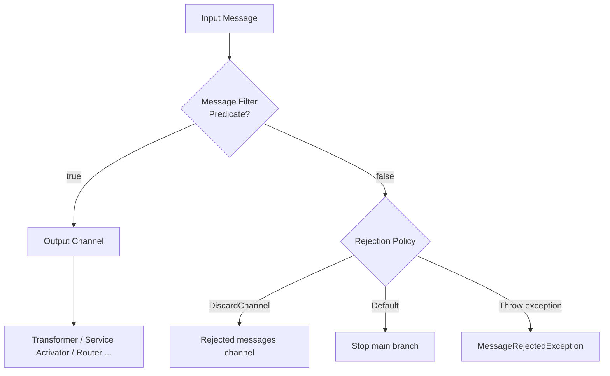
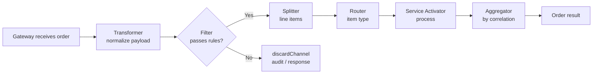

# Message Filter Decides Whether a Message Proceeds in Spring Integration

In a messaging system, not all data entering a pipeline should be allowed to reach the next processing step. An order might still be invalid, an event might have expired, or a message might fall outside the scope handled by a service. **Message Filter** is a *message endpoint* implementing the **Message Filter** pattern from **Enterprise Integration Patterns (EIP)**: it evaluates a condition and decides **whether to let a Message continue or remove it from the main flow**.

In the `SPRING_INTEGRATION_PATTERN` module, the goal is to build loosely coupled and extensible Spring Integration flows using Router, Filter, Transformer, Splitter, Aggregator, Gateway, retry, error channel, and correlation. Understanding Filter properly is especially important because a decision “not to proceed” can affect a Gateway's response, the item count an Aggregator is waiting for, and observability of a processing branch.

## 1. What Is a Message Filter?

In Spring Integration, a Message consists of a **payload** (business data) and **headers** (metadata such as `id`, `timestamp`, `correlationId`, `sequenceNumber`). A Message Filter receives a Message from an input channel and checks a **predicate**, i.e., a function returning `true` or `false`:

- **`true` — accepted:** the Message is sent to the output channel and continues down the pipeline.
- **`false` — rejected:** the Message does not go to the output channel. Depending on configuration, it is dropped, forwarded to `discardChannel`, or raises a rejection exception.
- **Predicate throws an exception:** this is an **evaluation error**, distinct from a valid `false` result. Exceptions must follow the endpoint/flow error-handling mechanism.



A Filter **is not a payload converter**: when a Message is accepted, the endpoint normally forwards that same Message without modifying its content. If you want to normalize or enrich data, use a `Transformer` or a dedicated step before/after the Filter.

A business example:

> The system only allows Messages whose order code starts with `ORD-` to proceed to the recording step. Other codes are routed to the `rejectedOrders` channel to record the reason and support operations.

## 2. How Does Filter Differ from Router, Transformer, and Validator?

Endpoints can sit side by side in the same flow while making different decisions:

| Component | Primary Question | Typical Behavior |
| --- | --- | --- |
| **Filter** | Should the Message proceed? | Accept or reject |
| **Router** | Which branch should the Message go to? | Select one or more target channels |
| **Transformer** | How should the Payload/Message be transformed? | Produce an appropriate output representation or Message |
| **Service Activator** | Which business operation should run on the Message? | Invoke a handler method and optionally produce a result |
| **Splitter** | How many parts should the Message be split into? | Create child Messages |
| **Aggregator** | Which Messages belong to the same group and are ready to combine? | Combine related Messages into a result |

If you need to **drop ineligible Messages**, Filter reflects the intent cleanly. If you need to **send each Message type to a different workflow** where every type must still be processed, Router is more appropriate. If the goal is to **return an error for invalid input**, validation/exceptions can be used instead of silently dropping Messages.

For example, an API request missing a required field is an error that should be returned to the caller; whereas a market price broadcast for a symbol the service does not track can be filtered out normally. This decision is a **business rule**, not merely an annotation choice.

## 3. Ways to Configure a Filter in Spring Integration

Spring Integration provides several mechanisms to express the same concept:

1. **`@Filter`** on a Java method: concise syntax when the predicate belongs to a bean.
2. **Java DSL** (`IntegrationFlow`): expresses the Filter directly within an endpoint chain.
3. **`MessageSelector` / `MessageFilter`**: used when operating at the Message level and configuring endpoints with foundational components.

A simple selector should be **easy to understand, deterministic, and low in side effects**. If it must query a database or external service, clearly define timeouts, retries, and the fact that a technical failure can prevent the filter decision from executing.

### 3.1. Configuring with `@Filter`

The example below is a minimal Spring Integration configuration. `orderInput` receives Messages from producers. Messages whose payload is a code starting with `ORD-` go to `acceptedOrders`, while others go to `rejectedOrders`.

```java
import org.springframework.context.annotation.Bean;
import org.springframework.context.annotation.Configuration;
import org.springframework.integration.annotation.Filter;
import org.springframework.integration.channel.DirectChannel;
import org.springframework.integration.channel.QueueChannel;
import org.springframework.integration.config.EnableIntegration;
import org.springframework.messaging.MessageChannel;
import org.springframework.messaging.PollableChannel;

@Configuration
@EnableIntegration
public class OrderFilterConfiguration {

    @Bean
    public MessageChannel orderInput() {
        return new DirectChannel();
    }

    @Bean
    public PollableChannel acceptedOrders() {
        return new QueueChannel(20);
    }

    @Bean
    public PollableChannel rejectedOrders() {
        return new QueueChannel(20);
    }

    @Filter(
            inputChannel = "orderInput",
            outputChannel = "acceptedOrders",
            discardChannel = "rejectedOrders")
    public boolean isAccepted(String orderCode) {
        return orderCode.startsWith("ORD-");
    }
}
```

Key points to note:

- `@EnableIntegration` activates Spring Integration infrastructure for the Spring application.
- `@Filter` binds a `boolean`-returning method to the endpoint. When a Message has a `String` payload, the framework passes the payload to the `orderCode` parameter.
- `DirectChannel` passes the Message to the Filter when the producer sends it. In this synchronous example, the Filter evaluates immediately on the sending flow.
- The two `QueueChannel` instances hold results so consumers can fetch them via `receive()`. They **do not have a poller by themselves**; in the test example we will receive Messages directly.
- Capacity `20` only limits the number of queued Messages per queue; it does not mean only 20 orders can be processed across the application's lifetime.

If you want to process rejected codes, the application can attach a polling consumer to `rejectedOrders` to write audits, record metrics, or return an appropriate status. Do not feed invalid data straight into a business consumer just because a discard channel exists.

### 3.2. Same Rule in Java DSL

With Java DSL, the logic can be expressed as a flow:

```java
import org.springframework.context.annotation.Bean;
import org.springframework.context.annotation.Configuration;
import org.springframework.integration.dsl.IntegrationFlow;

@Configuration
public class OrderFilterFlow {

    @Bean
    public IntegrationFlow filterFlow() {
        return IntegrationFlow.from("orderInput")
                .filter(String.class,
                        code -> code.startsWith("ORD-"),
                        spec -> spec.discardChannel("rejectedOrders"))
                .channel("acceptedOrders")
                .get();
    }
}
```

This snippet is an **alternative configuration** to the `@Filter` method in section 3.1; do not register both on the same `orderInput` in the same example unless multiple consumers are intentionally designed. When using the DSL, corresponding channels named `orderInput`, `acceptedOrders`, and `rejectedOrders` must exist.

DSL is convenient when placing a Filter sequentially with Router, Transformer, Splitter, or Aggregator within the same `IntegrationFlow`. Annotations are convenient when the filter rule is expressed as a standalone, easily unit-tested method.

## 4. Sending Flow and Observing Results

`OrderFilterConfiguration` lets us run a small check using `AnnotationConfigApplicationContext`:

```java
import org.springframework.context.annotation.AnnotationConfigApplicationContext;
import org.springframework.messaging.Message;
import org.springframework.messaging.MessageChannel;
import org.springframework.messaging.PollableChannel;
import org.springframework.messaging.support.MessageBuilder;

public class FilterDemo {

    public static void main(String[] args) {
        try (var context = new AnnotationConfigApplicationContext(
                OrderFilterConfiguration.class)) {

            MessageChannel input =
                    context.getBean("orderInput", MessageChannel.class);
            PollableChannel accepted =
                    context.getBean("acceptedOrders", PollableChannel.class);
            PollableChannel rejected =
                    context.getBean("rejectedOrders", PollableChannel.class);

            Message<String> good = MessageBuilder
                    .withPayload("ORD-1001")
                    .setHeader("businessOrderId", "ORD-1001")
                    .build();
            Message<String> bad = MessageBuilder
                    .withPayload("UNKNOWN-1")
                    .setHeader("businessOrderId", "UNKNOWN-1")
                    .build();

            input.send(good);
            input.send(bad);

            Message<?> acceptedMessage = accepted.receive(0);
            Message<?> rejectedMessage = rejected.receive(0);

            System.out.println(acceptedMessage.getPayload()); // ORD-1001
            System.out.println(rejectedMessage.getPayload()); // UNKNOWN-1
        }
    }
}
```

When the Filter sits behind a `DirectChannel` and the queues still have capacity, the example processes both sends immediately. Calling `receive(0)` fetches a Message immediately or returns `null` if the channel is empty. In production code, always check for `null` before reading the payload; this example assumes both sends succeeded and were handled by the endpoints.

**Important:** `input.send(bad)` can complete successfully because the Message was accepted by the Filter and routed to `discardChannel`. That **does not mean** the rejected order entered the `acceptedOrders` branch, nor does it mean business logic executed successfully. The meaning of `send()`'s return value depends on the channel type and processing flow.

## 5. Accepted, Rejected, and Evaluation Errors

There are distinct scenarios:

| Scenario | Path | Meaning |
| --- | --- | --- |
| Predicate returns `true` | `input → filter → output` | Rule allows proceeding |
| Predicate returns `false` and `discardChannel` is set | `input → filter → discard` | Rule actively rejects the Message |
| Predicate returns `false` and no `discardChannel` is set | Not sent to output | Message is removed from the main flow |
| Predicate throws an exception | Follows endpoint/flow error mechanism | Do not conflate system errors with valid rejection |

Normally, a Filter without a `discardChannel` **silently stops the Message** when the selector returns `false`. This may be intentional for irrelevant data, but makes it harder to explain why an order was not processed.

### 5.1. What Role Does `discardChannel` Play?

`discardChannel` receives **rejected Messages** so a separate branch can decide how to handle them. Common uses:

- Record audits or `rejected_message_total` metrics by reason.
- Route the Message to a manual review workflow.
- Produce a structured business response for an invalid request.
- Capture samples of dropped data to refine filtering policies.

Having a `discardChannel` does not automatically create a durable **dead-letter queue**, does not guarantee someone will read from the channel, and does not automatically infer the rejection reason. If you need a reason, design explicit metadata or audit records.

### 5.2. When Should an Exception Be Thrown?

Spring Integration supports configuring **`throwExceptionOnRejection`** on a Filter when a `false` outcome should be treated as an error rather than a normal discard. When enabled, rejection can result in a `MessageRejectedException`. Choose this handling according to the flow's contract, especially when a Gateway awaits a response.

For example: “customer not yet eligible” can be a **normal business outcome** that deserves a structured response; “unable to query policy due to authentication system failure” is a **technical error** that should follow retry/error flow mechanisms. Do not use a discard branch to hide unexpected errors.

### 5.3. `errorChannel` Differs from `discardChannel`

- **`discardChannel`:** used when the Filter *actively evaluates a Message as not meeting the condition*.
- **`errorChannel`:** the error-handling channel for endpoints/flows configured with corresponding error handling, such as failures during handler/poller execution.

In a synchronous flow over `DirectChannel`, exceptions can propagate back to the caller of `send()` or the Gateway. In polling/asynchronous flows, `ErrorMessage` and error channel behavior depend on poller, executor, and gateway configuration. **Do not assume that simply throwing an exception will automatically deliver the Message to a specific error channel.**

## 6. Designing Correct and Maintainable Predicates

A good Filter predicate should answer **exactly one decision question**. For orders: “Is the order code in a valid format?”, “Is the order amount greater than 0?”, or “Is this event source in the allowlist?”.

### 6.1. Inspecting Payload

```java
public boolean hasOrderPrefix(String orderCode) {
    return orderCode != null && orderCode.startsWith("ORD-");
}
```

This is a clear, testable rule with no side effects. In real applications, format checks may need to be stricter: maximum length, allowed characters, order state, and sender permissions.

### 6.2. Inspecting Metadata

Sometimes the condition relies on headers rather than the payload:

```java
import org.springframework.messaging.Message;

public boolean isApprovedSource(Message<?> message) {
    String source = message.getHeaders()
            .get("sourceSystem", String.class);
    return "trusted-partner".equals(source);
}
```

To use a predicate like this as a Filter, configure the endpoint to accept `Message<?>` or an appropriate selector. The `sourceSystem` header is an **application-defined header**, not authentication proof. If an untrusted source can set headers itself, verify identity at the system boundary before copying the result into metadata.

### 6.3. Principles for Putting Rules into a Filter

| Principle | Reason |
| --- | --- |
| Do not write to a database or call APIs “just in case” inside a predicate | Keeps filtering decisions deterministic, easy to retry, and observable |
| A predicate given the same input should yield the same result whenever possible | Reduces inconsistent outcomes across retry attempts |
| Split complex conditions into clearly named functions | Makes it easy to explain why a Message was dropped |
| Distinguish business rejection from evaluation errors | Governs discard, retry, and error handling accurately |
| Handle missing headers and wrong payload types intentionally | Prevents unexpected runtime errors from halting the flow |
| Do not log sensitive payloads upon rejection | Reduces data leaks during operations |

When a condition is overly complex or has mandatory side effects, consider a dedicated business step returning an explicit outcome, then use a Filter to decide the next route.

## 7. Filter Coordinating with Enterprise Integration Patterns

An integration flow can have multiple decision points. Example:



In this example, the Filter is placed **before the Splitter** to reject invalid orders altogether before creating child Messages. This reduces the number of branches processed and prevents a child Message from being dropped after the Aggregator already expects the full item count.

### 7.1. Filter Before or After Router?

If all branches share one rule, placing the Filter before the Router is usually easier to maintain and avoids redundant work. If each branch has its own policy, filtering after the Router makes sense. However, when filtering after a Router, measure accepted and rejected Message counts separately per branch.

### 7.2. Filter Before or After Splitter?

Suppose a Splitter splits one Message into three child Messages:

```text
Original Message: order = ORD-1001
              |
           Splitter
              |
       +------+------+ 
       |      |      |
      M1     M2     M3
   corr=X corr=X corr=X
   seq=1  seq=2  seq=3
       |      |      |
     pass   reject  pass
       |      |      |
       +------+------+
              |
           Aggregator
```

If a Filter **after the Splitter** drops `M2` while the Aggregator still waits for a group with `sequenceSize = 3`, it can wait forever without an appropriate release/expiration strategy.

Handling options depending on requirements:

1. **Filter before splitting** if the criterion applies to the entire request.
2. **Split only the items that need processing** if sub-items can be filtered during preparation.
3. **Configure release strategy/timeout and partial group handling** when a post-Splitter Filter is necessary.
4. **Record discards** so you can explain why an aggregated result is missing parts.

Correlation metadata such as `correlationId`, `sequenceNumber`, and `sequenceSize` belongs to group processing; a Filter does not automatically adjust `sequenceSize` when dropping a child Message.

### 7.3. Retry Must Target the Right Error Type

`false` from a predicate is a **filter decision**: retrying the same data usually will not change the outcome. Conversely, a timeout calling a dependent service during evaluation may require bounded retries with backoff.

Clearly define:

- Which errors are retryable and which require manual handling.
- When to notify the producer/Gateway that the Message was rejected.
- How to avoid re-executing business side effects if the flow is retried.
- An idempotency key used to prevent duplicate processing, such as a stable application-assigned `eventId`.

## 8. Filter with Gateway, Asynchronous Channels, and Response Requirements

An API often calls a **messaging gateway** and waits for a result. If a Filter drops the Message and nothing sends a reply, the Gateway call can time out. Therefore, do not leave “silent drop” as the default behavior for requests where users need to know success or failure.

Three common design approaches:

| Flow Type | Suggested Response Design |
| --- | --- |
| Fire-and-forget, irrelevant data can be dropped | Filter rejects, counts metrics, and writes appropriate audit |
| Synchronous request-reply | Include a branch creating a structured rejection reply, or map an exception to a response |
| Asynchronous event-driven | Emit a status event / route Message to a tracking branch; producer receives acceptance ack per contract |

If a `QueueChannel` or `ExecutorChannel` is introduced into the flow, processing can occur at a different time from when the producer sent the Message. At that point:

- A successful `send()` only shows the Message was accepted by the channel at that layer.
- The Filter may run inside a consumer/poller, not on the producer's thread.
- Filter errors do not necessarily propagate directly back to the original sender.
- `replyChannel`, `errorChannel`, timeouts, and Gateway correlation must be designed accordingly.

For branches that must guarantee auditing or zero Message loss on process shutdown, consider durable storage/transport. A `discardChannel` pointing to an in-memory `QueueChannel` **does not automatically become a reliable error store**.

## 9. Observing Rejected Messages

A Filter is only operationally useful if it can answer: **how many Messages were dropped, at which step, by which rule, and what was the impact on outcomes?**

Signals worth collecting:

| Signal | Example | Purpose |
| --- | --- | --- |
| Messages evaluated | `filter.evaluated` | Know traffic passing through the endpoint |
| Messages accepted | `filter.accepted` | Compute Filter pass rate |
| Messages rejected | `filter.rejected` | Detect shifts in data or rules |
| Evaluation errors | `filter.errors` | Distinguish technical incidents from valid rejections |
| Predicate latency | `filter.duration` | Detect slow selectors or blocked dependencies |
| Discard channel backlog | `discard.queue.depth` | Prevent tracking branches from filling up and dropping data |

The metric names in the table are **naming suggestions**, not a guarantee that Spring Integration emits all of them automatically. With Micrometer, Actuator, or tracing systems, you can add instrumentation at the endpoint, selector, and discard consumer to capture accurate values.

Structured logs can carry:

```json
{
  "stage": "order-filter",
  "decision": "REJECTED",
  "rule": "ORDER_CODE_PREFIX",
  "businessOrderId": "UNKNOWN-1",
  "messageId": "<message-uuid>",
  "correlationId": "<group-key-if-present>",
  "reason": "order code does not start with ORD-"
}
```

Do not fabricate a `correlationId` for a Message that lacks that header; omit it or represent it as `null`. Log only the keys needed for diagnostics, avoiding auth tokens, personal data, or full payloads.

## 10. Testing Filtering Behavior with Spring Integration

A valuable test should verify both branches, metadata, and boundary conditions. The JUnit 5 example below boots the configuration from section 3.1 and uses `QueueChannel` as observation points:

```java
import static org.junit.jupiter.api.Assertions.*;

import org.junit.jupiter.api.Test;
import org.springframework.context.annotation.AnnotationConfigApplicationContext;
import org.springframework.messaging.Message;
import org.springframework.messaging.MessageChannel;
import org.springframework.messaging.PollableChannel;
import org.springframework.messaging.support.MessageBuilder;

class OrderFilterIntegrationTest {

    @Test
    void shouldForwardOnlyAcceptedMessageAndDiscardRejectedMessage() {
        try (var context = new AnnotationConfigApplicationContext(
                OrderFilterConfiguration.class)) {
            MessageChannel input =
                    context.getBean("orderInput", MessageChannel.class);
            PollableChannel accepted =
                    context.getBean("acceptedOrders", PollableChannel.class);
            PollableChannel rejected =
                    context.getBean("rejectedOrders", PollableChannel.class);

            Message<String> valid = MessageBuilder.withPayload("ORD-42")
                    .setHeader("businessOrderId", "ORD-42")
                    .build();
            Message<String> invalid = MessageBuilder.withPayload("BAD-42")
                    .setHeader("businessOrderId", "BAD-42")
                    .build();

            assertTrue(input.send(valid));
            assertTrue(input.send(invalid));

            Message<?> passed = accepted.receive(0);
            Message<?> discarded = rejected.receive(0);

            assertNotNull(passed);
            assertNotNull(discarded);
            assertEquals("ORD-42", passed.getPayload());
            assertEquals("BAD-42", discarded.getPayload());
            assertEquals(valid.getHeaders().getId(), passed.getHeaders().getId());
            assertEquals("ORD-42", passed.getHeaders().get("businessOrderId"));
            assertNull(accepted.receive(0));
            assertNull(rejected.receive(0));
        }
    }
}
```

In this configuration, the Filter forwards accepted and rejected Messages to their respective channels. The ID assertion shows that Messages passing through the Filter in this example preserve original metadata; do not generalize that every Transformer/adapter in every system always preserves the exact ID.

### Additional Scenarios Worth Testing

1. **Boundary conditions:** empty string, wrong prefix, case differences, codes with whitespace, or oversized codes.
2. **Missing/untrusted metadata:** absent header, wrong type, or sender claiming to belong to an approved group.
3. **Predicate throws exception:** verify the error follows the exception/error-channel policy and is not misrecorded as a valid rejection.
4. **Gateway waiting for a result:** a rejected Message must yield an appropriate response or error, avoiding hanging until an unexplained timeout.
5. **Filter after Splitter:** one child Message is dropped; verify the Aggregator handles the incomplete group using the right strategy.
6. **Discard channel configuration:** no consumer, full queue, or error writing audit; observe upstream reaction.
7. **Retry/idempotency:** same `eventId` appears again; no duplicate business side effects occur.

For polling or asynchronous endpoints, use bounded waits and explicit assertion conditions instead of fixed `Thread.sleep()`. Always evaluate **the behavior of the whole flow** across both accepted and rejected branches.

## 11. Common Design Mistakes

| Symptom | Common Cause | How to Check and Fix |
| --- | --- | --- |
| Message “vanishes” without logs | Predicate returns `false`, no `discardChannel` | Check rule, add rejection metrics and audit routing when needed |
| Gateway times out when data is dropped | Filter drops Message with no reply | Design a rejection reply branch or map to an error |
| External service errors treated as rejects | Predicate catches exception and returns `false` | Separate technical errors from business decisions |
| Aggregator waits forever for missing Message | Filter drops items after Splitter | Filter before splitting or configure release/expiry strategy |
| Error branch gets overloaded | `discardChannel` has bounded capacity with no consumer | Attach a consumer, monitor capacity, and handle backpressure |
| Filter relies on spoofed header | Trusts client-supplied header | Verify source at the boundary and issue trusted metadata |
| Tests only cover the `true` branch | Ignoring rejection replies and metadata | Test accepted/discard/error paths with representative inputs |
| Retries never move the Message forward | Predicate always returns `false` on unchanged data | Retry only transient errors; treat rejects as intentional outcomes |

## 12. Rules for Building Integration Flows

1. Clearly write the **predicate** and the meaning of `true`/`false` before choosing the configuration style.
2. Choose an appropriate **rejection policy**: drop, route to discard channel, or emit error/reply.
3. Separate **valid rejections** from **technical exceptions** to design retries and error channels properly.
4. If the flow has a Gateway, define the **reply path** for both accepted and rejected Messages.
5. If the flow has Splitter/Aggregator, check the Filter's impact on **correlation and expected item count**.
6. Record **filtered Message counts, reasons, processing duration, and business keys** at a safe data level.
7. Use integration tests to verify **Message routing** across channels, including error and high-load scenarios.

Message Filter is a small endpoint with the authority to decide the entire remaining journey of a Message. When predicates, discard policies, and error handling are clearly designed, Spring Integration prevents unsuitable data from traveling deep into the system while keeping branches observable, testable, and extensible.
