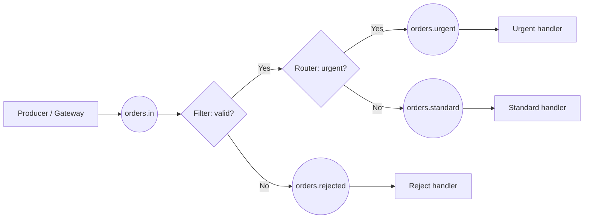
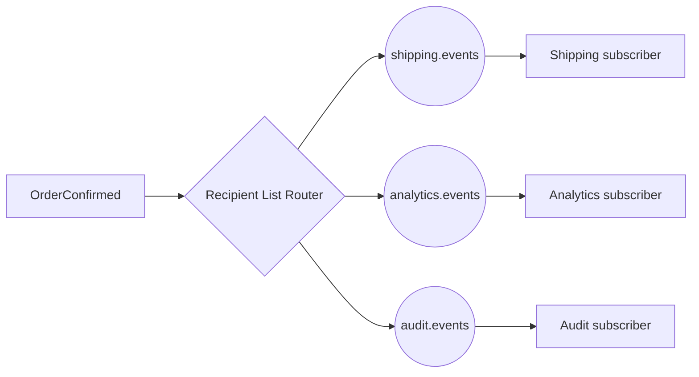
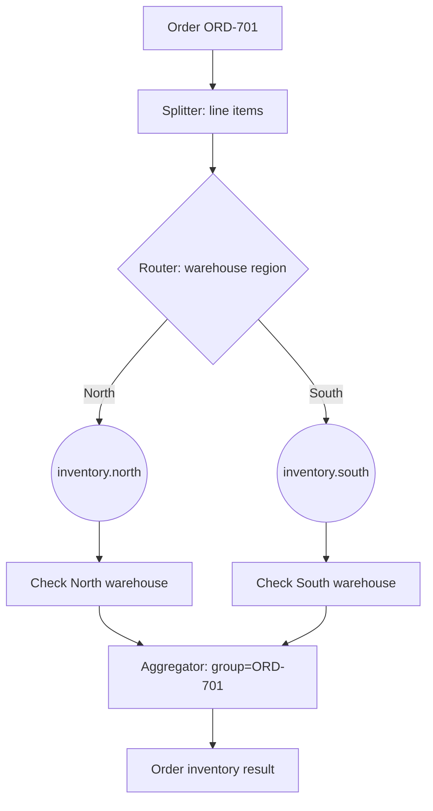

# Router Selecting the Target Channel

> **Chapter:** Endpoint  
> **Module:** `SPRING_INTEGRATION_PATTERN` — implementing Enterprise Integration Patterns with Spring Integration to build loosely coupled, easily extensible message flows; practicing Gateway, Filter, Transformer, Router, Splitter, Aggregator, retry, error channel, correlation, testing, and per-branch observability. This lesson focuses on the **Router endpoint**: how to decide which channel a message continues through.

## 1. Learning Objectives

After this lesson, you will be able to:

1. Explain what problems **Message Router** and **Content-Based Router** solve in an integration flow.
2. Distinguish **selecting a target channel** from **filtering messages, transforming payloads**, and **broadcasting messages to multiple subscribers**.
3. Set up routing rules based on **payload, headers, payload type, or expressions**; understand **channel mapping**, default branches, and unroutable cases.
4. Build routing examples with **Spring Integration Java DSL** and describe the behavior when sending messages to each branch.
5. Design error policies, retries, correlation, and tests to verify which branch a message actually took.

## 2. Problem: One Input, Multiple Processing Paths

Suppose an order-intake service receives orders from a website. Orders flagged as urgent must go to the fast-track team; standard orders go to standard processing; invalid orders must enter a rejection flow. If all conditions are written inside a single intake method, that method becomes tightly coupled to every downstream service:

```java
// Tightly coupled example to show the problem, NOT a recommended implementation pattern.
void receive(Order order) {
    if (!isValid(order)) {
        rejectionService.reject(order);
    } else if (order.urgent()) {
        urgentService.process(order);
    } else {
        standardService.process(order);
    }
}
```

Adding a new branch (international orders, high-fraud-risk orders, enterprise accounts) forces changes to the central method, mixing **target selection rules** with **each target's processing details**.

In Enterprise Integration Patterns (EIP), a **Message Router** is an endpoint that receives a message, evaluates routing rules, and **sends the message to the appropriate target channel**. The sender does not need to directly call every downstream service; downstream endpoints simply subscribe to the channel they serve.



A Router decides **the path of a message**; it does not automatically decide processing timing, message durability, or the receiving system's business outcome. Those properties also depend on channel types, handlers, brokers, and operational configuration.

## 3. Router Is an Endpoint, Channels Are Targets

In Spring Integration, a typical message has a **payload** and **headers**. A Router can inspect this information to pick a channel name or a corresponding `MessageChannel`. For example:

```text
Message:
  payload: Order(id="ORD-701", urgent=true, total=1250000)
  headers:
    sourceSystem: "web-store"
    correlationId: "ORD-701"

Routing decision:
  urgent=true  --> orders.urgent
  urgent=false --> orders.standard
```

A named channel is not necessarily a broker queue. `DirectChannel` usually invokes consumers synchronously; `ExecutorChannel` offloads dispatching to an executor; `QueueChannel` buffers messages for consumers/pollers to retrieve. **Routing and choosing an execution model are two separate decisions.**

### 3.1. How Router Differs from Filter, Transformer, and Gateway

| Component | Primary Question | Example |
| --- | --- | --- |
| **Gateway** | How does the application enter/exit the messaging flow? | `orderGateway.submit(order)` |
| **Filter** | Should the message continue or be dropped? | Reject orders with non-positive total |
| **Transformer** | What representation should payload/headers become? | `ExternalOrder` → internal `Order` |
| **Router** | Which channel should the message continue on? | Urgent order → `orders.urgent` |
| **Service Activator** | Which business logic should run from the message? | Call inventory reservation handler |
| **Splitter** | Which parts should a message be split into? | Split an order into individual line items |
| **Aggregator** | How are related parts combined? | Combine inventory check results by `orderId` |

**A Filter is not a “single-branch” Router.** A Filter expresses an accept/reject rule; a Router expresses a path-selection decision. A Router can route messages to a business error channel, but that does not make it a replacement for Filters or exception handling.

### 3.2. Content-Based Router

A **Content-Based Router** (CBR) is an EIP pattern that selects a destination based on **message content**, typically payload fields or headers reflecting business content. Decisions can rely on a single field (`priority`), a combination of fields (`country`, `amount`, `customerType`), or an expression.

Clear rule example:

| Condition | Routing Key | Target Channel |
| --- | --- | --- |
| `urgent == true` | `PRIORITY` | `orders.urgent` |
| `urgent == false` | `STANDARD` | `orders.standard` |
| Order type cannot be determined per contract | `UNKNOWN` | `orders.unmatched` or controlled error |

A **Routing key** like `PRIORITY` is a classification outcome; a **channel name** like `orders.urgent` is the actual target address. Separating the two via **channel mapping** lets you rename channels without changing all classification logic.

## 4. Ways to Select Channels in Spring Integration

Spring Integration offers multiple routing mechanisms; there is no need to write a large `if/else` block inside every handler.

| Router Type / Selection Method | Based On | Suitable Scenario | What to Watch |
| --- | --- | --- | --- |
| **Payload / Content-Based Router** | Fields or logic on payload | Urgent orders, international orders, transaction classification | Are rules clear, exhaustive, and consistent? |
| **Header Value Router** | Header value | Headers `tenant`, `region`, `messageKind` | Is the header trustworthy and verified/normalized? |
| **Payload Type Router** | Payload class | `CreateOrder` and `CancelOrder` into different flows | Type contract, proxies/subclasses, and schema updates |
| **Expression Router** | Expressions like SpEL | Short rules based on payload/headers | Readable, testable, never take arbitrary expressions from untrusted sources |
| **Recipient List Router** | List of target channels, optionally conditional | Notify both billing and audit | One message can go to **multiple** targets; per-target error handling |
| **Custom Router** | Business function/class | Complex rules needing dedicated naming and tests | Avoid side effects and blocking I/O in branch selection |

### 4.1. Routing by Payload

Pure Java function expressing the decision:

```java
String routeKey(Order order) {
    return order.urgent() ? "PRIORITY" : "STANDARD";
}
```

When it depends solely on input data, this function is easy to test, observe, and reuse in Java DSL. Do not put API calls or database writes inside a function whose **only job is determining the destination**.

### 4.2. Routing by Header

For instance, a `region=VN` or `region=SG` header can select a regional channel. This is useful when an inbound adapter layer has already validated and tagged the region from a trusted source. Using a raw client-supplied header without verification lets clients pick unauthorized flows.

Logic description:

```text
headers['region'] == 'VN'  --> orders.region.vn
headers['region'] == 'SG'  --> orders.region.sg
other / missing            --> orders.region.unknown
```

Spring Integration DSL can declare a router from an expression such as `headers['region']` and map results to channels. **The expression returns a routing key**, not necessarily an existing channel name by default; mapping/default settings must align with real values.

### 4.3. Routing by Payload Type

When messages are strongly typed, such as `CreateOrderCommand` and `CancelOrderCommand`, payload type can select the endpoint. The benefit is fewer manual `type` strings; the drawback is that Java types used for routing can couple components in the same process to shared model classes. Across brokers or JSON, payloads must generally be deserialized/validated into trusted types before type routing makes sense.

## 5. Spring Integration Java DSL Example: Selecting Priority Branches

The following example uses **Java 17+** (for `record`), Spring Framework, and Spring Integration Java DSL. Assume the application has appropriate Spring Integration dependencies configured. Sinks merely log to console for observation and do not simulate a real warehouse or fulfillment system.

### 5.1. Declaring Payload and Messaging Gateway

```java
import java.math.BigDecimal;

import org.springframework.integration.annotation.Gateway;
import org.springframework.integration.annotation.MessagingGateway;

record Order(String id, BigDecimal total, boolean urgent) {}

@MessagingGateway
interface OrderGateway {
    @Gateway(requestChannel = "orders.in")
    void submit(Order order);
}
```

The Gateway provides an interface for business code: order submitters call `submit` without directly looking up `MessageChannel` beans. The example demonstrates a **one-way flow** (`void`); a successful call does not mean a remote ERP/warehouse has processed the order.

### 5.2. Inbound Filter, Router, and Target Channels

```java
import org.springframework.context.annotation.Bean;
import org.springframework.context.annotation.Configuration;
import org.springframework.integration.annotation.IntegrationComponentScan;
import org.springframework.integration.config.EnableIntegration;
import org.springframework.integration.dsl.IntegrationFlow;

@Configuration
@EnableIntegration
@IntegrationComponentScan
class OrderRoutingConfiguration {

    @Bean
    IntegrationFlow orderIngressFlow() {
        return IntegrationFlow.from("orders.in")
            // Business admission rules belong in Filter, not Router.
            .filter(Order.class,
                order -> order.id() != null
                    && !order.id().isBlank()
                    && order.total() != null
                    && order.total().signum() > 0,
                spec -> spec.discardChannel("orders.rejected"))

            // Router returns a routing key; channelMapping maps key -> channel.
            .route(Order.class,
                order -> order.urgent() ? "PRIORITY" : "STANDARD",
                spec -> spec
                    .channelMapping("PRIORITY", "orders.urgent")
                    .channelMapping("STANDARD", "orders.standard")
                    .defaultOutputChannel("orders.unmatched"))
            .get();
    }

    @Bean
    IntegrationFlow urgentOrdersFlow() {
        return IntegrationFlow.from("orders.urgent")
            .handle(msg -> System.out.println(
                "URGENT: " + msg.getPayload()))
            .get();
    }

    @Bean
    IntegrationFlow standardOrdersFlow() {
        return IntegrationFlow.from("orders.standard")
            .handle(msg -> System.out.println(
                "STANDARD: " + msg.getPayload()))
            .get();
    }

    @Bean
    IntegrationFlow rejectedOrdersFlow() {
        return IntegrationFlow.from("orders.rejected")
            .handle(msg -> System.out.println(
                "REJECTED: " + msg.getPayload()))
            .get();
    }

    @Bean
    IntegrationFlow unmatchedOrdersFlow() {
        return IntegrationFlow.from("orders.unmatched")
            .handle(msg -> System.out.println(
                "UNMATCHED ROUTE: " + msg.getPayload()))
            .get();
    }
}
```

Key points explained:

1. **`orders.in`** is the flow's input channel. The Gateway sends `Order` messages there.
2. **Filter** blocks orders with blank `id` or invalid `total`; `discardChannel` sends non-conforming messages to `orders.rejected` for an explicit outcome.
3. **Router** does not process orders; it returns `PRIORITY` or `STANDARD` from the payload.
4. **`channelMapping`** translates routing keys into channel names; two independent flows consume messages from those channels.
5. **`defaultOutputChannel`** is the exit when **no route can be resolved under the rules and router configuration**; in this example the classifier returns two fixed mapped keys so this branch normally does not fire, though it is valuable as logic evolves.
6. Console handlers illustrate branch termination; in production, replace them with Service Activators or outbound Gateways/Adapters to another system.

Example invoking the gateway from an injected `OrderGateway` bean:

```java
orderGateway.submit(new Order(
    "ORD-701", new BigDecimal("1250000"), true));

orderGateway.submit(new Order(
    "ORD-702", new BigDecimal("300000"), false));

orderGateway.submit(new Order(
    "ORD-703", BigDecimal.ZERO, true));
```

Illustrative output, omitting `record.toString()` details:

```text
URGENT: Order[id=ORD-701, total=1250000, urgent=true]
STANDARD: Order[id=ORD-702, total=300000, urgent=false]
REJECTED: Order[id=ORD-703, total=0, urgent=true]
```

No `UNMATCHED ROUTE` line appears because every message passing the Filter yields one of the two mapped keys.

### 5.3. When Should You Use `@Router` Instead of DSL?

When you want channel selection logic encapsulated in a dedicated method, Spring Integration supports endpoints annotated with `@Router` on a managed bean. Conceptual example:

```java
import org.springframework.integration.annotation.Router;
import org.springframework.stereotype.Component;

@Component
class OrderRouteDecider {
    @Router(inputChannel = "orders.toRoute")
    public String chooseChannel(Order order) {
        return order.urgent() ? "orders.urgent" : "orders.standard";
    }
}
```

The `@Router` example is an **alternative declaration style** for a Router endpoint and **must not be stacked onto the same `orders.in` of the DSL flow above** unless intentionally redesigning the topology. It assumes `orders.toRoute` has a producer sending to it and both target channels exist. Avoid accidentally attaching two routers or competing endpoints to the same point-to-point channel.

## 6. Channel Mapping, Fallbacks, and Unroutable Errors

A common design mistake is handling only two familiar cases while ignoring new data values, missing fields, or mismatched target configurations.

### 6.1. Distinguishing Three Scenarios

| Scenario | Example | How to Handle |
| --- | --- | --- |
| **Valid routing key and target channel receives the message** | `PRIORITY` → `orders.urgent` | Continue flow; observe downstream result independently |
| **No matching route** | `EXPRESS` has no declared mapping | Define a default channel, handle as unsupported data, or raise a structured error |
| **Route exists, but delivery/handling at target fails** | `orders.urgent` has no subscriber or handler throws exception | Delivery/handler error per channel type; use error handling/retry, do not treat as “missing routing key” |

**`defaultOutputChannel` is not an automatic failover mechanism when the target handler fails.** If the Router already selected `orders.urgent` and its handler fails, re-routing to `orders.standard` could process the order twice or violate SLAs. Any runtime error fallback must be explicitly designed per business contract.

### 6.2. Untrusted Header/Routing Key Values

Never let a client set header `channelName=internal.admin` and use that string directly to route to arbitrary channel beans in the application context. Instead:

- **Validate** payload/header values at ingress.
- **Map** from a bounded set of keys (`PRIORITY`, `STANDARD`, `REVIEW`) to approved channels.
- **Reject or quarantine** values outside the allowlist while recording appropriate metrics/reasons.
- **Do not log** sensitive raw data to explain a routing decision.

### 6.3. Rule Precedence and Priority Branches

If an order has both `urgent=true` and a high `riskScore`, which branch should run first? Do not rely on accidental `if` ordering when business risk is involved. You can design an explicit order:

```text
if invalid        -> orders.rejected
else if highRisk  -> orders.manualReview
else if urgent    -> orders.urgent
else              -> orders.standard
```

Distinguish **classification precedence rules** from **operational priority**: selecting a channel named `orders.urgent` does not mean a scheduler, executor, or broker prioritizes it unless the infrastructure has matching policies.

## 7. Single Target, Multiple Targets, and Publish–Subscribe

A Content-Based Router typically picks **one matching destination** per rule. Yet a single message may need to reach several places: for example, a confirmed order must go to shipping *and* analytics. This calls for a **Recipient List Router** or a **Publish-Subscribe** model depending on intent.



| Option | Distribution Model | When to Use |
| --- | --- | --- |
| **Content-Based Router** | Picks target by content, usually one branch | Urgent orders **or** standard orders |
| **Recipient List Router** | Determines list of targets per message, optionally conditional | Only parties matching each event type should receive it |
| **Publish-Subscribe Channel** | One message is broadcast to registered subscribers | Multiple teams care about the same event |

Do not assume that a Router distributing to multiple channels executes *in parallel* or *with fault isolation*. Synchrony, ordering, message cloning, per-subscriber error handling, and backpressure depend on channel/dispatcher configuration. If one party must keep processing when another fails, establish appropriate operational/reliability boundaries.

**Note:** A `DirectChannel` with multiple subscribers normally uses point-to-point dispatching among subscribers and does **not** automatically broadcast to all subscribers. For fan-out, choose the right channel and EIP.

## 8. Router Coordinating with Splitter, Aggregator, and Correlation

An order `ORD-701` has three line items. Splitter creates three child messages; Router can send each line to a North/South warehouse based on SKU or fulfillment region. Aggregator waits for the needed results and emits a combined message.



Here you must design:

1. **Correlation key:** all three child messages (and results) must link to the same `orderId`/correlation group. Each part's own `messageId` is **not** the group key.
2. **Sequence/release:** know when the group has received all three lines via sequence metadata or a business-defined release condition.
3. **Late/duplicate messages:** retried or late parts can cause duplicate arrivals in a group; design idempotency and timeout/expiry policies accordingly.
4. **Header propagation:** when crossing adapters/brokers, verify correlation/sequence headers are mapped and preserved.
5. **Routing decision trace:** record branch labels and business keys to explain why a line item went to the North rather than South warehouse; do not put every `orderId` into high-cardinality metric tags.

Router only selects **the next hop**; it does not guarantee the Aggregator receives all responses or automatically handle missing groups.

## 9. Synchronous, Asynchronous, and What “Successfully Routed” Means

Once the router selects `orders.urgent`, there remains the question of how the channel operates:

| Target Channel Type | Typical Behavior | What Cannot Be Concluded from Route/Send Alone |
| --- | --- | --- |
| `DirectChannel` | Dispatches to handler immediately on sender thread | Success in an internal handler does not prove an external system committed |
| `ExecutorChannel` | Hands task off to an executor | Being scheduled does not mean the handler has finished |
| `QueueChannel` | Enqueues message for consumer/poller | Being enqueued does not prove dequeuing or processing |
| Adapter via external broker | Sends message via broker protocol | Publish ack is not always business-processing ack |

**Message-based does not mean asynchronous by default.** A Router may invoke the next handler synchronously on a `DirectChannel`. If the target channel uses an executor, error callbacks and timing differ; do not write tests assuming every branch finishes immediately after `send`.

## 10. Errors, Retry, and Error Channels Per Branch

Distinguish three main error sources:

| Error Type | Symptom | Response |
| --- | --- | --- |
| **Unclassifiable** | Missing routing key / no mapping match | Clear default/error route; optionally business rejection |
| **Undeliverable to target** | Channel missing, no subscriber, send refused | Fix resolution/dispatch config; record technical error |
| **Target processing fails** | Handler timeout, exception, external API failure | Bounded retry at appropriate step, error handling/compensation, idempotency |

On synchronous branches, downstream errors can propagate back up the `send()`/Gateway call. At executor/poller boundaries, the framework can emit `ErrorMessage` according to `errorChannel` and configuration. **Do not assume every exception goes to the same error channel** or gets redirected by the Router to its default channel.

Retries at handlers or outbound gateways must account for **duplicate side effects**. For instance, a timeout creating a shipment does not prove the carrier failed to create it; before resending `CreateShipment`, use an idempotency key, status lookup, or compensation workflow. Avoid calling the Router itself in an unbounded retry loop.

A flow with two branches can apply different policies: standard orders retry 3 times then alert, while urgent orders use bounded retries and escalate to a manual handling team. These numbers are **purely policy examples** that must be chosen by SLA and target contract—not Spring Integration defaults.

## 11. Observing and Testing Routing Paths

### 11.1. Signals to Measure

| Observation Point | Relevant Info | Question Answered |
| --- | --- | --- |
| Gateway / ingress | Payload type, source, timestamp, business key | Was the order received? |
| Filter | Accepted/rejected counts, reason | Why was an order dropped? |
| **Router** | Routing key, target channel name, per-branch counts | Where was the order classified? |
| Target channel | Send/receive counts, dispatch errors, queue depth | Did the message reach the channel? |
| Downstream handler | Business outcome, processing duration, retries | Did the target succeed? |
| Error flow | Exception type, attempt count, correlation | Was the error handled or missed? |

You can attach **ChannelInterceptor**, **Wire Tap**, logs, metrics, and tracing at appropriate points, without letting instrumentation mutate payloads or block the Router's hot path. When observing, **never log full sensitive data** (tokens, customer addresses, payment cards). `orderId` is helpful in logs/traces, but avoid using it as a metric tag due to high cardinality.

### 11.2. Minimum Test Matrix

| Input / Scenario | Expectation |
| --- | --- |
| Valid order `urgent=true` | Only `orders.urgent` receives one message; `orders.standard` receives none |
| Valid order `urgent=false` | Only `orders.standard` receives it; `orders.urgent` receives none |
| `total <= 0`, blank `id` | Goes to `orders.rejected`; Router does not dispatch to either processing branch |
| New unmapped routing key | Goes to `orders.unmatched` **if** fallback policy is configured accordingly |
| Target channel missing or has no consumer | Configuration/dispatch error detected; not counted as processed |
| Urgent branch handler throws exception | Error observed under sync/async semantics and handled per policy |
| Resending the same command | Does not duplicate business actions when idempotency is implemented |
| Splitter sends parts to different branches | Preserves correlation and releases Aggregator group properly |

**How to structure integration tests:** boot a Spring context containing `OrderGateway` and the flow; attach test handlers or use test channels to capture messages at each target; submit orders via the gateway; assert **payload, headers, message counts, and absence on unselected branches**. When using asynchronous channels, wait with timeout-bounded conditions instead of arbitrary `Thread.sleep()`. This lesson only outlines test structure; integrating into a real project must match the Spring version and existing test setup.

### 11.3. Classification Rules Should Also Be Unit-Tested Independently

You can extract simple logic into a standalone function to test without booting a Spring context:

```java
// Pure function for rule testing; does not send messages itself.
static String classify(Order order) {
    if (order == null || order.id() == null || order.id().isBlank()) {
        return "REJECT";
    }
    if (order.total() == null || order.total().signum() <= 0) {
        return "REJECT";
    }
    return order.urgent() ? "PRIORITY" : "STANDARD";
}
```

A pure function proves classification rules are right, yet **does not replace integration tests**, because it does not verify channel names, mappings, subscriptions, error flows, or real sync/async behavior.

## 12. Production Router Design Checklist

- [ ] Clear contract exists for payload/headers used to decide branches.
- [ ] Route rules are **exhaustive and non-contradictory**, with a controlled default or error branch.
- [ ] Routing keys map to an allowlisted set of channels; never derive arbitrary target names from untrusted data.
- [ ] Every target channel exists, has a consumer, and uses a dispatch model suited to requirements.
- [ ] Distinguished **Content-Based Router**, **Recipient List Router**, and Publish-Subscribe based on recipient count.
- [ ] Filter/Transformer/Router keep separate responsibilities, with no hidden side effects inside classification logic.
- [ ] Accounted for idempotency on retry, error channels, and error handling per branch.
- [ ] Correlation/sequence headers preserved across Splitter/Aggregator and broker boundaries.
- [ ] Metrics/logs/tracing cover each branch, and tests verify unselected branches receive no messages.
- [ ] Clearly distinguished milestones: “routed,” “received at channel,” and “processed at target” before declaring success.

## 13. Applied Exercise

An e-commerce platform processes orders under this policy:

- Orders missing `orderId` or with non-positive total → rejection flow.
- Orders with high risk score → manual review team first.
- Valid orders with `urgent=true` → priority team.
- Remaining orders → standard team.
- Once an order completes, emit an event to analytics and notification.

Answer for yourself:

1. Should the **high-risk** branch be evaluated before or after **urgent**? How would rules differ if both conditions hold simultaneously?
2. Where should Filter, Router, handlers, and event publication sit? Which channel needs a default route?
3. Should notifying analytics and notification use a single-target Content-Based Router or a multi-target Recipient List/Publish-Subscribe?
4. If the urgent branch uses an `ExecutorChannel`, does a successful send confirm order completion?
5. What tests would you write to prove **an order is never sent to two mutually exclusive branches**, while still publishing events to the intended subscribers after completion?

**Suggested diagram:** `Gateway → Filter → Transformer (if needed) → Router [manualReview | urgent | standard] → target processing → post-success event → Publish-Subscribe`. Correlation ID travels with the flow; retry/idempotency and error paths on each branch must be designed individually. If high risk is a mandatory gate, give it **precedence ahead of the urgent branch** per business policy rather than relying on incidental code ordering.

## 14. Summary

**A Router is an endpoint that chooses a message's next channel based on a testable decision.** In Spring Integration, you can write rules against payload, headers, payload type, expressions, or a business function; use channel mapping to decouple **classification outcomes** from **target channel addresses**. A default branch handles unmapped routes, but does not replace handling errors that occur after a target has been selected.

To keep EIP flows loosely coupled, extensible, and observable, keep the Router focused on **choosing the path**, use Filter for admission decisions, Transformer for normalization, Splitter/Aggregator for splitting/combining data, and design **retry, error channel, correlation, idempotency, and logging/metrics/tracing** specifically for your branches. Finally, test not only that “the right branch was called,” but also that “wrong branches were not called” and “the target actually succeeded under contract.”

**References:** Gregor Hohpe & Bobby Woolf, *Enterprise Integration Patterns* (Content-Based Router, Message Router, Recipient List); Spring Integration documentation on Routers, Message Channels, Java DSL, Gateways, and Error Handling.
