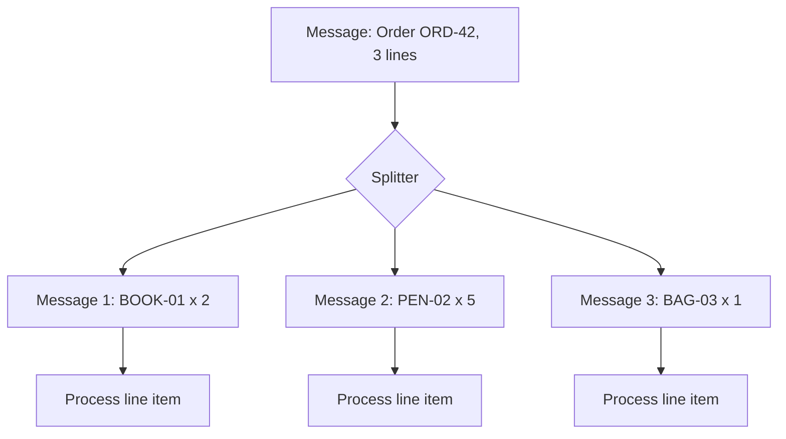
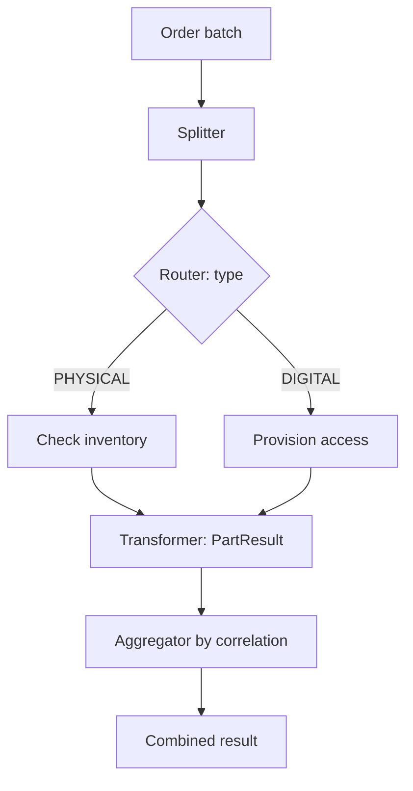
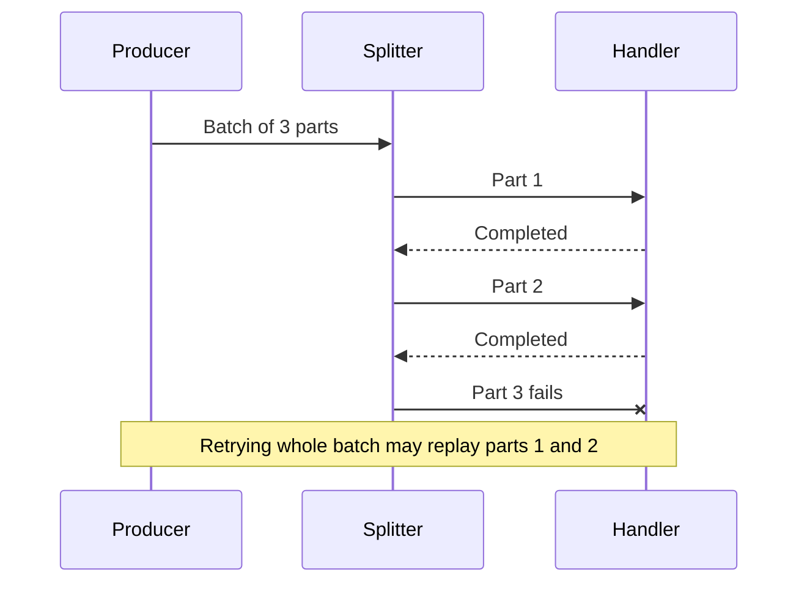

# Splitter Creating Multiple Messages from One Message in Spring Integration

## Lesson Objectives

In an integration flow, data often arrives as **a single message containing multiple items**: an order with multiple line items, a file with multiple records, or a sync request containing multiple customer IDs. If each item must be validated, routed, transformed, or processed independently, a **Splitter** turns one input message into multiple output messages.

This lesson belongs to the **Endpoint** chapter of the **SPRING_INTEGRATION_PATTERN** module. The module aims to practice Enterprise Integration Patterns (EIP) with Spring Integration to build loosely coupled, extensible message flows; coordinating Router, Filter, Transformer, Splitter, Aggregator, Gateway, retry, error channel, and correlation, while testing and observing processing branches.

After this lesson, you will be able to:

1. Distinguish Splitter from Transformer, Router, Filter, and Aggregator.
2. Explain the **one message → many messages** process and how payloads and headers are propagated.
3. Use Splitter with Spring Integration Java DSL and implement custom splitting logic.
4. Understand the `correlationId`, `sequenceNumber`, and `sequenceSize` headers, the `applySequence` mechanism, and conditions for re-aggregating messages.
5. Test message counts, item payloads, headers, empty inputs, and error scenarios.
6. Recognize risks when splitting large datasets: backpressure, asynchronous processing, duplicate retries, timeouts, and incomplete Aggregator groups.

## 1. What Is a Splitter?

A **Splitter** is a **message endpoint** implementing the **Splitter** pattern in Enterprise Integration Patterns. It receives **one** message and decomposes its content into **multiple** separate messages so downstream steps can process each part individually.

Example input:

```json
{
  "orderId": "ORD-42",
  "lines": [
    {"sku": "BOOK-01", "quantity": 2},
    {"sku": "PEN-02", "quantity": 5},
    {"sku": "BAG-03", "quantity": 1}
  ]
}
```

The flow can turn one message containing the whole order into three messages, each carrying a single line item:



Conceptually:

```text
Before Splitter:
  Message<List<OrderLine>>
    payload = [lineA, lineB, lineC]
    headers = {traceId, tenantId, ...}

After Splitter:
  Message<OrderLine>(lineA, headers + sequence)
  Message<OrderLine>(lineB, headers + sequence)
  Message<OrderLine>(lineC, headers + sequence)
```

**Core point:** each child message is an independent message entering the next channel and endpoint. Splitter **does not invoke business processing itself** for each item; it emits messages so downstream handlers perform the work.

### How Does Splitter Differ from Related Endpoints?

| Pattern | Primary Effect | Example |
| --- | --- | --- |
| **Transformer** | Changes shape/type of one message; typically one logical outcome | Normalize `OrderRequest` to `Order` |
| **Splitter** | Creates multiple messages from one message | Split `List<OrderLine>` into individual `OrderLine`s |
| **Filter** | Lets a message proceed or drops it based on a condition | Drop line items with invalid quantity |
| **Router** | Selects one or more target branches | Route by `region` or `orderType` |
| **Aggregator** | Combines related messages into one result | Aggregate inventory check results for an order |

Splitter often pairs with Transformer to convert each item, Router to pick processing branches, and Aggregator when waiting for all parts before returning a combined result.

## 2. Structure of a Message After Splitter Processing

A `Message<T>` in Spring Messaging contains `payload` and `headers`. When a Splitter produces child messages, the payload typically becomes one item from the split result, while headers preserve context and sequence tracking.

Headers serve distinct roles:

| Header | Purpose | Scope of Use |
| --- | --- | --- |
| `traceId` | Links logs and observes a business journey | Decided by the application and propagated through required endpoints |
| `tenantId` | Identifies the verified tenant context | Never let consumers infer it from payload if the contract requires the header |
| `correlationId` | Marks related messages so they can be grouped | Crucial for Aggregator and correlation strategy |
| `sequenceNumber` | Ordinal index of a child message within one split | Usually starts at 1 |
| `sequenceSize` | Expected element count of the sequence when total size is known | Helps release strategy know when all parts have arrived |
| `id`, `timestamp` | Per-message metadata | Do not use in place of an end-to-end request identifier |

When **apply sequence** is enabled, Splitter attaches sequence metadata so downstream components know which parts belong to the same split batch. For a collection of known size, such as a three-element list, we typically get:

```text
Message 1:
  payload = lineA
  correlationId = C42
  sequenceNumber = 1
  sequenceSize = 3

Message 2:
  payload = lineB
  correlationId = C42
  sequenceNumber = 2
  sequenceSize = 3

Message 3:
  payload = lineC
  correlationId = C42
  sequenceNumber = 3
  sequenceSize = 3
```

`C42` above is merely an illustrative value. Under default configuration, correlation metadata is linked to the original message; if the application sets headers or customizes the strategy, verify the actual value. **Never assume `correlationId` always equals the order ID.** If you need a stable business key like `orderId` or `batchId`, put it in a dedicated header and configure the Aggregator's correlation strategy accordingly.

### Sequence Metadata Is Not Completion Order

`sequenceNumber` records position in the Splitter output, **not a guarantee** that child messages finish processing in that order. When downstream uses `ExecutorChannel`, multiple consumers, brokers, or retries, completion order can change.

```text
Emitted:   part 1  →  part 2  →  part 3
Completed: part 3  →  part 1  →  part 2
```

If the application must restore the original order, the Aggregator or another step must rely on sequence metadata or an explicit sort key.

## 3. Basic Java DSL Example: Splitting a List into Messages

Suppose the input is a `List<OrderLine>` for an order. We use `IntegrationFlow.split()` to split the list, then send child messages into a `QueueChannel` for easy verification.

```java
import org.springframework.context.annotation.Bean;
import org.springframework.context.annotation.Configuration;
import org.springframework.integration.channel.DirectChannel;
import org.springframework.integration.channel.QueueChannel;
import org.springframework.integration.config.EnableIntegration;
import org.springframework.integration.dsl.IntegrationFlow;
import org.springframework.messaging.MessageChannel;
import org.springframework.messaging.PollableChannel;

@Configuration
@EnableIntegration
public class OrderSplitterConfig {

    public record OrderLine(String sku, int quantity) {}

    @Bean("orders.input")
    MessageChannel ordersInput() {
        return new DirectChannel();
    }

    @Bean("lines.output")
    PollableChannel linesOutput() {
        return new QueueChannel();
    }

    @Bean
    IntegrationFlow orderSplitterFlow() {
        return IntegrationFlow.from("orders.input")
            .split()
            .channel("lines.output")
            .get();
    }
}
```

Here:

- `DirectChannel` receives messages from the producer.
- `split()` uses the default splitter to handle a list payload.
- `QueueChannel` stores each child message, allowing explicit `receive()` calls in tests.
- There is no poller because this demo **actively pulls** from the output. In a real flow, if a `PollableChannel` connects to a handler, configure a corresponding poller or consumer.

The producer sends a single message:

```java
import java.util.List;
import org.springframework.messaging.Message;
import org.springframework.messaging.support.MessageBuilder;

List<OrderSplitterConfig.OrderLine> lines = List.of(
    new OrderSplitterConfig.OrderLine("BOOK-01", 2),
    new OrderSplitterConfig.OrderLine("PEN-02", 5),
    new OrderSplitterConfig.OrderLine("BAG-03", 1)
);

Message<List<OrderSplitterConfig.OrderLine>> request =
    MessageBuilder.withPayload(lines)
        .setHeader("orderId", "ORD-42")
        .setHeader("tenantId", "tenant-a")
        .setHeader("traceId", "trace-42")
        .build();

ordersInput.send(request);
```

`ordersInput` is a `MessageChannel` injected from the Spring context. After `send()`, with no downstream consumer attached yet, `lines.output` holds three child messages; each message's payload has type `OrderLine`.

**Important condition:** this example relies on Spring Integration's `DefaultMessageSplitter` handling a `List` input. If the payload is a custom `OrderBatch` object, explicitly specify how to extract the line items list; do not expect the splitter to guess an arbitrary property on an object.

## 4. Custom Splitter: Choosing What to Split

In practice, the payload is often a wrapper object:

```java
public record OrderBatch(
    String orderId,
    List<OrderLine> lines
) {}
```

We want to extract `lines` from `OrderBatch` instead of sending the whole object down each branch. With Java DSL, replace `.split()` in `IntegrationFlow` with:

```java
.split(OrderBatch.class, OrderBatch::lines)
```

This uses a splitter function: Spring Integration receives an `OrderBatch` payload, invokes `lines()`, and emits the list's elements as child messages. Both `OrderBatch` and `OrderLine` records must be visible to the flow.

### When Do You Need a Dedicated Splitter Method?

You can put splitting logic into a bean when decomposition involves more than returning a collection:

```java
import java.util.List;

public class BatchSplitter {

    public List<WorkPart> split(OrderBatch batch) {
        return batch.lines().stream()
            .map(line -> new WorkPart(
                batch.orderId(),
                line.sku(),
                line.quantity()
            ))
            .toList();
    }

    public record WorkPart(String orderId, String sku, int quantity) {}
}
```

This logic produces each `WorkPart` carrying `orderId`, useful when downstream needs the order ID inside the payload. A flow can use:

```java
.split(OrderBatch.class, batch -> new BatchSplitter().split(batch))
```

In a real application, register `BatchSplitter` as a Spring bean and reference the bean or method rather than instantiating it repeatedly. If the splitter accesses a database or external system, account for mid-split failures, retryability, and data consistency.

### Should You Filter Data Inside the Splitter?

A Splitter can return a subset of a list if that is a clearly defined **decomposition rule**. However, when the logic means “pass/drop” based on business conditions, using a **Filter** before or after the Splitter usually expresses responsibility more cleanly.

One crucial decision: a **Filter placed after a Splitter** can reduce the number of messages reaching an Aggregator below the initial `sequenceSize`, leaving the Aggregator waiting for an incomplete group. If post-split filtering is required, redesign the release/aggregation strategy or represent excluded items with an explicit status result rather than silently dropping messages.

## 5. Testing Message Count, Payloads, and Correlation

A solid test must verify both **message count** and **metadata**. Since the output is a `QueueChannel`, we can send the full input and call `receive()` sequentially.

```java
import static org.assertj.core.api.Assertions.assertThat;

import java.util.List;
import org.junit.jupiter.api.Test;
import org.springframework.beans.factory.annotation.Autowired;
import org.springframework.beans.factory.annotation.Qualifier;
import org.springframework.messaging.Message;
import org.springframework.messaging.MessageChannel;
import org.springframework.messaging.PollableChannel;
import org.springframework.messaging.support.MessageBuilder;
import org.springframework.test.context.junit.jupiter.SpringJUnitConfig;

@SpringJUnitConfig(OrderSplitterConfig.class)
class OrderSplitterTest {

    @Autowired
    @Qualifier("orders.input")
    MessageChannel input;

    @Autowired
    @Qualifier("lines.output")
    PollableChannel output;

    @Test
    void splitsListIntoThreeCorrelatedMessages() {
        List<OrderSplitterConfig.OrderLine> lines = List.of(
            new OrderSplitterConfig.OrderLine("BOOK-01", 2),
            new OrderSplitterConfig.OrderLine("PEN-02", 5),
            new OrderSplitterConfig.OrderLine("BAG-03", 1)
        );

        Message<?> request = MessageBuilder.withPayload(lines)
            .setHeader("traceId", "trace-42")
            .setHeader("tenantId", "tenant-a")
            .build();

        assertThat(input.send(request)).isTrue();

        Message<?> first = output.receive(2_000);
        Message<?> second = output.receive(2_000);
        Message<?> third = output.receive(2_000);

        assertThat(first).isNotNull();
        assertThat(second).isNotNull();
        assertThat(third).isNotNull();

        assertThat(first.getPayload()).isEqualTo(lines.get(0));
        assertThat(second.getPayload()).isEqualTo(lines.get(1));
        assertThat(third.getPayload()).isEqualTo(lines.get(2));

        Object group = first.getHeaders().get("correlationId");
        assertThat(group).isNotNull();
        assertThat(second.getHeaders().get("correlationId")).isEqualTo(group);
        assertThat(third.getHeaders().get("correlationId")).isEqualTo(group);

        assertThat(first.getHeaders().get("sequenceNumber")).isEqualTo(1);
        assertThat(second.getHeaders().get("sequenceNumber")).isEqualTo(2);
        assertThat(third.getHeaders().get("sequenceNumber")).isEqualTo(3);

        assertThat(first.getHeaders().get("sequenceSize")).isEqualTo(3);
        assertThat(second.getHeaders().get("sequenceSize")).isEqualTo(3);
        assertThat(third.getHeaders().get("sequenceSize")).isEqualTo(3);

        for (Message<?> part : List.of(first, second, third)) {
            assertThat(part.getHeaders().get("traceId"))
                .isEqualTo("trace-42");
            assertThat(part.getHeaders().get("tenantId"))
                .isEqualTo("tenant-a");
        }
        assertThat(output.receive(0)).isNull();
    }
}
```

This test is written for the default splitter with `applySequence` enabled and a fixed-size input collection. If the project configures `applySequence(false)`, adjust sequence assertions accordingly. JUnit 5, AssertJ, and Spring Test dependencies are required in the test environment.

When adding asynchronous processing or multiple consumers, **do not assume final arrival order is 1–2–3**. Compare sets of `sequenceNumber` and keyed payloads instead of asserting arrival position, unless the flow enforces strict ordering.

### Testing Empty Inputs

An input of `List.of()` can produce **zero child messages**. That differs from a single child message whose payload is an empty list.

```java
input.send(MessageBuilder.withPayload(List.of()).build());

Message<?> anyPart = output.receive(0);
assertThat(anyPart).isNull();
```

Run this case with an empty queue and simple flow. When a splitter sits before an Aggregator or inside a request-reply Gateway, producing no reply can cause the caller to wait until timeout. Clearly define the business meaning of an empty collection: return an empty result directly, skip processing, or emit an “empty items” event.

## 6. Splitter with Different Result Sources

A Splitter can return various result types; whether the element count is known upfront directly affects sequence metadata and aggregation strategy.

| Result of Split Operation | Point to Watch | Design Guidance |
| --- | --- | --- |
| `List` / array | Size usually known upfront; convenient for sequences | Fits moderate item counts needing count-based Aggregator |
| `Iterator` / `Iterable` | Can be iterated lazily; size not necessarily known upfront | Avoid hardcoding `sequenceSize` when source does not expose count |
| `Stream` | Single-use and lazily produces elements | Mind stream lifecycle, mid-iteration errors, and resource closing |
| Items already `Message<?>` | Items may carry their own headers | Check header-merging, correlation, and sequence policies |
| Empty result | No elements to emit | Define reply contract and Aggregator behavior on zero items |

**Not every data source yields an accurate positive `sequenceSize`.** Some iterator or stream sources do not know their size when emission starts, so verify the actual values produced by your splitter version and configuration; when count is unknown, the Aggregator's release strategy needs another condition.

Especially with `Stream` or huge sources, Splitter does not magically turn the problem into bounded distributed processing. If downstream is slow, message emission, queues, brokers, and retries still need design to avoid overload.

## 7. Splitter + Router + Transformer: Routing Each Part to Its Branch

After splitting, a flow can process different line items differently:



In this model:

1. **Splitter** breaks an order into subtasks.
2. **Router** sends each task to the right handler; every child message must enter a defined branch.
3. **Transformer** normalizes all results into a common type such as `PartResult`, preserving needed correlation info.
4. **Aggregator** determines when a group is complete and builds the combined result.

If branches return different payload types, normalize before the Aggregator or use a group processor capable of handling every variant. If a branch drops a message without producing a result, adjust the release strategy or emit an explicit “skipped result” so the group does not hang.

### Header Propagation Across Branches

Headers such as `traceId`, `tenantId`, and `orderId` should be maintained when they are part of the contract. In custom handlers constructing `Message<?>`, control header copying carefully:

```java
import org.springframework.messaging.Message;
import org.springframework.messaging.support.MessageBuilder;

Message<String> convert(Message<String> input) {
    return MessageBuilder.withPayload(input.getPayload().trim())
        .copyHeaders(input.getHeaders())
        .setHeader("processingStage", "normalized")
        .build();
}
```

Distinguish business headers from internal orchestration headers. Do not blindly copy all headers onto HTTP/Kafka transports; use a header mapper and an allowlist. Child message `id` and `timestamp` may differ from the original message, so `traceId` or a business key is a better way to correlate logs.

## 8. From Splitter to Aggregator: Getting Correlation Right

**An Aggregator does not “guess” which messages belong to the same order.** It uses a correlation strategy to partition messages into groups, and a release strategy to decide when a group is emitted. The `correlationId` and `sequenceSize` header pair produced by Splitter is often very handy for default behavior.

```text
Batch B-42
    |
    +--> part 1, correlationId = C-42, sequenceNumber = 1
    +--> part 2, correlationId = C-42, sequenceNumber = 2
    +--> part 3, correlationId = C-42, sequenceNumber = 3
                                                |
                                                v
Aggregator: wait for all messages in group C-42
                                                |
                                                v
Result(B-42)
```

At least four design questions must be answered:

- **Correlation key:** Taken from the default header, `batchId`, or a composite business key? If multiple users or tenants can reuse `batchId`, the group key must disambiguate them.
- **Release condition:** Full `sequenceSize`, timeout, end-of-stream, final marker, or another business condition?
- **Duplicate policy:** Can an item be resent during retry or broker redelivery? How does the group handle duplicates?
- **Message group store:** Groups can live in memory or durable storage; when are groups evicted to avoid resource leaks?

### Especially Dangerous Pitfall: Filter After Splitter

Suppose Splitter emits three parts with `sequenceSize=3`. A Filter drops the second part:

```text
Splitter:   #1 --------> Aggregator
            #2 --X Filter
            #3 --------> Aggregator

Aggregator receives 2/3: fails size-based release condition.
```

This is a frequent design bug. Valid solutions depend on business needs:

1. **Filter before splitting** so `sequenceSize` matches the number of parts actually sent.
2. **Emit a `SKIPPED` status result** for the excluded item so the group reaches full count.
3. **Design a custom release strategy** with explicit completion/timeout criteria, plus incomplete-group handling.
4. **Decouple the Aggregator from the drop path** if the group does not need to wait for every item.

Never set a timeout and blindly treat incomplete groups as “success”; explicitly define whether partial results are acceptable and how missing data is reported.

### Conceptual Java DSL Example

```java
IntegrationFlow.from("orders.input")
    .split()
    .handle(OrderLine.class, (line, headers) ->
        new PartResult(line.sku(), "OK"))
    .aggregate()
    .channel("orders.results")
    .get();
```

`PartResult` is an application-defined DTO. The pattern above illustrates the Splitter → per-item handler → Aggregator chain; a real flow must define beans/channels, data types, reply contracts, error handling policies, and appropriate group/release configuration. When a handler returns a plain payload, Spring Integration normally creates a reply message and carries context headers forward; test to verify correlation is never lost.

## 9. Splitter and Synchronous vs. Asynchronous Execution

How channels are wired determines where work runs:

| Architecture | Typical Behavior | What to Test |
| --- | --- | --- |
| `DirectChannel` between endpoints | Invokes handlers synchronously on current call path | Errors typically return to caller; steps may run sequentially |
| `ExecutorChannel` | Offloads processing to a thread pool | Completion order varies; MDC/`ThreadLocal` does not propagate automatically |
| `QueueChannel` | Buffers messages for a consumer/poller | Queue depth, timeouts, memory, poller, and backpressure |
| Broker outbound/inbound adapter | Separates processes, serialization, and redelivery | Header mapping, idempotency, ordering, retry, and correlation |

**Splitter does not automatically mean parallel processing.** To process parts in parallel, configure appropriate channels/consumers/executors and ensure handlers are thread-safe. If strict ordering is required, sequential processing or key-based coordination may be necessary.

When using MDC/tracing, put keys like `traceId` into headers; configure separate context propagation across thread hops. Data in the producer's `ThreadLocal` will not appear automatically on consumer threads.

## 10. Errors, Retry, and Consistency When Splitting into Many Parts

Important truth: splitting and dispatching individual parts is **not inherently an atomic transaction**. For example, Splitter emits parts #1 and #2, then fails while creating or sending part #3. Downstream handlers may have already processed the first two parts; retrying the entire batch risks re-emitting #1 and #2.



Practical safeguards:

- Create an **idempotency key** per item, such as `batchId + lineId`, and check processed state before applying mutations.
- Define retry at the **right granularity**: per-item retry vs. whole-batch retry; avoid doing both without deduplication.
- Use `errorChannel` or an error flow where asynchronous steps emit errors; errors in synchronous flows can throw directly to the caller.
- Attach `traceId`, `batchId`, and `partId` to logs per security policy for troubleshooting.
- Design Aggregator timeouts and partial-failure behavior. Do not expect an exception to automatically supply a missing group result.

### Returning Errors to the Caller via Gateway

A synchronous Gateway can submit a batch and wait for an aggregated reply. If Splitter emits 0 items, a branch drops a message, or the Aggregator never releases, the Gateway may wait until `replyTimeout`. Therefore, define empty/incomplete batch handling, configure timeouts, and build clear error responses at the system boundary.

### Correlation and Retry

If a retry constructs a brand-new root message, its new `id` may yield a different correlation group from the prior attempt under default root-message correlation. If business logic needs retries grouped under the same `batchId`, define a correlation strategy using a stable business key alongside message deduplication. However, do not merge different versions of the same batch if their contents differ; include a generation/attempt ID when required by contract.

## 11. Performance and Operations

Splitting a huge batch into hundreds of thousands of messages incurs substantial overhead:

- **Memory:** creating message objects and headers per item; emission can outpace downstream consumption.
- **Throughput:** sending too many tiny messages increases serialization, routing, and logging overhead.
- **Backpressure:** bounded channels may block or reject sends; brokers have their own limits and flow-control policies.
- **Aggregation groups:** Aggregator buffers many parts, holding memory and storage longer if one part is lost.
- **Observability:** message counts spike; throughput metrics should track both item counts and batch counts.

For very large batches, consider **chunking** into manageable sizes (for example, 100 or 500 items per chunk depending on SLA and resources), or appropriate streaming. Balance per-message overhead, per-item retryability, latency, and group size. No single chunk size fits every system.

### Metrics Worth Tracking

| Metric | Meaning |
| --- | --- |
| `split_input_total` | Source messages entering Splitter |
| `split_output_total` | Child messages emitted |
| `parts_per_batch` | Distribution of items per batch |
| `split_failures_total` | Errors during decomposition or sending parts |
| `queue_depth` / `send_timeout_total` | Pressure on downstream channels |
| `aggregation_pending_groups` | Groups currently awaiting completion |
| `aggregation_group_age` | Group age; detects stuck groups |
| `duplicate_part_total` | Items emitted or received more than once |

These are illustrative **application-chosen metric names**, not all emitted out of the box by Spring Integration. Use Micrometer/observation and structured logging per your project configuration.

## 12. Common Pitfalls and Fixes

| Symptom | Possible Cause | Fix |
| --- | --- | --- |
| Only one output message seen | Payload wasn't split as expected, or an earlier handler changed its type | Check actual payload type and splitter function |
| No messages on empty list | Splitter emits 0 items | Define empty-batch contract and reply explicitly |
| Aggregator waits forever | Missing part, Filter dropped an item, or wrong size-based release strategy | Check `correlationId`, `sequenceSize`, discards, and timeouts |
| Parts arrive out of order | Parallel processing, broker, or retries | Use `sequenceNumber`/business key to reorder if needed |
| `traceId` disappears | Custom handler builds a new message dropping headers, or adapter doesn't map them | Check reply creation and header mappers |
| One line item executes twice | Retry/redelivery after earlier parts were already processed | Use per-batch + item idempotency keys |
| Memory spikes sharply | Batch too large and downstream slow | Add bounded queues, chunking, backpressure, and monitoring |
| Gateway times out | Aggregator never releases or Splitter emitted 0 items | Define empty/partial policies, timeouts, and error replies |

## 13. Hands-on Exercises

### Exercise 1 — Splitting a List of Order Lines

Create an `IntegrationFlow` using `.split()` with a `List<OrderLine>` payload containing five line items. Capture the payload and headers of each child message. Verify there are **exactly five messages**, sharing the same `correlationId` and with `sequenceNumber` covering 1 through 5.

### Exercise 2 — Custom Input Payload

Define `OrderBatch(orderId, lines)`. Use `.split(OrderBatch.class, OrderBatch::lines)` to split only `lines`; propagate `orderId` and `traceId` via headers or an item DTO. Write tests for an empty batch and a single-item batch.

### Exercise 3 — Filter After Splitter

Create three parts and intentionally drop the second part after the Splitter. Observe the default Aggregator while it still expects three parts. Choose and implement one approach: pre-filtering, producing a `SKIPPED` result, or an intentional release strategy. Explain each option's impact on the final result.

### Exercise 4 — Router and Parallel Processing

Each child message has `type=PHYSICAL` or `type=DIGITAL`. Use a Router to select two handlers, simulating different processing durations. Test that **completion** order can differ from `sequenceNumber` while the Aggregator still correlates parts accurately.

### Exercise 5 — Retry and Duplicates

Make a handler succeed on two parts and throw an exception on the third. Simulate a full-batch retry. Design an idempotency key and verify each line item updates business state **only once**.

### Exercise 6 — Observability and Load Limits

Measure inbound/outbound message counts, queue depth, and Aggregator group wait time when splitting 1,000 items. Compare results against chunking and document your configuration's resource limits.

## 14. Pre-Production Splitter Checklist

1. Confirm **input payload** and output item type; ensure the splitter function handles `null`, empty collections, and invalid inputs clearly.
2. Specify headers to preserve: `traceId`, `tenantId`, `orderId`, or `batchId`; never misuse `id` as a business key.
3. Verify `applySequence` and reliability of `sequenceSize` for the type being split.
4. Define correlation/release strategies when paired with an Aggregator; handle filtered, missing, duplicate, or late messages.
5. Choose channels and concurrency matching SLAs; never assume completion order equals emission order.
6. Design per-item retries and idempotency to avoid duplicate work on partial batch failures.
7. Test network boundaries, header mapping, timeouts, backpressure, and oversized inputs.
8. Monitor items per batch, queues, errors, incomplete groups, and latency by correlation key.

### Key Takeaway

**Splitter solves the problem of “one message containing multiple units of work that need independent handling.”** Its value lies not in looping over a list, but in turning each element into a **message that can flow through channels, Transformers, Routers, Filters, and independent handlers**. When reassembling parts, proactively design correlation, sequencing, release strategies, error handling, and deduplication. A well-tested Splitter makes Spring Integration flows easier to scale, cleaner in responsibility, and easier to trace.
