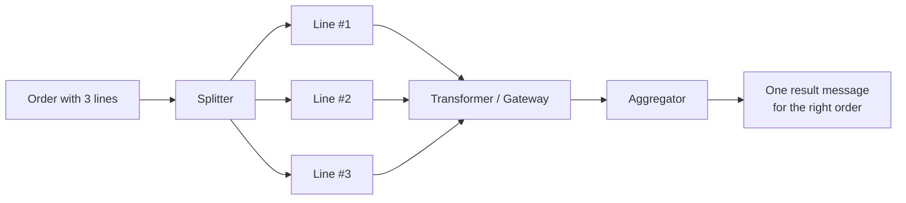
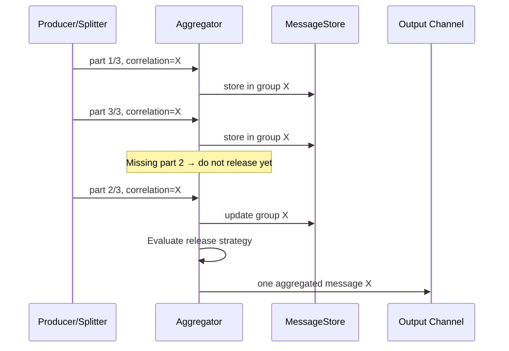

# Aggregator Combining Multiple Messages into One

## 1. What Problem Does Aggregator Solve?

In an integration flow, a business request is often split into multiple messages for independent processing. For instance, an order with three product lines is split into three messages, each passing through a pricing Transformer, a Router choosing a service, or a Gateway calling an external system. Ultimately, the system must **combine the results belonging to the same order** into one aggregated result.

**Aggregator** is an endpoint in **Enterprise Integration Patterns (EIP)** that handles this job. Instead of processing each incoming message in isolation, an Aggregator:

1. Determines **which group** a message belongs to using a *correlation key*.
2. Holds messages not yet eligible to emit a result inside a *message group*.
3. Checks the **group completion condition** (*release strategy*) when a new message arrives or when configured timeout/group-end events occur.
4. Transforms the group into a single output message via a *message group processor* (payload aggregation).
5. Releases or retains group state per policy and handles late-arriving messages.

In the **SPRING_INTEGRATION_PATTERN** module, this directly connects to building loosely coupled, extensible message flows with Spring Integration: coordinating Splitter, Router, Filter, Transformer, Gateway, retry, error channel, and correlation, while testing and observing processing branches.

After this lesson, learners should be able to explain how **correlation differs from release**, build an aggregation flow, prevent group cross-contamination, decide timeouts and late-message policies, and test missing/duplicate message scenarios.

## 2. Overview Flow: From Many Messages to One Message



An example with two orders A and B interleaved:

| Arrival Order | Correlation Key | Item | Expected Count | Status |
| --- | --- | --- | --- | --- |
| 1 | `order-A` | A-1 | 3 | Group A has 1/3 |
| 2 | `order-B` | B-1 | 2 | Group B has 1/2 |
| 3 | `order-A` | A-2 | 3 | Group A has 2/3 |
| 4 | `order-B` | B-2 | 2 | Group B reaches 2/2 → emit result B |
| 5 | `order-A` | A-3 | 3 | Group A reaches 3/3 → emit result A |

Key point to remember: **Aggregator groups by correlation key, not by bundling all messages that arrive close together**. Emitting B before A is completely valid even though A arrived earlier.

### Three Independent Decisions

| Component | Question | Example |
| --- | --- | --- |
| **Correlation strategy** | Which group does this message belong to? | Every message with `orderId = order-A` enters group A. |
| **Release strategy** | Which group is ready to emit its result? | The group has received all `sequenceSize` parts or a trusted completion signal. |
| **Output processor** | What output is the group turned into? | A list of results, total amount, or an `OrderSummary` object. |

Having the right group does not guarantee completion; having enough messages does not guarantee the right output unless business rules are applied. Separating these three decisions keeps configuration readable and independently testable.

## 3. Correlation: Identifying Group Members

Spring Integration uses a **correlation key** to partition incoming messages at an Aggregator into independent `MessageGroup`s. Messages sharing the same key enter the same group even if they arrive non-consecutively. Different keys belong to different groups.

In a default Splitter → Aggregator flow, Splitter can create sequence headers:

- `correlationId`: identifier linking parts originating from one parent message.
- `sequenceNumber`: ordinal index of the item within the parent message.
- `sequenceSize`: total number of items emitted in the sequence.

These headers are used by Spring Integration for orchestration, not necessarily as the business order ID. An order might be processed across multiple runs; therefore **the business `orderId` and a single split's correlation ID may need to be kept separate**.

Example:

```text
Message 1
  payload: LineResult(sku="A", amount=120)
  correlationId: split-7f1
  sequenceNumber: 1
  sequenceSize: 3
  orderId: ORDER-204

Message 2
  payload: LineResult(sku="B", amount=80)
  correlationId: split-7f1
  sequenceNumber: 2
  sequenceSize: 3
  orderId: ORDER-204

Message 3
  payload: LineResult(sku="C", amount=60)
  correlationId: split-7f1
  sequenceNumber: 3
  sequenceSize: 3
  orderId: ORDER-204

Aggregator:
  group key: split-7f1
  group size: 3
  output: [LineResult(A,120), LineResult(B,80), LineResult(C,60)]
```

If the sender does not use the default Splitter or parts cross a broker, you can configure a custom `correlationStrategy`, such as extracting a verified `batchId`. Ensure that:

1. Every message has a valid key; `null` or missing keys must be handled explicitly.
2. The key is sufficiently **unique for the lifetime of the group**. Do not reuse `orderId` across multiple calculation runs if results can arrive late; use a distinct `aggregationAttemptId` or `batchId` if needed.
3. Data from different tenants never mixes in the same group. You may need a composite key such as `tenantId + ":" + batchId`, where `tenantId` comes from an authenticated source.
4. If deriving correlation from the payload, the payload must have an explicit schema and version understood across systems.
5. With Splitter/Aggregator, preserve required control headers across Transformers and hops. If a step strips `sequenceSize` or alters `correlationId`, default release behavior may stop working as expected.

### Important Aggregator Headers

| Header | Role | What to Watch |
| --- | --- | --- |
| `correlationId` | Used to link parts from the same source in common setups | Do not automatically equate with HTTP correlation or `JMSCorrelationID`. |
| `sequenceNumber` | Item index in a post-Splitter sequence | Used to check missing/duplicate items and reconstruct order if required by business logic. |
| `sequenceSize` | Expected message count in the sequence | Reliable only when the producer knows the exact count and does not silently filter out items. |
| `replyChannel` | Channel for internal request/reply responses | Does not replace the Aggregator's correlation key. |
| `errorChannel` | Configured error channel | Routes group-processing errors to the right error flow. |
| `batchId` or `orderId` | Application-assigned business identifier | Good for tracing; usable as a group key if uniqueness scope is guaranteed. |

## 4. Release Strategy: When Does a Group Emit Its Result?

**Release** is the decision that a message group has met the criteria to be processed and emitted as one output. Multiple policies exist; choose based on the producer–consumer contract.

### 4.1. Receiving All Expected Parts

When using a standard Splitter, default Aggregator configuration typically uses `correlationId` and `sequenceSize` to gather and emit groups. Count-based group release is usually implemented with `SequenceSizeReleaseStrategy`.



Do not infer that arrival order determines the order of aggregated payloads. If downstream requires strict business ordering, inspect `sequenceNumber`, sort inside the output processor, or enforce an explicitly ordered contract.

**Watch out with Filter and Router:** if a Filter drops an item after Splitter while `sequenceSize` remains 3, the Aggregator can wait forever for 3 items because only 2 will arrive. Handle excluded items via a pre-designed policy: send a placeholder/rejected outcome, adjust count contracts at a control point, or use a different release strategy. Never alter `sequenceSize` ad hoc on one branch while leaving other branches unchanged.

### 4.2. Fixed Count or Metadata-Driven Count

If the producer guarantees every batch has exactly 3 parts:

```java
.releaseStrategy(group -> group.size() == 3)
```

For variable counts, expected size can come from verified metadata. However:

- Every message in the group must carry the same `expectedCount`.
- The value must be greater than 0 and capped to prevent accumulating groups that can never complete.
- `group.size()` is simply the number of messages in the group; **it does not automatically represent unique business events**. Redelivery from retries can cause double-counting.
- If a business event can arrive more than once, deduplicate by `eventId` or `partIndex` with an appropriate mechanism before evaluating release.

### 4.3. Releasing by Business Condition

Some groups do not know the total part count ahead of time. In those cases, you can use:

- A “batch completed” message emitted by a trusted producer after sending all parts.
- A custom `ReleaseStrategy` verifying all mandatory result types are present.
- A business deadline paired with rules for partial or error results.

For example, three quote services named `SHIPPING`, `TAX`, and `DISCOUNT`. You can release when the group contains all three **service types**, rather than merely `group.size() == 3`. That prevents a retried SHIPPING quote from being miscounted as TAX.

### 4.4. Timeouts and Groups That Never Complete

In reality, a part can be lost to network errors, dropped by a Filter, left unanswered by a service, or routed to an error flow. Without a termination mechanism, group state can linger and consume memory or database space.

Spring Integration supports **group timeout** settings and **group expiry** policies. When designing, decide:

| Policy | Desired Behavior | When Appropriate |
| --- | --- | --- |
| Wait for every part | Emit result only when release criteria are met | Data must be complete, with upstream retries and monitoring. |
| Timeout then fail | Mark batch failed, trigger alert or error flow | Incomplete results cannot be used. |
| Timeout then emit partial | Emit available parts with `PARTIAL` status and missing list | Reports or queries that can tolerate missing data. |
| Timeout then discard group | Free group memory/state; handle late messages per policy | High volume, transient data, with external recovery mechanisms. |

The `sendPartialResultOnExpiry` flag alongside timeout configuration can help emit partial groups; however, business logic usually needs to define its own `PARTIAL` payload/status and list of missing items. **Never treat a 2/3 partial list as a complete order** simply because the Aggregator emitted a message.

Similarly, a Gateway reply timeout **does not mean** the group inside the Aggregator was deleted. Request deadlines, group timeouts, MessageStore expiry, and broker retries are independent mechanisms that must be designed cohesively.

## 5. MessageStore: Where Does the Aggregator Remember Parts?

An Aggregator is a **stateful** endpoint. Messages not yet eligible for release must be stored somewhere. Spring Integration manages group state via `MessageGroupStore`, typically backed by an appropriate `MessageStore` implementation.

| Storage Option | Characteristics | Limitations |
| --- | --- | --- |
| In-memory (e.g., `SimpleMessageStore`) | Easy to test, simple setup, low latency | State lost on process restart; consumes heap proportional to pending groups. |
| JDBC message store | Persists groups to database, can recover after process failure per config | Needs schema, transactions, cleanup/lock management, and throughput tuning. |
| Redis or shared store | Supports multiple instances accessing shared state | Requires concurrency control, consistency, expiry, and understanding store/adapter semantics. |

A multi-instance system must not assume “sharing a database is enough.” When two workers update the same group, coordinate transactions and locking, typically via a lock registry and appropriate store. Verify how messages are consumed from transport, written to the store, emitted, and committed/acked. **Persisting a message group does not automatically guarantee exactly-once delivery** or guarantee downstream successfully received the output.

### Group Lifecycle

1. First message arrives, creating a group under the correlation key.
2. Subsequent messages with the same key are added to the group.
3. When the release strategy returns true, the processor builds one output message.
4. The group completes and its state is managed per configuration.
5. On expiry or completion, resources must be reclaimed; policy for late arrivals must be defined.

The `expireGroupsUponCompletion` setting controls removing completed group state in matching scenarios. If a group is deleted, **a late message with the same key can open a brand-new group**. If completed group metadata is retained, the system can handle late arrivals under a different policy. Do not treat a cleanup flag as business deduplication. To prevent an already processed batch from re-running, maintain an idempotency store or business state keyed by `batchId` and `eventId`.

Track at minimum open group count, oldest group age, total buffered messages, completed groups, timed-out groups, and groups still missing items.

## 6. Java DSL Example: Splitter → Transformer → Aggregator

This is the easiest model to start with: accept a list of order lines, split into independent messages, transform each line, and combine them into a result list. Because Splitter and Aggregator reside in the same flow, sequence headers created by Splitter stay intact end-to-end.

```java
import java.math.BigDecimal;

import org.springframework.context.annotation.Bean;
import org.springframework.context.annotation.Configuration;
import org.springframework.integration.config.EnableIntegration;
import org.springframework.integration.dsl.IntegrationFlow;

@Configuration
@EnableIntegration
public class OrderLineAggregationFlow {

    public record OrderLine(String sku, int quantity, BigDecimal unitPrice) {}

    public record LineAmount(String sku, BigDecimal amount) {}

    @Bean
    public IntegrationFlow calculateOrderLines() {
        return IntegrationFlow.from("incomingOrderLines")
            .split()
            .<OrderLine, LineAmount>transform(line ->
                new LineAmount(
                    line.sku(),
                    line.unitPrice().multiply(
                        BigDecimal.valueOf(line.quantity()))
                ))
            .aggregate()
            .channel("calculatedOrderLines")
            .get();
    }
}
```

**Input:** one `Message<List<OrderLine>>` containing three lines. `split()` creates messages per line with sequence/correlation metadata needed for grouping. Transformer computes the line amount without losing flow headers. `aggregate()` uses default settings to emit once all parts arrive, producing **one message containing the combined payloads** on `calculatedOrderLines`.

The aggregated result is a collection of `LineAmount`; to compute `grandTotal`, apply a subsequent Transformer to that collection with proper type checks and business currency rounding. Channel names are illustrative; a real application needs a downstream consumer and error management.

### Progression with Three Lines

```text
incomingOrderLines:
  [Line(A, 2, 50), Line(B, 1, 80), Line(C, 3, 20)]

Splitter:
  A -> correlation=X, sequence=1/3
  B -> correlation=X, sequence=2/3
  C -> correlation=X, sequence=3/3

Transformer:
  A -> LineAmount(A, 100)
  B -> LineAmount(B, 80)
  C -> LineAmount(C, 60)

Aggregator:
  group X has 3/3 -> one message containing 3 LineAmounts

Next consumer:
  compute total = 240 (if required by business logic)
```

In this example, `BigDecimal` is preferable to `double` for money. Having Splitter emit three messages in one call does not mean the system runs them in parallel automatically; concurrent execution requires suitable endpoints/channels and executors. If an intermediate step removes or alters correlation headers, the default Aggregator may fail to release.

## 7. Custom Correlation/Release/Output Configuration Example

Consider a system receiving results from multiple services. Each request carries `batchId`, and each result carries `partIndex` from 1 to 3. Upstream **has already verified** that each batch has exactly three parts, no duplicate `partIndex`, and `batchId` is unique per processing run.

We want to group by `batchId` and sort results by `partIndex` before emitting. The following example uses Spring Integration Java DSL and a `SimpleMessageStore` to highlight the Aggregator's three decisions:

```java
import java.util.Comparator;

import org.springframework.context.annotation.Bean;
import org.springframework.context.annotation.Configuration;
import org.springframework.integration.channel.DirectChannel;
import org.springframework.integration.channel.QueueChannel;
import org.springframework.integration.config.EnableIntegration;
import org.springframework.integration.dsl.IntegrationFlow;
import org.springframework.integration.store.SimpleMessageStore;

@Configuration
@EnableIntegration
public class BatchAggregationConfig {

    @Bean
    public DirectChannel batchParts() {
        return new DirectChannel();
    }

    @Bean
    public QueueChannel completedBatches() {
        return new QueueChannel();
    }

    @Bean
    public IntegrationFlow aggregateBatch(
            DirectChannel batchParts, QueueChannel completedBatches) {

        return IntegrationFlow.from(batchParts)
            .aggregate(spec -> spec
                .correlationStrategy(message -> {
                    Object batchId = message.getHeaders().get("batchId");
                    if (batchId == null) {
                        throw new IllegalArgumentException(
                            "Missing batchId");
                    }
                    return batchId;
                })
                .releaseStrategy(group -> group.size() == 3)
                .outputProcessor(group -> group.getMessages().stream()
                    .sorted(Comparator.comparingInt(message ->
                        ((Number) message.getHeaders()
                            .get("partIndex")).intValue()))
                    .map(message -> message.getPayload())
                    .toList())
                .messageStore(new SimpleMessageStore())
                .expireGroupsUponCompletion(true))
            .channel(completedBatches)
            .get();
    }
}
```

Key parts of the code:

- `correlationStrategy` determines the group key. Never dump messages missing `batchId` into a “default group.”
- `releaseStrategy` uses a fixed count **solely because** upstream guarantees three unique parts. In production, verify duplicate `partIndex` handling and how group completion is detected.
- `outputProcessor` builds the output payload from messages in the group. It sorts by `partIndex` rather than trusting arrival order.
- `SimpleMessageStore` demonstrates in-memory group storage. On restart, this state is not preserved.
- `expireGroupsUponCompletion(true)` cleans up completed groups; add a safeguard blocking already processed batch IDs against late-arriving messages.
- `QueueChannel` at the output lets test code call `receive(timeout)`. In a production flow, use a channel type matching downstream processing needs.

This example omits timeout policy, duplicate message handling, persistence, and recovery mechanisms; those are designed per SLA and data contract. When multiple batches process concurrently, each batch has its own key, and each message carries complete `batchId`/`partIndex` plus trusted sender metadata.

### Why Not Always Rely Solely on `group.size() == 3`?

Suppose `(A,1)`, `(A,1)`, `(A,2)` arrive. The group has three messages, yet **part 3 is missing**. A release strategy that only counts messages can emit an incomplete or duplicate-laden result. When reliability matters, release criteria should check for **three distinct items by business key** alongside deduplication at ingestion.

Similarly, if messages can arrive again after a group is deleted, a new group could reopen under the old `batchId`. The solution belongs at the business level: record processed batches, define an idempotency key, and specify state retention windows.

## 8. Testing Aggregator: Right Group, Right Time, Right Result

Do not test only “an output appeared.” A proper Aggregator test must prove it **does not release early**, **does not mix batches**, and **enforces policies for missing/duplicate/late messages**.

Using the configuration in section 7, we can write a JUnit 5 and AssertJ internal end-to-end test:

```java
import static org.assertj.core.api.Assertions.assertThat;

import org.junit.jupiter.api.Test;
import org.springframework.beans.factory.annotation.Autowired;
import org.springframework.beans.factory.annotation.Qualifier;
import org.springframework.integration.channel.QueueChannel;
import org.springframework.messaging.Message;
import org.springframework.messaging.MessageChannel;
import org.springframework.messaging.support.MessageBuilder;
import org.springframework.test.context.junit.jupiter.SpringJUnitConfig;

@SpringJUnitConfig(BatchAggregationConfig.class)
class BatchAggregationTest {

    @Autowired
    @Qualifier("batchParts")
    MessageChannel parts;

    @Autowired
    @Qualifier("completedBatches")
    QueueChannel results;

    private void send(String batchId, int partIndex, String payload) {
        boolean accepted = parts.send(
            MessageBuilder.withPayload(payload)
                .setHeader("batchId", batchId)
                .setHeader("partIndex", partIndex)
                .build()
        );
        assertThat(accepted).isTrue();
    }

    @Test
    void releasesOnlyAfterThreePartsForSameBatch() {
        send("A", 2, "A-2");
        send("B", 1, "B-1");
        send("A", 1, "A-1");

        assertThat(results.receive(0)).isNull();

        send("A", 3, "A-3");

        Message<?> combined = results.receive(1_000);
        assertThat(combined).isNotNull();
        assertThat(combined.getPayload())
            .isEqualTo(java.util.List.of("A-1", "A-2", "A-3"));

        // B still only has 1/3, must not be released alongside A.
        assertThat(results.receive(0)).isNull();
    }
}
```

The test code above verifies the policy deployed **within one Spring context instance** using internal input/output channels; it does not verify broker transactions or state recovery across restarts.

Scenarios to add in real-world deployments:

| Test Case | Outcome to Verify |
| --- | --- |
| Two batches with interleaved messages | Groups A and B stay completely independent; output matches each batch. |
| All parts arrive out of order | Output does not depend on arrival order; business ordering is explicitly verified. |
| Missing part and timeout | Group is retained, emitted as partial, or discarded per configured policy; metrics/logs include correlation. |
| Same part sent twice | No false completion emitted; duplicates controlled via `eventId`/`partIndex`. |
| Late message arrives after release | No unintended second output emitted; idempotency holds. |
| Filter drops a part after Splitter | Aggregator does not hang silently forever; error branch/contract adjustment observed. |
| Downstream handler fails after release | Retry/recovery and safe replay exist; group cleanup is not mistaken for transaction success. |
| Restart while group is open | Matches storage policy: memory loses state, persistent store recovers when configured properly. |
| Two application instances update same key | No lost updates or duplicate releases from races; locking/transactions verified. |

In concurrent tests, use synchronization primitives or test helpers rather than `Thread.sleep` to guess thread timing. For timeouts, pick deadlines wide enough relative to the test scheduler and assert behavior across output, state store, and error flow.

## 9. Combining Aggregator with Other EIPs

| Pattern/Endpoint | Relationship to Aggregator | What to Verify |
| --- | --- | --- |
| **Splitter** | Splits one parent message into child messages; Aggregator can recombine results. | Preserve `correlationId`, `sequenceNumber`, `sequenceSize`, or supply custom strategies. |
| **Transformer** | Transforms each part's payload or the whole group post-release. | Preserve required metadata; ensure output type matches group expectations. |
| **Filter** | Drops invalid messages before or during processing. | If reducing item count, `sequenceSize`-based release may never trigger. |
| **Router** | Branches processing by message type. | Ensure all required branches reconverge into the right group; avoid loops causing duplicates. |
| **Gateway** | Submits requests and may await a reply after Aggregator completes. | Separate request timeout, reply timeout, and group timeout. |
| **Retry / Error Channel** | Recovers per-part failures or group creation/emission errors. | Maintain idempotency; never let a retry count one part as two valid parts. |
| **Resequencer** | Enforces ordered emission while keeping messages separate. | Do not substitute for Aggregator when a single combined result is needed, and vice versa. |

### How Aggregator and Resequencer Differ

Both can use `correlationId` and `sequenceNumber`, yet:

- **Aggregator:** receives N messages and emits **one message representing the entire group**.
- **Resequencer:** receives N messages and **re-emits individual messages** in the desired order.

If the goal is outputting every result in sequence while keeping one message per result, use Resequencer. If the goal is producing a single report or grand total, use Aggregator.

### Headers After Aggregation

Shared metadata across group members can be retained or merged per output processing policy; headers with differing values across messages require explicit resolution. Never assume a reply automatically carries every header from every part. For public APIs, construct intentional output headers such as `batchId`, `businessStatus`, `traceId`, processed item count, and error codes if any.

## 10. Operations: Timeouts, Overload, Errors, and Observability

An Aggregator can look like it is “doing nothing” when messages are missing: in reality, it is accumulating state. Therefore, measure and bound group retention.

**Common operational risks:**

- **Forever-open groups:** lost part, mismatched `sequenceSize`, Filter dropping a message, or missing expiry configuration.
- **Growing memory usage:** many correlation keys never complete, or in-memory store holds large payloads.
- **Wrong results emitted:** `batchId` reused, tenants mixed, duplicates counted as fresh parts, or output processor using wrong order.
- **Duplicate group emissions:** late arrival hits a deleted group, or downstream retries lack idempotency.
- **Scale-out races:** two instances process one group without synchronized store/locking.
- **Blind spots in errors:** logging only payloads without `batchId` or group-timeout metrics.

Suggested baseline metrics: `aggregator.groups.open`, `aggregator.group.age.max`, `aggregator.parts.received`, `aggregator.groups.released`, `aggregator.groups.expired`, `aggregator.parts.duplicate`, `aggregator.output.failed`. These are **application-suggested metric names**, not a claim that the framework creates these exact names automatically.

When logging at ingress, release, and error flows, include correlation key, received part count, expected part count, group age, and processing status. Never log tokens or personal data from headers/payloads. Across systems using trace context, propagate correlation and trace IDs consistently across trust-boundary adapters.

### Troubleshooting Matrix

| Symptom | Likely Cause | Where to Check |
| --- | --- | --- |
| Aggregator emits no output | Missing/wrong `correlationId`, `sequenceSize` mismatch, lost part | Inspect headers entering Aggregator and message counts per group. |
| Two requests merged together | Colliding correlation keys or reusing bare `orderId` across runs | Check key namespacing, tenant isolation, and batch attempt IDs. |
| Emits output while still missing parts | Release strategy counts duplicates, or count ignores unique item identity | Inspect `eventId`/`partIndex` and deduplication logic. |
| Output payload out of order | Out-of-order arrivals, processor doesn't sort | Sort by business sequence/index when constructing output. |
| Groups never reclaimed | Missing cleanup/timeout config or state retained after completion | Check store/aggregator lifecycle policies. |
| Duplicate output after a long delay | Late message reopens an expired key, or downstream retry | Add idempotency and decide completed-group retention. |
| Fails only in multi-instance runs | Store/lock/transaction doesn't protect concurrent group updates | Verify `MessageGroupStore`, lock registry, and transactions. |

## 11. Hands-on Exercises

**Exercise 1 — Aggregating an Invoice.** A message with four order lines passes through Splitter → Transformer → Aggregator. Transformer computes line amounts using `BigDecimal`, Aggregator collects them into one result set, then computes the invoice total. Intentionally shuffle message order and verify the grand total stays unchanged.

**Exercise 2 — Interleaved Batches.** Create two batches: A with three parts and B with two parts. Send in order A1, B1, A3, B2, A2. Design correlation and release so B emits upon reaching two parts and A emits upon reaching three parts. Add assertions proving results are never mixed.

**Exercise 3 — Missing Part and Timeout.** A shipping service fails to respond while TAX and DISCOUNT finish. Design two policies: (a) fail the entire batch; (b) emit a partial result listing the missing component. Explain how to distinguish group timeout from Gateway reply timeout.

**Exercise 4 — Duplicates and Late Arrivals.** Producer sends A1, A1 (duplicate), A2, A3. Add logic keyed by `partIndex`/`eventId` to release accurately. Then send an extra late A3 after group completion and verify idempotency.

**Exercise 5 — Durability and Scale-Out.** Replace `SimpleMessageStore` with a persistent store suited to your environment. Test restarting when a group has 2/3 parts, then send the final part. Scale out to two instances and verify locking, output emission errors, and safe replay.

A passing solution must specify: **correlation contract**, **release rules**, **output payload type**, **timeout/duplicate strategy**, and tests proving correct behavior even in failure cases.

## 12. Principles to Remember

- Aggregator is a **stateful endpoint**: it holds message groups until a release decision or group termination occurs.
- **Correlation** defines *same group*; **release** defines *ready*; **output processor** defines *combined result*.
- Splitter → Aggregator works smoothly via sequence/correlation headers, but Filters or routing that drop items can prevent a group from ever completing.
- Receiving N messages in a group does not guarantee N **unique business items**.
- Timeouts, cleanup, late arrivals, persistent stores, and idempotency must be designed together. Aggregator does not guarantee end-to-end exactly-once semantics by itself.
- For reliable integration, test interleaved batches, out-of-order arrivals, missing/duplicate parts, error recovery, and downstream behavior.

## References

- [Spring Integration Reference — Aggregator](https://docs.spring.io/spring-integration/reference/aggregator.html)
- [Spring Integration Reference — Correlation and Release Strategy](https://docs.spring.io/spring-integration/reference/aggregator.html)
- [Spring Integration Reference — Splitter](https://docs.spring.io/spring-integration/reference/splitter.html)
- [Spring Integration Reference — Message Store](https://docs.spring.io/spring-integration/reference/message-store.html)
- [Spring Integration Reference — Java DSL](https://docs.spring.io/spring-integration/reference/dsl.html)
- [Enterprise Integration Patterns — Aggregator](https://www.enterpriseintegrationpatterns.com/patterns/messaging/Aggregator.html)

Examples target modern Spring Integration with Java DSL and JUnit 5. When applying to a real project, verify your framework version, `MessageGroupStore` behavior, and timeout/release configuration details for your running endpoints.
