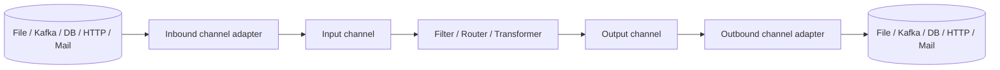
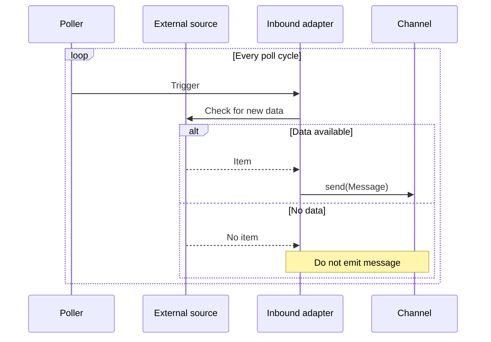
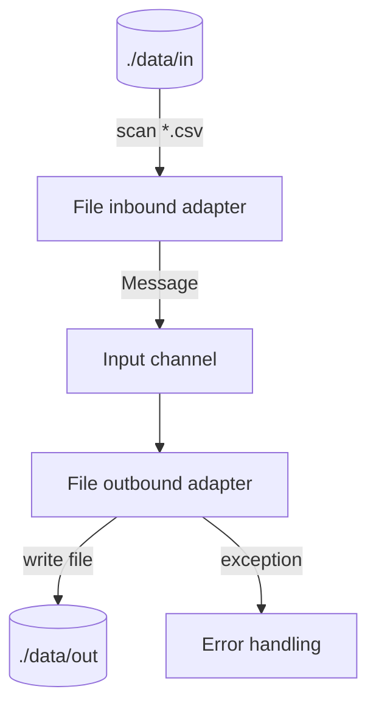
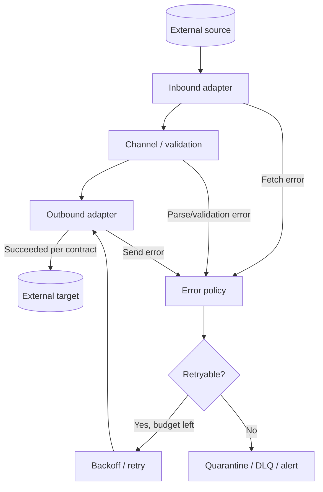
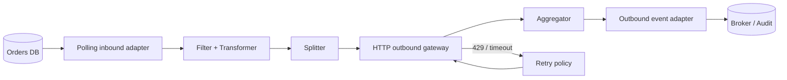

# Channel Adapter Connecting External Sources or Targets

In **Spring Integration**, a system cannot only exchange messages between internal components. An integration flow must also read files, receive broker events, pull database records, ingest emails, send HTTP requests, or write results to other systems. A **Channel adapter** is the *endpoint* type that bridges those external sources/targets with Spring Integration's `Message<?>` and `MessageChannel` model.

This is one of the core components when implementing **Enterprise Integration Patterns** (EIP): sources and targets can change while the logic in between remains organized with Filter, Router, Transformer, Splitter, Aggregator, Gateway, retry, error channel, and correlation. This lesson belongs to the **Endpoint** chapter of the `SPRING_INTEGRATION_PATTERN` module, focusing on designing a **loosely coupled and extensible** integration boundary without equating sending a message to a channel with successful processing by the external system.

After this lesson, you will be able to:

- Distinguish **inbound channel adapter**, **outbound channel adapter**, and **messaging gateway**.
- Recognize **polling** and **message-driven** adapters and pick the mechanism suited to the data source.
- Read a Java DSL flow connecting external files into a channel and writing to an external target.
- Identify payload/header conversion points, error handling, retry, idempotency, and delivery states.
- Design tests for inbound/outbound boundaries, including transient failures and duplicate messages.

## 1. What Is a Channel Adapter?

In Spring Integration, an **endpoint** is a component connecting a message channel to a processing step. A **Channel adapter** is an endpoint specialized in *adapting* between the application's message model and a source/target outside that model.

There are two basic directions, named from the **perspective of the Spring Integration flow**:

| Direction | Responsibility | Data Flow | Example |
| --- | --- | --- | --- |
| **Inbound channel adapter** | Brings external data/events **into** the messaging system. | External source → `Message<?>` → `MessageChannel`. | Scanning a directory for new files, receiving MQTT/Kafka events, polling a database table. |
| **Outbound channel adapter** | Sends messages **out of** the system to an external system. | `MessageChannel` → `Message<?>` → external target. | Writing files, sending emails, making fire-and-forget HTTP calls, publishing to a broker. |

Normally, channel adapters have **one-way semantics** at the message-exchange level: inbound **emits** messages into a channel; outbound **consumes** messages and acts on the target. External protocols may still return status codes or technical acknowledgements, but do not confuse those with a **business reply message** of a request–reply flow.



### Why Not Let Every Handler Call External APIs Directly?

Suppose an order-processing service directly reads Kafka, parses events itself, checks payment, and writes CSV files. When switching from Kafka to RabbitMQ, from CSV to REST, or adding a monitoring branch, the service ends up changing many non-business parts.

Instead, place an **inbound adapter** to handle communication with the source; intermediate steps work with payloads and headers per contract; and an **outbound adapter** handles communication with the target. As a result, swapping transports generally does not require rewriting Filters, Transformers, or business logic—provided message contracts and delivery guarantees stay consistent.

## 2. How Do Channel Adapter, Channel, and Gateway Differ?

Three concepts often appear together yet carry distinct responsibilities:

| Component | Responsibility | Example Question It Answers |
| --- | --- | --- |
| **`MessageChannel`** | Transfers messages between endpoints inside the application. | “Which handler will this message travel to?” |
| **Channel adapter** | Transfers data across the **external source/target ↔ message** boundary. | “How do we read files from a directory or write results to an external system?” |
| **Messaging gateway** | Adapts a **request–reply** method call or protocol into a message flow. | “How do we invoke a flow and get the corresponding result or error?” |
| **Service Activator** | Invokes a method/service upon receiving a message. | “Which business service method handles this content?” |

For example, an adapter receiving orders from a broker and forwarding them to `ordersInput` does not automatically expose a `getOrderStatus()` API to callers. When the application needs a **request → response** flow, a gateway (or a pair of endpoints designed for request–reply) is usually the better model.

```text
One-way:        External event -> [Inbound adapter] -> Channel -> Handler
One-way:        Channel -> [Outbound adapter] -> External system

Request/reply:  Caller -> [Gateway] -> Request channel -> Handler
                       <- Reply channel   <- Response ------┘
```

**Terminology note:** “Inbound” does not mean “HTTP server”; “outbound” does not mean “HTTP client.” They describe **message direction relative to the IntegrationFlow**. For instance, an HTTP inbound gateway receives HTTP requests and returns responses; a Kafka inbound adapter receives records pushed by Kafka; both bring external data in, yet differ in their reply contracts.

## 3. Two Inbound Styles: Polling and Message-Driven

Not every external source proactively pushes events. How a source notifies new data determines the inbound mechanism.

### 3.1. Polling Inbound Adapter: Application Actively Queries the Source

Some sources only support **reading/fetching data** on demand: file directories, database tables, FTP/SFTP in some setups, or APIs that must be queried periodically. In those cases, the system uses a **poller** to trigger the source on a schedule.



In Spring Integration, a source under this model is typically represented by `MessageSource<?>`; a `SourcePollingChannelAdapter` takes its schedule from `PollerMetadata` and polls the source. Key configuration settings include:

- **Polling cadence:** `fixedDelay` is normally measured from the end of one poll to the start of the next; `fixedRate` and cron have different scheduling semantics.
- **`maxMessagesPerPoll`:** caps messages fetched per poll cycle; not necessarily the maximum across the whole system.
- **Scheduler/thread:** a slow poll can delay subsequent polls without appropriate scheduling design.
- **Source state filtering:** must distinguish already-processed items, items still being written by a producer, and items that could be re-read after a restart.
- **Polling error handling:** fetch errors and downstream send/write errors need separate policies where appropriate.

If `MessageSource.receive()` finds no data, it can return `null` to signal **no message this cycle**. That does **not** mean Spring creates a `Message<?>` with a `null` payload; messages built via standard Spring APIs require a non-null payload.

### 3.2. Message-Driven Inbound Adapter: Source Pushes Events

For sources supporting listeners/callbacks, the adapter typically registers to be notified when new events arrive. Examples: Kafka consumer containers, AMQP listener containers, or callbacks from MQTT systems (depending on library and configuration).

```text
External broker/event
        │ push/callback
        ▼
Message-driven inbound adapter
        │ Spring Message + mapped headers
        ▼
      Channel
        │
        ▼
     Handler/Flow
```

With this style, no Spring Integration poller is needed to wake a `MessageSource` periodically. However, **message-driven does not guarantee non-blocking or parallel execution**: a listener may run on a container thread, process synchronously, or delegate to an executor; backpressure, prefetch, acknowledgement, and concurrency depend on the transport adapter.

### Quick Selection Table

| Aspect | Polling Inbound | Message-Driven Inbound |
| --- | --- | --- |
| Who initiates checking? | Poll schedule inside the application. | Listener/callback/container when the source has data. |
| Best suited when | Source lacks push events, or periodic data scans are needed. | Source supports consumers/listeners/event subscriptions. |
| Latency | Depends on polling interval and processing time. | Usually depends on source push rate and consumer speed. |
| What to control | Poll schedule, items per batch, deduplication filter, source locking. | Ack, consumer count, prefetch, commit, ordering, redelivery. |
| Common pitfalls | Re-reading the same file/DB row on restart. | Acking too early, losing order, duplicate processing on redelivery. |

## 4. Outbound Channel Adapter: One-Way Consumer to External Systems

On the outbound side, an endpoint consumes `Message<?>` from a channel and interacts with a target—writing files, sending emails, calling HTTP endpoints, or publishing records to a broker. At the framework level, this adapter type is typically built around a **`MessageHandler`** dedicated to communicating with external systems.

```text
OrderAccepted payload + headers
           │
           ▼
      resultsChannel
           │
           ▼
  Outbound channel adapter
           │  serialization, credentials, mapping
           ▼
      External target
```

Mandatory design decisions to clarify:

1. **What target payload is required?** A file adapter may accept `File`, byte array, or `String` depending on the handler; an HTTP adapter needs request body/headers; a broker adapter needs schema-compliant value/key/metadata. Not every adapter understands arbitrary domain objects automatically.
2. **Which headers need mapping?** `traceId`, correlation, content type, and routing keys may require mapping. Never assume every Spring header passes verbatim to the transport.
3. **What counts as “sent successfully”?** Directory write completing, HTTP returning 2xx, broker confirming publish, or the receiver finishing business processing—these are distinct milestones.
4. **What if sending fails?** Choose bounded retries, circuit breakers (if available), error channels, or durable persistence for replay; make the operation replay-safe whenever possible.
5. **Is a response needed?** If the caller needs response body/status fed back into the flow, consider an **outbound gateway** instead of a one-way outbound adapter.

## 5. Java DSL Practice: Reading CSV Files from One Directory and Writing to Another

An easy-to-observe example combines a **File inbound channel adapter** and a **File outbound channel adapter**. An external producer drops CSV files into a source folder; Spring Integration scans periodically and sends a Spring message into the flow; the outbound handler writes a copy to the destination folder.

### 5.1. Dependencies

When using Spring Boot with Spring Integration, declare the starter and file module (versions managed by BOM/Boot):

```xml
<dependency>
    <groupId>org.springframework.boot</groupId>
    <artifactId>spring-boot-starter-integration</artifactId>
</dependency>
<dependency>
    <groupId>org.springframework.integration</groupId>
    <artifactId>spring-integration-file</artifactId>
</dependency>
```

### 5.2. Configuring a Simple File Flow

```java
import java.io.File;
import java.time.Duration;

import org.springframework.context.annotation.Bean;
import org.springframework.context.annotation.Configuration;
import org.springframework.integration.dsl.IntegrationFlow;
import org.springframework.integration.dsl.Pollers;
import org.springframework.integration.file.dsl.Files;
import org.springframework.integration.file.support.FileExistsMode;

@Configuration
class CsvBridgeConfiguration {

    @Bean
    IntegrationFlow copyCsvFiles() {
        return IntegrationFlow
                .from(
                        Files.inboundAdapter(new File("./data/in"))
                                .patternFilter("*.csv"),
                        endpoint -> endpoint.poller(
                                Pollers.fixedDelay(Duration.ofSeconds(5))
                                        .maxMessagesPerPoll(10)
                        )
                )
                .handle(
                        Files.outboundAdapter(new File("./data/out"))
                                .fileExistsMode(FileExistsMode.FAIL)
                )
                .get();
    }
}
```

Here:

1. `Files.inboundAdapter(...)` creates a file-reading source. The adapter emits messages whose **payload is `File`**; it does not automatically parse CSV columns into domain objects.
2. `.patternFilter("*.csv")` filters by filename, which does not replace checking that a file is finished writing or validating CSV format.
3. The poller fires at the configured interval and fetches up to 10 messages per poll; actual file count depends on directory state and filters.
4. `Files.outboundAdapter(...)` consumes messages and writes files at the destination; `FileExistsMode.FAIL` chooses **not to overwrite** if a destination file with the same name already exists.
5. `.get()` builds the `IntegrationFlow`; Spring manages the flow's endpoints when the application context starts.

This example is intentionally short to highlight the inbound/outbound boundary. For production operation, ensure directories exist with proper permissions, avoid reading partially written files, monitor errors, define duplicate handling, and verify adapter behavior on your Spring Integration version. **Do not treat `patternFilter` or default file source settings as an exactly-once guarantee across restarts.**



### 5.3. Where Do Transformation Steps Go for Business Processing?

Before writing the destination file, you can insert a **Transformer** to convert `File` into validated data, a **Filter** to drop invalid records, a **Router** to split outputs across destinations, and **Splitter/Aggregator** if one file holds multiple rows to process and recombine. Example topology:

```text
File inbound adapter
    -> Message<File>
    -> Parser/Transformer: File -> List<OrderRow>
    -> Validator/Filter
    -> Splitter: List<OrderRow> -> OrderRow messages
    -> Router: domestic / international
    -> Process each row
    -> Aggregator: group by import batch
    -> Serializer: Result -> CSV/JSON
    -> Outbound adapter: file / HTTP / broker
```

Here `Message<File>` and `Message<OrderRow>` do not share the same payload type; choose clear conversion boundaries rather than casting arbitrarily. When Splitter produces multiple child messages, preserve `correlationId`, `sequenceNumber`, `sequenceSize`, or a suitable group key so Aggregator groups one import batch accurately. If an input file has zero valid rows, explicitly define a “processed with empty result” state rather than leaving Aggregator waiting forever with no child messages.

## 6. Design Examples with Other External Sources and Targets

Adapters live at the **integration boundary**; not every source/target uses files. Typical scenarios:

| Source/Target | Common Direction | Technical Details to Verify |
| --- | --- | --- |
| Kafka topic | Inbound listener / outbound publisher | Record key, offset, acknowledgement, redelivery, serialization, partition/ordering. |
| AMQP/RabbitMQ | Inbound listener / outbound publisher | Exchange, routing key, queue, ack, requeue, dead-letter. |
| SFTP/FTP | Polling inbound / outbound upload | File listing, resume, rename, atomic upload, duplicate-processing state. |
| Database | Polling inbound / outbound update | SQL query, transactions, checkpoints, row locking, detecting new rows. |
| File system | Polling inbound / outbound write | In-progress files, size, naming collisions, retention and cleanup. |
| HTTP REST | Inbound endpoint or outbound client | HTTP method, status, timeout, headers, security, request–reply. |
| Email | Mail inbound / outbound | MIME, size, retry, authentication, sensitive data. |

Each protocol has its own adapters and configuration; this table describes **common usage patterns**, not a guarantee that every library and version supports the exact same modes or features. For HTTP, if the response body must continue into the Spring Integration flow, an **HTTP outbound gateway** is a more natural fit than a one-way outbound channel adapter.

### Case A — Kafka → Order Processing → External API

```text
Kafka inbound adapter
  -> ordersInput
  -> Transformer (deserialize/map contract)
  -> Filter (valid order?)
  -> Router (order type)
  -> Gateway/handler (call API needing result)
  -> outcomeChannel
  -> Kafka/file outbound adapter (emit result)
```

A **Kafka inbound adapter** should clearly configure consumer commit/acknowledgement semantics and replay behavior. If downstream logic has side effects, use a stable idempotency key (such as an event ID or command ID in the contract), not merely Spring's `MessageHeaders.id`. To call an API requiring a response, consider a gateway or a service with an explicit contract; an outbound channel adapter does not turn a flow into request–reply on its own.

### Case B — Periodic Data Scan → Email Report

```text
Scheduled poller
  -> JDBC inbound adapter (new rows)
  -> Transformer (rows -> report)
  -> Filter (report not empty?)
  -> Mail outbound adapter
```

Here “no new rows” may mean the source emits no message on that poll cycle; whereas an “empty report” might be a **valid payload** if business rules require reporting zero activity. Do not conflate both into an ambiguous `null`. If a report is sent and marking completion in the DB fails, the next poll could send it again—design appropriate idempotency/transaction/outbox policies.

## 7. Payloads, Headers, and Transport Boundaries

A Spring message consists of `payload` and `headers`; when crossing an adapter, both typically map to or from the transport's representation.

| Information | Where Should It Live? | Example at Adapter |
| --- | --- | --- |
| Business values surviving replay | Payload or serialized event contract | `orderId`, `amount`, `eventId`, `occurredAt`. |
| Tracing information | Headers/transport metadata with intentional mapping | `traceId`, `correlationId` for logs and observability. |
| Transport-level routing | Protocol/adapter metadata | Kafka topic/key, AMQP routing key, target filename. |
| Content type | Header or transport contract | JSON, CSV, content type/charset. |
| Single-delivery identifier | Framework/transport metadata | Spring message ID, Kafka offset, or delivery tag. |

For example, the same `OrderCreated` can be sent to Kafka or written as a JSON file. The **business payload** still means “order created,” while mapping `traceId`, content type, key, filename, or ack depends on the adapter. Do not assume adding a header via `MessageBuilder` automatically delivers it to external transports; many adapters only map supported or explicitly configured headers.

### Do Not Let Transport Metadata Become Canonical Business Data

Spring's `headers.id` does not replace a durably stored `eventId`; a Kafka offset is not an order ID; an HTTP 202 status does not mean an order has been paid. When business logic requires replay, deduplication, auditing, or cross-system correlation, design an explicit contract and test mapping across each adapter.

### Absence vs. Null

Finding no file or database row on a poll cycle typically means **emitting no message**, not emitting a `Message` with a null payload. When a caller needs a “not found” status, consider a gateway and explicit result types like `Found`/`NotFound`. Avoid treating adapter exceptions or timeouts as a `null` payload inside a valid message.

## 8. Retry, Errors, and Delivery Boundaries

At external boundaries, failures are routine: network drops, broker temporarily unavailable, locked files, expired credentials, or target service errors. A single identical retry configuration cannot fit every failure mode.

### Classify Errors Before Handling

| Error | Example | Handling Direction |
| --- | --- | --- |
| Transient | Network timeout, broker unavailable, rate limit | Bounded retry, backoff, jitter where appropriate; monitor attempt counts. |
| Invalid data | Schema-invalid JSON, negative amount | Do not retry infinitely; route to error channel/quarantine/DLQ or return rejection. |
| Business conflict | Order already canceled, event already processed | Clear idempotency rules or business outcome. |
| Unauthorized | 401/403, invalid certificate | Fix config/credentials; do not hammer with retries while root cause persists. |
| Overload | More files/commands than capacity | Throttle polling/concurrency, apply backpressure per adapter capability, durable queues if needed. |

### Error Channel and Error Flow

In Spring Integration, failures can be wrapped in an `ErrorMessage` and sent to an `errorChannel` depending on endpoint type, sync/async invocation, pollers, and configuration. **Do not assume** every exception in any adapter automatically enters the same error channel, or that logging an error means the message was safely handled.

Example topology:



This diagram shows **design decisions**, not edges Spring automatically adds to a flow. Actual retry points can live in consumer containers, poller advice, outbound handlers, or brokers; avoid accidentally nesting multiple retry layers that multiply call attempts exponentially.

### Idempotency and Replay

A broker-fed flow may reprocess the same record after a crash, or a file may be rediscovered after a restart. Therefore:

- **Never assume end-to-end exactly-once by default.** That requires coordinated transactions and idempotency across the entire path, not a single adapter.
- Use a **durable business/event ID** when deciding whether to skip repeating an action.
- Use an *idempotent receiver* with a durable metadata store, or an outbox/inbox pattern depending on design; ensure the key does not change when messages are reconstructed.
- For files, verify atomic renames, processed-file tracking, restart-safe filters, and cleanup/archival policies.
- For brokers, control when ack/commit occurs and how poison messages are handled per transport contract.

An outbound operation succeeding at the network layer does not prove downstream business work finished. For instance, HTTP 202 may mean only “accepted for later processing,” a Kafka producer ack may confirm only broker persistence, and a successful file write does not prove the reading system processed its contents.

## 9. Threading, Polling, Backpressure, and Performance

Channel adapter design must clarify both **load sources** and **load sinks**:

1. **Polling source:** `fixedDelay`, `maxMessagesPerPoll`, batch size, and processing time govern ingestion speed. Overly short intervals create idle background load; overly long intervals increase latency.
2. **Message-driven source:** brokers/containers enforce their own concurrency, prefetch, and ack policies; adding consumers does not guarantee preserving order per business key.
3. **Downstream channel:** `DirectChannel` may run handlers on the sender thread; `ExecutorChannel` decouples threads without durable storage; `QueueChannel` buffers internally but needs bounds and recovery policies.
4. **Reactive bridge:** connecting to a `FluxMessageChannel` does not make an imperative inbound adapter understand end-to-end Reactive Streams demand automatically. Check whether the adapter/container supports pausing, bounds, or appropriate buffering.
5. **Outbound side effects:** slow APIs, heavy file writes, or high-latency brokers prolong endpoint thread execution. Monitor outbound duration and avoid starving critical threads.

```text
Fast producer                      Slow target
     │                                  ▲
     ▼                                  │
Inbound adapter -> Channel/buffer -> Outbound adapter
                       │
           Must define capacity,
           timeout, retry, recovery
```

Do not add unbounded thread pools or queues just to make short-term throughput look better: under sustained load, memory and pending message counts grow without limit. When business rules forbid data loss, choose a durable broker or store with capacity planning and recovery mechanisms.

## 10. Security and Observability at Adapters

Because adapters touch networks, file systems, and external services, they are prime spots for **security and observability**.

**Security:**

- Grant **least-privilege** accounts/permissions to APIs, brokers, directories, or databases.
- Never hardcode secrets, tokens, passwords, or sensitive identifiers in Java source or message headers for debugging convenience.
- Verify TLS, certificates, endpoint URLs, file paths, and write permissions; bound accepted payload types and sizes.
- Guard against malicious external inputs: validate format, size, encoding, filename/path traversal, and schema before deep processing.
- Define clear trust boundaries for headers; never treat a self-asserted `traceId` or `userId` as authentication proof.

**Observability:**

- Measure received/sent counts, failures, retries, latency, backlog, processing duration, and items per poll.
- Propagate correlation/trace IDs across the flow, without assuming `ThreadLocal`/MDC crosses executor or reactive boundaries automatically.
- Emit structured logs: source/target, event type, adapter outcome, failure reason, and safe correlation keys; mask or omit sensitive fields.
- Distinguish **accepted**, **delivered**, and **processed** on dashboards to avoid falsely reporting a business transaction complete merely because a message send succeeded.

## 11. Testing Strategy for Channel Adapters

Testing must verify not only that “a file appeared” or “HTTP returned 200,” but that the adapter preserves business semantics and error policies at the boundary.

| Test Type | Scenario | Verification Criteria |
| --- | --- | --- |
| **Unit test** | Transformer/Filter receiving adapter-created payload | Type conversion, validation, and routing decisions are correct. |
| **File integration test** | Create files in temp directory, run flow | Inbound reads ready files; outbound writes exact contents and names; no duplicates per contract. |
| **Contract test** | Producer/consumer across services | JSON/Avro schema, header mapping, content type, and nullable/missing field semantics match. |
| **Failure test** | Target unreachable or permission denied | Retry/backoff, error flow, attempt count, zero lost messages or infinite loops. |
| **Restart/replay test** | Process stops between receive and send | Processed state, ack/commit, deduplication, and recovery work as expected. |
| **Load test** | Producer faster than consumer | Bounded backlog, wait times, throughput, memory, and overload recovery. |

### A Reproducible File Test Scenario

1. Create **isolated** source and target directories in tests; use temporary test paths instead of production paths.
2. Create a valid `orders-001.csv` file; trigger the flow and wait conditionally until the target file appears, with an **explicit timeout**.
3. Read back the target file contents to compare bytes/encoding, not just filename.
4. Drop a duplicate-named file and verify `FileExistsMode.FAIL` raises the expected error instead of silently overwriting.
5. Stop/restart the application to check whether the source file is picked up again; if once-only processing is required, configure a durable metadata store/state marker and verify it.
6. Simulate write failures (unwritable path, disk full) and observe the error flow/metrics. Do not delete the source file before confirming desired recovery behavior.

With Spring Integration Test, you can control endpoints, swap handlers for mocks, or use `QueueChannel` to inspect messages instead of hitting live systems. For adapters requiring brokers or databases, integration tests can use isolated environments/Testcontainers depending on stack, without tying business unit tests to a permanently running broker.

## 12. Common Mistakes

**Mistake 1 — Using an outbound adapter when a response is actually needed.** Sending a REST request and needing response data to choose the next branch while using a one-way endpoint. **Fix:** use an outbound gateway or a handler with an explicit request–reply contract.

**Mistake 2 — Treating a successful `send()` as business completion.** A channel only confirms delivery at one boundary; downstream may run asynchronously or fail later. **Fix:** separate accepted/delivered/processed milestones and define proper ACKs/replies.

**Mistake 3 — Polling partially written files.** The adapter sees the filename before the producer closes the stream, reading truncated data. **Fix:** use atomic renames, completion markers, or stability checks per source contract.

**Mistake 4 — Trusting an in-memory filter as durable checkpoint storage.** Restarts can rescan items. **Fix:** use a durable metadata store, idempotency keys, or post-processing file moves under a verified policy.

**Mistake 5 — Retrying every error infinitely.** Schema-broken files or HTTP 401s will not heal after thousands of retries. **Fix:** classify errors, bound retries, route to dead-letter/quarantine, and alert.

**Mistake 6 — Packing all transport attributes into business payloads.** Swapping brokers or HTTP headers forces mass model rewrites. **Fix:** separate durable business payloads, orchestration headers, and adapter-specific mappings.

**Mistake 7 — Swallowing errors in `.handle()` or `subscribe()` with only a log line.** Sources may keep acking/committing even though business work failed. **Fix:** design failure propagation and boundary-aligned ack policies, and test error replay.

**Mistake 8 — Using a channel as an unbounded buffer.** When targets slow down, queued messages grow unchecked. **Fix:** cap capacity, manage concurrency, and pick durable queues if zero data loss is required.

## 13. Design Exercise: Syncing Orders to a Shipping System

**Context:** An e-commerce application stores orders in a database. The external shipping system only exposes an HTTP API, occasionally returns `429 Too Many Requests`, and requires a `shipmentRequestId` on every request to prevent duplicate shipments. Orders must pass address validation, split into individual packages, and receive final shipment status.

**Design requirements:**

1. If orders are fetched in batches from a DB table, choose a **JDBC polling inbound adapter** or an appropriate event/outbox mechanism. Explain how to fetch only unprocessed items and prevent multiple workers from claiming the same item.
2. Use **Filter** to validate data and **Transformer** to build shipment requests; if an order has multiple packages, use **Splitter** with explicit correlation.
3. Because the shipping API must **return a tracking number**, consider an **HTTP outbound gateway** rather than a one-way outbound adapter at the shipment-creation step. Use an outbound adapter only when one-way sending fits the contract.
4. For HTTP 429, use bounded retry with backoff while keeping the same `shipmentRequestId` across attempts—never generate a new ID on retry.
5. If packages are processed concurrently, use **Aggregator** to reassemble groups by `shipmentBatchId`, handling timeouts or single-package failures.
6. Upon receiving confirmed results, use an outbound adapter to publish `ShipmentCreated` events to a broker or audit file. Do not equate broker publish confirmation with downstream consumers finishing updates.
7. Test disconnects, restarts, duplicate requests, throttling, invalid payloads, and trace `traceId` across all branches.



**Self-check question:** If the inbound adapter picks up an order and sends it into the channel successfully, but the HTTP gateway has not returned a result yet, can the order be marked “shipment created” right away? **No.** Business state must depend on confirmed results under the shipping service contract, paired with failure/idempotency handling and restart recovery.

## Summary

- **Inbound channel adapters** bring data **from external sources into** Spring Integration; **outbound channel adapters** send Spring messages **out to external targets**. Inbound/outbound direction is defined from the integration flow's perspective.
- **Polling inbound** is triggered by schedules and `MessageSource`; **message-driven inbound** typically uses listeners/containers to receive events from push-capable sources.
- Channel adapters generally carry **one-way semantics**; when request–reply results are needed for further processing, use a **Gateway** or equivalent contract.
- Keep business logic inside **Filter, Router, Transformer, Splitter, Aggregator**, and service steps; adapters specialize in mapping, connectivity, and boundary operations.
- **Retry, error channel, ack/commit, idempotency, correlation, backpressure, security, and observability** must match each transport's semantics; never assume adapters provide end-to-end exactly-once delivery out of the box.
- Measure success at the right boundary: **message received**, **sent to target**, and **business processing completed** are three distinct milestones.
