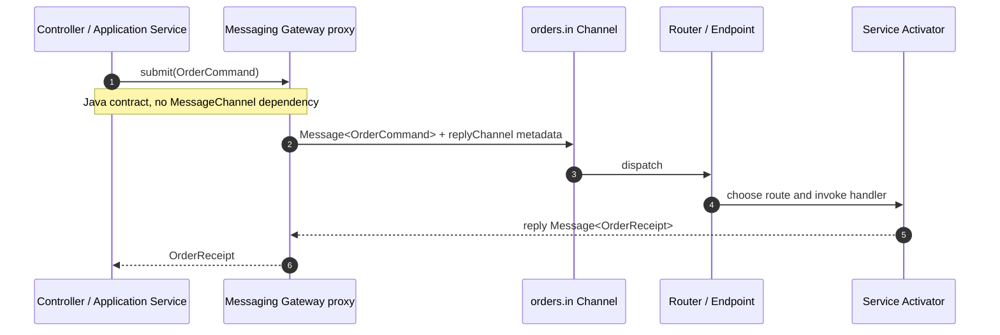
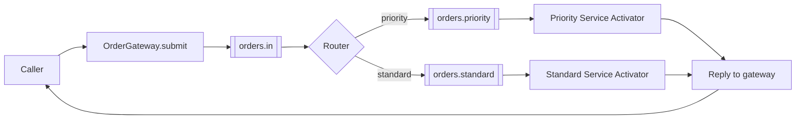
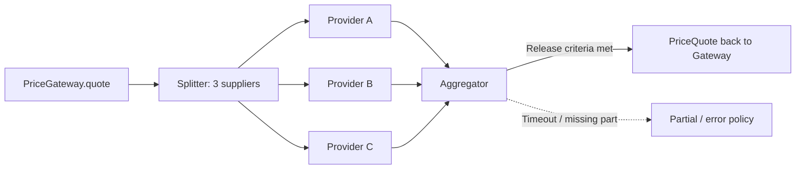
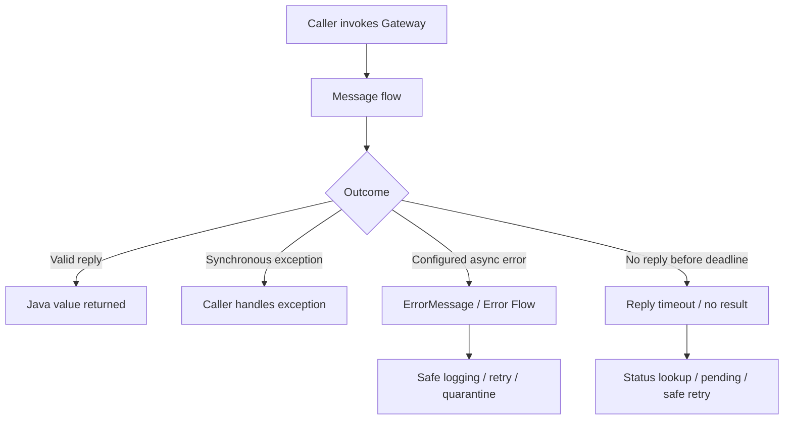

# Gateway Creating a Facade for a Message Flow

In a Spring application, a Controller or application service often wants to invoke a capability using familiar Java syntax: `orderGateway.submit(command)`. Behind the scenes, that request may travel through a **Message Channel**, **Filter**, **Transformer**, **Router**, processing branches, and a **Service Activator**. If business code had to directly build a `Message`, populate headers, pick channels, and await replies, integration flow details would leak into places that should not know about them.

**Spring Integration's Messaging Gateway** solves this by providing a **facade—a Java method interface sitting in front of a message flow**. Callers see a clean contract, while the gateway turns the method call into a message sent to a channel, and can then receive a reply and return the expected Java type.

In the `SPRING_INTEGRATION_PATTERN` module, Gateway is an essential component for practicing **Enterprise Integration Patterns (EIP)** in a loosely coupled, extensible way. It integrates smoothly with Router, Filter, Transformer, Splitter, Aggregator, retry, error channel, and correlation, while creating a clean boundary for testing and observing processing branches.

> **Key idea:** Gateway is *how callers view the integration system*, not the entire integration flow. Gateway hides `Message`/`Channel` details from calling code, yet **does not automatically guarantee asynchrony, durability, safe retries, or business completion before a deadline**.

## 1. Problem Without a Facade

Suppose a system receives order creation commands. Priority orders route to a fast-track lane; standard orders route to the standard lane. If the application service depends directly on messaging infrastructure, code quickly pulls in technical decisions:

```java
// Sketch of unwanted coupling; NOT sample code to adopt.
class OrderController {
    // MessageChannel, MessageBuilder, replyChannel, timeout... pushed up to the API layer.
    // Whenever channel names or reply mechanics change, the controller must change too.
}
```

What needs protecting is the **boundary of responsibility**:

- Controllers care about requests, responses, and HTTP contracts.
- Application services care about use cases, state, and business rules.
- Integration flows care about transformation, routing, invoking handlers, and message correlation.
- External adapters/gateways care about protocols with ERPs, brokers, partners, or other resources.

Calling code should look like this:

```java
OrderReceipt receipt = orderGateway.submit(
    new OrderCommand("ORD-1050", true)
);
```

The caller only needs to know **the interface and data types**. It does not need to know how many Routers exist, channel names, or which handler is ultimately invoked.

## 2. What Is a Gateway, and Where Does the Facade Sit?

A **facade** provides a simple entry point to a complex structure behind it. In Spring Integration, a gateway is typically declared as a Java interface annotated with `@MessagingGateway`. The framework registers a **proxy** implementing the interface; when a method is invoked, the proxy constructs/sends a message and, for methods with return values, manages waiting/receiving replies per configuration.



This diagram is a **logical model**. Depending on channel and endpoint types, steps may run immediately on the caller's thread or across asynchronous boundaries. Replies can travel over a framework-managed reply channel; in simple examples, developers do not need to create that channel manually.

### 2.1. Distinguishing Commonly Confused Concepts

| Component | Responsibility | Is It a Facade for Calling Code? |
| --- | --- | --- |
| **Messaging Gateway** | Converts a method call into a request message, and a reply message into a return value when needed. | **Yes** — typically a Java interface. |
| **Message Channel** | Send/receive boundary between steps. | No; calling code does not necessarily see channels. |
| **Service Activator** | Invokes a handler method upon receiving a message. | No; it is a backend handler inside the flow. |
| **Router** | Chooses the branch/channel for processing a message. | No; it routes inside the flow. |
| **Channel Adapter** | Connects an external source or target to the messaging system. | Not necessarily; adapters can be one-way inbound/outbound. |
| **Inbound/Outbound Gateway** | Performs request–reply communication with an external system/protocol, such as HTTP. | A gateway at a **protocol boundary**, distinct from the Java proxy interface even though both follow request–reply. |
| **HTTP API Gateway/reverse proxy** | Routes, secures, and manages HTTP traffic at the network edge. | **Not synonymous** with `@MessagingGateway`. |

**Note:** The word *gateway* in Spring Integration does not always refer to a single annotation. Beyond `@MessagingGateway` proxies, there are also **gateway endpoints** inside flows and **protocol-specific gateways**. They all relate to request–reply communication but sit at different boundaries and abstraction levels.

## 3. Three Core Parts of a Messaging Gateway

### 3.1. Interface: Business Contract of the Facade

Rather than exposing `MessageChannel` or `Message<?>` at call sites, start with an interface with clear business types:

```java
import org.springframework.integration.annotation.MessagingGateway;

@MessagingGateway(
    defaultRequestChannel = "orders.in",
    defaultReplyTimeout = "3000"
)
public interface OrderGateway {
    OrderReceipt submit(OrderCommand command);
}
```

Here:

- `OrderGateway` is a contract callers can inject as a Spring bean once the gateway is discovered/registered.
- `submit(OrderCommand)` accepts a payload as a Java object; callers do not have to build a `Message`.
- `defaultRequestChannel` specifies the default channel for sending requests.
- `defaultReplyTimeout` configures the reply wait duration when the gateway waits for a response and timeout policy applies.
- `OrderReceipt` describes **the result callers expect**, without forcing calling layers to read `MessageHeaders`.

The name `orders.in` is an **integration contract**. If the channel name changes, the edit usually belongs in gateway/flow configuration, not every controller calling `submit(...)`.

### 3.2. Proxy: Bridging Method Invocation to Message

Spring Integration creates a proxy for the gateway interface (you can use `@IntegrationComponentScan` to discover these interfaces). When a caller invokes `submit(...)`, the proxy turns arguments into a request message and sends it to the channel. When a return type exists, the proxy also coordinates receiving the reply and converting it to the matching return value.

You do not need to manually write `MessageBuilder` and `replyChannel` at every call site. Still, **never assume every gateway method is synchronous or always returns a reply**: behavior depends on the method signature, gateway settings, channels, and actual flow.

### 3.3. IntegrationFlow: Endpoint Chain Behind the Facade

A Gateway **does not replace** Filter, Transformer, Router, or Service Activator. It feeds requests into a defined flow. A message can pass through multiple steps, or even cross a broker and return via another gateway/adapter.



## 4. Complete Structural Example: Gateway + Router + Two Handlers

This is a minimal example that clearly demonstrates **how a facade hides multiple message flow branches**. Assume the project uses Java supporting `record`, Spring Framework, and a compatible Spring Integration version. Snippets in the same package can be placed in their respective Java files.

### 4.1. Business Data Types

```java
public record OrderCommand(String orderId, boolean priority) {}

public record OrderReceipt(String orderId, String route, String status) {}
```

Facade payloads are expressed as meaningful domain/application types. The `ACCEPTED` status in the example only simulates a handler-returned result, **not a guarantee that an ERP or broker durably processed it**.

### 4.2. Java Facade for the Flow

```java
import org.springframework.integration.annotation.MessagingGateway;

@MessagingGateway(
    defaultRequestChannel = "orders.in",
    defaultReplyTimeout = "3000"
)
public interface OrderGateway {
    OrderReceipt submit(OrderCommand command);
}
```

### 4.3. Processing Service After Routing

```java
public class OrderApplicationService {

    public OrderReceipt submitPriority(OrderCommand command) {
        validate(command);
        return new OrderReceipt(command.orderId(), "priority", "ACCEPTED");
    }

    public OrderReceipt submitStandard(OrderCommand command) {
        validate(command);
        return new OrderReceipt(command.orderId(), "standard", "ACCEPTED");
    }

    private void validate(OrderCommand command) {
        if (command == null || command.orderId() == null
                || command.orderId().isBlank()) {
            throw new IllegalArgumentException("orderId is required");
        }
    }
}
```

Putting the mandatory `orderId` rule inside the service clarifies **business contract validation**. In real environments, authentication, authorization, schema validation, and deduplication belong cleanly at boundaries. Avoid making a Router both pick routes and deduct inventory or charge money.

### 4.4. Wiring with Spring Integration Java DSL

```java
import org.springframework.context.annotation.Bean;
import org.springframework.context.annotation.Configuration;
import org.springframework.integration.annotation.IntegrationComponentScan;
import org.springframework.integration.config.EnableIntegration;
import org.springframework.integration.dsl.IntegrationFlow;

@Configuration
@EnableIntegration
@IntegrationComponentScan
public class OrderFlowConfiguration {

    @Bean
    OrderApplicationService orderApplicationService() {
        return new OrderApplicationService();
    }

    @Bean
    IntegrationFlow routeOrders() {
        return IntegrationFlow.from("orders.in")
            .route(OrderCommand.class,
                command -> command.priority() ? "priority" : "standard",
                spec -> spec
                    .channelMapping("priority", "orders.priority")
                    .channelMapping("standard", "orders.standard"))
            .get();
    }

    @Bean
    IntegrationFlow priorityOrders(OrderApplicationService service) {
        return IntegrationFlow.from("orders.priority")
            .handle(service, "submitPriority")
            .get();
    }

    @Bean
    IntegrationFlow standardOrders(OrderApplicationService service) {
        return IntegrationFlow.from("orders.standard")
            .handle(service, "submitStandard")
            .get();
    }
}
```

**Step-by-step explanation:**

1. `@EnableIntegration` activates Spring Integration infrastructure in the context; `@IntegrationComponentScan` scans and registers gateway interfaces within the configured scan scope.
2. The `OrderGateway` proxy sends `OrderCommand` to the `orders.in` channel.
3. The Router chooses `orders.priority` or `orders.standard` based on `priority`.
4. The two destination flows use Service Activators (`.handle(...)`) to invoke the corresponding methods on `OrderApplicationService`.
5. The methods return `OrderReceipt`. In a properly wired request–reply flow, the reply routes back to the gateway so the caller receives `OrderReceipt`.

In real applications, **component scanning must cover `OrderGateway`**, beans must exist in the Spring context, and every target channel must have a valid consumer/flow. This example omits HTTP endpoints, brokers, transactions, or persistence; add those when required by your problem.

### 4.5. Caller Depends Only on the Facade

```java
public class PlaceOrderUseCase {
    private final OrderGateway orderGateway;

    public PlaceOrderUseCase(OrderGateway orderGateway) {
        this.orderGateway = orderGateway;
    }

    public OrderReceipt execute(String orderId, boolean priority) {
        return orderGateway.submit(new OrderCommand(orderId, priority));
    }
}
```

The use case does not import `Message`, `MessageBuilder`, or `MessageChannel`. If the system later adds a Filter for schema validation, a Transformer to convert to an ERP payload, a Splitter for order lines, or an Aggregator for combining results, the `execute(...)` signature **can remain unchanged** as long as the business contract stays the same.

## 5. How Does Gateway Support Request–Reply?

### 5.1. Request Channel and Reply Channel

In a value-returning call, the gateway typically sends a request message carrying metadata telling the flow **where to reply** (e.g., reply-channel metadata). The terminal handler produces an output message/reply; the messaging infrastructure routes that reply back to the waiting gateway.

This explains why the example code **does not manually create a separate reply `QueueChannel` per caller**. Still, this automatic mechanism works properly only when an endpoint returns a result and the path preserves the reply contract.

If the flow drops the message via a Filter, the Router finds no branch, a handler returns `null`, or the message crosses an external transport with no return path, **the caller may never receive a reply**. Explicitly define the behavior in those cases: return a rejection result, throw a handleable exception, or return an async status—never silently leave callers hanging indefinitely.

### 5.2. Two Kinds of Gateway Methods

| Signature | Design Meaning | Assumption to Avoid |
| --- | --- | --- |
| `OrderReceipt submit(OrderCommand cmd)` | Caller expects a result from the message flow. | Do not assume a reply always arrives if the flow drops/blocks messages or loses correlation. |
| `void publish(OrderEvent event)` | Caller does not receive a business result via method return value. | `void` does **not** automatically make a flow durable, async, or true fire-and-forget on every channel. |

With `DirectChannel`, a `void` method can still execute handlers synchronously and propagate exceptions back to the caller. With executor/broker channels, the call may return before business processing completes. **Return type and channel together determine caller experience**; never judge from one factor alone.

### 5.3. Timeouts: Succeeding to Send vs. Receiving a Result

A Gateway can have two distinct wait budgets:

- **Request timeout:** time spent waiting to send the request into the channel when sending can block, such as a full bounded `QueueChannel`.
- **Reply timeout:** time spent waiting for a reply in request–reply paths that involve waiting, such as asynchronous processing.

Per-method customization example with `@Gateway` (an **alternative declaration**, not an annotation to stack onto the interface in section 4):

```java
import org.springframework.integration.annotation.Gateway;
import org.springframework.integration.annotation.MessagingGateway;

@MessagingGateway
public interface PriceGateway {
    @Gateway(
        requestChannel = "pricing.requests",
        requestTimeout = "200",
        replyTimeout = "1500"
    )
    PriceQuote quote(PriceRequest request);
}

// PriceRequest/PriceQuote are application-defined;
// the pricing.requests flow must have a reply-producing handler.
```

Example values are in milliseconds. **Setting a 1500 ms reply timeout does not mean a synchronous handler making a 10-second HTTP call will automatically abort after 1500 ms**. In a synchronous `DirectChannel` flow, the handler method can hold the thread longer. Set timeouts at the HTTP client/broker/database, budget end-to-end deadlines, and design late-reply handling.

**Especially important:** timing out while waiting for a reply **does not prove** the target system never completed the operation. Retrying a charge or order-creation command without idempotency can cause duplicate side effects.

## 6. Combining Gateway with Other EIPs

Gateway forms the entry portal; the remaining patterns handle internal work:

| Pattern | Role Behind Gateway | Design Question to Answer |
| --- | --- | --- |
| **Filter** | Keeps or drops invalid/irrelevant messages. | If dropped, does the caller get an error response or just a timeout? |
| **Transformer** | Normalizes payloads or converts caller DTOs to downstream formats. | Which headers and sensitive fields are allowed to pass? |
| **Router** | Sends requests to one or more branches conditionally. | How are default/invalid branches handled? |
| **Splitter** | Splits one request into parts for independent processing. | How do we track parts belonging to the same request? |
| **Aggregator** | Combines related responses into a joint result. | How do correlation, completion, timeout, and late replies behave? |
| **Service Activator** | Calls the actual business method. | Does the result return to the gateway or run as background work? |
| **Outbound Gateway** | Performs request–reply with an external system. | What are timeout, authentication, retry, and correlation on that transport? |
| **Error Flow** | Monitors/handles errors when endpoints emit errors or error messages. | Which exceptions return straight to caller vs. go to an error channel? |

### 6.1. Gateway + Filter: Don't Forget the Rejection Path

Suppose a gateway has signature `OrderReceipt submit(...)`. If a Filter drops a message without emitting a reply, the caller **has no business result** to receive. Good design must decide how to answer invalid requests:

1. Validate input before the gateway and return a clear error.
2. Or inside the flow, route invalid requests to a handler producing an `OrderReceipt` with an appropriate rejected status.
3. Or throw an exception with an explicit contract and let the calling layer map it to the right response.

Which option you choose depends on where validation ownership lives. What you must avoid is silently discarding and relying on reply timeout as a substitute for a business validation message.

### 6.2. Gateway + Splitter/Aggregator: One Request, Many Responses

For instance, a gateway receives a `PriceRequest` covering three suppliers. Splitter divides it into three parts; each branch fetches a quote, and Aggregator combines them into one `PriceQuote`. To answer the caller properly, address:

- **Correlation:** responses must share the request/group key without mixing with other requests.
- **Release strategy:** when are enough results present to emit a reply?
- **Group timeout/expiry:** if one supplier fails to respond, return partial results, return an error, or wait longer?
- **Reply path:** Aggregator output must still route to the reply channel awaited by the gateway, or across equivalent mapping when leaving the JVM.
- **Late arrivals:** how are results handled/recorded if they arrive after the caller timed out?



**Gateway reply timeout** and **Aggregator group timeout** are two distinct concepts. Increasing one does not fix missing messages in the other. Allocate the overall request deadline consistently across stages.

### 6.3. Gateway + Retry: Failures May Have Already Created Side Effects

Suppose a request travels through an outbound gateway to an ERP. The ERP creates the order, but the response is lost. The caller of `OrderGateway.submit(...)` times out and retries. Without deduplication, the system can create two orders.

Gateway does not guarantee *exactly once* on its own. Use a **business-stable idempotency key**, perform status lookups on ambiguous outcomes, and place retry/backoff policies at the right boundaries. For multi-system operations, state persistence, outbox, or compensation may be needed per real requirements.

## 7. Error Channel and Error Paths from Gateway

Errors can occur in many places: Filter/Transformer throwing exceptions, Router finding no route, handler business errors, executor rejecting tasks, outbound gateway timeouts, or malformed responses.

In **synchronous** flows, handler exceptions can propagate back to the caller through the gateway, sometimes wrapped by the framework in messaging-related exceptions. In **asynchronous** flows, endpoints/adapters can emit `ErrorMessage` to an error channel when configured accordingly. **Never assume** every exception goes to `errorChannel` or that all exceptions surface to callers identically.



A clear policy should distinguish:

| Error | Recommended Behavior at Facade Boundary |
| --- | --- |
| Missing required field | Validation error with stable code; never infinitely retry the same request. |
| Invalid Router branch | Defined error/default handling branch; never silently drop the message. |
| External service timeout | Report uncertain status; check idempotency/status before retrying. |
| Channel/executor overload | Return overload status or fall back to durable intake per contract. |
| Unrecoverable business error | Return meaningful error; never turn exceptions into `SUCCESS`. |

Also, never log raw `Message<?>`, tokens, or personal data in `ErrorMessage`/stack traces. For traceability, prefer `eventType`, `component`, `errorCode`, `attempt`, opaque correlation IDs, and controlled trace context.

## 8. Does a Gateway Always Hide All Infrastructure?

Not completely. Gateway helps **reduce technical leakage**, yet interface design must still reflect **real semantics**:

- If a request is genuinely an **asynchronous job**, do not design an interface implicitly promising immediate completion; return `JobAccepted`/job ID and let clients poll or subscribe for status.
- If processing might **not reply**, define deadlines, expiry outcomes, and how to retrieve results later.
- If callbacks must carry an extra correlation ID, place it in the business contract as an opaque identifier or let the gateway/flow manage appropriate headers.
- If callers manage authentication, do not stuff raw access tokens into every `MessageHeaders` as a convenient credential carrier.
- If a single Gateway handles dozens of unrelated business operations, the interface turns into a **God facade** that is hard to test and maintain.

### 8.1. Choosing Between a Synchronous Facade and an Asynchronous Facade

| Problem | Clearer Facade Style | Note |
| --- | --- | --- |
| Fast price quote | `Quote quote(QuoteRequest request)` | Has an end-to-end deadline; outcome may fail or expire. |
| Background notification | `NotificationAccepted enqueue(Notification command)` | Distinguish acceptance from delivery; requires persistence if zero loss is needed. |
| Fire-and-forget event emission | `void publish(Event event)` | `void` does not guarantee async or durability; depends on channel and transport. |
| Multi-supplier batch job | `JobId submitBatch(...)` then `status(JobId)` | Better fit when Aggregator waits a long time or returns partial results. |

**Interface design must be honest about outcome certainty.** A type like `OrderReceipt(status="ACCEPTED")` should mean only that the system accepted the request under contract—not that shipment occurred or ERP persistence succeeded without evidence.

## 9. Testing Facades and Flows Separately

A facade enables testing at multiple levels without spinning up every external service.

### 9.1. Testing Routing Through the Gateway

Using the classes from section 4, you can use Spring Test + JUnit 5 to boot the context and invoke the gateway like a real caller:

```java
import static org.junit.jupiter.api.Assertions.assertEquals;

import org.junit.jupiter.api.Test;
import org.springframework.beans.factory.annotation.Autowired;
import org.springframework.test.context.junit.jupiter.SpringJUnitConfig;

@SpringJUnitConfig(OrderFlowConfiguration.class)
class OrderGatewayFlowTest {

    @Autowired
    OrderGateway gateway;

    @Test
    void priorityOrderUsesPriorityBranch() {
        OrderReceipt receipt = gateway.submit(new OrderCommand("ORD-1", true));

        assertEquals("priority", receipt.route());
        assertEquals("ACCEPTED", receipt.status());
    }

    @Test
    void normalOrderUsesStandardBranch() {
        OrderReceipt receipt = gateway.submit(new OrderCommand("ORD-2", false));

        assertEquals("standard", receipt.route());
        assertEquals("ACCEPTED", receipt.status());
    }
}
```

Both tests use **the exact same interface**, yet the Router selects different handlers. The caller never needs channel names or manual `Message` construction. If gateway component scanning misses the interface, the test cannot inject the gateway—a wiring error well worth verifying in real projects.

### 9.2. Additional Tests Needed Before Production

| Scenario | What Must Hold True |
| --- | --- |
| Invalid input (blank `orderId`) | Meaningful error returned without invoking business logic; caller maps error properly. |
| Filter discards a reply-expecting request | Never leave client hanging for a missing reply; explicit rejection policy applies. |
| Router finds no matching branch | No silent message loss; default route or error path triggers. |
| Slow outbound service | Timeouts/exceptions follow contract; do not assume the handler was canceled. |
| Handler returns no reply | Gateway handles missing reply per method signature and configured timeout. |
| Retry with same `eventId` | Business side effects are not duplicated. |
| Splitter/Aggregator returns late results | Correlation, group expiry, and late replies behave accurately. |
| Logging/tracing | Requests/branches remain traceable without leaking payloads, personal info, or tokens. |

### 9.3. Mocking the Facade in Caller Unit Tests

Because `OrderGateway` is an interface, unit tests for `PlaceOrderUseCase` can pass a **fake/mock gateway** with no Spring Integration context required. This keeps application-layer tests fast, readable, and independent of channel topology.

```java
OrderGateway fake = command ->
    new OrderReceipt(command.orderId(), "fake", "ACCEPTED");

PlaceOrderUseCase useCase = new PlaceOrderUseCase(fake);
OrderReceipt result = useCase.execute("ORD-3", true);

// Assert result.orderId(), result.status() per unit test goals.
```

The example above relies on the interface having a single abstract method (`submit`), allowing a lambda as a test stub. For interfaces with multiple methods, use a fake class or mocking library.

## 10. Observing Flows Through a Facade Without Losing Visibility

A facade reduces coupling, yet must not turn the flow into a “black box.” Key metrics to monitor:

- **Requests through gateway:** received, replied, timed out, errored.
- **End-to-end latency:** from method invocation to returned result.
- **Per-Router-branch traffic:** `priority`, `standard`, unmatched/error.
- **Handler/outbound gateway duration:** distinct from channel wait time.
- **Retry and failure rates:** by endpoint/error category, never by secret data.
- **Correlation and tracing:** tracking Splitter/Aggregator and request–reply across boundaries.

Structured log example (illustrative, not default Spring Integration output):

```text
event=order_gateway_completed
gateway=OrderGateway.submit
branch=priority
outcome=accepted
latency_ms=41
correlation_id=24f55ffd-aad6-42da-9e27-a6cb1d365db3
```

Avoid putting customer names/emails/addresses, access tokens, or full message payloads into logs. Never use per-request correlation IDs as **metric labels**, as that explodes cardinality and risks leaking linked data; aggregate metrics should use bounded labels such as `gateway`, `branch`, and `result`.

Metrics/tracing require **configuration and testing** tailored to your Spring Integration version, Micrometer/observability stack, and adapters; they do not appear automatically just because an interface has `@MessagingGateway`.

## 11. Common Design Mistakes

### Mistake 1 — Putting All Business Logic Inside the Gateway Interface

A Gateway should only be a **flow access contract**, not the place expressing hundreds of business rules. Decisions like inventory deduction or pricing belong in use cases/domain services; patterns handle message movement and integration-boundary concerns.

### Mistake 2 — Confusing `@MessagingGateway` with an HTTP API Gateway

`@MessagingGateway` creates a Java proxy; it does not expose a REST endpoint or reverse proxy. If HTTP intake is needed, you still need a Controller or HTTP inbound gateway/adapter with proper security configuration.

### Mistake 3 — Thinking `void` Means “Durably Sent in the Background”

`void publish(...)` does not promise non-blocking execution, zero message loss, or automatic retries. Inspect channels, executors, brokers, ack/transactions, and completion states.

### Mistake 4 — Using Reply Timeout to Cancel In-Flight Tasks

A gateway reply timeout does not guarantee canceling synchronous handlers or partner HTTP requests. Put client timeouts, end-to-end deadlines, late-reply policies, and resource limits in the right places.

### Mistake 5 — Ignoring Filter Cases That Produce No Reply

In request–reply flows, discarding without a reply branch leaves callers without expected responses. Return an explicit rejection result or contracted exception instead of using timeouts as validation errors.

### Mistake 6 — Gateway Knowing Every Channel and Passing Tokens in Headers

A facade loses value if callers still pick channels, pass credentials in headers, handle routes, or wire correlation manually everywhere. Split gateways by use case/boundary, let integration flows orchestrate, and manage credentials in target-specific adapters.

## 12. Self-Check Questions

**Q1.** The caller invokes `orderGateway.submit(command)` without importing `Message` or `MessageChannel`. Who creates the message?

**Answer:** Spring Integration's proxy for `@MessagingGateway` converts the call into a request message and sends it to the configured channel.

**Q2.** A Gateway sends to `orders.in`, Router forwards to `orders.priority`, and a handler returns `OrderReceipt`. Does the caller need to know `orders.priority`?

**Answer:** No. The caller depends only on `OrderGateway`; downstream topology is managed inside the flow.

**Q3.** A Gateway has a 1-second reply timeout, while a synchronous handler takes 5 seconds. Is the handler guaranteed to be canceled after 1 second?

**Answer:** No. Reply timeout is not a kill switch for synchronous methods. Analyze channel types, configure client/handler timeouts, and manage overall deadlines.

**Q4.** A request–reply Gateway hits a Filter and the message is discarded with no reply handler. Is this a valid validation response?

**Answer:** Not automatically. Define explicit rejection outcomes or errors; silent discards can leave callers waiting until timeout.

**Q5.** After a reply timeout, the caller retries order creation in the ERP. What must be checked first?

**Answer:** Verify whether the prior attempt already created side effects; use an idempotency key and status reconciliation rather than assuming a timeout means unexecuted.

**Q6.** Splitter fans out requests to three systems, and Aggregator only has two responses. Will Gateway automatically pick a partial-result policy?

**Answer:** No. You must design the release strategy, timeout/expiry, correlation, and contract for partial/late results.

## 13. Gateway Implementation Checklist

| Check | Goal |
| --- | --- |
| Does the Gateway interface use clear business types? | Callers stay decoupled from `MessageChannel` and `Message<?>`. |
| Is `@MessagingGateway` scanned/registered properly? | A real Spring proxy bean exists, not just an interface in source. |
| Does the request channel have a receiving flow? | Never send to a channel lacking subscribers/handlers. |
| Do Router/Filter flows honor the contract? | Zero silent message drops; default/rejection paths exist where needed. |
| Is the reply path complete? | Value-returning methods actually receive replies across all branches. |
| Are timeouts and slow downstreams handled? | Never confuse reply timeout with handler cancellation. |
| Are retry and idempotency designed? | No duplicate side effects when responses are lost. |
| Are correlation and late replies controlled? | Splitter/Aggregator never mix groups or ignore expired items. |
| Are logs/metrics safe and informative? | Track flows/branches without logging sensitive payloads. |
| Are both caller and flow tested? | Callers can mock the gateway; flow tests cover branches, errors, and timeouts. |

## Conclusion

**Gateway creates a facade for a message flow** by translating a Java method call into a Spring Integration message and optionally returning a reply to the caller. As a result, calling code depends only on an **interface with business data types**, while the integration layer owns **Messages, Channels, Endpoints, Routers, Filters, Transformers, Splitters, Aggregators, and adapters**.

A well-designed Gateway **never hides the truth about the system**: it clearly states what is request–reply, what is accepted for deferred processing, what timeouts mean, and how errors/retries behave. Combining gateways with correlation, idempotency, error flows, testing, and observability yields an entry point that is **easy for callers to use yet transparent and operable underneath**.
