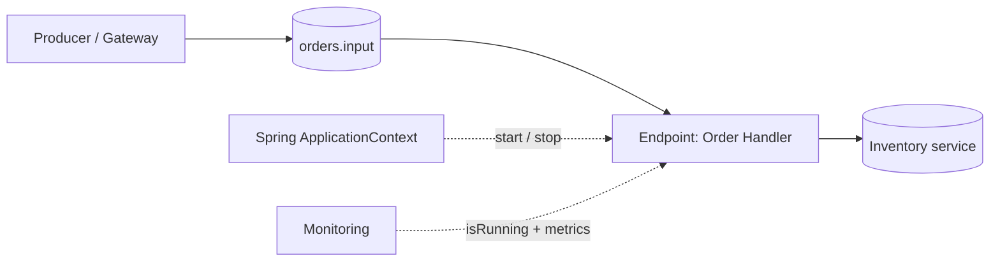
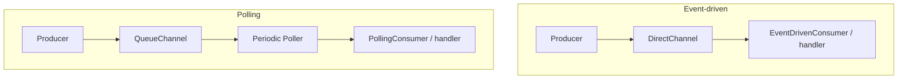
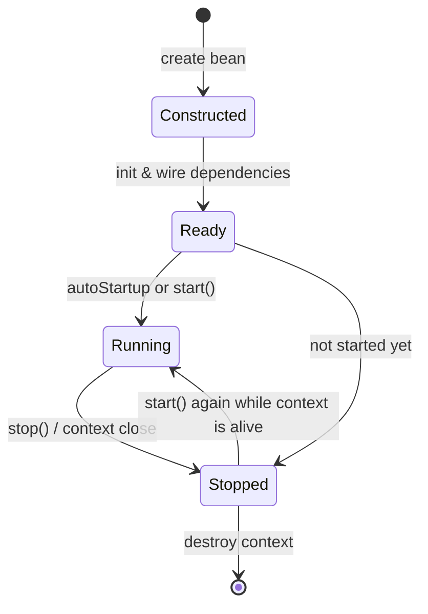
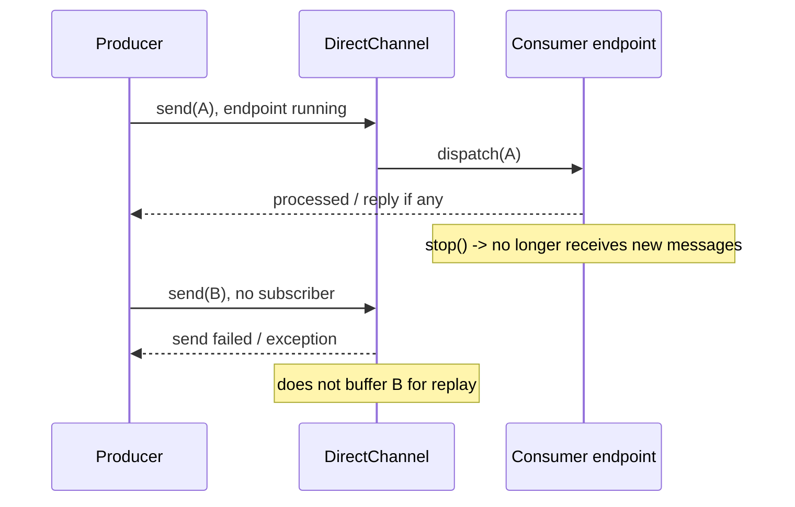
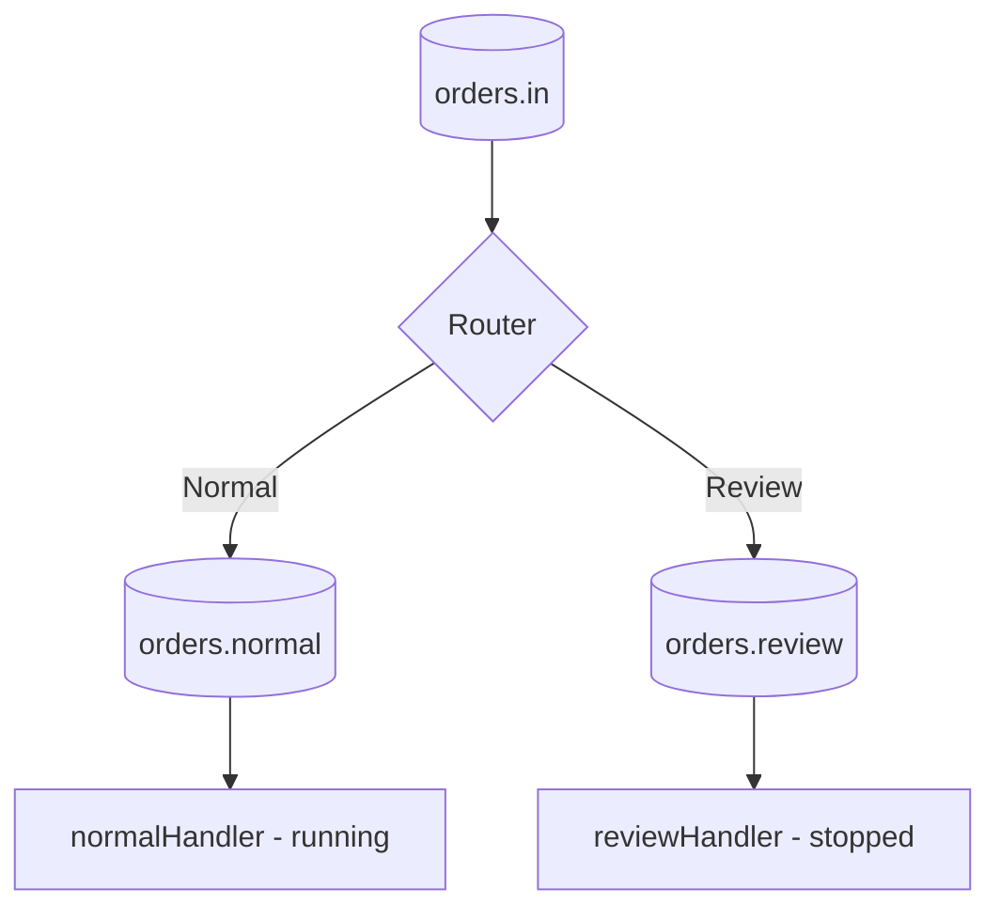

# Endpoint Lifecycle and Running State

## 1. Why Understanding Endpoint Lifecycle Matters

In **Spring Integration**, an integration flow is composed of **messages**, **channels**, and **endpoints**. Endpoints connect channels to where messages are emitted, received, or processed: `Service Activator`, `Filter`, `Transformer`, `Router`, `Splitter`, `Aggregator`, inbound/outbound adapters, or gateways. We often focus on endpoint business logic and forget that **endpoints also have a lifecycle**: created, initialized, started, running, stopped, and restarted or destroyed on application shutdown.

Lifecycle becomes especially critical when a branch must pause for maintenance, a downstream dependency is overloaded, a broker disconnects, or a system wants ordered startup across component groups. For example, you pause the order-processing consumer to upgrade a database. **Does the channel still accept messages? Do in-flight messages finish? Does `isRunning()` guarantee the database connection is healthy?** The answers depend on channel type, endpoint type, and lifecycle mechanics.



This lesson belongs to the **Endpoint** chapter of the `SPRING_INTEGRATION_PATTERN` module, where we implement Enterprise Integration Patterns with Spring Integration for loosely coupled, extensible message flows. Understanding lifecycle helps operate Router, Filter, Transformer, Splitter, Aggregator, Gateway, retry, error channel, and correlation safely, while accurately testing and observing processing branches.

After this lesson, you will be able to:

1. Distinguish **bean existence**, **endpoint running**, and **actual service health**.
2. Understand the roles of `Lifecycle`, `SmartLifecycle`, `autoStartup`, `phase`, and `isRunning()`.
3. Recognize differences between event-driven consumers and polling consumers during start/stop.
4. Control a specific endpoint without confusing it with stopping a channel or shutting down the entire application context.
5. Predict behavior when an endpoint stops while producers keep sending; design timeouts, backpressure, retries, and recovery.
6. Test startup/shutdown and monitor bottlenecks without treating `isRunning()` as the sole health check.

## 2. Which Endpoints Have a Lifecycle?

### 2.1. Endpoint Is a Role in a Flow, Not Just an HTTP Endpoint

An endpoint can connect an external system or represent an **internal** processing stage inside a flow:

| Component | Role in Flow | Lifecycle Object to Observe |
|---|---|---|
| Inbound adapter | Pulls or receives messages from an external source or polling source. | Adapter/container or data-receiving endpoint. |
| Inbound gateway | Receives external requests, sends into the flow, then returns replies. | Listener/server adapter and request–reply path. |
| Service Activator | Invokes business logic on a message. | Consumer endpoint wiring the handler to a channel. |
| Filter/Router/Transformer | Drops, routes, or transforms messages. | Consumer endpoint subscribed to receive messages; not merely the transformation function. |
| Outbound adapter/gateway | Sends to an external target, with or without a reply. | Consumer endpoint and associated client/transport. |
| Polling consumer | Pulls messages from a `PollableChannel`. | Poll schedule, task registration, and message retrieval. |

**Common confusion:** a Java handler may just be a plain bean with a `handle()` method, whereas the **consumer endpoint** is the Spring Integration component registering that handler onto an input channel. When pausing message intake, you normally control the **consumer endpoint**, not invoke an arbitrary `stop()` on the service bean. Nor is the service bean's name necessarily the endpoint's ID.

### 2.2. Event-Driven Consumer vs. Polling Consumer

Two common models:



- With a **`SubscribableChannel`** like `DirectChannel`, the consumer endpoint registers a handler so the channel **dispatches messages as they are sent**. Starting/stopping typically toggles the message subscription.
- With a **`PollableChannel`** like `QueueChannel`, the consumer endpoint must **actively pull** messages via a poller; starting/stopping typically toggles scheduling and execution of the polling task.

Therefore, **stopping a consumer does not stop the channel**. With a single-subscriber `DirectChannel`, sending after the endpoint stops leaves no subscriber and leads to failed sends or exceptions. With a `QueueChannel`, producers can keep enqueueing while the poller is stopped until the queue fills up; in-memory messages are not durable across restarts by default.

## 3. Spring's Lifecycle Mechanism

### 3.1. `Lifecycle` and `SmartLifecycle`

In Spring Framework, the `Lifecycle` interface declares three core methods:

```java
public interface Lifecycle {
    void start();
    void stop();
    boolean isRunning();
}
```

`SmartLifecycle` extends coordination with **auto-startup**, **phase ordering**, and a **callback-based stop contract for lifecycle processors**. Many Spring Integration endpoints implement `SmartLifecycle` through the framework's endpoint infrastructure.

| Capability | Meaning | Practical Question |
|---|---|---|
| `start()` | Requests the endpoint to enter an active state. | Can it start receiving messages now? |
| `stop()` | Requests the endpoint to stop active work. | How do we temporarily pause message intake? |
| `isRunning()` | Observes lifecycle state at call time. | Has the endpoint been started according to the framework? |
| `isAutoStartup()` | Indicates whether the endpoint auto-starts on context refresh. | Does it require manual startup after deployment? |
| `getPhase()` | Supplies phase for ordering `SmartLifecycle` beans. | Which components start first and stop last? |
| `stop(Runnable callback)` | Stop contract with callback so lifecycle processor tracks stop completion. | Does the custom endpoint coordinate shutdown cleanly? |

**Not every bean in a flow implements `SmartLifecycle`.** For instance, a DTO, a plain `MessageHandler`, or a `MessageChannel` does not necessarily have `start()`/`stop()`. Look up the **registered endpoint bean** rather than trying to cast arbitrary beans to `SmartLifecycle`.

### 3.2. States from an Operational Perspective

To understand lifecycle, consider this conceptual state flow:



This diagram is a **mental model**, not an official `EndpointState` enum published by Spring Integration. The API side is simpler: `isRunning()` is primarily `true` or `false`. It does not distinguish states such as *starting*, *stopping*, *degraded*, *waiting for broker*, *no subscriber*, or *deadlocked*.

Stages to distinguish:

1. **Bean created and initialized:** configuration, dependency injection, and initialization callbacks have run. That does not necessarily mean the endpoint is consuming messages.
2. **Application context refreshed:** the lifecycle processor starts `SmartLifecycle` components with `autoStartup=true` according to ordering rules.
3. **Endpoint in running state:** the component participates in receiving or emitting messages per its own mechanism.
4. **Endpoint stopped:** halts lifecycle-managed work; does not automatically clear channels, reset data, or stop external dependencies.
5. **Context shutdown/destroy:** the container releases beans and resources; never expect calling `start()` on a destroyed bean to revive the application.

### 3.3. `autoStartup` and `phase`

**`autoStartup=true`** is typically chosen for endpoints that must run as soon as the application is ready. For conditional startup, set **`autoStartup=false`** and have an operational step call `start()` once dependencies are verified.

**`phase`** controls relative start/stop ordering across `SmartLifecycle` beans:

- Under standard lifecycle coordination, **lower phases start earlier**, and **higher phases start later**.
- On shutdown, phase order normally **reverses**: **higher phases stop earlier**, and **lower phases stop later**.
- Actual bean dependencies and lifecycle callbacks also influence ordering; `phase` does not replace proper dependency design.

For example, if an application needs inbound listeners active only after downstream components are ready, you can coordinate startup with phases and readiness gates. However, **setting a phase alone does not guarantee broker/database connections are healthy**; you still need health probes, reconnect/retry logic, and policies when dependencies are unavailable.

In Java DSL, you can configure `.autoStartup(false)` and `.phase(...)` on endpoint specs, such as consumer endpoints inside `.handle(...)`. At runtime, verify the expected bean ID has been registered by Spring Integration.

## 4. Hands-on Example: Toggling an Order-Processing Endpoint

### 4.1. Requirements

Build a `DirectChannel` named `orders.input` and a service activator processing messages. The endpoint **must not auto-start** when the Spring context initializes. An operator can call `start()` to open intake and `stop()` to pause. The example uses an atomic counter for clear observation without requiring a database.

```text
Producer --send--> orders.input --[orderProcessorEndpoint]--> count++
                                          |
                                   autoStartup=false
                                          |
                               operator start()/stop()
```

### 4.2. Configuration with Spring Integration Java DSL

The example targets Java 17+, Spring Boot 3.x, and Spring Integration 6.x with `spring-boot-starter-integration`:

```java
import java.util.concurrent.atomic.AtomicInteger;

import org.springframework.context.annotation.Bean;
import org.springframework.context.annotation.Configuration;
import org.springframework.integration.channel.DirectChannel;
import org.springframework.integration.config.EnableIntegration;
import org.springframework.integration.dsl.IntegrationFlow;
import org.springframework.messaging.MessageChannel;

@Configuration
@EnableIntegration
class EndpointLifecycleConfig {

    @Bean(name = "orders.input")
    MessageChannel ordersInput() {
        return new DirectChannel();
    }

    @Bean
    AtomicInteger handledMessageCount() {
        return new AtomicInteger();
    }

    @Bean
    IntegrationFlow processOrders(AtomicInteger handledMessageCount) {
        return IntegrationFlow.from("orders.input")
                .handle(message -> {
                    // Replace with a business service in a real application.
                    handledMessageCount.incrementAndGet();
                }, endpoint -> endpoint
                        .id("orderProcessorEndpoint")
                        .autoStartup(false)
                        .phase(100))
                .get();
    }
}
```

Explanation:

- Bean **`orders.input`** is the synchronous message channel.
- `processOrders` is the **flow definition** bean, whereas **`orderProcessorEndpoint`** is the ID of the consumer endpoint configured inside the flow. That is the lifecycle target controlled in this example.
- `.autoStartup(false)` keeps the endpoint unregistered from message processing on context startup; explicit startup is required.
- `.phase(100)` illustrates endpoint phase. This value is **not** a message priority; it only coordinates lifecycle ordering with other components.
- The counter simply proves the handler ran; it guarantees neither business outcomes nor data durability.

### 4.3. Controlling the Endpoint from the Spring Context

Look up the **endpoint bean by its registered ID**, then call `start`/`stop`:

```java
import org.springframework.context.ApplicationContext;
import org.springframework.context.SmartLifecycle;

void toggleProcessor(ApplicationContext context) {
    SmartLifecycle endpoint =
            context.getBean("orderProcessorEndpoint", SmartLifecycle.class);

    System.out.println("Before: " + endpoint.isRunning()); // false initially

    endpoint.start();
    System.out.println("Running: " + endpoint.isRunning()); // true

    endpoint.stop();
    System.out.println("After stop: " + endpoint.isRunning()); // false
}
```

This code illustrates controlling **an endpoint with a stable ID in a live application context**. In production, replace demo methods with authenticated, authorized, audited operational commands that verify outcomes. Never allow arbitrary public Internet requests to invoke `start()`/`stop()` directly.

**Important:** `isRunning() == true` only means the endpoint reports itself started; it **does not prove** any message callback finished, healthy subscribers exist, downstreams are online, or consumers are keeping up with desired throughput.

## 5. When an Endpoint Stops, Where Do Messages Go?

This question matters far more than `stop()` syntax.

### 5.1. With `DirectChannel` and Event-Driven Endpoints

In the example above, `DirectChannel` dispatches synchronously. When `orderProcessorEndpoint` stops, it no longer receives messages as it did while running. If `orders.input` **has no other subscribers**, the sender may receive a failed send result or a dispatch/no-subscriber exception depending on the call path; messages **do not wait inside `DirectChannel`** until the endpoint restarts.



If multiple subscribers are registered on a point-to-point channel, stopping one endpoint affects behavior according to the remaining subscribers. Do not assume stopping one endpoint stops the whole channel; conversely, never assume messages still reach that stopped endpoint.

### 5.2. With `QueueChannel` and Polling Consumers

With `QueueChannel`, producer and consumer rates are decoupled:

```text
Producer --> QueueChannel(capacity=100) --> Poller --> Service Activator
               keeps accepting if space   ^
                                        stop(): stops polling new messages
```

When a polling consumer stops, **the queue can continue accumulating messages** while space remains. After `start()`, the poller can drain the backlog. However, watch out for:

- A **bounded-capacity** queue will fill up if producers keep sending while consumers are stopped. Send behavior when full depends on timeouts and send contracts.
- The default in-memory queue **is not durable across restarts**. For restart recovery, choose an appropriate message store/broker and verify delivery guarantees.
- Being pulled from the queue **does not mean** the message was processed/committed successfully; design recovery/transactions per business requirements.
- `stop()` may not immediately cancel **already-running** handlers or dispatched tasks; this depends on the endpoint, scheduler, and transport.

### 5.3. With Inbound Adapters/Gateways and External Transports

An inbound endpoint may own an HTTP listener, message listener container, file poller, or broker consumer. Calling `stop()` on the right endpoint can pause polling or halt new request/delivery intake. Yet **acknowledgements, offsets, prefetch, retries, reconnects, and already-fetched-but-unfinished messages** depend on both the adapter and external technology (JMS, RabbitMQ, Kafka, HTTP...).

Never promise “stop always returns messages to the broker.” Verify your specific adapter's contract and transaction/ack behavior; in-flight handlers may still finish or fail during shutdown.

| Flow Type | Endpoint Stopped | What Producers May Observe | What Must Be Verified |
|---|---|---|---|
| `DirectChannel -> handler` | Consumer unsubscribed | Send has no receiver or throws exception; does not wait automatically. | Remaining subscribers, error responses, upstream retries. |
| `QueueChannel -> poller` | Poller stops pulling | Sends succeed until queue fills. | Capacity, TTL/timeouts, persistence, post-start backlog. |
| `ExecutorChannel -> handler` | Endpoint stops accepting new tasks as before | Affected by executor and subscribers. | Queued tasks, rejection policy, thread pool lifecycle. |
| `HTTP inbound gateway` | Listener stops accepting per adapter rules | Connection errors, HTTP 5xx, or gateway/load-balancer behavior. | Readiness, draining, and client error messaging. |
| `Broker inbound adapter` | Container/consumer pauses | Publishing to broker may still succeed. | Acknowledgements, offsets, prefetch, redelivery, DLQ. |

## 6. Polling Endpoints: `running` Does Not Mean Actively Processing

An endpoint marked `running` might be **waiting on a poll interval**, **seeing an empty queue**, or **stalled on a slow downstream**. For pollers, distinguish three levels:

1. **Lifecycle running:** endpoint has been started and the poll schedule is active.
2. **Actual receive/poll:** poller is pulling messages from the input channel.
3. **Business processing:** handler finishes and side effects are persisted successfully.

Configuration example for a manually started polling consumer:

```java
import org.springframework.context.annotation.Bean;
import org.springframework.context.annotation.Configuration;
import org.springframework.integration.channel.QueueChannel;
import org.springframework.integration.config.EnableIntegration;
import org.springframework.integration.dsl.IntegrationFlow;
import org.springframework.integration.dsl.Pollers;

@Configuration
@EnableIntegration
class PollingLifecycleConfig {

    @Bean(name = "orders.pending")
    QueueChannel ordersPending() {
        return new QueueChannel(100);
    }

    @Bean
    IntegrationFlow pendingOrderFlow() {
        return IntegrationFlow.from("orders.pending", endpoint -> endpoint
                        .id("pendingOrdersPoller")
                        .autoStartup(false)
                        .poller(Pollers.fixedDelay(200).maxMessagesPerPoll(5)))
                .handle(message -> {
                    // Process a message pulled from the queue.
                    System.out.println(message.getPayload());
                })
                .get();
    }
}
```

**Reading the example accurately:** `QueueChannel(100)` holds at most 100 **waiting** messages; `maxMessagesPerPoll(5)` caps messages fetched per poll cycle, not a guarantee of consuming exactly 5 messages every 200 ms. While `pendingOrdersPoller` is stopped, sends to the queue still succeed while capacity remains; once restarted, backlog drains gradually. Poller schedulers and handlers still require concurrency, transaction, error-handling, and shutdown controls.

If a flow has a queue with **no** poller or active `receive()` consumer, messages simply sit in the queue without turning into completed business work.

## 7. `start()` and `stop()` Do Not Mean “Pause/Resume the Whole System”

### 7.1. What Happens to In-Flight Work?

`stop()` requests a change in endpoint activity; **it does not roll back all in-flight messages by default**. At the moment of `stop()`, there may be:

- A handler executing a synchronous database/HTTP call.
- A task submitted to an executor but not yet started.
- A message pulled from a queue awaiting commit.
- An Aggregator group still waiting for remaining parts.
- A gateway call awaiting a reply and timeout.

How each behaves depends on endpoint type, transaction boundaries, timeouts, schedulers, message stores, and adapters. Therefore, when designing **graceful shutdown**, distinguish:

```text
1. Stop admitting new traffic at the edge (load balancer / inbound)
2. Allow in-flight work to finish/ack within a defined deadline
3. Stop consumers/pollers and inspect remaining tasks
4. Handle backlog, pending groups, retries, and recovery
5. Stop dependent resources / close the application context
```

This is a **recommended operational sequence**, not an automatic protocol executed simply by calling `endpoint.stop()`. If zero message loss is required, combine persistence, transactions, acknowledgements, and idempotency per transport.

### 7.2. `stop()` vs. `destroy()` vs. Removing a Flow

| Operation | Meaning | Can the Same Bean Restart? |
|---|---|---|
| `endpoint.stop()` | Pauses activity under lifecycle contract. | Usually **yes**, while context and dependencies stay valid. |
| `endpoint.start()` | Activates a registered endpoint. | No need to re-register the flow after a prior `stop()`. |
| Closing `ApplicationContext` | Stops lifecycle, destroys/releases beans and resources. | Never call `start()` on destroyed beans; need a fresh context. |
| Unregistering a dynamic flow | Removes dynamic flow definition/registration via management API. | May require re-registering the flow, not just restarting an old endpoint. |

Do not destroy/deregister a flow for short pauses when `stop()` suffices. Conversely, stopping an endpoint does not empty queues, change route definitions, or terminate subscriptions on other endpoints.

### 7.3. Stopping One Branch Behind a Router

Suppose a router splits orders by value:



If you stop `reviewHandler` while the router keeps sending to `orders.review` (a `DirectChannel` with no other subscribers), that branch **does not become a holding queue**. Explicitly design one of these options:

1. **Reject at the boundary:** stop accepting review requests and return a clear status.
2. **Use a durable buffer:** send review tasks to a broker/queue designed for downtime, then resume consumers later.
3. **Controlled reroute:** forward to an approved deferred/fallback branch without violating business rules.

With Splitter/Aggregator branches, stopping one child consumer can leave groups incomplete. On recovery, verify `correlationId`, `sequenceNumber`, release strategy, expiration, duplicates, and ordering; do not assume groups auto-heal simply because the endpoint is running again.

## 8. Managing Lifecycle via API and Control Bus

### 8.1. Programmatic Control

When operated from an internal admin service, fetch the endpoint via `ApplicationContext` and invoke `SmartLifecycle` as shown in section 4. Require **stable endpoint IDs**, authorization checks, and confirmation policies.

A good operational command logs at least: `operator`, `endpointId`, `action`, `previousRunning`, `currentRunning`, timestamp, and `reason`. For queue-impacting actions, also record queue depth, in-flight count, and recovery status if measurable.

Do not confuse an **IntegrationFlow bean ID**, a **DSL-created endpoint ID**, and a **handler/service bean ID**. When looking up by name, verify the bean actually implements `Lifecycle`/`SmartLifecycle`; never blindly cast a transformer service to an endpoint.

### 8.2. Control Bus

Spring Integration includes the **Control Bus** pattern, allowing control commands evaluated inside the integration context to manipulate lifecycle on permitted components. This fits systems wanting message-driven endpoint control, yet opens huge risks if inputs are untrusted.

Safeguards:

- Allow only authorized operators/admin systems to send commands.
- Never wire a Control Bus directly to public HTTP/APIs or broker topics with untrusted producers.
- Restrict allowed endpoints/commands via allowlist, log audits, and rate-limit calls.
- Never treat user command strings as harmless data; Control Bus evaluates control expressions and must sit behind strict trust boundaries.
- After start/stop commands, verify both endpoint state **and** operational signals—not merely that the command was sent.

If you only need a maintenance switch for one consumer, an admin service calling `SmartLifecycle` directly against an endpoint allowlist is usually easier to govern than exposing a general Control Bus.

## 9. `isRunning()` Differs from Readiness, Liveness, and Throughput

Suppose `orderProcessorEndpoint.isRunning() == true`. All of the following can still happen:

- Downstream database is down; every message fails.
- Broker consumer is started but disconnected and reconnecting.
- Poller is idle because the queue is empty.
- Executor is saturated; tasks sit queued for a long time.
- Handler is deadlocked or stalled; completion rate is near zero.
- Router sends to a branch lacking a consumer.
- Error channel receives many failures with no sensible recovery.

Therefore, never conclude “service is healthy” from `isRunning()` alone.

| Signal | Question Answered | Limitation |
|---|---|---|
| `endpoint.isRunning()` | Does lifecycle report the endpoint as running? | Does not prove processing success or healthy dependencies. |
| Application readiness | Should the app accept new traffic? | Must incorporate essential dependencies into explicit policy. |
| Application liveness | Is the process minimally alive/responsive? | Does not mean the entire flow is healthy. |
| Input/processed rate | How many messages enter and complete? | Low rate may simply mean low traffic, not a failure. |
| Queue depth and oldest age | Is backlog growing or aging? | Must pair with ingress/egress rates and capacity. |
| Error/retry/timeout rate | Are failures or retries spiking? | Distinguish intake errors, business rejections, and infra failures. |
| Last-success timestamp | How long since the last successful completion? | Meaningful only when traffic is expected. |
| In-flight count | How many messages are currently executing? | Requires instrumentation; not provided by `isRunning()`. |

In multi-branch apps, collect metrics by **endpoint ID**, **channel ID**, **route**, and **service**. Use Spring Integration management/metrics, Micrometer Observation, Spring Boot Actuator, structured logging, and distributed tracing per your setup. Avoid copying hardcoded meter names or actuator endpoints from another version without verifying against your current version.

### 9.1. Combining Lifecycle with Distributed Tracing and Message History

Message History shows **which tracked components a message passed through**; distributed tracing tracks spans across threads/services; `isRunning()` is merely **endpoint state at observation time**. The three signals complement each other:

```text
orderId = ORD-2001
traceId = trace-2001
endpoint = reviewHandler
running = true
lastSuccess = 10 minutes ago
queueDepth = 92/100
errorRate = 85%
```

An endpoint with `running=true` and metrics like those above may still require alerting or shedding new intake by policy. Never log payloads containing sensitive data solely for lifecycle tracking; business IDs, correlation IDs, outcomes, and endpoint names are far more useful.

## 10. Testing Lifecycle: Create Context, Start, Send, Stop

### 10.1. Testing an Event-Driven Endpoint

Using `EndpointLifecycleConfig` from section 4. JUnit 5 and Spring Test example:

```java
import java.util.concurrent.atomic.AtomicInteger;

import org.junit.jupiter.api.Test;
import org.springframework.beans.factory.annotation.Autowired;
import org.springframework.beans.factory.annotation.Qualifier;
import org.springframework.context.SmartLifecycle;
import org.springframework.messaging.MessageChannel;
import org.springframework.messaging.support.MessageBuilder;
import org.springframework.test.context.junit.jupiter.SpringJUnitConfig;

import static org.junit.jupiter.api.Assertions.assertEquals;
import static org.junit.jupiter.api.Assertions.assertFalse;
import static org.junit.jupiter.api.Assertions.assertTrue;

@SpringJUnitConfig(EndpointLifecycleConfig.class)
class EndpointLifecycleTest {

    @Autowired
    @Qualifier("orderProcessorEndpoint")
    SmartLifecycle processorEndpoint;

    @Autowired
    @Qualifier("orders.input")
    MessageChannel input;

    @Autowired
    AtomicInteger handledMessageCount;

    @Test
    void canStartHandleAndStop() {
        assertFalse(processorEndpoint.isRunning());

        processorEndpoint.start();
        try {
            assertTrue(processorEndpoint.isRunning());
            assertTrue(input.send(
                    MessageBuilder.withPayload("ORD-1").build(), 0));
            assertEquals(1, handledMessageCount.get());
        } finally {
            processorEndpoint.stop();
        }

        assertFalse(processorEndpoint.isRunning());
    }
}
```

**What this test proves:** the endpoint can start from a non-auto-started state; while running, `DirectChannel` delivers messages to the handler; after stop, the framework reports not running. The test uses an `AtomicInteger` counter for easy observation of side effects.

**What this test does NOT prove:** that sending to the channel after stopping always raises a **specific exception type**, that in-flight messages drain cleanly, that transactions commit, that an inbound broker adapter stops cleanly, or that every system branch is healthy. On a subscriberless direct channel, depending on setup, `send` may fail or throw an exception; tests checking that path must verify the exact contract for your framework version.

### 10.2. Testing Polling Consumers and Backlog

For `PollingLifecycleConfig` (section 6), add dedicated tests:

1. Initialize the Spring context and assert `pendingOrdersPoller.isRunning()` is `false`.
2. Send two messages to `orders.pending`, confirm enqueueing succeeds and queue depth is 2 (when the test controls all producers/consumers).
3. Start the polling endpoint; use a collector/test handler and **await with a timeout** until both messages arrive.
4. Stop the polling endpoint; send a new message to the queue and confirm it stays queued without being processed by the stopped poller (accounting for stop/in-flight lag).
5. Restart and verify the message is processed once per contract and backlog drops.
6. Set a small capacity to verify producers receive clear feedback when the queue is full.

Never use `Thread.sleep(5000)` as the sole condition for asserting completion; that creates flaky CI tests. Use latches/await conditions while controlling concurrency and deadlines. When testing stop during an active handler, use a controlled latch **holding the handler** to measure exact behavior, and release it in `finally` so the test never hangs.

### 10.3. Pre-Production Test Matrix

| Scenario | Expected Behavior | What Must Be Verified |
|---|---|---|
| `autoStartup=false` | Endpoint does not join processing when context boots. | `isRunning=false`; send does not count as processed while endpoint is stopped. |
| Manual `start()` | Endpoint begins receiving/polling per its type. | Test message reaches handler; endpoint ID is accurate. |
| `stop()` while idle | Endpoint stops accepting/polling new messages. | `isRunning=false`, not confused with destroy. |
| `stop()` while in-flight | Handled per safe policy. | Ack/commit/retry and shutdown deadline; do not promise draining unless designed. |
| Queue full while poller stopped | Producer receives backpressure/overload signal. | `send` times out / returns false; never mark accepted if not enqueued. |
| Restart after maintenance | Backlog/recovery progresses. | No dropped or duplicated side effects; correlation stays intact. |
| Start while downstream broken | Endpoint may be running yet fail processing. | Health, retry/backoff, error flow, alerts. |
| Shutdown application context | Components stop per lifecycle. | Deadlines met, resources freed, no stuck tasks left behind. |

## 11. Common Design Mistakes

| Misconception | Consequence | Proper Approach |
|---|---|---|
| “If the bean exists, the endpoint is running.” | Sending messages to a path with no active consumer. | Check `autoStartup`, the actual endpoint bean, and `isRunning`. |
| “The handler service and endpoint are the same object.” | Controlling the wrong bean without toggling subscriptions/pollers. | Assign endpoint IDs in Java DSL and fetch the `SmartLifecycle` bean. |
| “`isRunning=true` means downstream is healthy.” | Missing broker outages, DB failures, timeouts, and backlogs. | Combine readiness, processed rate, queue depth, and error rate. |
| “Stopping a DirectChannel handler queues messages automatically.” | Failed sends or missing replies; lost requests if callers ignore errors. | Design routing/buffers or pause intake intentionally. |
| “Stopping a polling consumer loses everything in QueueChannel.” | Misunderstanding queue vs. consumer boundary. | Queue retains messages while space holds; verify persistence/restarts. |
| “Calling `stop()` cancels all in-flight work immediately.” | Duplicate side effects, wrong acks, or half-finished transactions. | Design graceful shutdown, deadlines, and recovery. |
| “`phase` waits until the database is healthy.” | Endpoint starts before dependencies are truly ready. | Combine health/readiness/retry with phase coordination. |
| “Stopping one endpoint stops all Routers/Filters/Aggregators.” | Misjudging blast radius and breaking other branches. | Clarify per-endpoint ownership; inspect remaining channels and consumers. |
| “Exposing Control Bus to all callers is handy for ops.” | Unauthorized callers can manipulate flow state. | Admin-only, allowlists, and audits; never expose control endpoints publicly. |
| “Restarting guarantees no duplicates.” | Retries/redeliveries can repeat side effects. | Use stable business/event IDs, idempotency, and ack policies. |

## 12. Self-Practice Exercises

1. **Start/stop:** set `autoStartup=false` on `orderProcessorEndpoint`, start manually, send two messages, stop, restart, and verify the counter increments only while the endpoint actually receives messages.
2. **Comparing channels:** replace `DirectChannel` with `QueueChannel(3)` and add a polling endpoint. While stopped, send four messages; identify which three enqueue and what the sender sees on the fourth.
3. **Phase:** create two lifecycle endpoints with different phases and log startup/shutdown order. Explain execution order and why `phase` does not prove database connectivity succeeded.
4. **Router:** create `normal` and `review` branches, and stop the `review` branch endpoint. Check what the Gateway receives and design an appropriate buffer/rejection option without letting callers wait forever.
5. **Splitter/Aggregator:** split one message into three parts and pause one branch's consumer. Design correlation, timeout, expiry, and recovery so the Aggregator never hangs indefinitely.
6. **Retry/error channel:** simulate downstream failures immediately after an endpoint starts. Contrast `running=true` against error metrics; add bounded retries and idempotency.
7. **Observability:** build a dashboard with `endpointId`, `running`, queue depth, processed rate, last-success age, and error rate. Add an alert when an endpoint is running yet backlog keeps climbing.

### Self-Check Questions

**Q1:** Spring has created the endpoint bean, but `autoStartup=false`. Can we conclude it is ready to consume messages? **No.** Call `start()` and verify actual endpoint/transport conditions.

**Q2:** After calling `stop()` on a `DirectChannel` consumer, will subsequent messages automatically wait until `start()` is called again? **No.** `DirectChannel` is not a queue; send outcome depends on subscribers and dispatch contracts.

**Q3:** A polling consumer reports `running=true`, yet the queue is empty. Is the endpoint broken? **No.** It may simply be healthy and waiting for messages; check expected traffic and other health signals.

**Q4:** When calling `stop()` while a handler is writing to a database, will the framework definitely roll back that write? **No.** Transactions and in-flight handling depend on configuration; explicitly test shutdown/recovery.

**Q5:** Does `phase=100` guarantee an endpoint starts only after a database can actually serve queries? **No.** `phase` orders lifecycle beans; it does not replace health checks or availability gates.

**Conclusion:** Lifecycle answers **whether an endpoint is participating under Spring's contract**, not the full health of an integration flow. To operate EIPs safely, assign explicit endpoint IDs, understand `SmartLifecycle`/`autoStartup`/`phase`, choose the right channels when pausing, manage backlogs and in-flight work, and combine `isRunning()` with metrics, tracing, error flows, correlation, and start/stop tests. That is the foundation for loosely coupled, extensible, and controllably recoverable message flows.
