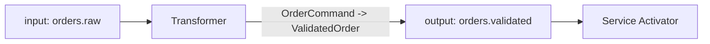
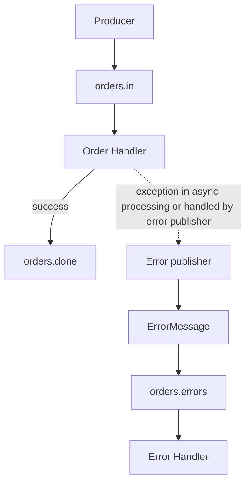
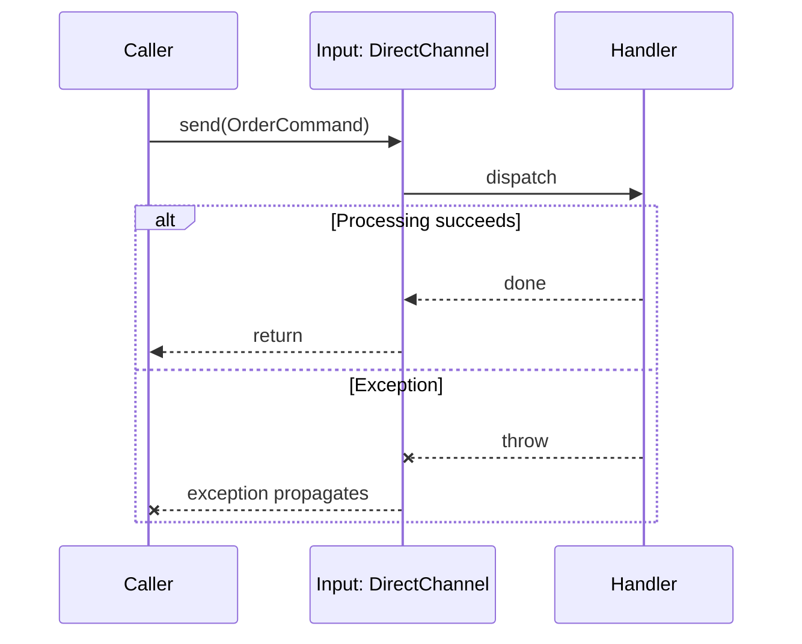
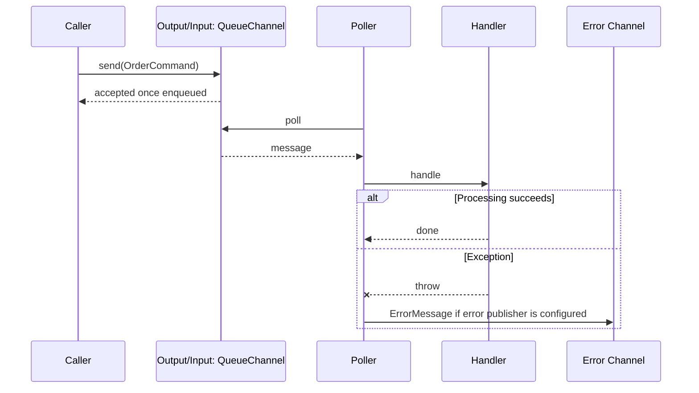
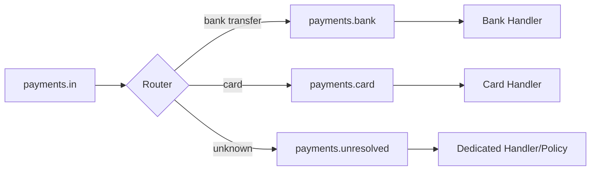
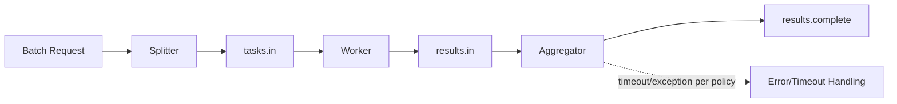

# Input Channel, Output Channel, and Error Channel

In Enterprise Integration Patterns (EIP), an **endpoint** is the connection point between a processing function and the messaging system. An endpoint can receive a message to validate, transform, route, or invoke business logic; some endpoints also produce subsequent messages. To trace where a flow travels, we need to understand three connection roles commonly appearing around an endpoint:

- **Input channel:** where the endpoint receives messages to process.
- **Output channel:** where the endpoint sends resulting or forwarded messages.
- **Error channel:** a dedicated path receiving **information about processing errors** when error-capture and error-publishing mechanisms are configured to use that channel.

These three roles help read, design, and test **Spring Integration** flows in the **SPRING_INTEGRATION_PATTERN** module. They are especially important when combining **Gateway, Filter, Transformer, Router, Splitter, Aggregator** with retry, correlation, and error observability. Choosing or misunderstanding a channel's role can make a message vanish from the expected flow, keep errors from reaching monitoring, or report success while work was merely enqueued.

> **Core point:** input, output, and error are **roles around an endpoint/flow**, not three fixed `MessageChannel` implementations. The exact same channel bean can serve as the output of an upstream endpoint and the input of a downstream endpoint.

## 1. The Big Picture: Endpoints Sitting Between Channels

Suppose an application receives an inventory reservation request, validates data, converts the payload into a warehouse request, and executes business logic.

```mermaid
flowchart LR
    A[Order Gateway] -->|sends message| IN[orders.in]
    IN -->|input| F[Filter]
    F -->|output| VALID[orders.valid]
    VALID -->|input| T[Transformer]
    T -->|output| READY[orders.ready]
    READY -->|input| H[Inventory Handler]
    H -.->|error per configured error handling| ERR[orders.errors]
    ERR --> EH[Error Handler]
```



- From the **Filter**'s perspective, `orders.in` is the input channel and `orders.valid` is the output channel.
- From the **Transformer**'s perspective, `orders.valid` becomes the input channel, and `orders.ready` is the output channel.
- From the **Inventory Handler**'s perspective, `orders.ready` is the input channel. If the handler performs a one-way task with no return value, it may not need an output channel.
- `orders.errors` receives error notifications **only when an error-publishing path targets it**. An exception from a synchronous handler does not automatically turn into a message on this channel.

The graph shows **logical connections**. It does not yet specify whether messages run synchronously, are persisted durably, or are retried. Those traits depend on channel implementations, endpoints, and transport mechanisms.

### Distinguishing Channel Roles from Channel Types

| Concept | Question It Answers | Example |
| --- | --- | --- |
| Input channel | **Where** does the endpoint read messages from? | `orders.in` |
| Output channel | **Where** does the endpoint send resulting messages to? | `orders.valid` |
| Error channel | **Where** is error info sent if message-based error handling is used? | `orders.errors` |
| Channel type | **How** are messages dispatched? | `DirectChannel`, `QueueChannel`, `ExecutorChannel`, `PublishSubscribeChannel` |
| Endpoint | **Who processes** the message? | Filter, Router, Transformer, Service Activator |

A name like `orders.errors` does not make Spring Integration automatically treat it as an error channel. Role and usage emerge from the configuration of gateways, handlers, pollers, error publishers, or related headers.

## 2. Input Channel: Entry Door of a Consumer Endpoint

An **Input channel** is the message reception point for a consuming component (consumer endpoint). An endpoint reads messages from it and executes the corresponding action.

Example: a service activator receiving an order:

```java
import org.springframework.integration.annotation.ServiceActivator;

class InventoryEndpoint {
    private final InventoryService inventoryService;

    InventoryEndpoint(InventoryService inventoryService) {
        this.inventoryService = inventoryService;
    }

    @ServiceActivator(inputChannel = "orders.ready")
    public void reserve(ValidatedOrder command) {
        inventoryService.reserve(command);
    }
}
```

This example illustrates the annotation: to work, the class must be registered as a Spring bean and integration annotation processing must be enabled via Spring Integration configuration. `orders.ready` is the channel name the endpoint consumes from—not a Java method name.

### 2.1. Does Every Endpoint Have an Input Channel?

**No.** *Source endpoints* that produce messages from an external source or polling schedule can have an **output channel** without an input channel. Examples:

- An HTTP inbound gateway accepts HTTP requests and feeds messages into an integration flow.
- An inbound channel adapter reads files, queues, or event sources and emits messages.
- A message source runs on a poller to create messages from a data source.

Conversely, a service activator, filter, transformer, or router usually has an input channel because it processes messages emitted by another component.

### 2.2. Input Channels Do Not All Receive Messages the Same Way

- With `DirectChannel`, the endpoint is called synchronously when the producer sends a message.
- With `ExecutorChannel`, the message may be dispatched on an executor thread.
- With `QueueChannel`, the consumer typically needs a poller to pull messages from the queue.
- With `PublishSubscribeChannel`, messages can reach multiple subscribers per configuration, unlike a channel selecting a single consumer.

From the endpoint's viewpoint, all four can act as “input”; yet timing, concurrency, and error characteristics differ sharply.

## 3. Output Channel: Exit Path for Results or Forwarded Messages

An endpoint that produces a new message or continues a flow can send that message to an **output channel**. Forwarding happens only when the endpoint actually produces a message and knows where to send it.



A **Transformer** can convert an `OrderCommand` payload into `ValidatedOrder` and send it to `orders.validated`. A **Filter** normally forwards accepted messages; when conditions fail, the filter may drop or reject them depending on configuration. A **Router** can select one or more channels depending on router type; thus a router's output is not necessarily a single fixed path.

A **Splitter** emits multiple output messages from one input message. An **Aggregator** holds and combines related messages, emitting one result message when completion criteria are met; it requires correlation, release strategy, timeouts, and group state management. All of them can use output channels, differing in when and how many messages they emit.

### 3.1. An Endpoint May Have No Output Channel

A handler that only updates a database or sends a notification can be the **terminal point** of a one-way flow:

```java
@org.springframework.integration.annotation.ServiceActivator(
    inputChannel = "orders.ready")
public void reserve(ValidatedOrder command) {
    inventoryService.reserve(command);
}
```

The method returns `void`, so there is no result payload to forward. When using Java DSL with a request-reply-typed handler, returning `null` is a common way to end a reply path in one-way examples.

Do not add an output channel merely to “have all three channels.” If business logic needs a result, define an explicit **request-reply contract** rather than emitting meaningless messages.

### 3.2. Fixed Output Channel vs. Reply Channel

In a linear flow, we commonly configure a fixed output channel via `.channel("orders.validated")` or `outputChannel` on the endpoint.

For request-reply, Spring Integration also supports **reply channel** information in message headers (e.g., the `replyChannel` header), allowing a component to reply back to the destination specified by the requester. Gateways can manage reply channels for request-reply. When an endpoint specifies no fixed output, header-based reply routing can be used depending on the handler type.

Therefore, distinguish:

- **Output channel:** the next forwarding destination inside an integration flow.
- **Reply channel:** the destination for a request's response, typically supplied by the request-reply context.
- **Error channel:** the destination for error information; not a “normal data reply on failure.”

A returned message carrying a business status like `PaymentDeclined` can still be a **valid reply**. It does not necessarily have to be an `ErrorMessage`. Separating technical errors from business outcomes helps APIs respond accurately.

## 4. Error Channel: When Does an Error Become a Message?

An **Error channel** receives error messages, typically `org.springframework.messaging.support.ErrorMessage`. Inside an `ErrorMessage`, the payload is a `Throwable` (possibly a `MessagingException` holding details of the failed message). An error flow can log, update metrics, trigger alerts, route to replay, or enqueue errors appropriately if designed to do so.

Conceptual view:



The dashed line indicates potential error paths; it is **not a promise that every exception automatically routes into `orders.errors`**.

### 4.1. What Does an ErrorMessage Contain?

An error message may contain:

- **`Throwable` payload:** the root exception or a wrapper thrown while sending/receiving/processing a message.
- **Headers:** metadata used for routing and error handling.
- **Original/failed message:** when present, allows correlating which request failed, which payload was processed, and which correlation ID to record.

Not every failure includes complete original message info. For instance, an error occurring before successful deserialization may lack an application-contract payload. Error handlers must tolerate incomplete metadata and should not assume every throwable is a `MessagingException`.

### 4.2. Synchronous: Exceptions Usually Return to the Caller

With `DirectChannel`, the handler executes on the sender's thread. If the handler throws an exception, it **typically propagates up the call stack**. Without special handling, the error **does not necessarily** travel through an error channel.

```text
Caller thread
  -> orders.in (DirectChannel)
      -> Validator
          -> Inventory Handler
              -> throw IllegalStateException
      <- exception
  <- caller catches exception
```

For example: a controller calls a gateway synchronously and the inventory handler throws an exception. The controller can catch the error along the call chain and decide the appropriate response. Merely declaring an `orders.errors` bean does not alter this path by itself.

### 4.3. Asynchronous: Errors Must Be Published and Handled Elsewhere

With `ExecutorChannel`, a task may execute after the sender has moved on. With a polled `QueueChannel`, the consumer runs on a polling thread. When an exception happens, the original calling thread may no longer be waiting to catch it.

Components such as pollers, executor-backed endpoints, or message-driven adapters can use an **error handler/error publisher** and emit an `ErrorMessage`. The target may come from endpoint configuration, the message's `errorChannel` header, or the default `errorChannel` bean depending on context and component rules.

**Design point:** know *which component catches the exception*, *which component constructs the ErrorMessage*, *which error channel is actually used*, and *whether post-error handling triggers retry, dead-lettering, or data loss*.

### 4.4. Error Channel Does Not Equal Retry or Dead-Letter Queue

| Mechanism | Primary Responsibility | Does Not Automatically Guarantee |
| --- | --- | --- |
| Error channel | Delivers error info to an error handler | Retries, durable storage, successful reprocessing |
| Retry advice/handler | Retries an operation per policy | Idempotency, zero duplicate submissions |
| Dead-letter flow/queue | Holds failed messages for investigation/replay | Self-healing business errors |
| Idempotency | Prevents duplicate effects from the same event/command | All errors were handled or reported |
| Correlation ID | Links steps belonging to the same request | Message ordering or storage durability |

A production system typically combines multiple mechanisms rather than merely declaring a nicely named error channel.

## 5. Java DSL Example: Input and Output Across Two Endpoints

The following example implements a **synchronous** flow: a gateway receives an order request; a Filter validates data; a Transformer produces the output contract; a service activator executes business logic. Channels use `DirectChannel` so input/output roles remain clear.

### 5.1. Defining Payloads and Call Contract

```java
import java.math.BigDecimal;

record OrderCommand(String orderId, BigDecimal amount) {}
record ValidatedOrder(String orderId, BigDecimal amount) {}

interface InventoryService {
    void reserve(ValidatedOrder order);
}
```

```java
import org.springframework.integration.annotation.Gateway;
import org.springframework.integration.annotation.MessagingGateway;

@MessagingGateway
interface OrderGateway {
    @Gateway(requestChannel = "orders.in")
    void submit(OrderCommand order);
}
```

Here the gateway is the entry point to the integration flow. The `submit` method returns `void`, expressing a one-way call regarding return data. Because the channel is synchronous, `void` does **not** mean asynchronous or returning before the handler finishes.

### 5.2. Defining Channels and Integration Flows

```java
import org.springframework.context.annotation.Bean;
import org.springframework.context.annotation.Configuration;
import org.springframework.integration.annotation.IntegrationComponentScan;
import org.springframework.integration.channel.DirectChannel;
import org.springframework.integration.config.EnableIntegration;
import org.springframework.integration.dsl.IntegrationFlow;
import org.springframework.messaging.MessageChannel;

@Configuration
@EnableIntegration
@IntegrationComponentScan
class OrderEndpointConfig {

    @Bean("orders.in")
    MessageChannel incomingOrders() {
        return new DirectChannel();
    }

    @Bean("orders.ready")
    MessageChannel readyOrders() {
        return new DirectChannel();
    }

    @Bean
    IntegrationFlow validateAndTransformOrders() {
        return IntegrationFlow.from("orders.in")
            .filter(OrderCommand.class,
                order -> order.orderId() != null
                    && !order.orderId().isBlank()
                    && order.amount() != null
                    && order.amount().signum() > 0,
                spec -> spec.throwExceptionOnRejection(true))
            .transform(OrderCommand.class,
                order -> new ValidatedOrder(
                    order.orderId(), order.amount()))
            .channel("orders.ready")
            .get();
    }

    @Bean
    IntegrationFlow reserveInventory(InventoryService inventory) {
        return IntegrationFlow.from("orders.ready")
            .handle(ValidatedOrder.class, (order, headers) -> {
                inventory.reserve(order);
                return null; // end one-way flow
            })
            .get();
    }
}
```

This example focuses on messaging wiring; a real app needs Spring Integration dependencies and a bean implementing `InventoryService`. The `OrderGateway` interface must lie within `@IntegrationComponentScan` scope or be registered equivalently.

Diagram mapping directly to the code:

```text
OrderGateway.submit()
    |
    v
"orders.in"        [Filter's input]
    |
    v
Filter(OrderCommand)
    |
    v
Transformer(OrderCommand -> ValidatedOrder)
    |
    v
"orders.ready"     [Transformer's output]
    |
    v
Inventory handler  [Service Activator's input]
    |
    v
Completion or exception
```

Filter and Transformer inside one `IntegrationFlow` can be wired with framework-configured internal channels; there is no need to declare a separate channel bean just to name every intermediate step.

### 5.3. Runtime Results

| Input | What Happens in This Configuration? |
| --- | --- |
| `OrderCommand("O-1", 200000)` | Filter accepts; Transformer creates `ValidatedOrder`; handler invokes `inventory.reserve` |
| `OrderCommand("", 200000)` | Filter rejects; because `throwExceptionOnRejection(true)` is enabled, exception propagates synchronously to caller |
| `OrderCommand("O-2", -100)` | Filter rejects due to invalid amount |
| `inventory.reserve` throws exception | Exception can propagate back to `gateway.submit` because channels are `DirectChannel` |
| Handler succeeds and returns `null` | One-way flow terminates, emitting no result message |

There is no retry, durable queue, or error flow in this configuration yet. Naming channels makes routing clear, but does not install an error-handling policy automatically.

## 6. Adding a Proper Error Flow

Suppose components **are configured to publish `ErrorMessage` into `orders.errors`**. We can implement an endpoint consuming those errors:

```java
import org.springframework.context.annotation.Bean;
import org.springframework.context.annotation.Configuration;
import org.springframework.integration.channel.DirectChannel;
import org.springframework.integration.dsl.IntegrationFlow;
import org.springframework.messaging.MessageChannel;

@Configuration
class OrderErrorFlowConfig {

    @Bean("orders.errors")
    MessageChannel ordersErrors() {
        return new DirectChannel();
    }

    @Bean
    IntegrationFlow logOrderErrors() {
        return IntegrationFlow.from("orders.errors")
            .handle(Throwable.class, (failure, headers) -> {
                System.err.println(
                    "Order processing failed: " + failure.getMessage());
                // In production: use logger and metrics; avoid logging sensitive payloads.
                return null;
            })
            .get();
    }
}
```

Why the handler uses `Throwable.class`: an `ErrorMessage` is a Spring message whose **payload** is a `Throwable`. In Java DSL, the handler above handles the error payload rather than assuming `ErrorMessage` sits inside the payload.

**Mandatory condition:** some component must actually send error messages to `orders.errors`. Merely creating the `orders.errors` bean and declaring an error-consuming flow will not automatically route exceptions from `OrderEndpointConfig` into it.

When extracting the original message, check whether the `Throwable` is a `MessagingException`, then inspect the available failed message. When raising alerts, include business key/correlation ID if present, along with endpoint name and exception type.

### Configuring ErrorMessage Publishers

There are typically three approaches:

1. **Asynchronous endpoint/poller:** configure an error handler or error channel on the consuming component; when a poller catches an error, it can emit an `ErrorMessage` instead of throwing back to the original sender.
2. **Message carrying an `errorChannel` header:** some error-handling mechanisms read this header to decide where to send `ErrorMessage`. Verify the header survives Transforms/Routers or network adapters.
3. **Application context's default error channel:** integration infrastructure may fall back to the `errorChannel` bean when no specific error destination is given. `orders.errors` in the example is a custom destination; it does not automatically replace the default bean.

Selection and precedence among error targets **depend on the endpoint/transport and configuration**. Verify the actual path with an intentional exception in an integration test.

## 7. When Moving to Asynchronous Execution, How Does the Three-Channel Relationship Change?

To clarify, compare two versions of the same business operation.

### 7.1. Synchronous Version



When callers need immediate results, synchronous paths have the advantage that the caller knows whether the handler finished or threw before returning. However, caller latency is tied directly to downstream processing time.

### 7.2. Queue and Poller Version



In this version:

- The polled endpoint's **input channel** can be a `QueueChannel`.
- The upstream endpoint's **output channel** is that same queue; producers enqueue and continue working.
- The **error channel** is used by error handling on the poller thread when configured accordingly.
- A successful send **does not mean** the handler finished processing.
- `QueueChannel` uses memory by default, offering no durability across restarts. For durability, select a message store or broker with appropriate ack/retry strategies.

Naming a channel `orders.async` does not make it asynchronous automatically. Choose the right channel type, executor, or poller, while defining when the API may return and who monitors pending work.

### 7.3. Error Flows Do Not Replace Business Reply Paths

Suppose an order-creation API enqueues a message and returns “accepted.” If processing fails later, the user is no longer waiting on the original HTTP response. Sending errors to `orders.errors` alerts operations, yet the product still needs a way to update **order status**, notify outcomes, or support status queries later.

`ErrorMessage` serves technical error workflows. It does not replace business state models such as `PENDING`, `COMPLETED`, `FAILED`. To inform clients, define a result channel or status-query API.

## 8. How the Three Channels Interact with Other EIPs

### 8.1. Filter

Filter has an input and typically an output for accepted messages. Rejected messages may be dropped, throw an exception, or go to a discard channel depending on configuration. **Discard channel differs from error channel:** a message failing a filter rule is not necessarily a technical error.

For instance, skipping promotional emails for opted-out users is a valid business decision. Here, discard/logging fits better than an exception.

### 8.2. Router

Router reads messages from an input channel and selects one or more output channels per rule. Branches can use `DirectChannel` or other channel types, each with its own error behavior.



The `payments.unresolved` branch can handle unsupported payment types cleanly at the business level. If the router is configured to throw an exception instead of picking a branch, error behavior depends on sync vs. async flow semantics.

### 8.3. Transformer

Transformer receives a message, creates a new payload or message, and emits it via its output channel. When transformation fails on invalid schema, exceptions can follow the endpoint's error path; when transformation succeeds, required metadata like correlation IDs must be preserved or mapped per design rules.

Do not hide silent error-swallowing inside a transformer so callers falsely assume every message is valid. State clearly which data is normalized, which is rejected, and which routes to an error flow.

### 8.4. Splitter and Aggregator

Splitter emits multiple related messages; Aggregator receives them via its input channel, maintains group state, and emits one result message when ready.



Correlation ID, sequence number, release strategy, and timeouts determine whether the Aggregator completes a group. Input/output channels transport messages; they do not correlate groups or enforce timeout policies themselves.

### 8.5. Gateway

Gateway hides message send/receive mechanics from business code. For one-way commands, a gateway may only use a request channel. For request-reply, the gateway manages reply paths and timeouts. When error handling is configured on a gateway, certain errors can be routed or handled under the gateway's contract. Clearly inspect return types, completion timing, reply timeouts, and exceptions visible to callers.

## 9. Observing Messages and Errors Stage by Stage

When a production incident occurs, knowing only “a message failed” is not enough. You need to know which endpoint's **input** the message reached, whether it emitted to the matching **output**, and whether errors reached the expected **error channel**.

| Observation Point | Data to Capture | Question Answered |
| --- | --- | --- |
| Before input channel | Message/business ID, timestamp, source | Did the producer send it? |
| When endpoint starts | Endpoint name, correlation ID, payload type | Was the message dispatched to the right handler? |
| After output channel | Channel name, emitted count, latency | Did the endpoint forward the next message? |
| At error publisher | Exception type, failed message if any, retry count | Where was the error caught? |
| When error handler runs | Correlation ID, action taken, outcome | Was the error logged, retried, or escalated? |
| Inside queue/poller | Queue depth, lag, throughput, timeouts | Is the bottleneck in the queue or handler? |

Use Spring Integration channel interceptors, metrics, logs, or observation/tracing per application setup. Before claiming “tracing works,” verify trace context propagates across thread hops, adapters, and external systems.

**Never log full sensitive payloads** just for debugging. Logging IDs, business types, channel names, timestamps, and concise error info is usually both more effective and safer.

## 10. Testing the Exact Semantics of Each Channel

### 10.1. Testing Input → Output

For the synchronous flow in section 5:

1. Send a valid `OrderCommand` via `OrderGateway`.
2. Using a mock/spy for `InventoryService`, verify `reserve` receives the exact `ValidatedOrder`.
3. Send an `OrderCommand` with `amount <= 0`, verify the filter rejects it and the service is never called.
4. Have the service throw an exception; verify the caller receives the error synchronously.

This test verifies input/output responsibilities and processing contracts without needing a queue or broker.

### 10.2. Testing the Error Flow Separately

To verify the error handler itself, construct an `ErrorMessage` and send it straight to `orders.errors`:

```java
import org.springframework.messaging.MessageChannel;
import org.springframework.messaging.support.ErrorMessage;

void publishSyntheticError(MessageChannel errors) {
    errors.send(
        new ErrorMessage(
            new IllegalStateException("Synthetic failure")));
}
```

**Test limitation:** this only proves the error channel and handler accept an `ErrorMessage`. It does **not** prove a real exception from a handler, poller, or gateway is actually caught and routed to that error channel properly. To test the full chain, write an integration test where a real handler throws and observe the message arriving at the error handler under your real configuration.

### 10.3. Timeout-Bounded Asynchronous Testing

If a handler's input uses `QueueChannel` or `ExecutorChannel`, never assert side effects completed right after `send` returns. Wait on a timeout-bounded condition and distinguish:

- Producer enqueued successfully.
- Consumer pulled the message.
- Handler performed the side effect.
- Error handler received `ErrorMessage` on failure.
- Retry/ack mechanisms behaved properly on transient errors.

When using an external broker, also verify serialization, header mapping, redelivery, offset/ack, and idempotency.

## 11. Common Mistakes and How to Avoid Them

**Mistaking input/output for two separate Java classes.** They are connection roles around endpoints; one channel can be the Transformer's output and the Service Activator's input.

**Assuming every endpoint has all three channels.** Source endpoints may only have output; terminal handlers may only have input; error flows appear only when explicitly configured.

**Defining `orders.errors` and assuming every exception lands there.** With `DirectChannel`, exceptions usually return to the caller. Know which component catches and publishes `ErrorMessage`.

**Confusing Filter-dropped messages with system errors.** Filters can use a discard channel for unmet conditions; error channels handle exceptions published per error policy.

**Assuming replies always use a fixed output channel.** Request-reply can route responses using a gateway-managed reply-channel header. Check the endpoint's contract instead of guessing from channel names.

**Confusing successful enqueue with handler completion.** This is a major risk when switching from `DirectChannel` to `QueueChannel` or `ExecutorChannel`; define explicit asynchronous business states.

**Retrying infinitely via error handlers without idempotency.** Messages can double-book orders, double-deduct inventory, or send duplicate notifications. Use bounded retries, error classification, and deduplication keys.

**Dropping correlation IDs across Transformers or adapters.** When tracing across branches is required, explicitly define which headers are forwarded, mapped, and persisted.

**Forgetting subscribers or pollers.** A channel holding messages without an active consumer will not produce outcomes; queues can pile up, while subscriberless `DirectChannel`s fail to dispatch as intended.

## 12. Design Exercise: Order Through Three Channels

An ordering application has these requirements:

- Customers submit `PlaceOrder`; requests must be validated immediately.
- Once valid, inventory deduction can run asynchronously via a queue; the application must tell the customer “processing.”
- When inventory rejects or a handler hits a technical error, the system must record clear status and send an alert.
- If inventory receives the same request twice due to retries, stock must not be deducted twice.

Design the corresponding components.

**One approach:**

1. `PlaceOrderGateway` emits messages to `orders.in`; Filter reads from this input. Filter rejects invalid requests with a business result or exception per API contract.
2. Valid messages go to `orders.work`, a queue with a consumer/poller. `orders.work` is the output of validation and the input to the inventory endpoint.
3. The poller/consumer is configured to send `ErrorMessage` to `orders.errors` on technical failures; the error handler records error type, correlation ID, retry count, and next action.
4. The handler processes by business key `orderId` with idempotency safeguards; order status transitions `PENDING → COMPLETED` or `FAILED` based on real outcomes.
5. Integration tests verify valid data flows to output, invalid data never reaches the handler, async errors reach the error handler, and retries never double-deduct inventory.

Explain to yourself: if the gateway returns before the poller pulls the message, what has actually succeeded? If error logs exist yet customers see “processing” forever, which piece of the design is missing? These two questions separate *technical error paths* from *business outcome contracts*.

## Key Takeaways

**Input channel** is where an endpoint receives messages; **output channel** is where an endpoint emits subsequent or result messages; **error channel** is where `ErrorMessage` lands when an error-publishing mechanism targets it. All three roles coexist in an EIP architecture, though not every endpoint needs all three.

To apply Spring Integration effectively, read every endpoint in sequence: **receives from where → processes what → sends where → where errors are caught and published**. Then verify channel types, sync/async semantics, request-reply contracts, retries, idempotency, and correlation. That keeps flows using Gateway, Filter, Transformer, Router, Splitter, and Aggregator easy to trace, easy to test, and predictable on failure.
