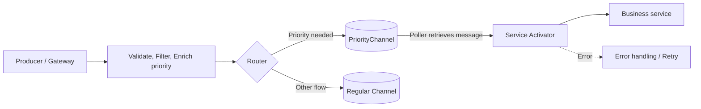
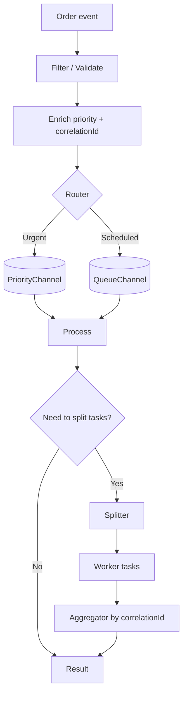

# Priority Channel: Ordering Messages by Priority

## 1. Problem to Solve

In an integration system, many types of requests often pass through the same processing flow: orders that need immediate delivery, regular transactions, end-of-day reconciliation jobs, and background notifications. If all messages are retrieved in arrival order, a large volume of background work can cause urgent requests to wait too long.

**Priority Channel** is a way to organize a message channel capable of **prioritizing waiting messages based on their importance**. In Spring Integration, `PriorityChannel` implements this concept as a pollable channel. Messages are sent into the channel, wait in a queue, and are retrieved according to the priority determined by a comparator.

This lesson belongs to the **Priority** group in **SPRING_INTEGRATION_PATTERN**. The goal is to implement Enterprise Integration Patterns using Spring Integration so that message flows are loosely coupled and easily extensible, while working together with Router, Filter, Transformer, Splitter, Aggregator, Gateway, retry, error channel, and correlation.

After this lesson, you will be able to:

- Explain the difference between **message reception order** and **message processing order**.
- Attach priority metadata, configure `PriorityChannel`, and consume messages using a poller.
- Test dequeue ordering deterministically without depending on thread speed.
- Recognize limitations around concurrency, starvation, memory, retry, and flow consistency.
- Know when to use a single priority channel and when to split into separate processing flows.

## 2. Where Does Priority Channel Fit in Enterprise Integration Patterns?

A message may pass through multiple components before reaching business processing. **Router** decides which branch a message enters; **Filter** discards invalid messages; **Transformer** converts structures or enriches data; **Priority Channel** decides the order in which messages **waiting in that specific channel** are retrieved. It does not replace the other patterns.



In the priority branch, the components have clear responsibilities:

| Component | Responsibility | What to keep in mind |
| --- | --- | --- |
| Producer / Gateway | Sends requests and metadata | Does not decide which message is processed immediately |
| Header Enricher / Transformer | Normalizes `priority` | One data type, one priority policy |
| `PriorityChannel` | Holds waiting messages and selects the next message to retrieve | Only orders messages **still remaining in the queue** |
| Poller | Actively invokes `receive()` on a schedule | Frequency, messages per poll, and consumer count affect throughput |
| Service Activator | Executes business logic | Must manage errors, idempotency, and latency |

Unlike `DirectChannel`, where a `send()` call can trigger processing directly on the calling thread, `PriorityChannel` is a `PollableChannel`: sending and receiving are decoupled, so the consumer needs a poller or must explicitly call `receive()`.

## 3. Priority Rules and Practical Limitations

In Spring Integration's default configuration, messages with an integer **`priority`** header are ordered so that **a higher value has higher priority**. To avoid ambiguity, the flow should explicitly set this header for every message and constrain it to an agreed scale.

Example policy for an order system:

| Work group | `priority` | Meaning |
| --- | ---: | --- |
| Fraud handling or orders needing urgent intervention | 90 | Urgent |
| Express delivery orders | 60 | High priority |
| Regular orders | 30 | Normal |
| Report synchronization / background tasks | 10 | Low |

Suppose the poller has not started receiving messages yet and the system sends in sequence:

```text
Send order:       report(10) -> regular(30) -> urgent(90) -> express(60)
Dequeue order:    urgent(90) -> express(60) -> regular(30) -> report(10)
```

This holds because **all four messages are already waiting in the queue before receiving begins**. If a consumer has already picked up `report(10)` for processing, an `urgent(90)` message arriving later cannot preempt the work in progress. Priority Channel **has no preemption mechanism**.

Several important principles:

1. **Do not equate priority with an absolute SLA.** High-priority messages still depend on the number of consumers, work currently in progress, downstream systems, and system resources.
2. **Do not assume FIFO for messages with equal priority.** If the business requires stable ordering on ties, you must define a secondary rule (such as sequence/time plus an appropriate comparator) and test it.
3. **Do not treat priority as processing completion order.** Multiple consumers may receive messages in priority order yet finish them in a different order.
4. **Do not confuse priority with message ordering for an aggregate.** If all events with the same `orderId` must be processed sequentially, you must design additional ordering/correlation constraints.
5. **Do not let untrusted sources choose their own priority.** Normalize or bound values before messages enter the queue; incoming data may have missing, wrongly typed, or out-of-range priority values.

## 4. Creating and Consuming `PriorityChannel` in Spring Integration

The example below uses Java configuration. It is a minimal order-processing flow with a priority channel and a `Service Activator` receiving messages through a poller.

```java
import org.springframework.context.annotation.Bean;
import org.springframework.context.annotation.Configuration;
import org.springframework.integration.annotation.Poller;
import org.springframework.integration.annotation.ServiceActivator;
import org.springframework.integration.channel.PriorityChannel;
import org.springframework.integration.config.EnableIntegration;
import org.springframework.messaging.MessageHandler;

@Configuration
@EnableIntegration
public class PriorityOrderConfiguration {

    @Bean("priorityOrders")
    public PriorityChannel priorityOrders() {
        return new PriorityChannel();
    }

    @Bean
    @ServiceActivator(
        inputChannel = "priorityOrders",
        poller = @Poller(fixedDelay = "200", maxMessagesPerPoll = "1")
    )
    public MessageHandler priorityOrderHandler() {
        return message -> {
            OrderRequest order = (OrderRequest) message.getPayload();
            Integer priority = (Integer) message.getHeaders().get("priority");
            System.out.printf("Handle order=%s, priority=%s%n", order.id(), priority);
            // Call application service; manage transaction/idempotency here.
        };
    }

    public record OrderRequest(String id, String category) {}
}
```

To send messages, the application can inject the `priorityOrders` bean as a `MessageChannel` and build messages with consistent headers:

```java
import org.springframework.beans.factory.annotation.Qualifier;
import org.springframework.messaging.MessageChannel;
import org.springframework.messaging.support.MessageBuilder;
import org.springframework.stereotype.Service;

@Service
public class OrderIngress {
    private final MessageChannel priorityOrders;

    public OrderIngress(@Qualifier("priorityOrders") MessageChannel priorityOrders) {
        this.priorityOrders = priorityOrders;
    }

    public boolean submit(PriorityOrderConfiguration.OrderRequest order, int priority) {
        int normalizedPriority = Math.max(0, Math.min(priority, 100));

        return priorityOrders.send(
            MessageBuilder.withPayload(order)
                .setHeader("priority", normalizedPriority)
                .setHeader("correlationId", order.id())
                .build()
        );
    }
}
```

In the example above:

- `PriorityChannel` accepts messages and holds them in a queue until they are retrieved.
- The `priority` header is set **before** sending; `normalizedPriority` clamps the value to the `0..100` range.
- `@Poller(fixedDelay = "200", maxMessagesPerPoll = "1")` instructs the poller to check periodically, at most one message per poll; actual values should be tuned based on load.
- `@ServiceActivator` acts as the consumer, without requiring the producer to know downstream processing details.
- The `correlationId` header helps trace messages belonging to the same order, though it **does not automatically guarantee ordering** or automatically aggregate messages.

Using `System.out` in the example is for illustration only. Production applications should use a structured logger, measure wait times, and place business services in dedicated components.

### 4.1. Why Must You Configure a Poller?

`PriorityChannel` does not invoke the handler immediately when a producer sends a message. The consumer must actively retrieve messages, so an endpoint reading from a pollable channel must have a poller. You can use annotations as above or Java DSL with a poller endpoint. Without a receiving mechanism, messages remain waiting and business logic is never triggered.

`fixedDelay` is the interval between scheduled polls of the endpoint, **not a guarantee that a message will be processed within exactly 200 ms**. Actual latency includes poll wait time, backlog, processing duration, and resource limits. When increasing consumer concurrency to raise throughput, you must revisit ordering requirements and parallel-processing safety.

### 4.2. Where Should Priority Be Assigned?

You should not let every producer define the meaning of priority numbers in its own way. A more maintainable approach is to have a **Transformer/Header Enricher** map `type`, `customerTier`, `deadline`, or internal policy to `priority`, after a **Filter** has validated the input. When multiple sources feed the same channel, the normalization step must share a single rule set, for example:

```text
priority = 90  if the event requires an urgent response
priority = 60  if the order belongs to the express group
priority = 30  if the order is a regular order
priority = 10  if it is a background task
```

Rules can evolve alongside business requirements, but they should be versioned and tested. Never attach uncontrolled values directly from HTTP requests or external partners onto the priority queue.

## 5. Deterministic Order Testing

Order tests are best designed by separating queue sorting behavior from poller scheduling. In tests, **send all messages first before calling `receive()`**; this avoids dependence on thread scheduling and verifies the exact behavior under test.

```java
import static org.junit.jupiter.api.Assertions.assertEquals;

import org.junit.jupiter.api.Test;
import org.springframework.integration.channel.PriorityChannel;
import org.springframework.messaging.Message;
import org.springframework.messaging.support.MessageBuilder;

class PriorityChannelTest {
    @Test
    void receivesHigherPriorityFirstWhenAllMessagesAreQueued() {
        PriorityChannel channel = new PriorityChannel();

        channel.send(message("batch-report", 10));
        channel.send(message("regular-order", 30));
        channel.send(message("fraud-alert", 90));
        channel.send(message("express-order", 60));

        assertEquals("fraud-alert", channel.receive(0).getPayload());
        assertEquals("express-order", channel.receive(0).getPayload());
        assertEquals("regular-order", channel.receive(0).getPayload());
        assertEquals("batch-report", channel.receive(0).getPayload());
    }

    private static Message<String> message(String payload, int priority) {
        return MessageBuilder.withPayload(payload)
            .setHeader("priority", priority)
            .build();
    }
}
```

`receive(0)` retrieves a message immediately without waiting long. This test only verifies **dequeue order when all messages are already in the queue**. It does not prove that the queue guarantees completion times, fairness across threads, or order stability when priorities are equal.

For integration testing, you should add the following scenarios:

| Scenario | Expected result / invariant to verify |
| --- | --- |
| Low-priority messages exist while consumer is busy; then a high-priority message is sent | The high-priority message is selected ahead of low-priority messages **still waiting** once the consumer becomes free |
| Priority is missing, wrong type, or out of range | Normalization/input validation handles it according to defined policy |
| Same `priority` but different `correlationId` | Do not assume FIFO unless a secondary rule is implemented |
| Handler throws an exception | Message enters the intended error/retry flow, with logging and safeguards against unintended duplicate processing |
| Multiple producers and consumers | Do not equate dequeue order with completion order |
| Incoming load exceeds processing capacity | Monitor backlog, wait time, memory, and alert thresholds |

## 6. Combining with Router, Splitter, Aggregator, and Correlation

Priority is a **local property of a single queue**, whereas correlation is how messages belonging to the same business process are identified. These two concepts solve different problems.

Example order-processing flow containing fraud checking and reconciliation steps:



- **Router:** Chooses the appropriate processing branch. When load levels and SLAs differ significantly, you can separate urgent and regular queues entirely instead of using a single priority queue.
- **Splitter:** Splits a message into multiple subtasks. Decide whether to copy priority to child messages or recalculate it based on each task's purpose.
- **Aggregator:** Combines results by correlation key and completion condition. Priority does not replace `correlationId`, `sequenceNumber`, `sequenceSize`, or the aggregator's release strategy.
- **Gateway:** Provides a message-sending interface for the application. Synchronous gateways may have to wait for a response, so configure appropriate timeouts when requests sit behind a backlogged queue.

**Scenario to avoid:** a single order emits `CREATED`, `PAID`, and `CANCELLED` events with different priorities, and all events enter the same queue. If the business requires receiving them in strict causal order, a single `PriorityChannel` does not satisfy that requirement: a later event with a higher priority can be dequeued first. Partition by order key, serialize per key, or redesign priority bounds at the right unit of work.

## 7. Retry, Errors, and Production Risks

### 7.1. Starvation: Low-Priority Messages Can Wait Indefinitely

If `priority=90` messages continuously arrive faster than they can be processed, `priority=10` messages can repeatedly be bypassed. This is **starvation**. Using a priority queue does not guarantee fairness by itself.

Measures you can apply depending on the criticality of the problem:

- Separate queues and worker pools by SLA tier (e.g., urgent, normal, background), applying processing quotas to each class.
- Reserve minimum capacity for normal/background work so it is not starved.
- Design an aging policy that raises priority over wait time if the comparator and queue update mechanism can uphold that policy.
- Track wait time per priority level; do not look only at total queue depth.

Note: increasing a message's priority **after it is already in the queue** does not automatically mean the queue will re-sort according to an aging policy. You must redesign the selection step or dequeue and re-enqueue under a controlled mechanism.

### 7.2. Retries Should Not Obscure Priority Rules

When a handler fails, clearly define whether the system retries immediately in place, retries after a delay, or routes to an error/recovery flow. Retrying immediately inside the same consumer can force other priority messages to wait. Retrying by re-sending into the `PriorityChannel` can alter relative positions, create loops, or duplicate work if retry attempts are unbounded.

A practical design should include:

1. A retry policy based on error type (transient errors vs. business errors).
2. A maximum retry count, backoff, and a terminal route to an error channel or dead-letter flow.
3. An idempotency key on the business operation so messages can be handled safely on redelivery/reprocessing.
4. Logs containing `messageId`, `correlationId`, `priority`, attempt number, and failure reason.

Spring Integration supports advice mechanisms, error channels, and recovery flows, though exact configuration depends on the endpoint type and transaction setup. **PriorityChannel does not add retries automatically, does not guarantee exactly-once delivery, and does not replace error handling.**

### 7.3. Backpressure, Storage, and Durability

A default `PriorityChannel` is an in-process queue. Therefore, you must account for memory growth when producers outpace consumers and message loss if the process stops abruptly. Prioritizing message ordering does not imply persistent storage or message acknowledgment mechanics like those of a message broker.

If you need zero message loss or load sharing across multiple instances, you may need a persistent broker/queue, broker-level priority tiering, or SLA-separated flows. Never assume that `PriorityChannel` ordering in one JVM will be preserved across multiple instances or across restarts.

## 8. Observing and Operating a Priority Flow

A priority flow is truly useful when you can measure **how long each message waited**, rather than merely checking that messages carry a `priority` header.

| Metric / signal | Meaning | Sign requiring investigation |
| --- | --- | --- |
| Number of waiting messages, by priority level | Backlog of each work class | Low tier grows indefinitely or high tier does not drain |
| Age of the oldest message | Starvation / SLA risk | Messages waiting beyond acceptable threshold |
| Enqueue-to-dequeue latency | Actual wait time | High latency even when the handler is fast |
| Handler processing duration | Downstream capacity | Long-running tasks keep consumers busy |
| Exception and retry rate | Stability | Retries consume capacity needed by other classes |
| Inbound/outbound message rate by priority | Load vs. throughput correlation | Inbound load exceeds processing capacity |

You can attach a timestamp at ingress to compute wait time while including `correlationId` in logging and tracing. Distinguish **enqueue time**, **dequeue time**, and **completion time** to interpret metrics accurately.

For flows with multiple Router/Filter branches, trace both the selected branch and the reason for the chosen priority. This helps detect cases where a Transformer assigns the wrong header or one source submits too many tasks as urgent.

## 9. When Should You Use or Avoid Priority Channel?

| Situation | Appropriate choice |
| --- | --- |
| One consumer or consumer group needs to prioritize waiting work within one application | `PriorityChannel` combined with a poller and header policy |
| Workloads have vastly different SLAs and starvation must be prevented | Tiered routing via Router, multiple queues, and dedicated processing capacity |
| Messages with the same key must be processed in exact creation order | Per-key serialization / ordering mechanism; use priority only if it preserves the invariant |
| Durable queuing across restarts and multi-instance consumption are required | Design with an appropriate broker or persistent storage, verifying actual priority behavior |
| You only need to route to different business handlers | `Router` is usually the more direct choice |
| Messages must be handled immediately in a synchronous call without queuing | Consider synchronous channels and endpoints instead of a pollable queue |

## 10. Suggested Practice Exercise

Extend the order example in Section 4 into a flow handling three groups: `URGENT`, `NORMAL`, and `BATCH`.

1. Create a normalization step that maps `category` to `priority` values `90`, `30`, and `10` respectively; reject invalid categories.
2. Send at least 20 messages in random order into `PriorityChannel` before receiving begins; verify dequeue order from highest to lowest.
3. Add `correlationId` equal to the order ID and measure wait time from send to handler receipt.
4. Simulate a slow consumer and then send an urgent message; observe that an in-flight message is not interrupted, while the urgent message overtakes waiting messages.
5. Simulate transient handler failures; configure a retry limit and route failed messages to an error branch. Verify that business logic produces no duplicate side effects on retry.
6. Continuously push urgent messages and observe `BATCH` latency; from the results, propose a policy to prevent starvation.

**Completion criteria:** be able to explain why `PriorityChannel` changes dequeue order without guaranteeing completion order; test at least one high-priority case, one error/retry case, and one sustained-load case; have logs or metrics tracking backlog and wait time by priority level.

## 11. Self-Check Questions

1. Why does `PriorityChannel` require a poller while a flow using `DirectChannel` can process immediately upon calling `send()`?
2. If a low-priority message has already been picked up by a consumer, can a newly arrived high-priority message replace the running work? Why or why not?
3. Why must you not assume FIFO for two messages with the same priority?
4. Does a Splitter/Aggregator flow that already uses `correlationId` automatically guarantee ordering when adding a Priority Channel?
5. When a queue faces risks of starvation and data loss after a restart, which architectural aspects should you change?

**Key takeaway:** Priority Channel optimizes **which waiting message is picked next for processing**. For a safe enterprise flow, combine a priority classification policy, poller, ordering tests, correlation, retry/error handling, and practical observability.
