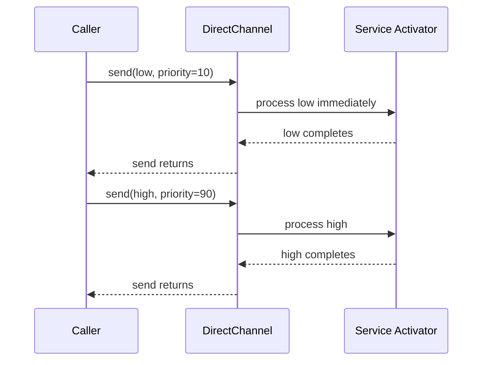
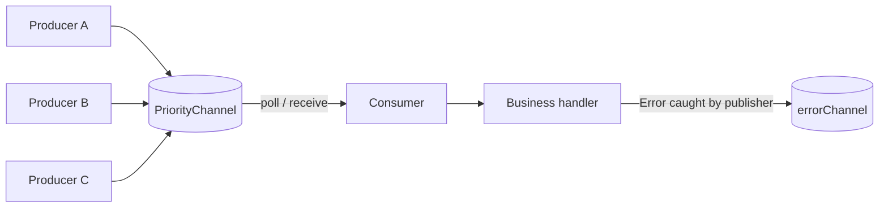

# Priority in Synchronous and Asynchronous Spring Integration Flows

## 1. Learning Objectives

In the `SPRING_INTEGRATION_PATTERN` module, we implement **Enterprise Integration Patterns** with Spring Integration to create message flows that are loosely coupled, extensible, testable, and observable. When combining Router, Filter, Transformer, Splitter, Aggregator, Gateway, retry, Error Channel, and correlation, a system often handles many messages concurrently. Some work, such as urgent alerts or orders nearing their processing deadline, carries higher priority than routine tasks.

**Priority** lets you express message importance and, when a priority-capable queue is present, decide which message is dequeued first. However, **attaching a priority header does not by itself guarantee a message runs first or completes first**. The outcome depends on the `MessageChannel` type, when the message enters the queue, consumer count, thread pools, and the state of work already running.

After this lesson, you will be able to:

- Distinguish **message priority level**, **queue dequeue order**, **execution start order**, and **completion order**.
- Explain why a synchronous `DirectChannel` does not reorder `send()` calls automatically.
- Configure `PriorityChannel` and understand the conditions required for high-priority messages to be received first.
- Contrast `PriorityChannel` with `ExecutorChannel`, `QueueChannel`, and asynchronous pollers.
- Write Java DSL/JUnit examples verifying queue dequeue order, thread boundaries, and priority limits.
- Design anti-starvation, backpressure, timeouts, retries, and correlation preservation across EIPs.

## 2. Priority Is a Work-Selection Policy, Not a Completion Promise

Suppose a system has three pending tasks:

| Message | Priority | Example business meaning |
| --- | ---: | --- |
| `order-standard` | 10 | Regular order. |
| `order-express` | 90 | Express delivery order. |
| `fraud-review` | 50 | Fraud check needing early handling. |

If all three **are sitting inside the same `PriorityChannel`** and no consumer has pulled them yet, the priority-90 message is normally dequeued first, followed by 50 and then 10.

However, if `order-standard` was already picked up by a worker at 10:00:00 and `order-express` does not arrive until 10:00:01, the queue **cannot recall or interrupt** work already in progress:

```text
10:00:00  Worker picks up standard (priority=10), starts processing
10:00:01  Express (priority=90) enters PriorityChannel
10:00:02  Worker is still processing standard
10:00:10  Worker finishes standard and only then picks up express
```

This is the difference between **priority scheduling at dequeue time** and **preemption** (interrupting running work). `PriorityChannel` supports selecting waiting messages by priority; it **does not provide preemption**.

### Four Concepts to Keep Separate

| Term | Question | Does priority decide this with certainty? |
| --- | --- | --- |
| Enqueue order | Which message enters the queue first? | No. Depends on sources and send timing. |
| Dequeue order | Which waiting message does a consumer pull first? | Yes, if the channel actually applies a priority policy. |
| Start order | Which message does the handler start first? | Not necessarily; depends on poller, executor, and consumer count. |
| Completion order | Which message finishes first? | Not necessarily; depends on runtime, I/O, retries, locks, and transactions. |

**High priority does not guarantee low absolute latency.** If workers are busy or the queue is overloaded, even a very important message can still be delayed.

## 3. Channel Types and Priority Semantics

| Channel | Processing model | Effect of the priority header |
| --- | --- | --- |
| `DirectChannel` | Dispatcher invokes handler on sender's thread; typically synchronous. | Does not reorder send calls automatically. |
| `QueueChannel` | Pollable channel with standard FIFO queue behavior. | Does not become a priority queue merely from the header. |
| `PriorityChannel` | Pollable channel selecting messages by queue priority order. | Can change dequeue order among waiting messages. |
| `ExecutorChannel` | Dispatcher hands work to an executor so handlers run on worker threads. | Priority header does not configure executor task priority. |
| `PublishSubscribeChannel` | Broadcasts messages to configured subscribers. | Not a priority queue; requires custom design if prioritization is needed. |

In Spring Integration, the conventional header for priority is `priority`, and its value should be an integer. With `PriorityChannel`, the channel's default comparator uses that priority information to choose waiting messages. If the business uses other criteria such as deadline or customer tier, you can provide a custom comparator, though you must test consistency and missing-data handling.

**Do not use a string like `"urgent"` and assume the default comparator will interpret it as highest priority.** Normalize data types and priority levels right at the boundary.

## 4. Synchronous Flow: DirectChannel Preserves Call Order, Not Scheduling

When a caller sequentially sends `low` then `high` to a `DirectChannel` and the handler runs synchronously, the handler receives `low` on the first call. The second message's `priority=100` header **does not pause the first message**:



With **multiple caller threads**, calls into the same channel interleave according to JVM scheduling; there is no global ordering guarantee based solely on log timestamps. If priority-based processing order is needed, **buffer waiting work in an appropriate queue** and let consumers pull according to policy.

For errors, a synchronous `DirectChannel` can propagate handler exceptions straight back to the caller. Introducing a `PriorityChannel`/poller across an asynchronous boundary changes who receives the exception and when the Error Channel is invoked.

## 5. Flows Using PriorityChannel: Prioritization at Dequeue Time

`PriorityChannel` is a `PollableChannel`. This means producers **send messages into the queue**, while consumers call `receive()` or use a polling endpoint to pull messages later. **The gap between send and receive** allows multiple messages to accumulate and wait, enabling priority sorting.



When all three messages in the example sit in the queue before the consumer calls `receive()`, we expect the order **90 → 50 → 10**. If the consumer already picked up message 10 before message 90 was sent, priority cannot undo work already underway.

### Headers and Missing Priority

Define a default value for messages missing priority at the boundary. With the default comparator, messages without priority may be treated according to a channel-provided default; rather than relying on that detail, **explicitly attach priority** to all message types that participate in comparison.

For messages **with equal priority**, never assume FIFO or stable order without an explicit tie-breaker contract. If the business requires FIFO within the same tier, use a comparator with a consistent secondary key or separate queues, and explicitly test the rule.

## 6. Java DSL Example: DirectChannel, PriorityChannel, and ExecutorChannel

The example below uses Java 17 and Spring Integration Java DSL. It intentionally **does not attach a poller to `PriorityChannel` in the same configuration** so the test can enqueue all three messages first and then call `receive()` directly to verify dequeue ordering. The other two flows illustrate a synchronous handler and an asynchronous executor.

In Spring Boot you can use `spring-boot-starter-integration`; tests can use `spring-boot-starter-test` for JUnit 5, Spring Test, and AssertJ.

```java
import java.util.concurrent.BlockingQueue;
import java.util.concurrent.LinkedBlockingQueue;
import java.util.concurrent.TimeUnit;

import org.springframework.context.annotation.Bean;
import org.springframework.context.annotation.Configuration;
import org.springframework.integration.channel.DirectChannel;
import org.springframework.integration.channel.ExecutorChannel;
import org.springframework.integration.channel.PriorityChannel;
import org.springframework.integration.config.EnableIntegration;
import org.springframework.integration.dsl.IntegrationFlow;
import org.springframework.messaging.Message;
import org.springframework.messaging.MessageChannel;
import org.springframework.messaging.PollableChannel;
import org.springframework.scheduling.concurrent.ThreadPoolTaskExecutor;

@Configuration
@EnableIntegration
public class PriorityFlowLessonConfig {

    public record WorkItem(String id) {}
    public record Observation(String id, String threadName) {}

    public static class Probe {
        private final BlockingQueue<Observation> sync = new LinkedBlockingQueue<>();
        private final BlockingQueue<Observation> async = new LinkedBlockingQueue<>();

        void recordSync(WorkItem item) {
            sync.add(new Observation(item.id(),
                Thread.currentThread().getName()));
        }

        void recordAsync(WorkItem item) {
            async.add(new Observation(item.id(),
                Thread.currentThread().getName()));
        }

        public Observation nextSync() {
            return sync.poll();
        }

        public Observation awaitAsync() throws InterruptedException {
            return async.poll(5, TimeUnit.SECONDS);
        }
    }

    @Bean
    public Probe priorityProbe() {
        return new Probe();
    }

    @Bean
    public MessageChannel directInput() {
        return new DirectChannel();
    }

    @Bean
    public PollableChannel priorityInbox() {
        return new PriorityChannel();
    }

    @Bean
    public ThreadPoolTaskExecutor priorityWorkers() {
        ThreadPoolTaskExecutor executor = new ThreadPoolTaskExecutor();
        executor.setCorePoolSize(2);
        executor.setMaxPoolSize(2);
        executor.setQueueCapacity(20);
        executor.setThreadNamePrefix("priority-worker-");
        return executor;
    }

    @Bean
    public MessageChannel asyncInput(ThreadPoolTaskExecutor priorityWorkers) {
        return new ExecutorChannel(priorityWorkers);
    }

    @Bean
    public IntegrationFlow directFlow(Probe priorityProbe) {
        return IntegrationFlow.from("directInput")
            .handle((Message<?> message) ->
                priorityProbe.recordSync((WorkItem) message.getPayload()))
            .get();
    }

    @Bean
    public IntegrationFlow executorFlow(Probe priorityProbe) {
        return IntegrationFlow.from("asyncInput")
            .handle((Message<?> message) ->
                priorityProbe.recordAsync((WorkItem) message.getPayload()))
            .get();
    }
}
```

Meaning of the configuration:

1. `directInput` and `directFlow`: record messages on the sender thread. No priority queue is involved.
2. `priorityInbox`: holds waiting messages and lets a consumer pull by priority. **This example has no background consumer running yet**, so pure queue ordering can be tested.
3. `asyncInput` uses `ExecutorChannel` and a thread pool. The sender hands off work before workers finish; the priority header **does not change the pool's scheduling**.
4. `Probe` stores observations for tests; in production use proper metrics/logging or state stores rather than an in-memory observation queue for reliability.

### When You Need a Real Polling Consumer

Once queue ordering has been verified, you can add a **polling consumer** to the application configuration (do not enable it at the same time in the test configuration below):

```java
import org.springframework.context.annotation.Bean;
import org.springframework.integration.dsl.IntegrationFlow;
import org.springframework.integration.dsl.Pollers;
import org.springframework.messaging.Message;

// Extension sample inside a @Configuration that defines the priorityInbox bean.
@Bean
public IntegrationFlow priorityConsumerFlow() {
    return IntegrationFlow
        .from("priorityInbox",
            endpoint -> endpoint.poller(
                Pollers.fixedDelay(200).maxMessagesPerPoll(1)))
        .handle((Message<?> message) -> {
            // Replace with real business logic.
            System.out.println("Processing " + message.getPayload());
        })
        .get();
}
```

A poller can pick up a message **as soon as it appears**. Therefore, with active producers running continuously, you cannot extrapolate a pre-loaded queue test into a promise that every late-arriving high-priority message will overtake an already-picked low-priority message. `maxMessagesPerPoll(1)` only limits how many messages are fetched per poll; it does not provide work preemption.

## 7. Testing Dequeue Order and Synchronous/Asynchronous Boundaries

In tests, only assert priority order when **all messages are already in `PriorityChannel` before calling `receive()`**. For `ExecutorChannel`, tests verify execution on worker threads but **do not** assert processing order by header.

```java
import java.util.List;

import org.junit.jupiter.api.Test;
import org.springframework.beans.factory.annotation.Autowired;
import org.springframework.beans.factory.annotation.Qualifier;
import org.springframework.messaging.Message;
import org.springframework.messaging.MessageChannel;
import org.springframework.messaging.PollableChannel;
import org.springframework.messaging.support.MessageBuilder;
import org.springframework.test.context.junit.jupiter.SpringJUnitConfig;

import static org.assertj.core.api.Assertions.assertThat;

@SpringJUnitConfig(PriorityFlowLessonConfig.class)
class PriorityFlowLessonTest {

    @Autowired
    @Qualifier("priorityInbox")
    PollableChannel priorityInbox;

    @Autowired
    @Qualifier("directInput")
    MessageChannel directInput;

    @Autowired
    @Qualifier("asyncInput")
    MessageChannel asyncInput;

    @Autowired
    PriorityFlowLessonConfig.Probe probe;

    private static Message<PriorityFlowLessonConfig.WorkItem> job(
            String id, int priority) {
        return MessageBuilder
            .withPayload(new PriorityFlowLessonConfig.WorkItem(id))
            .setHeader("priority", priority)
            .build();
    }

    @Test
    void priorityChannelDequeuesWaitingMessagesByPriority() {
        assertThat(priorityInbox.send(job("low", 10))).isTrue();
        assertThat(priorityInbox.send(job("high", 90))).isTrue();
        assertThat(priorityInbox.send(job("medium", 50))).isTrue();

        assertThat(priorityInbox.receive(0).getPayload())
            .isEqualTo(new PriorityFlowLessonConfig.WorkItem("high"));
        assertThat(priorityInbox.receive(0).getPayload())
            .isEqualTo(new PriorityFlowLessonConfig.WorkItem("medium"));
        assertThat(priorityInbox.receive(0).getPayload())
            .isEqualTo(new PriorityFlowLessonConfig.WorkItem("low"));
        assertThat(priorityInbox.receive(0)).isNull();
    }

    @Test
    void directChannelDoesNotReorderSequentialSends() {
        String callerThread = Thread.currentThread().getName();

        assertThat(directInput.send(job("low-direct", 10))).isTrue();
        assertThat(directInput.send(job("high-direct", 90))).isTrue();

        var first = probe.nextSync();
        var second = probe.nextSync();
        assertThat(first.id()).isEqualTo("low-direct");
        assertThat(second.id()).isEqualTo("high-direct");
        assertThat(first.threadName()).isEqualTo(callerThread);
        assertThat(second.threadName()).isEqualTo(callerThread);
    }

    @Test
    void executorChannelUsesWorkersWithoutPriorityOrderGuarantee()
            throws InterruptedException {
        assertThat(asyncInput.send(job("low-async", 10))).isTrue();
        assertThat(asyncInput.send(job("high-async", 90))).isTrue();

        var first = probe.awaitAsync();
        var second = probe.awaitAsync();

        assertThat(first).isNotNull();
        assertThat(second).isNotNull();
        assertThat(first.threadName()).startsWith("priority-worker-");
        assertThat(second.threadName()).startsWith("priority-worker-");
        assertThat(List.of(first.id(), second.id()))
            .containsExactlyInAnyOrder("low-async", "high-async");
        // Do not assert high-async finishes before low-async:
        // ExecutorChannel is not a PriorityChannel.
    }
}
```

In the first test, no poller competes for messages, so the order 90 → 50 → 10 cleanly verifies **priority queue behavior**. The second test highlights synchronous execution. The third highlights **thread boundaries** and intentionally avoids asserting completion order.

**Limitations:** These examples do not execute real I/O, transactions, or broker adapters. A successful `send()` on `ExecutorChannel` does not replace verifying that business work actually completed. When state certainty is required, use completion events, processing status records, or appropriate integration tests.

## 8. Priority in Real Asynchronous Flows

In practice, switching from `DirectChannel` to `PriorityChannel` usually comes with a **polling consumer**. The flow then becomes asynchronous relative to the producer: messages may wait in the queue before executing on a poller thread. However, the asynchrony **comes from decoupling producer and consumer**, not because a priority number creates threads.

Compare two designs:

```text
A. Producer --> PriorityChannel --> Poller(1 worker) --> Handler
    - When multiple messages wait together, the poller picks higher priority first.
    - Running messages are not interrupted.

B. Producer --> ExecutorChannel --> ThreadPool(4 workers) --> Handler
    - Tasks are handed to the executor and may run in parallel.
    - Attaching a priority header alone does not change how the executor schedules tasks.
```

### Combining PriorityChannel with Multiple Consumers

```text
Producer --> PriorityChannel --> consumer 1 (picks high, runs 8s)
                           \--> consumer 2 (picks medium, runs 1s)
                           \--> consumer 3 (picks low, runs 2s)
```

A low-priority message can **finish before** a high-priority message because processing durations differ. Consumers may also pull almost simultaneously, so do not use completion order to conclude that the priority queue is broken.

### Concurrent Execution and Order Preservation

If a business contract requires sequential execution, keep a single consumer or partition by business key; throughput may be lower in exchange. If the business only requires “pick higher-priority waiting work whenever a worker becomes free” while allowing parallel execution, multiple consumers fit better. Explicitly state whether the SLA measures **wait time until start** or **completion time**, as the two goals require different measurements.

## 9. Starvation, Fairness, and Backpressure

A key risk of priority queues is **starvation**: low-priority messages are continually overtaken by newly arriving high-priority messages, causing excessive wait times.

| Issue | Symptom | Mitigation |
| --- | --- | --- |
| Starvation | Low-priority queue never drains, message age climbs. | Cap consecutive high picks; priority aging; quotas or separate lanes. |
| High-priority flood | Urgent tasks continuously monopolize workers. | Ingress rate limiting and priority budgets. |
| Unbounded queue growth | Memory/latency grow when producers outpace consumers. | Bound backlog, monitor queue depth, apply backpressure or an appropriate broker. |
| Retries hogging the front | Failing jobs repeat endlessly at high priority. | Backoff outside the hot queue, retry limits, dead-letter/quarantine. |
| Unstable equal-priority order | Two equal-priority messages swap positions. | Comparator with a reliable tie-breaker if required by business. |
| Priority inversion via locks | High message waits on a lock held by a low message. | Keep critical sections short, isolate resources, and measure wait time. |

A common strategy is **aging**: raising effective priority once a message has waited too long. If applied, remember that a queue comparator does not always re-sort automatically as time passes; you may need to refresh order via a scheduler or another dispatch mechanism. Never just call `System.currentTimeMillis()` inside a comparator expecting the queue to re-order continuously.

**Backpressure matters more than priority labels.** If any producer can push unlimited work into memory, the system can still collapse even while processing strictly in priority order.

## 10. Priority and Related EIPs

### Router, Filter, and Transformer

Router splits flows by tier (such as `critical` and `standard` lanes), whereas `PriorityChannel` orders **within a single queue**. The two mechanisms are not synonymous:

- **Tier-based routing:** selects a dedicated channel per work class, allowing isolated consumer counts and SLAs.
- **Priority queue:** chooses which message is dequeued first when multiple messages share one queue.

Filter discards ineligible messages; never use Filter wired to `nullChannel` to silently drop low-priority work when policy requires data preservation. Transformer may modify headers; if priority is an important contract, verify the `priority` header is preserved or intentionally re-computed.

### Splitter, Aggregator, and Correlation

A parent message split by a Splitter into parts may carry the same or different priorities. If only some child messages are prioritized, they may reach the Aggregator sooner, yet the group still must wait for the release condition. `PriorityChannel` **does not alter** `correlationId`, `sequenceNumber`, `sequenceSize`, or the Aggregator's release strategy.

If one part fails or retries, the Aggregator may wait until timeout. Design timeouts, partial results, compensation, or group failure policies; never treat high priority as a guarantee that the whole group finishes sooner.

### Gateway and Request-Reply

A synchronous Gateway may wait for a reply under a timeout. If its message enters a backlogged PriorityChannel, queue wait counts toward overall latency. **High priority does not guarantee preempting a currently running handler**, so Gateways can still time out. Tune timeouts/async contracts and track queue wait time.

### Retry and Error Channel

Technical errors after dequeuing still need retry advice or an appropriate error publisher. `PriorityChannel` does not retry automatically, and `errorChannel` does not replay the original message automatically.

A repeatedly failing high-priority job can starve other work. Once retries pass a limit, move to quarantine/dead-letter or wait on backoff outside the hot queue. When replaying, track idempotency keys and side-effect state, especially for payments.

## 11. Measuring Priority Properly

Record **wait time**, **processing time**, **outcome**, and **priority level** separately:

| Metric or signal | Meaning |
| --- | --- |
| `messages_enqueued_total{flow,priority_band}` | Volume admitted per band. |
| `queue_wait_seconds{flow,priority_band}` | Time from enqueue to consumer receipt. |
| `processing_duration_seconds{flow,priority_band}` | Time from handler start to completion. |
| `queue_depth{flow,priority_band}` | Backlog per band, when instrumented accordingly. |
| `message_failures_total{flow,priority_band,type}` | Execution errors after dequeue. |
| `message_oldest_age_seconds{flow,priority_band}` | Early starvation detection. |

**Keep priority band cardinality bounded** (e.g., `critical`, `normal`, `bulk`) so metrics do not suffer cardinality explosions. `eventId` and `correlationId` belong in structured logs and traces rather than metric labels.

In asynchronous flows, never confuse `send() == true` with completed work. Measure `accepted`, `started`, `succeeded`, `failed`, and `retried` with distinct signals. With multiple workers, verify completion order vs. dequeue order before blaming the priority queue.

## 12. Common Design Mistakes

| Mistake | Consequence | Recommendation |
| --- | --- | --- |
| Setting `priority=100` on `DirectChannel` expecting queue jumping | No queue exists to sort. | Use `PriorityChannel` with a suitable consumer when waiting-order priority is truly needed. |
| Using `ExecutorChannel` assuming priority header schedules tasks | Executor runs by its own pool policy. | Design an explicit priority queue/dispatcher and test it. |
| Checking completion order to verify a priority queue | I/O, concurrency, and retries alter completion order. | Measure dequeue/start separately and test with pre-populated queues. |
| Assuming incoming high messages steal CPU from running low work | No preemption exists. | Set timeouts, split long tasks, or use separate worker lanes. |
| Having no limits on high-priority traffic | Low/normal traffic starves. | Apply aging, quotas, rate limits, and message-age alerts. |
| Skipping transactions/retries because of priority | Can duplicate or lose data. | Keep idempotency, ACK, retry, and error flows independent. |
| Dropping correlation metadata after Transformer/Splitter | Hard to correlate and debug groups. | Preserve required headers under explicit contracts. |

## 13. Practice Exercises

**Scenario:** An e-commerce platform processes regular orders, express deliveries, and payment alerts. The system receives thousands of messages per minute and processes them with pollers and worker pools.

1. Send `low=10`, `high=90`, and `medium=50` into a `PriorityChannel` **without a poller**; predict `receive()` order and write a JUnit test.
2. Send the same messages into a `DirectChannel` on a single thread. Explain why the priority header does not reorder two sequential calls.
3. Pass two messages through a two-worker `ExecutorChannel`. Inspect thread names and explain why you should not assert completion order.
4. Configure a polling consumer on `PriorityChannel`, then send a high message **after** a low message has already been picked up. Analyze why high cannot interrupt work in progress.
5. Design retries for a high-priority order encountering provider timeouts; avoid hot retries causing starvation and ensure idempotency.
6. Create a Splitter/Aggregator scenario where parts carry different priorities; design correlation and timeouts so groups never wait forever.
7. Propose metrics grouped by priority band and an alert rule for low-priority messages waiting too long.

**Self-check questions:** Does priority determine *dequeue* order or always *completion* order? Why is adding a priority header to `ExecutorChannel` insufficient? When does `PriorityChannel` help a synchronous flow? Why must retries be designed separately from the priority policy?

## 14. Key Takeaways

**Priority only affects scheduling when a mechanism actively consumes it.** In Spring Integration, synchronous `DirectChannel` does not queue by priority header; `PriorityChannel` orders waiting messages by priority; `ExecutorChannel` dispatches work to other threads without turning message priority into executor task scheduling. Measure dequeue order, start time, and completion separately, and design anti-starvation, backpressure, correlation, retries, and error handling so your flow is both responsive and reliable.
