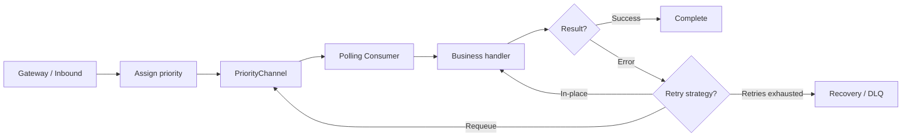
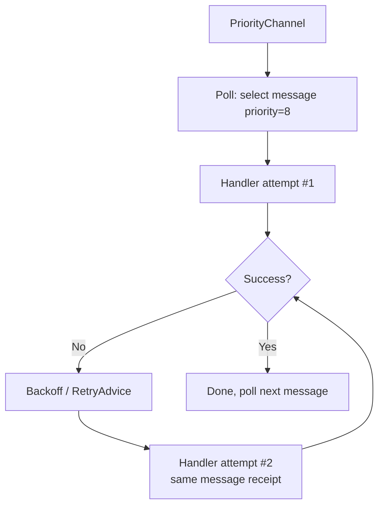
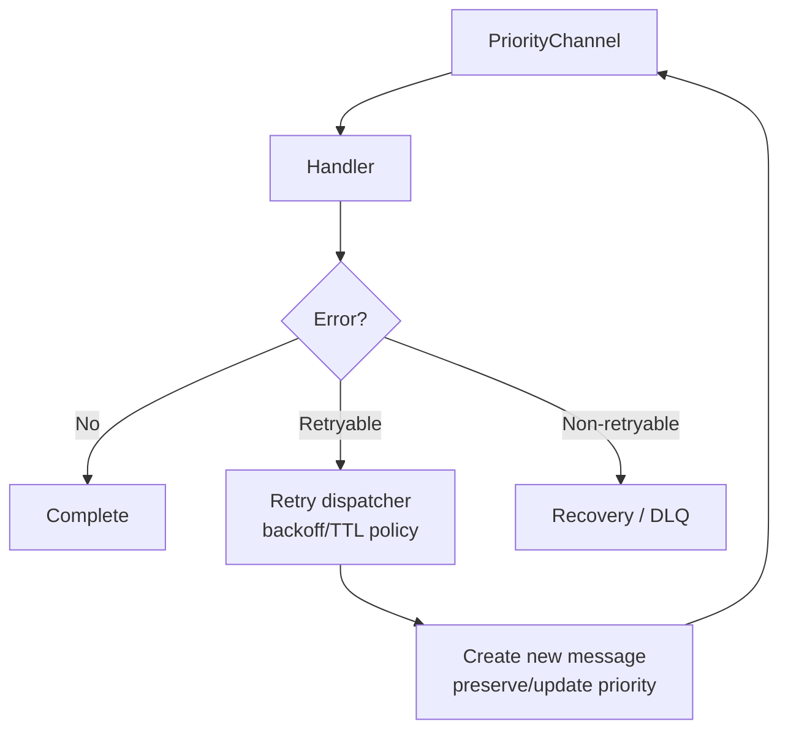
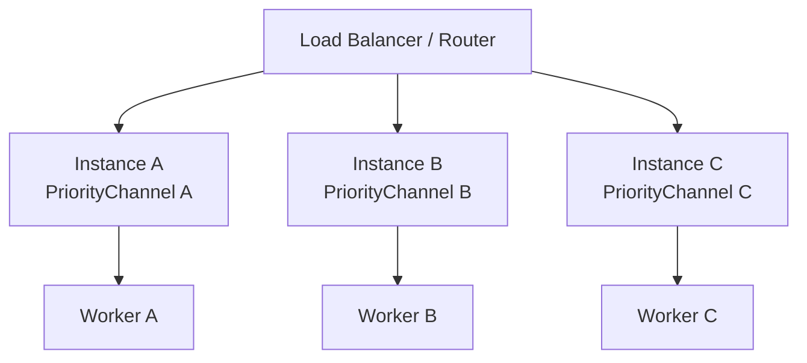

# Does Retrying a Message Preserve Priority?

In an integration system, high-priority messages generally need to be processed ahead of regular messages. Spring Integration supports **Priority Channel** to select dequeue order based on priority. However, once a handler fails, the question “**Does retrying a message preserve priority?**” has no single answer valid for every retry style.

**Short answer:** if the retry mechanism re-invokes the handler on a **message already dequeued from the channel**, the message's priority attribute may still remain in its headers, yet **`PriorityChannel` does not participate in re-ordering between those attempts**. If retrying by **re-enqueuing the message into `PriorityChannel` or publishing a new message through a broker**, subsequent processing order depends on whether priority is copied/mapped onto the new message, how the comparator/broker behaves, and the scheduling policy. Never assume every retry mechanism preserves both priority and the original queue position.

This lesson belongs to the **Priority** chapter of the **SPRING_INTEGRATION_PATTERN** module. The module focuses on implementing Enterprise Integration Patterns (EIP) with Spring Integration to build loosely coupled, extensible message flows; practicing Router, Filter, Transformer, Splitter, Aggregator, Gateway, retry, error channel, and correlation, while testing and monitoring processing branches.

After this lesson, you will be able to:

- Explain the difference between **the priority value in headers** and **actual message processing order**.
- Distinguish in-place handler retries, requeue retries, deferred retries, error channels, DLQs, and republishing.
- Preserve or adjust `MessageHeaders.PRIORITY` under a controlled policy when building new messages.
- Understand situations where retries stall consumers, invert ordering, cause starvation, or alter latency for high-priority messages.
- Write Spring Integration Java DSL flows and tests, distinguishing in-JVM priority channels from broker-enforced priority.
- Track attempts, priority, queue age, correlation, and idempotency without leaking sensitive data into logs.

## 1. Priority Can Carry Three Different Meanings

Before asking “is priority preserved?”, identify which kind of priority you mean.

| Concept | Meaning | What to verify |
| --- | --- | --- |
| **Priority metadata** | Value attached to `MessageHeaders.PRIORITY` or equivalent metadata | Does the value remain on the message after transformations/retries? |
| **Queue ordering** | Rule used by channel/broker to pick the next message | Comparator, priority range, tie handling |
| **Scheduling/execution priority** | Whether the message actually runs earlier or later in a handler | Worker count, retry backoff, in-flight tasks, fairness, downstream latency |

A message with `priority=9` does not automatically “evict” a handler currently executing a `priority=1` message from the CPU. A priority queue primarily decides **which message is selected when a consumer is ready to pull the next message**. It typically has no preemption mechanism for work already started.

Example:

```text
10:00:00  Worker pulled Job A, priority=1, started a 5-second API call
10:00:01  Job B, priority=9, enters PriorityChannel
10:00:02  Job B remains in queue; Worker is still handling A
10:00:05  Worker finishes A and only then gets to pull B
```

In that case, B's priority header was not wrong. Simply, **dequeue order** and **execution time** are two different things.

### High-Level Flow



The diagram outlines two strategies; in practice, retry/requeue and error publishing are configured on endpoints, advice, adapters, or application code. These arrows do not mean Spring Integration automatically requeues every error back into the channel.

## 2. How Does PriorityChannel Work in Spring Integration?

`PriorityChannel` is a `PollableChannel` whose queue is sorted by a comparator, usually based on `MessageHeaders.PRIORITY`. With default numeric priority comparison, higher priority is picked first when a consumer polls, **provided those messages are still waiting in the channel**.

Example:

```text
Message A: priority=2
Message B: priority=9
Message C: priority=5

When A, B, and C are all waiting:
poll #1 -> B
poll #2 -> C
poll #3 -> A
```

The critical condition is that **all three messages are in the queue at poll time**. If a consumer already picked up A before B arrived, B cannot push A back into the queue.

For equal-priority messages, do not rely on strict FIFO assumptions across changes to comparators, endpoints, runtime environments, or brokers. If ordering within the same priority tier is a business requirement, explicitly define and test tie-breaking, sequencing, or a suitable processing model.

### How to Set Priority

Use the `MessageHeaders.PRIORITY` constant rather than inventing an arbitrary key unrecognized by channels/brokers:

```java
import org.springframework.messaging.Message;
import org.springframework.messaging.MessageHeaders;
import org.springframework.messaging.support.MessageBuilder;

Message<String> urgent = MessageBuilder.withPayload("urgent-job")
        .setHeader(MessageHeaders.PRIORITY, 9)
        .setHeader("requestCorrelationId", "req_42")
        .build();
```

`MessageHeaders.PRIORITY` is an attribute of the **message**. Spring Integration still needs a **priority-capable channel/adapter** to use it for ordering. `DirectChannel` has no queue to sort; `ExecutorChannel` hands work to an executor under its own mechanism; external brokers/adapters each have distinct priority semantics.

**Note:** the value `9` in this example is simply an application-chosen priority level. Valid ranges and broker mappings must be verified per transport technology; never assume Java header values pass unchanged to external systems.

## 3. In-Place Retry: Preserves the Message Without Returning to the Priority Queue

A common pattern is a polling consumer pulling a message from `PriorityChannel`, with the handler wrapped by `RequestHandlerRetryAdvice` or equivalent Spring Retry configuration.



In this retry style:

1. The message has already **left** `PriorityChannel` on the initial poll.
2. Retry advice re-invokes the processing step; the message **is not automatically re-added to `PriorityChannel`** between attempts.
3. The `priority` header usually remains present on the message passed to the handler unless the handler/advice constructs a new message or overwrites headers.
4. Other messages in the channel **are not interleaved** simply because the handler is backing off; with a single consumer and synchronous retries, the worker remains occupied throughout the retry cycle.
5. Processing order after the final attempt resumes only when the consumer returns to poll the queue.

Thus, “priority is preserved” here is true for **message metadata**, yet not necessarily meaningful for **scheduling between retry attempts**.

### Illustration of Actual Execution Order

```text
Initial queue: A(priority=8), B(priority=7), C(priority=2)

t=0    Worker polls A
t=1    A attempt #1 fails
t=2    RetryAdvice waits 3 seconds
t=3    D(priority=9) arrives, waits in queue
t=5    A attempt #2 still runs before D on that worker
t=6    A succeeds
t=7    Worker polls D(priority=9), then B, then C
```

There is no guarantee that a priority-9 message will **execute immediately** while a worker is blocked retrying a priority-8 message.

## 4. Java DSL Example: PriorityChannel with Handler RetryAdvice

The following example uses Java 17+, Spring Integration Java DSL, and Spring Retry. This is an **in-JVM local pollable `PriorityChannel`**, not a distributed broker.

```java
import org.springframework.context.annotation.Bean;
import org.springframework.context.annotation.Configuration;
import org.springframework.integration.channel.PriorityChannel;
import org.springframework.integration.dsl.IntegrationFlow;
import org.springframework.integration.dsl.Pollers;
import org.springframework.integration.handler.advice.RequestHandlerRetryAdvice;
import org.springframework.messaging.MessageChannel;

import org.springframework.retry.policy.SimpleRetryPolicy;
import org.springframework.retry.backoff.FixedBackOffPolicy;
import org.springframework.retry.support.RetryTemplate;

record WorkItem(String id, String payload) { }

class WorkHandler {
    public void process(WorkItem item) {
        // Call dependent system / execute business logic.
        // May throw RuntimeException for advice to evaluate retry.
    }
}

@Configuration
class PriorityRetryFlowConfig {

    @Bean
    PriorityChannel priorityWorkQueue() {
        return new PriorityChannel(100);
    }

    @Bean
    RequestHandlerRetryAdvice workRetryAdvice() {
        RetryTemplate template = new RetryTemplate();

        SimpleRetryPolicy retryPolicy = new SimpleRetryPolicy(3);
        FixedBackOffPolicy backOff = new FixedBackOffPolicy();
        backOff.setBackOffPeriod(500L);

        template.setRetryPolicy(retryPolicy);
        template.setBackOffPolicy(backOff);

        RequestHandlerRetryAdvice advice = new RequestHandlerRetryAdvice();
        advice.setRetryTemplate(template);
        return advice;
    }

    @Bean
    WorkHandler workHandler() {
        return new WorkHandler();
    }

    @Bean
    IntegrationFlow priorityWorkerFlow(
            WorkHandler workHandler,
            RequestHandlerRetryAdvice workRetryAdvice) {
        return IntegrationFlow.from("priorityWorkQueue")
                .handle(workHandler, "process", endpoint -> endpoint
                        .poller(Pollers.fixedDelay(100)
                                .maxMessagesPerPoll(1))
                        .advice(workRetryAdvice))
                .get();
    }
}
```

Explanation:

- `PriorityChannel(100)` creates a bounded queue within the same application (verify constructor/API against your Spring Integration version).
- The poller fetches the next message when ready. The channel's comparator determines the higher-priority message **among waiting messages**.
- `RequestHandlerRetryAdvice` wraps the handler call with `RetryTemplate`; in this example, the policy allows up to 3 total attempts with a fixed 500 ms backoff between attempts.
- Retry advice **does not** put the message back into `priorityWorkQueue` after each attempt. While the handler is retrying, the priority queue continues holding waiting messages.
- When retries are exhausted and the handler still throws, how `ErrorMessage` is emitted, exceptions are handled, or recovery runs depends on the poller, error channel, and endpoint configuration. This snippet does not implement DLQ/requeue yet.
- Every handler invocation must be idempotent or paired with compensation; retries can repeat side effects if an earlier attempt partially succeeded.

**Important:** this code is a learning illustration showing where priority and advice sit. Test against your exact dependency versions and define retryable exceptions, downstream timeouts, error flows, metrics, thread pools, and persistence across restarts. An in-memory queue does not automatically survive process crashes.

### What If Newly Arrived High-Priority Messages Must Run During Backoff?

You can increase consumer concurrency (if business rules permit parallelism), use deferred retries instead of blocking a worker, or split priority tiers into separate lanes/queues with dedicated concurrency. Each option carries trade-offs in ordering, downstream load, idempotency, and fairness. Never assume a single priority queue with a single poller gives optimal latency for every workload.

## 5. Retry via Requeue: Priority Is Re-Evaluated on the Next Poll

Another strategy on failure is **building a message to send back into a queue**. The retried message then competes with waiting messages, and priority becomes relevant again at the **next selection**.



Example:

```text
Queue holds B(priority=6), C(priority=2)
Handler picked A(priority=8) and failed
A is requeued with priority=8

After requeue, if B, C, and A are all waiting:
next poll typically selects A(priority=8) before B(priority=6)
```

That **does not mean A keeps its original queue slot**. It enters re-sorting; if D(priority=9) exists, D can be dequeued before A. If A and B share equal priority, order depends on the tie-breaker/implementation—never claim exact original position is preserved.

### Cases Where Retried Messages Lose or Alter Priority

| How the message is created/forwarded | What to verify |
| --- | --- |
| Sending the exact `Message<?>` back to PriorityChannel | Priority header remains, yet check queue capacity, in-flight state, and duplicates |
| `MessageBuilder.fromMessage(original)` | Is priority copied or overwritten by a later step? |
| `MessageBuilder.withPayload(...)` creating a new message | Without copying/setting priority, the header may be missing |
| Transformer returning a new message/payload | Header propagation depends on transformer/endpoint contract |
| Error flow using `ErrorMessage` | `ErrorMessage` headers do not automatically match the failed message |
| Sending via outbound broker adapter | Header mapping and broker/producer priority property |
| DLQ then republish | Do tooling and republisher preserve/normalize priority? |
| Policy varying by retry count | Priority may be raised, lowered, or kept per business decision |

**The core question is “is priority used to pick which message runs next?”**, not just “does a field named `priority` exist on the object?”.

## 6. Preserving the Priority Header When Creating Retry Messages

If you want to **keep the business priority**, read the validated value from the failed message and build the new message under an explicit policy. Example utility code:

```java
import org.springframework.messaging.Message;
import org.springframework.messaging.MessageHeaders;
import org.springframework.messaging.support.MessageBuilder;

final class RetryMessageFactory {

    private RetryMessageFactory() { }

    static <T> Message<T> forRetry(
            Message<T> failed, int nextAttempt) {

        if (nextAttempt <= 1 || nextAttempt > 5) {
            throw new IllegalArgumentException("Invalid retry attempt");
        }

        Object raw = failed.getHeaders().get(MessageHeaders.PRIORITY);
        int priority = (raw instanceof Integer value && value >= 0
                && value <= 9) ? value : 0;

        return MessageBuilder.fromMessage(failed)
                .setHeader(MessageHeaders.PRIORITY, priority)
                .setHeader("retryAttempt", nextAttempt)
                .build();
    }
}
```

**Key points:**

1. `MessageBuilder.fromMessage(failed)` builds from an existing message. The example still **explicitly** sets the priority header to express policy and the application's 0–9 bounds.
2. `retryAttempt` is new metadata for the resend; enforce a clear retry cap so it never increments endlessly.
3. Do not use `MessageHeaders.ID` as an absolute business idempotency key. When constructing new messages or crossing adapters, message IDs can change per framework/transport; maintain a stable application-defined `businessOperationId`.
4. Unneeded or untrusted headers must be filtered before crossing service boundaries. `fromMessage(...)` does not replace a header allowlist when republishing externally.
5. Ensure `priority` originates from a trusted source/policy—never allow clients to arbitrarily attach priority 9 to jump ahead of other orders.
6. Having `priority=9` in the new message **is not enough** to guarantee the broker uses it; configure proper adapter mapping/settings as well.

This illustrates **message construction**, not a complete recovery flow. A production system must specify where waiting retry messages live, expiration, multi-attempt handling, transaction/ACK effects, and what happens if `send(...)` fails.

## 7. Comparing Three Retry Styles on One Scenario

Assume A has priority 8, B has priority 6, and C has priority 2; A fails on its first processing attempt.

| Mechanism | Where does A go? | Does priority determine A's position on retry? |
| --- | --- | --- |
| **In-place RetryAdvice** | Stays inside the current handler invocation | No. Handler retries immediately; queue does not pull new messages |
| **Requeue to PriorityChannel** | Returns to queue alongside B/C (if send succeeds) | Yes, if priority header/comparator are preserved |
| **Delayed retry then republish** | Goes to delay scheduler/queue, then re-enters target queue | Only after re-entering target queue; also depends on timing and broker |

If in-place retries drag out, **both B and C wait** on a single worker. If A is requeued keeping priority 8 and keeps failing, it can repeatedly jump ahead of B/C, causing **starvation**. With delayed retry, A temporarily leaves the queue so B/C get turns while A waits, though initial ordering is no longer maintained.

No mechanism is universally ideal:

- In-place retry is simple and keeps context, yet can tie up threads for a long time.
- Requeue frees workers, yet requires controlling duplicates, ordering, TTLs, ACKs, and infinite loops.
- Delayed retry relieves downstream pressure, yet adds scheduling, storage, and observability complexity.

## 8. Should Priority Decrease After Each Retry?

This is a **business policy**, not a Spring Integration default rule. Several options exist:

| Policy | Example A from priority 8 after two failures | Advantage | Risk |
| --- | --- | --- | --- |
| **KEEP** | 8 → 8 → 8 | Preserves original SLA and urgency meaning | Repeatedly failing messages can hog the head of the queue |
| **DECREASE** | 8 → 6 → 4 | Yields resources to healthy new messages | Urgent work may suffer unintended delays |
| **INCREASE** | 8 → 9 → 9 | Tries to recover critical tasks aggressively | Can worsen retry storms and starvation |
| **SEPARATE RETRY LANE** | 8 → dedicated retry queue | Limits disruption to the main flow | Requires managing another queue/scheduler |
| **TIME-BASED AGING** | Selection score rises with wait time | Reduces starvation of low-priority items | Requires a verified comparator/scheduler |

**Never escalate priority just because retries piled up.** A message failing repeatedly may be waiting on a broken dependency to recover; raising it higher can choke every healthy incoming request.

A straightforward sample policy:

- For transient failures: keep **businessPriority** in the original header and use backoff/deferred retry.
- After too many attempts: move to classified recovery/DLQ rather than requeuing endlessly.
- For urgent SLAs: provide a dedicated lane and capacity while still protecting the dependency with a circuit breaker/rate limiter.
- For old messages: combine TTL/deadlines and composite prioritization instead of relying on a single static integer.

If you define a separate `effectivePriority` for queuing, document that it changes across retries; never overwrite `businessPriority` without auditability or recovery.

## 9. Priority and Backoff Can Have Conflicting Goals

A high-priority message may need to wait **longer** before retry due to error backoff policies. For example:

```text
A(priority=9): upstream returned HTTP 503, must back off 30 seconds
B(priority=4): ready to process immediately
C(priority=4): ready to process immediately
```

If a worker holds A during a 30-second in-place retry, B and C are delayed even though their dependency is healthy. If A is deferred in a scheduler, B and C continue running; when A becomes eligible again, it re-enters the queue and competes by priority.

Therefore distinguish:

- **Business priority:** urgency of the work.
- **Next eligible time:** when the message becomes eligible to retry.
- **Deadline/TTL:** until when the message remains valid for business.
- **Fairness:** minimum capacity reserved for other tiers.
- **Retry budget:** allowed retry count/total retry window.

A well-designed system does not overload a single `priority` field to govern all five concerns. Priority does not replace retry policies, circuit breakers, or rate limiters.

### Retry Storms and Circuit Breakers

When a downstream fails, thousands of high-priority messages may retry together. Requeuing at high priority without backoff lets that group exhaust worker and connection pools. A circuit breaker or retry budget prevents hammering an unhealthy dependency; retry lanes/queues still need backlog and wait-time monitoring. Never assume “high priority” exempts a flow from system safety limits.

## 10. Do Error Channel, failedMessage, and DLQ Automatically Preserve Priority?

When an endpoint emits an `ErrorMessage`, its payload is typically a `Throwable`; with `MessagingException` you can inspect `getFailedMessage()`. However, **`ErrorMessage` is a different message** from the failed business message, and you should not assume all headers on `ErrorMessage` mirror the original message completely.

When implementing a recovery handler:

1. Inspect the `Throwable` and locate the **failed message** at the right stage, checking `MessagingException.getFailedMessage()` where applicable.
2. Extract the **validated** business operation ID, request correlation, and priority from the appropriate business message.
3. Determine whether the error is retryable and whether retry budget remains.
4. If requeuing, construct the new message via a priority-policy factory; attach attempt metadata and expiry.
5. If non-retryable, route to DLQ/quarantine/terminal error handling per requirements; never drop into `nullChannel` just to silence exceptions.
6. Emit counters/logs for `retried`, `exhausted`, and `dead_lettered` with accurate semantics.

Policy pseudocode:

```text
onError(errorMessage):
  failed = extractFailedBusinessMessage(errorMessage)
  if failed is null:
      recordUncorrelatedFailureAndAlert()
      return

  if isRetryable(errorMessage) and attempts(failed) < maxAttempts:
      message = rebuildForRetry(failed, KEEP_BUSINESS_PRIORITY)
      enqueueAfterBackoff(message)
  else:
      sendToDeadLetterWithMetadata(failed, errorCode)
```

This is **pseudocode**, not a built-in API providing all those helpers. For synchronous errors on `DirectChannel`, exceptions may propagate back to the caller instead of automatically entering `errorChannel`; for async pollers/adapters, error routing depends on configuration.

### Is a DLQ a PriorityChannel?

No. A DLQ holds failed messages for investigation/recovery; it may use a FIFO queue, broker queue, or durable store depending on design. On DLQ replay, **whether priority is preserved** depends on persisted metadata and the replay tool's mapper. A DLQ storing only the body while dropping the priority header cannot automatically recover original business priority.

For strict replay requirements, persist `businessPriority`, `originalMessageId`/`businessOperationId`, attempt, error code, timestamp, and schema version inside a controlled envelope.

## 11. Across Brokers, Priority Is No Longer Just a Java Header

In multi-service systems, retried messages may cross JMS, RabbitMQ, Kafka, or other transports. Each transport has different semantics:

| Transport / model | What to keep in mind |
| --- | --- |
| **Local Spring Integration PriorityChannel** | Comparator selects among waiting messages inside that instance's queue |
| **JMS** | JMS defines message priority; producer/adapter and broker must map, support, and configure it properly |
| **RabbitMQ priority queue** | Queue must be declared with priority support and publisher must set message priority property; not every queue is a priority queue by default |
| **Kafka partition** | Guarantees offset ordering within a partition per Kafka semantics, does not automatically sort by a `priority` header |
| **Delayed/retry topic/queue** | After the delay, publisher/consumer decides which metadata carries forward |
| **DLQ** | Retains data for replay per transport/tool capabilities, not guaranteeing unchanged ordering/priority |

**Do not equate priority levels across transports.** `MessageHeaders.PRIORITY` on a Spring Message, JMS priority, AMQP message priority, and a custom Kafka header do not interoperate automatically. Adapters/header mappers can translate, drop, or normalize metadata; inspect and test the actual path.

A broker priority queue may also deliver via batching, prefetch, or consumer scheduling: a newly arrived high-priority message after a consumer has already prefetched low-priority messages will not necessarily run ahead of those prefetched ones.

## 12. One PriorityChannel Per Instance Does Not Create Cluster-Wide Order

Suppose a service runs three replicas, each with its own `PriorityChannel`:



A priority-9 message waiting on A can finish later than a priority-3 message running on B if A is busy or backing off. There is no **single global queue** comparing messages across all three instances.

Therefore, when cluster-level priority SLAs are needed, decide explicitly:

- Is **global ordering** required, or relative priority per partition/worker?
- Are there separate priority lanes, such as `urgent` and `standard`, or one shared queue?
- May workers pull messages beyond per-lane concurrency limits?
- Can retries switch lanes, and must business priority stay intact?
- Can the urgent lane scale independently, and how is the shared downstream protected?
- Which fairness strategy prevents `standard` from starving?

Strict global ordering usually imposes heavy throughput and availability trade-offs. Many systems choose **bounded prioritization** instead of requiring every urgent message cluster-wide to finish before every regular message.

## 13. Correlation, Idempotency, and Business Ordering

Retries can repeat side effects and spawn new messages. Even when priority is preserved, protect **business correctness**.

| Metadata | Role |
| --- | --- |
| `businessOperationId` | Operation idempotency key, stable across retries |
| `requestCorrelationId` | Links events belonging to a single request |
| `MessageHeaders.ID` | Per-step message identifier; do not rely on stability across republishing |
| `MessageHeaders.PRIORITY` | Value used for ordering on priority-capable channels |
| `retryAttempt` | Current attempt number per policy |
| `originalPriority` | Optional original business level if policy adjusts effective priority |
| `nextEligibleAt` | Eligibility timestamp for deferred retry scheduling |
| `deadline` | Business processing deadline |
| `correlationId`/`sequenceNumber` | Splitter/Aggregator group metadata when applicable |

A priority-9 message must never skip idempotency. If the first attempt committed to the DB yet the acknowledgment was lost, the next attempt can repeat the write. Do not try to solve this by lowering priority: it is an acknowledgment/idempotency and transaction problem, not a priority problem.

### When Splitter/Aggregator Is Involved

A request may be split into multiple items, each carrying correlation and sequence headers. If one item fails and is requeued at high priority, determine:

- Does **each item** keep the parent request's priority or compute its own?
- Does the Aggregator wait for the full group or have a release strategy for failed items?
- Do retries alter `sequenceNumber`/`sequenceSize` or `correlationId`?
- If an item is processed twice, do the aggregator/dedup checks catch the duplicate?
- Does raising one item's priority help the group finish sooner or merely starve other groups?

Never use `PriorityChannel` poll order to infer business sequence order. Priority ordering and sequence ordering serve two different purposes.

## 14. Observing Priority and Retries via Metrics, Logs, and Traces

To verify “does retry preserve priority?” in production, observe **header values at receipt, retry, and dequeue**, not just final error logs.

Suggested structured log event:

```json
{
  "event": "integration.retry_requeued",
  "flow": "orderFulfillment",
  "stage": "inventoryWorker",
  "requestCorrelationId": "req_42",
  "businessOperationId": "op_42",
  "messageId": "2e7743aa-1d89-4c12-8c73-7a22c2d75b4e",
  "businessPriority": 8,
  "effectivePriority": 8,
  "retryAttempt": 2,
  "reasonCode": "UPSTREAM_TIMEOUT"
}
```

Never log sensitive payloads or tokens. `businessOperationId` and request IDs also need access controls, length/format standards, and retention policies.

| Metric | Unit | Question answered |
| --- | --- | --- |
| `priority_queue_depth` | Waiting messages, by bounded priority bucket | Which priority tier is backlogged? |
| `priority_queue_oldest_age` | Seconds waiting | Are low-priority messages starving? |
| `handler_attempts_total` | Attempts | How many extra calls are retries generating? |
| `retry_requeued_total` | Requeued messages/events | How often are messages re-entering the queue? |
| `retry_exhausted_total` | Terminal failures | How many messages exhausted retries? |
| `processing_duration` | Handler duration | How much do retries inflate processing time? |
| `end_to_end_duration` | Request duration | Are per-priority SLAs being met? |
| `dead_letter_total` | Messages sent to DLQ | Which priority tier fails terminally? |

Metric names above are application suggestions. For metric labels, use only a bounded priority set (`urgent`, `normal`, `background`, or fixed numeric tiers); never put request IDs, message IDs, or exception text in metric tags.

**Measurement nuances:**

- In-place retries increase `attempts` **without increasing `requeued`**.
- One message requeued three times emits three events; that does not mean three distinct business messages.
- Queue depth can drop because a worker dequeued a message while the request is still backing off inside the handler.
- Retry trace spans only appear if instrumented; trace sampling does not guarantee every attempt retains a span.

## 15. Systematic Testing Instead of Guessing

### Test 1 — PriorityChannel Dequeues Higher-Priority Messages First

JUnit 5 example enqueueing three messages before any consumer polls:

```java
import static org.junit.jupiter.api.Assertions.assertEquals;
import static org.junit.jupiter.api.Assertions.assertNotNull;

import org.junit.jupiter.api.Test;
import org.springframework.integration.channel.PriorityChannel;
import org.springframework.messaging.Message;
import org.springframework.messaging.MessageHeaders;
import org.springframework.messaging.support.MessageBuilder;

class PriorityChannelOrderingTest {

    @Test
    void takesHigherPriorityAmongWaitingMessages() {
        PriorityChannel queue = new PriorityChannel(10);

        queue.send(MessageBuilder.withPayload("low")
                .setHeader(MessageHeaders.PRIORITY, 1).build());
        queue.send(MessageBuilder.withPayload("high")
                .setHeader(MessageHeaders.PRIORITY, 9).build());
        queue.send(MessageBuilder.withPayload("medium")
                .setHeader(MessageHeaders.PRIORITY, 5).build());

        Message<?> first = queue.receive(0);
        Message<?> second = queue.receive(0);
        Message<?> third = queue.receive(0);

        assertNotNull(first);
        assertNotNull(second);
        assertNotNull(third);

        assertEquals("high", first.getPayload());
        assertEquals("medium", second.getPayload());
        assertEquals("low", third.getPayload());
    }
}
```

This test only checks **ordering of messages already waiting in a local `PriorityChannel`**, not retries or multiple consumers. For equal priorities, test comparators/tie-breaking as required.

### Test 2 — Rebuilding a Retry Message Preserves Normalized Priority

```java
import static org.junit.jupiter.api.Assertions.assertEquals;

import org.junit.jupiter.api.Test;
import org.springframework.messaging.Message;
import org.springframework.messaging.MessageHeaders;
import org.springframework.messaging.support.MessageBuilder;

class RetryMessageFactoryTest {

    @Test
    void preservesConfiguredBusinessPriority() {
        Message<String> original = MessageBuilder.withPayload("job-42")
                .setHeader(MessageHeaders.PRIORITY, 8)
                .setHeader("requestCorrelationId", "req_42")
                .build();

        Message<String> retried = RetryMessageFactory.forRetry(original, 2);

        assertEquals(8, retried.getHeaders().get(MessageHeaders.PRIORITY));
        assertEquals("req_42",
                retried.getHeaders().get("requestCorrelationId"));
        assertEquals(2, retried.getHeaders().get("retryAttempt"));
    }
}
```

If a factory uses `MessageBuilder.withPayload(...)` without copying priority, tests must catch the missing header or policy-default fallback. Never assert only payload equality.

### Test 3 — In-Place Retry Does Not Let Queue Re-Sort Between Attempts

With a single consumer, construct a scenario:

1. Enqueue A(priority=8) into `PriorityChannel` and wait for the handler to pick up A.
2. On A's first attempt, intentionally throw a transient exception and block briefly on a controlled backoff.
3. While A is backing off, send D(priority=9).
4. Verify A's second attempt runs before the consumer returns to poll D.
5. After A succeeds or exhausts retries, verify D is polled next if still waiting with no higher-priority message present.

Synchronize using latches/fake clocks or bounded test coordination instead of arbitrary `Thread.sleep`. With multiple consumers, execution order can vary and tests should specify concurrency clearly.

### Test 4 — Requeuing Into the Priority Queue

1. Enqueue waiting messages B(priority=6) and C(priority=2).
2. Create a retry copy of A(priority=8) via the factory and resend into the queue.
3. Verify `send` succeeds, then poll messages with no other consumers active.
4. Assert A is selected ahead of B/C.
5. Test A with missing header or invalid priority; verify default/reject policy.
6. Test full queue and requeue failure: explicit recovery must occur without silently dropping messages.

### Test 5 — Multi-Instance, Broker, and Fairness

| Scenario | Outcome to verify |
| --- | --- |
| PriorityChannel A/B on two JVMs | No default global priority ordering |
| Retry via JMS/RabbitMQ | Priority applied by mapper/broker when configured |
| Kafka republish | Partition/offset order, not custom priority header sorting |
| Prefetching multiple messages | Newly arrived high messages do not always overtake prefetched low ones |
| Continuous high-priority flood | Low queue age climbs; fairness/aging required |
| Handler with side effects then retry | Idempotency prevents duplicate writes/orders |
| Retry of one Splitter item | Group correlation/sequence remains intact |
| DLQ replay | Preserves required priority and operation ID |
| Toggling DEBUG logging | Queue/handler behavior remains unchanged |
| ErrorMessage lacking failedMessage | Recovery does not guess priority from the error message |

## 16. Common Mistakes and Fixes

| Mistake | Consequence | Fix |
| --- | --- | --- |
| “Priority header is still there, so retries will jump ahead” | Confuses metadata with in-place retry scheduling | Clarify whether retry requeues or runs in-place |
| Requeuing a new message without copying priority | Urgent jobs fall back to default priority | Test message factory and header mapping |
| Keeping high priority and requeuing immediately forever | Starvation, retry storms, upstream overload | Retry budgets, backoff, DLQ, or dedicated lanes |
| Increasing priority on every retry | Failing messages hog the queue long-term | Pick policy by SLA and error type |
| Comparing multi-worker execution order like FIFO | Flaky tests and wrong conclusions | Separate dequeue order from completion order |
| Treating in-memory PriorityChannel as durable | Messages lost on process crash | Choose appropriate persistence/transport |
| Expecting global priority across replicas | Cluster-wide SLAs miss expectations | Choose topology/lanes/scheduler with clear contracts |
| Trusting client-supplied priority as authority | Quota abuse or bypassed fairness | Validate/derive priority at trusted ingress |
| Routing failed retries to `nullChannel` to silence exceptions | Silent business loss and hidden bugs | Proper recovery, error channel, DLQ |
| Using a new messageId as business key | Duplicate side effects after republishing | Stable businessOperationId + idempotency |
| Counting WARN logs to count retries | Skewed by log levels, sampling, and duplicates | Count attempts/requeues with metrics at execution points |
| Long backoff on a single poller thread | Even high-priority jobs wait behind backoff | Deferred retry or controlled concurrency scaling |

## 17. Practice Exercise: Prioritizing Orders After Retry

**Scenario:** an order system receives three work types: `urgent`, `standard`, and `background`. Router classifies them, Transformer normalizes payloads, and sends them to `PriorityChannel` where a poller calls Inventory Gateway. When upstream times out, jobs retry. Some jobs are split by Splitter into items and reassembled by Aggregator.

Design in steps:

1. Define mapping `urgent=9`, `standard=5`, `background=1`. Ensure the application assigns priority after validating inputs rather than trusting raw client values.
2. Create a local bounded `PriorityChannel` and worker flow. Write a test where three messages already sit in the queue before polling.
3. Configure in-place retry up to 3 attempts with bounded backoff. Send D(priority=9) while A(priority=8) is retrying; observe why D does not preempt A on the same worker.
4. Replace with deferred retry: send failed messages to a retry scheduler/queue, set `nextEligibleAt`, and requeue only once eligible. Preserve `businessPriority`.
5. Build a retry message factory and test that priority headers, request correlation, attempt, and business operation ID propagate accurately.
6. Compare **KEEP** and **DECREASE** priority on retry. Compare p95 latency per class, starved message counts, and overall throughput.
7. Trigger failures until retries exhaust and route to an error flow/DLQ. Verify priority and operation ID are preserved for controlled replay.
8. Fail one child message from Splitter; verify correlation/sequence and Aggregator release strategy remain intact.
9. Run two instances with separate PriorityChannels; explain why priority 9 on replica A can finish after priority 5 on replica B.
10. Collect `attempts`, `requeued`, and `queue oldest age` metrics plus structured logs with `businessPriority`/`effectivePriority`. Ensure logs omit sensitive payloads.
11. Simulate full queues, worker shutdown, and crash mid-retry. Document recovery paths, potential loss/duplicates, and system acceptance criteria.

**Completion criteria:** be able to state accurately for each strategy whether the priority header is preserved, whether the queue re-evaluates priority, and how completion order can change. Ensure zero infinite retries, no silent loss of critical messages, duplicate protection, and sufficient telemetry to detect starvation.

### Self-Check Questions

1. In an in-place retry, why does a newly arrived priority-9 message not necessarily run ahead of the next attempt of a priority-8 message?
2. Is an intact `MessageHeaders.PRIORITY` header enough to prove a retry is prioritized by the scheduler?
3. Which headers and business IDs must be copied/set when requeuing a new message?
4. When `RetryAdvice` retries inside a handler, does `PriorityChannel` receive the message back after each attempt?
5. When a message is requeued with priority 8, does it automatically retain its exact pre-failure **position** in the queue?
6. Why can decreasing priority across retries improve fairness yet delay an urgent job?
7. What are the differences between local `PriorityChannel`, JMS priority, RabbitMQ priority queues, and Kafka partitions?
8. Why do prefetching or multiple workers change completion order?
9. Can an `ErrorMessage` be used directly as a business message with its original priority?
10. Why is a stable business operation ID more important than message ID during retries?
11. When should you separate a dedicated retry queue or use a backoff scheduler instead of blocking a polling consumer?
12. If the queue age of low-priority jobs keeps rising, what should you measure and adjust?

## 18. References

- [Spring Integration — Priority Channel](https://docs.spring.io/spring-integration/reference/channel/implementations.html): channel implementations, including PriorityChannel.
- [Spring Integration — Message Headers](https://docs.spring.io/spring-integration/reference/message.html): Message structure and metadata.
- [Spring Integration — Polling Consumer](https://docs.spring.io/spring-integration/reference/endpoint.html): pollers and endpoints reading from PollableChannel.
- [Spring Integration — Retry Advice](https://docs.spring.io/spring-integration/reference/handler-advice/classes.html): handler advice, retry, and recovery.
- [Spring Integration — Error Handling](https://docs.spring.io/spring-integration/reference/error-handling.html): ErrorMessage, error channels, sync/async errors.
- [Spring Integration — Splitter](https://docs.spring.io/spring-integration/reference/splitter.html) and [Aggregator](https://docs.spring.io/spring-integration/reference/aggregator.html): correlation and release strategy.
- [Spring Retry Reference](https://docs.spring.io/spring-retry/reference/): RetryTemplate, policies, and backoff.
- [Spring Framework — Messaging](https://docs.spring.io/spring-framework/reference/integration.html#spring-integration): message and channel concepts.
- [RabbitMQ — Priority Queues](https://www.rabbitmq.com/docs/priority): priority support conditions and practical limits.
- [Apache Kafka — Design](https://kafka.apache.org/documentation/): partitions, offsets, and ordering.
- [Micrometer — Metrics Concepts](https://docs.micrometer.io/micrometer/reference/concepts.html): counters, timers, gauges, and cardinality.

**Key takeaway:** A retry can **keep the priority header** while **never being re-sorted by `PriorityChannel`** if retries execute inside the handler. Priority only governs the next selection when the message re-enters a priority-capable queue; across transformers, error flows, DLQs, brokers, or newly built messages, verify header mappings and retry policies. Measure queue age, attempts, requeues, and final outcomes, and safeguard idempotency, fairness, and correlation so prioritization never compromises business correctness.
