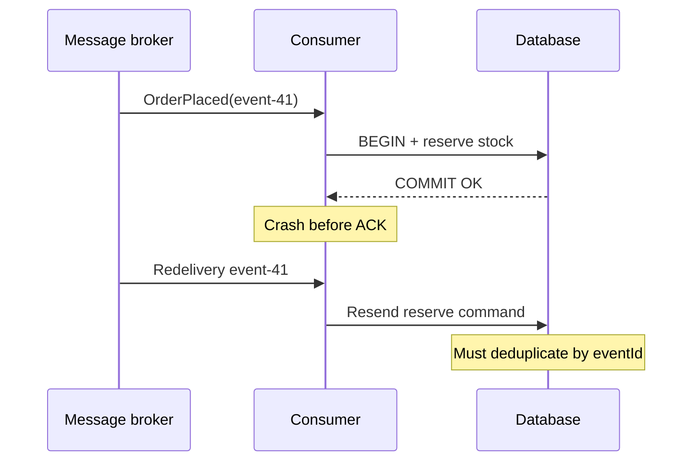
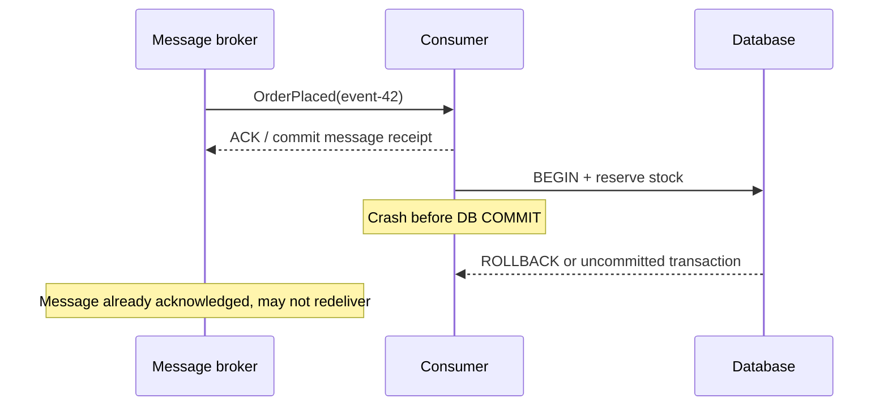
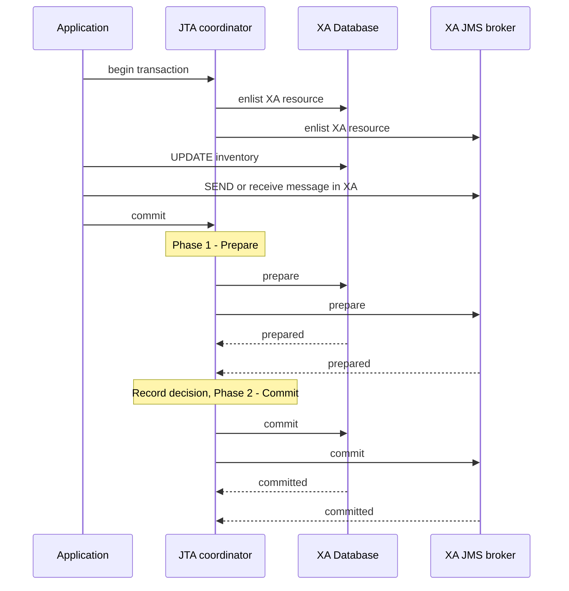
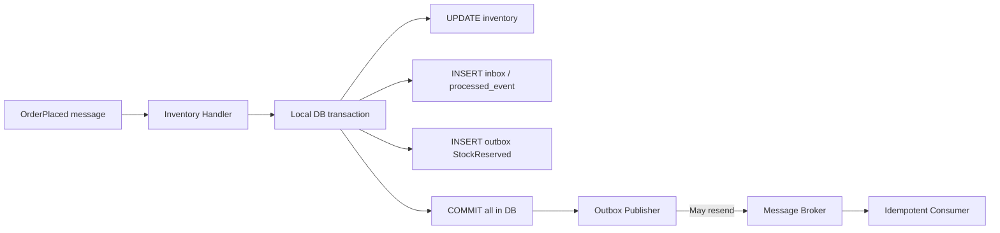
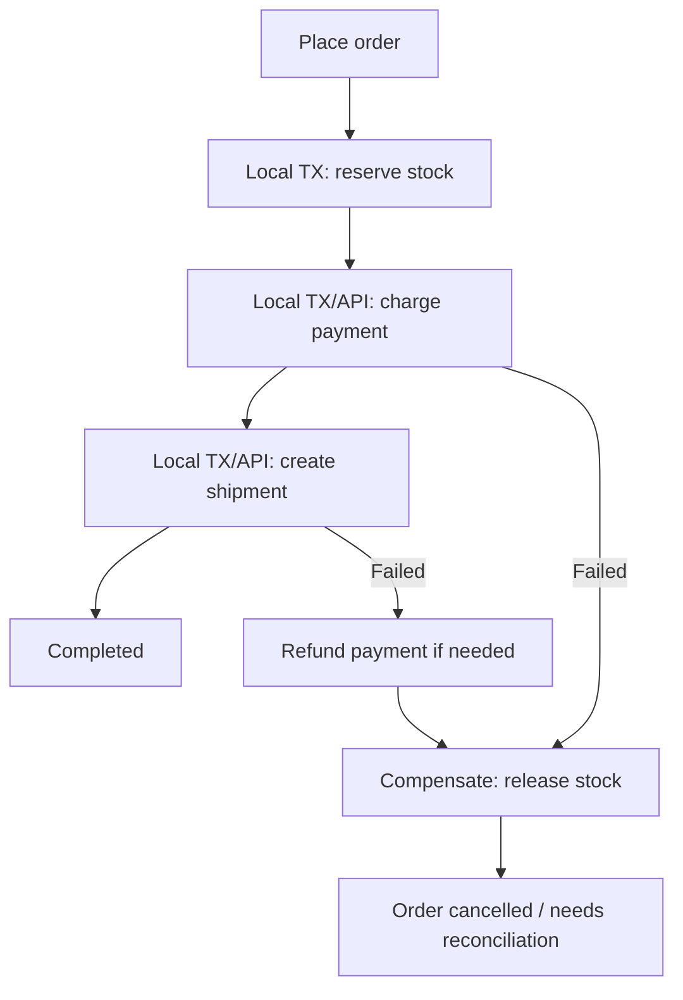

# Local Transactions and Distributed Transactions in Spring Integration

## 1. The Problem: Are Database Writes and Message Handling Really One Transaction?

An e-commerce system receives an `OrderPlaced` event from a message broker. Spring Integration uses a Filter to reject invalid data, a Transformer to normalize it, a Router to select a warehouse, and a handler to update inventory in the database. After reserving stock successfully, the system must emit a `StockReserved` event to the shipping service.

What happens if the application **commits the database yet crashes before acknowledging the message**? The broker can redeliver, causing the same order to be processed twice. Conversely, if the application **sends the next message and the database then rolls back**, downstream services may act on a change that was never committed.

This is the central problem of **Transactional messaging**, especially when distinguishing a **local transaction** from a **distributed transaction**.

In the `SPRING_INTEGRATION_PATTERN` module, we learn how to implement Enterprise Integration Patterns with Spring Integration to create loosely coupled, extensible message flows. Transaction boundaries must be understood alongside Router, Filter, Transformer, Splitter, Aggregator, Gateway, retries, error channels, correlation, and per-branch tests.

**Learning Objectives:**

1. Identify which resources genuinely participate in a transaction and which operations fall outside rollback scope.
2. Distinguish JDBC/JMS local transactions, transaction synchronization, JTA/XA, and two-phase commit (2PC).
3. Explain the failure windows that cause **lost messages**, **redeliveries**, or **duplicate side effects**.
4. Decide when to use XA, transactional outbox/inbox, idempotent consumers, or sagas.
5. Design Spring Integration flows with clear transaction boundaries and measurable commit, rollback, retry, and recovery outcomes.

## 2. Concepts That Must Be Separated

| Concept | Meaning | What does it guarantee? |
| --- | --- | --- |
| **Local transaction** | One transaction manager managing a single transactional resource, e.g. one JDBC `DataSource` | Atomicity for operations belonging to **that exact resource** |
| **Local JMS transaction** | A transacted JMS session managing receive/send within its corresponding session/broker scope | Does not implicitly combine commits with a database |
| **Transaction synchronization** | Registering callbacks running before/after commit/rollback of an active transaction | Execution ordering, **not necessarily atomic commit** across multiple resources |
| **Distributed transaction** | A unit of work involving multiple transactional resources | Requires a coordination mechanism and compatible resources for atomicity |
| **JTA/XA + 2PC** | A JTA transaction manager coordinating XA resources via prepare/commit | Can commit/roll back a group of XA resources as one unit, provided configuration and recovery are proper |
| **Transactional outbox** | Writing business data and events to publish in the same database transaction | No lost publish intent when DB commits; publisher may still send duplicates |
| **Idempotent consumer / inbox** | Recording processed message identity alongside the business effect | Prevents re-applying side effects at the consumer on redelivery |
| **Saga** | Sequence of local transactions with compensating steps when a later step fails | Process-level eventual consistency, not global ACID |

**Key takeaway:** Having `@Transactional` on a service **does not mean** an HTTP API, another database, or a message broker automatically joins the same transaction. You must verify the transaction manager, connection factory, adapter, and which resources are actually enlisted.

## 3. Local Transactions in One Database

A JDBC transaction uses `DataSourceTransactionManager` (or a transaction manager suitable for JPA/JDBC) to coordinate multiple SQL statements executed on the same data source.

Stock reservation example:

```text
BEGIN (database local transaction)
  INSERT processed_event(event_id)
  UPDATE inventory SET available = available - quantity
  INSERT stock_reservation(...)
  INSERT outbox_event(...)
COMMIT
```

If the inventory update throws an exception and the transaction rolls back, the processed marker and reservation/outbox rows in this transaction all roll back. If the transaction commits, the records appear together. This is **in-database atomicity**, not atomicity with a broker or HTTP.

### 3.1. PostgreSQL Schema Example

```sql
CREATE TABLE inventory (
    tenant_id VARCHAR(64) NOT NULL,
    sku VARCHAR(128) NOT NULL,
    available INTEGER NOT NULL CHECK (available >= 0),
    PRIMARY KEY (tenant_id, sku)
);

CREATE TABLE processed_order_events (
    tenant_id VARCHAR(64) NOT NULL,
    event_id VARCHAR(128) NOT NULL,
    PRIMARY KEY (tenant_id, event_id)
);

CREATE TABLE stock_reservations (
    tenant_id VARCHAR(64) NOT NULL,
    event_id VARCHAR(128) NOT NULL,
    order_id VARCHAR(128) NOT NULL,
    sku VARCHAR(128) NOT NULL,
    quantity INTEGER NOT NULL,
    PRIMARY KEY (tenant_id, event_id)
);

CREATE TABLE outbox_events (
    event_id VARCHAR(128) PRIMARY KEY,
    event_type VARCHAR(64) NOT NULL,
    payload TEXT NOT NULL,
    published BOOLEAN NOT NULL DEFAULT FALSE
);
```

This is a simplified learning model; production needs timestamps, outbox statuses, payload conflict checks, retry counts, and a retention plan. `processed_order_events` only works if the `tenantId + eventId` key has stable semantics; a reused event ID with differing data must be detected, not silently accepted.

### 3.2. Local Transaction Service with Spring JDBC

The Java code below uses `JdbcTemplate` and `@Transactional`. All SQL statements in the method are expected to share one database transaction **when the method is invoked through a Spring proxy and appropriate transaction manager**.

```java
import org.springframework.jdbc.core.JdbcTemplate;
import org.springframework.stereotype.Service;
import org.springframework.transaction.annotation.Transactional;

record ReserveStock(
        String tenantId, String eventId, String orderId,
        String sku, int quantity) {}

@Service
public class InventoryService {

    private final JdbcTemplate jdbc;

    public InventoryService(JdbcTemplate jdbc) {
        this.jdbc = jdbc;
    }

    @Transactional(transactionManager = "inventoryTransactionManager")
    public void reserve(ReserveStock event) {
        if (event.eventId() == null || event.eventId().isBlank()
                || event.quantity() <= 0) {
            throw new IllegalArgumentException("Invalid stock event");
        }

        // PostgreSQL: claiming identity is atomic.
        int claimed = jdbc.update("""
                INSERT INTO processed_order_events (tenant_id, event_id)
                VALUES (?, ?)
                ON CONFLICT DO NOTHING
                """, event.tenantId(), event.eventId());

        if (claimed == 0) {
            // Same identity was already processed earlier.
            // Production should verify a payload fingerprint before returning success.
            return;
        }

        int updated = jdbc.update("""
                UPDATE inventory
                   SET available = available - ?
                 WHERE tenant_id = ?
                   AND sku = ?
                   AND available >= ?
                """,
                event.quantity(), event.tenantId(),
                event.sku(), event.quantity());

        if (updated != 1) {
            throw new IllegalStateException("Insufficient inventory");
        }

        jdbc.update("""
                INSERT INTO stock_reservations
                    (tenant_id, event_id, order_id, sku, quantity)
                VALUES (?, ?, ?, ?, ?)
                """, event.tenantId(), event.eventId(), event.orderId(),
                event.sku(), event.quantity());

        jdbc.update("""
                INSERT INTO outbox_events
                    (event_id, event_type, payload)
                VALUES (?, 'STOCK_RESERVED', ?)
                """,
                event.eventId(),
                event.orderId() + ":" + event.sku());
    }
}
```

**Limitations to understand:** `InventoryService` only protects records inside the same JDBC transaction. It does not automatically acknowledge broker messages, automatically publish the outbox, or make email/API calls rollbackable. In a real application, configure the `inventoryTransactionManager` bean for the right `DataSource`.

### 3.3. Wiring the Service into a Spring Integration Flow

```java
import org.springframework.context.annotation.Bean;
import org.springframework.context.annotation.Configuration;
import org.springframework.integration.channel.DirectChannel;
import org.springframework.integration.dsl.IntegrationFlow;
import org.springframework.messaging.MessageChannel;

@Configuration
class StockFlowConfiguration {

    @Bean
    MessageChannel reserveStockInput() {
        return new DirectChannel();
    }

    @Bean
    IntegrationFlow reserveStockFlow(InventoryService inventoryService) {
        return IntegrationFlow.from("reserveStockInput")
                .handle(inventoryService, "reserve")
                .get();
    }
}
```

`DirectChannel` dispatches synchronously on the caller's thread. If `InventoryService.reserve(...)` is invoked through a transactional Spring bean/proxy, the transaction wraps this service method; it does not implicitly cover upstream steps executed before entering the service transaction.

## 4. Two Failure Windows When Coordinating a Database and Broker with Local Transactions

Suppose a consumer receives a message from JMS, processes it, and updates the DB. If receiving the message and writing the database **are not inside one XA transaction**, we must pick a commit order, and every order has a failure window.

### Window A — DB Commits First, Broker ACKs After



The DB has committed, yet the broker does not know the consumer finished and may redeliver. If `reserve` is not idempotent, inventory is deducted again. An **inbox/dedup** with a unique key written in the same local transaction prevents duplicate effects.

### Window B — Broker ACKs First, DB Commits After



The broker was acknowledged while database changes have not committed; **the message risks being lost at the business level**. Transaction synchronization and callback ordering can help pick a more consistent sequence, yet cannot eliminate the entire crash window if the two resources lack a shared atomic commit.

| Actual sequence | If crash happens between steps | Main consequence | Mitigation |
| --- | --- | --- | --- |
| DB commit → broker ack | DB changed, broker may redeliver | Duplicate processing | Inbox/idempotency |
| Broker ack → DB commit | Message gone, DB unchanged | Lost processing | Avoid early ack; consider XA or another design |
| DB commit with outbox → publisher sends | Outbox retains work if publisher crashes | May republish; low risk of losing send intent | Outbox + idempotent consumer |
| Coordinated XA commit DB + broker | Resources share XA transaction | Atomicity under XA/2PC conditions | JTA/XA, recovery logs, operational checks |

## 5. Transaction Synchronization Is Not a Distributed Transaction

Spring supports `TransactionSynchronization` to run work at `beforeCommit`, `afterCommit`, and `afterCompletion`. Spring Integration also supports transaction synchronization in flows triggered by pollers/transactional message sources.

The following **conceptual** example merely registers a callback after a local transaction commits:

```java
import org.springframework.transaction.support.TransactionSynchronization;
import org.springframework.transaction.support.TransactionSynchronizationManager;

void publishAfterCommit(OrderEvent event, EventPublisher publisher) {
    if (!TransactionSynchronizationManager.isSynchronizationActive()) {
        throw new IllegalStateException("No active transaction synchronization");
    }

    TransactionSynchronizationManager.registerSynchronization(
            new TransactionSynchronization() {
                @Override
                public void afterCommit() {
                    publisher.publish(event);
                }
            });
}
```

`OrderEvent` and `EventPublisher` here are application-provided business interfaces/types. Invoke this illustrative method while a transaction with active synchronization is running and publishing matches the application contract.

**The failure window still exists:** the database may commit and the process then crashes before or during `afterCommit()`. The callback will not automatically re-run upon application restart, so message publish intent can be lost. That is why a transactional outbox is usually better suited for flows needing reliable delivery.

Similarly, registering an `afterRollback` callback to send a message to a failure channel can be operationally useful, yet that callback does not turn writing failures to another resource into an atomic transaction. To ensure failure records survive, enforce suitable storage and separate transactions.

## 6. What Is a Distributed Transaction?

A **distributed transaction** is a unit of work spanning multiple transactional resources, such as a database and a JMS broker, or two independent databases. The goal is to prevent one resource from committing while the other rolls back.

A common approach is **JTA/XA two-phase commit (2PC)**:

- **JTA** is the Java API/specification for transaction management; the JTA transaction manager acts as coordinator.
- **XA** is the protocol/contract enabling resources to provide `prepare`, `commit`, `rollback`, and recovery; it requires genuinely XA-capable `DataSource`, connection factories, and brokers.
- **2PC** is the protocol where the coordinator asks every resource whether it is ready to commit, then decides to commit or roll back.

### Two Phases of 2PC



If any resource votes no on prepare, the coordinator directs a rollback instead of commit. After deciding to commit, if connection to a resource drops, the transaction may enter an **in-doubt** state until coordinator/resource recovery resolves the decision.

**2PC does not mean “cannot fail”**. The system still needs:

1. Durable persistence of the coordinator's transaction log and configured recovery.
2. Resource managers that truly support XA; never use a regular local `DataSource`/`ConnectionFactory` and assume it enlisted in XA.
3. Timeouts, monitoring for in-doubt transactions, and alerts for heuristic outcomes.
4. Operational runbooks when the coordinator fails between prepare and commit.
5. Understanding resource/lock holding costs and impacts on latency and scalability.

A resource may end up in **heuristic commit/rollback**, requiring manual reconciliation. Thus 2PC offers strong atomicity conditional on participants, rather than a silver bullet eliminating all anomalies.

## 7. Configuring JTA/XA in Spring and Spring Integration

Structurally, a service sending JMS and updating a database in the same **JTA transaction**:

```java
import org.springframework.jdbc.core.JdbcTemplate;
import org.springframework.jms.core.JmsTemplate;
import org.springframework.stereotype.Service;
import org.springframework.transaction.annotation.Transactional;

@Service
public class XaOrderService {

    private final JdbcTemplate jdbc;
    private final JmsTemplate jms;

    public XaOrderService(JdbcTemplate jdbc, JmsTemplate jms) {
        this.jdbc = jdbc;
        this.jms = jms;
    }

    @Transactional(transactionManager = "jtaTransactionManager")
    public void persistAndPublish(OrderEvent event) {
        jdbc.update(
                "INSERT INTO orders (event_id, status) VALUES (?, ?)",
                event.eventId(), "ACCEPTED");

        jms.convertAndSend("stock.reservation.request", event.eventId());
    }
}

record OrderEvent(String eventId) {}
```

**Mandatory requirement for multi-resource atomicity above:** `JdbcTemplate` and `JmsTemplate` must use **XA-aware** `DataSource` and `ConnectionFactory` enlisted in **the same JTA transaction**. The application needs a real JTA transaction manager such as Narayana (or another supported JTA solution) with full recovery configured. If using a local `DataSourceTransactionManager` and a non-XA JMS template, `@Transactional` on the same method **is not enough to guarantee a distributed transaction**.

For **inbound JMS consumers**, if **receiving/acknowledging the message** must also join the same XA transaction as the DB, the JMS listener container must be configured to participate in that JTA transaction. Placing `@Transactional("jtaTransactionManager")` inside the handler alone does not prove the container's receive enlisted; the consumer transaction and service transaction may be different.

### IntegrationFlow Pattern Calling the Service

```java
import org.springframework.context.annotation.Bean;
import org.springframework.context.annotation.Configuration;
import org.springframework.integration.dsl.IntegrationFlow;

@Configuration
class XaOrderFlowConfiguration {

    @Bean
    IntegrationFlow xaOrderFlow(XaOrderService service) {
        return IntegrationFlow.from("orders.input")
                .handle(service, "persistAndPublish")
                .get();
    }
}
```

The `orders.input` channel and inbound adapter are declared separately by the application. In a synchronous flow, the service method executes inside the JTA transaction when invoked via Spring proxy with all resources properly enlisted. If the flow contains an `ExecutorChannel` or `@Async` before the handler, the imperative thread-bound transaction does not automatically cross to another thread.

### Practical Boundaries of XA

Not all systems are XA resources. A REST API, email/SMS provider, or most SaaS endpoints **do not** expose an `XAResource` to join 2PC. Kafka transactions can provide atomicity within supported Kafka producer/consumer scopes, yet **do not automatically merge DB and Kafka commits into one XA transaction**. Read specific adapter/driver docs and distinguish broker transactions from system-wide transactions.

## 8. When Are Local Transactions and Outbox Better Than XA?

XA can fit when synchronous commits across two compatible XA resources are needed and the application accepts coordination overhead, timeouts, and recovery logs. However, in microservice architectures, Kafka/HTTP, or multiple external providers, outbox + idempotent consumers are usually more practical.

### Transactional Outbox Pattern



Within one DB transaction, the handler writes **business data**, the **inbox/processed event marker**, and the **outbox event**. After successful commit, the publisher can recover outbound work after a crash by re-reading the outbox. If the publisher sends the message and crashes before marking `published`, it may send again; the receiver must be idempotent.

**Outbox does not guarantee exactly-once delivery**. It mainly eliminates the “database committed yet application failed to emit the event” window, trading it for potentially repeated delivery and eventual consistency. Operate with unique keys, stable event IDs, bounded retries, DLQs, and backlog monitoring.

### Inbox / Idempotent Consumer Pattern

```text
Consumer receives eventId=evt-101
  BEGIN DB transaction
    INSERT processed_event(evt-101) with UNIQUE(eventId)
    If already exists: do not apply side effect again
    If new: UPDATE inventory + INSERT reservation
  COMMIT
  ACK broker once reception succeeds per contract
```

A crash after DB commit but before broker ack produces redelivery; the DB unique key prevents deducting inventory twice. Also handle **same event ID with differing payloads**, transaction rollbacks, multi-consumer concurrency, and record retention periods.

### Saga When Atomic Commit Is Impossible

An order has stock reservation, payment, and shipment creation steps across distinct systems:



A Saga **is not a global ACID rollback**: compensating steps are new business actions that can also fail and require retries, idempotency, and durable state. For irreversible actions, design state machines and intervention workflows instead of assuming compensation always succeeds.

## 9. Comparing Architectural Choices

| Criterion | Local DB TX | JTA/XA 2PC | Outbox + inbox | Saga |
| --- | --- | --- | --- | --- |
| Scope | Single DB/resource | Multiple XA resources | Per-local DB; async messaging | Multiple services with local TXs and compensation |
| Atomic commit across resources? | No | Yes, within properly enlisted XA scope | No | No |
| Crash after DB commit | Must handle broker ack/publish | XA recovery via coordinator | Outbox retains unsent work | Workflow resumes/recovers via state |
| Latency | Low to moderate | Potentially higher due to prepare/commit and locks | Usually async/eventual | Multi-step, eventual |
| Operational complexity | Low | High: coordinator logs, in-doubt/heuristics | Moderate: outbox publisher, dedup, backlog | High: state/compensation/workflows |
| HTTP/SaaS integration | Cannot roll back | Usually cannot enlist | Can send via worker, requires reconciliation | Fits when compensation or error workflows exist |
| When to prefer | Writing multiple tables in one DB | Two XA resources genuinely needing atomic commit | Microservices/event-driven, DB + broker | Multi-service business workflows |

**Selection rule:** Start with the question “what must be guaranteed on crash?”, not with picking an annotation. If the requirement is “never lose committed events” and downstream tolerates deduplicated repeats, outbox is usually simpler than XA. If synchronous commit across two XA resources is genuinely required, weigh JTA/XA along with recovery risks.

## 10. Transaction Boundaries Across Spring Integration Patterns

### DirectChannel and Async Boundaries

`DirectChannel` uses the sender's thread to dispatch to subscribers; an active transaction on that thread **can** be used by subsequent synchronous steps. `ExecutorChannel` and `@Async` shift work to another thread, so imperative `ThreadLocal`-based transactions **do not propagate automatically**.

`QueueChannel`/brokers also introduce handoff boundaries; producer commit does not mean the consumer shares the same physical transaction. Each consumer typically needs its own transaction and ack/rollback mechanics.

### Pollers and Transaction Synchronization

Spring Integration allows a poller to execute `receive()` and its subsequent synchronous flow inside a transaction when configured with matching transaction advice. If the poller pulls from a transaction-capable resource, rollback can make the message available again **according to source semantics**. There is no universal guarantee across all sources; sources like filesystems or HTTP do not support rollback like JMS/databases.

### Router, Filter, and Transformer

These components alter routing and payloads but **do not add atomicity**. If a Filter drops a message, verify whether the broker ACKs/commits. If a Transformer strips `eventId`/`correlationId`, deduplication and recovery mechanisms lose correlation. Validation errors should not be retried infinitely like transient database errors.

### Splitter / Aggregator

A Splitter creates multiple parts; each part may land in a different transaction or consumer. **A local transaction for part A does not automatically roll back part B** committed on another thread/node. The Aggregator needs correlation IDs, sequence headers, timeouts, and rules for incomplete groups. On retry/replay, enforce idempotency by `eventId + partId` to avoid emitting duplicate group results.

### Gateway and Replies

A synchronous Gateway must distinguish **handler execution finished** from **transaction committed and outcome final**. A Gateway timeout does not prove downstream failed to apply side effects. For distributed transactions or long sagas, consider returning `ACCEPTED/PENDING` with a correlation ID and using a status-tracking channel rather than holding a synchronous request open for the whole workflow.

### Error Channel, Retry, and Recovery

`ErrorMessage` and `errorChannel` are error-routing mechanisms, **not a distributed transaction manager**. `RequestHandlerRetryAdvice` can retry a handler; `RecoveryCallback` can record failures or route to a DLQ. If a recovery callback returns normally, the inbound adapter may treat the message as handled and ACK; if the failure record was not durably persisted, recoverability is at risk.

## 11. Retry, Rollback, and Transaction Ordering

For a database handler with retry, advice ordering strongly affects transactions:

```text
RetryAdvice(
    TransactionAdvice(
        handler()
    )
)
=> Each attempt gets a chance to use a fresh transaction.

TransactionAdvice(
    RetryAdvice(
        handler()
    )
)
=> Multiple attempts may share a transaction already marked rollback-only.
```

If a `@Transactional(REQUIRED)` method marks the shared transaction `rollback-only` after an error, retrying inside that same physical transaction can cause `UnexpectedRollbackException` at commit. Usually you want the failed attempt rolled back **before** retrying recoverable database errors.

However, a **poller/JMS listener/caller** transaction may already surround both advices. `PROPAGATION_REQUIRED` then joins the outer transaction; `REQUIRES_NEW` creates a separate transaction if the manager supports suspend/resume, yet increases connection demand and opens a commit divergence from the outer broker transaction.

With stateless retries, broker redelivery can multiply total attempts: `maxAttempts = 3` in the handler and 4 broker deliveries can trigger up to **12 handler calls**. Identity-based stateful retry manages retry context across deliveries within suitable cache/deployment scopes, yet **does not** automatically provide exactly-once side effects.

## 12. Failure Scenarios to Design Upfront

| Incident | Local DB + non-XA broker | XA 2PC | Outbox/inbox or saga |
| --- | --- | --- | --- |
| Crash after DB commit, before broker ack | Redelivery occurs; dedup needed | Recovery follows XA decision if receive enlisted | Inbox prevents duplicate side effects |
| Crash after DB commit, before publish | Event may be lost without persisted send intent | XA send can share transaction if supported | Outbox retains unsent event |
| Crash after publish, before marking sent | Duplicate send possible on restart | XA send belongs to same unit if enlisted properly | Consumer deduplicates by event ID |
| One XA resource stops responding at commit | N/A if non-XA | May go in-doubt; recovery logs needed | No 2PC; uses retries/durable state |
| HTTP provider processed request then timed out | Local TX does not roll back HTTP | HTTP normally cannot enlist in XA | Idempotency key, reconciliation, or compensation |
| Consumer hits validation error | Broker may redeliver on rollback | Unit can roll back, though error persists | DLQ/validation branch; avoid infinite retries |
| Recovery recorder fails | Risk of false ACK or lost failure record | Recovery also needs its own transaction/design | Durable store, monitored retry/DLQ |
| Consumer node changes between redeliveries | In-memory retry state may be lost | XA manager recovery must be configured properly | Node-independent durable inbox/outbox |

**Verification questions for every scenario:** Can data be lost? Can side effects repeat? Is an `UNKNOWN` state possible? Who replays, with what retry cap, and which key do operators use to reconcile?

## 13. Testing Local and Distributed Transactions

You cannot prove atomicity merely by seeing a handler throw or verifying a mock was called. You must **read committed state** from real systems and observe how the message source handles rollback/ack.

### 13.1. Local Transaction Test Matrix

| Scenario | DB after processing | Broker/message behavior |
| --- | --- | --- |
| Successful processing | Reservation, inventory, and outbox commit together | Consumer can ACK after success |
| Error between inventory update and outbox insert | Both inventory change and processed marker roll back | Source can redeliver per configuration |
| Crash after DB commit, before ack | DB changed exactly once | Broker redelivers; inbox skips duplicate |
| Two consumers concurrently process same `eventId` | Unique key ensures only one transaction applies side effect | Both may receive message; one is a duplicate |
| Same `eventId` with different payload | Never silently record as the same task | Report conflict, route to explicit handling branch |
| Recovery recorder shares a rollback-only TX | Failure record may roll back | Do not ACK as failure-persisted unless durable |

Measure transaction commit/rollback via transaction manager instrumentation **and** query the DB on an independent connection/transaction after the method ends. For PostgreSQL, use Testcontainers or a test database with matching semantics; never conclude solely from H2 if your problem depends on PostgreSQL locking/isolation.

### 13.2. XA/JTA Test Matrix

| Scenario | Expectation |
| --- | --- |
| Both JDBC and JMS XA prepare and commit | Both commit within the transaction scope |
| JDBC throws error before prepare | JMS send/receive and DB both roll back per coordinator decision |
| JMS resource votes no on prepare | Coordinator rolls back enlisted participants |
| Coordinator crashes after prepare | Recovery logs resolve in-doubt transactions |
| One resource is slow or disconnects during commit | Alerting/recovery triggers; never treat operation as definitely done |
| ConnectionFactory misconfigured as non-XA | Test must detect the resource did not join the shared transaction |
| Consumer receive not enlisted in JTA | DB rollback/commit must not be treated as atomic with ack |

**Never intentionally kill production resources for testing.** In an isolated integration environment, use fault injection or stop containers after prepare or around commit and verify recovery state via transaction logs. The focus here is test design, not deploying a specialized chaos framework.

### 13.3. Testing Outbox and Saga

- Commit DB then stop publisher: outbox still holds pending records.
- Publisher finishes sending then crashes before status update: publisher can resend, consumer applies only one side effect.
- Consumer processes then crashes before ack: inbox detects committed event and avoids duplicating outcome.
- Saga fails after payment step: workflow triggers compensation; if compensation fails, pending recovery state persists.
- Same idempotency key with altered payload: report conflict instead of returning false success.
- Trace `correlationId` and `eventId` across branches, including Splitter parts.

## 14. Operational Observability

Operational signals to capture:

- **Transaction metrics:** counts of local/JTA transactions started, committed, rolled back, timed out, and `UnexpectedRollbackException`.
- **XA recovery:** counts of in-doubt/heuristic transactions, age of pending recovery transactions, and coordinator log health.
- **Broker delivery:** receive/ack/rollback/redelivery counts, DLQ counts, and processing latency.
- **Outbox/inbox:** unpublished backlog, resend attempts, blocked duplicates, key conflict errors, and age of pending rows.
- **Saga:** counts of workflows in `PENDING`, `COMPENSATING`, `FAILED`, completion time, or reconciliation rate.
- **Flow tracing:** event ID, correlation ID, endpoint/Router branch, Splitter/Aggregator part ID, exception type, and transaction outcome.

Avoid putting `eventId`, `orderId`, or individual payloads into high-cardinality metric labels. Use controlled logging/tracing; metric labels should group by error category, resource, endpoint name, and outcome. Do not assume Spring Integration exports every metric in this list out of the box—add instrumentation appropriate to your version/adapter.

## 15. Common Pitfalls

| Pitfall | Consequence | Fix |
| --- | --- | --- |
| Seeing `@Transactional` and assuming JDBC + JMS are atomic | One resource commits, the other rolls back | Verify real JTA manager and XA enlistment |
| Assuming `afterCommit()` always delivers events | Crash before callback loses notifications | Transactional outbox |
| ACKing broker before DB commit | Messages lost if DB rolls back | Adjust boundaries, use XA, or handle idempotently |
| Retrying after DB commit without dedup | Duplicate stock deductions/reservations | Inbox/unique key in the same DB TX |
| Wrapping retry inside transaction for deadlock errors | TX may become rollback-only | Wrap TX per attempt with retry outside when appropriate |
| Assuming `ExecutorChannel` preserves caller's TX | New thread work never joins prior TX | Open transaction on consumer thread |
| Thinking XA covers HTTP/SMTP | Executed API calls cannot roll back | Idempotency/compensation |
| Thinking outbox gives exactly-once delivery | Publisher crash can resend duplicates | Idempotent consumer |
| Treating Saga like instant transaction rollback | Compensation can fail, leaving transient inconsistency | Durable workflow, retry/monitor compensation |
| Neglecting XA recovery logs | Prolonged in-doubt transactions | Coordinator log persistence and recovery procedures |
| Swallowing exceptions in recovery and ACKing | Failed messages lose investigability | Persist failures durably, clarify ack contract |

## 16. Capstone Lab

Build the flow `OrderPlaced → Filter → Transformer → Router`. The **Inventory** branch receives `ReserveStock`, updates stock, saves `processed_event`, and writes `StockReserved` to the outbox within **one local database transaction**. A publisher reads the outbox and sends messages to the broker; the **Shipping** branch receives the message, checks the inbox, and calls a shipment API with a stable idempotency key. Preserve the order's correlation ID across all branches.

Then implement two comparative approaches:

1. **Local DB + outbox/inbox:** Test crashing after DB commit before ack, crashing after publish before outbox status update, two concurrent consumers, and provider timeout after creating a shipment.
2. **XA/JTA (in a supported environment):** Configure an XA-capable DB and JMS broker under one JTA transaction manager. Test prepare-phase failures, connection loss during commit/recovery, and inspect actual state across both resources.

Additionally design a three-step Saga: reserve stock → charge payment → create shipment; when shipment creation fails, persist state to refund/restock and test failures during compensation itself. Track attempts, transaction outcomes, redeliveries, outbox backlog, DLQ, correlation IDs, and workflow states.

**Completion criteria:** Accurately explain which resources belong to each transaction, distinguish transaction synchronization from XA atomic commit, verify zero lost or contract-violating duplicate side effects on crash, ACK messages only after defined processing conditions, persist durable data for recovery/reconciliation, and test the relevant Router, Gateway, retry, error channel, and Splitter/Aggregator branches.

## References

- [Spring Integration — Transaction Support](https://docs.spring.io/spring-integration/reference/transactions.html): transaction boundaries, pollers, and transaction synchronization.
- [Spring Integration — Transaction Synchronization](https://docs.spring.io/spring-integration/reference/transactions.html#transaction-synchronization): transaction callbacks and resource synchronization limits.
- [Spring Integration — Ordering Advices](https://docs.spring.io/spring-integration/reference/handler-advice/order.html): ordering of Retry and Transaction advice.
- [Spring Framework — Declarative Transaction Management](https://docs.spring.io/spring-framework/reference/data-access/transaction/declarative.html): `@Transactional`, transaction managers, and propagation.
- [Spring Framework — Transaction Propagation](https://docs.spring.io/spring-framework/reference/data-access/transaction/declarative/tx-propagation.html): `REQUIRED`, `REQUIRES_NEW`, and rollback-only semantics.
- [Jakarta Transactions Specification](https://jakarta.ee/specifications/transactions/): JTA and the standard framework for distributed transaction coordination.
