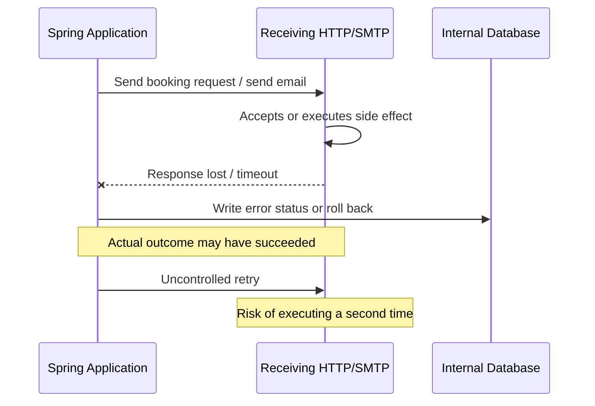
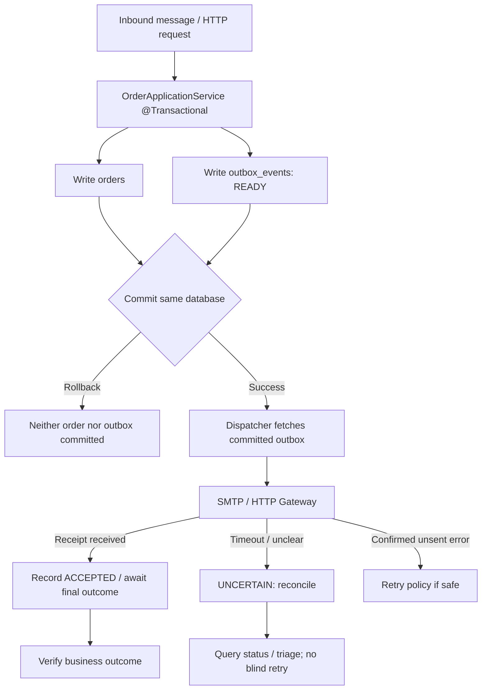
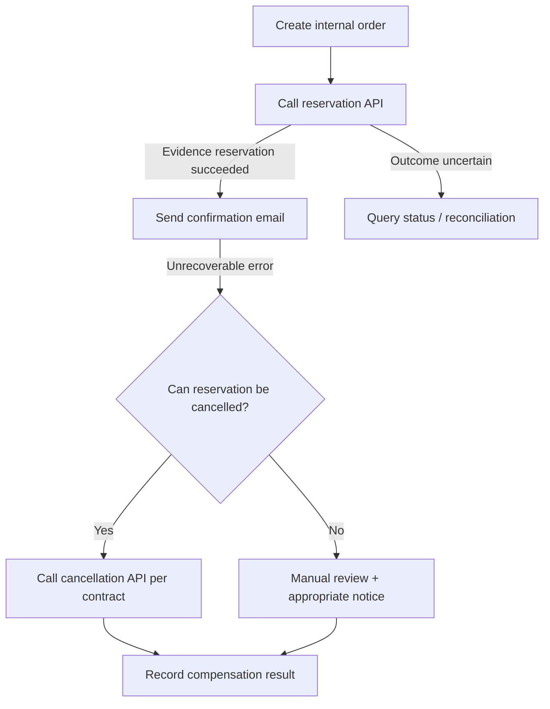

# Never Assume SMTP or HTTP Can Roll Back

In the **SPRING_INTEGRATION_PATTERN** module, we implement **Enterprise Integration Patterns (EIP)** with Spring Integration to build loosely coupled, extensible message flows. Routers, Filters, Transformers, Splitters, Aggregators, and Gateways often coordinate with databases, brokers, HTTP APIs, or SMTP servers. When a step fails, Spring Integration can emit an `ErrorMessage` over an error channel, retry, or route the message to a dead-letter queue. Yet one distinction must be crystal clear: **rolling back a transaction inside the application does not mean external actions outside the application are undone**.

The lesson **“Never Assume SMTP or HTTP Can Roll Back”** focuses on transaction boundaries when sending email or calling HTTP, failure windows after commit/before ACK, how to use the **Transactional Outbox**, **idempotency**, **reconciliation**, and **compensation**, along with Java/Spring Integration examples and a test suite. The goal is to build flows that behave correctly when an external side effect **may have already occurred while the application is uncertain of the outcome**.

> **Key point:** A database transaction guarantees atomicity only for **resources that genuinely participate in that transaction**. Standard SMTP or HTTP calls do not participate in a JDBC transaction; calling `rollback` cannot “unsend an email” or “cancel an HTTP request already processed by a partner”.

## 1. What Scope Does a Transaction Protect?

Consider an order-creation workflow:

1. Write `orders` to the database.
2. Call a partner's reservation HTTP API.
3. Send a confirmation email via SMTP.
4. Update status and return the result.

Putting all four steps inside one `@Transactional` method **does not automatically create a distributed transaction** covering the database, HTTP server, and SMTP server. The actual scope is:

| Component | Can it join the default JDBC transaction? | What happens when JDBC rolls back |
| --- | --- | --- |
| Same database, matching transaction manager/connection | Yes | Uncommitted changes are undone |
| Another database | Not by default | Depends on actual transaction coordination |
| Publish to a broker | Not by default | Requires separate transaction/confirm or outbox mechanics |
| Sent HTTP request | No | The partner may already have executed and committed |
| Message accepted by SMTP server | No | An email accepted by the SMTP relay may continue being delivered |
| Async call in another thread/process | Not by default | Must not infer it shares the transaction or context |

Even with JTA/XA across **protocol-compatible resources**, never extrapolate that arbitrary HTTP endpoints or standard SMTP servers can enlist in that transaction. Spring `@Transactional`, `TransactionInterceptor`, or poller transactions **are not magic wands that undo remote side effects**.

### Anti-Example: Calling External Services While a JDBC Transaction Is Open

```java
@Service
public class OrderApplicationService {
    private final OrderRepository orders;
    private final PartnerHttpClient partner;
    private final MailGateway mail;

    @Transactional
    public void placeOrder(CreateOrderCommand command) {
        orders.insert(command.orderId());

        partner.reserve(command.orderId());  // Outbound HTTP
        mail.sendConfirmation(command.orderId()); // Outbound SMTP

        orders.markConfirmed(command.orderId());

        // If an exception occurs here, DB may roll back.
        // Yet reserve() or sendConfirmation() may already have taken effect.
    }
}
```

This code is an **anti-example**, with helper classes serving as illustrative business interfaces. If an error occurs after `partner.reserve(...)` or `mail.sendConfirmation(...)`, the database transaction can roll back while the partner already booked the reservation or the SMTP relay accepted the email. The system lands in a state where **external side effects succeeded while internal state reports failure**.

**Do not try to fix this merely by catching every exception.** Swallowing errors can even cause the system to report success when a critical step failed. Design explicit result contracts and recovery mechanisms per side effect.

## 2. A Timeout Does Not Mean the Side Effect Failed

In a request–response model, the sender observes the outcome of **the response path**, not directly every internal state inside the receiving server.



A timeout has **at least three possibilities**:

- The request never reached the server: no side effect occurred.
- The request reached the server, yet the server did not execute it.
- The request executed or entered the server's queue, and only the response was lost.

Without a status-checking mechanism, the application usually **cannot reliably distinguish** those three cases. Blind retries can cause duplicate emails, duplicate bookings, double payments, or firing webhooks twice.

### HTTP: Success Codes and Limited Idempotency

| Situation | What can be asserted | What to do |
| --- | --- | --- |
| HTTP 2xx under a synchronous contract | Endpoint reports success per contract | Record result/receipt; verify business outcome if needed |
| HTTP 202 Accepted | Request accepted for later processing | Track job status; do not assume completion |
| HTTP timeout after sending | Uncertain whether server processed it | Query status or retry with a partner-supported idempotency key |
| HTTP 409 Conflict | Conflict per API contract | Classify: already-completed duplicate or business conflict? |
| HTTP 429 / 503 | Likely transient error | Retry within limits with backoff and `Retry-After` as appropriate |
| HTTP 400 from invalid payload | Usually won't fix itself on retry | Do not retry senselessly; route to data-error handling |

HTTP methods have idempotency properties at the spec level (e.g., PUT/DELETE), yet **never assume every external implementation honors business expectations**. In particular, POST usually creates side effects and needs an **idempotency contract genuinely enforced by the target server**.

A client-sent `Idempotency-Key` header **is not enough on its own**; the receiver must enforce deduplication rules, key scope, retention window, and handling of identical keys with differing payloads. On retries, reuse **the same key for the same business operation**, never minting a fresh key per attempt.

### SMTP: Sent Does Not Mean Delivered to Inbox

An SMTP relay can return an acceptance response (such as `250` after receiving data). That typically indicates **the relay accepted responsibility for further processing**, not that the recipient opened or even definitely received the final email.

If the client times out after the relay received data, the application may not know whether the message was accepted. Resending can produce **two emails**. Never assume `Message-ID` itself is an idempotency key used by every SMTP server or mailbox provider to deduplicate. To curb duplicates, use email-provider-specific APIs where available, reconcile delivery events/receipts, or define a risk-acceptance policy.

**A sent email is a side effect that cannot be rolled back via JDBC.** Sending a follow-up correction email is a **compensating action** (*compensation*), not “undoing” the previous email.

## 3. Failure Windows Within a Business Transaction

Suppose business logic wants both to write to the DB and call a partner:

| Ordering | Where does failure occur? | Possible state | Risk |
| --- | --- | --- | --- |
| Call HTTP/SMTP **before** DB commit | DB rolls back after external side accepted | External succeeded, DB has no record | “Orphaned” side effect |
| DB commit **before** calling HTTP/SMTP | App crashes after commit but before send | DB persisted, external call never ran | Missed task |
| Send succeeds, before marking DB | Crash / DB connection loss | External executed, DB still pending | Retry may duplicate |
| HTTP timeout after sending | Response lost | Uncertain whether executed | Blind retry |
| SMTP accepted by relay, response lost | Client assumes error | Email may already be in flight | Duplicate email |
| Marked sent successfully yet source not ACKed | Broker redelivers | Message reprocessed | Duplicates if lacking idempotency |

There is no simple linear ordering that guarantees **atomicity across JDBC and SMTP/HTTP** merely by moving the call before or after `commit`.

### Why “Send After Commit” Is Still Not Enough

`@TransactionalEventListener(phase = AFTER_COMMIT)` or `TransactionSynchronization.afterCommit()` helps avoid calling external services before a transaction commits. Yet callbacks **run in the current process**. If the application stops right after DB commit, the callback may never run; the event has no durable record to recover from.

Sending after commit is useful when **best-effort** is acceptable. If losing notifications or outbound commands is unacceptable, persist the **send intent** in the same transaction as business changes, e.g. via the **Transactional Outbox**.

## 4. Transactional Outbox: Committing Data and Send Intent Together

The outbox pattern writes **business state** and an **outbox event/command** within **the same database transaction**. A separate dispatcher picks up committed events and sends them over HTTP/SMTP or a broker.



**What does the outbox guarantee?** If the database transaction commits, both the order and the send intent exist; if it rolls back, neither is persisted. However, the dispatcher can finish sending and crash before marking as sent. Therefore an outbox typically provides **at-least-once dispatch**, **not automatic exactly-once side effects** on SMTP or HTTP.

A system aiming for “no duplicate sends” must combine:
- Receiver-side idempotency where available (especially useful for HTTP).
- Status reconciliation when send outcomes are uncertain.
- Business contracts/compensation when receivers cannot deduplicate.
- Retry caps, alerts, quarantine states, and auditing.

## 5. Illustrative Order and Outbox Table Design

PostgreSQL example for sending a notification after an order is created:

```sql
CREATE TABLE orders (
    order_id UUID PRIMARY KEY,
    state VARCHAR(24) NOT NULL,
    created_at TIMESTAMPTZ NOT NULL DEFAULT NOW()
);

CREATE TABLE outbox_events (
    event_id UUID PRIMARY KEY,
    order_id UUID NOT NULL REFERENCES orders(order_id),
    effect_type VARCHAR(64) NOT NULL,
    status VARCHAR(24) NOT NULL DEFAULT 'READY',
    attempt_count INTEGER NOT NULL DEFAULT 0
        CHECK (attempt_count >= 0),
    created_at TIMESTAMPTZ NOT NULL DEFAULT NOW(),
    next_attempt_at TIMESTAMPTZ NOT NULL DEFAULT NOW(),
    claimed_at TIMESTAMPTZ,
    accepted_at TIMESTAMPTZ,
    last_reason_code VARCHAR(80),
    CONSTRAINT uq_outbox_order_effect
        UNIQUE (order_id, effect_type)
);

CREATE INDEX idx_outbox_ready
    ON outbox_events (next_attempt_at, created_at)
    WHERE status = 'READY';

CREATE INDEX idx_outbox_claimed
    ON outbox_events (claimed_at)
    WHERE status = 'CLAIMED';
```

`event_id` is the stable identifier of **one send intent**. `attempt_count` increments when the dispatcher claims a processing attempt, **not** as proof the external service received it. Illustrative statuses:

| Status | Meaning | Policy |
| --- | --- | --- |
| `READY` | Intent committed, no worker currently holds it | Eligible to claim |
| `CLAIMED` | One worker acquired processing ownership | No other worker sends independently |
| `ACCEPTED` | Protocol/partner confirmed per contract | Track final outcome if API is async |
| `UNCERTAIN` | Uncertain whether request was received/executed | Reconcile; do not blindly retry |
| `RETRY_READY` | Evidence shows safe to retry; needs scheduling | Transition to `READY` only per policy |
| `QUARANTINED` | Budget exhausted or manual decision needed | Do not auto-replay |
| `COMPLETED` | Final business outcome verified | Close and audit |

This table simplifies to **one notification type per order**; the `UNIQUE(order_id, effect_type)` constraint would need adjustment if business rules allow multiple notifications of the same type across different updates. The example avoids storing emails or tokens in the outbox; the dispatcher should resolve target details from an authorized datastore or protected payload reference.

### Java: Writing Order and Outbox in the Same Transaction

```java
package demo.integration;

import java.util.UUID;

import org.springframework.jdbc.core.JdbcTemplate;
import org.springframework.stereotype.Service;
import org.springframework.transaction.annotation.Transactional;

@Service
public class OrderApplicationService {

    private final JdbcTemplate jdbc;

    public OrderApplicationService(JdbcTemplate jdbc) {
        this.jdbc = jdbc;
    }

    @Transactional
    public UUID createOrder(UUID orderId) {
        jdbc.update(
                "INSERT INTO orders (order_id, state) VALUES (?, ?)",
                orderId, "CREATED");

        UUID eventId = UUID.randomUUID();
        jdbc.update("""
                INSERT INTO outbox_events
                    (event_id, order_id, effect_type, status)
                VALUES (?, ?, ?, 'READY')
                """,
                eventId, orderId, "SEND_ORDER_CONFIRMATION");

        // DO NOT call SMTP/HTTP here.
        // An error on the second INSERT rolls back the whole transaction
        // if managed by the same DataSourceTransactionManager.
        return eventId;
    }
}
```

In this example, `@Transactional` requires a configured transaction manager and invoking the method through a Spring proxy. Never call the method from inside the same class via `this.createOrder(...)` expecting the transaction proxy to work. `JdbcTemplate` must use the same `DataSource` and right transaction manager. Configuration details depend on the application.

**Never place `gateway.sendEmail(...)` after the two INSERTs while still inside the `@Transactional` method.** Decoupling dispatch from the transaction is the very essence of the outbox.

## 6. Claiming Outbox Rows Safely with Multiple Dispatchers

If two instances simultaneously read `READY` and send before updating status, both may invoke HTTP/SMTP. You need **atomic claiming** from the database.

PostgreSQL example using `FOR UPDATE SKIP LOCKED`:

```sql
WITH selected AS (
    SELECT event_id
    FROM outbox_events
    WHERE status = 'READY'
      AND next_attempt_at <= NOW()
    ORDER BY created_at
    FOR UPDATE SKIP LOCKED
    LIMIT :batch_size
)
UPDATE outbox_events AS outbox
SET status = 'CLAIMED',
    claimed_at = NOW(),
    attempt_count = attempt_count + 1
FROM selected
WHERE outbox.event_id = selected.event_id
RETURNING outbox.event_id, outbox.order_id,
          outbox.effect_type, outbox.attempt_count;
```

The claim query must run in its own database transaction and commit **before starting outbound calls**. Never hold JDBC locks/transactions open for the duration of HTTP/SMTP network calls. With multiple workers, a row should only be claimed by one worker at a time.

**Crash while `CLAIMED`:** a record can get stuck if a worker dies. Never automatically reset all stale `CLAIMED` rows back to `READY` and resend SMTP, because the worker might have finished sending without recording status. A **reconciliation** job is needed to determine which completed, which definitely never sent, and which remain unclear.

For HTTP APIs with supported, still-valid idempotency keys, replaying with the same key can be contractually safe. With standard SMTP, retrying after an uncertain result can produce duplicate emails; choosing manual handling vs. accepting duplicates must be an explicit decision.

## 7. Dispatcher: Do Not Equate `send()` with the Final Outcome

An illustrative dispatcher takes claimed records, calls an abstract gateway, and updates status. The snippets below use Java 17 and Spring JDBC/Scheduling.

```java
package demo.integration;

import java.util.List;
import java.util.UUID;

import org.springframework.jdbc.core.JdbcTemplate;
import org.springframework.stereotype.Repository;
import org.springframework.transaction.annotation.Transactional;

@Repository
public class OutboxRepository {

    private final JdbcTemplate jdbc;

    public OutboxRepository(JdbcTemplate jdbc) {
        this.jdbc = jdbc;
    }

    public record ClaimedEvent(
            UUID eventId, UUID orderId,
            String effectType, int attemptCount) {}

    @Transactional
    public List<ClaimedEvent> claimBatch(int batchSize) {
        return jdbc.query("""
                WITH selected AS (
                    SELECT event_id
                    FROM outbox_events
                    WHERE status = 'READY'
                      AND next_attempt_at <= NOW()
                    ORDER BY created_at
                    FOR UPDATE SKIP LOCKED
                    LIMIT ?
                )
                UPDATE outbox_events AS o
                SET status = 'CLAIMED',
                    claimed_at = NOW(),
                    attempt_count = attempt_count + 1
                FROM selected
                WHERE o.event_id = selected.event_id
                RETURNING o.event_id, o.order_id,
                          o.effect_type, o.attempt_count
                """,
                (rs, rowNum) -> new ClaimedEvent(
                        rs.getObject("event_id", UUID.class),
                        rs.getObject("order_id", UUID.class),
                        rs.getString("effect_type"),
                        rs.getInt("attempt_count")),
                batchSize);
    }

    @Transactional
    public void markAccepted(UUID eventId) {
        int updated = jdbc.update("""
                UPDATE outbox_events
                SET status = 'ACCEPTED', accepted_at = NOW(),
                    last_reason_code = NULL
                WHERE event_id = ? AND status = 'CLAIMED'
                """, eventId);

        if (updated != 1) {
            throw new IllegalStateException("OUTBOX_STATE_CHANGED");
        }
    }

    @Transactional
    public void markUncertain(UUID eventId) {
        int updated = jdbc.update("""
                UPDATE outbox_events
                SET status = 'UNCERTAIN',
                    last_reason_code = 'DELIVERY_OUTCOME_UNKNOWN'
                WHERE event_id = ? AND status = 'CLAIMED'
                """, eventId);

        if (updated != 1) {
            throw new IllegalStateException("OUTBOX_STATE_CHANGED");
        }
    }
}
```

Note: `claimBatch()` uses PostgreSQL syntax (it does not run verbatim on every database). This repository omits leases, HTTP status classification, retention, or full auditing—all needed for production deployments.

```java
package demo.integration;

import org.springframework.scheduling.annotation.Scheduled;
import org.springframework.stereotype.Component;

@Component
public class OutboxDispatcher {

    private final OutboxRepository repository;
    private final ExternalEffectGateway gateway;

    public OutboxDispatcher(
            OutboxRepository repository, ExternalEffectGateway gateway) {
        this.repository = repository;
        this.gateway = gateway;
    }

    @Scheduled(fixedDelay = 5_000)
    public void dispatch() {
        for (var event : repository.claimBatch(20)) {
            try {
                // Gateway may already have caused side effects before throwing.
                gateway.deliver(event);
            } catch (Exception failure) {
                // Do not log raw payloads/credentials/exception messages.
                // Transition to UNCERTAIN for investigation/reconciliation.
                repository.markUncertain(event.eventId());
                continue;
            }

            // Only asserts gateway returned per contract.
            // If DB fails here, record may stay CLAIMED
            // even though external side received it: DO NOT auto-resend.
            repository.markAccepted(event.eventId());
        }
    }

    public interface ExternalEffectGateway {
        void deliver(OutboxRepository.ClaimedEvent event);
    }
}
```

This example is **deliberately conservative**: when `gateway.deliver(...)` throws, it moves the record to `UNCERTAIN`, even if the error could have occurred before sending. Production applications should classify into “confirmed not sent”, “confirmed accepted”, “uncertain outcome”, and “permanently rejected”, and only then choose retry, quarantine, or reconciliation. Not every error requires manual triage, yet never blindly retry every error. For `@Scheduled` to actually execute, scheduling must be enabled (e.g., `@EnableScheduling` in Spring config) and the required gateway/repository beans registered.

**Important limitation:** `markAccepted(...)` itself can fail after the gateway returns. The record remains `CLAIMED`; reconciliation must resolve it rather than resending endlessly. If `markUncertain(...)` also hits a database outage, status may stay `CLAIMED`, so alert on repository errors and run a job checking overdue claims.

### Integrating into Spring Integration

Spring Integration can orchestrate dispatcher steps, yet **does not change atomicity boundaries**. Example of a synchronous channel invoking the gateway for a claimed event:

```java
package demo.integration;

import org.springframework.context.annotation.Bean;
import org.springframework.context.annotation.Configuration;
import org.springframework.integration.channel.DirectChannel;
import org.springframework.integration.config.EnableIntegration;
import org.springframework.integration.dsl.IntegrationFlow;
import org.springframework.messaging.MessageChannel;

@Configuration
@EnableIntegration
public class OutboxOutboundFlow {

    @Bean
    MessageChannel externalEffectInput() {
        return new DirectChannel();
    }

    @Bean
    IntegrationFlow externalEffectFlow(
            OutboxDispatcher.ExternalEffectGateway gateway) {
        return IntegrationFlow.from("externalEffectInput")
                .handle(gateway, "deliver")
                .get();
    }
}
```

If the dispatcher prefers calling through the channel instead of the gateway directly:

```java
// After claiming/committing outbox, outside JDBC transaction:
Message<OutboxRepository.ClaimedEvent> message =
        MessageBuilder.withPayload(event).build();
boolean accepted = externalEffectInput.send(message);
```

This snippet requires importing `org.springframework.messaging.Message` and `org.springframework.messaging.support.MessageBuilder`. With `DirectChannel` and a synchronous handler, exceptions propagate back to the caller, yet **`accepted == true` does not necessarily prove an async HTTP API completed business work or an email reached the recipient**. Never use channel return values to claim external side effects were rolled back.

When using `RequestHandlerRetryAdvice` on an outbound handler, remember that **every retry may repeat the side effect**. If the gateway does not guarantee idempotency, default retry advice can send duplicate emails. Retry/error channel paths must reflect the specific HTTP/SMTP contract and classify uncertain outcomes.

## 8. HTTP Idempotency: Sending the Same Intent with the Same Key

When a partner supports proper idempotency keys, pass the stable key from the outbox:

```java
package demo.integration;

import org.springframework.web.client.RestClient;

public final class PartnerHttpGateway
        implements OutboxDispatcher.ExternalEffectGateway {

    private final RestClient client;

    public PartnerHttpGateway(RestClient client) {
        this.client = client;
    }

    @Override
    public void deliver(OutboxRepository.ClaimedEvent event) {
        client.post()
              .uri("/partner/orders/{id}/reserve", event.orderId())
              // Never generate a new UUID per attempt.
              .header("Idempotency-Key", event.eventId().toString())
              .retrieve()
              .toBodilessEntity();
    }
}
```

This uses Spring Framework's `RestClient` and **does not guarantee every partner supports this header**. The receiver must record the key atomically alongside the action or via a recoverable design; check docs for key TTL, collisions, payload mismatches, and replay response semantics. If a key expires before retry, duplicate risk returns.

**Classify responses per contract:**
- HTTP 2xx may mean accepted; for 202, keep tracking the async outcome.
- HTTP timeout is **unknown**, never assume “did not run”.
- When the API exposes a status query endpoint by `eventId` or external operation ID, use it to reconcile.
- Without idempotency support or status querying, use manual review/compensation workflows instead of infinite auto-retries.

With RabbitMQ/JMS/Kafka as input sources, the broker can redeliver a message after restart or NACK. **Idempotency must cover both in-app retries and broker redeliveries**, not just a single `RetryTemplate` cycle.

## 9. SMTP: Duplicate Email Policies and Ambiguous Outcomes

Unlike many business HTTP APIs, standard SMTP does not provide an end-to-end idempotency protocol for email delivery. On connection errors, you cannot always tell whether the relay accepted the email.

An appropriate policy can be:

1. Each business notification has a stable `notificationId` in the outbox.
2. Before sending, persist controlled send metadata (never log tokens).
3. After the SMTP gateway returns acceptance, mark **ACCEPTED_BY_RELAY** or equivalent—never report “email read”.
4. If the outcome is uncertain, move the record to `UNCERTAIN`; check provider events/receipts if available, or reconcile manually.
5. If a retry is necessary, acknowledge duplicate risk and prioritize accordingly (e.g., a reminder notification may tolerate duplicates better than a transaction-triggering email).
6. If an erroneous email was sent, the next action is **a correction notice or compensating workflow**, not rolling back data sent over SMTP.

**You can use an email provider with an idempotent API or custom event IDs**, provided you verify that service's specific contract. Never attribute that capability to standard SMTP or `Message-ID` by default.

### Retry Decisions by Side Effect Type

| Side effect | If outcome is uncertain | Handling direction |
| --- | --- | --- |
| Booking-creation HTTP call, server supports idempotency | Can resend with **same key** within retention window | Bounded retry/backoff; query status |
| Payment HTTP call without idempotency | Cannot tell if already charged | Reconcile transaction before retrying |
| Order confirmation SMTP | Relay may have accepted; email may duplicate | Check provider events; explicit duplicate policy |
| Marketing/reminder email | Duplicates may annoy recipients | Prefer caps/approvals and dedupe |
| Idempotent read-only HTTP GET per contract | Usually retryable | Cap attempts/timeouts, respect rate limits |
| Idempotent command past business deadline | Retry may still be invalid business-wise | Stop and transition to expired state |

## 10. Saga / Compensation Is Not a Physical Rollback

When a workflow spans multiple side effects, design a **Saga** with business compensating actions. For example:



**Compensation is a new task**, which can also fail, time out, or run twice. It needs its own idempotency, retry budget, correlation, audit, and monitoring. For instance, `cancelReservation()` may return an error even though the partner already cancelled; reconcile state rather than entering an infinite compensation loop.

An outbound email cannot be “unsent” via a JDBC transaction. A correction email only mitigates business impact; it does not erase the prior email's existence.

### Boundaries at Router, Splitter/Aggregator, and Gateway

- **Router:** branches have distinct side effects; an exception in one branch cannot roll back side effects already executed in another branch.
- **Splitter:** multiple fragments go to separate services; if the third fragment fails, the first two may already have succeeded.
- **Aggregator:** aggregated results may be incomplete; never blindly resend all fragments without checking idempotency/correlation.
- **Gateway:** a synchronous request can time out while async downstream continues processing; response timeout is not proof of rollback.
- **Error channel / dead letter:** provides error observability and isolation; **does not undo HTTP or SMTP requests**.

When designing a flow, draw **each system's commit boundary**, not just message arrows.

## 11. Testing Failure Windows, Not Just Happy Paths

To prove the design works, tests must hit every gap between **DB commit, claim, send, and status updates**.

| Test case | Scenario | Expectation |
| --- | --- | --- |
| 1 | Order INSERT succeeds, outbox INSERT fails | Both order and outbox roll back |
| 2 | DB commits, process crashes before dispatcher | Outbox stays `READY` and can be claimed after restart |
| 3 | Two dispatchers claim concurrently | Each event is claimed by only one worker |
| 4 | HTTP action succeeds yet response times out | Status becomes `UNCERTAIN`; no new key minted |
| 5 | HTTP retried with same idempotency key | Server deduplicates if contract supports it |
| 6 | SMTP relay accepted, client loses connection | Do not treat as confirmed unsent; avoid blind resend |
| 7 | Gateway succeeds, DB fails during `markAccepted` | Event may stay `CLAIMED`; reconciliation avoids unconditional resend |
| 8 | Worker dies while `CLAIMED` | Do not auto-reset `READY` for non-idempotent actions |
| 9 | Broker redelivers same event | Dedupe/idempotency prevents invalid repeat side effects |
| 10 | Retries exhausted yet side effect still unknown | Route to quarantine/triage without losing history |
| 11 | Compensation API times out | Check compensation state; do not assume cancelled |
| 12 | Saving audit/dead letter fails | Do not log raw payloads or silently report saved |
| 13 | Event has correlation ID and tenant | Maintain reliable tracing without leaking sensitive info |

For PostgreSQL and transactions/repositories, write **integration tests on a database with matching lock/transaction behavior**, such as an isolated test DB or Testcontainers. Mocked-database tests do not verify `SKIP LOCKED` and production-like transaction semantics.

### Unit Test: Decision Policy When Send Outcome Is Unclear

We can isolate post-call decisions into a pure function for clear testing:

```java
package demo.integration;

public final class DispatchDecisionPolicy {
    private DispatchDecisionPolicy() {}

    public enum Outcome {
        CONFIRMED_ACCEPTED,
        CONFIRMED_NOT_SENT,
        UNKNOWN
    }

    public enum Action {
        MARK_ACCEPTED,
        RETRY_AFTER_BACKOFF,
        RECONCILE
    }

    public static Action decide(
            Outcome outcome, boolean retryAllowed,
            int attemptsMade, int maxAttempts) {

        if (attemptsMade < 1 || maxAttempts < 1) {
            throw new IllegalArgumentException("Invalid attempts");
        }
        if (outcome == Outcome.CONFIRMED_ACCEPTED) {
            return Action.MARK_ACCEPTED;
        }
        if (outcome == Outcome.UNKNOWN) {
            // Never allow blind retry even if budget remains.
            return Action.RECONCILE;
        }
        // Applies only with evidence the request was NOT sent.
        if (retryAllowed && attemptsMade < maxAttempts) {
            return Action.RETRY_AFTER_BACKOFF;
        }
        return Action.RECONCILE;
    }
}
```

JUnit 5 example:

```java
package demo.integration;

import static demo.integration.DispatchDecisionPolicy.*;
import static org.assertj.core.api.Assertions.assertThat;

import org.junit.jupiter.api.Test;

class DispatchDecisionPolicyTest {

    @Test
    void unknownOutcomeMustBeReconciledNotBlindlyRetried() {
        assertThat(decide(Outcome.UNKNOWN, true, 1, 5))
                .isEqualTo(Action.RECONCILE);
    }

    @Test
    void confirmedAcceptedMustNotBeRetried() {
        assertThat(decide(Outcome.CONFIRMED_ACCEPTED, true, 1, 5))
                .isEqualTo(Action.MARK_ACCEPTED);
    }

    @Test
    void confirmedNotSentCanRetryWithinBudget() {
        assertThat(decide(Outcome.CONFIRMED_NOT_SENT, true, 1, 3))
                .isEqualTo(Action.RETRY_AFTER_BACKOFF);
    }

    @Test
    void confirmedNotSentStopsAtBudget() {
        assertThat(decide(Outcome.CONFIRMED_NOT_SENT, true, 3, 3))
                .isEqualTo(Action.RECONCILE);
    }
}
```

This is an **illustrative policy test**, not run in a repository at STEP 4. Never assume every exception can safely be classified as `CONFIRMED_NOT_SENT`. To prove that, the adapter or protocol must supply solid evidence; timeouts after starting transmission usually belong to `UNKNOWN`.

## 12. Observability, Correlation, and Dead Letters for Multi-System Transactions

A transactional messaging system needs visibility into **task state** rather than just counting exceptions:

| Suggested metric / signal | Meaning |
| --- | --- |
| `outbox_ready_total` | Committed intents not yet dispatched |
| `outbox_oldest_ready_age_seconds` | Age of oldest waiting intent |
| `outbox_claimed_stale_total` | Claims exceeding expected duration, needing reconciliation |
| `external_effect_accepted_total` | Partner/relay confirmed acceptance |
| `external_effect_uncertain_total` | Tasks with uncertain outcomes |
| `external_effect_reconciled_total` | Tasks reconciled |
| `external_effect_duplicate_prevented_total` | Tasks deduplicated by idempotency (if measurable) |
| `compensation_failed_total` | Failed business compensations |
| `outbox_quarantined_total` | Intents needing manual intervention |

Metric names are **suggestions**, not automatically built-in metrics. Use low-cardinality labels like `flowId`, `effectType`, `reasonCode`, `partner`; never put raw order IDs, emails, tokens, or request bodies in metric labels.

Auditing should record:
- Allowed identifiers `eventId`, `correlationId`, `orderId`, and `effectType`.
- Local transaction and outbox status (READY, CLAIMED, ACCEPTED, UNCERTAIN, COMPLETED).
- External operation ID, idempotency key reference, and reconciliation trace if available.
- Timestamps for claim, send, receipt, callback, and reconciliation outcome.
- Operator decisions on manual retries or compensations.

Never write raw Authorization headers, SMTP credentials, full payloads, or unfiltered exception messages into audits/logs. If payloads must be kept for replay, use a dedicated schema and protected store referenced by the outbox/dead letter.

## 13. Common Design Mistakes

| Mistake | Consequence | Fix |
| --- | --- | --- |
| Wrapping DB + SMTP/HTTP in `@Transactional` expecting everything to roll back | DB rolls back while side effects still happen | Define transaction boundaries; outbox/reconciliation |
| Calling HTTP/SMTP before DB commit | Orphaned side effects when DB rolls back | Persist intent durably with business state |
| Using `AFTER_COMMIT` callback as the sole queue | Crash after commit loses tasks | Transactional Outbox |
| Retrying HTTP POST with a new idempotency key every time | Duplicate bookings/payments | Stable key and server-side dedupe support |
| Retrying SMTP after timeout as if definitely unsent | Duplicate emails | `UNCERTAIN`, reconciliation/duplicate policy |
| Treating SMTP accepted as delivered/read | Incorrect state auditing | Distinguish accepted/delivered/bounced/read |
| Auto-resetting all stale `CLAIMED` rows to `READY` | Duplicate external invocations | Leases, reconciliation, idempotency checks |
| Holding JDBC transaction open during HTTP calls | Long locks, lower throughput, still no HTTP rollback | Claim/commit before calling external services |
| Treating successful publish as business completion | Downstream errors surface later | Track final business status |
| Treating compensation as infallible rollback | Cross-system state drift | Saga with its own retry/idempotency/audit |
| No dead letter/quarantine for unknown outcomes | Infinite retry loops or lost trails | `UNCERTAIN` state, exception handling SLA |
| Logging full request/headers on error | Token and PII leaks | Error taxonomy + sanitized logging |

## 14. Self-Check Questions

1. Why can't `@Transactional` undo a sent email or a booking created over HTTP?
2. What are the real possible outcomes of an HTTP timeout after POST? Why shouldn't you infer “server hasn't processed it”?
3. What does an SMTP server returning `250` prove, and what does it not prove?
4. Why isn't an `AFTER_COMMIT` listener sufficient to replace a Transactional Outbox when zero lost tasks are required?
5. Which two types of changes does an Outbox make atomic? Does it create exactly-once effects outside the system?
6. When two workers concurrently read `READY` records, how do you prevent both from sending the same task?
7. A worker crashes after HTTP succeeds but before `markAccepted`. Why can't it automatically resend with a new key?
8. Why isn't an SMTP `Message-ID` an idempotency mechanism guaranteed by every relay?
9. For an HTTP API with idempotency keys, what should the key be tied to and how long should it live?
10. When is reconciliation or quarantine needed instead of retries?
11. If a Saga already sent an email and then must cancel a reservation, what compensation can run and what cannot be undone?
12. In Splitter/Aggregator, why doesn't rolling back one branch guarantee other branches had no side effects?
13. Which failure windows must be tested between DB commit, claim, send, receipt, and ACK?
14. How do you monitor `UNCERTAIN` states without leaking payloads or credentials?

## References

- [Spring Framework Reference — Transaction Management](https://docs.spring.io/spring-framework/reference/data-access/transaction.html): transaction scope and mechanics.
- [Spring Framework Reference — Transaction-bound Events](https://docs.spring.io/spring-framework/reference/data-access/transaction/event.html): `@TransactionalEventListener` and phases.
- [Spring Integration Reference — Transaction Support](https://docs.spring.io/spring-integration/reference/transactions.html): transactions in endpoints/pollers.
- [Spring Integration Reference — Error Handling](https://docs.spring.io/spring-integration/reference/error-handling.html): `ErrorMessage`, error channels, and recovery flows.
- [Spring Integration Reference — Handler Advice](https://docs.spring.io/spring-integration/reference/handler-advice.html): retry advice and handler scope.
- [RFC 9110 — HTTP Semantics](https://www.rfc-editor.org/rfc/rfc9110): response codes and HTTP method idempotency semantics.
- [RFC 5321 — Simple Mail Transfer Protocol](https://www.rfc-editor.org/rfc/rfc5321): SMTP and message acceptance/responses.
- [Microservices.io — Transactional Outbox Pattern](https://microservices.io/patterns/data/transactional-outbox): pattern for saving send intent alongside business transactions.

**Takeaway:** **DB rollback cannot undo side effects that already occurred via SMTP or HTTP**. Proper design separates internal commits from remote outcomes; persists send intent via a Transactional Outbox when durability is required; uses receiver-supported idempotency; treats timeouts as *uncertain outcomes*; reconciles before unsafe retries; and treats compensation as a new, fallible business operation rather than assuming system-wide rollback.
