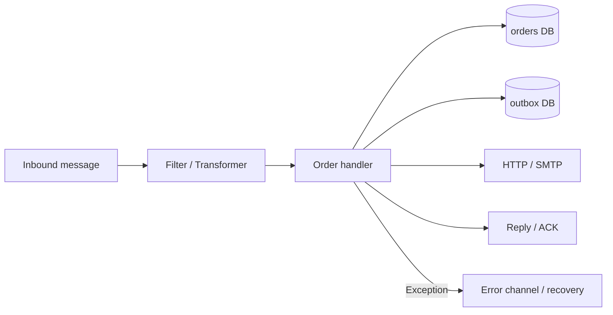
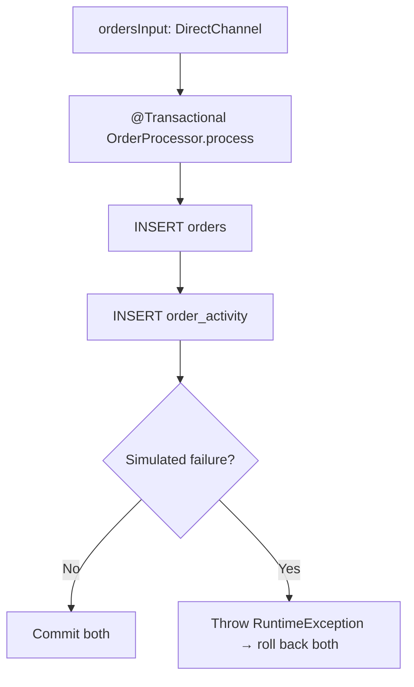
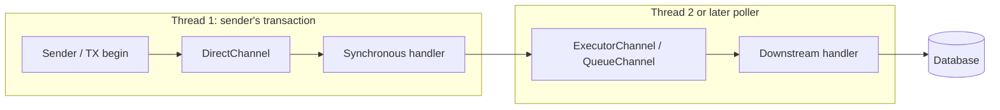
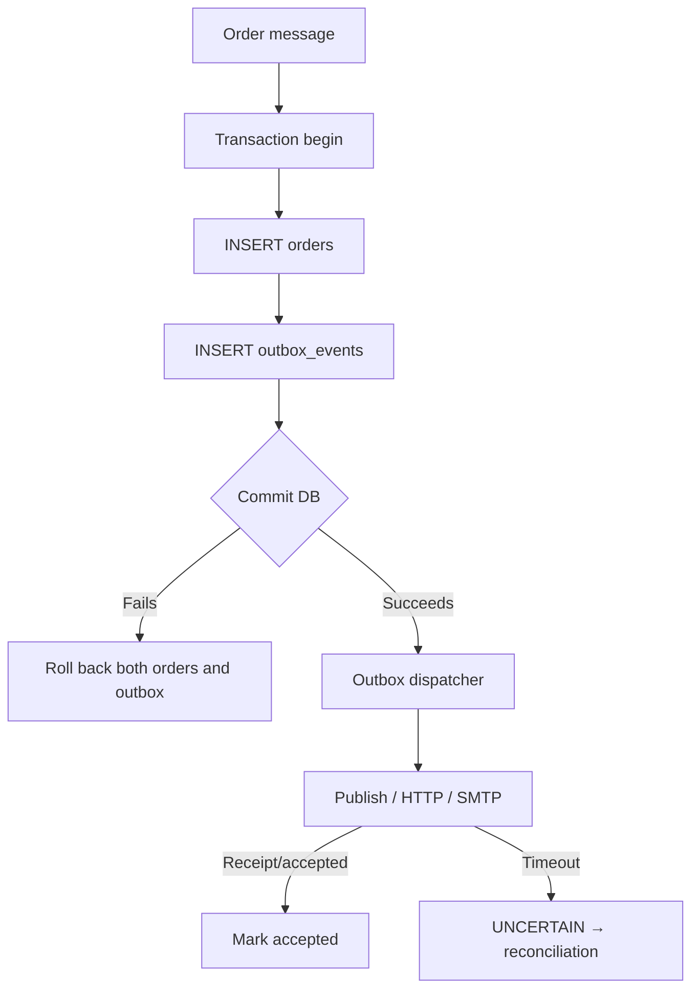

# Testing Transactions with Message Flows

In the **SPRING_INTEGRATION_PATTERN** module, Spring Integration is used to implement **Enterprise Integration Patterns** (Router, Filter, Transformer, Splitter, Aggregator, Gateway, retry, error channel, and correlation) to build **loosely coupled, extensible** message flows. When flows read or write databases, receive messages from brokers, or call external systems, transactions help bound partial states. Yet **configuring transactions is not enough to prove the system handles errors properly**: you must test commits, rollbacks, ACK/redelivery, idempotency, and process-crash windows.

The lesson **“Testing Transactions with Message Flows”** shows how to define transaction boundaries, design test scenarios, and illustrate them with **Java 17+, Spring Integration 6.x, Spring JDBC, Spring Test, and JUnit 5**. We will practice on a synchronous flow using `DirectChannel`, then extend that reasoning to `QueueChannel`, `ExecutorChannel`, pollers, brokers, retries, dead letters, and the transactional outbox.

> **Testing principle:** Do not just verify that a handler throws an exception. You must verify **persisted state after the exception escapes**, where the message is acknowledged or redelivered, and which side effects fall outside the same transaction.

## 1. Define Transaction Scope Before Writing Tests

A message can traverse multiple endpoints:



Those arrows **do not implicitly belong to a single transaction**. Clarify:

- Which transaction manager governs which resource: JDBC `DataSourceTransactionManager`, JPA transaction manager, or broker transactions?
- Where does the transaction begin: inbound poller, endpoint advice, or a `@Transactional` service?
- Do endpoints run on **the same thread** and share the same transaction context?
- When an exception occurs, does it escape to the transaction boundary to trigger rollback?
- Which resources do **not** participate in the transaction: HTTP APIs, SMTP, and most external actions?
- After commit or rollback, under what contract does the inbound adapter **ACK/NACK/redeliver**?

### Distinguishing Guarantees

| Concept | What to test | What must NOT be inferred |
| --- | --- | --- |
| **Local atomicity** | Two changes in the same DB or resource transaction commit/roll back together | That HTTP/SMTP operations also roll back |
| **Transaction propagation** | Do same-thread calls join the active transaction as configured? | That a new thread carries the transaction over |
| **Broker redelivery** | Is the message redelivered on failure per adapter/broker config? | That every DB error produces exactly one redelivery |
| **At-least-once processing** | Messages are not lost on retries; duplicates may occur | That zero duplicates occur |
| **Idempotent business effect** | Receiving the same `eventId` again causes no duplicate side effects | That the whole system is end-to-end exactly-once |
| **Transactional outbox** | Business state and event send intent commit together in the DB transaction | That external partners receive strictly once |
| **Dead letter** | Failed messages are persisted per policy with diagnostic info | That sending to a channel named “deadLetter” implies durable storage |

With default Spring `@Transactional`, `RuntimeException` and `Error` usually trigger rollback; checked exceptions do not trigger rollback by default unless `rollbackFor` is configured. If a service catches the exception and returns normally, the transaction may commit. These are behaviors **that must have tests**.

## 2. Build a Test Matrix Before Implementation

A solid strategy combines multiple layers:

| Layer | Suggested tools | What it proves | Limitations |
| --- | --- | --- | --- |
| Policy unit tests | JUnit 5, AssertJ | Which error types retry, duplicate handling, failure states | Does not prove real commits |
| Local DB integration tests | Spring Test, H2, or suitable DB | `@Transactional` and writes/rollbacks on the same database | Differs from production on locking, isolation, and SQL |
| Production-compatible DB integration tests | Testcontainers PostgreSQL/MySQL | Isolation, unique constraints, `SKIP LOCKED`, real rollbacks | Higher resource cost |
| Broker integration tests | Broker running in test environment | ACK/NACK, redelivery, DLQ, consumer crash | Depends on adapter and broker settings |
| End-to-end failure tests | Test setup with DB, broker, HTTP stub, audit | Commit–publish–ACK failure windows, duplicates, reconciliation | Hard to reproduce every crash/network failure |
| Observability tests | Metrics, tracing, audit assertions | Evidence of commit/rollback and failure state | Metrics/logs do not replace data checks |

**You do not need the same test type for every risk.** Unit tests suffice for error-classification logic, but if the goal is proving transaction rollback after real database writes, you need integration tests with the matching transaction manager. For brokers, test against a real broker or equivalent environment to avoid false conclusions from mocks.

## 3. Baseline Example: Synchronous Handler with a JDBC Transaction

Let's build a simple flow:

1. Input channel receives a `String` order ID.
2. `OrderProcessor` executes two INSERTs into `orders` and `order_activity`.
3. If the order ID starts with `FAIL-`, the processor throws an exception **after both INSERTs**.
4. Both statements are managed by `@Transactional` on one service.
5. The handler is invoked from a `DirectChannel`, so execution runs synchronously on the sender's thread in this example.

Test goal: **a successful message populates both tables; a failing message leaves zero rows in either table**.



### 3.1. Configuring Spring Integration and the Transaction Manager

The example below is a **standalone test configuration**, suitable for package `demo.integration`. It uses an embedded H2 database to demonstrate local transactions; include appropriate dependencies for Spring Integration, Spring JDBC, Spring AOP/transactions, Spring Test, JUnit Jupiter, AssertJ, and H2.

```java
package demo.integration;

import javax.sql.DataSource;

import org.springframework.context.annotation.Bean;
import org.springframework.context.annotation.Configuration;
import org.springframework.integration.channel.DirectChannel;
import org.springframework.integration.config.EnableIntegration;
import org.springframework.integration.dsl.IntegrationFlow;
import org.springframework.jdbc.core.JdbcTemplate;
import org.springframework.jdbc.datasource.DataSourceTransactionManager;
import org.springframework.jdbc.datasource.embedded.EmbeddedDatabaseBuilder;
import org.springframework.jdbc.datasource.embedded.EmbeddedDatabaseType;
import org.springframework.messaging.MessageChannel;
import org.springframework.transaction.PlatformTransactionManager;
import org.springframework.transaction.annotation.EnableTransactionManagement;
import org.springframework.transaction.annotation.Transactional;
import org.springframework.transaction.support.TransactionSynchronizationManager;

@Configuration
@EnableIntegration
@EnableTransactionManagement(proxyTargetClass = true)
public class TransactionalFlowTestConfiguration {

    @Bean
    DataSource dataSource() {
        return new EmbeddedDatabaseBuilder()
                .setType(EmbeddedDatabaseType.H2)
                .build();
    }

    @Bean
    JdbcTemplate jdbcTemplate(DataSource dataSource) {
        return new JdbcTemplate(dataSource);
    }

    @Bean
    PlatformTransactionManager transactionManager(
            DataSource dataSource) {
        return new DataSourceTransactionManager(dataSource);
    }

    @Bean
    MessageChannel ordersInput() {
        return new DirectChannel();
    }

    @Bean
    OrderProcessor orderProcessor(JdbcTemplate jdbc) {
        return new OrderProcessor(jdbc);
    }

    @Bean
    IntegrationFlow ordersFlow(OrderProcessor processor) {
        return IntegrationFlow.from("ordersInput")
                .handle(processor, "process")
                .get();
    }

    public static class OrderProcessor {
        private final JdbcTemplate jdbc;

        public OrderProcessor(JdbcTemplate jdbc) {
            this.jdbc = jdbc;
        }

        @Transactional
        public void process(String orderId) {
            // Catch if the service did not run through a transaction proxy.
            if (!TransactionSynchronizationManager
                    .isActualTransactionActive()) {
                throw new IllegalStateException("NO_ACTIVE_TRANSACTION");
            }

            jdbc.update("""
                    INSERT INTO orders (order_id, status)
                    VALUES (?, 'PENDING')
                    """, orderId);
            jdbc.update("""
                    INSERT INTO order_activity (order_id, action)
                    VALUES (?, 'RECEIVED')
                    """, orderId);

            if (orderId.startsWith("FAIL-")) {
                throw new IllegalStateException(
                        "SIMULATED_FAILURE_AFTER_TWO_WRITES");
            }
        }
    }
}
```

**Key points:**

- `@EnableTransactionManagement` enables transaction advice for `@Transactional`; `proxyTargetClass = true` demonstrates class-based proxying. Spring Boot apps may auto-configure these components, yet tests should not silently rely on that assumption.
- `DataSourceTransactionManager` manages transactions on the DataSource injected into `JdbcTemplate`. If the two statements used connections outside the same transaction, rollback behavior would differ.
- The `OrderProcessor` service is created as a Spring bean, and the flow invokes the bean carrying transaction advice. Calling `process(...)` directly on a `new` instance or via self-invocation bypassing the proxy can prevent `@Transactional` from taking effect.
- `DirectChannel` does not open a transaction itself; the transaction begins when the call reaches the advised method. This configuration **does not** imply every endpoint in a flow shares one transaction.
- This example covers **one handler + one database**, with no HTTP/SMTP, broker, or JPA.

### 3.2. Integration Test Verifying Real Commit and Rollback

The test intentionally **does not annotate the test class or test method with `@Transactional`**. If a test opens its own transaction and rolls back after each test, it can produce an “empty database” result even if application transaction handling is broken, or fail to prove post-handler commit state.

```java
package demo.integration;

import static org.assertj.core.api.Assertions.assertThat;
import static org.assertj.core.api.Assertions.assertThatThrownBy;

import org.junit.jupiter.api.BeforeEach;
import org.junit.jupiter.api.Test;
import org.springframework.beans.factory.annotation.Autowired;
import org.springframework.beans.factory.annotation.Qualifier;
import org.springframework.jdbc.core.JdbcTemplate;
import org.springframework.messaging.MessageChannel;
import org.springframework.messaging.support.MessageBuilder;
import org.springframework.test.context.junit.jupiter.SpringJUnitConfig;

@SpringJUnitConfig(TransactionalFlowTestConfiguration.class)
class TransactionalFlowIntegrationTest {

    @Autowired
    @Qualifier("ordersInput")
    MessageChannel input;

    @Autowired
    JdbcTemplate jdbc;

    @BeforeEach
    void prepareSchemaAndClearData() {
        jdbc.execute("""
                CREATE TABLE IF NOT EXISTS orders (
                    order_id VARCHAR(80) PRIMARY KEY,
                    status VARCHAR(24) NOT NULL
                )
                """);
        jdbc.execute("""
                CREATE TABLE IF NOT EXISTS order_activity (
                    order_id VARCHAR(80) NOT NULL,
                    action VARCHAR(32) NOT NULL
                )
                """);
        jdbc.update("DELETE FROM order_activity");
        jdbc.update("DELETE FROM orders");
    }

    @Test
    void successfulHandlerCommitsBothWrites() {
        boolean accepted = input.send(
                MessageBuilder.withPayload("OK-101").build());

        assertThat(accepted).isTrue();
        assertThat(count("orders", "OK-101")).isEqualTo(1);
        assertThat(count("order_activity", "OK-101")).isEqualTo(1);
    }

    @Test
    void runtimeFailureRollsBackBothWrites() {
        assertThatThrownBy(() -> input.send(
                MessageBuilder.withPayload("FAIL-101").build()))
                .hasRootCauseInstanceOf(IllegalStateException.class);

        // Read back with JdbcTemplate outside the handler's transaction:
        assertThat(count("orders", "FAIL-101")).isZero();
        assertThat(count("order_activity", "FAIL-101")).isZero();
    }

    @Test
    void earlierCommittedMessageSurvivesLaterFailure() {
        assertThat(input.send(
                MessageBuilder.withPayload("OK-102").build()))
                .isTrue();

        assertThatThrownBy(() -> input.send(
                MessageBuilder.withPayload("FAIL-102").build()))
                .hasRootCauseInstanceOf(IllegalStateException.class);

        assertThat(count("orders", "OK-102")).isEqualTo(1);
        assertThat(count("order_activity", "OK-102")).isEqualTo(1);
        assertThat(count("orders", "FAIL-102")).isZero();
        assertThat(count("order_activity", "FAIL-102")).isZero();
    }

    private int count(String table, String orderId) {
        // table is an internal test constant, not user input.
        Integer result = jdbc.queryForObject(
                "SELECT COUNT(*) FROM " + table + " WHERE order_id = ?",
                Integer.class, orderId);
        return result == null ? 0 : result;
    }
}
```

Here, after `FAIL-101` fails, both INSERTs are rolled back. Afterward, `OK-102` committed in the prior request still remains: rollback is **transaction-scoped**, not deleting all records in the flow.

**Test reliability:** H2 suffices to demonstrate basic JDBC transactions, yet cannot prove full PostgreSQL, MySQL, or broker behavior. When business logic depends on locking, isolation levels, SQL dialects, concurrent claiming, or disconnect recovery, running the same scenarios on a production-compatible database (such as Testcontainers) is essential.

## 4. Scenarios That Very Easily Yield Misleading Test Results

### 4.1. Test Running Inside Its Own Transaction

An example that often misleads:

```java
// DO NOT use as the sole check to prove a business commit.
// @Transactional on the test may cause the framework to roll back after the test.
@Transactional
@Test
void misleadingTest() {
    input.send(MessageBuilder.withPayload("OK-1").build());
    assertThat(count("orders", "OK-1")).isEqualTo(1);
}
```

Queries inside the test's own transaction can see **uncommitted** data. When the framework rolls back for end-of-test cleanup, an empty table afterward does not prove the handler rolled back on exception. Better approach: let the flow/service create the transaction, then verify from an independent transaction/connection **after the call returns**.

### 4.2. Handler Catches Exception and Returns Normally

```java
@Transactional
public void processAndSuppress(String orderId) {
    jdbc.update("INSERT INTO orders(order_id,status) VALUES (?, 'PENDING')",
            orderId);
    try {
        callFailureProneLogic();
    } catch (RuntimeException failure) {
        // Without rethrowing or marking rollback-only,
        // the transaction can commit despite business failure.
        recordSafeDiagnosticCode("DOWNSTREAM_FAILED");
    }
}
```

Test whether data commits unintentionally. One fix is rethrowing the exception so transaction advice rolls back; another is **intentionally** marking rollback-only or modeling an explicit business status instead of faking a rollback.

### 4.3. Checked Exceptions Do Not Roll Back by Default

```java
@Transactional(rollbackFor = java.io.IOException.class)
public void processChecked(String orderId)
        throws java.io.IOException {
    jdbc.update("INSERT INTO orders(order_id,status) VALUES (?, 'PENDING')",
            orderId);
    throw new java.io.IOException("Temporary file failure");
}
```

Without `rollbackFor` or custom rollback rules, checked exceptions can cause the transaction to **commit** by default. Tests must distinguish expected behavior from actual behavior rather than guessing from an exception's name.

### 4.4. Self-Invocation Bypassing the Transaction Proxy

```java
public void processAll(String orderId) {
    // this.processOne(...) bypasses the Spring proxy by default.
    this.processOne(orderId);
}

@Transactional
public void processOne(String orderId) {
    jdbc.update("INSERT INTO orders(order_id,status) VALUES (?, 'PENDING')",
            orderId);
}
```

When invoked via `processAll(...)` on the same instance, `processOne(...)`'s transaction advice may not apply. Tests should invoke through the exact production flow or bean proxy and include assertions confirming a transaction is genuinely active in the tested branch.

## 5. Synchronous / Asynchronous Boundaries of Message Channels

A Spring-based transaction normally binds to the executing thread. Spring Integration supports several channel types with distinct semantics:

| Channel / flow | Key behavior | Test questions |
| --- | --- | --- |
| `DirectChannel` | Handler runs synchronously on sender's thread | Does the active transaction wrap the synchronous downstream call? |
| `ExecutorChannel` | Hands work off to an executor thread | Does the consumer open a new transaction? Never assume sender ThreadLocal carries over |
| `QueueChannel` | Holds messages for later polling, decoupling sender/receiver | Is the message durably stored? Who opens a transaction when polling and processing? |
| Polling consumer | Poller receives messages and executes handler on schedule | Does the transaction start before or after fetching the message? When is ack/checkpoint? |
| Broker inbound adapter | Broker delivers messages via its own protocol | How are ACK/NACK, transactions, redelivery, and offsets configured? |
| Gateway | Caller may wait for a reply or time out | Does a timeout prove downstream rolled back? |



**Never assume a transaction crosses `ExecutorChannel` or `QueueChannel`.** Even when the sender uses `@Transactional`, work beyond the async boundary needs its own transaction, retry, and deduplication rules. If `QueueChannel` uses the default in-memory store, it does not survive restarts.

### Thread-Handoff Test Scenario

1. In the sender, write to the DB and send a message over `ExecutorChannel`.
2. Have the consumer on the other thread attempt a DB write and throw an exception.
3. Verify the sender's transaction committed/rolled back **independently** of the consumer's transaction per design.
4. Check whether the consumer has its own `@Transactional` or transaction advice if needed.
5. Use latches, futures, or bounded polling to await results—**never rely on `Thread.sleep(...)` as the sole synchronization mechanism**.
6. Never claim cross-thread rollback merely because messages share a `correlationId`.

Alongside data checks, tests can record `TransactionSynchronizationManager.isActualTransactionActive()` and thread names. However, that metadata only diagnoses execution scope and **does not replace assertions checking committed state**.

## 6. Testing Transactions at the Poller

In polling flows, transactions are typically configured **at the poller** to wrap message retrieval and subsequent synchronous processing, depending on source and endpoint. Spring Integration supports transactions in polling consumers, though you must inspect the specific adapter configuration.

Illustrative model:

```text
poller:
  begin transaction
  read work item from transactional store
  send to DirectChannel
  handler writes database
  if success: commit
  if RuntimeException escapes: rollback
  if after boundary crossed to async worker:
       downstream work has its own transaction policy
```

This is **pseudocode**, not concrete configuration syntax. With database polling, how rollback affects the “item fetched” state depends on the query, row locking, status update, and transaction manager. With filesystems or non-transactional sources, a database rollback does not necessarily restore a file/message to unread state.

### Poller Matrix to Test

| Scenario | Expected assertions |
| --- | --- |
| Poll succeeds and handler finishes | Data commits; work item is marked per contract |
| Handler throws RuntimeException | Database rolls back within the poll transaction scope |
| Error handler swallows exception | Check whether the transaction committed; adjust if violating policy |
| Worker stops before commit | Work item can be picked up again per source design |
| Worker stops right after commit | Completion evidence exists; no duplicate processing on next poll |
| Poller hands off to async thread | Downstream must not be assumed to share the same TX |
| Poller fails before receiving item | Item is not marked complete |
| Multiple instances poll concurrently | Locking/claiming prevents concurrent processing beyond contract |

**Never treat an `errorChannel` outcome as proof of rollback.** Seeing an `ErrorMessage` proves the error was routed down a channel; it does not prove the database transaction rolled back. Re-query state after the transaction.

## 7. Testing ACK/NACK and Redelivery with Brokers

JMS, AMQP/RabbitMQ, Kafka, and adapters have **different semantics**. Database transactions and source message acknowledgements **do not automatically form a single atomic transaction**.

### Cases That Must Be Separated

| Failure window | Risk | What the test must observe |
| --- | --- | --- |
| Broker delivers message, DB not yet written | Consumer crashes | Is the message redelivered per broker policy? |
| DB writes succeed yet uncommitted | Handler fails | DB rolls back; how does broker retry/ACK per configuration? |
| DB commits successfully, ACK/offset commit fails | Broker redelivers | Deduplication prevents a second business effect |
| Broker ACKs successfully, DB commit fails | Business message may be lost | Design must prevent unsafe ordering or provide recovery |
| Publish to target broker succeeds, producer times out | Uncertain whether duplicate publish occurred | Idempotency/dedup/outbox |
| Failure routed to DLQ | Was the message persisted durably? | Publisher confirm/transaction, error payload, and ACK status |

With JMS, know whether the listener container uses a local session transaction, JDBC transaction, or a compatible coordination mechanism. With RabbitMQ, inspect manual/auto ack, requeue, publisher confirms, and DLX. With Kafka, inspect offset commits, retry/DLT, and producer/consumer transactions per adapter config. **No single `@Transactional` setting describes all of them.**

### Broker Tests Need Concrete Evidence

A solid test suite should:

1. Send a message with a fixed `eventId` to the test broker.
2. Configure the handler to intentionally fail on the first attempt.
3. Count consumer deliveries and business handler executions separately.
4. Inspect database records after the failure and after redelivery.
5. Verify whether the message remains in the source queue, DLQ/DLT, or matching partition offset.
6. Restart the consumer at pre-commit and pre-ACK checkpoints.
7. Verify duplicates produce no extra side effects, or that the system detects uncertain cases.

When testing async deliveries, use bounded deadlines and wait conditions on broker/DB state; avoid immediate assertions before the consumer has time to process.

## 8. RetryAdvice, TransactionAdvice, and Handler Wrapping Order

Retry and transaction are distinct mechanisms. If a handler has both advices, **advice ordering changes the rollback scope**.

### Model A — Each Attempt Gets Its Own Transaction

```text
RetryAdvice (outer)
  ├─ Attempt 1 → TransactionAdvice begin → handler → rollback
  ├─ Attempt 2 → TransactionAdvice begin → handler → rollback
  └─ Attempt 3 → TransactionAdvice begin → handler → commit
```

This design fits when each attempt must roll back all local changes before the next try. Tests must prove intermediate data from attempts 1 and 2 does not exist once attempt 3 commits.

### Model B — One Transaction Wraps the Entire Retry Cycle

```text
TransactionAdvice (outer): begin
  RetryAdvice
    ├─ Attempt 1 → exception handled by retry
    ├─ Attempt 2 → exception handled by retry
    └─ Attempt 3 → handler returns
  transaction commits/rolls back per final state
```

In this case, attempts can run inside the same transaction. If an exception marks the transaction **rollback-only**, the final attempt may return normally yet commit fails. With JPA/JDBC, certain resource errors leave the transaction unsafe to continue using. Hence **do not merge all retries into one long transaction by default**.

When combining Spring Integration's `RequestHandlerRetryAdvice` with transaction advice, define exact precedence or nesting in configuration and **test with a simulated failure on the first attempt**. Never just glance at annotations and guess the order.

### Required Assertions

| Scenario | What to prove |
| --- | --- |
| First attempt fails, later attempt succeeds | Only valid data from the committed transaction exists |
| All attempts fail | No partial changes remain within the expected DB transaction scope |
| Non-retryable exception | Handler is not called again |
| Retry budget exhausted | Recovery/error flow triggers strictly per policy |
| Transaction rollback-only | Business state is not marked successful prior to commit |
| Endpoint has HTTP/SMTP side effects | Retries must not assume prior side effects rolled back |
| Broker redelivery after retry cycle | Attempt counters and delivery counters are observed separately |

**Note:** `SimpleRetryPolicy`'s `maxAttempts=3` means **3 total invocations**, including the initial attempt. Retries at the HTTP client or broker layer can add extra executions beyond those 3 attempts. Tests should measure each layer separately to avoid missing retry storms.

## 9. Error Channels, Recovery, and Dead Letters Do Not Replace Rollback

When a handler fails, Spring Integration can send an `ErrorMessage` to an error channel via endpoint, poller, or recovery callback mechanics. However:

- With a synchronous `DirectChannel`, exceptions can propagate directly back to the caller.
- `RequestHandlerRetryAdvice` can use `ErrorMessageSendingRecoverer` to route exhausted failures to a dedicated channel.
- `ErrorMessage.getOriginalMessage()` or `MessagingException.getFailedMessage()` helps trace the related message.
- An in-memory default `QueueChannel` **does not** guarantee dead-letter survival across restarts.
- An error flow **receiving** a message does not verify that database rollback or broker ACK occurred.

### A Test That Passes “Green” Yet Fails Business Rules

Suppose a handler writes to the DB, throws an exception, and a recovery callback sends to a dead-letter channel and returns normally. If recovery is configured so the exception **never escapes** the transaction boundary, the transaction can commit even though the message went to the DLQ. A test checking only “dead letter has a record” misses this bug.

You must assert **simultaneously**:

1. The message reached the recovery/error flow per policy.
2. DB state rolled back/committed as required.
3. Dead-letter storage is genuinely durable, not merely an in-memory channel.
4. Broker ACK/NACK/redelivery honors the contract without silently dropping or duplicating messages.
5. Exceptions inside the dead-letter writer itself are not swallowed, leading to appropriate rollback/alerting.

Never loop dead-letter writer failures infinitely back into the same error flow. If the primary store fails, design fallback/alerting or rely on source redelivery; test **dead-letter store failure** as well.

## 10. Testing Transactional Outbox: Committing State and Intent Together

When a flow must write to a database and emit a message/HTTP/SMTP call, **Transactional Outbox** is an essential pattern to prevent losing send intent if the process crashes after DB commit.



A minimal test schema (PostgreSQL):

```sql
CREATE TABLE orders (
    order_id UUID PRIMARY KEY,
    status VARCHAR(24) NOT NULL
);

CREATE TABLE outbox_events (
    event_id UUID PRIMARY KEY,
    order_id UUID NOT NULL REFERENCES orders(order_id),
    event_type VARCHAR(64) NOT NULL,
    status VARCHAR(24) NOT NULL DEFAULT 'READY',
    attempt_count INTEGER NOT NULL DEFAULT 0,
    created_at TIMESTAMPTZ NOT NULL DEFAULT NOW(),
    UNIQUE (order_id, event_type)
);
```

Inside one `@Transactional` method, insert into `orders` and `outbox_events`. Test these cases:

| Scenario | Assertion after transaction finishes |
| --- | --- |
| Both INSERTs succeed | One order and one outbox event exist |
| Outbox INSERT fails after order INSERT | **Neither** order nor outbox event exists |
| Process crashes after commit before publish | `READY` outbox row still exists for dispatcher |
| Dispatcher sends then crashes before update | Intent may remain `READY/CLAIMED`; system has dedupe/reconciliation |
| Two dispatchers claim the same event | At most one worker claims it at any given moment |
| Broker redelivers input with same `eventId` | No extra order/intent created outside policy |
| HTTP times out after dispatch | Status is `UNCERTAIN`; do not treat as definitely unsent |
| Outbox sits idle for hours | Age/backlog metrics and alerts trigger |

**Outbox does not guarantee external exactly-once delivery.** If the dispatcher sends successfully and loses the response or crashes, resending is possible; receiver-side idempotency keys or reconciliation are needed. With standard SMTP, an email accepted by the relay cannot be rolled back by a JDBC transaction.

## 11. Testing Idempotency When Messages Are Redelivered

With at-least-once brokers, duplicate deliveries are normal. One way to guard database business effects is an **inbox/dedup table** with a stable key:

```sql
CREATE TABLE processed_messages (
    consumer_name VARCHAR(80) NOT NULL,
    event_id VARCHAR(128) NOT NULL,
    processed_at TIMESTAMPTZ NOT NULL DEFAULT NOW(),
    PRIMARY KEY (consumer_name, event_id)
);

-- Inside the SAME transaction as business writes:
INSERT INTO processed_messages (consumer_name, event_id)
VALUES (:consumer_name, :event_id)
ON CONFLICT DO NOTHING
RETURNING event_id;
```

If the INSERT returns a row, this handler has not previously marked the message processed: proceed with business writes **in the same transaction**. If zero rows return, treat it as a previously committed duplicate per contract and skip re-applying the business effect.

**Why must it share the transaction?** If marking `processed_messages` committed in a separate transaction and the business update failed, future redeliveries would be wrongly skipped. Conversely, if the business update committed before writing the marker, redelivery could repeat the business effect.

### Idempotency Test Matrix

1. Send a new `eventId`: business state changes once, marker exists.
2. Resend **the same `eventId`**: no additional business effect.
3. Fail after marker INSERT but before business commit: marker also rolls back; redelivery can still process.
4. Send two messages with the same `eventId` **concurrently**: unique constraint/locking blocks duplicates per isolation policy.
5. Send the same `eventId` with a different payload: detect data conflict if required by contract, **never silently treat both as equivalent**.
6. Resend after consumer restart: deduplication still works because the marker is durably persisted.

A database marker only protects side effects inside that transaction. If the business handler also makes HTTP/SMTP calls, add an outbox, downstream idempotency, and reconciliation; a marker cannot roll back external side effects.

## 12. Fault Injection: Checking the Gaps Between Commit, Publish, and ACK

In test environments, place fault injection points at **meaningful boundaries**, rather than just throwing at the start of a handler.

| Fault injection point | Data to check | Expected message behavior |
| --- | --- | --- |
| Before first INSERT | Both DB tables empty | Source is not falsely acknowledged |
| After first INSERT, before second INSERT | First change rolls back if in same TX | Retry/redelivery per policy |
| After both INSERTs, before commit | Both roll back when exception escapes | No success response emitted |
| Right after commit, before publish | Order/outbox exist | Dispatcher can recover |
| Publish succeeds, before status update | External side may already have sent | Reconcile/dedupe; no blind retry |
| DB commit succeeds, broker ACK fails | DB holds result | Redelivery produces no duplicate |
| Broker ACK succeeds before DB commit fails | Risk of lost message | Test must expose unsafe ordering |
| Retry handler fails first, succeeds later | Only committed data exists | No doubled side effects |
| Writing dead letter fails | Record not durably persisted | Alert/rollback per source |
| Consumer/dispatcher crashes holding claim | Claim state evidence exists | No auto-resend of non-idempotent side effects |

To simulate real crashes, **do not just throw exceptions inside the same JVM**. Depending on the goal, stop the consumer/database/broker container at a controlled barrier, then restart and reconcile durable data. Use correlation and idempotency keys to link executions.

### Measurement Rules

- **Count business effects**, not just handler invocations.
- Inspect database state after the transaction finishes and after the system settles.
- For brokers, check queues/offsets/ACKs directly; avoid relying solely on logs.
- For HTTP, mocks/stubs can simulate timeouts **after the server executes the side effect**, not just connection refused prior to sending.
- For SMTP, test when the relay accepted the message yet the response to the client was lost; never assume emails can be recalled.
- Use bounded test timeouts so deadlocks or infinite retries **fail explicitly** rather than hanging the entire test suite.

## 13. Observability for Transaction Tests

Auditing, tracing, and metrics help explain **why a test failed**, though you must still verify final persisted data.

A test/operational event record may contain:

- Stable `eventId` and `correlationId` across deliveries/replays.
- `flowId`, endpoint name, message source, and channel type.
- `transactionOutcome`: `COMMITTED`, `ROLLED_BACK`, or `UNKNOWN`, assigned only with evidence.
- **Separate** `handlerAttempts`, `brokerDeliveryCount`, and `replayCount`.
- `outboxStatus`, `deadLetterStatus`, and safe reason codes.
- `traceId` and timestamps for commit/ACK/publish.

Suggested metrics:

| Metric | Purpose | Recommended labels |
| --- | --- | --- |
| `message_flow_committed_total` | Count of successful DB-committing flows | Flow, outcome |
| `message_flow_rollback_total` | Count of transaction rollbacks | Flow, reason code |
| `broker_redelivery_total` | Count of redelivered messages | Consumer, controlled topic/queue |
| `idempotency_duplicate_total` | Count of blocked duplicates | Flow |
| `outbox_ready_count` | Count of unsent intents | Event type |
| `outbox_oldest_age_seconds` | Age of oldest pending intent | Flow |
| `dead_letter_persist_failed_total` | Failures saving dead letters | Flow |

These are **suggested metric names**, not framework defaults. Never use emails, tokens, raw payloads, exception messages, or `eventId` as metric labels. For tracing/auditing, retain diagnostic fields per access-control and retention policies.

## 14. Transaction Testing Checklist per Message Flow

Before considering a flow “transaction-safe”, verify:

- [ ] Transaction boundaries and chosen resources/transaction managers are documented.
- [ ] A **commit** test reads data back outside the handler's transaction.
- [ ] A **rollback test after multiple writes** exists, not just failures before writing.
- [ ] Default exceptions and checked exceptions/`rollbackFor` are tested where relevant.
- [ ] Tests cover caught exceptions or normal-returning recovery callbacks that could let TX commit.
- [ ] Transaction proxy/self-invocation and production-wired service calls are tested.
- [ ] Boundaries between `DirectChannel` and `QueueChannel`/`ExecutorChannel` are tested if used.
- [ ] Retry advice and transaction advice are tested **in exact order**, counting attempts.
- [ ] Broker ACK/NACK/redelivery and restarts are tested when using a broker.
- [ ] Duplicate `eventId`, concurrent deliveries, and marker rollbacks are tested.
- [ ] Outbox state/intent, crashes before/after publish, and reconciliation are tested.
- [ ] Failures inside error flows, failed DLQ persistence, and contract-compliant message preservation are tested.
- [ ] HTTP/SMTP side effects are verified not to be treated as rolling back with the DB.
- [ ] Assertions check final business state, not merely mock invocations/logs.
- [ ] Bounded timeouts, isolated test data, and zero credential/payload leaks in logs.

## 15. Self-Check Questions

1. Why doesn't `@Transactional` on one handler prove an entire IntegrationFlow shares one transaction?
2. With `DirectChannel`, what parts can a synchronous transaction wrap? What changes when switching to `ExecutorChannel`?
3. Why shouldn't you annotate the test itself with `@Transactional` and conclude “the handler rolled back” just because the database is empty afterward?
4. After two INSERTs, a handler throws `RuntimeException`; which assertions prove rollback actually occurred?
5. A handler catches an exception and returns success: can the transaction commit? When?
6. How do checked exceptions affect default rollback behavior?
7. What is the difference between retrying outside a transaction and retrying inside the same transaction?
8. When a broker redelivers after the DB committed, how do you prevent duplicate business effects?
9. Why does a persisted dead letter not mean the source transaction rolled back?
10. Which data does a Transactional Outbox make atomic, and what does it not guarantee for HTTP/SMTP?
11. How should two dispatchers claiming the same outbox event be tested?
12. When HTTP times out after the partner processed the request, should you generate a new idempotency key to retry?
13. In Splitter/Aggregator, does rolling back one fragment automatically undo other fragments already processed via external services?
14. If a consumer crashes after DB commit before ACK, which states should tests check?
15. What differences can cause an IntegrationFlow test to pass on H2 yet fail on PostgreSQL?
16. Why isn't a “transaction rollback” log sufficient instead of re-querying business state?

## References

- [Spring Framework Reference — Transaction Management](https://docs.spring.io/spring-framework/reference/data-access/transaction.html): transaction management, propagation, and rollbacks.
- [Spring Framework Reference — Declarative Transaction Rollback](https://docs.spring.io/spring-framework/reference/data-access/transaction/declarative/rolling-back.html): rollback rules and `rollbackFor`.
- [Spring Framework Reference — Testing: Transaction Management](https://docs.spring.io/spring-framework/reference/testing/testcontext-framework/tx.html): transactions in tests and caveats when verifying commits.
- [Spring Integration Reference — Transaction Support](https://docs.spring.io/spring-integration/reference/transactions.html): transactions in pollers, message flows, and endpoints.
- [Spring Integration Reference — Message Channels](https://docs.spring.io/spring-integration/reference/channel.html): `DirectChannel`, `ExecutorChannel`, `QueueChannel`.
- [Spring Integration Reference — Error Handling](https://docs.spring.io/spring-integration/reference/error-handling.html): error channels, `ErrorMessage`, and error-handling paths.
- [Spring Integration Reference — Handler Advice](https://docs.spring.io/spring-integration/reference/handler-advice.html): handler-wrapping advice and retry interaction.
- [Spring Test — JUnit Jupiter Integration](https://docs.spring.io/spring-framework/reference/testing/testcontext-framework/support-classes.html): running Spring contexts in JUnit.
- [Testcontainers Documentation](https://java.testcontainers.org/): provisioning realistic database/broker environments for integration tests.

**Takeaway:** Testing transactions in message flows requires **clear resource boundaries**, testing **commits and rollbacks after real writes**, checking **synchronous/asynchronous channels**, **retry and transaction advice**, **ACK/redelivery**, **idempotency**, **outbox**, and **failure windows**. Seeing an exception or dead letter alone is not enough; the strongest evidence is **committed state, message ownership at the source, and real side effects after failure occurs**.
