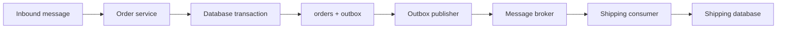
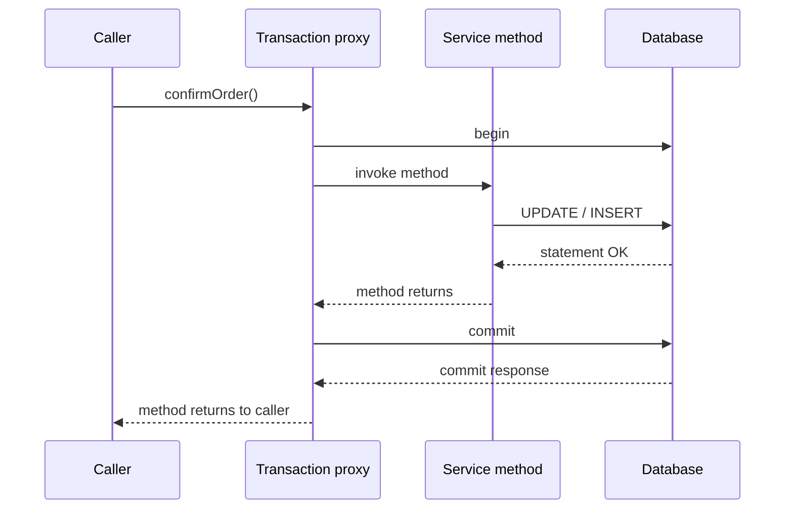
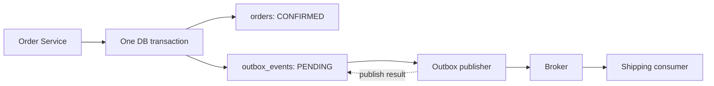
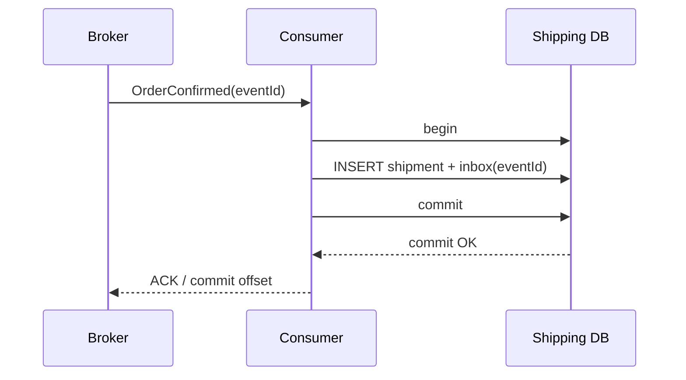
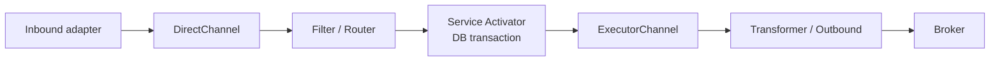
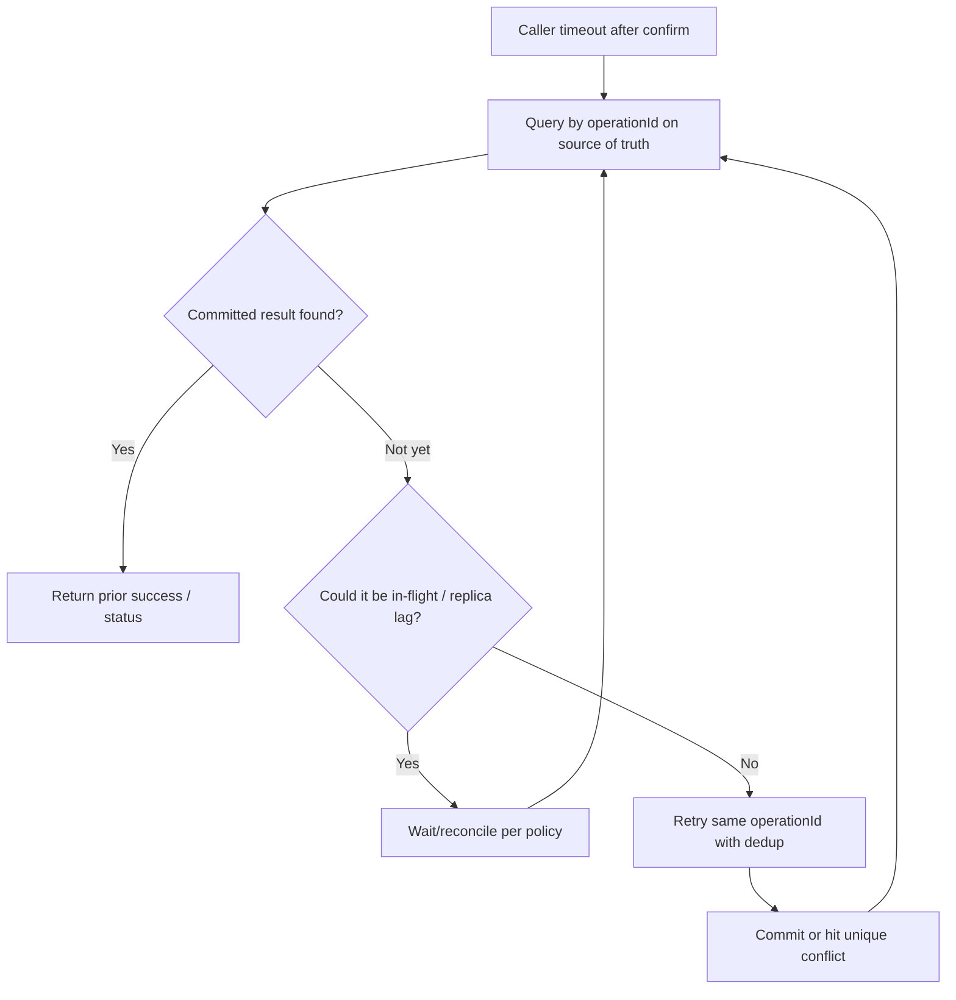

# Evidence When a Transaction Commits Successfully

A Spring Integration flow may receive a message from a Gateway, pass through a Filter, Router, Transformer, and Service Activator, write to a database, and then emit an event to another service. Logs may show `Order confirmed`, yet the customer still reports not seeing the order; or an HTTP client receives a timeout even though the database actually updated. In that situation, the question **“What evidence proves the transaction committed successfully?”** must be answered **according to the exact resource and transaction boundary**, not via a generic log line.

**Main takeaway:** a local transaction is considered successfully committed per the transaction manager's contract when the commit operation completes without error; additional verifiable durable evidence is **committed state** inside the authoritative resource (e.g., both the data row and outbox record exist together). Yet that **does not automatically prove** the broker accepted the message, a consumer processed it, or cross-system business logic finished. Each boundary requires its own confirmation. If the connection drops right during commit, the client may be uncertain of the outcome even though the server committed.

This lesson belongs to the **Transactional messaging** chapter of the **SPRING_INTEGRATION_PATTERN** module. The module focuses on learning to implement Enterprise Integration Patterns with Spring Integration to build loosely coupled, extensible message flows; practicing Router, Filter, Transformer, Splitter, Aggregator, Gateway, retries, error channels, correlation, and testing and monitoring processing branches. This lesson guides classifying reliable transaction evidence and building recovery paths when commit information is ambiguous.

After studying, you can:

- Distinguish `flush`, a successful SQL statement, `commit`, `afterCommit` callbacks, broker publish confirms, consumer ACKs, and business completion.
- Know when `@Transactional`/`TransactionTemplate` actually commits in Spring.
- Apply the **transactional outbox** to prove DB changes and event send intent were persisted in the same transaction.
- Handle crashes before/after commit and uncertain commit outcomes without creating duplicate side effects.
- Design correlation, idempotency, auditing, metrics, and tests targeting the right source of evidence at each step.
- Understand when a local transaction suffices versus when multi-resource coordination via XA/JTA or a saga/compensation model is needed.

## 1. First, Clarify “Committed What?”

A messaging system typically spans multiple independent resources:



In this diagram there may be **multiple independent confirmation points**, for instance:

1. The `orders` database commits the order status.
2. The same transaction commits an `outbox` record.
3. The publisher sends the event and the broker confirms per producer mechanics.
4. The consumer receives the event and completes a transaction on the `shipping` database.
5. The consumer ACKs or commits offsets after processing per configuration.
6. A final business step confirms the order has a shipment.

Having evidence only for step 1 never allows claiming step 4 or 6 succeeded. Operational questions must be explicit: **local DB committed**, **outbox persisted**, **broker accepted**, **consumer processed**, or **business outcome completed**.

### Statements Differ in Strength

| Statement | Scope it can prove | What it does NOT prove by itself |
| --- | --- | --- |
| “UPDATE returned 1 row” | The statement executed inside the current transaction | That the transaction committed |
| “JPA flush succeeded” | Pending SQL/state sync was pushed to the DB within the transaction | That commit completed |
| “Transaction manager returned from commit” | Managed resource reported successful commit per contract | That broker and downstream processed it |
| “Reading order=CONFIRMED on authoritative DB” | State is visible per the read's consistency level | That the event was published or consumed |
| “Outbox row coexists with order state” | Publish intent was persisted in the same DB transaction | That the publisher sent the event |
| “Broker confirm/transaction commit succeeded” | Broker confirmed per configured mechanism | That the consumer committed its database |
| “Consumer ACK” | Transport recorded receive/processing progress per ack mode | That all side effects are durable if ACK was misplaced |
| “Shipping record committed and queryable” | Shipping resource holds committed state | That all other related tasks completed |

Note: even reading data requires considering **reading from primary vs. replica**, isolation levels, replication lag, and the business key queried. A lagging read replica can cause a **false negative**, insufficient to conclude the primary never committed.

## 2. Signals Easily Mistaken for Commit Evidence

### “Success” Logged Inside the Transaction

```java
@Transactional
public void confirm(String orderId) {
    orderRepository.markConfirmed(orderId);
    log.info("Order committed: {}", orderId);
    // Errors or rollback can still happen after this line.
}
```

In the code above, the log line runs **before the proxy transaction's commit boundary**. It does not prove data committed. Exceptions, rollback-only state, optimistic locking, or commit-phase failures can still roll back the transaction after that `INFO` line.

### `save()`, `update()`, or `flush()` Does Not Equal Commit

A successful SQL statement and affected row count prove **changes were applied within the transaction scope**, yet those changes may remain invisible to other transactions and can still roll back. With JPA, `flush()` synchronizes pending changes to the DB; it does not replace `commit()`. Never call state “committed” at this stage.

### Absence of Exceptions in the Handler Is Still Not Enough

If a handler runs inside a transaction managed by a poller, message listener container, or interceptor, the handler may return before the transaction manager commits. Specifically with `@Transactional`, the directive applies via proxies or transaction aspects when conditions hold; internal self-invocation may bypass the proxy unexpectedly.

### HTTP 200, Queue ACK, or Absence of ERROR Logs Are Not Universal Proof

- HTTP 200 from **one service** only carries meaning per that endpoint's contract and when it produced the response.
- Inbound broker ACKs may be emitted before DB commit if processing is misconfigured.
- Absence of `ERROR` logs may be due to log levels, collector drops, or crashing before logging.
- A trace/span reporting `OK` may reflect a single hop rather than a second resource.

**Rule:** every signal must be tied to a **specific operation, resource, and point in time**.

## 3. Where Does Commit Actually Happen in Spring?

For a `@Transactional` method invoked through a suitable proxy, the transaction manager typically executes:



The diagram depicts an **ideal success sequence** and simplifies flush, synchronization, propagation, and transaction manager details. The service method returning **inside the proxy** is not enough; the caller only receives a successful proxy return after transaction completion finishes per the manager's contract.

Several pitfalls exist:

- A method running inside an **outer transaction** with `REQUIRED` propagation has not committed when the inner method returns. The real commit sits at the **outermost transaction** boundary.
- `@Transactional` placed on a method not called through a Spring proxy, incompatible with weaving/proxying, or self-invoked within a bean may fail to create the expected transaction.
- A DB transaction and a broker call do not become one atomic transaction simply by sitting in the same `@Transactional` method.
- An async endpoint across `ExecutorChannel`, a broker, a queue, or a new poller may use a different thread/transaction. Transaction context does not implicitly follow messages into another service.
- A `TransactionSynchronization` callback in `afterCommit` does not turn subsequent network calls into part of the database transaction.

### `TransactionTemplate` Makes Boundaries Easier to Observe

With `TransactionTemplate.execute(...)`, the callback executes inside a transaction managed by the template; if the template **opened and completed that transaction itself**, the call returns normally only after commit succeeds per the manager. If it joins an existing transaction, you must still understand propagation and the outer transaction; never treat every `execute` return as an independent commit.

## 4. Evidence: Ranked by Reliability and Verifiability

No single piece of evidence fits every requirement. Pair **operation outcomes** with **verifiable durable state**.

| Evidence | What it is strong for | Limitations to state |
| --- | --- | --- |
| Transaction manager commit returns normally | Resource manager completed commit per contract | Client may crash before receiving response; says nothing about other resources |
| Querying DB by business operation ID | Can verify durable post-commit state | Must query the right source with right isolation/read consistency |
| Outbox record in the same transaction | DB state and event-to-publish saved/rolled back together | Does not prove the event was sent to the broker |
| DB transaction log / CDC commit record | Reflects committed changes per DB/CDC mechanics | Connector has lag, offsets, and retention policies |
| Broker publish confirm or producer transaction result | Broker confirmed write/transaction per config | Does not prove consumer processed it or side effects finished |
| Consumer inbox/dedup record + business state | Verifies an operation was processed at the consumer | Does not prove all other systems are synchronized |
| Durable audit record | History for operations/compliance with suitable TX and integrity | Best-effort text “audit logs” are insufficient |
| Logs / traces / metrics | Observing, searching, investigating paths | Can emit early, drop, duplicate, sample; never replaces durable state |

**The strongest evidence for a given question** is a record residing in the exact **resource owning the business truth**, per agreed storage/replication contracts. A successful commit return may suffice for a simple synchronous request; a cross-system operation requires tracing multiple resources and final states.

## 5. Crash Windows Around a Transaction

Failures rarely fall cleanly “before” or “after” in ways the caller can know with certainty:

```text
T0: receive request
T1: BEGIN
T2: UPDATE orders
T3: INSERT outbox
T4: send COMMIT to DB
T5: DB commits successfully
T6: DB sends commit ACK
T7: application returns HTTP success
T8: outbox publisher sends event to broker
```

| Crash or timeout | What may happen | What must be done |
| --- | --- | --- |
| Before T4 | Transaction may roll back on connection close; depends on DB | Do not report success; check state |
| Between T4 and T6 | DB may or may not have committed; client is uncertain | Handle **commit outcome unknown** |
| After T5, before T7 | DB committed, yet client missed success | Retry with idempotency key and query state |
| After T7, before T8 | DB committed and client got success, event un-published | Outbox publisher resumes from durable record |
| After broker receives event, before publisher marks “sent” | Event may be republished | Consumer must be idempotent |
| After consumer writes DB, before sending ACK | Broker may redeliver | Consumer uses inbox/dedup or idempotent updates |

Never use `Thread.sleep`, logs, or an in-RAM flag to bridge two resources and call it a transaction. These failure windows still occur on process kills, power loss, network timeouts, or executor shutdowns.

### Does “Commit Failed” Always Mean Rollback?

No. Deterministic errors like constraint violations cause rollback; there are also **uncertain-outcome** errors like losing connection right while receiving the commit response. When state is uncertain, never automatically execute a brand-new operation with a new operation ID. Instead, **reconcile durable data by the stable ID**, then decide on retry or recovery.

## 6. Transactional Outbox: Evidence of Message Send Intent Alongside DB Commit

When you must both mutate a DB and notify another service, the **transactional outbox** is a vital pattern:



Meaning:

1. The service updates `orders` and inserts `outbox_events` **in the same transaction on the same resource/transaction manager**.
2. If the transaction rolls back, both changes roll back.
3. If it commits, both changes persist; this is durable evidence of order state **and the intent to emit an event**.
4. The publisher reads `PENDING` records, sends the event, receives confirmation per broker mechanics, and updates dispatch status.
5. If the publisher crashes, records remain scannable and resendable.

Outbox **does not promise end-to-end exactly-once**. The publisher may send successfully and die before marking the record; on recovery it resends. Consumers must handle duplicates, e.g. via unique `eventId`/`operationId`.

### Illustrative Schema

```sql
CREATE TABLE orders (
    order_id        VARCHAR(100) PRIMARY KEY,
    status          VARCHAR(32) NOT NULL
);

CREATE TABLE integration_outbox (
    event_id        VARCHAR(100) PRIMARY KEY,
    operation_id    VARCHAR(100) NOT NULL UNIQUE,
    aggregate_id    VARCHAR(100) NOT NULL,
    event_type      VARCHAR(80) NOT NULL,
    payload_json    TEXT NOT NULL,
    publish_status  VARCHAR(20) NOT NULL,
    created_at      TIMESTAMP NOT NULL DEFAULT CURRENT_TIMESTAMP
);
```

This schema merely illustrates the idea; adjust timestamp types, constraints, keys, indexes, retry leases, dead letters, and idempotency definitions for your real DB. In particular, a unique `operation_id` prevents creating **multiple outbox events for one business intent**; scope the operation ID appropriately.

## 7. Java Example: Returning Confirmation Only After DB Transaction Completes

This example uses Java 17+, Spring JDBC, and Spring Transaction. `TransactionTemplate` manages **one local transaction** on the datasource holding both `orders` and `integration_outbox`. This code **does not publish to a broker itself**, so the receipt speaks only to the DB portion.

```java
import java.util.UUID;

import org.springframework.jdbc.core.JdbcTemplate;
import org.springframework.stereotype.Service;
import org.springframework.transaction.support.TransactionTemplate;

record CommitReceipt(String operationId, String eventId, String state) { }

@Service
class OrderConfirmationService {

    private final JdbcTemplate jdbc;
    private final TransactionTemplate transactions;

    OrderConfirmationService(
            JdbcTemplate jdbc,
            TransactionTemplate transactions) {
        this.jdbc = jdbc;
        this.transactions = transactions;
    }

    CommitReceipt confirm(
            String orderId,
            String operationId,
            String eventJson) {

        // operationId must be kept stable by caller / trusted ingress
        // when retrying the same business request.
        String eventId = UUID.randomUUID().toString();

        CommitReceipt receipt = transactions.execute(status -> {
            int changed = jdbc.update(
                    "UPDATE orders SET status = ? " +
                    "WHERE order_id = ? AND status = ?",
                    "CONFIRMED", orderId, "PENDING");

            if (changed != 1) {
                throw new IllegalStateException(
                        "Order cannot transition from PENDING");
            }

            jdbc.update(
                    "INSERT INTO integration_outbox " +
                    "(event_id, operation_id, aggregate_id, " +
                    "event_type, payload_json, publish_status) " +
                    "VALUES (?, ?, ?, ?, ?, ?)",
                    eventId,
                    operationId,
                    orderId,
                    "OrderConfirmed",
                    eventJson,
                    "PENDING");

            // This is only the result object CREATED inside the callback,
            // NOT yet proof of commit at the moment this line executes.
            return new CommitReceipt(operationId, eventId,
                    "DB_COMMITTED");
        });

        if (receipt == null) {
            throw new IllegalStateException(
                    "No transaction result");
        }

        // Reaches here only after TransactionTemplate.execute returns normally
        // and provided the template genuinely managed a transaction completing here.
        // Does not imply the event was published or processed by consumers.
        return receipt;
    }
}
```

**Essential conditions for this example to be valid:**

- `TransactionTemplate` must be bound to a transaction manager genuinely managing **the same datasource** used by `JdbcTemplate`. Never let the `orders` write and `outbox` write accidentally run on separate datasources/transactions.
- There must be a **new/independent transaction boundary completing here** if the receipt is meant to signify DB commit upon `confirm()` returning. If the template joins an outer transaction, only the outer boundary actually commits.
- `JdbcTemplate.update(...)` only returns affected row count of the statement, **not** proof of commit.
- `eventJson` must be produced with a validated serializer and schema. Never concatenate raw user input into JSON strings for the outbox.
- `operationId` needs deduplication handling. This example **illustrates the happy path of a new request**, not replay handling of the same operation ID or an order already `CONFIRMED`.
- Unique constraints on `operation_id`/`event_id` stop DB duplicates, yet production needs to catch conflicts and inspect **committed state** instead of merely throwing HTTP 500.
- `state="DB_COMMITTED"` is a status name in **the service's receipt**, not a DB-generated property. Explicitly document which resource the receipt refers to.

If code fails at the outbox INSERT and the transaction manager rolls back, both order status and outbox must roll back together. If the commit response is lost, the caller still needs a verification flow keyed by `operationId`.

### How to Reconcile Durable State

Querying the authoritative database outside the finished transaction can verify:

```sql
SELECT o.order_id, o.status,
       x.operation_id, x.event_id, x.publish_status
FROM orders o
LEFT JOIN integration_outbox x
    ON x.aggregate_id = o.order_id
WHERE o.order_id = ?
  AND x.operation_id = ?;
```

In this example, finding `orders.status=CONFIRMED` alongside the matching operation ID's outbox row provides durable evidence for **order state and outbox**, not that the event was sent. Use the right source of truth and consistency level; a read replica may lag. Account for concurrency and schema design when one order can have multiple valid operations.

## 8. `afterCommit` Aids Observability, Not a Durable Queue

Spring supports `TransactionSynchronization` and transaction-phase listeners for post-commit handling. Example:

```java
import org.springframework.transaction.support.TransactionSynchronization;
import org.springframework.transaction.support.TransactionSynchronizationManager;

static void registerAfterCommitLog(
        String operationId, Runnable recordMetric) {

    if (!TransactionSynchronizationManager.isSynchronizationActive()
            || !TransactionSynchronizationManager.isActualTransactionActive()) {
        throw new IllegalStateException("No active transaction");
    }

    TransactionSynchronizationManager.registerSynchronization(
            new TransactionSynchronization() {
                @Override
                public void afterCommit() {
                    recordMetric.run();
                    // Safe structured metadata logging can happen here.
                }
            });
}
```

Things to understand:

1. `afterCommit()` runs **after the transactional resource committed successfully** in the normal synchronization lifecycle.
2. If the JVM crashes between DB commit and the callback, the callback **never runs**; hence logs/metrics in callbacks cannot be the sole source to reconstruct all commits.
3. Exceptions in the callback may propagate to the caller or affect the response per framework rules, **even though the DB transaction cannot “uncommit”**. Never infer a DB rollback from a failed callback.
4. During post-commit synchronization, some resources may still be thread-bound. If the callback needs a **new DB write** in its own transaction, open a genuinely new transaction per config (such as `REQUIRES_NEW`) rather than assuming it belongs to the completed commit.
5. `TransactionSynchronizationManager.isSynchronizationActive()` alone does not prove a real transaction exists; the example also checks actual transaction status, yet you must still understand the manager in use.

Likewise, `@TransactionalEventListener(phase = AFTER_COMMIT)` helps publish internal events after commit, yet **adds no durability** to subsequent HTTP/broker calls. If events must not be lost on crash, writing an outbox **inside the original transaction** is usually far more appropriate than publishing only inside `afterCommit`.

### `afterCompletion` Has a Different Meaning

`afterCompletion(int status)` can receive committed, rolled back, or unknown status per Spring's contract. It is suited for cleanup and summary telemetry, yet a callback is not a database transaction log. On unknown status, **never** automatically translate it to “confirmed rolled back”. Reconcile against the authoritative resource.

## 9. Broker Publish Confirmation Is Broker Evidence, Not DB Evidence

A producer may emit an event after DB commit:

```text
DB: COMMITTED
   |
   v
Publisher -> Broker
   |
   v
Broker confirm/ack
```

Broker confirmation is evidence **on the broker side per the mechanism/configuration used**, not proof the DB committed or a consumer processed it. Event durability also depends on queues/topics, replicas, producer mode, confirm mode, retention, and transport guarantees.

| Case | What can be stated? | What cannot be stated yet? |
| --- | --- | --- |
| DB commit OK, broker publish not yet run | DB committed; outbox may be pending | That the broker received the event |
| Producer sent event without receiving confirm | Publish outcome may be uncertain | That the event was definitely not recorded |
| Broker confirm OK | Broker confirmed per producer contract | That shipping updated its DB |
| Consumer received event | Event reached the consumer | That side effects committed |
| Consumer DB commit OK, ACK not yet reached broker | Consumer may have finished DB | That the broker will not redeliver |
| Consumer ACK OK | Broker sees processing progress per mode | That all downstream finished if ACK was placed at the wrong boundary |

**Technology note:** JMS, RabbitMQ, Kafka, and Spring Integration adapters do not share identical transaction/confirm semantics. Kafka producer transactions, JMS session transactions, and local JDBC transactions are distinct scopes; a “transaction” in one resource does not span another.

### Should You Use XA/JTA?

If true atomic commit across multiple XA-capable resources is required and your organization accepts the complexity, JTA/XA can be considered. Still verify whether **both** resources/drivers/transaction managers join the same global transaction, coordinator recovery capability, and in-doubt handling.

Never use the term “2PC” to describe a flow that simply executes `DB.commit` followed by `broker.send`. Without a real distributed transaction, the actual model is **two separate operations** with a failure window between them. Outbox + at-least-once delivery + idempotent consumers is often another fitting option, provided it meets SLAs and system characteristics.

## 10. Consumer ACK, DB Commit, and Duplicate Handling

A consumer receives `OrderConfirmed` to create a shipment:



This is the desired order in many architectures: **commit DB first, then ACK the broker**. Yet crashing after DB commit before ACK causes the broker to redeliver the event. Thus the consumer should maintain an `inbox`/dedup table in the same transaction as shipping changes, with a unique constraint on `eventId` or business operation ID.

Pseudocode:

```text
consume(event):
  begin local DB transaction
  if inbox already contains event.id:
      commit/no-op
  else:
      insert inbox(event.id)
      apply idempotent business change
      commit
  ACK broker according to adapter contract
```

If the side effect calls an external service outside the DB transaction, an inbox alone does not ensure atomicity with that call. Add an outbox/compensating command/idempotency semantics at the target service.

**Important:** ACK is not an application commit. Some adapters auto-ACK when methods return, while other listener/session modes differ; errors and transaction propagation depend on the concrete connector. Test with your actual technology and configuration.

## 11. Transaction Boundaries in Spring Integration Flows

One flow can hold many patterns; yet not everything shares one transaction merely because it appears in the same Java DSL block.



Boundaries to distinguish:

- **`DirectChannel`:** normally invokes handlers on the sending thread, so it can join the caller's transaction context if one exists; `DirectChannel` itself does not open transactions automatically for every case.
- **Polling endpoints:** transactions can be configured on the poller/advice; enlisted scope and resources decide which steps commit covers.
- **`@Transactional` on handler/service:** depends on proxy, propagation, and transaction manager type; never assume the whole flow shares one transaction.
- **`ExecutorChannel`, queues/pollers, and brokers:** introduce asynchronous boundaries; thread-bound transaction contexts do not implicitly travel to new threads or services.
- **Gateway request/reply:** a reply produced at one stage does not prove async downstream stages finished if the architecture does not await them.
- **Splitter/Aggregator:** child messages and aggregated messages may traverse separate transactions; group completion does not replace per-resource commits.
- **Retry advice:** can retry a handler call inside or outside a transaction boundary. Distinguish an **attempt** from a **committed operation**.

### A Note on Retrying Inside the Same Transaction

If one DB operation fails and marks the current transaction `rollback-only`, continuing to retry inside that same transaction may fail to commit at the end. Design retries at a boundary that creates an **appropriate fresh transaction per attempt** when needed. Inspect the ordering of retry advice vs. transaction advice and which exceptions are retryable, avoiding the misconception that three handler calls equal three independent commits.

## 12. Logs, Metrics, and Traces Aid Investigation, Not Replace Durable Proof

Structured events can distinguish milestones:

```json
{
  "event": "orders.db_commit_returned",
  "operationId": "op_42",
  "aggregateId": "ORD-42",
  "outboxEventId": "evt_42",
  "dbResource": "orders-primary",
  "outcome": "COMMIT_RETURNED"
}
```

This is an **illustrative application-defined schema**. Events should only be emitted after the corresponding commit boundary, yet log records can still be dropped or fail to flush. Never emit `event=transaction_committed` **inside the transaction callback before commit**.

Useful fields:

| Field | Reason |
| --- | --- |
| `operationId` / idempotency key | Query durable state after timeouts/retries |
| `requestCorrelationId` | Link inbound Gateways with EIP branches |
| `outboxEventId` | Trace an event across publisher, broker, and consumer |
| `aggregateId` | Query business state under authorization controls |
| `transactionBoundary` / `dbResource` | Know which resource committed |
| `event` / `outcome` | Distinguish attempt, committed, published, consumed, failed |
| `durationMs` | Diagnose slow commit/publish stages |
| `traceId` / `spanId` | View distributed journeys when tracing is configured and sampled |

**Never include raw SQL params, tokens, sensitive payloads, or raw exception messages** in logs. Business IDs must also be normalized with access controls and retention limits.

### Metrics Need Accurate Units

Suggested metric suite:

- `db_transaction_attempts_total`: number of transaction execution attempts.
- `db_transaction_commit_returned_total`: number of times the manager returned normally at the instrumented boundary.
- `db_transaction_rollback_total`: confirmed rollbacks.
- `db_transaction_unknown_total`: uncertain commit outcomes after communication errors.
- `outbox_pending` / `outbox_oldest_age`: count and age of records awaiting publish.
- `outbox_publish_attempts_total`, `outbox_confirmed_total`: per publisher semantics.
- `consumer_processed_total`, `consumer_duplicate_total`, `consumer_failed_total`: per consumer definition.

These are **example names**, not a claim that Spring creates every meter automatically. Never use `operationId` or `eventId` as high-cardinality metric tags. Use logs/traces to investigate individual cases; use metrics to aggregate volume and health.

**Remember:** metrics and traces can also be sampled, delayed in exporters, or dropped in pipelines. When conflicts arise, return to durable resource state and transaction contracts rather than treating log line counts as truth.

## 13. Durable Auditing Differs from “Transaction Success” Logs

When audit evidence is required, explicitly define:

1. **Who** requested the change and authorization.
2. **Operation ID** tied to the change, independent of request timeouts.
3. **State transition** from which state to which state.
4. **Which resource** owns the transaction.
5. **Which commit boundary** guarantees the business change and audit record persist together.
6. **Integrity** and access control of audit data.
7. **Retention, querying, reconciliation, and recovery**.

An audit table written **in the same database transaction** as the primary change can provide durable evidence per the DB's contract, given proper schema and integrity controls. A plain `INFO commit success` text log lacks those guarantees and can be lost if the process crashes before flushing.

If auditing lives on an independent system sent only after commit, use an outbox or equivalent mechanism to avoid losing signals between two resources. Meanwhile, diagnostic logs may still record events without serving as the official audit store lacking those guarantees.

## 14. Commit Outcome Unknown: What to Do When the Caller Times Out?

This is the most critical real-world scenario. Suppose an HTTP client sends `confirmOrder(op_42)`; the DB commits, yet the service connection drops before HTTP 200 returns. The client sees a timeout. If the client sends a **new operation ID** and the service executes another transaction, duplicate shipments or double charges can occur.

Safe strategy:

1. Assign a stable `operationId` at ingress or trusted client; the client **reuses this ID** when retrying the same action.
2. In the DB, place a unique constraint or idempotency record tying the outcome in the same transaction as business updates.
3. On retry, query by `operationId` against the authoritative source.
4. If a valid committed state is found, **return the prior result** instead of executing new side effects.
5. If not found yet, account for isolation/replication lag, in-flight transactions, and locking; never treat a single “not found” query as absolute proof the prior commit did not happen.
6. If confirmed uncommitted per contract and deadlines, retry with **the same operation ID**, letting constraints/dedup prevent duplicates under races.
7. If still unclear, return `PENDING/UNKNOWN` status with reconciliation/alerting, rather than falsely declaring guaranteed failure or success.



This model assumes business idempotency logic, unique indexes, and rules defining operation completion exist. Never rely solely on an in-RAM `HashSet`, as restarts or scaling wipe deduplication history. For payments/orders, consider durable `PENDING` states and partner reconciliation workflows.

## 15. Testing Commits Against Real Resources, Not Just Reading Logs

### Tests That Easily Produce False Conclusions

- Spring Test Framework `@Transactional` tests normally roll back at test end; querying inside the same test transaction sees data **without proving production commits**.
- Mocking `repository.save(...)` to return success only proves the method was called, without testing the transaction manager.
- Asserting logs contain `"COMMIT_OK"` before method exit misses errors occurring in the commit phase.
- Tests reading only from a replica can fail due to replication lag rather than transaction rollback.
- Happy-path tests miss both crash windows: *after DB commit before HTTP reply* and *after broker publish before outbox mark*.

### Recommended Test Matrix

| Scenario | What to verify | Preferred evidence |
| --- | --- | --- |
| DB happy path | Order changes state, outbox appears | Query DB after transaction finishes |
| Exception before commit | No order transition or new outbox | Query on an independent transaction |
| Outbox INSERT fails | Order UPDATE also rolls back | Same DB transaction; query after rollback |
| Constraint violation | Service returns deterministic error, no publish | DB state + error classification |
| Transaction marked rollback-only | No `DB_COMMITTED` receipt emitted | Transaction boundary and DB state |
| Crash before commit | No definitive success reported | Query/recovery by operation ID |
| Network drops commit ACK | Outcome marked unknown if needed | Idempotency lookup; do not infer from timeout |
| Crash after DB commit before HTTP reply | Retry with same ID returns prior status | Durable operation/outbox |
| Crash after DB commit before publish | Outbox record persists and is rescanned | Pending outbox + publisher |
| Publish succeeds yet not marked sent | Consumer handles duplicates safely | Broker + consumer inbox/dedup |
| Consumer DB commits before ACK then crashes | Redelivery does not double side effects | Consumer DB + inbox |
| Retry advice repeats attempts | Does not create extra independent operations beyond policy | Operation ID and constraints |
| `ExecutorChannel` switches threads | Never assume transaction/trace context carries over | Resource boundaries, trace propagation |
| Splitter/Aggregator | Group release does not replace per-item DB commits | Durable per-item/group state |
| Metrics/log collector turned off | Business commits still honor contract | Authoritative DB/broker state |
| On rollback, no false event published | Publisher reads only committed outbox records | DB outbox + broker test |

### Designing Commit/Rollback Integration Tests

Run against a **database and transaction manager matching your target version** (e.g., database containers in the test environment). For each test:

1. Prepare an order in `PENDING` state with a fresh operation ID.
2. Call the real transactional public service boundary, never directly calling internal methods bypassing the proxy.
3. Wait for the method to return, then use an **independent read transaction/connection** to query `orders` and `integration_outbox`.
4. Inject an error after UPDATE but before outbox INSERT; confirm **neither commits**.
5. Simulate a commit exception/timeout in the communication layer; confirm the client does not conclude “definitely rolled back” when state may be unknown.
6. Simulate the publisher running multiple times; the consumer must apply the side effect exactly once per event ID.
7. Verify events/metrics/logs only describe proven states, never emitting `COMMIT_SUCCESS` merely upon calling `save()`.

To test true crash windows, inject faults at resource/publisher boundaries rather than only throwing inside handlers. Real database, broker, and adapter configurations determine recovery behavior.

## 16. Case Study: An Order Is Confirmed Yet No Shipment Exists

**Context:** Gateway receives `ConfirmOrder(op_42)`. Filter validates data, Router selects the `standard` branch, and Service Activator updates `orders`. Next, `OrderConfirmed` must reach shipping. Some client requests timed out, and several confirmed orders lack shipments in shipping.

### Evidence-by-Evidence Analysis

| Question | How to check | If evidence exists |
| --- | --- | --- |
| Did Order DB commit? | Query order/operation ID on source of truth | Knows state at the orders resource |
| Did the outbox event commit together? | Query outbox by `operationId` | Knows publish intent was persisted |
| Did the publisher send it? | Outbox state + broker confirms/publisher records | Knows publish progress per contract |
| Does the broker hold the event? | Broker metadata/offsets or queue per technology | Knows event reached transport |
| Did shipping process it? | Inbox/dedup and shipment DB | Knows side effect at shipping |
| Did shipping return final outcome? | Shipping business status/events | Knows which stage the end-to-end journey reached |

### One Execution Trace Might Look Like

```text
T0  Gateway receives ConfirmOrder(operationId=op_42)
T1  Filter passes, Router selects standard
T2  DB transaction: UPDATE orders + INSERT outbox
T3  DB commits successfully
T4  HTTP connection drops before client receives response
T5  Client retries with same operationId=op_42
T6  Service reads DB, sees operation already committed -> returns prior result
T7  Publisher reads PENDING outbox, publishes OrderConfirmed
T8  Broker confirms, publisher crashes before marking sent
T9  Publisher restarts, resends the event
T10 Shipping consumer uses eventId/inbox, creates exactly one shipment
```

There is no contradiction when:

- Client at T4 saw a timeout while DB had committed.
- Publisher sent twice while shipping created only one shipment thanks to idempotency.
- T3 logs were lost while outbox and order remained durable evidence.
- A trace omits T8–T10 due to sampling or async context while business status completed.

**Operational conclusion:** reconcile every transaction and transport boundary individually; never conclude solely from a response timeout, an `INFO` log, or a broker ACK.

## 17. Common Pitfalls

| Mistake | Why is it wrong? | Fix |
| --- | --- | --- |
| Logging “commit success” right after `save()` | Transaction may not commit or may roll back | Log after boundary; verify durable state |
| Treating `flush()` as commit | SQL flushed yet still rollbackable | Distinguish flush from commit |
| Internal `@Transactional` method return equals commit | Proxy/outer transaction may not have ended | Identify outermost transaction boundary |
| Calling broker in same method assuming DB atomicity | Two resources do not implicitly share a transaction | Outbox or contract-valid global transaction |
| Using only `afterCommit` to send mandatory events | Crash after commit before callback loses events | Write outbox in original transaction |
| Creating new operation ID on uncertain commit outcome | Risks double charge / double shipment | Retry same ID, query/dedup |
| Interpreting HTTP timeout as rollback | Commit may have finished before reply dropped | Reconcile against source of truth |
| Treating publish confirm as consumer processed | Confirm is broker-side only | Consumer inbox/DB status |
| Consumer ACKs before DB commit | Crash can lose side effect without redelivery | Commit-before-ACK design per adapter contract |
| Counting commits via log lines | Logs can drop, repeat, or be sampled | Boundary metrics, DB audit/durable proof |
| Reading lagging replica and concluding uncommitted | Replication lag, differing isolation | Read authoritative consistent source |
| `@Transactional` test querying inside same test | Test may roll back at test end | Verify past boundary using independent transaction |
| Retrying inside a rollback-only transaction | Subsequent attempts may fail to commit | Configure retry/transaction advice order |
| Outbox row exists yet claiming “broker received” | `PENDING` event may not be published yet | Track publisher/broker confirms separately |
| DB commit succeeds yet afterCommit log fails => rollback | Callback failure cannot undo an existing commit | Classify post-commit errors and check DB |
| Using `nullChannel` to swallow final failures | Hides messages needing recovery | Proper error channel, DLQ, outbox/saga |

## 18. Lab Exercise: Producing Commit Evidence and Recoverability

**Prompt:** build an order confirmation flow with Gateway → Filter → Router → Service Activator writing `orders` and `integration_outbox`, followed by a publisher emitting `OrderConfirmed` and a shipping consumer processing it. Implement using Spring Integration Java DSL and suitable Spring Transaction components.

1. Explicitly define states `PENDING`, `DB_COMMITTED`, `OUTBOX_PENDING`, `PUBLISHED`, `CONSUMED`, `BUSINESS_COMPLETED`. Each state must specify **which resource** owns the truth, not just a text log.
2. Assign a stable `operationId` at ingress. If the client retries the same intent, reuse that ID.
3. Use a local transaction updating the order and inserting outbox in the same DB. Test when UPDATE succeeds yet outbox INSERT fails: both must roll back.
4. Return a “DB committed” receipt only past the real commit boundary. If an outer transaction exists, relocate where the receipt is issued.
5. Add unique constraints/idempotency records keyed by operation ID; handle replays without duplicating side effects.
6. Build an outbox publisher with retries, attempt/age caps, broker confirmation, and handling crashes right after publish before mark-sent.
7. Build a shipping consumer with dedup/inbox in the same transaction as shipment updates; ACK per adapter contract.
8. Simulate losing the HTTP reply after commit; client retries with the same ID and receives the committed state.
9. Simulate an unknown DB commit outcome; do not assume rollback solely from connection exceptions—query/reconcile instead.
10. Attach structured logs/metrics/traces keyed by `operationId`, `outboxEventId`, and stages without logging sensitive payloads.
11. Run tests for rollback, commit success, duplicate delivery, publisher restart, consumer crash before ACK, and simulated read replica lag.
12. Present a step-by-step evidence table: DB committed? outbox persisted? broker confirmed? consumer DB committed? business result?

**Completion criteria:** prove via **durable state** that order update and outbox commit together; a timeout never spawns a second operation; publish/consumer retries never double business effects; unknown states are explicitly reconciled rather than guessed from logs.

### Self-Check Questions

1. Why doesn't an `INFO Order committed` log line inside a `@Transactional` method prove commit?
2. How does `flush()` differ from `commit()` regarding rollback capability and durability?
3. Under what condition does `TransactionTemplate.execute()` returning still not mark the final commit boundary of the transaction?
4. After DB commit before the HTTP response, the client times out. What must happen before retrying?
5. What does a Transactional Outbox prove and what does it **not** prove?
6. Why doesn't `afterCommit` alone guarantee an event is published if the process crashes?
7. Does a broker confirm prove the shipping consumer wrote to its database?
8. Why must consumers still use idempotency even when publishers use an outbox?
9. How does a network error right at commit differ from a pre-commit constraint violation?
10. In Spring Integration, how does switching to `ExecutorChannel` affect transaction context?
11. Why shouldn't sampled logs/traces serve as the sole audit evidence?
12. How can a `@Transactional` test that rolls back at test end yield misleading conclusions?
13. When a DB read replica does not show the outbox row yet, can you conclude the primary failed to commit?
14. When combining retry advice and transaction advice, why does advice ordering affect each attempt's ability to commit/roll back?
15. An operation logs `PUBLISHED` yet shipping has no shipment—which resources must be checked for evidence?

## 19. References

- [Spring Framework — Transaction Management](https://docs.spring.io/spring-framework/reference/data-access/transaction.html): transaction abstractions, propagation, and resource management.
- [Spring Framework — Declarative Transaction Management](https://docs.spring.io/spring-framework/reference/data-access/transaction/declarative.html): `@Transactional`, transaction proxies, and commit timing.
- [Spring Framework — Programmatic Transaction Management](https://docs.spring.io/spring-framework/reference/data-access/transaction/programmatic.html): `TransactionTemplate` and transaction boundaries.
- [Spring Framework — Transaction-bound Events](https://docs.spring.io/spring-framework/reference/data-access/transaction/event.html): `@TransactionalEventListener` and transaction phases.
- [Spring Integration — Transaction Support](https://docs.spring.io/spring-integration/reference/transactions.html): transaction management in message flows/pollers.
- [Spring Integration — Error Handling](https://docs.spring.io/spring-integration/reference/error-handling.html): `ErrorMessage`, error channels, and error handling.
- [Spring Integration — Message Channels](https://docs.spring.io/spring-integration/reference/channel.html): synchronous/asynchronous channel boundaries.
- [Spring Integration — Gateway](https://docs.spring.io/spring-integration/reference/gateway.html): request/reply and flow invocation outcomes.
- [Spring Integration — Retry Advice](https://docs.spring.io/spring-integration/reference/handler-advice/classes.html): retry and transaction advice.
- [Transactional Outbox Pattern — microservices.io](https://microservices.io/patterns/data/transactional-outbox.html): outbox, publisher, and duplicate challenges.
- [Idempotent Consumer Pattern — microservices.io](https://microservices.io/patterns/communication-style/idempotent-consumer.html): preventing duplicate processing after redelivery.
- [Spring Boot — Observability](https://docs.spring.io/spring-boot/reference/actuator/observability.html): metrics, tracing, and logging for investigation.
- [OWASP Logging Cheat Sheet](https://cheatsheetseries.owasp.org/cheatsheets/Logging_Cheat_Sheet.html): managing sensitive data in logs.

**Takeaway:** **a commit is a fact belonging to one specific resource and one specific transaction boundary**. `save()`, `flush()`, `INFO` logs, callbacks, publish confirms, and consumer ACKs each carry different meanings. When DB and outbox commit in the same transaction, they serve as durable evidence of the business change and send intent; broker delivery and downstream processing still require their own confirmation, retries, and idempotency. When commit outcome is unclear, reconcile against the authoritative data source using a stable operation ID before acting again.
