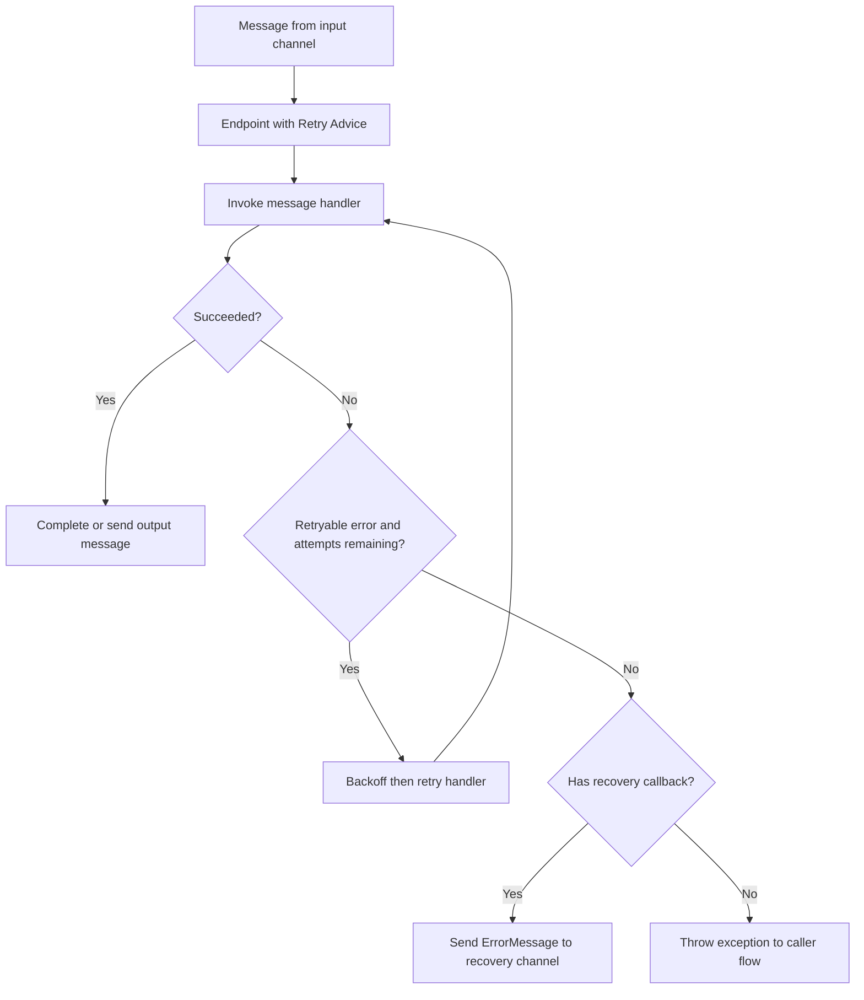

# Retry Advice for Message Handlers in Spring Integration

## 1. Problem Statement and Goals

In an **Enterprise Integration Patterns (EIP)** flow, a message handler often has to call external systems: shipping APIs, payment services, databases, or other internal systems. These calls can fail transiently due to overload, timeouts, brief connection drops, or HTTP 503 errors. If the entire flow is aborted on the very first error, the system easily misses transactions that would succeed after a few retries.

**Retry advice for a message handler** allows Spring Integration to retry calling *that specific handler* according to a controlled policy. This is one way to implement the Retry pattern in Spring Integration, working alongside Routers, Filters, Transformers, Gateways, error channels, and correlation to build loosely coupled, extensible, and observable message flows.

After this lesson, you will be able to:

- Explain where `RequestHandlerRetryAdvice` sits in the message processing chain.
- Configure the number of attempts, increasing backoff intervals, and retryable exception types.
- Route failures to a recovery branch after exhausting retries, avoiding silent failures.
- Distinguish synchronous handler retry from broker message redelivery or retrying the entire flow.
- Design idempotency, correlation, testing, and observability for success/failure branches.

## 2. Where Does Retry Advice Operate?

Spring Integration processes messages through endpoints. When an endpoint invokes a `MessageHandler` configured with `RequestHandlerRetryAdvice`, the handler invocation is wrapped in an **advice chain**. If the handler throws a retryable exception, the advice re-invokes the handler according to the Spring Retry policy.



Key points:

1. **The retry scope is the advised handler.** Preceding Transformer, Filter, or Router steps do not automatically re-run. To retry another step, attach the advice to that corresponding endpoint.
2. **Retry is stateless and synchronous by default.** Attempts happen within the same handler invocation; backoff keeps the processing thread waiting. With `DirectChannel`, this also blocks the sender's thread. This is not an operation that automatically queues the message for later execution.
3. **Attempt count includes the initial call.** `maxAttempts = 3` means at most three calls to the handler, not three retries plus one initial call.
4. **The handler must let the exception propagate.** If the handler catches the exception and returns a successful result, the advice does not know that a retry is needed.
5. **Recovery determines the path after exhausting attempts.** Without a recovery callback, the final exception is typically propagated back to the caller. If a recoverer is configured to send an error message and then complete normally, the caller must be designed to understand the business failure state rather than assuming success.

### How do retry, redelivery, and error channels differ?

| Mechanism | Unit retried | Typical trigger | Key considerations |
| --- | --- | --- | --- |
| `RequestHandlerRetryAdvice` | Invocation of a single message handler | When the handler throws an exception | Backoff can hold the thread; must select appropriate retryable errors |
| Broker redelivery | Message redelivered to a consumer | After `nack`, rollback, or reconnection | May re-execute flow steps; requires idempotency |
| Error channel | Converts an error into an `ErrorMessage` for handling | When the flow routes an error to an error-handling mechanism | An error channel alone does not retry the handler |
| Recovery/dead-letter | Records or routes failed messages | After further processing is impossible | Must preserve enough context for investigation and controlled replay |

## 3. Real-World Scenario: Sending Shipping Requests

Suppose the system receives a `ShippingCommand(orderId, idempotencyKey)` and calls a carrier API:

- If the network is flaky or the carrier reports a transient error, try up to **3 times**.
- Wait **200 ms**, then **400 ms** between attempts; cap the maximum backoff at **1,000 ms** so the policy remains reasonable if the attempt count increases.
- If the payload is invalid or the request is permanently rejected, **do not retry**.
- When all attempts fail, send the error to `shippingRetryErrors` for recording, alerting, or forwarding to a dead-letter queue.

With Spring Boot, the project needs Spring Integration components and **Spring Retry** (`org.springframework.retry:spring-retry`). The following Java snippet illustrates the core configuration. The two interfaces `ShippingService` and `ShippingFailureRecorder` are business adapters that the application must provide as Spring beans.

```java
import java.util.HashMap;
import java.util.Map;

import org.springframework.beans.factory.annotation.Qualifier;
import org.springframework.context.annotation.Bean;
import org.springframework.context.annotation.Configuration;
import org.springframework.integration.channel.DirectChannel;
import org.springframework.integration.dsl.IntegrationFlow;
import org.springframework.integration.handler.advice.ErrorMessageSendingRecoverer;
import org.springframework.integration.handler.advice.RequestHandlerRetryAdvice;
import org.springframework.messaging.MessageChannel;
import org.springframework.messaging.support.ErrorMessage;
import org.springframework.retry.backoff.ExponentialBackOffPolicy;
import org.springframework.retry.policy.SimpleRetryPolicy;
import org.springframework.retry.support.RetryTemplate;

@Configuration
public class ShippingIntegrationConfiguration {

    @Bean
    MessageChannel shippingRequests() {
        return new DirectChannel();
    }

    @Bean
    MessageChannel shippingRetryErrors() {
        return new DirectChannel();
    }

    @Bean
    RequestHandlerRetryAdvice shippingRetryAdvice(
            @Qualifier("shippingRetryErrors") MessageChannel recoveryChannel) {

        Map<Class<? extends Throwable>, Boolean> retryable = new HashMap<>();
        retryable.put(TemporaryCarrierException.class, true);

        // traverseCauses = true: find the root cause when an exception is wrapped.
        SimpleRetryPolicy retryPolicy =
                new SimpleRetryPolicy(3, retryable, true);

        ExponentialBackOffPolicy backOff = new ExponentialBackOffPolicy();
        backOff.setInitialInterval(200L);
        backOff.setMultiplier(2.0);
        backOff.setMaxInterval(1_000L);

        RetryTemplate template = new RetryTemplate();
        template.setRetryPolicy(retryPolicy);
        template.setBackOffPolicy(backOff);

        RequestHandlerRetryAdvice advice = new RequestHandlerRetryAdvice();
        advice.setRetryTemplate(template);
        advice.setRecoveryCallback(
                new ErrorMessageSendingRecoverer(recoveryChannel));
        return advice;
    }

    @Bean
    IntegrationFlow shippingFlow(ShippingService shippingService,
                                 RequestHandlerRetryAdvice shippingRetryAdvice) {
        return IntegrationFlow.from("shippingRequests")
                .handle(shippingService, "send",
                        endpoint -> endpoint.advice(shippingRetryAdvice))
                .get();
    }

    @Bean
    IntegrationFlow shippingRecoveryFlow(ShippingFailureRecorder recorder) {
        return IntegrationFlow.from("shippingRetryErrors")
                .handle(message -> recorder.record((ErrorMessage) message))
                .get();
    }
}

record ShippingCommand(String orderId, String idempotencyKey) {}

interface ShippingService {
    void send(ShippingCommand command);
}

interface ShippingFailureRecorder {
    void record(ErrorMessage error);
}

class TemporaryCarrierException extends RuntimeException {
    TemporaryCarrierException(String message, Throwable cause) {
        super(message, cause);
    }
}
```

**Usage:** Send a `Message<ShippingCommand>` to the `shippingRequests` channel bean. `ShippingService.send(...)` calls the carrier API and throws `TemporaryCarrierException` on transient failures. `ShippingFailureRecorder.record(...)` must perform a verifiable action, such as persisting the error record and order identifier to a database or forwarding it to a dead-letter queue; simply logging is usually insufficient to recover the transaction.

### Reading Each Part of the Configuration

- `endpoint.advice(shippingRetryAdvice)` attaches the advice to **specifically the `send` handler**. Declaring the advice bean without attaching it to the endpoint will not make the handler retry.
- `SimpleRetryPolicy(3, retryable, true)` limits the total number of attempts and retries only the declared transient error. The `true` parameter enables traversing the cause chain (`cause`) when Spring Messaging wraps an exception thrown by the handler.
- `ExponentialBackOffPolicy` paces retries, helping avoid hammering the API while the dependency is overloaded. With three attempts in this example, the two expected wait intervals are 200 ms and 400 ms, excluding execution time.
- `ErrorMessageSendingRecoverer` uses a recovery callback after attempts are exhausted, sending an `ErrorMessage` to a dedicated channel. This branch needs an active consumer and a reliable error persistence strategy.
- `shippingRequests` is a `DirectChannel`, suitable for clearly observing synchronous behavior. You can swap the channel or introduce a queue when load decoupling is needed, but you must re-evaluate transactions, timeouts, and replay mechanisms.

> **Note on exception types:** The policy in the example intentionally retries only `TemporaryCarrierException`. The application should translate timeouts, connection resets, or HTTP 503 responses from the client library into this exception type, while leaving validation errors or HTTP 4xx errors that cannot be fixed by retrying untouched. You should not default to retrying every `Exception`.

## 4. Designing Handlers for Safe Retries

Suppose an order has already been processed by the carrier, but the response back to the application times out. A retry can send that exact same request again. Therefore, **retry does not guarantee exactly-once execution**: the same operation may be executed multiple times on the target system.

An appropriate handler can use a stable identifier across every attempt:

```java
// Example implementation of send(ShippingCommand command) logic.
// CarrierApi is the application's adapter to the actual HTTP client.
public void send(ShippingCommand command) {
    try {
        carrierApi.createShipment(
                command.orderId(),
                command.idempotencyKey()); // Keep the same key across every attempt.
    } catch (CarrierTimeoutException | CarrierUnavailableException ex) {
        throw new TemporaryCarrierException("Carrier is temporarily unavailable", ex);
    }
    // Data/authorization errors must not be translated into TemporaryCarrierException.
}
```

Here `CarrierApi`, `CarrierTimeoutException`, and `CarrierUnavailableException` are types defined by the application's adapter, not built-in Spring Integration classes. The receiver must support an idempotency key, or the application must have a mechanism to prevent duplicate side effects (such as storing `orderId` + processing status with a unique constraint). Never generate a new idempotency key on each attempt.

Supporting principles:

1. **Bound external call durations.** HTTP/database timeouts must be configured separately. A retry policy does not replace connect timeouts, read timeouts, or overall deadlines.
2. **Classify errors clearly.** Retry timeouts, transient connection errors, or appropriate 5xx responses; do not retry schema errors, business rule violations, invalid credentials, or invalid data.
3. **Avoid duplicating side effects.** If a handler both charges a payment and sends an email, retrying the whole handler can repeat both actions. Split them into independent steps/handlers or use the outbox pattern and idempotency.
4. **Never retry infinitely.** Multiple concurrent consumers retrying simultaneously can overwhelm the target system. Combine concurrency limits, backoff, jitter (when needed), circuit breakers, and alerting.
5. **Respect transactions.** When database transactions or broker acknowledgements are involved, understand whether a rollback redelivers the *message* or only retries the handler call; a failed transaction may already be marked rollback-only before a retry occurs.

## 5. Recovery, Correlation, and Error-Handling Branches

After attempts are exhausted, `ErrorMessageSendingRecoverer` forwards error details to `shippingRetryErrors`. The handler on the error branch should record at least: message ID, `orderId`, `idempotencyKey`, exception type, root cause, timestamp, and processing status. When a `MessagingException` contains a `failedMessage`, you can extract the original message's headers and payload from it; always check the actual exception type instead of casting unconditionally.

Example of reading the failed message:

```java
import org.springframework.messaging.Message;
import org.springframework.messaging.MessagingException;
import org.springframework.messaging.support.ErrorMessage;

void inspectFailure(ErrorMessage error) {
    Throwable failure = error.getPayload();
    if (failure instanceof MessagingException messagingException) {
        Message<?> original = messagingException.getFailedMessage();
        if (original != null) {
            Object payload = original.getPayload();
            Object correlationId = original.getHeaders().get("correlationId");
            // Record information for tracing, avoiding sensitive data.
        }
    }
}
```

If the application uses a Splitter/Aggregator or Router branches, keep correlation IDs, sequence headers, and business identifiers stable across retries. A successful attempt on branch A and a failed attempt on branch B must be tracked separately; retrying does not mean re-running all branches.

**Recovery is a business decision:** sending operational alerts, persisting a retry job for later processing, or routing to a dead-letter queue can all be valid. If the API is invoked via a Gateway and the caller needs to know the failure outcome, define a clear reply contract: report a failure status or propagate the exception as required. Do not treat normal completion of the recovery callback as proof that the transaction succeeded.

### When Do You Need Stateful Retry?

Default stateless retry re-attempts within the same invocation. For transactions where a failure must trigger a rollback followed by broker redelivery of the message, consider **stateful retry** with a stable identifier key to track attempt counts across redeliveries. This must be designed together with the adapter's acknowledgement/redelivery mechanism; do not enable stateful retry just to replace a simple timeout. If you want to retry after several minutes without holding a thread, a retry queue or scheduler is a better model than synchronous backoff.

## 6. Testing Behavior, Not Just Configuration

Integration tests using a mock handler, an invocation counter, and a recorder capturing errors should cover the following cases:

| Scenario | Expected `send` calls | Assertion to verify |
| --- | ---: | --- |
| Handler succeeds immediately | 1 | No record sent to the recovery channel |
| Two transient errors, third succeeds | 3 | Only one business result, nothing sent to recovery |
| Always throws `TemporaryCarrierException` | 3 | One `ErrorMessage` arrives at `shippingRetryErrors` |
| Throws validation error not in retryable list | 1 | Moves immediately to recovery, no backoff retry |
| API processed request but response timed out | Per mock, max 3 | All calls use the same idempotency key |

Example of testing the `RetryTemplate` policy in isolation with JUnit 5 (this code tests the Retry mechanism; integration tests still need to verify that the advice is attached to the handler):

```java
@Test
void retriesTransientFailureUntilThirdAttempt() {
    AtomicInteger calls = new AtomicInteger();

    RetryTemplate template = new RetryTemplate();
    template.setRetryPolicy(new SimpleRetryPolicy(
            3, Map.of(TemporaryCarrierException.class, true), true));
    template.setBackOffPolicy(new NoBackOffPolicy()); // Tests do not need to wait.

    String result = template.execute(context -> {
        if (calls.incrementAndGet() < 3) {
            throw new TemporaryCarrierException("temporary", null);
        }
        return "sent";
    });

    assertEquals("sent", result);
    assertEquals(3, calls.get());
}
```

This test uses `AtomicInteger`, `Map`, `RetryTemplate`, `SimpleRetryPolicy`, `NoBackOffPolicy`, and JUnit 5's `assertEquals`; add the appropriate imports to your test class. At the flow level, send messages to `shippingRequests`, use a fake `ShippingService` to throw scenario-specific exceptions, and use a fake `ShippingFailureRecorder` to observe the recovery branch. Test wrapped exceptions, timeouts, and the scenario where the error channel has no consumer to prevent losing errors in production.

## 7. Monitoring and Operations

To catch cases where retries mask a degrading downstream dependency, monitor:

- **Attempts / recovery / success:** number of handler invocations, commands succeeding after retry, and commands exhausting retries, broken down by endpoint and error type.
- **Latency:** handler execution time, total retry duration (including backoff), and Gateway wait time.
- **Load and backlog:** threads waiting in retry, queue depth, dead-letter record count, and number of replayed messages.
- **Correlation:** message ID, correlation ID, order ID, trace ID, and idempotency key to stitch attempts together; do not put sensitive data or large payloads into metric tags.

You can use Micrometer/Actuator and Spring Integration observability alongside structured logging in the handler and recovery branch. Default framework metrics do not necessarily break down individual attempts out of the box; if you need that granularity, add an appropriate listener/instrumentation to `RetryTemplate` or the adapter. Alerts should be based on **recovery rate and latency**, because a high total retry count can signal a downstream incident even if most commands eventually succeed.

## 8. Common Issues and Troubleshooting

| Symptom | Possible cause | Resolution |
| --- | --- | --- |
| Handler does not retry | Advice not attached to endpoint; handler swallowed the error | Check `.advice(...)`, let eligible exceptions propagate from the handler |
| Only tries once despite transient error | Exception class does not match retry policy | Map the right exception and enable `traverseCauses` if wrapped |
| Duplicate orders/transactions | Side effect completed before timeout | Use idempotency keys, deduplication, outbox, or proper transactions |
| Gateway is slow or times out | Synchronous retry and backoff too long | Compute total deadline, reduce attempts, or switch to queue-based retry |
| Errors disappear from caller flow | Recovery callback handled the error | Record failure status explicitly; check reply contract |
| Retries exhausted but errors not saved | Recovery channel lacks a consumer or recorder fails | Test the recovery branch, monitor it, and persist errors durably |

## 9. Suggested Practice Exercise

Build a flow that receives `ShippingCommand` through a Gateway, uses a Router to split commands by carrier, attaches `RequestHandlerRetryAdvice` to the handler of a carrier that frequently times out, and routes exhausted failures to the `shippingRetryErrors` channel. Send three types of input: success, transient error, and validation error. Measure invocation counts, total processing time, correlation ID, and the number of recovered messages, then simulate a response timeout after the downstream system has accepted the order to verify your idempotency mechanism.

**Completion criteria:** Every message follows a deterministic path; transient errors are retried within limits; permanent errors are not repeated; processing branches are traceable; commands failing after retries are persisted for recovery; and no duplicate business side effects occur in the timeout scenario.
