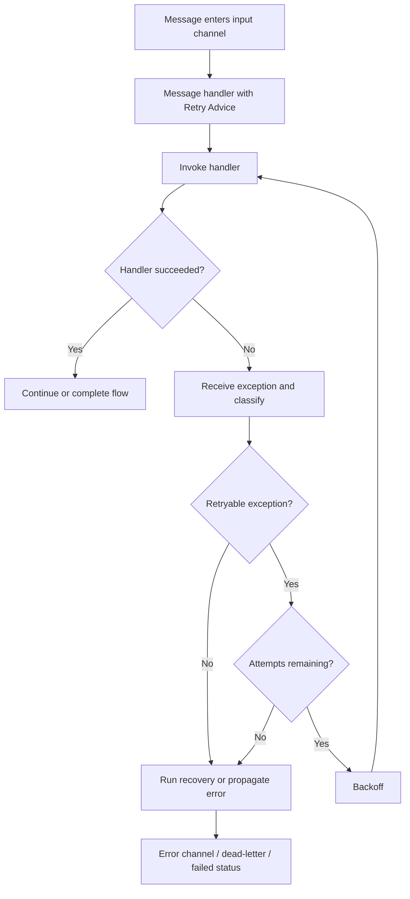

# Retry by Exception Type in Spring Integration

## 1. Why Classify Exceptions Before Retrying?

In an **Enterprise Integration Patterns (EIP)** flow with Spring Integration, a message typically passes through a Filter, Transformer, Router, Splitter, or Gateway before a message handler calls an external service. If a partner temporarily fails to respond, re-invoking the handler can allow the transaction to succeed. However, if the input payload is invalid or the caller lacks authorization, retrying repeatedly only slows down the flow and increases load.

**Retry by exception type** is a conditional selection mechanism: which exceptions are retryable, which must fail immediately, and optionally applying different attempt counts per group. In the `SPRING_INTEGRATION_PATTERN` module, this technique keeps message flows loosely coupled and extensible while keeping success branches, error channels, correlation, and testable outcomes clear.

After this lesson, you will know how to:

- Distinguish transient failures, permanent business errors, and programming bugs.
- Use `SimpleRetryPolicy` to allow retries by **exception class** and traverse the `cause` chain when exceptions are wrapped.
- Attach the policy to `RequestHandlerRetryAdvice` on the right message handler.
- Handle non-retryable or exhausted failures using a recovery/error channel.
- Test exception classification, invocation counts, idempotency, and message traceability.

## 2. Error Classification Rules

Do not start with a rule like "every exception is retryable." The policy must be based on the **likelihood that the next attempt will succeed** and the business impact if the handler runs again.

| Error source | Examples | Recommended policy | Reason |
| --- | --- | --- | --- |
| Transient connectivity | Connection reset, read timeout, brief network glitch | Retry with limit | May recover once the connection stabilizes |
| Service temporarily unavailable | HTTP 503, brief server overload | Retry with backoff | Gives downstream time to recover |
| Rate limiting | HTTP 429 | Retry only when appropriate; respect `Retry-After` | Retrying too early adds pressure on the target system |
| Transient write conflict | Deadlock or optimistic lock conflict resolvable by reloading state | Consider retrying the whole unit of work | Must consider transactions and idempotency |
| Invalid data | Missing required field, business rule violation | Do not retry | Input will not fix itself after a few hundred milliseconds |
| Unauthorized access | Missing permissions, invalid token | Do not retry the same request | Requires fixing permissions or refreshing credentials via a separate workflow |
| Programming error | `NullPointerException`, broken invariant | Do not retry | Software needs fixing or the data needs separate handling |
| Transaction completed but response lost | Timeout after the partner already created the order | Retryable **if idempotent** | Otherwise, easily creates duplicate transactions |

These are **situational guidelines**, not a fixed mapping from every HTTP status to retry behavior. For example, HTTP 500 might come from a transient glitch or a persistent logic bug; HTTP 404 may occasionally result from eventual consistency, though it usually cannot be fixed by an immediate retry. The service adapter should translate technical errors into exceptions reflecting business semantics before feeding them into the retry policy.

A system might define three exceptions:

```java
// Two exceptions that may recover on their own.
class PartnerTimeoutException extends RuntimeException {
    PartnerTimeoutException(String message, Throwable cause) {
        super(message, cause);
    }
}

class PartnerUnavailableException extends RuntimeException {
    PartnerUnavailableException(String message, Throwable cause) {
        super(message, cause);
    }
}

// Input data will still be invalid if the exact same request is resent.
class InvalidShipmentException extends RuntimeException {
    InvalidShipmentException(String message) {
        super(message);
    }
}
```

The benefit of this normalization is that the retry policy does not need to know whether a specific HTTP client throws `SocketTimeoutException`, `ResourceAccessException`, or a proprietary exception type. Swapping HTTP libraries does not force the entire flow to change its policy.

## 3. Decision Flow When a Handler Throws an Exception



`RequestHandlerRetryAdvice` wraps the invocation of **a single handler** via Spring Integration's advice chain, while `RetryTemplate` executes the retry policy provided by Spring Retry. By default, handler retry is synchronous: `maxAttempts = 3` means at most **3 handler executions including the initial call**, with at most 2 backoff intervals.

Key distinction: **handler retry** does not redeliver the message from the source, does not re-run preceding Transformers or Routers, and does not guarantee exactly-once transaction execution. When a broker adapter redelivers a message after a rollback/negative acknowledgement, that is a separate mechanism; you may need to combine it with stateful retry and deduplication.

## 4. Configuring `SimpleRetryPolicy` by Exception Type

When a group of error types shares the same attempt limit, `SimpleRetryPolicy` is a concise choice. You define the map of retryable exception classes, set `traverseCauses = true` to inspect root causes when handler exceptions are wrapped by the messaging layer, and attach the policy to `RetryTemplate`.

Example: a message contains a shipment creation request. Only `PartnerTimeoutException` and `PartnerUnavailableException` are retried; `InvalidShipmentException` and undeclared errors go straight to recovery.

```java
import java.util.HashMap;
import java.util.Map;

import org.springframework.beans.factory.annotation.Qualifier;
import org.springframework.context.annotation.Bean;
import org.springframework.context.annotation.Configuration;
import org.springframework.integration.channel.DirectChannel;
import org.springframework.integration.dsl.IntegrationFlow;
import org.springframework.integration.handler.advice.ErrorMessageSendingRecoverer;
import org.springframework.integration.handler.advice.RequestHandlerRetryAdvice;
import org.springframework.messaging.MessageChannel;
import org.springframework.messaging.support.ErrorMessage;
import org.springframework.retry.backoff.ExponentialBackOffPolicy;
import org.springframework.retry.policy.SimpleRetryPolicy;
import org.springframework.retry.support.RetryTemplate;

@Configuration
public class PartnerShipmentIntegrationConfiguration {

    @Bean
    MessageChannel shipmentRequests() {
        return new DirectChannel();
    }

    @Bean
    MessageChannel shipmentFailures() {
        return new DirectChannel();
    }

    @Bean
    RequestHandlerRetryAdvice shipmentRetryAdvice(
            @Qualifier("shipmentFailures") MessageChannel failures) {

        Map<Class<? extends Throwable>, Boolean> retryable = new HashMap<>();
        retryable.put(PartnerTimeoutException.class, true);
        retryable.put(PartnerUnavailableException.class, true);
        retryable.put(InvalidShipmentException.class, false);

        // 3 attempts including the first call; inspect wrapped causes inside.
        SimpleRetryPolicy policy = new SimpleRetryPolicy(3, retryable, true);

        ExponentialBackOffPolicy backoff = new ExponentialBackOffPolicy();
        backoff.setInitialInterval(200L); // ms
        backoff.setMultiplier(2.0);
        backoff.setMaxInterval(1_000L);

        RetryTemplate template = new RetryTemplate();
        template.setRetryPolicy(policy);
        template.setBackOffPolicy(backoff);

        RequestHandlerRetryAdvice advice = new RequestHandlerRetryAdvice();
        advice.setRetryTemplate(template);
        advice.setRecoveryCallback(new ErrorMessageSendingRecoverer(failures));
        return advice;
    }

    @Bean
    IntegrationFlow shipmentFlow(PartnerShipmentClient partnerClient,
                                 RequestHandlerRetryAdvice shipmentRetryAdvice) {
        return IntegrationFlow.from("shipmentRequests")
                .handle(partnerClient, "submit",
                        endpoint -> endpoint.advice(shipmentRetryAdvice))
                .get();
    }

    @Bean
    IntegrationFlow shipmentFailureFlow(ShipmentFailureRecorder recorder) {
        return IntegrationFlow.from("shipmentFailures")
                .handle(message -> recorder.record((ErrorMessage) message))
                .get();
    }
}

record ShipmentRequest(String orderId, String idempotencyKey) {}

interface PartnerShipmentClient {
    void submit(ShipmentRequest shipment);
}

interface ShipmentFailureRecorder {
    void record(ErrorMessage error);
}
```

The application must provide the `PartnerShipmentClient` and `ShipmentFailureRecorder` beans; the three exception classes are defined in section 2. Add Spring Integration, Spring Retry (`org.springframework.retry:spring-retry`), and the appropriate Spring dependencies to the project. The configuration snippet shows the main wiring; HTTP calls and dead-letter persistence belong in the business adapter implementation.

### Reading the Policy Accurately

- `retryable.put(X.class, true)` enables retries for exceptions in that configured group. `false` denies retries for that exception group. With an allowlist map like in this example, exceptions not in the allowed set will not be retried.
- `SimpleRetryPolicy(3, retryable, true)` caps the number of attempts and enables searching the `cause` chain. This is useful when `MessagingException` or `MessageHandlingException` wraps the original exception inside. There is no need to retry broad wrapper classes like `Exception.class`.
- The policy inspects exception classes, including inheritance hierarchies. When mixing broad and narrow rules, test subclasses so a broad rule does not accidentally override the intended business decision.
- `ExponentialBackOffPolicy` waits roughly 200 ms then 400 ms when all three attempts are needed. For non-retryable exceptions, the handler is called only once with no extra waiting.
- `.advice(shipmentRetryAdvice)` is what actually applies retry to the `submit` handler. Declaring the `RequestHandlerRetryAdvice` bean alone is not enough.
- `ErrorMessageSendingRecoverer` receives the error after the policy rejects retry or exhausts attempts, then sends an `ErrorMessage` to `shipmentFailures`. This error-recording branch must have an active consumer and reliable error storage.

### Example Progression of Individual Messages

| Message | Exception from `submit` | Max invocations | Final branch |
| --- | --- | ---: | --- |
| A | Succeeds immediately | 1 | Success |
| B | Times out twice, third succeeds | 3 | Success |
| C | Always throws `PartnerUnavailableException` | 3 | Recovery/error channel |
| D | Throws `InvalidShipmentException` | 1 | Recovery/error channel |
| E | Throws `NullPointerException` | 1 | Recovery/error channel, needs code investigation |

When attaching a recovery callback that sends an `ErrorMessage`, the advice may finish without rethrowing the exception to the caller once recovery succeeds. If the caller uses a **Gateway** and needs to know the transaction outcome, explicitly design the response or error propagation; never interpret the absence of an exception as "shipment created."

## 5. Handling Wrapped Exceptions: `traverseCauses`

A message handler may throw `PartnerTimeoutException`, yet the invocation/messaging layer wraps it in `MessageHandlingException` or another exception. Looking only at the outermost class can lead the retry policy to misclassify it.

Example cause chain:

```text
MessageHandlingException
└── PartnerTimeoutException
    └── SocketTimeoutException
```

The standard solution is to let `SimpleRetryPolicy` walk `Throwable.getCause()` via `traverseCauses = true`. When the policy encounters a retryable error in the cause chain, it can decide to retry even if the outer wrapper is not in the allowlist. If the adapter **swallows** the exception and only logs it or returns a normal value, the retry advice cannot detect the failure.

Do not enable blanket retries on `RuntimeException.class` or `MessagingException.class` merely because some exceptions get wrapped. Overly broad rules cause data errors and programming bugs to be retried. For complex wrappers that can hold multiple error types, normalize exceptions at the adapter boundary and write tests against the real `cause` chain.

## 6. How Does the Adapter Decide the Exception Type?

The retry policy only inspects exception classes; it does not inherently know which HTTP statuses are recoverable. The adapter calling the partner is responsible for **translating client library errors into the appropriate business exception types**.

```java
// Illustrative body of PartnerShipmentClient.submit(...).
// carrierApi and Http*Exception are types defined by the application adapter.
public void submit(ShipmentRequest shipment) {
    try {
        carrierApi.createShipment(
                shipment.orderId(),
                shipment.idempotencyKey());
    } catch (HttpReadTimeoutException ex) {
        throw new PartnerTimeoutException("Partner response timed out", ex);
    } catch (HttpServiceUnavailableException ex) {
        throw new PartnerUnavailableException("Partner temporarily unavailable", ex);
    } catch (HttpBadRequestException ex) {
        throw new InvalidShipmentException("Invalid shipment data");
    }
}
```

The `Http*Exception` classes and `carrierApi` in this example are **adapter-layer placeholders**, not built-in Spring Integration APIs. With a concrete HTTP library, catch its actual exception types, inspect status/body safely, and map them to `PartnerTimeoutException`, `PartnerUnavailableException`, `InvalidShipmentException`, or equivalent types.

If the partner returns HTTP 429 with a `Retry-After` interval, handling logic should respect that timing rather than relying solely on fixed backoff. If the error occurs after the request might already have been processed, the retried request must keep the same **idempotency key** to prevent creating duplicate records or double-charging.

## 7. When Different Exception Types Need Different Attempt Counts

`SimpleRetryPolicy` in section 4 applies **the same `maxAttempts`** to all retryable errors. When timeouts may be tried four times but service-unavailable errors should only be tried twice, you can use `ExceptionClassifierRetryPolicy` to select a `RetryPolicy` per exception.

```java
import java.util.Map;
import org.springframework.retry.policy.ExceptionClassifierRetryPolicy;
import org.springframework.retry.policy.NeverRetryPolicy;
import org.springframework.retry.policy.SimpleRetryPolicy;

ExceptionClassifierRetryPolicy byException = new ExceptionClassifierRetryPolicy();
byException.setPolicyMap(Map.of(
        PartnerTimeoutException.class, new SimpleRetryPolicy(4),
        PartnerUnavailableException.class, new SimpleRetryPolicy(2),
        InvalidShipmentException.class, new NeverRetryPolicy()
));

// Attach the classified policy to RetryTemplate as configured in section 4:
// template.setRetryPolicy(byException);
```

Important caveat: `ExceptionClassifierRetryPolicy`'s classification works according to the classifier configured for exceptions. When real errors are wrapped, **do not assume** it traverses the `cause` chain the same way `SimpleRetryPolicy(..., true)` does; you may need a custom classifier that unwraps causes or normalize exceptions before they reach the policy. Explicitly handle exception types absent from the map and test cases where the exception type changes between attempts.

`RetryTemplate` has its own backoff policy, so the snippet above differentiates **attempt counts** only, not distinct backoff schedules per exception. If each error group requires different deadlines, backoff schedules, circuit breakers, or recovery channels, consider splitting them into separate endpoints/advices per Router branch or writing an advanced strategy with independent tests.

## 8. Integrating with Other EIP Patterns

In a Spring Integration system, the exception type and where the advice is attached determine what gets retried:

- **Filter:** A message discarded under normal business conditions is not an exception and needs no retry. Failures when a Filter calls a dependency can be retried if advice is attached to the right endpoint.
- **Transformer:** If parse/validation failures are data errors, route them to an error branch. Do not retry a pure Transformer that takes the same input and always throws the same exception.
- **Router:** Each branch can use its own policy. A handler timing out while calling system A does not mean branches that already succeeded on system B should re-run.
- **Splitter/Aggregator:** Keep correlation IDs, sequence headers, and business keys stable. One branch retrying does not guarantee every part of the message group will complete; configure timeout/partial-result policies on the Aggregator.
- **Gateway:** Synchronous retry increases caller wait time. Total invocation + backoff time must fit within the Gateway timeout and SLA.
- **Error channel:** Used for observation, error persistence, or recovery routing. An error channel does not infer retry conditions on its own; the policy must live on the handler or in a dedicated redelivery mechanism.

Example: A Router splits `carrier = A` and `carrier = B`. Branch A can retry `PartnerTimeoutException` three times, while branch B only retries `PartnerUnavailableException` twice. Isolating endpoints makes it easy to adjust one partner's policy with minimal impact on the rest of the flow.

## 9. Testing the Right Branch per Exception Type

Testing the policy and testing the flow complement each other. `RetryTemplate` tests prove the classification logic, while flow tests confirm the advice is actually attached to the handler, recovery triggers, and critical headers are preserved.

### Test Matrix

| Scenario | Expected outcome |
| --- | --- |
| Handler returns successfully | 1 attempt, nothing sent to recovery |
| `PartnerTimeoutException` twice then succeeds | 3 attempts, nothing sent to recovery |
| Consecutive `PartnerUnavailableException` | All 3 attempts per `SimpleRetryPolicy`, 1 recovery |
| `InvalidShipmentException` | 1 attempt, routed to recovery immediately |
| `NullPointerException` | 1 attempt, programming error not retried |
| Wrapper exception containing `PartnerTimeoutException` | Retried if policy enables `traverseCauses` |
| Error occurs after downstream already processed | Same idempotency key across all attempts |
| Recovery channel fails to handle error | Error in recovery branch is observable; business operation not marked successful |

### JUnit 5 Example Testing Classification

```java
import java.util.Map;
import java.util.concurrent.atomic.AtomicInteger;

import org.junit.jupiter.api.Test;
import org.springframework.retry.backoff.NoBackOffPolicy;
import org.springframework.retry.policy.SimpleRetryPolicy;
import org.springframework.retry.support.RetryTemplate;

import static org.junit.jupiter.api.Assertions.assertEquals;
import static org.junit.jupiter.api.Assertions.assertThrows;

class ExceptionTypeRetryPolicyTest {

    private RetryTemplate retryTemplate() {
        RetryTemplate template = new RetryTemplate();
        template.setRetryPolicy(new SimpleRetryPolicy(3,
                Map.of(PartnerTimeoutException.class, true), true));
        template.setBackOffPolicy(new NoBackOffPolicy());
        return template;
    }

    @Test
    void retriesTimeoutThenSucceeds() {
        AtomicInteger attempts = new AtomicInteger();

        String result = retryTemplate().execute(context -> {
            if (attempts.incrementAndGet() < 3) {
                throw new PartnerTimeoutException("temporary", null);
            }
            return "ok";
        });

        assertEquals("ok", result);
        assertEquals(3, attempts.get());
    }

    @Test
    void doesNotRetryInvalidData() {
        AtomicInteger attempts = new AtomicInteger();

        assertThrows(InvalidShipmentException.class,
                () -> retryTemplate().execute(context -> {
                    attempts.incrementAndGet();
                    throw new InvalidShipmentException("missing address");
                }));

        assertEquals(1, attempts.get());
    }

    @Test
    void retriesWrappedTimeoutWhenTraversingCauses() {
        AtomicInteger attempts = new AtomicInteger();

        String result = retryTemplate().execute(context -> {
            if (attempts.incrementAndGet() == 1) {
                throw new IllegalStateException("wrapper",
                        new PartnerTimeoutException("temporary", null));
            }
            return "ok";
        });

        assertEquals("ok", result);
        assertEquals(2, attempts.get());
    }
}
```

In this test, `NoBackOffPolicy` avoids waiting time; the exception classes reuse the definitions from section 2. When integrating the policy into the real flow, add tests sending `Message<ShipmentRequest>` to `shipmentRequests` with a fake `PartnerShipmentClient` and a fake `ShipmentFailureRecorder`. Verify payload, message headers (`correlationId`, message ID, trace ID if present), handler invocation count, and the number of `ErrorMessage`s captured.

## 10. Observability and Handling Exhausted Attempts

Retry by exception type is effective when operators understand **which errors are being retried and why**. Track metrics per endpoint and normalized error type:

- Attempts per exception type, post-retry success rate, and recovery rate.
- Duration per attempt, total backoff wait time, timeouts, and queue depth.
- `orderId`, correlation ID, and idempotency key to trace the same transaction across branches; avoid using high-cardinality data as metric labels.
- Rate of non-retryable errors, as an unusual spike can indicate schema changes or corrupted input data.

In recovery, store the original message or retrieval metadata, the final exception class and root cause, attempt count if collected, timestamp, and business status. With `ErrorMessage`, the payload is a `Throwable`; when that throwable is a `MessagingException`, you can access `getFailedMessage()` to retrieve the original headers/payload if present. Never cast unconditionally, as actual exceptions can vary.

If manual or dead-letter queue replay is needed, enforce idempotency and prevent infinite retry loops. For business errors, notifying users or routing to a data-correction queue is usually more helpful than blindly replaying the exact same message.

## 11. Common Mistakes

| Mistake | Consequence | Fix |
| --- | --- | --- |
| Retrying all `Exception`s | Retries validation, code, and permission errors | Use an allowlist of recoverable exceptions |
| Matching wrapper class without inspecting `cause` | Misses underlying transient errors | Normalize exceptions or enable `traverseCauses` appropriately |
| Catching exception in handler and returning normally | Retry advice does not detect failure | Let errors propagate or return an explicit business result |
| Counting `maxAttempts` as additional retries | Invokes more times than intended | Include the initial invocation in the count |
| Retrying non-idempotent side effects | Duplicate shipments, duplicate notifications | Use idempotency keys and persist state |
| Handling only transient errors while ignoring permanent ones | Lost messages or hard-to-debug failures | Design recovery/error channel for non-retryable errors too |
| Attaching advice to the wrong endpoint | Retries wrong stage or never retries | Test the actual path through the channels |
| Excessive backoff in synchronous flows | Gateway timeouts, long-held threads | Compute total deadline or move to asynchronous processing |

## 12. Practice Exercise

Build a flow that receives `ShipmentRequest` via a Gateway, uses a Router to split by carrier, and attaches `RequestHandlerRetryAdvice` to the handler calling carrier A. Have a mock handler throw `PartnerTimeoutException`, `PartnerUnavailableException`, and `InvalidShipmentException` in turn; verify attempt counts, wait intervals, recovery branch, and correlation IDs. Next, switch attempt counts to `ExceptionClassifierRetryPolicy` so timeouts get more attempts than service-unavailable errors, and add a test case for wrapped exceptions.

**Completion criteria:** Retries occur only for permitted error types; every failed message is routed to a deterministic handling branch; no duplicate business side effects occur when downstream succeeds before a response timeout; and Router, Gateway, and error channel behavior are observable and tested.
