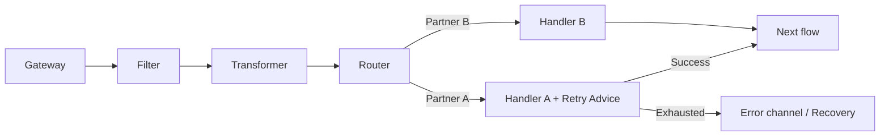

# Attempt Count and Backoff in Spring Integration

## 1. The Problem: How Many Times to Retry, and How Long to Wait?

In an **Enterprise Integration Patterns (EIP)** flow, a message typically passes through a Router, Filter, Transformer, or Splitter before reaching a message handler that calls an external system: a shipping API, payment gateway, inventory service, or database. These systems can respond slowly or become temporarily unavailable. **Retry** helps absorb transient failures, but retrying too many times or too quickly can overload downstream services, hold threads for too long, exceed Gateway timeouts, and create duplicate business side effects.

Therefore, a retry policy must answer three questions at once:

1. **How many attempts?** Including the initial call and subsequent retries.
2. **How long to wait between attempts?** Using *backoff* to avoid hammering downstream right after it fails.
3. **When to stop?** Stop on success, on a non-retryable exception, when attempts are exhausted, or when an external time limit is reached.

In the `SPRING_INTEGRATION_PATTERN` module, choosing appropriate attempts/backoff helps build loosely coupled, extensible message flows. These parameters must work in concert with Gateways, error channels, correlation, testing, and per-branch observability; they are not merely numbers to drop into configuration.

**Learning objectives:** After this lesson, you will be able to calculate the time budget for a retried handler, configure `RequestHandlerRetryAdvice` with Spring Retry, select a `BackOffPolicy`, recognize retry storms, test attempt counts, and design a traceable recovery branch.

## 2. Understanding `maxAttempts` Properly

In Spring Retry, `maxAttempts` is the **total number of executions**, including the initial attempt. Thus:

| `maxAttempts` | Initial call | Max retries | Max backoff intervals |
| ---: | ---: | ---: | ---: |
| 1 | 1 | 0 | 0 |
| 2 | 1 | 1 | 1 |
| 3 | 1 | 2 | 2 |
| 4 | 1 | 3 | 3 |

Example with `maxAttempts = 4`:

```text
T0               T1               T2               T3
│                │                │                │
├─ attempt #1 ──X│                │                │
│    wait b1     ├─ attempt #2 ──X│                │
│                │    wait b2     ├─ attempt #3 ──X│
│                │                │    wait b3     ├─ attempt #4
│                │                │                └─ success or recovery
```

In this diagram, `X` is a retryable exception, and `b1`, `b2`, `b3` are wait intervals before the next attempt. If attempt #2 succeeds, attempts #3, #4 and their corresponding wait intervals **do not happen**. If a non-retryable error occurs on attempt #1, the policy stops immediately even though theoretical attempts remain.

Spring Integration's `RequestHandlerRetryAdvice` wraps a **message handler** through the advice chain. It uses Spring Retry's `RetryTemplate` to decide whether to re-invoke that handler call. By default, this retry is **synchronous and stateless**: attempts happen within the same message handling execution, rather than automatically scheduling message redelivery through a broker.

> Do not confuse `maxAttempts = 3` with "retry three times after the first call." Being off by one can significantly amplify load when many consumers run concurrently.

## 3. What Is Backoff and What Options Exist?

Backoff is the **wait interval after a failed attempt before performing the next attempt**. Its purpose is to give the dependent system room to recover and to reduce request frequency during widespread failures.

Spring Retry provides several common policies:

| Policy | Characteristics | Best suited for | Key considerations |
| --- | --- | --- | --- |
| `NoBackOffPolicy` | No wait between attempts | Testing, very short in-memory operations | Easily causes retry storms against external APIs |
| `FixedBackOffPolicy` | Every wait has the same length | Simple transient errors, steady load | Multiple clients may retry in lockstep |
| `ExponentialBackOffPolicy` | Each wait grows by a multiplier up to a ceiling | Temporarily overloaded downstream, repeated network glitches | Must set a ceiling and bound total duration |
| `UniformRandomBackOffPolicy` | Picks a random wait within a configured range | Reducing synchronized client retries | Wait time varies across runs |
| `ExponentialRandomBackOffPolicy` | Grows wait exponentially with a random factor | Many consumers at risk of retrying together | Random distribution differs from full jitter; understand the specific policy |

Example with **fixed backoff of 300 ms** and 4 attempts (at most three wait intervals):

```text
attempt 1 --300 ms--> attempt 2 --300 ms--> attempt 3 --300 ms--> attempt 4
                 Total wait time = 900 ms
```

Example with **exponential backoff**, `initialInterval = 250 ms`, `multiplier = 2`, `maxInterval = 1,000 ms`, 4 attempts:

```text
attempt 1 --250 ms--> attempt 2 --500 ms--> attempt 3 --1,000 ms--> attempt 4
                 Total wait time = 1,750 ms
```

For standard exponential backoff, the wait interval at step `i` (starting from `i = 1`) can be estimated as:

\[
b_i = \min\bigl(B_{\max},\; B_0 \times m^{i-1}\bigr),\qquad i=1,\ldots,N-1
\]

Where `N` is `maxAttempts`, `B0` is the initial interval, `m` is the multiplier, and `Bmax` is the maximum interval. This formula describes standard exponential backoff; randomized policies do not necessarily match these exact values.

### Why Must `maxInterval` Be Capped?

Without a proper cap, the backoff sequence grows rapidly: 250, 500, 1,000, 2,000, 4,000, 8,000 ms... After just a few attempts, a Gateway or client will wait longer than its SLA allows. `maxInterval` caps **each individual wait interval**, not the total execution time.

### Why Add Randomness (*Jitter*)?

Suppose 500 instances all receive HTTP 503 at 10:00:00. If every instance retries after exactly 500 ms, downstream gets hit by another massive wave of requests at 10:00:00.500. Randomized backoff spreads retry timestamps out to prevent clients from synchronizing. When you need *full jitter*, *equal jitter*, or a specific distribution, implement and verify the corresponding policy; do not assume every policy with `Random` in its name uses the exact same algorithm.

## 4. Calculating the Time Budget for Retries

Backoff is only part of the latency. Each attempt also includes connection, read, and processing time. If a handler takes up to `t` milliseconds per attempt and has `N` attempts, the estimate is:

\[
T_{\text{retry}} \approx \sum_{k=1}^{N} t_k + \sum_{i=1}^{N-1} b_i + T_{\text{overhead}}
\]

With `N = 4`, an API call timeout of **800 ms/attempt**, and wait intervals of **250, 500, 1,000 ms**:

| Component | Value |
| --- | ---: |
| Estimated max processing time for 4 attempts | `4 × 800 = 3,200 ms` |
| Total exponential wait time | `250 + 500 + 1,000 = 1,750 ms` |
| Total time before overhead | **4,950 ms** |

Thus, a request that looks like "an API call with an 800 ms timeout" can block the caller for nearly **5 seconds** if all four attempts run. This is an *estimate* assuming timeouts are properly enforced; thread scheduling, exception handling, serialization, and auxiliary operations can make actual latency higher.

When designing Gateways and message handlers:

- Configure **connect timeout / read timeout / deadline** on the HTTP or database client; a retry policy does not replace them.
- Choose attempt count, backoff, concurrency limits, and deadlines **as a cohesive parameter set**.
- With `DirectChannel` and synchronous handlers, backoff holds the handler thread. Certain timeouts on a Gateway or channel only bound the send/receive operation; they do not necessarily interrupt a downstream call blocking the thread.
- If a request has a tight deadline while downstream can stay unhealthy for minutes, consider a retry queue, scheduler, or asynchronous workflow instead of keeping the Gateway waiting.
- For HTTP 429 with `Retry-After`, design a policy that honors downstream guidance. A static `ExponentialBackOffPolicy` does not automatically read HTTP headers.

## 5. Spring Integration Configuration: Attempts + Exponential Backoff

Consider a shipment creation flow: a message carries `ShipmentCommand(orderId, idempotencyKey)` and is routed to a handler calling a carrier API. Only transient technical errors (`TemporaryCarrierException`) may be retried. We choose at most **4 attempts**, exponential backoff **250 → 500 → 1,000 ms**, and route unrecoverable failures to the `shipmentRetryFailures` channel.

The Spring application requires Spring Integration and Spring Retry (`org.springframework.retry:spring-retry`). The Java example below shows the core wiring; business adapters `CarrierClient` and `ShipmentFailureRecorder` must be provided as Spring beans by the application.

```java
import java.util.HashMap;
import java.util.Map;

import org.springframework.beans.factory.annotation.Qualifier;
import org.springframework.context.annotation.Bean;
import org.springframework.context.annotation.Configuration;
import org.springframework.integration.channel.DirectChannel;
import org.springframework.integration.dsl.IntegrationFlow;
import org.springframework.integration.handler.advice.ErrorMessageSendingRecoverer;
import org.springframework.integration.handler.advice.RequestHandlerRetryAdvice;
import org.springframework.messaging.MessageChannel;
import org.springframework.messaging.support.ErrorMessage;
import org.springframework.retry.backoff.ExponentialBackOffPolicy;
import org.springframework.retry.policy.SimpleRetryPolicy;
import org.springframework.retry.support.RetryTemplate;

@Configuration
public class ShipmentRetryConfiguration {

    @Bean
    MessageChannel shipmentRequests() {
        return new DirectChannel();
    }

    @Bean
    MessageChannel shipmentRetryFailures() {
        return new DirectChannel();
    }

    @Bean
    RequestHandlerRetryAdvice shipmentRetryAdvice(
            @Qualifier("shipmentRetryFailures") MessageChannel failures) {

        Map<Class<? extends Throwable>, Boolean> retryable = new HashMap<>();
        retryable.put(TemporaryCarrierException.class, true);

        // 4 attempts: 1 initial call and up to 3 retries.
        SimpleRetryPolicy retryPolicy =
                new SimpleRetryPolicy(4, retryable, true);

        ExponentialBackOffPolicy backOff = new ExponentialBackOffPolicy();
        backOff.setInitialInterval(250L);
        backOff.setMultiplier(2.0);
        backOff.setMaxInterval(1_000L);

        RetryTemplate template = new RetryTemplate();
        template.setRetryPolicy(retryPolicy);
        template.setBackOffPolicy(backOff);

        RequestHandlerRetryAdvice advice = new RequestHandlerRetryAdvice();
        advice.setRetryTemplate(template);
        advice.setRecoveryCallback(
                new ErrorMessageSendingRecoverer(failures));
        return advice;
    }

    @Bean
    IntegrationFlow shipmentFlow(CarrierClient carrierClient,
                                 RequestHandlerRetryAdvice shipmentRetryAdvice) {
        return IntegrationFlow.from("shipmentRequests")
                .handle(carrierClient, "createShipment",
                        endpoint -> endpoint.advice(shipmentRetryAdvice))
                .get();
    }

    @Bean
    IntegrationFlow shipmentFailureFlow(ShipmentFailureRecorder recorder) {
        return IntegrationFlow.from("shipmentRetryFailures")
                .handle(message -> recorder.record((ErrorMessage) message))
                .get();
    }
}

record ShipmentCommand(String orderId, String idempotencyKey) {}

interface CarrierClient {
    void createShipment(ShipmentCommand command);
}

interface ShipmentFailureRecorder {
    void record(ErrorMessage error);
}

class TemporaryCarrierException extends RuntimeException {
    TemporaryCarrierException(String message, Throwable cause) {
        super(message, cause);
    }
}
```

### What Happens When a Message Flows Through?

1. A message enters `shipmentRequests`, and the endpoint invokes `CarrierClient.createShipment(...)`.
2. If the handler succeeds right away, the flow finishes in **1 attempt** with no backoff.
3. If the handler throws `TemporaryCarrierException`, the retry policy allows re-invocation after the corresponding wait interval. `traverseCauses = true` inspects transient errors even when wrapped in the cause chain by the messaging layer.
4. If the error is non-retryable (e.g., validation) or still fails after the fourth attempt, the recovery callback sends an `ErrorMessage` to `shipmentRetryFailures`.
5. `ShipmentFailureRecorder` should persist error details and the original message so operators can investigate/replay safely; this is an application adapter, not a place to automatically retry again.

**Do not retry every exception.** Invalid data, bad credentials, and programming errors usually cannot be resolved by waiting 250 ms and trying again. Instead of mapping `Exception.class` to `true`, classify errors in the adapter and maintain an allowlist as shown.

**Never silently treat recovery as success.** `ErrorMessageSendingRecoverer` executes the callback after retries fail; if that callback completes normally, the caller may not receive the original exception. A Gateway needs an explicit failure status in its reply contract or a dedicated error propagation mechanism.

## 6. Changing Backoff Policy Without Changing the Flow

When using `RetryTemplate`, changing the backoff policy only affects **wait intervals between attempts**. Exception classification rules and attempt counts are governed by `RetryPolicy`.

### Fixed Wait

```java
import org.springframework.retry.backoff.FixedBackOffPolicy;

FixedBackOffPolicy fixed = new FixedBackOffPolicy();
fixed.setBackOffPeriod(300L); // ms, after each retryable failed attempt.
template.setBackOffPolicy(fixed);
```

### Random Wait Within a Range

```java
import org.springframework.retry.backoff.UniformRandomBackOffPolicy;

UniformRandomBackOffPolicy random = new UniformRandomBackOffPolicy();
random.setMinBackOffPeriod(200L);
random.setMaxBackOffPeriod(700L);
template.setBackOffPolicy(random);
```

### Randomized Exponential Wait

```java
import org.springframework.retry.backoff.ExponentialRandomBackOffPolicy;

ExponentialRandomBackOffPolicy randomized =
        new ExponentialRandomBackOffPolicy();
randomized.setInitialInterval(250L);
randomized.setMultiplier(2.0);
randomized.setMaxInterval(2_000L);
template.setBackOffPolicy(randomized);
```

In these snippets, `template` is the `RetryTemplate` declared in section 5; select only **one** backoff policy per configuration. You can declare a separate policy per Router branch/handler if partners have different SLAs and recovery speeds. Do not mutate a shared policy per message while threads execute concurrently; determine policies through endpoint configuration or a well-designed classification mechanism.

## 7. Retries Must Coordinate with Other EIP Patterns

Where you attach retry advice directly impacts what gets re-executed:



- **Router:** Retrying Handler A does not re-run the Router and does not re-invoke Handler B. Both branches can configure different attempt counts tailored to each system's SLA.
- **Filter/Transformer:** A Filter discarding a message under normal rules is not an error. For a pure Transformer failing on bad data, increasing attempts rarely helps.
- **Splitter/Aggregator:** One message part may retry while other parts succeed. Keep correlation IDs and sequence headers intact, and configure Aggregator timeout/partial-result policies so it does not wait indefinitely.
- **Gateway:** Synchronous retry plus backoff extends caller wait time. Compute total deadlines, bound concurrency, and define what happens when the caller times out while the handler continues running.
- **Error channel:** Routes exhausted failures to recovery, preserving audit trails and transaction state. An error channel is not a backoff policy itself and does not automatically create redelivery.

With message brokers (Kafka, RabbitMQ, JMS...), **message redelivery** can re-run the consumer or more processing steps than handler-level retry advice. When combining both layers, attempt limits **multiply**: for example, 3 broker redeliveries with 4 handler attempts each can produce up to 12 downstream calls. Calculate the real total invocation budget and guard against replay loops.

## 8. Idempotency and System Load

Retries are especially dangerous if downstream **received and processed the request** but the response timed out. The handler can resend the exact same command, creating two shipments or charging twice.

A command should carry a stable idempotency key:

```java
// Illustrative logic for CarrierClient.createShipment(...).
// carrierApi is an application adapter, not a Spring Integration class.
public void createShipment(ShipmentCommand command) {
    try {
        carrierApi.submit(
                command.orderId(),
                command.idempotencyKey());
    } catch (CarrierTimeoutException | CarrierUnavailableException ex) {
        throw new TemporaryCarrierException("Transient error while sending shipment", ex);
    }
}
```

The types `CarrierTimeoutException`, `CarrierUnavailableException`, and `carrierApi` are adapter-layer examples that must be implemented with an appropriate client. Preserve the **same `idempotencyKey` across all attempts** and ensure the receiver supports it or implement business-level deduplication. Retrying does not inherently provide an exactly-once guarantee.

Additionally, if 100 consumers fail simultaneously and each message has 4 attempts, downstream may receive hundreds of extra calls in a short burst. Pair attempts/backoff with:

- Concurrency limits and connection pool caps.
- Per-attempt timeouts, overall timeouts, and rate limiting.
- Jitter to break up synchronized retry waves.
- Circuit breakers or pausing consumption when a dependency stops recovering.
- Delayed retry queues for errors requiring long waits, rather than sleeping threads in synchronous flows.

## 9. Testing Attempt Counts and Backoff Behavior

Test **retry decisions** independently of sleep durations, then test the actual flow with advice and recovery wired. To keep tests fast and deterministic, use `NoBackOffPolicy` when verifying attempt counts; avoid `Thread.sleep(...)` and millisecond-exact timing assertions.

### JUnit 5 Example: Third Attempt Succeeds

```java
import java.util.Map;
import java.util.concurrent.atomic.AtomicInteger;

import org.junit.jupiter.api.Test;
import org.springframework.retry.backoff.NoBackOffPolicy;
import org.springframework.retry.policy.SimpleRetryPolicy;
import org.springframework.retry.support.RetryTemplate;

import static org.junit.jupiter.api.Assertions.assertEquals;
import static org.junit.jupiter.api.Assertions.assertThrows;

class RetryAttemptTest {

    private RetryTemplate template() {
        RetryTemplate retry = new RetryTemplate();
        retry.setRetryPolicy(new SimpleRetryPolicy(
                4, Map.of(TemporaryCarrierException.class, true), true));
        retry.setBackOffPolicy(new NoBackOffPolicy());
        return retry;
    }

    @Test
    void succeedsOnThirdAttempt() {
        AtomicInteger calls = new AtomicInteger();

        String result = template().execute(context -> {
            if (calls.incrementAndGet() < 3) {
                throw new TemporaryCarrierException("transient", null);
            }
            return "created";
        });

        assertEquals("created", result);
        assertEquals(3, calls.get());
    }

    @Test
    void stopsAfterFourFailedAttempts() {
        AtomicInteger calls = new AtomicInteger();

        assertThrows(TemporaryCarrierException.class,
                () -> template().execute(context -> {
                    calls.incrementAndGet();
                    throw new TemporaryCarrierException("still down", null);
                }));

        assertEquals(4, calls.get());
    }
}
```

These tests verify `RetryTemplate` **without a recovery callback**; once attempts are exhausted, the exception is thrown. In the section 5 flow example, `RequestHandlerRetryAdvice` has an `ErrorMessageSendingRecoverer`, so integration tests should verify that the error channel receives the failure rather than always expecting an exception to bubble back to the caller.

### Integration Test Matrix

| Scenario | Handler invocations | Backoff | Expectation |
| --- | ---: | --- | --- |
| Succeeds on first attempt | 1 | None | Flow completes, no recovery |
| Transient error on 1st, 2nd succeeds | 2 | 250 ms | Succeeds, no recovery |
| Transient error on 1st–3rd, 4th succeeds | 4 | 250 + 500 + 1,000 ms | Succeeds, no recovery |
| Transient error across all 4 attempts | 4 | 250 + 500 + 1,000 ms | One recovery execution, full error recorded |
| Non-retryable validation error | 1 | None | Routed to recovery immediately |
| Order created but response timed out | Max 4 | Per policy | Idempotency key unchanged; no duplicate order |

When you need to verify the **wait interval sequence** in unit tests, use a mockable sleeper/clock or observe retry policy events appropriate for your Spring Retry version rather than relying on wall-clock time. In integration tests, assert latency within a **generous tolerance window** and verify attempt ordering via logs or a recorder.

## 10. Operational Observability

Increasing `maxAttempts` can improve eventual success rates while masking real downstream degradation. Monitor at minimum:

- **Attempts per message:** distribution of 1, 2, 3, 4 attempts by handler and exception type.
- **Recovery rate:** count of messages exhausting attempts or failing non-retryably, and post-retry recovery ratio.
- **End-to-end latency:** Gateway and flow latency, including external call duration and backoff waits.
- **Concurrency/backlog:** threads waiting on retries, queue backlog depth, and dead-letter items pending triage.
- **Correlation:** message ID, correlation ID, order ID, and trace ID; link attempts of the same transaction using a stable key.

Spring Integration integrates with Spring observability/Micrometer metrics, though default metrics do not necessarily break out per-message attempt counts. If exact per-attempt visibility is required, add controlled instrumentation or a `RetryListener` to `RetryTemplate`; avoid putting sensitive payloads or high-cardinality identifiers into metric tags.

The recovery branch should persist the details needed for safe operational replay: final root cause, original message if available, attempt count if captured, business identifiers, idempotency key, and timestamp. After recovery, make an explicit business decision: report failure, queue for manual review, or route to a controlled replay queue.

## 11. Common Mistakes When Choosing Attempt Counts and Backoff

| Mistake | Consequence | Fix |
| --- | --- | --- |
| Treating `maxAttempts = 3` as three retries after the initial call | Calls API more times than intended | Include the initial call in total attempts |
| Immediate mass retries | Downstream stays overloaded | Add backoff, jitter, and concurrency limits |
| Increasing attempts without calculating total timeout | Gateway/caller exceeds SLA | Sum `attempt duration + backoff`, set deadlines |
| Leaving `maxInterval` uncapped | Late attempts wait far too long | Set a cap aligned with SLA |
| Configuring backoff without classifying exceptions | Retries data errors and programming bugs | Use an allowlist of recoverable exceptions |
| Combining handler retry and broker redelivery blindly | Total calls multiply across both layers | Budget total attempts, cap redeliveries |
| Generating a new idempotency key per attempt | Creates duplicate transactions | Keep business keys stable |
| Recovery finishes normally and caller assumes success | Incorrect business state | Build explicit reply/failure persistence contracts |

## 12. Practice Exercise

Design a flow that receives `ShipmentCommand` through a Gateway and uses a Router to split between carriers A and B. Attach a dedicated `RequestHandlerRetryAdvice` to A with `maxAttempts = 4`, `initialInterval = 250 ms`, `multiplier = 2`, `maxInterval = 1,000 ms`; configure B with a 300 ms fixed backoff and at most 2 attempts. Make mock handlers simulate immediate success, success after retry, exhausted attempts, and validation errors.

Record attempt counts, actual wait intervals by timestamp, total latency, correlation IDs, and messages arriving at the error channel. Next, simulate a timeout occurring **after** downstream created the shipment to verify idempotency. Finally, increase concurrent consumers to observe synchronized retries and experiment with a randomized backoff policy.

**Completion criteria:** Branches follow their configured attempt/backoff rules, total response times stay within the calculated budget, permanent errors are never retried, exhausted failures are persisted for recovery, and retries produce no duplicate business side effects.
