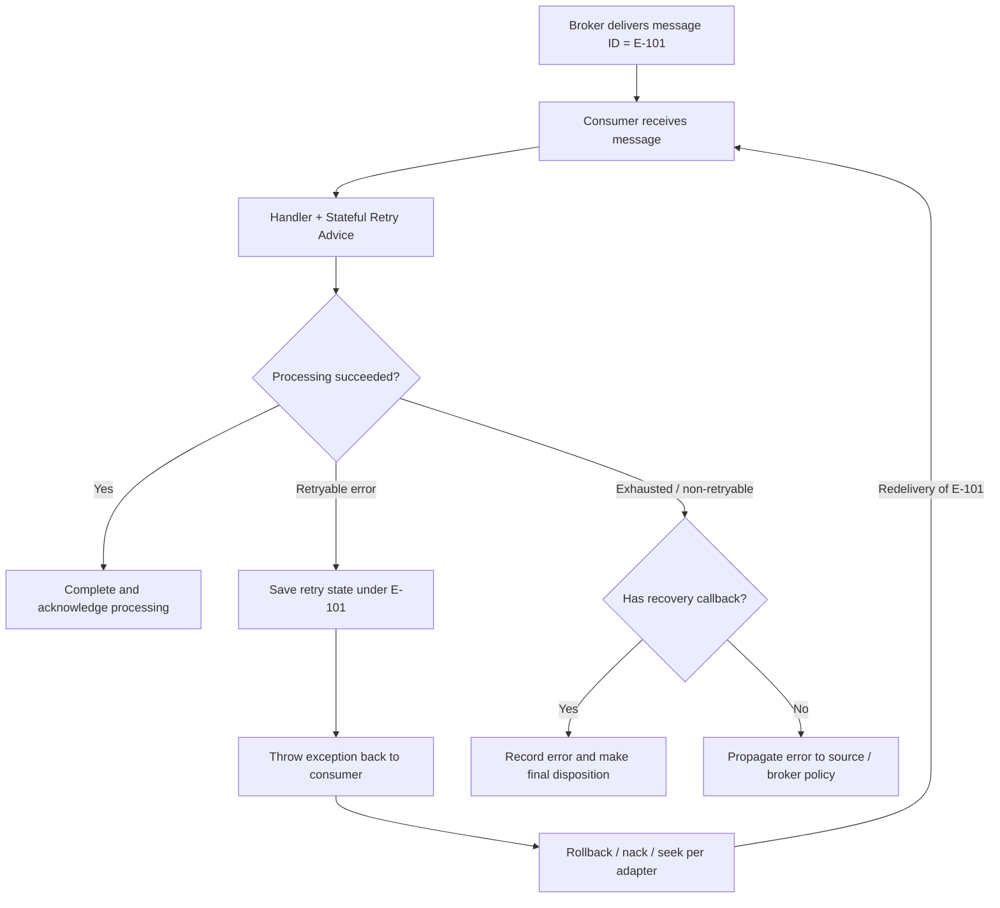

# Stateful Retry by Message Identity in Spring Integration

## 1. The Problem: Is a Returning Message Still the Same Retry Sequence?

In an **Enterprise Integration Patterns (EIP)** flow, a message may travel through a Filter, Transformer, Router, or Splitter before reaching a handler that calls an external system. Suppose the shipment creation handler fails because the carrier returns HTTP 503. If the input comes from a broker supporting redelivery (JMS, RabbitMQ, or Kafka with an appropriate replay mechanism), the exception can be thrown back to the consumer so the message is redelivered later.

When the message comes back, the handler needs to distinguish two cases: **is this the next attempt for the same message**, or **is this a brand-new business message**. If every redelivery initializes a fresh counter, the handler-level retry limit becomes meaningless. Conversely, if two distinct messages share a retry key, one message's failures can cause the other to be treated as exhausted.

**Stateful retry by message identity** solves the problem of tracking a processing sequence across multiple redeliveries. In the `SPRING_INTEGRATION_PATTERN` module, this mechanism helps build loosely coupled, extensible flows that integrate cleanly with Gateways, Routers, error channels, correlation, testing, and per-branch observability.

After this lesson, you will be able to:

- Distinguish **stateless retry** within a single invocation from **stateful retry** across multiple redeliveries.
- Choose a stable identity key and avoid collisions between messages.
- Attach stateful retry to `RequestHandlerRetryAdvice` using the API corresponding to Spring Integration 6.x or 7.x.
- Understand how exceptions, transaction rollbacks, broker redelivery, and recovery work together.
- Test retry state persistence/restoration, attempt limits, and idempotency.

## 2. How Do Stateless and Stateful Retry Differ?

| Characteristic | Stateless retry | Stateful retry |
| --- | --- | --- |
| Retry counter | Lives within a single advice/handler invocation | Tied to the message identity key and reused across redeliveries |
| After handler throws retryable error | Usually retries immediately in the same execution after backoff | Records state and lets the exception propagate to the caller/source for handling |
| Who triggers the next attempt? | Retry advice | Sender, consumer, or broker redelivery |
| Time scope | Single handler invocation | Multiple deliveries of the same message |
| Key requirement | Handler has advice attached and error is retryable | Stable identity key **and** an actually working redelivery mechanism |
| Best suited for | Synchronous HTTP, short operations, immediate retry | Consumers with transactions/acknowledgements and redelivery |
| Primary risks | Holding threads, extending Gateway timeouts | Lost/colliding retry state, redelivery loops, state skew across nodes |

With stateful retry, **the advice does not create a replay queue on its own**. It only recognizes that a redelivered message shares the same identity as a previously failed message. The broker or calling source must perform the resubmission. Depending on the adapter, this comes from transaction rollback, negative acknowledgement, seek/reposition, or an application-built replay mechanism.



This diagram is a logical model; the exact mechanics for redelivering a message depend on the broker type, transaction mode, and adapter error handler. An application using only `DirectChannel` with no resubmitting source will not magically run extra attempts just by enabling stateful retry.

## 3. Message Identity: Which Key Properly Tracks Retry State?

**Message identity** here means *the key used to correlate deliveries of the same unit of work*, which does not necessarily match `MessageHeaders.ID` generated by Spring Messaging.

| Key candidate | Recommended? | Reason |
| --- | --- | --- |
| Business event ID, e.g., `eventId` | Usually suitable | Remains stable across redeliveries of the same event; should be unique within system scope |
| `tenantId + eventId` | Suitable for multi-tenant apps | Prevents key collisions when two tenants generate the same ID |
| JMS message ID preserved across redelivery | Suitable when preserved by adapter | Coupled to a specific broker; verify actual headers |
| Kafka `topic + partition + offset` | Suitable for identifying a re-read record | A record's offset is stable; a bare Kafka `key` may repeat across records |
| Bare `orderId` | Only if one order always maps to one job | One order can have multiple distinct events/operations |
| Spring's `MessageHeaders.ID` | Do not use by default | Can change when transforming or creating a new `Message` |
| Current timestamp or UUID generated in handler | Unsuitable | Every redelivery generates a new key, losing retry history |

Example business message:

```java
record ShipmentEvent(
        String tenantId,
        String eventId,
        String orderId,
        String idempotencyKey) {}
```

For an event with `tenantId = "vn"`, `eventId = "evt-101"`, the retry key can be `shipment:vn:evt-101`. Every redelivery of that event must produce the same key. Event `evt-102` needs a separate key, even if it shares the same `orderId`.

### Mandatory Key Principles

1. **Stable across redeliveries:** A broker may wrap the message in a new object. Derive the key from a durable payload field or a preserved header.
2. **Unique within a reasonable scope:** If two flows share an advice/cache and could produce colliding identities, prefix the key with the business type, source, or tenant.
3. **Never `null` or blank:** Never allow multiple ID-less messages to accidentally share one retry state. Treat missing IDs as an explicit input error.
4. **Do not confuse retry identity with idempotency key:** Retry identity tracks failure counts; the idempotency key prevents duplicate business side effects at the target. They may be related, but they serve two distinct purposes.
5. **Understand ID lifecycles:** When a new event shares an `orderId` but has a different `eventId`, it must not inherit the old event's retry count.

## 4. Lifecycle of a Message with Rollback and Redelivery

Suppose the policy allows **1 initial call and 2 retries**, totaling at most **3 handler executions**. Suppose the handler always throws `TemporaryCarrierException`. In a typical redelivery sequence:

| Delivery | Identity | What the advice knows | Typical action |
| --- | --- | --- | --- |
| 1st | `shipment:vn:evt-101` | No prior state | Invoke handler, fails; save state and rethrow for rollback/redelivery |
| 2nd | `shipment:vn:evt-101` | One failed attempt recorded | Try again; if still failing, rethrow and update state |
| 3rd | `shipment:vn:evt-101` | Two failed attempts recorded | Try again per policy; if still failing, mark sequence as exhausted |
| Subsequent redelivery after exhaustion (if any) | `shipment:vn:evt-101` | State is exhausted | Advice invokes recovery or throws exhausted error depending on config/version |

In Spring Integration 6.x, documentation illustrates `SimpleRetryPolicy(3)` resulting in three failed handler calls and a subsequent delivery triggering recovery. Spring Integration 7.x also describes recognizing exhausted state on redelivery; always test the exact sequence in the version you run.

**Do not equate broker delivery count with handler invocation count.** The delivery that detects exhaustion may not execute the handler. A broker also enforces its own redelivery limit; if the broker moves the message to a dead-letter queue too early, the advice may never get a chance to run its planned recovery.

When the handler succeeds, the retry state for that sequence completes. When no retries remain, decide clearly where the failure is persisted and when the message may be acknowledged to the broker. If recovery itself fails, exception propagation and further redelivery depend on the transaction/error handler; never silently assume the message was handled.

## 5. Configuring Stateful Retry with Spring Integration 7.x

**Version note:** Spring Integration 7.x moved retry support to Spring Framework's `org.springframework.core.retry`. The API enabling stateful retry is `RequestHandlerRetryAdvice.setStateKeyFunction(...)`. In Spring Integration 6.x, the API is different: `setRetryStateGenerator(...)` with Spring Retry. These two configurations are **not directly interchangeable**. The primary example below targets **Spring Integration 7.1.x / Spring Framework 7.x**.

The flow receives `ShipmentEvent` from the `shipmentEvents` channel. A JMS/RabbitMQ/Kafka consumer must be configured separately to feed messages into the channel and perform redelivery when the handler throws. The configuration below focuses on the advice, identity key, and recovery branch:

```java
import java.time.Duration;

import org.springframework.beans.factory.annotation.Qualifier;
import org.springframework.context.annotation.Bean;
import org.springframework.context.annotation.Configuration;
import org.springframework.core.retry.RetryPolicy;
import org.springframework.integration.channel.DirectChannel;
import org.springframework.integration.dsl.IntegrationFlow;
import org.springframework.integration.handler.advice.ErrorMessageSendingRecoverer;
import org.springframework.integration.handler.advice.RequestHandlerRetryAdvice;
import org.springframework.messaging.Message;
import org.springframework.messaging.MessageChannel;
import org.springframework.messaging.support.ErrorMessage;

@Configuration
public class StatefulShipmentConfiguration {

    @Bean
    MessageChannel shipmentEvents() {
        return new DirectChannel();
    }

    @Bean
    MessageChannel shipmentRetryFailures() {
        return new DirectChannel();
    }

    static String retryKey(Message<?> message) {
        ShipmentEvent event = (ShipmentEvent) message.getPayload();
        if (event.tenantId() == null || event.tenantId().isBlank()
                || event.eventId() == null || event.eventId().isBlank()) {
            throw new IllegalArgumentException("Missing stable shipment identity");
        }
        return "shipment:" + event.tenantId() + ":" + event.eventId();
    }

    @Bean
    RequestHandlerRetryAdvice shipmentStatefulAdvice(
            @Qualifier("shipmentRetryFailures") MessageChannel failures) {

        // Spring Framework 7: maxRetries = number of retries AFTER the initial call.
        RetryPolicy policy = RetryPolicy.builder()
                .maxRetries(2) // At most 3 handler executions.
                .delay(Duration.ofMillis(200))
                .multiplier(2.0)
                .maxDelay(Duration.ofSeconds(1))
                .includes(TemporaryCarrierException.class)
                .build();

        RequestHandlerRetryAdvice advice = new RequestHandlerRetryAdvice();
        advice.setRetryPolicy(policy);
        advice.setStateKeyFunction(StatefulShipmentConfiguration::retryKey);
        advice.setStateCacheSize(500); // Configuration example; tune based on load.
        advice.setRecoveryCallback(new ErrorMessageSendingRecoverer(failures));
        return advice;
    }

    @Bean
    IntegrationFlow shipmentFlow(ShipmentDispatcher dispatcher,
                                 RequestHandlerRetryAdvice shipmentStatefulAdvice) {
        return IntegrationFlow.from("shipmentEvents")
                .handle(dispatcher, "send",
                        endpoint -> endpoint.advice(shipmentStatefulAdvice))
                .get();
    }

    @Bean
    IntegrationFlow shipmentRecoveryFlow(ShipmentFailureRecorder recorder) {
        return IntegrationFlow.from("shipmentRetryFailures")
                .handle(message -> recorder.record((ErrorMessage) message))
                .get();
    }
}

record ShipmentEvent(String tenantId, String eventId,
                     String orderId, String idempotencyKey) {}

interface ShipmentDispatcher {
    void send(ShipmentEvent event);
}

interface ShipmentFailureRecorder {
    void record(ErrorMessage error);
}

class TemporaryCarrierException extends RuntimeException {
    TemporaryCarrierException(String message, Throwable cause) {
        super(message, cause);
    }
}
```

### Reading the Configuration

- `setStateKeyFunction(...)` identifies the same unit of work across multiple deliveries. **This is the switch that activates stateful retry** in Spring Integration 7.x.
- `RetryPolicy.builder().maxRetries(2)` allows at most **2 retries after the initial call**. Do not read this parameter like Spring Retry 6.x's `SimpleRetryPolicy(3)`: both the name and counting convention differ.
- `includes(TemporaryCarrierException.class)` restricts which errors are retryable. If errors from the handler get wrapped in `MessagingException` or another wrapper, test the real exception chain and adjust via a predicate or adapter-level normalization; do not widen it to all `RuntimeException`s.
- `delay(...)`, `multiplier(...)`, and `maxDelay(...)` define backoff. In 7.x stateful retry, redeliveries are driven by the source; **a redelivered execution may still wait for backoff** before calling the handler, so do not assume it never blocks a thread.
- `setStateCacheSize(500)` is just an example overriding the default of **100** in Spring Integration 7.x. The in-advice cache is neither durable across restarts nor distributed across instances.
- `ErrorMessageSendingRecoverer` forwards exhausted errors to the failure-recording branch. The recorder must genuinely persist or route errors somewhere suitable for investigation and reprocessing; a normally completing callback can lead upstream to treat processing as successful.

**Prerequisites:** The project must provide bean implementations of `ShipmentDispatcher` and `ShipmentFailureRecorder`, along with an appropriately configured source adapter. The Java DSL flow above only declares channels and endpoints; **it does not produce broker redelivery**. If you send a message once to `DirectChannel` and never resend it, the handler only gets one stateful attempt during that delivery.

### `newMessagePredicate` and Key Reuse Cases

Spring Integration 7.x also offers `setNewMessagePredicate(Predicate<Message<?>>)` to **start fresh state** when a message is considered new despite sharing a key; use this only with a clear rule, such as a data generation or event version field.

Avoid configuring a predicate that always returns `true`: that resets attempt counts on every redelivery. Whenever possible, designing a genuinely unique identity per event is clearer and safer. `setStateCacheSize(...)` and `setNewMessagePredicate(...)` apply only to stateful retry.

## 6. Equivalent Configuration in Spring Integration 6.x

If the application runs on **Spring Integration 6.x + Spring Retry**, `RetryStateGenerator` and `SpelExpressionRetryStateGenerator` generate keys for `RetryTemplate` to store per-message state. The following snippet is **6.x advice configuration**, not compatible with a 7.x project:

```java
import java.util.Map;

import org.springframework.integration.handler.advice.ErrorMessageSendingRecoverer;
import org.springframework.integration.handler.advice.RequestHandlerRetryAdvice;
import org.springframework.integration.handler.advice.SpelExpressionRetryStateGenerator;
import org.springframework.messaging.MessageChannel;
import org.springframework.retry.backoff.NoBackOffPolicy;
import org.springframework.retry.policy.SimpleRetryPolicy;
import org.springframework.retry.support.RetryTemplate;

RequestHandlerRetryAdvice statefulAdvice6x(MessageChannel failureChannel) {
    RetryTemplate retryTemplate = new RetryTemplate();
    retryTemplate.setRetryPolicy(new SimpleRetryPolicy(
            3, Map.of(TemporaryCarrierException.class, true), true));
    retryTemplate.setBackOffPolicy(new NoBackOffPolicy());

    RequestHandlerRetryAdvice advice = new RequestHandlerRetryAdvice();
    advice.setRetryTemplate(retryTemplate);
    advice.setRetryStateGenerator(
            new SpelExpressionRetryStateGenerator("headers['retryIdentity']"));
    advice.setRecoveryCallback(
            new ErrorMessageSendingRecoverer(failureChannel));
    return advice;
}
```

Here, the adapter must set the same `retryIdentity` header on every delivery of the same event (e.g., `shipment:vn:evt-101`) **before** the message reaches the handler. You can use `headers['jms_messageId']` if the system truly preserves that JMS header. Never pick a header that can be regenerated differently on each redelivery.

Key differences:

| Item | Spring Integration 6.x | Spring Integration 7.x |
| --- | --- | --- |
| API to enable stateful | `setRetryStateGenerator(...)` | `setStateKeyFunction(...)` |
| Key generation | `SpelExpressionRetryStateGenerator` or custom `RetryStateGenerator` | `Function<Message<?>, Object>` |
| Retry policy | `org.springframework.retry.policy.SimpleRetryPolicy` | `org.springframework.core.retry.RetryPolicy` |
| Limit parameter | `maxAttempts = 3` means **3 handler calls** | `maxRetries = 2` means **2 retries**, max **3 handler calls** |
| Setting policy | `advice.setRetryTemplate(template)` | `advice.setRetryPolicy(policy)` |
| State storage | Retry context cache in Spring Retry | State cache managed by advice, configured via `stateCacheSize` |

Spring Integration 7.x removed `RetryStateGenerator` and `SpelExpressionRetryStateGenerator`. When upgrading a module, check the available APIs and migrate identity logic, retry policy, recovery, and redelivery tests together rather than just renaming methods.

## 7. Coordinating Rollback, Acknowledgement, and Recovery

Stateful retry is valuable when rollback must happen **before** the next attempt—for example, transactional JMS reads or when a consumer relies on the broker to manage redelivery.

### Failed Attempt with Remaining Retries

The handler throws an exception permitted by the retry policy. The advice records state under the retry key and rethrows the exception so the consumer can roll back or trigger redelivery. If the application catches the exception at an outer layer and acknowledges the message anyway, no subsequent delivery occurs and the stateful sequence stops right there.

### Final Attempt and Recovery Branch

After retries are exhausted, two common approaches are:

1. **With `RecoveryCallback`:** emit an `ErrorMessage`, route to a dead-letter flow, or persist a failure record; decide explicitly when to acknowledge the message as processed. Recovery must persist failures reliably.
2. **Without a recovery callback:** the exhausted exception propagates upstream; the broker/error handler decides whether to dead-letter, discard, or redeliver. If unlimited redelivery runs without durable state, infinite loops or restarting from scratch remain a risk.

Do not confuse an **error channel** with a broker **dead-letter queue**. An error channel routes `ErrorMessage`s inside a Spring Integration application; a dead-letter queue is messaging-infrastructure storage for failed messages. You can bridge the two with an appropriate adapter, but they are not automatically the same thing.

### Examples of Source Adapters

| Source | Possible redelivery mechanism | What to verify |
| --- | --- | --- |
| JMS | Session/transaction rollback for broker redelivery | Transactions enabled, broker delivery limit, identity preserved |
| RabbitMQ | Consumer reject/nack with requeue or retry/dead-letter setup | No tight requeue loop; handler exception maps to nack properly |
| Kafka | Consumer error handler seek/reposition or retry topic | Offset commits, partition/offset, and real redelivery config |
| Synchronous HTTP Gateway | Caller actively resends the same event | No automatic broker redelivery; caller must preserve identity and deadline |

In a distributed multi-instance deployment, node A's in-memory retry cache is not automatically shared with node B. If the broker can redeliver the same event to a different node, design sticky partitioning or persist attempt/poison-message status appropriately. Never rely on an in-memory cache as an absolute guarantee of retry counts across restarts, rebalances, and failovers.

## 8. Correlation, Router, Splitter, and Idempotency

Identity-based stateful retry solves **remembering retry progress**, but it does not solve end-to-end single-execution semantics on its own.

- **Router:** An event may be routed to multiple handlers. If different handlers share retry state, differentiate keys by endpoint/branch name, e.g., `shipment:A:tenant:eventId` and `shipment:B:tenant:eventId`.
- **Filter/Transformer:** When creating a new `Message`, preserve the identity header or payload event ID. A validation error cannot self-heal by retrying the same payload, so route it explicitly to an error branch.
- **Splitter/Aggregator:** For split message parts, append `partId` or sequence number to the key if retry state is tracked per part, while keeping the group's correlation ID intact so the Aggregator reassembles parts properly.
- **Gateway:** When a gateway resends the same request, define whether it represents a *redelivery of the same event* or a new business command. Never use send timestamp as a retry identity.
- **Error channel:** Store original metadata for lookup: source, retry key, correlation ID, event ID, order ID, final error, and attempt history if available.

For example, two messages with the same `orderId = O-42` but `eventId = create-42` and `eventId = cancel-42` are **two distinct jobs**. Using `orderId` as the key accidentally merges state between order creation and cancellation; using `eventId` (with an appropriate namespace) keeps them separate.

### Idempotency When Downstream Processed the Request but the Response Was Lost

Suppose the partner API **already created the shipment**, yet the response timed out. The broker redelivers the message with the same retry identity. If the handler calls the API again without idempotency, a second shipment may be created even though the retry counter works accurately.

```java
// Illustrative logic for ShipmentDispatcher.send(...).
// carrierApi and the exception types below are application business adapters.
public void send(ShipmentEvent event) {
    try {
        carrierApi.createShipment(event.orderId(), event.idempotencyKey());
    } catch (CarrierTimeoutException | CarrierUnavailableException ex) {
        throw new TemporaryCarrierException("Partner temporarily unresponsive", ex);
    }
}
```

`idempotencyKey` must **stay identical across** redeliveries of the same operation, and the target system must support deduplication or the application must enforce idempotency itself. Retry state and idempotency must be designed together, yet neither replaces the other.

## 9. When Should You Avoid Stateful Retry?

Not every system needs stateful retry. Consider alternatives when:

- Synchronous callers have no resubmit mechanism or cannot preserve identity. Bounded stateless retry is usually simpler here.
- The message source already provides retry topics, delayed queues, and reliable attempt counters. Adding another internal counter can make total invocation counts hard to control.
- Wait times between attempts span minutes or hours. A delayed queue or scheduler backed by durable storage is usually more appropriate.
- Requirements demand attempt tracking across restarts, multiple pods, or multi-region deployments. Durable state in the broker/database or a well-designed distributed solution is needed instead of trusting a local cache.

## 10. Testing Identity and Redelivery Sequences

Testing stateful retry requires simulating **multiple deliveries of the same event returning to the endpoint**, rather than simply calling a handler repeatedly inside one thread.

### Testing the Retry Key Function

For the 7.x configuration in section 5, the following JUnit 5 example proves that Spring `Message`s with different IDs/headers still produce **the same retry key** when the business event is unchanged:

```java
import org.junit.jupiter.api.Test;
import org.springframework.messaging.Message;
import org.springframework.messaging.support.MessageBuilder;

import static org.junit.jupiter.api.Assertions.assertEquals;
import static org.junit.jupiter.api.Assertions.assertNotEquals;
import static org.junit.jupiter.api.Assertions.assertThrows;

class ShipmentRetryIdentityTest {

    @Test
    void redeliveredMessagesShareTheSameBusinessRetryKey() {
        ShipmentEvent event = new ShipmentEvent(
                "vn", "evt-101", "order-42", "idem-42");

        Message<ShipmentEvent> first = MessageBuilder.withPayload(event)
                .setHeader("delivery", 1).build();
        Message<ShipmentEvent> redelivery = MessageBuilder.withPayload(event)
                .setHeader("delivery", 2).build();

        assertEquals(StatefulShipmentConfiguration.retryKey(first),
                StatefulShipmentConfiguration.retryKey(redelivery));
        assertEquals("shipment:vn:evt-101",
                StatefulShipmentConfiguration.retryKey(redelivery));
    }

    @Test
    void differentEventIdentityMustNotShareState() {
        Message<ShipmentEvent> a = MessageBuilder.withPayload(
                new ShipmentEvent("vn", "evt-101", "order-42", "idem-a"))
                .build();
        Message<ShipmentEvent> b = MessageBuilder.withPayload(
                new ShipmentEvent("vn", "evt-102", "order-42", "idem-b"))
                .build();

        assertNotEquals(StatefulShipmentConfiguration.retryKey(a),
                StatefulShipmentConfiguration.retryKey(b));
    }

    @Test
    void missingEventIdIsRejected() {
        Message<ShipmentEvent> invalid = MessageBuilder.withPayload(
                new ShipmentEvent("vn", "", "order-42", "idem-42"))
                .build();

        assertThrows(IllegalArgumentException.class,
                () -> StatefulShipmentConfiguration.retryKey(invalid));
    }
}
```

This test only verifies the identity function; it **does not prove** that broker rollback/redelivery and the retry policy work end-to-end. Add integration tests using a broker container or consumer test adapter matching real deployment settings.

### Integration Test Matrix

| Scenario | Expectation |
| --- | --- |
| New message, handler succeeds | Handler called once; nothing sent to recovery |
| Same `eventId` redelivered after transient error | Retry state recognized; next attempt resumes progress instead of resetting to 0 |
| Same `orderId` but different `eventId` | Two isolated states that do not affect each other's attempt count |
| Handler fails until retries are exhausted | Handler invocation count stays within budget; recovery branch or final error behaves as designed |
| Non-retryable exception | Does not trigger prolonged retry chain with the same bad payload |
| Spring `id` header changes on redelivery | Event-derived retry key remains stable |
| Recovery callback fails to persist error | Does not acknowledge success silently; recovery error is observable |
| Consumer switches nodes or app restarts mid-sequence | Explicitly verify whether retry state is lost; test durable state supplements if needed |
| API already processed request but response timed out | Attempts share identical idempotency key; no duplicate side effects created |

During tests, measure **two separate counters**: broker delivery count and actual handler invocation count. Also monitor transaction/ack status, recovery message counts, dead-letter items, correlation IDs, and event ordering. When backoff is enabled, assert durations within a generous tolerance to avoid millisecond-sensitive flakiness.

## 11. Monitoring and Operations

Key operational signals:

- **Retry state by identity:** number of active identities holding state, cache eviction rate, and colliding or blank key counts.
- **Deliveries and attempts:** compare broker deliveries against handler invocations by endpoint, exception type, and tenant/source.
- **Recovery/dead-letter:** count of exhausted messages, failure reasons, message age, and elapsed time from first attempt to final recovery.
- **Load:** active consumers, backlog depth, continuously redelivering messages, wait times, and downstream health.
- **Correlation:** event ID, retry identity, trace ID, and business identifiers for tracing across Router/Splitter/Gateway and error channels.

Avoid placing individual identity values into metric tags due to extreme cardinality; capture them in controlled logs/traces instead. Do not log sensitive payload data solely for debugging convenience. In multi-node setups, alert when events frequently bounce to different nodes or when broker redeliveries climb while stateful counters keep resetting.

## 12. Common Mistakes

| Mistake | Consequence | Fix |
| --- | --- | --- |
| Using `headers.id` when each delivery builds a new message | Fails to recognize the same event | Use an event ID or preserved broker ID |
| Sharing `orderId` across distinct operations | Merges retry state for unrelated messages | Include event/operation ID and namespace |
| Enabling stateful retry without a redelivery mechanism | Runs only once, never reaches next retry | Configure transaction/nack/seek or resubmit |
| Catching errors and acknowledging immediately | Broker never redelivers the message | Let exceptions follow the broker's error policy |
| Small cache or node switches | Retry state lost, attempt counts restart | Monitor eviction, use sticky routing, or persist state durably |
| `newMessagePredicate` always returning `true` | Resets state continuously | Refresh only when certain the event is new |
| Reading 7.x `maxRetries` like 6.x `maxAttempts` | Wrong number of handler calls | Check version-specific counting semantics |
| Recovery returns normally without persisting error | Message may be acked/lost for investigation | Persist errors durably and handle recovery failures |
| Confusing identity with idempotency | Retry state works yet duplicate transactions occur | Keep idempotency keys and downstream deduplication |

## 13. Practice Exercise

Design a flow that receives `ShipmentEvent` from a broker, uses a Router to pick a carrier, and attaches stateful retry to carrier A's handler. Construct the retry key from branch name, tenant, and event ID. Configure a policy equivalent to **one initial call + two retries** for transient errors; validation errors must not be retried. Make handler A fail under three scenarios: succeeding after one redelivery, failing through to recovery, and failing after downstream completed the transaction but the response timed out.

Verify that identity stays intact across redeliveries, delivery count differs from handler count, the source actually rolls back or seeks, the recovery branch preserves the original message, Splitter/Aggregator parts retain correlation, and downstream creates no duplicate shipments. Finally, test restarting the application or switching consumer nodes to evaluate the impact of local in-memory state caching.

**Completion criteria:** The same message maintains consistent retry state across redeliveries under the designed conditions; different messages never share state; failures stop and route properly upon exhaustion; transactions/acks align with recovery outcomes; and all business side effects are protected by idempotency.

## Version-Specific References

- [Spring Integration 7.1 — Retry Advice](https://docs.spring.io/spring-integration/reference/handler-advice/classes.html): `stateKeyFunction`, `stateCacheSize`, `newMessagePredicate`, and stateful redelivery.
- [Spring Integration 6.5 — Retry Advice](https://docs.spring.io/spring-integration/reference/6.5/handler-advice/classes.html): `RetryStateGenerator`, `SpelExpressionRetryStateGenerator`, and Spring Retry.
- [Spring Framework 7 — Resilience Features](https://docs.spring.io/spring-framework/reference/core/resilience.html): `RetryPolicy`, `maxRetries`, and backoff options.
