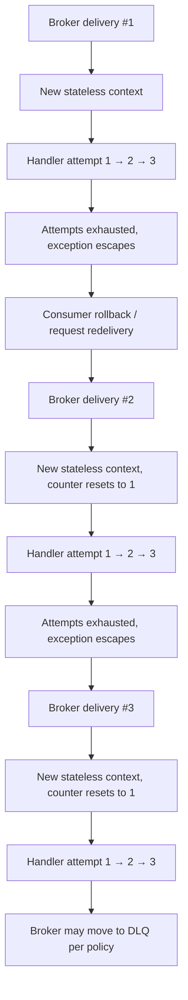
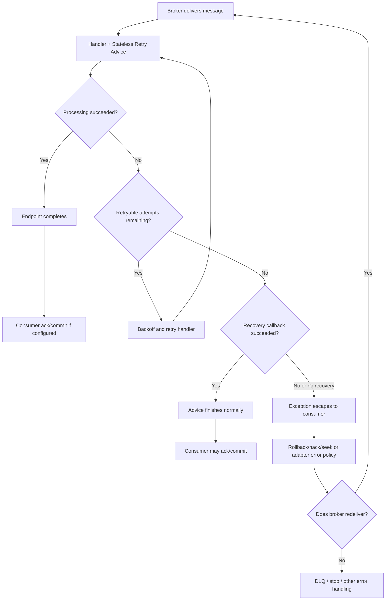

# Stateless Retry and Per-Redelivery Behavior in Spring Integration

## 1. The Problem: Does a Redelivered Message Continue the Old Retry Counter?

Suppose a Spring Integration flow receives a shipment creation event from a broker. The message passes through a validation Filter, a normalizing Transformer, a Router selecting the carrier, and then a message handler calling the partner API. The partner returns a transient error, so the handler has `RequestHandlerRetryAdvice` attached to retry.

After the handler exhausts its allowed attempts and still fails, the exception propagates back to the consumer. If the consumer rolls back or asks the broker to redeliver, **the same business event may be processed again from the beginning**. The question is how `RequestHandlerRetryAdvice`'s counter behaves during that redelivery.

With **stateless retry**, attempt-count state exists only within **a single retry execution**. When the broker redelivers and the endpoint is invoked again, a brand-new retry context is created: the counter starts over from the beginning, even though the payload, `eventId`, and business key are identical to the previous delivery. This is the core characteristic covered in **"Stateless Retry and Per-Redelivery Behavior"** in the **Retry** chapter of the `SPRING_INTEGRATION_PATTERN` module.

Understanding this helps design loosely coupled, extensible Enterprise Integration Patterns flows while coordinating Routers, Filters, Transformers, Splitters/Aggregators, Gateways, error channels, correlation, testing, and per-branch monitoring without unexpectedly inflating downstream call counts.

After this lesson, you will be able to:

- Explain why stateless retry **does not preserve attempt counts across redeliveries**.
- Calculate how many times a handler can execute when retries exist at multiple layers.
- Determine when an exception must propagate back for broker redelivery versus when recovery ends processing.
- Configure stateless `RequestHandlerRetryAdvice` and exception classification.
- Independently test handler attempt counts, broker delivery counts, idempotency, and traceability.

## 2. Three Concepts You Must Keep Separate

| Concept | Who performs it? | Scope | Example |
| --- | --- | --- | --- |
| **Handler attempt** | Handler orchestrated by retry advice | One handler invocation | Calling the shipment API attempt 1, attempt 2, attempt 3 |
| **Stateless retry operation** | `RetryTemplate` or retry policy inside advice | One advised endpoint execution | Up to 3 attempts with backoff between calls |
| **Broker delivery/redelivery** | Consumer and source broker/adapter | One broker delivery of the message to the app | Initial delivery, then redelivered after rollback/nack/seek |

One delivery can contain **multiple handler attempts**. Conversely, a redelivery may re-run an entire pipeline segment before the handler, depending on how adapters, transactions, and flows are structured. Retry advice on a handler only governs attempts **within the current processing pass**.

In Spring Integration 6.x, `RequestHandlerRetryAdvice` uses Spring Retry's `RetryTemplate`. Without a configured `RetryStateGenerator`, the advice runs statelessly. Starting in Spring Integration 7.x, retry APIs moved to Spring Framework; stateless mode remains the behavior whenever no state key function is provided. Java configuration snippets for each version are shown separately later.

## 3. Every Redelivery Starts a Fresh Retry Sequence

Suppose the handler is allowed **3 attempts including the first call** and the broker performs at most **3 deliveries including the initial delivery**. Suppose downstream always fails with a retryable error.



| Delivery | Attempts in that delivery | Cumulative handler invocations |
| --- | --- | ---: |
| 1st | #1, #2, #3 | 3 |
| 2nd | #1, #2, #3 | 6 |
| 3rd | #1, #2, #3 | 9 |

In this example, **`maxAttempts = 3` does not mean downstream is called at most three times across the entire lifecycle of the event**. It only bounds a single `RetryTemplate` execution. If the message traverses the endpoint again, stateless retry does not reuse attempt history from earlier runs.

Let:

- `A` = maximum attempts within one delivery.
- `D` = maximum broker deliveries, **including** the initial delivery.
- `H` = total number of handler invocations.

When all attempts fail and errors always propagate to trigger broker redelivery, the theoretical upper bound is:

\[
H_{\max}=A\times D
\]

If `A = 4` and `D = 5`, downstream can receive **20 requests** for the exact same event. This ceiling assumes the broker actually caps deliveries at 5 and no extra retry layer exists. In practice, `H` may be smaller if an attempt succeeds early, hits a non-retryable exception, is handled by recovery, or the broker stops redelivering.

**Without a broker redelivery limit**, the formula above yields no finite bound: fresh stateless contexts can restart endlessly. A permanently failing message risks becoming an infinitely looping *poison message*.

## 4. When Does the Broker Redeliver, and When Does It Not?

The deciding factor is **what happens to the exception after the handler invocation ends**. Retry configuration alone does not determine acknowledgement or rollback.



### Case A — No Recovery Callback

Once attempts are exhausted, `RetryTemplate` typically throws the final exception. If the handler is invoked over a `DirectChannel` from a synchronous consumer, the exception can bubble back to the consumer. **Only when the source adapter is configured** to roll back, nack/requeue, or seek backward will the broker produce a new delivery. If the application catches and swallows the exception, or the consumer acknowledges unconditionally, no redelivery occurs via that mechanism.

### Case B — Recovery Callback Succeeds

For example, a callback uses `ErrorMessageSendingRecoverer` to send the error to `shipmentFailures`, where a recorder persists a failure record. If the recoverer finishes normally, the advice can return **without rethrowing the original exception**. The consumer may treat that delivery as handled and ack/commit, so the broker **will not necessarily redeliver**. Recovery must carry explicit business semantics: failure recorded, dead-lettered, or terminal disposition made; it must never be misread as downstream having succeeded.

### Case C — Recovery Also Fails

If the channel has no consumer, the recorder fails to persist, or recovery throws an exception, the exception can still escape. At that point the source adapter again decides rollback, redelivery, or DLQ routing. Therefore, the recovery branch must also be tested and monitored, especially before the broker acknowledges the message.

### Case D — Exception Not in the Retryable List

The policy can stop right at the **first attempt**. Stopping retries inside the handler does not mean the broker will skip redelivery. If the exception still rolls back the transaction, the broker may redeliver the message even though the handler only runs one attempt each time. Provide dedicated handling for validation, data, or programming errors to avoid pointless loops.

## 5. Example Stateless Retry Configuration in Spring Integration 6.x

The example below uses Spring Integration **6.x** and Spring Retry. The flow receives `ShipmentCommand` and attaches retry advice to the handler calling the carrier API. Only `TemporaryCarrierException` is retried, up to 3 attempts with a fixed 200 ms wait between calls. **No recovery callback is set intentionally** so you can observe exceptions escaping back to the source and triggering broker redelivery when the source is configured accordingly.

```java
import java.util.Map;

import org.springframework.context.annotation.Bean;
import org.springframework.context.annotation.Configuration;
import org.springframework.integration.channel.DirectChannel;
import org.springframework.integration.dsl.IntegrationFlow;
import org.springframework.integration.handler.advice.RequestHandlerRetryAdvice;
import org.springframework.messaging.MessageChannel;
import org.springframework.retry.backoff.FixedBackOffPolicy;
import org.springframework.retry.policy.SimpleRetryPolicy;
import org.springframework.retry.support.RetryTemplate;

@Configuration
public class StatelessShipmentRetryConfiguration {

    @Bean
    MessageChannel shipmentInput() {
        return new DirectChannel();
    }

    @Bean
    RequestHandlerRetryAdvice statelessRetryAdvice() {
        // 3 attempts including the initial call.
        SimpleRetryPolicy retryPolicy = new SimpleRetryPolicy(
                3, Map.of(TemporaryCarrierException.class, true), true);

        FixedBackOffPolicy backOffPolicy = new FixedBackOffPolicy();
        backOffPolicy.setBackOffPeriod(200L);

        RetryTemplate template = new RetryTemplate();
        template.setRetryPolicy(retryPolicy);
        template.setBackOffPolicy(backOffPolicy);

        RequestHandlerRetryAdvice advice = new RequestHandlerRetryAdvice();
        advice.setRetryTemplate(template);
        // No setRetryStateGenerator: this is stateless retry.
        // No setRecoveryCallback: errors can still escape to the consumer.
        return advice;
    }

    @Bean
    IntegrationFlow shipmentFlow(CarrierClient carrierClient,
                                 RequestHandlerRetryAdvice statelessRetryAdvice) {
        return IntegrationFlow.from("shipmentInput")
                .handle(carrierClient, "send",
                        endpoint -> endpoint.advice(statelessRetryAdvice))
                .get();
    }
}

record ShipmentCommand(String eventId, String orderId, String idempotencyKey) {}

interface CarrierClient {
    void send(ShipmentCommand command);
}

class TemporaryCarrierException extends RuntimeException {
    TemporaryCarrierException(String message, Throwable cause) {
        super(message, cause);
    }
}
```

To run this example, the application needs a bean implementing `CarrierClient` plus Spring Integration and Spring Retry (`org.springframework.retry:spring-retry`) dependencies. The Java DSL configuration above **defines only the channel and handler**; it does not create an inbound adapter, transaction manager, broker redelivery rules, or dead-letter queue. A JMS/RabbitMQ/Kafka source must be wired to `shipmentInput` with its own rollback/ack configuration.

### Why Is This Stateless?

- `RequestHandlerRetryAdvice` is attached directly to the `send` handler; preceding Router/Transformer steps do not automatically re-run during a single advice execution.
- `RetryTemplate` has `SimpleRetryPolicy(3, ..., true)`: up to 3 attempts per invocation, inspecting exceptions inside the `cause` chain.
- `FixedBackOffPolicy` waits 200 ms after each failed attempt **that will be retried**: at most 400 ms total backoff per delivery.
- No `RetryStateGenerator`: the retry context is not bound to any durable identity key across separate endpoint invocations.
- No recovery callback: once attempts are exhausted, the exception propagates outward, letting the source adapter apply its own error and redelivery policy.

With an allowlist `SimpleRetryPolicy` as shown, `InvalidShipmentException` or `NullPointerException` outside the allowlist **will not be retried at the handler**. Still, if the consumer rolls back on those exceptions, the broker may redeliver the message. Handle unrecoverable errors via an appropriate error/dead-letter branch.

## 6. If You Are Using Spring Integration 7.x

Spring Integration **7.x** migrated from Spring Retry APIs to Spring Framework's built-in retry support. Do not copy 6.x `RetryTemplate` configuration into a 7.x project without adapting it.

The corresponding approach for stateless retry in 7.x sets Spring Framework's `RetryPolicy` on `RequestHandlerRetryAdvice` and **does not** provide a `stateKeyFunction`:

```java
import java.time.Duration;

import org.springframework.core.retry.RetryPolicy;
import org.springframework.integration.handler.advice.RequestHandlerRetryAdvice;

RetryPolicy policy = RetryPolicy.builder()
        .maxRetries(2) // 2 retries AFTER the initial call, 3 attempts total.
        .delay(Duration.ofMillis(200))
        .includes(TemporaryCarrierException.class)
        .build();

RequestHandlerRetryAdvice advice = new RequestHandlerRetryAdvice();
advice.setRetryPolicy(policy);
// No setStateKeyFunction(...): stateless processing.
```

This snippet illustrates advice configuration only and should be placed inside a valid Java configuration method. The easiest pitfall to miss is **counting semantics**: in Spring Retry 6.x, `maxAttempts = 3` is the total number of calls; in Spring Framework 7.x, `maxRetries = 2` means two retries **after** the initial call. Both examples allow up to 3 handler executions per delivery.

## 7. Combining Handler Retry and Broker Redelivery

Treat both layers as two **independent budgets**. The handler policy governs downstream calls per delivery; the consumer/broker policy governs how many deliveries an event can receive.

| Source | Redelivery usually depends on | What to verify |
| --- | --- | --- |
| JMS | Session rollback, transactions, and broker redelivery policy | Does initial delivery count toward the limit; how are `JMSRedelivered`/delivery counts populated |
| RabbitMQ | Ack, reject/nack, requeue, DLX, or retry queues | Is it tightly requeuing in a loop; when does it route to DLQ |
| Kafka | Error handler, seek/reposition, offset commits, or retry topics | Is the record re-read with the same `topic/partition/offset`; who tracks attempt counts |
| Synchronous HTTP Gateway | Caller actively resending the request | Gateways have no automatic broker redelivery; requires deadlines and stable identity |

There is no universal `maxDeliveries` property across all brokers. In real systems, verify through documentation and tests for your **specific adapter/consumer/broker** whether limits count deliveries, redeliveries, or failed processing attempts.

### Backoff at the Two Layers Is Different

`RetryTemplate` backoff executes **within a single delivery**; with `DirectChannel` and a synchronous consumer, it holds the processing thread. Broker delays or retry topics usually happen **between deliveries** and can release the worker thread while waiting. If both layers configure backoff, total latency includes both.

Suppose `A = 3` attempts/delivery, each HTTP attempt times out after at most 500 ms, fixed backoff is 200 ms, and the broker delivers the message **3 times** with two 2-second gaps between deliveries:

\[
T_{\text{delivery}} \approx 3\times500+2\times200=1{,}900\;\text{ms}
\]

\[
T_{\text{total}} \approx 3\times1{,}900+2\times2{,}000=9{,}700\;\text{ms}
\]

These are **estimated** durations, excluding overhead from the broker, consumer, message conversion, transactions, and scheduling. If a Gateway waits 3 seconds for a result, this entire chain cannot be treated as a normal synchronous call. Processing can easily outlive the client's deadline.

### Why Can Multi-Layer Retries Cause Overload?

If 200 concurrent messages hit the same error, a single delivery with 3 attempts can already generate 600 downstream calls. If the broker redelivers 4 times, the theoretical total climbs to 2,400 requests. If an adapter also enables its own HTTP client retry, real traffic multiplies even further. Concurrency limits, timeouts, exponential backoff/jitter, circuit breakers, or delayed queues are essential to avoid a *retry storm*.

## 8. Can Correlation IDs Preserve Retry State?

In **stateless retry**, even when a message retains the same correlation ID or event ID across redeliveries, the attempt counter **still resets**. Those identifiers only aid tracing; they do not automatically turn a retry context stateful.

Example:

```text
eventId: evt-101
correlationId: shipment-batch-7
delivery 1: handler attempts 1, 2, 3 → failed
delivery 2: handler attempts 1, 2, 3 → failed
delivery 3: handler attempt 1 → succeeded

Total handler calls: 7
Retry state remembered across deliveries: no
```

To observe accurately, record **two separate counters**:

- `deliveryCount`: how many times the broker/adapter has delivered the event.
- `handlerAttempt`: which invocation of the handler this is **within the current delivery**.

When emitting logs or traces, include `eventId`, `correlationId`, `deliveryCount`, `handlerAttempt`, endpoint name, and exception type. With Kafka, use `topic`, `partition`, and `offset` to identify the record; do not assume Kafka has a JMS-like `redelivered` flag. With JMS or RabbitMQ, read metadata per the specific adapter in use.

### Stateless Retry Does Not Solve Idempotency

If the partner **already created the shipment** but the response timed out, a subsequent attempt or broker redelivery can re-trigger an already completed business action. Having the same event ID only supports tracing; you still need a stable `idempotencyKey` and downstream deduplication.

```java
// Illustrative logic of CarrierClient.send(...).
// carrierApi and exceptions are adapter components defined by the application.
public void send(ShipmentCommand command) {
    try {
        carrierApi.createShipment(
                command.orderId(),
                command.idempotencyKey());
    } catch (CarrierTimeoutException | CarrierUnavailableException ex) {
        throw new TemporaryCarrierException("Carrier temporarily unresponsive", ex);
    }
}
```

`idempotencyKey` must **stay unchanged across both attempts and broker deliveries** of the same operation. If the target system lacks idempotency support, the application needs its own deduplication guard, such as a business state table with a unique constraint or a transactional outbox. Retry does not provide exactly-once guarantees for external side effects.

## 9. When Should You Switch to Stateful Retry?

If business rules mandate **at most 3 total attempts for the same event, regardless of how many times the broker redelivers**, independent stateless retry on each delivery cannot enforce that rule.

Options include:

1. **Identity-based stateful retry:** the advice tracks retry state by a stable key, such as `tenantId + eventId`. Spring Integration 6.x uses `RetryStateGenerator`; Spring Integration 7.x uses `stateKeyFunction`. Verify cache lifecycle, redelivery, and recovery against your actual version.
2. **Retry only at the broker/consumer layer:** set handler attempts to 1 and manage redeliveries and dead-lettering at the adapter or broker. Suitable when source infrastructure already offers reliable retry topics/delayed delivery and attempt limits.
3. **Persist attempt state durably in the application:** use a database or distributed store keyed by event ID if limits must survive restarts or span multiple instances.

Remember that in-memory stateful retry is **not inherently durable** across restarts, cache evictions, consumer rebalances, or when a broker routes a message to another node. In distributed systems, state storage and identity keys must match operational realities.

## 10. Testing: Proving the Counter Resets on Every Delivery

Testing should separate two layers: unit tests for `RetryTemplate` and integration tests with the message source. A unit test invoking `RetryTemplate.execute(...)` **twice in a row** simulates two independent stateless retry operations; that models two deliveries, though it is not yet a real broker test.

### JUnit 5: Two Deliveries, Three Attempts Each

This example uses Spring Integration **6.x** Spring Retry APIs with no recovery callback:

```java
import java.util.Map;
import java.util.concurrent.atomic.AtomicInteger;

import org.junit.jupiter.api.Test;
import org.springframework.retry.backoff.NoBackOffPolicy;
import org.springframework.retry.policy.SimpleRetryPolicy;
import org.springframework.retry.support.RetryTemplate;

import static org.junit.jupiter.api.Assertions.assertEquals;
import static org.junit.jupiter.api.Assertions.assertThrows;

class StatelessRedeliveryTest {

    @Test
    void retryCountStartsOverForEachExecution() {
        RetryTemplate template = new RetryTemplate();
        template.setRetryPolicy(new SimpleRetryPolicy(
                3, Map.of(TemporaryCarrierException.class, true), true));
        template.setBackOffPolicy(new NoBackOffPolicy());

        AtomicInteger handlerCalls = new AtomicInteger();

        // Simulate two deliveries of the same event.
        for (int delivery = 1; delivery <= 2; delivery++) {
            assertThrows(TemporaryCarrierException.class,
                    () -> template.execute(context -> {
                        handlerCalls.incrementAndGet();
                        throw new TemporaryCarrierException("503", null);
                    }));

            assertEquals(delivery * 3, handlerCalls.get());
        }

        assertEquals(6, handlerCalls.get());
    }
}
```

With `NoBackOffPolicy`, the test does not wait in real time. Expected counts are 3 handler calls after the first `execute` and 6 after the second. `RetryTemplate` is **reused**, yet each `execute` starts a fresh retry context because the test uses no stateful `RetryState`.

### Integration Test Matrix

| Scenario | Handler attempts | Broker deliveries | What to verify |
| --- | ---: | ---: | --- |
| Immediate success | 1 | 1 | Consumer acks, no redelivery |
| Succeeds on attempt #3 of delivery #1 | 3 | 1 | Retry resolves before broker redelivery is needed |
| Exhausts 3 attempts, then delivery #2 succeeds immediately | 4 | 2 | Counter resets when delivery #2 begins |
| All three deliveries fail with 3 attempts each | 9 | 3 | Broker limit applies; message goes to terminal error handling or DLQ |
| Non-retryable validation error, consumer still rolls back | 1 per delivery | Per broker | Handler does not retry, yet broker may still redeliver |
| Recovery callback persists error and exits normally | Max 3 | Possibly 1 | Verify appropriate ack/commit after recovery |
| Recovery callback throws exception | Per policy | Per broker | Broker applies its error policy; message is not lost |
| Handler succeeds downstream but response times out | Per scenario | Potentially multiple | Idempotency key unchanged; no duplicate side effects |

At the integration level, use a real consumer and broker (or an appropriate test container), a fake `CarrierClient` counting invocations, a recorder capturing `ErrorMessage`s, and a mock target verifying side effects. Check rollbacks, ack/commits, redelivery delays, and DLQ routing; a test that merely calls `channel.send(...)` in a loop **does not prove** broker redelivery works properly.

## 11. Essential Observability Signals

A system can report a high message success rate while downstream call volume spikes sharply. Therefore, monitor:

- **Attempts per delivery:** average and distribution of handler calls per delivery.
- **Deliveries per event:** how many times an event ID enters the consumer; distinguish intentional resubmissions from consumer rollbacks.
- **Total downstream calls per event:** actual requests sent to the partner, catching multiplicative retries across layers.
- **Recovery/DLQ:** exhaustion rate, error routing counts, and time spent cycling in redelivery loops.
- **Latency and backlog:** in-thread backoff wait time, inter-delivery delays, active consumer count, and queue depth.
- **Correlation:** event ID, correlation ID, trace ID, and transaction ID to connect processing passes accurately.

Use Micrometer/Actuator alongside structured logging and retry instrumentation. Do not assume built-in framework metrics expose `handlerAttempt` or `deliveryCount` out of the box; the application may need a `RetryListener`, interceptor, or adapter metadata to track them separately. Never put individual event IDs into high-cardinality metric labels; use controlled logs or tracing instead.

## 12. Common Design Mistakes

| Mistake | Consequence | Fix |
| --- | --- | --- |
| Assuming `maxAttempts = 3` caps the entire message lifecycle | Downstream calls exceed expectations | Multiply handler budget by broker delivery limit |
| Thinking the same correlation ID preserves retry state | Attempts reset after redelivery | Use stateful retry or external state when required |
| Failing to verify adapter ack/rollback behavior | Never redelivers, or redelivers endlessly | Write integration tests with real transaction/error handlers |
| Attaching a recoverer while still expecting broker redelivery | Recovery swallows exception, consumer acks | Define terminal business outcomes and error branches clearly |
| Letting broker requeue immediately after multi-attempt handler retries | Retry storm, downstream overload | Use delay/jitter, concurrency limits, circuit breakers, DLQ |
| Retrying validation errors | Every delivery fails uselessly | Classify exceptions and use dead-letter/validation flows |
| Multi-layer retries without idempotency | Duplicate shipments/transactions | Enforce idempotency keys and deduplication |
| Relying on local retry cache for cluster-wide limits | Attempt counts lost on restart or node switch | Persist state durably or manage retries at the broker |

## 13. Comprehensive Practice Exercise

Build a flow that receives `ShipmentCommand` from a broker, passes through a validation Filter, a normalizing Transformer, and a Router selecting partner A or B. Attach **stateless retry** to handler A with up to **3 attempts**, a fixed **200 ms** backoff, retrying only `TemporaryCarrierException`. Configure the source so the broker performs at most **3 deliveries** (initial delivery plus two redeliveries), then moves exhausted messages to a DLQ per source policy.

Test in order: immediate success; failing two attempts then succeeding; exhausting attempts on delivery #1 and succeeding on delivery #2; failing all three deliveries; non-retryable validation error; and downstream succeeding before a response timeout. Record `eventId`, `deliveryCount`, `handlerAttempt`, correlation ID, total invocation count, and DLQ message count.

Next, enable `ErrorMessageSendingRecoverer` with a reliable error recorder and observe whether subsequent deliveries still happen. Compare that outcome with having no recovery callback, then decide which layer should own retries if business rules allow at most three total downstream calls.

**Completion criteria:** Accurately explain attempt counts per delivery and total handler calls; distinguish handler-level retry conditions from broker-level redelivery conditions; terminate failing messages rather than looping forever; and maintain correlation and idempotency across every processing pass.
