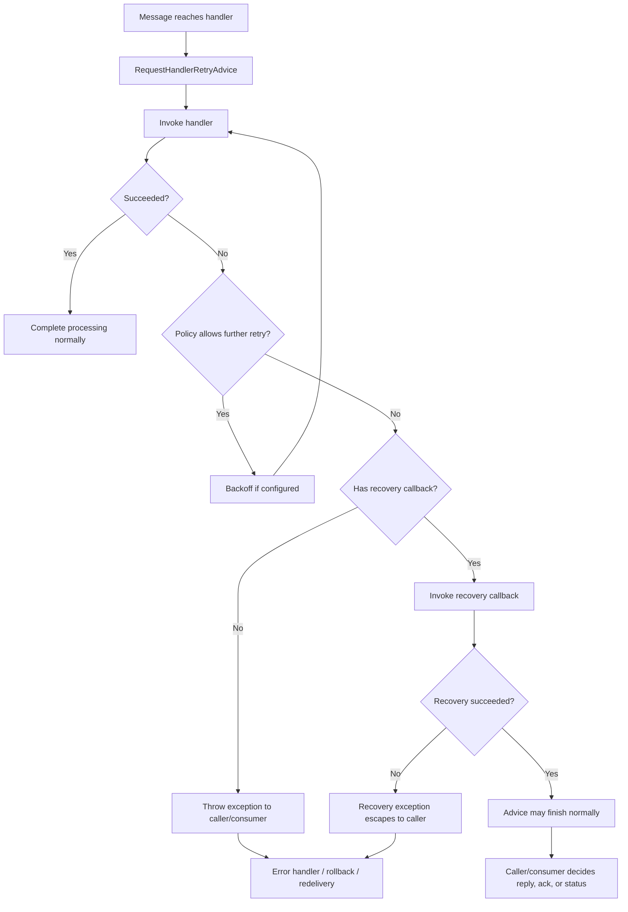
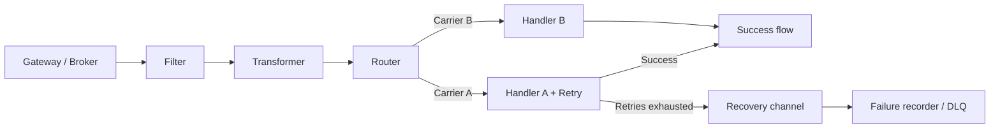

# Recovery Callback After Exhausted Retries in Spring Integration

## 1. What Problem Does a Recovery Callback Solve?

In an Enterprise Integration Patterns (EIP) flow, a message typically passes through a Router, Filter, or Transformer before reaching a message handler that calls an external system. A handler submitting a shipment creation request can encounter timeouts, HTTP 503 responses, or brief connectivity errors. Retries help recover from transient glitches; however, once all allowed attempts are spent and the call still fails, the system must **decide the fate of the message**.

A **recovery callback** is the action invoked when the retry policy stops without a successful outcome. In Spring Integration, `RequestHandlerRetryAdvice` can be configured with `ErrorMessageSendingRecoverer`: this component sends the final failure details to a `MessageChannel` wrapped as an `ErrorMessage`. An independent recovery flow can record the failure, send alerts, or forward replay metadata to durable storage.

In the `SPRING_INTEGRATION_PATTERN` module, this technique ties Retry, error channels, Gateways, and correlation together into loosely coupled, extensible, and testable message flows. Key points to keep in mind:

- Recovery runs only when retries **stop due to failure**, never after a successful attempt.
- When the callback returns normally, the original exception may **no longer be thrown back to the caller**. This directly affects broker acknowledgements and Gateway contracts.
- Routing an error to a channel **does not by itself guarantee** durable storage, business completion, or safe replayability.
- If recovery itself fails, the new exception can escape to the calling layer; you must know how the adapter/transaction will handle that outcome.

After this lesson, you will be able to configure a recoverer, trace every success/failure branch, extract needed data from `ErrorMessage`, control ack/rollback behavior, and write tests for exhausted-retry scenarios.

## 2. Where Does Recovery Sit in the Retry Lifecycle?



Suppose a policy allows at most **3 attempts including the initial call**. When the handler fails all three times, the callback is invoked **once for that exhausted retry sequence**. If the policy treats an exception as non-retryable on the very first call, the sequence stops after one attempt and also enters recovery if a callback is configured. That is why you should classify errors and preserve the final cause.

| Scenario | Handler calls (3-attempt policy) | Recovery callback | Typical outcome |
| --- | ---: | --- | --- |
| Handler succeeds immediately | 1 | No | Flow succeeds |
| Two transient errors, third succeeds | 3 | No | Flow succeeds |
| Always throws transient error | 3 | Yes | Error recorded or routed to failure branch |
| Non-retryable validation error | 1 | Yes if recovery is used here | Data error logged, avoiding pointless retries |
| Retries exhausted with no callback | 3 | No | Exception propagated to caller |
| Retries exhausted, callback also throws | 3 | Yes, but fails | Recovery exception must be handled |

Exact exception matching and attempt rules depend on the `RetryPolicy` and library version. Never think of recovery as "one extra retry"; it **handles the failed outcome** of a finished sequence.

## 3. Recovery Callback, Error Channel, and Dead-Letter Are Different

These three concepts often appear together yet play distinct roles:

| Component | Responsibility | Does not guarantee by itself |
| --- | --- | --- |
| `RecoveryCallback` | Decides what to do after the policy stops retrying | Business success or durable persistence |
| `ErrorMessageSendingRecoverer` | Builds and sends an `ErrorMessage` to a designated channel | Having a consumer, DB persistence, or a broker DLQ |
| Spring Integration error channel | Delivers error messages to error-handling flows/handlers | Re-invoking the handler or rolling back transactions |
| Broker dead-letter queue (DLQ) | Stores unprocessable messages per broker/adapter rules | Automatic business recovery or idempotency |

`ErrorMessageSendingRecoverer` can send to a **dedicated recovery channel** such as `shipmentRecoveryErrors`, separate from the global `errorChannel`. A dedicated channel isolates shipment creation errors from errors in other flows and lets you apply custom persistence, alerting, and replay workflows.

Specifically, `ErrorMessageSendingRecoverer` uses an `ErrorMessageStrategy` by default to construct the `ErrorMessage`; that message carries a `Throwable` payload. When the error context still retains the original message, `ErrorMessage.getOriginalMessage()` may return it. Never assume that field is always present; a `MessagingException` may also carry `failedMessage`.

## 4. Designing a Real-World Scenario

An e-commerce application submits `ShipmentCommand` into an integration flow calling a carrier. Rules:

1. Connectivity glitches or temporary service outages may be retried up to **3 attempts**; wait 200 ms then 400 ms between attempts.
2. Validation or misconfiguration errors **must not be retried**; failures still need to be recorded for triage.
3. When completion fails, send an `ErrorMessage` to `shipmentRecoveryErrors`, extract the order identifiers, and persist a failure record.
4. The record must include `eventId`, `orderId`, `idempotencyKey`, correlation ID, error type, timestamp, and processing status; optionally include attempt count if instrumented.
5. After recovery, never reply that a shipment was created when downstream did not actually succeed.

Example payload:

```java
record ShipmentCommand(String eventId, String orderId,
                       String idempotencyKey) {}
```

`eventId` identifies the event being processed; `idempotencyKey` prevents creating duplicate shipments if downstream executed the request before a lost response. These two identifiers may be related, yet they serve distinct purposes.

## 5. Java DSL Configuration with Spring Integration 6.x

The following example demonstrates `RequestHandlerRetryAdvice`, `RetryTemplate`, `SimpleRetryPolicy`, exponential backoff, and `ErrorMessageSendingRecoverer` in **Spring Integration 6.x + Spring Retry**. The project needs compatible Spring Integration and `org.springframework.retry:spring-retry` dependencies.

```java
import java.util.Map;

import org.springframework.beans.factory.annotation.Qualifier;
import org.springframework.context.annotation.Bean;
import org.springframework.context.annotation.Configuration;
import org.springframework.integration.channel.DirectChannel;
import org.springframework.integration.dsl.IntegrationFlow;
import org.springframework.integration.handler.advice.ErrorMessageSendingRecoverer;
import org.springframework.integration.handler.advice.RequestHandlerRetryAdvice;
import org.springframework.messaging.MessageChannel;
import org.springframework.messaging.support.ErrorMessage;
import org.springframework.retry.backoff.ExponentialBackOffPolicy;
import org.springframework.retry.policy.SimpleRetryPolicy;
import org.springframework.retry.support.RetryTemplate;

@Configuration
public class ShipmentRecoveryConfiguration {

    @Bean
    MessageChannel shipmentRequests() {
        return new DirectChannel();
    }

    @Bean
    MessageChannel shipmentRecoveryErrors() {
        return new DirectChannel();
    }

    @Bean
    RequestHandlerRetryAdvice shipmentRetryAdvice(
            @Qualifier("shipmentRecoveryErrors") MessageChannel recoveryChannel) {

        // Max 3 handler invocations, including the initial call.
        SimpleRetryPolicy retryPolicy = new SimpleRetryPolicy(
                3, Map.of(TemporaryCarrierException.class, true), true);

        ExponentialBackOffPolicy backoff = new ExponentialBackOffPolicy();
        backoff.setInitialInterval(200L);
        backoff.setMultiplier(2.0);
        backoff.setMaxInterval(1_000L);

        RetryTemplate template = new RetryTemplate();
        template.setRetryPolicy(retryPolicy);
        template.setBackOffPolicy(backoff);

        RequestHandlerRetryAdvice advice = new RequestHandlerRetryAdvice();
        advice.setRetryTemplate(template);
        advice.setRecoveryCallback(
                new ErrorMessageSendingRecoverer(recoveryChannel));
        return advice;
    }

    @Bean
    IntegrationFlow shipmentFlow(CarrierClient client,
                                 RequestHandlerRetryAdvice shipmentRetryAdvice) {
        return IntegrationFlow.from("shipmentRequests")
                .handle(client, "submit",
                        endpoint -> endpoint.advice(shipmentRetryAdvice))
                .get();
    }

    @Bean
    IntegrationFlow shipmentRecoveryFlow(ShipmentFailureRecorder recorder) {
        return IntegrationFlow.from("shipmentRecoveryErrors")
                .handle(message -> recorder.record((ErrorMessage) message))
                .get();
    }
}

interface CarrierClient {
    void submit(ShipmentCommand command);
}

interface ShipmentFailureRecorder {
    void record(ErrorMessage error);
}

class TemporaryCarrierException extends RuntimeException {
    TemporaryCarrierException(String message, Throwable cause) {
        super(message, cause);
    }
}
```

The types `ShipmentCommand`, `CarrierClient`, and `ShipmentFailureRecorder` belong to the application; provide bean implementations for the two business interfaces. `CarrierClient.submit(...)` should translate timeouts, connection resets, or HTTP 503 responses into `TemporaryCarrierException`. Data and programming errors must not be wrapped into this retryable type. This example is a **one-way send flow** to focus on recovery; Gateways expecting replies require an explicit reply contract.

### Why Attach Recovery Only to the Advice?

- `.advice(shipmentRetryAdvice)` attaches the advice specifically to the `submit` handler. Merely declaring a retry advice bean does not make every handler retry.
- `SimpleRetryPolicy(3, ..., true)` retries transient errors and walks the `cause` chain when Spring Messaging wraps exceptions. Other exceptions stop after the first call.
- `ExponentialBackOffPolicy` waits 200 ms then 400 ms when all three attempts are needed. Maximum total wait in this example is 600 ms, **excluding API call time**.
- `setRecoveryCallback(new ErrorMessageSendingRecoverer(recoveryChannel))` defines what happens when the policy stops: it emits an `ErrorMessage` to the chosen channel.
- `shipmentRecoveryFlow` must have a consumer that truly persists the failure record. If it only calls `log.info(...)`, the message might be acknowledged as complete with no way to recover it.

In production, ensure the database or queue receiving failure records is durable. If error recording shares the same transaction as an operation slated for rollback, design transaction boundaries carefully; if a shared transaction rolls back the failure record too, recovery looks successful while error data vanishes.

## 6. Spring Integration 7.x Uses a Different RetryPolicy

Spring Integration **7.x** moved to Spring Framework's Retry Support (`org.springframework.core.retry`) instead of configuring Spring Retry's `RetryTemplate` as in 6.x. `ErrorMessageSendingRecoverer` and `setRecoveryCallback(...)` are still available; what changes is how the policy is built and counted.

```java
import java.time.Duration;

import org.springframework.core.retry.RetryPolicy;
import org.springframework.integration.handler.advice.ErrorMessageSendingRecoverer;
import org.springframework.integration.handler.advice.RequestHandlerRetryAdvice;
import org.springframework.messaging.MessageChannel;

RequestHandlerRetryAdvice retryAdvice7x(MessageChannel recoveryChannel) {
    RetryPolicy policy = RetryPolicy.builder()
            .maxRetries(2) // Two retries AFTER the initial call: 3 attempts total.
            .delay(Duration.ofMillis(200))
            .multiplier(2.0)
            .maxDelay(Duration.ofSeconds(1))
            .includes(TemporaryCarrierException.class)
            .build();

    RequestHandlerRetryAdvice advice = new RequestHandlerRetryAdvice();
    advice.setRetryPolicy(policy);
    advice.setRecoveryCallback(
            new ErrorMessageSendingRecoverer(recoveryChannel));
    return advice;
}
```

This is an illustrative configuration method to place in an appropriate application configuration/bean class. Both examples aim for at most **three handler invocations**, but 6.x's `SimpleRetryPolicy(3)` counts **including the first call**, whereas Spring Framework 7.x's `maxRetries(2)` specifies **two retries after the first call**. Test against the exact library version in use, and never mix imports across the two APIs.

## 7. Inspecting `ErrorMessage` to Persist the Right Failed Event

A recovery flow must not assume the `ErrorMessage` payload is always a `MessageHandlingException`. Under Spring Messaging, the payload is a `Throwable`; `ErrorMessage.getOriginalMessage()` or `MessagingException.getFailedMessage()` **may** carry the message near the failure point. Inspect types safely and handle missing original data.

```java
import org.springframework.messaging.Message;
import org.springframework.messaging.MessagingException;
import org.springframework.messaging.support.ErrorMessage;

void recordFailure(ErrorMessage error) {
    Throwable failure = error.getPayload();
    Message<?> source = error.getOriginalMessage();

    if (source == null && failure instanceof MessagingException messagingError) {
        source = messagingError.getFailedMessage();
    }

    if (source != null && source.getPayload() instanceof ShipmentCommand command) {
        String eventId = command.eventId();
        String orderId = command.orderId();
        String idempotencyKey = command.idempotencyKey();
        Object correlationId = source.getHeaders().get("correlationId");

        // Forward these fields and failure to durable error storage.
        // Do not log the full payload or sensitive data.
    } else {
        // Record the technical error and available trace metadata so failures are not missed.
    }
}
```

This illustrates data extraction, **not a complete durable persistence implementation**. In a real application, `ShipmentFailureRecorder.record(...)` must write to a failure table, send to a confirmed DLQ, or use another reliable mechanism; if saving fails, never return normally in silence. A failure record typically needs:

| Field | Purpose |
| --- | --- |
| `eventId`, `orderId`, `tenantId` if present | Identifies the event and business scope |
| `idempotencyKey` | Supports verification and replay without duplicate side effects |
| `correlationId`, `traceId` | Links the failure across Router/Splitter/Gateway branches |
| Exception type and cause details | Classifies transient vs. permanent errors and aids investigation |
| `failedAt`, `status`, `nextAction` | Drives remediation and replay workflows |
| `attemptCount` if separately instrumented | Explains how the policy behaved |

Do not assume `ErrorMessage` automatically populates attempt counts or every header. Extra fields may require a retry listener, adapter metadata, or custom instrumentation. When persisting error data, safeguard personal information, secrets, and payload size.

## 8. Successful Recovery Does Not Mean Business Success

This is a common source of severe bugs when integrating Gateways and brokers. Distinguish two outcomes:

**Business processing outcome:** Did the carrier actually create the shipment?

**Recovery outcome:** Did the application succeed in recording the failure or forwarding the message to downstream triage?

`ErrorMessageSendingRecoverer` can finish sending the error message and return normally. The consumer layer may consider message delivery complete and execute ack or commit. Yet the shipment record still was not created. In a request/reply Gateway, a `null` recovery result can leave the gateway without a reply or violate a reply-required contract; and `null` must never be interpreted as success.

```text
ShipmentCommand(eventId=evt-77)
  -> handler calls carrier: failed
  -> retries exhausted
  -> recovery records status: FAILED_PENDING_REVIEW
  -> source may ack per error-handling contract

Message processing result: failure recorded
Shipment creation result: not succeeded
```

Application strategies to choose from:

1. **Fire-and-forget or asynchronous consumers:** Recovery persists the failure to durable storage and finishes. Acknowledge only once failure capture meets the required durability guarantee.
2. **Synchronous Gateways requiring a response:** Return an explicit business outcome (`FAILED`, `PENDING_RETRY`, error code, correlation ID) through a dedicated flow, or let the exception propagate to the caller per contract.
3. **Transactions requiring rollback and broker redelivery:** Either omit the exception-swallowing callback, or have the callback act and then rethrow per an explicit policy. If the broker already manages reliable DLQs/redelivery limits, avoid unmanaged two-layer retries over the same event.

**Important:** A recovery callback does not by itself enforce `ack`, `nack`, rollback, or commit. Those actions are controlled by the inbound adapter, transaction manager, and source-level error handler.

## 9. Recovery Failure: The Error-Handling Branch Itself Can Fail

The recovery branch can fail because the database is down, the DLQ rejects the message, the channel has no subscriber, serialization breaks, or source metadata is missing. If recovery silently swallows its own errors, the system loses both visibility and replayability.

| Situation | What to verify | Mitigation |
| --- | --- | --- |
| Recovery channel has no consumer | Does `DirectChannel`/`PublishSubscribeChannel` have subscribers and throw on missing delivery | Guarantee a subscriber, test at startup/shutdown |
| Failure persistence database fails | Transaction/rollback behavior, whether call throws | Propagate error to source or use durable outbox/DLQ |
| Message lacks original payload | Check `originalMessage`, `failedMessage`, or other headers | Record technical trace, avoid unconditional casts |
| Failure recorder runs multiple times | Same event redelivered by broker | Deduplicate by event ID and failure state |
| Downstream succeeded but response timed out | Recovery marks failure even though work completed | Reconcile via idempotency key before replaying |
| Recovery callback blocks thread too long | Gateway timeouts, consumer backlog | Bound latency, consider fast persistence via durable queue |

For example: the handler retried three times, recovery attempts a DB write, and the DB is also down. If the recorder's exception propagates back to the consumer and the broker redelivers, **the stateless retry chain may run all over again from scratch**. Account for the total budget of handler retries plus broker redeliveries. If using identity-based stateful retry, ensure retry state stays stable across deliveries and plan for cache eviction/loss.

## 10. Recovery and Other EIP Patterns



- **Router:** Each branch can have its own recovery channel. Carrier A failing does not automatically retry or roll back other branches; make explicit fan-out decisions.
- **Filter/Transformer:** Normal Filter rejections or validation errors are not synonymous with retry exhaustion. Only exceptions from an advised endpoint invoke that advice's callback.
- **Splitter/Aggregator:** One part entering recovery may prevent the Aggregator from ever completing its group. Configure timeouts, failed-part notifications, or partial-result rules; keep correlation IDs and sequence headers when routing to recovery.
- **Gateway:** Avoid returning success when downstream failed. Define explicit `PENDING`, `FAILED`, exception, or typed reply contracts.
- **Error channel:** `ErrorMessageSendingRecoverer` actively publishes failures to a channel. Exceptions from other synchronous endpoints may propagate to callers without passing through the global error channel in the same way.
- **Dead-letter:** Routing to a DLQ requires a concrete adapter/producer and storage policy; it does not happen automatically just by naming a channel `...Failures`.

When status must be aggregated across branches, a failure record should capture `eventId`, `partId` (if applicable), `correlationId`, endpoint name, and final status so only the missing part is replayed. Replaying the entire event when some branches already succeeded requires idempotency or compensation.

## 11. Testing the Recovery Callback

Unit tests on the retry policy can verify that the callback runs upon exhaustion. Integration tests are what prove the advice is attached to the right handler, messages arrive on the recovery channel, and the consumer handles ack/rollback as intended.

### JUnit 5: Recovery Invoked Exactly Once After Three Attempts

The example below uses Spring Retry **6.x**'s `RetryTemplate`; it tests callback semantics independently of channels:

```java
import java.util.Map;
import java.util.concurrent.atomic.AtomicInteger;

import org.junit.jupiter.api.Test;
import org.springframework.retry.backoff.NoBackOffPolicy;
import org.springframework.retry.policy.SimpleRetryPolicy;
import org.springframework.retry.support.RetryTemplate;

import static org.junit.jupiter.api.Assertions.assertEquals;

class RetryRecoveryCallbackTest {

    @Test
    void invokesRecoveryOnceWhenAttemptsAreExhausted() {
        AtomicInteger handlerCalls = new AtomicInteger();
        AtomicInteger recoveryCalls = new AtomicInteger();

        RetryTemplate template = new RetryTemplate();
        template.setRetryPolicy(new SimpleRetryPolicy(
                3, Map.of(TemporaryCarrierException.class, true), true));
        template.setBackOffPolicy(new NoBackOffPolicy());

        String outcome = template.execute(context -> {
            handlerCalls.incrementAndGet();
            throw new TemporaryCarrierException("carrier unavailable", null);
        }, context -> {
            recoveryCalls.incrementAndGet();
            return "FAILED_RECORDED";
        });

        assertEquals(3, handlerCalls.get());
        assertEquals(1, recoveryCalls.get());
        assertEquals("FAILED_RECORDED", outcome);
    }
}
```

Here `NoBackOffPolicy` keeps the test instant. The test proves the callback executes once after the policy stops. The `FAILED_RECORDED` return value is simulated by the callback and **does not yet prove** a real record was persisted to a database.

### Integration Test Matrix for `ErrorMessageSendingRecoverer`

| Scenario | Handler calls | Recovery messages | Additional verification |
| --- | ---: | ---: | --- |
| Immediate success | 1 | 0 | Flow completes normally |
| Two transient errors, third succeeds | 3 | 0 | No false failure emitted |
| Always throws transient error | 3 | 1 | Captures final exception and event identity |
| Non-retryable validation error | 1 | 1 | No wasted backoff or retries |
| Recovery channel has no subscriber | Up to policy max | Does not complete cleanly | Recovery failure is clearly detected |
| Recorder throws while persisting | Up to policy max | Delivery may fail | Verify source rollback/ack behavior |
| Broker redelivery after recovery failure | May repeat full retry chain | Per delivery | Deduplicate failures and count total handler calls |
| Gateway awaits reply when recovery returns `null` | Per error | Possibly 1 | Never treat `null` as shipment created |
| Carrier created order but response timed out | Per policy | Possibly 1 | Reconcile idempotency, no duplicate orders |

In integration tests, replace `CarrierClient` with an attempt-counting fake and `ShipmentFailureRecorder` with an error-capturing recorder. Send real messages through `shipmentRequests` and verify exactly one `ErrorMessage` upon exhaustion. Then add a broker inbound adapter in a test container to verify ack/rollback behavior instead of inferring it from `channel.send(...)`.

## 12. Observability, Operations, and Replay

A reliable recovery flow must answer: which event failed, how many attempts ran, where was it recorded, and who is authorized to act next?

- **Attempts and exhausted counts:** handler invocation count, exhausted retry sequences, and final exception types.
- **Recovery delivery success/failure:** `ErrorMessage`s processed by consumers and recorder persistence failures.
- **Pending failures:** unacknowledged/pending failure record count, record age, replay count, and replay outcomes.
- **Latency:** handler time + backoff + failure persistence time, especially when sharing a thread with a Gateway or consumer.
- **Correlation:** trace ID, correlation ID, event ID, and endpoint ID connecting Router decisions to the recoverer.

Replaying failed messages needs a workflow: diagnose root cause, fix data or confirm downstream health, preserve the idempotency key, mark in-progress status, resubmit in a controlled manner, and update final status. Do not auto-replay validation or programming errors. Avoid logging sensitive payloads and never place per-`eventId` values into high-cardinality metric labels.

## 13. Common Design Mistakes

| Mistake | Consequence | Fix |
| --- | --- | --- |
| Assuming recovery means business processing succeeded | Caller gets wrong status, message may be acked | Separate business outcome from error-recording status |
| Only logging inside recovery | No durable record for investigation/replay | Persist durably or use a confirmed DLQ |
| Assuming an error channel retries automatically | Messages stall in error branch or terminate | Design explicit retry/replay mechanisms |
| Failing to test non-retryable exceptions | Callback triggers earlier than expected | Test error classification and retry policies |
| Not checking if `originalMessage` exists | Null pointers or lost correlation | Inspect both `getOriginalMessage()` and `getFailedMessage()` |
| Swallowing exceptions when recovery fails | Lost error messages | Propagate errors clearly and verify persistence results |
| Combining handler retry with unbounded broker redelivery | Retry storms or infinite loops | Count total requests, cap retries at each layer |
| Changing the idempotency key on replay | Duplicate business side effects | Keep keys stable and reconcile with downstream |

## 14. Practice Exercise

Build a flow that receives `ShipmentCommand` via a Gateway or inbound adapter and uses a Router to select carrier A or B. Attach `RequestHandlerRetryAdvice` to handler A with up to **3 attempts**, 200 ms then 400 ms backoff, retrying only transient errors. Route exhausted errors to `shipmentRecoveryErrors` using `ErrorMessageSendingRecoverer`. Implement a recorder that persists failures with `eventId`, `correlationId`, `idempotencyKey`, error type, timestamp, and status `PENDING_REVIEW`.

Run scenarios: immediate success, success on third attempt, exhausted retries, validation error, recovery recorder failure, broker redelivery, and carrier creating the shipment before a response timeout. Measure handler calls, recovery messages, persistence status, ack/rollback outcomes, and Gateway results. Finally, replay a failed record using its original idempotency key and confirm no duplicate transaction is created.

**Completion criteria:** Every message reaches a clear final state; the callback runs only when the policy stops without handler success; errors are persisted or propagated per contract; correlation and idempotency stay intact; and there are no false acknowledgements or fake business successes.

## References

- [Spring Integration 7.1 — Retry Advice](https://docs.spring.io/spring-integration/reference/handler-advice/classes.html): `RequestHandlerRetryAdvice`, `RecoveryCallback`, `ErrorMessageSendingRecoverer`, and Spring Framework's `RetryPolicy`.
- [Spring Integration 6.5 — Retry Advice](https://docs.spring.io/spring-integration/reference/6.5/handler-advice/classes.html): `RetryTemplate`, `SimpleRetryPolicy`, and Spring Retry recovery configuration.
- [Spring Integration — Error Handling](https://docs.spring.io/spring-integration/reference/error-handling.html): `ErrorMessage`, `ErrorMessageStrategy`, error channels, and original message context.
