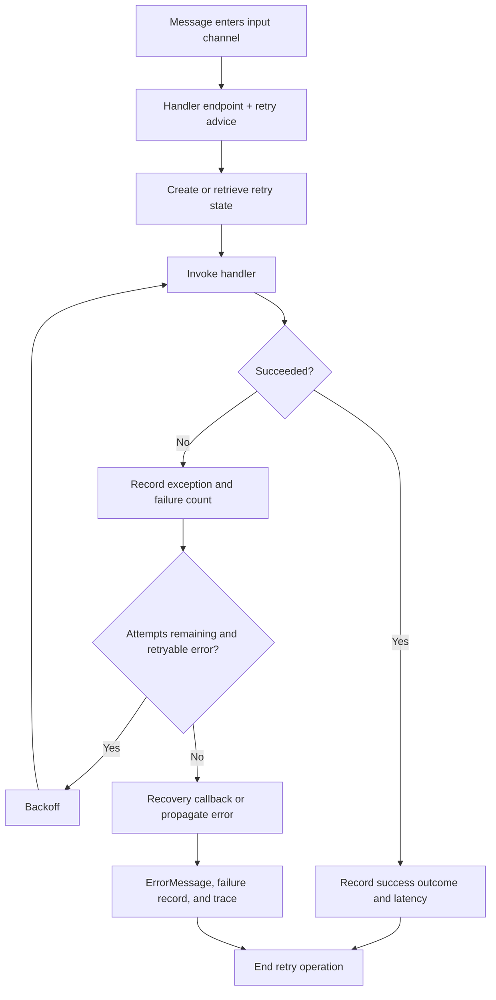

# Retry Context and Diagnostics in Spring Integration

## 1. Why Observe Every Retry Attempt?

An **Enterprise Integration Patterns (EIP)** flow typically receives a message from a Gateway or broker, routes it through a Filter, Transformer, Router, and Splitter, and then calls an external system via a message handler. When that handler hits a timeout or temporary service unavailability, `RequestHandlerRetryAdvice` can retry. The challenge is distinguishing **a request that succeeded immediately**, **a request that succeeded after a few attempts**, and **a request that failed and entered recovery**.

If you only log the final `Exception`, operations teams cannot tell how many times the handler called the partner, whether backoff caused a Gateway timeout, or whether many messages are simultaneously failing against one partner. The **retry context** holds the state of a retry sequence; **diagnostics** turn that state into logs, metrics, traces, and failure records usable for investigation.

In the `SPRING_INTEGRATION_PATTERN` module, this topic helps build loosely coupled, extensible message flows while keeping Router, Filter, Transformer, Splitter, Aggregator, Gateway, retry, error channel, and correlation branches observable.

After this lesson, you will be able to:

- Understand the retry context lifecycle, when attempts are counted, and how to read the final exception.
- Capture retry signals using `RetryListener` in Spring Integration 6.x / Spring Retry.
- Distinguish `RetryContext` (Spring Retry) from `RetryState` (Spring Framework 7.x).
- Correlate retry diagnostics with `eventId`, `correlationId`, message headers, and recovery.
- Write tests for attempt counts, exception chains, post-retry success, and exhausted attempts.
- Design observable metrics/logs without exposing sensitive data or causing metric label explosion.

## 2. Where Does Retry Context Fit in the Processing Flow?

`RequestHandlerRetryAdvice` wraps the invocation of **one message handler**. The retry context belongs to that retry execution; it is not automatically a field in the `Message` payload or headers.



A broker **redelivery** creates a new retry operation when the advice runs in stateless mode. With stateful retry, state is re-identified via an identity key configured according to the library version. Therefore, always keep handler attempt counts separate from broker redelivery counts.

| Data | Meaning | Appropriate source |
| --- | --- | --- |
| Attempt / retry count | Progress within the retry sequence | Retry context or listener |
| Final exception | Most recent failure cause | Context, listener, or `ErrorMessage` |
| Processing and backoff time | Handler and full-sequence latency | Timer/instrumentation around the operation |
| `eventId` or business key | Which event is being processed | Payload/headers supplied by the app |
| `correlationId` / trace ID | Which branches and services are involved | Message headers and tracing |
| Delivery count | How many times the broker delivered the message | Adapter/broker metadata |
| Recovery outcome | Whether the error was persisted/routed to DLQ | Recovery handler and error store |

Do not treat the items above as a single object auto-populated by the framework. A solid observability design stitches them together using stable business identifiers.

## 3. `RetryContext` in Spring Retry 2.x (Spring Integration 6.x)

In **Spring Integration 6.x** using Spring Retry, `org.springframework.retry.RetryContext` exposes several important APIs:

| API | Interpretation | Caveats |
| --- | --- | --- |
| `getRetryCount()` | Number of failures/retries recorded for this context | Usually `0` before the first attempt; usually `1` after one failed attempt |
| `getLastThrowable()` | Most recent exception recorded by the policy | May be `null`; do not dereference without checking |
| `getParent()` | Parent context in nested retries | May be `null` when retries are not nested |
| `getAttribute(name)` | Retrieve custom metadata saved on context | Lives only for the applicable context lifecycle |
| `setAttribute(name, value)` | Attach transient data like start timestamp | Do not use as durable storage |
| `setExhaustedOnly()` | Marks the retry sequence as exhausted | Use cautiously; alters control flow |

### How to Count Attempts Accurately?

In a sequence where the handler fails twice and succeeds on the third try:

| Observation point | Typical `getRetryCount()` | Corresponding handler call |
| --- | ---: | --- |
| Right before first call | 0 | Attempt #1 |
| After first failure inside `onError` | 1 | Attempt #1 failed |
| Before second call | 1 | Attempt #2 |
| After second failure inside `onError` | 2 | Attempt #2 failed |
| Before third call | 2 | Attempt #3 |
| After third call succeeds | 2 | 3 attempts ran, yet only 2 failures occurred |

Consequently, `getRetryCount()` **does not always equal the total number of handler invocations** at every point in time. Inside the handler callback, the common formula is `attemptNumber = context.getRetryCount() + 1`. Inside `onError`, `getRetryCount()` typically reflects the number of **failed** calls. To count total executed invocations independently of callback timing, measure right where the handler runs or use a listener with verified semantics.

### Context Is Not Business State Storage

Never use `RetryContext` to store orders, permanent transaction IDs, or state that must survive a restart. With stateless retry, the context ends with the operation and is recreated on the next redelivery. With stateful retry, retry state may live in an identity-keyed cache; survival across restarts, rebalances, or node switches must be designed explicitly.

## 4. Recording Diagnostics with `RetryListener` in Spring Integration 6.x

`RetryListener` receives lifecycle callbacks:

- `open(...)`: before the retry sequence; useful for starting a timer.
- `onError(...)`: after **each failed attempt**, including the final failure.
- `onSuccess(...)`: after a successful attempt; supported in Spring Retry 2.x.
- `close(...)`: after the retry sequence completes, whether the final outcome was success or failure/recovery.

The example below creates a `RetryTemplate` allowing up to three attempts. The listener records technical diagnostic signals; the code sits in a `@Configuration` class and wires into `RequestHandlerRetryAdvice`. Use SLF4J so you avoid dumping raw message payloads into logs.

```java
import java.util.Map;

import org.slf4j.Logger;
import org.slf4j.LoggerFactory;
import org.springframework.beans.factory.annotation.Bean;
import org.springframework.context.annotation.Configuration;
import org.springframework.retry.RetryCallback;
import org.springframework.retry.RetryContext;
import org.springframework.retry.RetryListener;
import org.springframework.retry.backoff.FixedBackOffPolicy;
import org.springframework.retry.policy.SimpleRetryPolicy;
import org.springframework.retry.support.RetryTemplate;

@Configuration
public class RetryDiagnosticsConfiguration {

    private static final Logger log =
            LoggerFactory.getLogger(RetryDiagnosticsConfiguration.class);

    @Bean
    RetryTemplate shipmentRetryTemplate() {
        RetryTemplate template = new RetryTemplate();

        template.setRetryPolicy(new SimpleRetryPolicy(
                3, Map.of(TemporaryCarrierException.class, true), true));

        FixedBackOffPolicy backoff = new FixedBackOffPolicy();
        backoff.setBackOffPeriod(200L);
        template.setBackOffPolicy(backoff);

        template.registerListener(new RetryListener() {
            @Override
            public <T, E extends Throwable> boolean open(
                    RetryContext context, RetryCallback<T, E> callback) {
                context.setAttribute("startedNanos", System.nanoTime());
                return true;
            }

            @Override
            public <T, E extends Throwable> void onError(
                    RetryContext context,
                    RetryCallback<T, E> callback,
                    Throwable error) {
                log.warn("retry_failed_attempts={} error_type={}",
                        context.getRetryCount(),
                        error.getClass().getSimpleName());
            }

            @Override
            public <T, E extends Throwable> void close(
                    RetryContext context,
                    RetryCallback<T, E> callback,
                    Throwable lastError) {
                Object started = context.getAttribute("startedNanos");
                if (started instanceof Long startedNanos) {
                    long elapsedMs =
                            (System.nanoTime() - startedNanos) / 1_000_000L;
                    log.info("retry_finished failed_attempts={} elapsed_ms={}",
                            context.getRetryCount(), elapsedMs);
                }
            }
        });

        return template;
    }
}

class TemporaryCarrierException extends RuntimeException {
    TemporaryCarrierException(String message, Throwable cause) {
        super(message, cause);
    }
}
```

Key point: register the listener on **the exact `RetryTemplate` used by the advice**, rather than merely declaring a standalone listener bean. `onError` reports each failed attempt; `close` measures the duration of the entire operation including backoff. The code above demonstrates logging only and does not yet integrate `MeterRegistry` or persistence.

### Attaching the Template to a Handler with Recovery

```java
import org.springframework.beans.factory.annotation.Qualifier;
import org.springframework.context.annotation.Bean;
import org.springframework.integration.dsl.IntegrationFlow;
import org.springframework.integration.handler.advice.ErrorMessageSendingRecoverer;
import org.springframework.integration.handler.advice.RequestHandlerRetryAdvice;
import org.springframework.messaging.MessageChannel;
import org.springframework.retry.support.RetryTemplate;

@Bean
RequestHandlerRetryAdvice shipmentRetryAdvice(
        RetryTemplate shipmentRetryTemplate,
        @Qualifier("shipmentFailures") MessageChannel failureChannel) {

    RequestHandlerRetryAdvice advice = new RequestHandlerRetryAdvice();
    advice.setRetryTemplate(shipmentRetryTemplate);
    advice.setRecoveryCallback(
            new ErrorMessageSendingRecoverer(failureChannel));
    return advice;
}

@Bean
IntegrationFlow shipmentFlow(ShipmentSender sender,
                             RequestHandlerRetryAdvice shipmentRetryAdvice) {
    return IntegrationFlow.from("shipmentRequests")
            .handle(sender, "send",
                    endpoint -> endpoint.advice(shipmentRetryAdvice))
            .get();
}
```

Both methods belong inside a valid Spring configuration class; the `shipmentRequests` and `shipmentFailures` channel beans, `ShipmentSender`, and the recovery consumer must be declared by the application. `ShipmentSender` is the business adapter sending shipping requests. These snippets target **Spring Integration 6.x / Spring Retry 2.x** and cannot simply have their imports swapped to 7.x.

**Diagnostic limitation of listeners:** `RetryListener` does not inherently supply `eventId`, `orderId`, or message headers. To tie logs to a specific message, enrich context at the handler boundary, via MDC/trace context, or with message-aware instrumentation; never store a shared mutable variable across requests on a singleton listener.

## 5. Reading the Retry Context Inside the Handler

When you need the current attempt number directly inside the handler (Spring Retry 2.x), read the active context via `RetrySynchronizationManager.getContext()`. Example:

```java
import org.springframework.messaging.Message;
import org.springframework.retry.RetryContext;
import org.springframework.retry.support.RetrySynchronizationManager;

void send(Message<ShipmentCommand> message) {
    RetryContext context = RetrySynchronizationManager.getContext();
    int attemptNumber =
            context == null ? 1 : context.getRetryCount() + 1;

    ShipmentCommand shipment = message.getPayload();
    String eventId = shipment.eventId();
    Object correlationId = message.getHeaders().get("correlationId");

    // Structured logging/tracing:
    // endpoint=shipmentSender, event_id=eventId,
    // correlation_id=correlationId, attempt=attemptNumber

    carrierApi.createShipment(
            shipment.orderId(), shipment.idempotencyKey());
}
```

`ShipmentCommand` can be defined as follows, with `carrierApi` as the application's adapter:

```java
record ShipmentCommand(String eventId, String orderId,
                       String idempotencyKey) {}
```

`getContext()` can return `null` when the handler is invoked outside retry advice or on an execution path without an active context. Always check for `null` before reading. Never call `RetrySynchronizationManager.register(...)` or `clear()` from a handler: those are internal framework context management operations.

**Thread note:** By default, Spring Retry 2.x may store contexts in `ThreadLocal`. When processing asynchronously, switching threads, using Reactor, or dispatching to executors, do not assume the context propagates across those boundaries automatically. Propagate business identifiers and trace context via infrastructure-appropriate mechanisms; for virtual threads, check your Spring Retry version's context management options. Never use retry context as a general cross-service baggage store.

## 6. Spring Integration 7.x: The New `RetryState` and `RetryListener`

Starting in **Spring Integration 7.x**, retry advice builds on APIs in Spring Framework 7's `org.springframework.core.retry` package. This API differs from `org.springframework.retry.RetryContext` in Spring Retry 2.x; you cannot keep the old `RetryContext` imports and assume identical behavior.

In Spring Framework 7.x, `RetryState` can provide:

| API | Role |
| --- | --- |
| `getRetryCount()` | `0` represents the initial call; `1` represents the first retry, etc. |
| `getExceptions()` | List of recorded exceptions in order of occurrence |
| `getLastException()` | Last exception in the list; ensure an exception exists before calling |
| `isSuccessful()` | Success outcome status according to retry state |

`RetryListener.onRetryableExecution(...)` is supported in Spring Framework **7.0.2 and later** and is invoked after every attempt, including the first one. The example below targets a standalone **Spring Framework 7.0.2+/7.1.x** `RetryTemplate`; it demonstrates the observation API and does not imply a listener bean automatically attaches to Spring Integration advice:

```java
import org.springframework.core.retry.RetryListener;
import org.springframework.core.retry.RetryPolicy;
import org.springframework.core.retry.RetryState;
import org.springframework.core.retry.RetryTemplate;
import org.springframework.core.retry.Retryable;

RetryPolicy policy = RetryPolicy.builder()
        .maxRetries(2) // Two retries after the initial call: max 3 attempts.
        .includes(TemporaryCarrierException.class)
        .build();

RetryTemplate template = new RetryTemplate(policy);
template.setRetryListener(new RetryListener() {
    @Override
    public void onRetryableExecution(
            RetryPolicy policy, Retryable<?> operation, RetryState state) {
        int retryCount = state.getRetryCount();
        if (!state.isSuccessful()) {
            Throwable error = state.getLastException();
            System.out.printf("retry_count=%d error_type=%s%n",
                    retryCount, error.getClass().getSimpleName());
        }
    }
});
```

This snippet illustrates declarations inside a Java method. To execute it, invoke `template.invoke(...)` or `template.execute(...)` with a concrete operation. In Spring Framework 7, `invoke` typically throws the final underlying exception once retries are exhausted, whereas `execute` may throw a `RetryException` holding the failure history; choose the API matching your observation contract.

To attach the policy to a Spring Integration 7.x handler, configure `RequestHandlerRetryAdvice.setRetryPolicy(policy)`. How you hook a listener into advice execution depends on the exact Spring Integration version's API, or you can place instrumentation at the handler/flow boundary; do not assume Spring Integration 6.x's `setRetryTemplate(...)` applies.

**Do not retain references to `RetryState` after the callback.** It is a mutable state object meant to be read only during callback execution. To preserve history for operations, copy out needed immutable fields such as attempt number, exception type, duration, and correlation ID.

### Quick Comparison of the Two API Generations

| Aspect | Spring Integration 6.x / Spring Retry 2.x | Spring Integration 7.x / Spring Framework 7.x |
| --- | --- | --- |
| Retry state | `org.springframework.retry.RetryContext` | `org.springframework.core.retry.RetryState` |
| Listener | `org.springframework.retry.RetryListener` | `org.springframework.core.retry.RetryListener` |
| Observation callbacks | `open`, `onError`, `onSuccess`, `close` | `onRetryableExecution` and version-specific callbacks |
| Limit counting | `SimpleRetryPolicy(maxAttempts=3)`: max 3 calls | `RetryPolicy.builder().maxRetries(2)`: max 3 calls |
| Advice config | `setRetryTemplate(...)` | `setRetryPolicy(...)` |
| Stateful retry identity | `setRetryStateGenerator(...)` | `setStateKeyFunction(...)` |

## 7. Correlation IDs and Traces: Linking Attempts to the Original Message

`RetryContext` tells you **which attempt you are on**; `correlationId` tells you **which job it is and which branches are involved**. A shipment flow might capture:

```text
eventId         = shipment-created-8841
orderId         = order-8841
correlationId   = checkout-2026-8841
endpoint        = carrierAHandler
deliveryCount   = 2
attempt         = 3
exceptionType   = TemporaryCarrierException
outcome         = RECOVERY
```

For a message passing through a Splitter/Aggregator, parts can share a correlation ID, yet **you must distinguish `partId` or sequence number** to tell which part retried. With a Router, include the branch/endpoint name so a carrier A failure is not mistaken for a failure across all branches.

Do not treat `MessageHeaders.ID` as a durable identity across every broker redelivery; messages may be reconstructed with new IDs. To identify the same event across deliveries, use `eventId` or a broker record identity preserved by the adapter contract.

### Example of an Investigation-Friendly Log Sequence

```text
INFO  event=shipment-created-8841 endpoint=carrierA attempt=1 action=start
WARN  event=shipment-created-8841 endpoint=carrierA attempt=1 error=TIMEOUT
INFO  event=shipment-created-8841 endpoint=carrierA attempt=2 action=start
WARN  event=shipment-created-8841 endpoint=carrierA attempt=2 error=503
INFO  event=shipment-created-8841 endpoint=carrierA attempt=3 action=start
ERROR event=shipment-created-8841 endpoint=carrierA attempts=3 outcome=RECOVERY
INFO  event=shipment-created-8841 failure_record=stored status=PENDING_REVIEW
```

This is a **recommended log format**, not automatically emitted by the framework. Emit logs/traces from the handler, listener, and recovery recorder using consistent identifiers. When using MDC in synchronous flows, always clear MDC in a `finally` block so the previous message's identity never leaks onto the next message on a reused thread.

## 8. Recovery and Final Exception Diagnostics

When retries are exhausted or the policy refuses further attempts, `RequestHandlerRetryAdvice` can invoke `ErrorMessageSendingRecoverer` to send an `ErrorMessage` to the recovery channel. `ErrorMessage` carries a `Throwable`, and sometimes the original message via `getOriginalMessage()` or `MessagingException.getFailedMessage()`.

```java
import org.springframework.messaging.Message;
import org.springframework.messaging.MessagingException;
import org.springframework.messaging.support.ErrorMessage;

void recordFailure(ErrorMessage errorMessage) {
    Throwable error = errorMessage.getPayload();
    Message<?> source = errorMessage.getOriginalMessage();

    if (source == null && error instanceof MessagingException messagingError) {
        source = messagingError.getFailedMessage();
    }

    String exceptionType = error.getClass().getSimpleName();
    if (source != null) {
        Object correlationId = source.getHeaders().get("correlationId");
        Object payload = source.getPayload();
        // Store diagnostics and message ID per application contract.
    }
    // Persist error to DB or reliable DLQ; handle source == null as well.
}
```

A failure record should include: `eventId`, source, endpoint, correlation ID, exception type, a summarized cause chain, total attempts **if measured**, first/last error timestamps, recovery status, and idempotency key. Do not assume `ErrorMessage` automatically carries the full retry history or `RetryContext`; collect those actively via a listener/instrumentation if needed.

If the recovery callback exits normally, the original exception may no longer propagate to the consumer. This can cause the broker to ack/commit and prevent a Gateway from seeing the expected exception. **Recovery outcome** (failure successfully saved) differs from **business outcome** (shipment successfully created). Report status accurately and test the reply/ack/rollback contract.

## 9. Designing Metrics and Alerts

Do not count only final exceptions. A sluggish upstream can succeed after retries while severely degrading latency, resource usage, and user experience.

| Metric or signal | Measurement suggestion | Operational meaning |
| --- | --- | --- |
| `handler_attempts_total` | Counter by endpoint and normalized exception class | Measures extra load added by retries |
| `retry_operations_total` | Counter by outcome: success, recovered, failed | Proportion of retry sequences reaching each end state |
| `retry_exhausted_total` | Counter when policy runs out of attempts | Alerts on degrading downstream health |
| `retry_operation_duration` | Timer over the whole sequence, including handler and backoff | Tracks real Gateway/consumer latency |
| `delivery_count` | Metadata from broker/adapter | Detects redelivery multiplying with handler retries |
| `recovery_failure_total` | Counter when recorder or error channel fails | Detects risk of losing recoverability |
| `retry_context_cache_size` if stateful | Measure actual cache/state usage | Tracks evictions, memory pressure, and identities |

The metric names in this table are **suggested application designs**, not names automatically exported by Spring Integration. Use Micrometer/Actuator, handler instrumentation, retry listeners, and observability features supported by your Spring version.

To prevent **high cardinality**, restrict metric labels to endpoint, exception group, and outcome. Never put `eventId`, `orderId`, `correlationId`, or individual payloads into metric labels; store them in structured logs/traces or access-controlled failure stores.

With synchronous retries, total processing time approximates the sum of attempt durations plus backoff waits and overhead. When latency nears Gateway timeouts or SLAs, a high post-retry success rate does not mean the system is healthy.

## 10. Stateless, Stateful, and Redelivery: Diagnosing the Right Layer

Retry contexts and delivery counts can diverge:

| Scenario | Retry context | How to measure accurately |
| --- | --- | --- |
| Stateless, one delivery with three attempts | One context within the operation | Count 3 handler calls, 1 broker delivery |
| Stateless, broker redelivers twice | Each delivery usually gets a fresh context | Sum calls across `eventId`, not just the final context |
| Stateful, same event redelivered | State bound to message identity key | Track retry key, cache state, and delivery count |
| Retries inside HTTP client outside handler | May not appear in Spring Retry listeners | Instrument the HTTP client directly |
| Recovery fails then broker redelivers | May start a new retry sequence again | Track both recovery failures and broker deliveries |

For example, if a handler has `maxAttempts = 3` and the broker delivers an event **twice** after rollback, when both deliveries fail there can be **6 handler calls** total, even though the last `RetryContext` only reflects the three attempts of the second delivery. If the HTTP client also retries internally, actual downstream requests grow even larger.

To preserve **idempotent** semantics, the same event must keep a stable idempotency key across attempts and deliveries. Retry diagnostics expose repetitions, but neither the context nor a listener guarantees that an external side effect happens only once.

## 11. Testing Listeners and Retry Context

In Spring Integration 6.x / Spring Retry 2.x, listeners can be tested independently of a broker. The example below proves the handler fails twice, succeeds on the third attempt, and `onError` observes two failures numbered `1` and `2`:

```java
import java.util.ArrayList;
import java.util.List;
import java.util.Map;
import java.util.concurrent.atomic.AtomicInteger;

import org.junit.jupiter.api.Test;
import org.springframework.retry.RetryCallback;
import org.springframework.retry.RetryContext;
import org.springframework.retry.RetryListener;
import org.springframework.retry.backoff.NoBackOffPolicy;
import org.springframework.retry.policy.SimpleRetryPolicy;
import org.springframework.retry.support.RetryTemplate;

import static org.junit.jupiter.api.Assertions.assertEquals;

class RetryDiagnosticsTest {

    @Test
    void listenerSeesFailedAttemptsBeforeSuccess() {
        AtomicInteger calls = new AtomicInteger();
        List<Integer> failedAttemptNumbers = new ArrayList<>();

        RetryTemplate template = new RetryTemplate();
        template.setRetryPolicy(new SimpleRetryPolicy(
                3, Map.of(TemporaryCarrierException.class, true), true));
        template.setBackOffPolicy(new NoBackOffPolicy());
        template.registerListener(new RetryListener() {
            @Override
            public <T, E extends Throwable> void onError(
                    RetryContext context,
                    RetryCallback<T, E> callback,
                    Throwable throwable) {
                failedAttemptNumbers.add(context.getRetryCount());
            }
        });

        String outcome = template.execute(context -> {
            if (calls.incrementAndGet() < 3) {
                throw new TemporaryCarrierException("temporary", null);
            }
            return "SENT";
        });

        assertEquals("SENT", outcome);
        assertEquals(3, calls.get());
        assertEquals(List.of(1, 2), failedAttemptNumbers);
    }
}
```

The test uses `NoBackOffPolicy` to avoid real-time waits. When testing a sequence that fails all three attempts, expect `onError` to record `[1, 2, 3]`; if recovery is configured, verify the callback runs exactly once, receives the final exception, and produces a failure record.

### Recommended Integration Test Matrix

| Scenario | What to assert |
| --- | --- |
| Succeeds on first attempt | 1 handler call, no failure event, no recovery |
| Fails two attempts then succeeds | 3 handler calls; listener logs two errors; final outcome succeeds |
| Transient failure exhausts three attempts | Three errors; one recovery outcome or final exception |
| Non-retryable validation exception | One handler call, no backoff retry |
| Exception wrapped by `MessagingException` | Retry policy recognizes root cause when configured properly |
| Broker redelivers the same `eventId` | Total handler calls and delivery count are not confused with retry count |
| Splitter has one failing part | Part ID and correlation ID pinpoint the failing branch |
| Recovery recorder fails to save | Recovery failure is observable; ack/rollback behaves properly |
| Gateway times out before handler finishes | In-flight retry sequence remains traceable; no false success reported |
| Downstream succeeded but response timed out | Idempotency key stays identical; no duplicate side effects |

In integration tests, attach advice to the real endpoint with `.advice(...)`, use a fake handler counting calls, a recorder capturing `ErrorMessage`s, and a test broker/container when verifying redelivery. A test running `RetryTemplate.execute(...)` alone does not prove your Router, Gateway, transactions, or acknowledgements work properly.

## 12. Common Diagnostic Mistakes

| Mistake | Consequence | Fix |
| --- | --- | --- |
| Reading `getRetryCount()` as total attempts in every callback | Reports wrong attempt count, especially when the last attempt succeeds | Distinguish pre/post-attempt timing and unit-test the listener |
| Registering listener on a template not used by the advice | Zero retry logs even while handler retries | Register on the exact template wired into the endpoint |
| Relying on `RetryContext` for long-term state | Lost after operation or restart | Persist durable logs, metrics, or failure records |
| Expecting listener to magically know `eventId` | Logs lack message context | Attach correlation at the handler boundary and trace context |
| Logging full stack traces on every attempt | Bloated logs, hard to spot root cause | Rate-limit/filter logs and record stack traces selectively |
| Putting `orderId` or `eventId` into metric labels | Cardinality explosion and high observability cost | Keep labels low-cardinality; put IDs in logs/traces |
| Confusing broker delivery count with retry count | Underestimates total downstream requests | Track both layers independently |
| Treating recovery callback completion as business success | False acks or wrong Gateway success replies | Separate `failure-recorded` from `business-success` |
| Mixing Spring Retry 6.x APIs into Spring Framework 7.x | Compilation errors or wrong semantics | Verify exact package, attempt counting, and listener API |

## 13. Practice Exercise

Build a flow that receives `ShipmentCommand` from a Gateway or message broker, passes through a Filter, Transformer, and Router, and then calls carrier A via a handler with `RequestHandlerRetryAdvice`. Configure retries only for `TemporaryCarrierException`, up to three attempts with 200 ms backoff. With Spring Integration 6.x, attach a `RetryListener` recording failed attempt counts, error types, and operation duration; with Spring Integration 7.x, use the corresponding `RetryState`/`RetryListener` APIs for observation.

Run cases: immediate success; two failures then success; exhausted retries followed by recovery; non-retryable validation error; broker redelivery; one failing Splitter branch; and downstream succeeding before a response timeout. Build a small dashboard showing attempts, exhausted counts, recovery rate, and latency per endpoint. Use correlation IDs to inspect logs for the same event without placing IDs into metric labels.

**Completion criteria:** Accurately track handler calls and broker deliveries; trace the final exception and recovery branch back to the originating event; avoid conflating transient failures with terminal failures in metrics; reflect true business status at the Gateway/consumer; and use stable idempotency keys on replay.

## References

- [Spring Retry 2.x — RetryContext API](https://docs.spring.io/spring-retry/docs/2.0.x/apidocs/spring.retry/org/springframework/retry/RetryContext.html): `getRetryCount()`, `getLastThrowable()`, context attributes.
- [Spring Retry 2.x — RetryListener API](https://docs.spring.io/spring-retry/docs/2.0.x/apidocs/spring.retry/org/springframework/retry/RetryListener.html): `open`, `onError`, `onSuccess`, `close` lifecycle.
- [Spring Framework 7 — Resilience Features](https://docs.spring.io/spring-framework/reference/core/resilience.html): `RetryPolicy`, `RetryState`, `RetryListener`, and diagnostics via `RetryTemplate`.
- [Spring Integration — Retry Advice](https://docs.spring.io/spring-integration/reference/handler-advice/classes.html): `RequestHandlerRetryAdvice`, stateful/stateless retry, and recovery.
