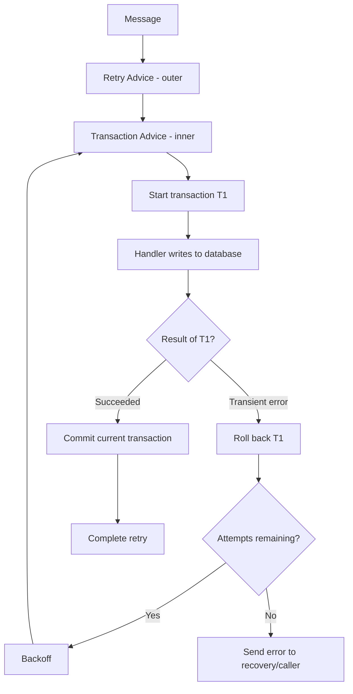
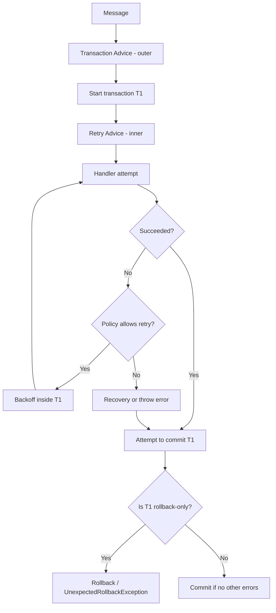
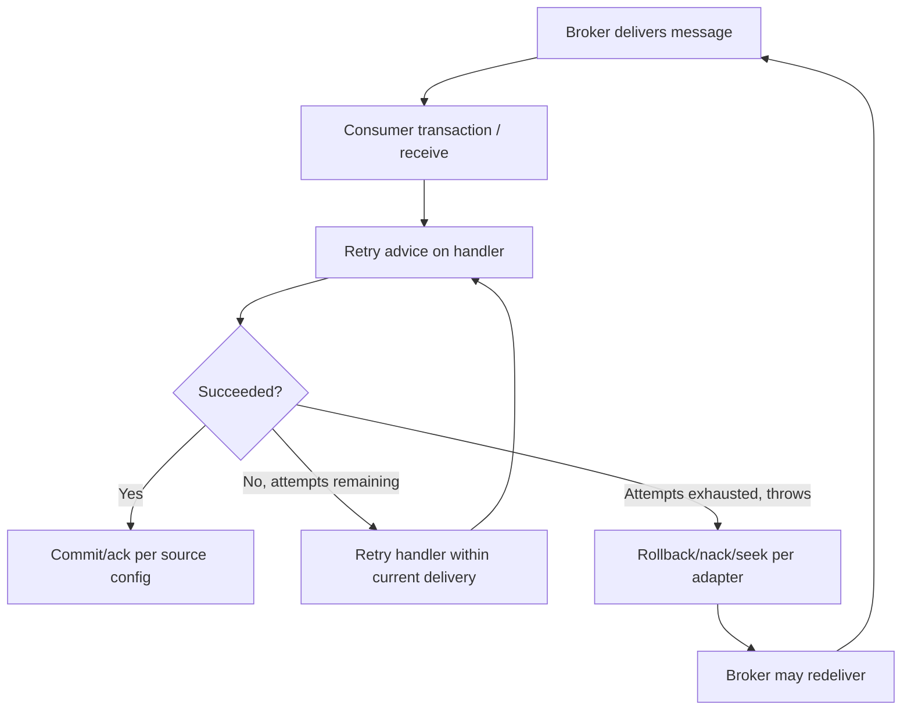

# Retry with Transactions in Spring Integration

## 1. The Problem: Retry Succeeds Yet the Transaction Still Rolls Back

Suppose an application receives a `StockCommand` reservation request from a Gateway or message broker. The command goes through a Filter to reject invalid data, a Transformer to normalize fields, a Router to pick a warehouse, and then a handler writes inventory counts to the database. During peak load, two transactions may contend for the same row. The database returns a recoverable deadlock or lock conflict; the system retries and the next attempt succeeds.

A subtle failure happens when **the next attempt reuses a transaction already marked `rollback-only`**. The handler can finish without throwing, yet at commit time an `UnexpectedRollbackException` occurs. Conversely, if each attempt opens an independent transaction, the failed attempt can roll back cleanly before the next attempt starts.

The **Retry** chapter of the `SPRING_INTEGRATION_PATTERN` module examines how to implement Enterprise Integration Patterns with Spring Integration to build loosely coupled, extensible message flows. **Retry with transactions** sits at the intersection of retry advice, transaction management, Routers, Filters, Transformers, Gateways, error channels, correlation, and testing success/failure branches.

After this lesson, you will be able to:

- Determine where transactions begin and end in a message flow.
- Choose the right **order of Retry advice and Transaction advice** for your business goal.
- Explain `rollback-only`, `PROPAGATION_REQUIRED`, `REQUIRES_NEW`, and `UnexpectedRollbackException`.
- Combine stateless/stateful retry with broker rollbacks, redelivery, and recovery.
- Ensure external side effects are not executed multiple times on retry.
- Test attempt counts, commits/rollbacks, and real data consistency.

## 2. Three Boundaries You Must Keep Separate

A message flowing through Spring Integration can sit inside three distinct scopes:

| Scope | Example | Who manages it? |
| --- | --- | --- |
| **Retry operation** | Handler invoked up to three times on transient errors | `RequestHandlerRetryAdvice` and retry policy |
| **Database transaction** | Single stock reservation: updating inventory and inserting reservation | `PlatformTransactionManager` / Spring Transaction |
| **Broker delivery** | Message redelivered by JMS/RabbitMQ/Kafka after failure | Inbound adapter, consumer, broker/error handler |

These three scopes can overlap, yet **they do not share the same lifetime by default**. For example, one broker delivery may wrap a three-attempt stateless retry operation; each attempt might open a database transaction. If all attempts fail, the broker may redeliver the message, starting a fresh retry operation on the next delivery.

Not every resource participates in a transaction. **A JDBC transaction cannot roll back an HTTP request already sent**, an email already dispatched, or an action already completed at an external service. For those side effects, add idempotency, an outbox, compensation states, or appropriate coordination mechanisms.

## 3. Advice Order Determines the Number of Transactions

Spring Integration lets you attach multiple advices to an endpoint. The first advice in the list is the **outermost layer**; the last advice is closest to the handler.

### Pattern A — Retry Outside, Transaction Inside



Expressed as advice nesting:

```text
RetryAdvice(
    TransactionAdvice(
        handler()
    )
)
```

**Each attempt has the opportunity to use a fresh transaction.** If `T1` rolls back, `T2` starts after the retry advice catches the exception. This is usually the right choice for recoverable database errors like deadlocks or lock contention, because data and transaction state from the prior attempt are cleaned up before the next attempt.

If **an outer transaction already surrounds the entire endpoint** (for instance, an inbound JMS consumer or caller transaction), `PROPAGATION_REQUIRED` on the inner advice simply joins that existing transaction. When you truly need an isolated physical transaction per attempt, explicitly configure `REQUIRES_NEW` and verify that the transaction manager can suspend the outer transaction; evaluate the resource cost and consistency implications of doing so.

### Pattern B — Transaction Outside, Retry Inside



Expressed as advice nesting:

```text
TransactionAdvice(
    RetryAdvice(
        handler()
    )
)
```

**The entire sequence of attempts and the recovery callback (if any) run inside one transaction** per the advice scope. This may work for a unit of work whose errors have not marked the transaction `rollback-only`, but it is hazardous if database operations set the rollback flag or hold locks too long.

| Criterion | Retry outer → TX inner | TX outer → Retry inner |
| --- | --- | --- |
| Transaction across attempts | Usually a separate TX per attempt | Usually a single shared TX |
| When first attempt rolls back | Can start a fresh TX | Shared TX may already be `rollback-only` |
| DB lock duration | Typically short, bounded per attempt | May span across all backoff waits |
| Recovery callback | Outside the rolled-back attempt's TX | May execute inside the shared TX |
| Best suited for | Deadlocks, transient write errors needing rollback before retry | Special cases where a single valid TX survives across attempts |
| What to verify | Existing outer TX, propagation, per-attempt commit | `rollback-only`, lock timeouts, transaction timeouts |

**Important:** Advice ordering only defines nesting scope. Actual transaction behavior also depends on propagation, transaction manager, proxies, upstream transaction originators, and the thread executing the handler.

## 4. Why Does `rollback-only` Break Retries Within the Same Transaction?

In Spring Transaction, `PROPAGATION_REQUIRED` typically shares a single **physical transaction** when one is already active. A participating method can mark that transaction as `rollback-only` upon failure. An outer caller can catch the exception and continue running, yet **it cannot turn a `rollback-only` transaction back into a committable state**.

Example:

```text
T1 starts
  attempt 1 -> DB conflict -> transaction T1 marked rollback-only
  retry advice catches exception
  attempt 2 -> handler returns normally
  commit T1 -> actually rolls back, may throw UnexpectedRollbackException
```

This bug is especially easy to hit when the handler calls a `@Transactional(propagation = REQUIRED)` service: the service throws a `RuntimeException` through the transactional proxy, and the interceptor marks the shared transaction for rollback before the retry advice ever catches the exception.

**Not every exception automatically sets `rollback-only`.** That depends on rollback rules, exception types, JDBC/JPA driver state, and where the error was thrown. However, once a transaction is `rollback-only`, catching exceptions, logging, or running another attempt inside that same physical transaction will never make it committable again.

### Comparing Propagation Modes

| Propagation | When an outer transaction exists | Impact on retry |
| --- | --- | --- |
| `REQUIRED` | Joins the existing physical TX | May carry `rollback-only` state across attempts |
| `REQUIRES_NEW` | Suspends outer TX and starts an independent physical TX | Allows per-attempt commit/rollback when supported |
| `NESTED` | Uses savepoints within the same physical TX when supported | Can roll back work to a savepoint; does not replace retrying a fresh transaction |
| `NOT_SUPPORTED` | Runs outside any TX (suspending active TX) | Unsuitable when atomic DB writes are required |

`REQUIRES_NEW` can require an extra database connection while the outer TX's connection remains held, increasing pool exhaustion risk under high concurrency. Never sprinkle it everywhere just to make retries run; clearly establish the transaction owner and consistency boundaries.

## 5. Java DSL / Annotation Example with Spring Integration 6.x

The example below uses **Spring Integration 6.x + Spring Retry 2.x** to reserve inventory. It orders two advices as:

1. `inventoryRetryAdvice` on the outside, catching transient exceptions and retrying up to **3 attempts including the initial call**.
2. `txPerAttempt` on the inside, opening a fresh DB transaction for each attempt.

```java
import java.util.Map;

import org.springframework.context.annotation.Bean;
import org.springframework.context.annotation.Configuration;
import org.springframework.integration.annotation.MessageEndpoint;
import org.springframework.integration.annotation.ServiceActivator;
import org.springframework.integration.channel.DirectChannel;
import org.springframework.integration.handler.advice.RequestHandlerRetryAdvice;
import org.springframework.integration.transaction.TransactionInterceptorBuilder;
import org.springframework.messaging.MessageChannel;
import org.springframework.retry.backoff.FixedBackOffPolicy;
import org.springframework.retry.policy.SimpleRetryPolicy;
import org.springframework.retry.support.RetryTemplate;
import org.springframework.transaction.PlatformTransactionManager;
import org.springframework.transaction.annotation.Propagation;
import org.springframework.transaction.interceptor.TransactionInterceptor;

@Configuration
public class StockRetryTransactionConfiguration {

    @Bean
    MessageChannel stockCommands() {
        return new DirectChannel();
    }

    @Bean
    RequestHandlerRetryAdvice inventoryRetryAdvice() {
        SimpleRetryPolicy retryPolicy = new SimpleRetryPolicy(
                3,
                Map.of(RetryableInventoryConflict.class, true),
                true);

        FixedBackOffPolicy backoff = new FixedBackOffPolicy();
        backoff.setBackOffPeriod(100L);

        RetryTemplate template = new RetryTemplate();
        template.setRetryPolicy(retryPolicy);
        template.setBackOffPolicy(backoff);

        RequestHandlerRetryAdvice advice = new RequestHandlerRetryAdvice();
        advice.setRetryTemplate(template);
        // No recovery attached: final error propagates to caller/consumer.
        return advice;
    }

    @Bean
    TransactionInterceptor txPerAttempt(
            PlatformTransactionManager transactionManager) {
        return new TransactionInterceptorBuilder(false)
                .transactionManager(transactionManager)
                .propagation(Propagation.REQUIRES_NEW)
                .build();
    }
}

record StockCommand(String eventId, String sku,
                    int quantity, String idempotencyKey) {}

class RetryableInventoryConflict extends RuntimeException {
    RetryableInventoryConflict(String message, Throwable cause) {
        super(message, cause);
    }
}

interface InventoryService {
    void reserve(StockCommand command);
}

@MessageEndpoint
class InventoryEndpoint {

    private final InventoryService inventoryService;

    InventoryEndpoint(InventoryService inventoryService) {
        this.inventoryService = inventoryService;
    }

    @ServiceActivator(
            inputChannel = "stockCommands",
            adviceChain = { "inventoryRetryAdvice", "txPerAttempt" })
    public void reserve(StockCommand command) {
        inventoryService.reserve(command);
    }
}
```

This illustrates the configuration and adapter contract; the application must supply a persistent `InventoryService` implementation, a real `PlatformTransactionManager` managing the database, and compatible Spring Integration, Spring Retry, and Spring Transaction dependencies. The adapter should map recoverable contention errors to `RetryableInventoryConflict` while leaving non-retryable validation errors unmapped.

**Why does the order work?** On `@ServiceActivator`, the first advice name is outermost. Retry observes both exceptions thrown inside the handler **and errors raised when the inner transaction ends**. Thus, if committing an attempt fails and the exception is classified as retryable, the invocation can be retried in a fresh transaction.

Example logic inside `InventoryService.reserve(...)`:

```java
public void reserve(StockCommand command) {
    // 1. Check whether eventId / idempotencyKey has already been processed.
    // 2. Check inventory and write reservation within the same DB transaction.
    // 3. A deadlock/lock conflict can be mapped by the adapter
    //    to RetryableInventoryConflict so advice decides to retry.
}
```

**Do not wrap the call to the advice with an outer `@Transactional(REQUIRED)`** while assuming each attempt still gets a fresh physical TX by default. `REQUIRES_NEW` in the example states the independence intent clearly, yet you must account for inbound adapter/broker transactions and outer transaction suspension.

### If You Want One Shared Transaction Across All Attempts

Swap the advice order to:

```java
@ServiceActivator(
        inputChannel = "stockCommands",
        adviceChain = { "txForOperation", "inventoryRetryAdvice" })
public void reserve(StockCommand command) {
    inventoryService.reserve(command);
}
```

In this setup, `txForOperation` is a separate `TransactionInterceptor` bean configured with the propagation chosen for the whole operation (usually `REQUIRED`). **Do not just rename `txPerAttempt` to `txForOperation` while keeping `REQUIRES_NEW` unless you understand the outer TX.** Test `rollback-only`, lock hold duration, and recovery behavior before shipping to production.

## 6. Spring Integration 7.x

Spring Integration 7.x builds on **Spring Framework Retry Support** (`org.springframework.core.retry`); do not configure `RequestHandlerRetryAdvice` with Spring Retry 2.x's `RetryTemplate` following the 6.x pattern. The concept of nesting transactions and retries **remains unchanged**: advice ordering and propagation still govern transaction boundaries.

Creating the retry advice in Spring Integration 7.x:

```java
import java.time.Duration;

import org.springframework.core.retry.RetryPolicy;
import org.springframework.integration.handler.advice.RequestHandlerRetryAdvice;

RequestHandlerRetryAdvice inventoryRetryAdvice7x() {
    RetryPolicy policy = RetryPolicy.builder()
            .maxRetries(2) // 2 retries, max 3 handler invocations.
            .includes(RetryableInventoryConflict.class)
            .delay(Duration.ofMillis(100))
            .build();

    RequestHandlerRetryAdvice advice = new RequestHandlerRetryAdvice();
    advice.setRetryPolicy(policy);
    return advice;
}
```

This declaration goes inside a Java configuration class; expose it as a `@Bean` and reference its bean name in `adviceChain`. In Spring Integration 6.x, `SimpleRetryPolicy(3)` counts three **total** attempts; in Spring Framework 7.x, `maxRetries(2)` specifies two retries **after** the initial call.

Transaction advice can continue using Spring Integration's `TransactionInterceptorBuilder` or Spring Framework's transaction interceptor. Choose `TransactionHandleMessageAdvice` when the transaction needs to encompass `MessageHandler.handleMessage()` and downstream flow; a regular `TransactionInterceptor` on a reply-producing handler may wrap only the internal `handleRequestMessage()` method.

## 7. Outer Transactions from Pollers, Brokers, and Gateways

A transaction may already be open **before the message arrives at the handler**. In that case, endpoint-level configuration is not the whole story.

### 7.1 Transactional Pollers

With a `PollableChannel` or message source polled inside a transaction, Spring Integration lets you attach transaction advice to the poller. That transaction can span `receive()` and subsequent synchronous processing. If the poller holds a transaction, a handler with `REQUIRED` joins the active TX on the same thread. Retrying at the handler inside that same TX risks hitting `rollback-only`.

When multiple advices are attached to a poller, advice order matters there too. Spring Integration provides transaction synchronization for `beforeCommit`, `afterCommit`, and `afterRollback` hooks, yet synchronization merely triggers callbacks at those moments; it **does not make HTTP calls, files, or external APIs transactional**.

### 7.2 Broker Message Listeners

If a JMS consumer receives a message inside a transaction and the handler call ultimately throws, the container can roll back message receipt so the broker redelivers it. That differs from retrying the handler within the same delivery:



With **stateless retry**, every broker redelivery can initiate a brand-new attempt sequence. For example, 3 handler attempts per delivery across 4 broker deliveries can reach **12 handler calls**, excluding any retries inside the HTTP client.

With **stateful retry**, the advice links state via a stable message identity; exceptions propagate back so the source redelivers the message. This fits when each try requires a fresh consumption transaction or real rollback before retrying. It **does not perform redelivery by itself**. In 6.x, use `RetryStateGenerator`; in 7.x, use `stateKeyFunction`. An in-memory cache is not automatically durable across restarts or node changes.

### 7.3 Synchronous Gateways

A Gateway can invoke the handler on the caller's thread and transaction. When retries include backoff, the caller waits through both execution and sleep intervals. If the Gateway times out or the caller cancels the request, the active transaction is not guaranteed to abort immediately. Budget timeouts across the database client, broker, and Gateway together, and define explicit result statuses so you never return `SUCCESS` when a transaction has not committed.

### 7.4 Thread Boundaries

Imperative transactions normally bind to the **current thread**. `DirectChannel` keeps execution synchronous so it can share a transaction; an `ExecutorChannel`, pollable channel, or `@Async` call switches threads and breaks standard transaction propagation. Never assume a rollback on the previous thread will automatically roll back work already handed off and committed on a later thread.

## 8. Retry and Recovery Inside Transactions

`RequestHandlerRetryAdvice` can take a `RecoveryCallback`, such as `ErrorMessageSendingRecoverer`. However, whether recovery participates in a transaction depends on advice order and propagation:

| Config pattern | Recovery callback | Risk to inspect |
| --- | --- | --- |
| Retry outer → TX inner | Recovery runs outside each rolled-back attempt's TX | Failure persistence needs its own TX and confirmation |
| TX outer → Retry inner | Recovery may run in the same TX as attempts | If TX is `rollback-only`, the failure record may also roll back |
| Broker TX wrapping everything | Recovery may finish normally before ack | Broker may ack despite main business failure if error is swallowed |

If recovery must save a failure record for later operational triage, define clear contracts:

1. **Business success:** inventory reserved, primary write transaction committed.
2. **Failure recorded:** business action did not succeed, yet the failure record was durably persisted.
3. **Failure not recorded:** both business logic and failure persistence failed; let the exception reach source error handling so recoverability is not lost.

A failure recorder can invoke a Spring-proxied service with `REQUIRES_NEW` to commit independently. Even then, when databases/brokers involve multiple transactions or XA/JTA, verify suspend/resume behavior and actual consistency guarantees. `REQUIRES_NEW` never makes an HTTP call or non-transactional message send atomic.

**Beware of recovery swallowing exceptions:** When `ErrorMessageSendingRecoverer` finishes normally, the caller/broker may treat the message as handled and ack. Only ack once the failure is persisted per system guarantees; if the broker needs to redeliver, let the exception escape and leave the decision to the consumer/error handler.

## 9. Side Effects and Idempotency

A DB transaction only governs resources enlisted in that transaction. Consider this handler:

```java
void reserveAndNotify(StockCommand command) {
    inventoryRepository.reserve(command.sku(), command.quantity());
    carrierHttpClient.notifyReservation(command.eventId()); // HTTP side effect
}
```

If the database rolls back after the HTTP call succeeds, a retry may invoke the API again. The HTTP endpoint receives two requests while the DB ends up with one final reservation. The reverse also happens: downstream finishes processing, the response times out, and the handler assumes failure and retries.

Common strategies:

- **Idempotency key:** Pass `eventId` or a stable business key across every attempt and delivery; either sender or receiver must enforce deduplication.
- **Transactional outbox:** Write business state and outgoing event rows to an outbox table in the **same DB transaction**; an independent worker publishes events post-commit with deduplication controls.
- **Saga/compensation:** When services cannot share one ACID transaction, design compensating actions for already-completed steps.
- **Narrow retry scope:** Retry only the recoverable step rather than retrying an entire flow containing multiple non-idempotent side effects.

Never treat `@Transactional` as an **end-to-end exactly-once** guarantee when interacting with HTTP, SMTP, or brokers outside the same transaction manager.

## 10. Testing Transaction Boundaries

Pure retry tests using mocks only prove invocation counts. To verify commits and rollbacks, you need a **real transactional database** (e.g., a test DB or Testcontainers), a real `PlatformTransactionManager`, and post-operation state inspection.

### Short Example: Retry Wrapping a Transaction

This snippet illustrates **a fresh transaction per attempt** at the Spring Retry + `TransactionTemplate` level for Spring Integration 6.x. Assume `RetryTemplate`, `PlatformTransactionManager`, and `reservationRepository` are provided:

```java
import org.springframework.transaction.TransactionDefinition;
import org.springframework.transaction.support.TransactionTemplate;

String reserveWithFreshTransactions(
        RetryTemplate retryTemplate,
        PlatformTransactionManager manager,
        StockCommand command,
        ReservationRepository reservationRepository) {

    TransactionTemplate tx = new TransactionTemplate(manager);
    tx.setPropagationBehavior(TransactionDefinition.PROPAGATION_REQUIRES_NEW);

    return retryTemplate.execute(context ->
            tx.execute(status -> {
                reservationRepository.reserve(
                        command.sku(), command.quantity(),
                        command.idempotencyKey());
                return "RESERVED";
            }));
}
```

Here `ReservationRepository` is an application adapter. If `reserve(...)` throws a retryable error, the transaction template rolls back before the retry template starts the next attempt. If the repository actually committed and a subsequent downstream step failed, retrying could repeat a committed transaction—so idempotency is still required.

### Essential Test Matrix

| Scenario | Expected attempts | What to verify in DB and flow |
| --- | ---: | --- |
| Succeeds on first try | 1 | One transaction commits, exactly one reservation exists |
| Deadlock on 1st, succeeds on 2nd | 2 | T1 rolls back, T2 commits; no partial T1 data remains |
| Transient failure all 3 times | 3 | All three TXs roll back, zero committed reservations |
| Non-retryable validation error | 1 | No extra attempts, no bad data committed |
| Existing outer TX with `REQUIRED` | Varies | Does `rollback-only` strike even if later attempt stops throwing |
| Outer TX with inner `REQUIRES_NEW` | Varies | Does each attempt get a real new physical TX; any connection pool exhaustion |
| Recovery writes inside a `rollback-only` TX | Varies | Does the failure record survive after rollback |
| Recovery with `REQUIRES_NEW` | Varies | Failure record commits independently; caller/broker knows true status |
| Broker redelivers after rollback | Up to A × D | Handler calls, delivery counts, DLQ, and idempotency |
| Handler calls external API then DB rolls back | Varies | No duplicate downstream side effects created |
| `ExecutorChannel` crosses thread boundary | Varies | Does transaction actually reach the handler across the async boundary |

### Verify Real Commits, Not Just Logs

In integration tests, have a repository insert an `attemptId` marker and business state inside the same transaction. After each request, query the DB in an **independent transaction** to see which rows truly committed; a handler running or logging "saved" does not prove the transaction committed. You can spy on the transaction manager to count `begin`, `commit`, and `rollback`, while still asserting durable database state.

For brokers, run a production-configured consumer/adapter in a suitable test environment, throw controlled exceptions, and assert `ack`, `nack`, offset commits, or rollbacks explicitly; never treat a plain `channel.send(...)` test as proof of broker redelivery.

## 11. Monitoring and Operations

Important metrics when combining retries and transactions:

- **Attempt outcomes:** attempts by exception type, endpoint, and final status.
- **Transaction outcomes:** TX begin/commit/rollback counts, `rollback-only` rate, deadlocks, and `UnexpectedRollbackException` occurrences.
- **End-to-end latency:** total handler time, lock hold duration, and sequence backoff waits.
- **Broker redeliveries:** delivery count for the same `eventId`, DLQ routing counts, and multi-layer retries.
- **Recovery persistence:** failure save success rate, recorder failure counts, and pending failure backlog.
- **Correlation:** message ID, event ID, trace/correlation ID, endpoint, and transaction outcome to link Router and Splitter/Aggregator branches.

In metrics, avoid using `orderId`, `eventId`, or payloads as high-cardinality labels. Put identifiers in structured logs/traces; keep metric labels at endpoint, error group, and transaction outcome granularity. Monitor connection pool utilization closely when using `REQUIRES_NEW`, as concurrent connection demand can spike unexpectedly.

## 12. Common Mistakes

| Mistake | Consequence | Fix |
| --- | --- | --- |
| Putting transaction outside retry while expecting a fresh TX after rollback | Retry executes inside a `rollback-only` TX | Flip advice order and check propagation |
| Assuming `REQUIRED` always starts a new transaction | Handler shares outer TX and gets `rollback-only` | Identify the transaction owner; use `REQUIRES_NEW` only when genuinely needed |
| Assuming catching an exception heals the transaction | Final commit throws `UnexpectedRollbackException` | Test rollback flags and real commits |
| Placing advice on handler while TX actually starts at poller | Transaction boundary differs from expectations | Trace transactions from the source across the full call chain |
| Inserting an async channel mid-flow | Transaction no longer crosses the thread boundary | Start a dedicated transaction at the new consumer/handler |
| Retrying a handler with HTTP side effects | Sends duplicate external requests | Use idempotency/outbox/sagas and narrow retry scope |
| Persisting recovery inside a `rollback-only` TX | Failure record vanishes on rollback | Use an independent recovery transaction or durable DLQ |
| Recovery exits normally so business is treated as success | Wrongful ack/commit state | Clearly distinguish `FAILED_RECORDED` from `BUSINESS_SUCCESS` |
| Unbounded broker redelivery plus handler retries | Total attempts multiply across layers | Calculate A × D, add backoff, DLQs, and deadlines |
| Counting handler calls without inspecting the DB | Tests pass even while every attempt rolls back | Query committed state and verify transactions |

## 13. Practice Exercise

Build a flow that receives `StockCommand` from a Gateway or broker, uses a Filter to reject negative quantities, a Transformer to normalize SKUs, and a Router to pick warehouse A or B. Branch A writes inventory and reservations to a database; branch B calls an external API. Attach `RequestHandlerRetryAdvice` to A with at most **3 attempts** and a 100 ms fixed backoff. Test both advice orders:

1. **Retry outside, transaction inside:** Simulate a deadlock on attempt 1 and succeed on attempt 2; prove T1 rolls back and T2 commits.
2. **Transaction outside, retry inside:** Have a transactional service throw an exception and mark `rollback-only`; observe the next attempt and commit outcome. If commit fails, explain why catching the exception was insufficient.

Next, test broker redelivery after handler exhaustion, enable a recovery channel that persists failures, and simulate the external API succeeding before a response timeout. Measure handler invocations, transaction commits/rollbacks, broker delivery counts, correlation IDs, surviving failure records, and downstream side effects. Evaluate differences when using `REQUIRES_NEW`, switching to `ExecutorChannel`, and persisting failures in an independent transaction.

**Completion criteria:** Transaction boundaries are accurately identified; each attempt commits/rolls back as designed; transient errors retry inside valid transactions; recovery never loses failure data; messages are never acked as business-successful when incomplete; and retries or redeliveries cause zero duplicate business side effects.

## References

- [Spring Integration — Ordering Advices within Advice Chain](https://docs.spring.io/spring-integration/reference/handler-advice/order.html): outer/inner advice order and impact on transactions.
- [Spring Integration — Transaction Support](https://docs.spring.io/spring-integration/reference/transactions.html): transaction boundaries, pollers, and transaction synchronization.
- [Spring Integration — TransactionHandleMessageAdvice](https://docs.spring.io/spring-integration/reference/handler-advice/tx-handle-message.html): distinguishing transactions on internal methods vs. the full flow.
- [Spring Integration — Retry Advice](https://docs.spring.io/spring-integration/reference/handler-advice/classes.html): stateless/stateful retry and recovery.
- [Spring Framework — Transaction Propagation](https://docs.spring.io/spring-framework/reference/data-access/transaction/declarative/tx-propagation.html): `REQUIRED`, `REQUIRES_NEW`, `NESTED`, and `UnexpectedRollbackException`.
