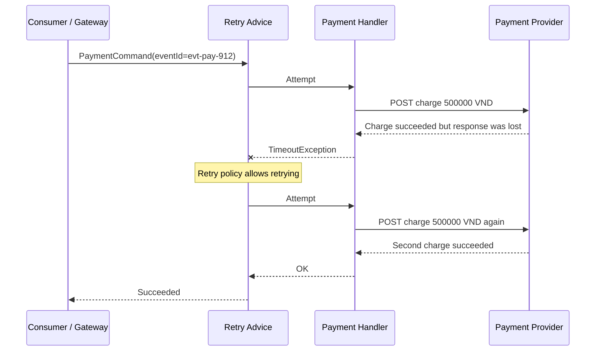
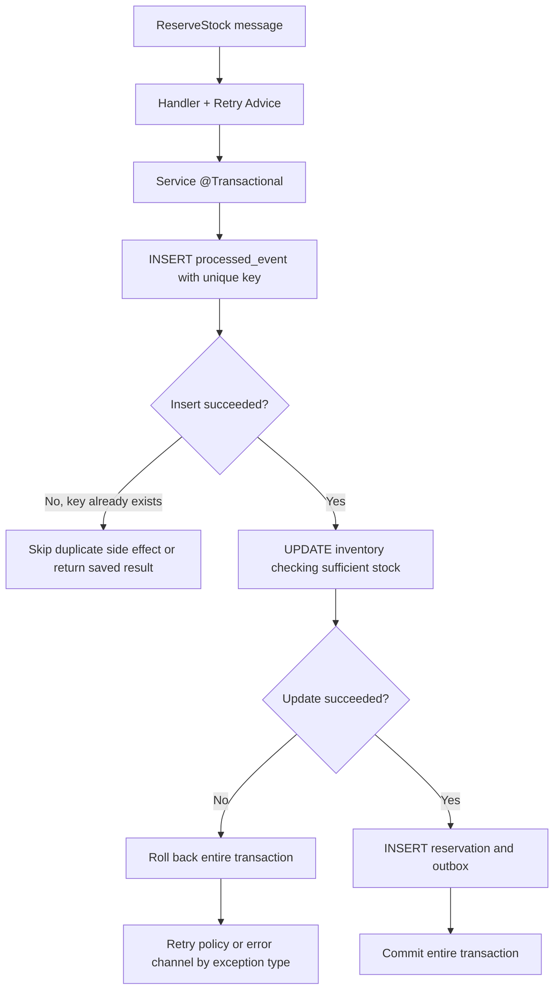
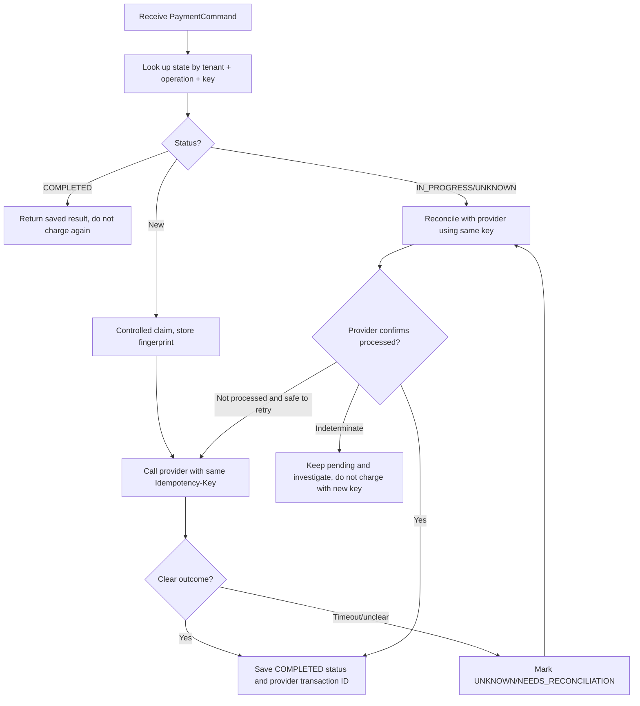

# Non-Idempotent Retries Causing Duplicate Side Effects in Spring Integration

## 1. The Problem: A Single Retry Can Create Two Real Transactions

A message in an **Enterprise Integration Patterns (EIP)** flow can pass through a Filter, Transformer, and Router before reaching a handler that creates a shipment, deducts inventory, or requests a payment. If downstream receives and processes the request **successfully** yet the response is lost, the handler sees a timeout. The retry mechanism can resend **that exact command**; if the receiver lacks deduplication, two deliveries can create two shipments, deduct stock twice, or charge the customer twice.

This is the **"Non-Idempotent Retries Causing Duplicate Side Effects"** problem in the **Retry** chapter of the `SPRING_INTEGRATION_PATTERN` module. The module aims to implement Enterprise Integration Patterns with Spring Integration to build loosely coupled, extensible, testable message flows while monitoring Router, Filter, Transformer, Splitter, Aggregator, Gateway, retry, error channel, and correlation branches.

Retry increases the probability that **a request gets processed**, but by itself **it does not guarantee the request takes effect only once**. Therefore, retry correctness must be designed alongside idempotency, transactions, recovery, and observability.

After this lesson, you will know how to:

- Identify timeout and replay scenarios that lead to duplicate side effects.
- Distinguish **at-least-once delivery**, **idempotent operations**, **deduplication**, and **exactly-once** claims.
- Design idempotency keys scoped by tenant, operation type, and event identifier.
- Block duplicate writes with **unique constraints and atomic transactions**, never separate check-then-insert logic.
- Understand database transaction limits when a handler also calls HTTP APIs, email services, or other brokers.
- Apply Idempotent Receiver, transactional outbox/inbox, and appropriate recovery patterns.
- Test retries after timeouts, redeliveries, concurrency, crash windows, and payload conflicts.

## 2. What Does Idempotent Mean?

An operation is **idempotent** if executing it multiple times with the same request semantics produces the **same final business effect** as executing it once. This does not require identical HTTP responses or response times every time; what matters is that outcomes and side effects remain controlled.

Examples:

| Operation | Inherently idempotent? | Risk on retry | Protection |
| --- | --- | --- | --- |
| `PUT /orders/42/status` with the same status | Often idempotent | Little final data drift, yet may still emit duplicate events | Deduplicate events/audit logs |
| `POST /payments` creating a new transaction every call | No | Double charging | Idempotency key at the payment provider |
| `UPDATE stock SET quantity = quantity - 1` | No | Double stock deduction | Deduplicate by event ID inside the same DB transaction |
| `INSERT shipment` generating a new random ID | No | Creating multiple shipments | Unique business key or idempotent API |
| Sending email/SMS | Usually no | Duplicate notifications | Outbox, send-task locking, provider-side deduplication |
| Setting a fixed value with `SET` | Usually state-idempotent | Audit logs or triggers may still repeat | Guard every secondary side effect |

**Idempotency must account for real-world effects**, not merely the primary write. For example, updating an order to the same status may leave the row unchanged, yet an update trigger sending an email still produces duplicate side effects.

## 3. Classic Scenario: Downstream Succeeds, Response Times Out

Consider event `evt-pay-912` from a payment flow:



The caller sees a single "success" response while the customer has been charged **twice**. Retry succeeded technically yet **failed in business correctness**.

### State After a Timeout Is "Unknown," Never Guaranteed Failed

| What the system observes | Possible true state | Safe action |
| --- | --- | --- |
| Connect timeout before sending request | Downstream likely did not receive it | Conditional retry |
| Read timeout after sending | Downstream may already have processed and committed | Query by idempotency key or retry with the same key |
| HTTP 503 | Possibly unprocessed, or side effect occurred before error | Depends on API contract and idempotency |
| Consumer crashes after processing before ack | Side effect committed; broker may redeliver | Deduplicate at consumer or downstream |
| Response succeeds yet Gateway caller timed out | Caller may submit the request again | Preserve the same request key across caller retries |

Therefore, never assume "an exception was thrown, so all side effects rolled back." A completed HTTP request cannot be rolled back by a Spring JDBC transaction.

## 4. Layers That Can Repeat Side Effects

A command can pass through multiple retry/redelivery mechanisms, each with its own limits:

```text
Client retry (resending HTTP request)
  └─ Gateway / application
       └─ Broker redelivery (after rollback/nack/seek)
            └─ RequestHandlerRetryAdvice (retrying handler)
                 └─ HTTP client retry (if configured)
                      └─ Downstream side effect
```

Illustrative example: a handler allows up to **3 attempts** per delivery, the broker delivers up to **4 deliveries**, and the HTTP client sends up to **2 requests** per handler call. Under persistent failure where all three layers engage, maximum downstream requests under those assumptions could reach:

\[
3 \times 4 \times 2 = 24
\]

If the caller also resubmits the request twice from the top, total requests climb higher. This is a **product of assumed limits**, not an automatic Spring Integration metric.

**Stateless retry** resets its counter on broker redelivery; **stateful retry** tracks retry state by message identity, yet it does not make external side effects idempotent. Retry identity manages retry progress, whereas an idempotency key identifies **one operation that must not execute twice**.

## 5. Designing an Accurate Idempotency Key

A good key remains stable across attempts, broker redeliveries, client retries, and manual replays of **the exact same operation**.

Example:

```text
tenantId        = vn-shop
operation       = create-shipment
eventId         = evt-912
idempotencyKey  = vn-shop:create-shipment:evt-912
```

Key principles:

1. **Unique within the protected scope:** Combine tenant, operation type, and event ID. Two events `create-shipment` and `cancel-shipment` on the same order must have distinct keys.
2. **Preserve across retries:** Never generate a fresh UUID inside the handler or per HTTP call. If the key changes, downstream cannot detect duplicates.
3. **Separate from correlation ID when needed:** A batch correlation ID may be shared across parts; using it directly as an idempotency key merges distinct tasks.
4. **Bind to a request fingerprint:** Same key with a different amount/currency/order is a data conflict and must raise an explicit error rather than silently returning an old result.
5. **Define a retention policy:** Too short a TTL lets late replays re-execute an old task after the record expires. Align TTL with business lifecycles, broker retention, and compliance rules.
6. **Enforce tenant isolation and authorization:** One tenant's key must never retrieve results or collide with another tenant's key.

| Key | Drawback | Better alternative |
| --- | --- | --- |
| Spring's `MessageHeaders.ID` | Regenerated on broker redelivery or Transformer copy | Durable event ID in payload or preserved header |
| Bare `orderId` | One order may have multiple shipments, cancellations, refunds | `operation + eventId` |
| Current timestamp | Every retry produces a new key | UUID/event ID generated **before first send** and persisted |
| Hash of all payload fields | Unrelated tweaks change the key; two valid identical operations collide | Dedicated intent key + fingerprint to detect key reuse |

Never use an idempotency key as a password or auth secret. It is a **reconciliation identifier**, not a substitute for authorization.

## 6. Idempotent Receiver in Spring Integration

Spring Integration provides the **Idempotent Receiver** pattern via `IdempotentReceiverInterceptor` and `MetadataStoreSelector`. Attached to an endpoint, the interceptor decides whether a message is a duplicate.

Depending on configuration:

- When the selector deems a message a duplicate, the interceptor can **set the header `duplicateMessage = true`** and still pass the message to the handler.
- If `discardChannel` or `throwExceptionOnRejection = true` is configured, duplicates can be excluded from invoking the handler.
- `MetadataStoreSelector` can use a `ConcurrentMetadataStore` to remember seen keys; the default in-memory store does not survive restarts.

**Critical warning:** "Message seen" **does not mean** "side effect committed." If the selector marks a key as processed **before** the handler submits the transaction and the handler then fails, redelivery gets discarded, leaving the operation **incomplete and never retried**.

When using Idempotent Receiver:

1. Know precisely when keys are claimed and when completion is marked.
2. Handle releasing/rolling back the claim if the handler fails.
3. Never mark completion merely because a message passed a Filter or interceptor.
4. Across concurrent workers, use a store supporting atomic compare-and-set / unique keys; `ConcurrentHashMap` protects only one JVM process, not a cluster.
5. Distinguish **IN_PROGRESS**, **COMPLETED**, **FAILED**, and **UNKNOWN/NEEDS_RECONCILIATION** for side effects that cannot roll back.

The interceptor helps organize an endpoint, yet it **does not replace** database transactions and consistency constraints.

## 7. Blocking Duplicate Side Effects in One Database with Atomic Transactions

Consider **deducting inventory once for a stock reservation event**. You can insert a "processed event" marker and update inventory inside the **same database transaction**. If the transaction rolls back, both the marker and inventory change roll back, letting broker redelivery retry safely.

### 7.1. Flow Diagram



### 7.2. Illustrative PostgreSQL Schema

```sql
CREATE TABLE processed_events (
    consumer_name text NOT NULL,
    tenant_id text NOT NULL,
    event_id text NOT NULL,
    PRIMARY KEY (consumer_name, tenant_id, event_id)
);

CREATE TABLE inventory (
    tenant_id text NOT NULL,
    sku text NOT NULL,
    available integer NOT NULL CHECK (available >= 0),
    PRIMARY KEY (tenant_id, sku)
);

CREATE TABLE stock_reservations (
    tenant_id text NOT NULL,
    event_id text NOT NULL,
    sku text NOT NULL,
    quantity integer NOT NULL,
    PRIMARY KEY (tenant_id, event_id)
);

CREATE TABLE outbox_events (
    tenant_id text NOT NULL,
    event_id text NOT NULL,
    event_type text NOT NULL,
    sku text NOT NULL,
    quantity integer NOT NULL,
    published boolean NOT NULL DEFAULT false,
    PRIMARY KEY (tenant_id, event_id, event_type)
);
```

Table and column names are illustrative. Production schemas need timestamps, publication statuses, data bounds, fingerprints, and monitoring; if an event key could ever be reused with a different payload, store a request hash to detect conflicts.

### 7.3. Java with Spring Transaction and JDBC

This example uses Spring JDBC and Spring Transaction; `reserve(...)` must be invoked **through the Spring bean/proxy** so `@Transactional` takes effect. Unique constraints act as the safety lock under concurrent access.

```java
import org.springframework.jdbc.core.JdbcTemplate;
import org.springframework.stereotype.Service;
import org.springframework.transaction.annotation.Transactional;

record ReserveStock(String tenantId, String eventId,
                    String sku, int quantity, String idempotencyKey) {}

@Service
class StockReservationService {

    private final JdbcTemplate jdbc;

    StockReservationService(JdbcTemplate jdbc) {
        this.jdbc = jdbc;
    }

    @Transactional
    public void reserve(ReserveStock command) {
        if (command.quantity() <= 0
                || command.eventId() == null || command.eventId().isBlank()) {
            throw new IllegalArgumentException("Invalid reservation command");
        }

        int inserted = jdbc.update("""
                INSERT INTO processed_events
                    (consumer_name, tenant_id, event_id)
                VALUES (?, ?, ?)
                ON CONFLICT DO NOTHING
                """,
                "stock-reserver", command.tenantId(), command.eventId());

        // Same event already committed on an earlier attempt.
        if (inserted == 0) {
            return;
        }

        int changed = jdbc.update("""
                UPDATE inventory
                   SET available = available - ?
                 WHERE tenant_id = ?
                   AND sku = ?
                   AND available >= ?
                """,
                command.quantity(), command.tenantId(),
                command.sku(), command.quantity());

        if (changed != 1) {
            // Transaction rolls back the just-inserted processed_event marker too.
            throw new IllegalArgumentException("Not enough inventory");
        }

        jdbc.update("""
                INSERT INTO stock_reservations
                    (tenant_id, event_id, sku, quantity)
                VALUES (?, ?, ?, ?)
                """,
                command.tenantId(), command.eventId(),
                command.sku(), command.quantity());

        jdbc.update("""
                INSERT INTO outbox_events
                    (tenant_id, event_id, event_type, sku, quantity)
                VALUES (?, ?, 'STOCK_RESERVED', ?, ?)
                """,
                command.tenantId(), command.eventId(),
                command.sku(), command.quantity());
    }
}
```

**Why does this prevent duplicate effects?**

- The initial pass inserts into `processed_events`, deducts stock, creates the reservation, and writes the outbox row in **one physical database transaction**.
- If the transaction commits yet the response to the consumer is lost, redelivery sees the unique key already exists and **does not deduct inventory a second time**.
- If the transaction fails, both the marker and stock deduction roll back. Redelivery can safely retry once the root cause is fixed.
- Two concurrent consumers processing the same `tenantId/eventId` cannot both insert under the unique constraint; the database enforces mutual exclusion.

This guards against duplication **inside a single database**. If an HTTP call to create a shipment also runs mid-method, the PostgreSQL transaction **cannot** roll back that external completed call.

**Limitation of this example:** Returning normally on `inserted == 0` is valid only when the event ID strictly represents the same business payload. Real applications should compare fingerprints and optionally return the prior reservation result instead of silently accepting the same event ID with a different SKU or quantity. Additionally, out-of-stock is a business failure that should route deterministically rather than retrying infinitely.

## 8. Attaching Retry Advice to the Right Handler

With **Spring Integration 6.x + Spring Retry**, `RequestHandlerRetryAdvice` can sit outside the `@Transactional` service. Because the service transaction completes before exceptions return to the advice, a deadlock or transient DB failure rolls back and retries in a fresh transaction.

```java
import java.util.Map;

import org.springframework.context.annotation.Bean;
import org.springframework.context.annotation.Configuration;
import org.springframework.integration.annotation.MessageEndpoint;
import org.springframework.integration.annotation.ServiceActivator;
import org.springframework.integration.channel.DirectChannel;
import org.springframework.integration.handler.advice.RequestHandlerRetryAdvice;
import org.springframework.messaging.MessageChannel;
import org.springframework.retry.backoff.FixedBackOffPolicy;
import org.springframework.retry.policy.SimpleRetryPolicy;
import org.springframework.retry.support.RetryTemplate;

@Configuration
class StockRetryConfiguration {

    @Bean
    MessageChannel reserveRequests() {
        return new DirectChannel();
    }

    @Bean
    RequestHandlerRetryAdvice stockRetryAdvice() {
        RetryTemplate template = new RetryTemplate();
        template.setRetryPolicy(new SimpleRetryPolicy(
                3, Map.of(TransientStockException.class, true), true));

        FixedBackOffPolicy backoff = new FixedBackOffPolicy();
        backoff.setBackOffPeriod(200L);
        template.setBackOffPolicy(backoff);

        RequestHandlerRetryAdvice advice = new RequestHandlerRetryAdvice();
        advice.setRetryTemplate(template);
        return advice;
    }
}

@MessageEndpoint
class StockReservationHandler {
    private final StockReservationService service;

    StockReservationHandler(StockReservationService service) {
        this.service = service;
    }

    @ServiceActivator(
            inputChannel = "reserveRequests",
            adviceChain = "stockRetryAdvice")
    public void handle(ReserveStock command) {
        service.reserve(command);
    }
}

class TransientStockException extends RuntimeException {
    TransientStockException(String message, Throwable cause) {
        super(message, cause);
    }
}
```

The adapter/repository must **classify retryable database errors** into `TransientStockException` at the appropriate boundary. Never wrap every `RuntimeException` (including validation errors) as transient. `StockReservationService` in section 7 illustrates transactional logic; real apps must map deadlocks, connection failures, or transient lock conflicts according to their database/driver.

With **Spring Integration 7.x**, policy configuration moves to Spring Framework:

```java
import java.time.Duration;

import org.springframework.core.retry.RetryPolicy;
import org.springframework.integration.handler.advice.RequestHandlerRetryAdvice;

RetryPolicy policy = RetryPolicy.builder()
        .maxRetries(2) // Two retries after the initial call: 3 attempts total.
        .delay(Duration.ofMillis(200))
        .includes(TransientStockException.class)
        .build();

RequestHandlerRetryAdvice advice = new RequestHandlerRetryAdvice();
advice.setRetryPolicy(policy);
```

This illustrates configuration inside a valid Java method; expose it as an advice bean for your endpoint. **Never mix** `org.springframework.retry.support.RetryTemplate` (6.x) and `org.springframework.core.retry.RetryPolicy` (7.x) in an incompatible advice setup. In both generations, **retry itself does not create idempotency**; the data constraints in section 7 provide that defense.

## 9. External Side Effects Outside the Database: Enforce Idempotency at the Target

Writing a "processed" marker in the database **before** calling a payment API opens a failure window:

1. Application saves `IN_PROGRESS`.
2. Application calls payment provider; provider charges successfully.
3. Application crashes before updating to `COMPLETED`.
4. Message is redelivered, sees `IN_PROGRESS`, and does not know whether the charge occurred.

Treating every `IN_PROGRESS` as "already done" risks dropping unfinished charges. Treating every `IN_PROGRESS` as "not done" and calling the API with a **new key** risks charging the customer twice.

A safer strategy:



For APIs supporting **`Idempotency-Key`**, pass the **exact same key** across all attempts, redeliveries, and replays of the same operation. Using an idempotency key does not guarantee every provider retains results forever: verify contract terms for key scope, payload mismatches, TTL, and retry behavior.

If a provider **does not support** idempotency or transaction lookup APIs, the system cannot automatically deduce a safe outcome from a timeout. Manual reconciliation, compensating actions, or integration redesign may be necessary; retry advice alone cannot guarantee end-to-end exactly-once execution.

### How Far Does a Transactional Outbox Help?

A **transactional outbox** stores business data and outgoing events in an outbox table within the same DB transaction. An independent publisher reads the table and emits messages post-commit.

- Closes the crash window **after DB commit but before publishing**, because the outbox preserves pending work.
- Does **not** by itself guarantee the receiver sees only **one** message: the publisher may send a message and crash before marking `published`, causing a resend.
- Thus, **outbox + idempotent consumer** or **downstream idempotency** remains essential. The two patterns complement each other rather than replacing one another.

## 10. Router, Splitter/Aggregator, Gateway, and Error Channel

Where side effects occur shapes the safe retry scope:

| EIP | Duplication risk on retry/redelivery | Recommendation |
| --- | --- | --- |
| **Router** | Resending the whole event may re-run an already-succeeded branch | Track state/keys per operation and endpoint on each branch |
| **Filter** | Filtering duplicates too early drops unfinished messages | Mark completion only after commit or use proper claim/release states |
| **Transformer** | Creating a new payload/header drops the event ID | Propagate stable business IDs across all steps |
| **Splitter** | Individual parts may retry or be redelivered by broker | Key idempotency on `eventId + partId + operation` |
| **Aggregator** | Receiving duplicate parts, miscounting completion, or emitting twice | Manage correlation/sequence and emit final results once |
| **Gateway** | Caller times out and resends the same request | Require clients to preserve idempotency keys across submissions |
| **Error channel** | Replaying failed messages may re-run committed side effects | Reconcile state before replay; avoid unbounded auto-replay |

For example, a Splitter divides an order into three parcels: `part-1` succeeds, `part-2` times out, `part-3` succeeds. Redelivering the entire order without per-part keys risks shipping `part-1` and `part-3` again. Appropriate keys look like:

```text
tenant:shipment:create:order-42:part-1
tenant:shipment:create:order-42:part-2
tenant:shipment:create:order-42:part-3
```

Keep the same `correlationId` for the group so the Aggregator recognizes part membership. **Correlation ID** groups messages, yet it is not automatically an idempotency key for individual parts.

## 11. Recovery and Dead-Letter Must Preserve Reconciliation Data

`RequestHandlerRetryAdvice` can use `ErrorMessageSendingRecoverer` to send exhausted failures to a recovery channel. However:

- Completing the recovery callback **does not mean** no side effect occurred. A timeout could be hiding a completed provider transaction.
- If recovery merely logs and returns normally, the consumer may ack/commit and the broker will stop redelivering.
- Before replaying, **check transaction ID / provider status and idempotency key first**, especially for payments.
- If the failure recorder fails to save, handle that exception explicitly instead of swallowing it and losing recovery visibility.

A failure record should capture `tenantId`, `eventId`, `operation`, `idempotencyKey`, fingerprint, endpoint, correlation ID, attempt/delivery counts if captured, final exception, provider transaction ID if present, and status `UNKNOWN`/`FAILED`/`COMPLETED`. Never log payment card numbers or payloads containing secrets.

**Do not equate dead-letter storage with safe replay.** A dead-letter queue captures failed messages, yet operators must still reconcile whether side effects already committed before the error surfaced.

## 12. Testing: Timeouts After Side Effects Must Not Duplicate

### 12.1 Unit Test Simulating an Idempotency-Key Provider

The example below uses JUnit 5 and Spring Retry 2.x's `RetryTemplate` (Spring Integration 6.x). The mock provider **records the transaction** yet drops the first response. The retry sends the same key and receives the original result without **creating a second charge**.

```java
import java.util.Map;
import java.util.concurrent.ConcurrentHashMap;
import java.util.concurrent.atomic.AtomicBoolean;
import java.util.concurrent.atomic.AtomicInteger;

import org.junit.jupiter.api.Test;
import org.springframework.retry.backoff.NoBackOffPolicy;
import org.springframework.retry.policy.SimpleRetryPolicy;
import org.springframework.retry.support.RetryTemplate;

import static org.junit.jupiter.api.Assertions.assertEquals;

class DuplicateSideEffectTest {

    @Test
    void sameIdempotencyKeyPreventsDoubleChargeAfterLostResponse() {
        Map<String, String> completedCharges = new ConcurrentHashMap<>();
        AtomicInteger sideEffects = new AtomicInteger();
        AtomicInteger apiCalls = new AtomicInteger();
        AtomicBoolean dropFirstResponse = new AtomicBoolean(true);

        RetryTemplate template = new RetryTemplate();
        template.setRetryPolicy(new SimpleRetryPolicy(
                3, Map.of(TemporaryPaymentTimeout.class, true), true));
        template.setBackOffPolicy(new NoBackOffPolicy());

        String key = "vn-shop:charge:evt-pay-912";

        String result = template.execute(context -> {
            apiCalls.incrementAndGet();

            // Simulate atomic claim and transaction recording at provider.
            String previous = completedCharges.putIfAbsent(key, "charge-42");
            if (previous == null) {
                sideEffects.incrementAndGet();
            }

            // Charge executed, yet the first time the caller received no response.
            if (dropFirstResponse.getAndSet(false)) {
                throw new TemporaryPaymentTimeout("response lost");
            }
            return completedCharges.get(key);
        });

        assertEquals("charge-42", result);
        assertEquals(2, apiCalls.get());
        assertEquals(1, sideEffects.get());
    }
}

class TemporaryPaymentTimeout extends RuntimeException {
    TemporaryPaymentTimeout(String message) {
        super(message);
    }
}
```

This test models an in-memory provider API; it **does not** prove durability across restarts, test real transactions, or guarantee a real provider honors identical semantics. When integrating a real provider, test its idempotency contract, TTL, and mismatched-payload handling.

### 12.2 Mandatory Integration Tests

| Scenario | Expected outcome |
| --- | --- |
| First `ReserveStock` delivery | Inventory drops by `quantity`, one reservation/outbox row |
| Broker redelivers same `tenantId/eventId` | Inventory unchanged, no new reservation created |
| Two consumers process same event concurrently | Single side effect via unique constraint / atomic transaction |
| Key inserted but DB transaction rolls back | No processed marker remains, safe to retry |
| Same key with different `sku` or `quantity` | Conflict detected, does not silently return success |
| Multiple retries due to HTTP timeout after provider commit | One charge/shipment at provider, identical idempotency key |
| Crash before and after DB commit | Final state consistent; outbox loses no pending work |
| Outbox publisher sends then crashes before update | Downstream consumer deduplicates the repeated delivery |
| One Splitter part fails | Already-succeeded parts produce no duplicate side effects |
| Recovery/reconciliation of `UNKNOWN` state | Never replayed with a new key while outcome is unclear |
| Idempotency TTL expires while old broker message remains | Retention/replay policy prevents wrong re-execution |

For database behavior, run integration tests against PostgreSQL or an environment matching production semantics. Use **two separate transactions/connections** to simulate concurrency; after the test, query the database in an independent transaction to confirm what truly committed. Merely verifying a mock method was invoked once does not prove DB deduplication works.

## 13. Observing Real-World Side Effects

In production, alongside `retry_attempts` and `broker_delivery_count`, monitor:

- **`duplicate_events_detected`**: duplicate events detected per endpoint/operation.
- **`idempotency_conflicts`**: same key with mismatched fingerprint — alert for investigation.
- **`business_side_effects_committed`**: actual committed transactions/reservations compared to API request volume.
- **`outcomes_unknown`** and **`reconciliation_latency`**: timed-out transactions with indeterminate outcomes and reconciliation duration.
- **`outbox_backlog`** and publisher resend counts.
- **`recovery_replay_total`**: manual or automatic replay counts along with final outcomes.

Keep metric labels limited to endpoint, operation type, error group, and outcome. `eventId`, `idempotencyKey`, `orderId`, and correlation IDs are high-cardinality identifiers: put them in controlled structured logs/traces, **never** as time-series labels.

A request succeeding on its third attempt does not mean the system is healthy: watch latency, post-retry success ratio, actual side-effect counts, and downstream health to spot retry storms early.

## 14. Common Mistakes

| Mistake | Consequence | Fix |
| --- | --- | --- |
| Treating a timeout as "definitely not processed" | Resends and creates a second side effect | Treat as unknown state, reconcile and reuse the same idempotency key |
| Generating a fresh key on each retry | Provider cannot detect duplicates | Generate once at the start of the business intent |
| Checking with `SELECT` then doing `INSERT` | Two parallel workers both pass the check | Use unique constraints + atomic writes/transactions |
| Marking processed before handler without rolling back on error | Redeliveries get dropped despite unfinished work | Tie processed markers to transactions or a safe state machine |
| Keying only on `orderId` | Collides create, cancel, refund, and multiple parts | Namespace by tenant/operation/event/part |
| Returning success on same key with different payload | Masks data errors, returns wrong result | Store request fingerprint and raise conflict |
| Assuming `@Transactional` rolls back HTTP | External side effects repeat | Enforce provider idempotency, outbox/sagas |
| Assuming outbox guarantees single message delivery | Publisher crash can resend duplicates | Pair with idempotent consumers |
| Assuming stateful retry equals idempotency | Retry state works while downstream duplicates | Separate retry identity from idempotency keys |
| Setting idempotency TTL too short | Late redeliveries execute as new commands | Align retention with business lifecycles |
| Blindly auto-replaying every DLQ message | Re-executes already-committed transactions | Reconcile state before replaying |

## 15. Practice Exercise

Design an `OrderCreated → Filter → Transformer → Router` flow; the **Inventory** branch uses `@Transactional` to insert `processed_events`, decrement stock, and write an outbox row in a single transaction. The **Carrier** branch sends shipment creation requests with a stable idempotency key. Configure `RequestHandlerRetryAdvice` for up to three attempts, followed by broker redelivery.

Simulate at least these scenarios: (1) DB commits yet consumer crashes before ack, (2) two consumers process the same event concurrently, (3) handler creates a shipment before a response timeout, (4) one Splitter part fails, (5) same key arrives with a different payload, and (6) recovery replays after reconciliation. Measure request counts, committed side effects, `eventId`, `correlationId`, attempts, deliveries, and final states.

**Completion criteria:** Each valid event produces exactly one business effect per operation; retries and redeliveries never double-write; mismatched-payload key reuse is caught; crashes/rollbacks never drop unfinished work; external calls are reconciled and retried with identical keys; and recovery neither fakes success nor replays unconditionally.

## References

- [Spring Integration — Idempotent Receiver](https://docs.spring.io/spring-integration/reference/handler-advice/idempotent-receiver.html): `IdempotentReceiverInterceptor`, `MetadataStoreSelector`, duplicate headers, and discard strategies.
- [Spring Integration — Retry Advice](https://docs.spring.io/spring-integration/reference/handler-advice/classes.html): `RequestHandlerRetryAdvice`, stateless/stateful retry, and recovery.
- [Spring Integration — Transaction Support](https://docs.spring.io/spring-integration/reference/transactions.html): transaction boundaries and rollback behavior in flows.
- [Spring Framework — Transaction Propagation](https://docs.spring.io/spring-framework/reference/data-access/transaction/declarative/tx-propagation.html): `REQUIRED`, `REQUIRES_NEW`, and rollback semantics.
