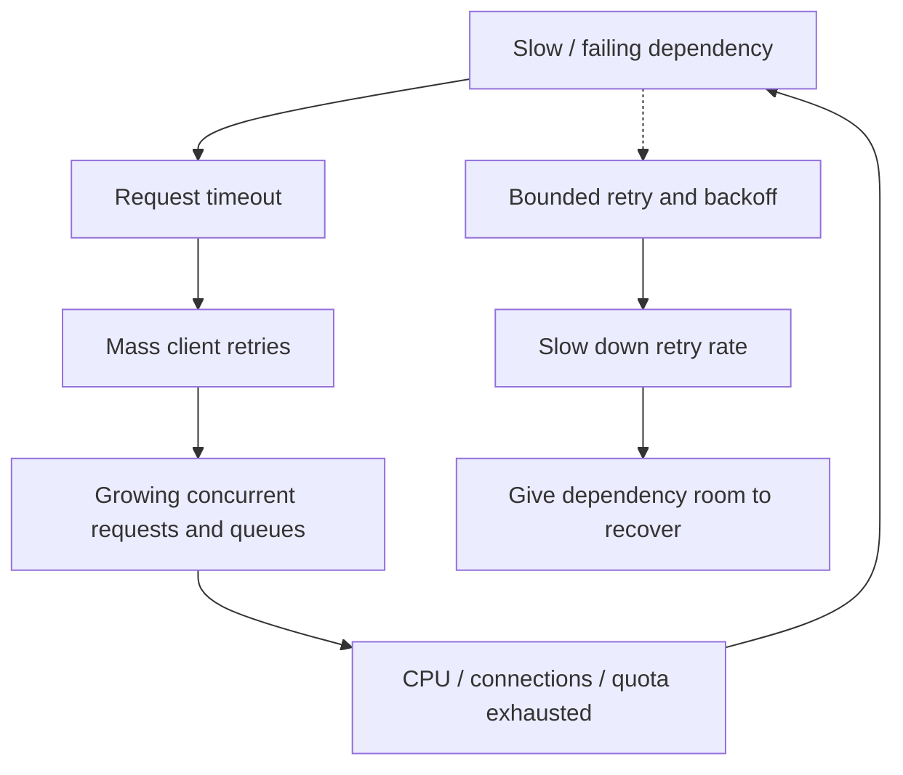
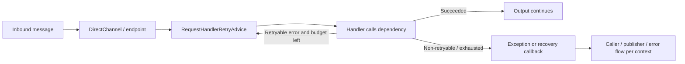
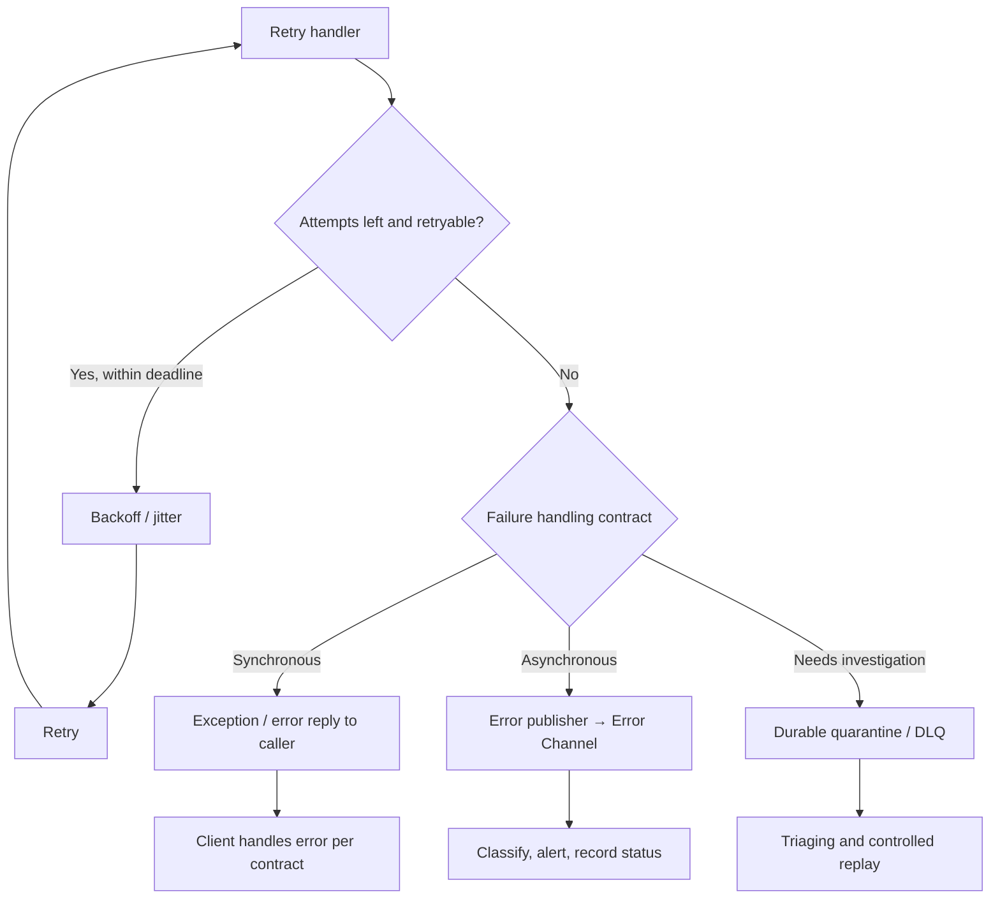

# Limiting Retries to Prevent Retry Storms in Spring Integration

## 1. Context: When Recovery Mechanisms Become the Outage Source

In the `SPRING_INTEGRATION_PATTERN` module, we implement **Enterprise Integration Patterns** (EIP) with Spring Integration to build loosely coupled, extensible, testable, and observable message flows. A message may travel through a Router, Filter, Transformer, Splitter, Aggregator, Gateway, and Service Activator before calling an external service. When that step times out or returns a transient error, retries can help complete the work without manual intervention.

However, **unbounded or overly aggressive retries can trigger a *retry storm***: an already overloaded system gets bombarded by repeated client calls. Latency climbs, connection pools drain, queues lengthen, more requests time out, and those timeouts trigger even more retries. Eventually, even previously healthy flows can degrade.

Example: An endpoint receives 1,000 requests per second. If every request fails and each is attempted up to **3 times, including the initial call**, calls hitting the dependency can reach roughly **3,000 invocations** per 1,000 original requests, before accounting for rate limits, backoff, queuing, and early terminations. When multiple layers retry independently, amplification grows even larger.

**Lesson goal:** Design retry as a **bounded, conditional, and budgeted** policy rather than "keep retrying until it works."

After this lesson, you will be able to:

- Recognize traffic amplification feedback loops that cause retry storms.
- Distinguish `maxAttempts`, additional retries, backoff, jitter, and deadlines.
- Select retryable exceptions and fail fast on errors that retrying cannot fix.
- Configure `RequestHandlerRetryAdvice`, `RetryTemplate`, `SimpleRetryPolicy`, and `ExponentialBackOffPolicy` in Spring Integration Java DSL.
- Write JUnit tests for post-retry success, exhausted attempts, and non-retryable errors.
- Combine retries with timeouts, rate limiters, bulkheads, circuit breakers, Error Channels, and quarantine.
- Design idempotency, correlation, metrics, and policies for synchronous/asynchronous flows.

## 2. How Does a Retry Storm Form?

### 2.1. The Positive Feedback Spiral

When a dependency slows down, calls start timing out. Callers assume the failure is transient and immediately retry. Every retry consumes extra threads, sockets, database connections, or API quota. The slower the dependency becomes, the more timeouts occur—and timeouts generate even more retries.



An especially dangerous cycle occurs when many workers notice failures during the same window and all retry after **the exact same fixed delay**. Synchronized bursts create repeated load spikes (*thundering herd*). **Jitter**—controlled randomness in wait times—prevents workers from waking up in lockstep.

### 2.2. Nested Retries Amplify Exponentially

Suppose there are three layers: HTTP client → order service → payment gateway. If **each layer performs up to 3 attempts**, worst-case calls reaching the final dependency can grow to:

```text
3 attempts by HTTP client
  × 3 attempts by order service
  × 3 attempts by payment gateway
  = 27 calls to the final dependency / per initial request
```

This is a hypothetical illustration to show the **amplification factor**, not an outcome guaranteed every time: wait intervals, deadlines, or per-layer policies can lower actual call counts.

**Principle:** Designate **one retry-owning layer** for an operation. If multiple layers must retry, share or cap the overall budget so attempts do not multiply unintentionally.

### 2.3. Pointless Retries

Not every exception should be retried. Payloads missing required fields, invalid account numbers, or business rule violations will not fix themselves in a few hundred milliseconds. Retrying those errors only adds load and obscures the true root cause.

| Error group | Examples | Handling strategy |
| --- | --- | --- |
| Potentially transient | Brief connection reset, HTTP 503, short network drop | Bounded retry if operation is safe and deadline permits. |
| Rate-limited | HTTP 429 | Honor valid `Retry-After` and reduce call rate; do not hammer immediately. |
| Invalid data or contract | Missing `orderId`, schema violation, HTTP 400 | Stop retrying, return business error, or quarantine. |
| Auth/permission error | HTTP 401/403 | Refresh tokens/permissions per contract; never retry blindly. |
| Timeout with unknown state | Payment command may already be processed by partner | Reconcile state/idempotency before replaying. |
| Sustained overload | Dependency persistently returning 503, saturated pools | Shed load, trip circuit breaker, lengthen backoff, or fail gracefully. |

## 3. Essential Limits in a Retry Policy

**Setting `maxAttempts` alone is not enough.** When thousands of messages fail together, allowing 3 attempts per message can still overwhelm the dependency. Add complementary limits:

| Limit | Question it answers | Policy example |
| --- | --- | --- |
| Attempts per message | How many times can one job run at most? | 3 attempts, including the initial call. |
| Wait between attempts | Are retries firing too fast? | Exponential backoff with jitter. |
| Time budget | Does total wait + execution exceed caller deadline? | Skip retrying if remaining time is insufficient. |
| Concurrency/bulkhead | How many tasks can call the dependency at once? | Dedicated limit per integration. |
| Ingress rate | How many requests per second may enter the dependency? | Token bucket / rate limiter. |
| Backlog size | Can the waiting queue grow without bound? | Bounded queue with overflow policy. |
| Cross-layer budget | Are retries nested? | Assign one owner or enforce a cross-layer retry budget. |
| Termination point | Where does the message go when budget runs out? | Error Channel, failed status, quarantine, or error reply. |

### 3.1. `maxAttempts` Includes the Initial Call

In Spring Retry, `SimpleRetryPolicy(3, ...)` allows **at most 3 total executions**, not one initial call plus three retries.

```text
Attempt 1: call dependency → transient error
             wait backoff
Attempt 2: call dependency → transient error
             wait backoff
Attempt 3: call dependency → fails again
             stop, throw exception / route to recovery per policy
```

Thus, if a policy calls for "at most two retries after the first call," configure `maxAttempts=3`.

### 3.2. Exponential Backoff and Jitter

With exponential backoff, wait intervals follow:

```text
delay(k) = min(maxDelay, initialDelay × multiplier^(k - 1))
```

Example with `initialDelay=100 ms`, `multiplier=2`, `maxDelay=1,000 ms`:

| Retry preparation | Wait before next call |
| --- | ---: |
| After attempt 1 | 100 ms |
| After attempt 2 | 200 ms |
| After attempt 3 | 400 ms — only if attempts remain. |
| Subsequent waits | Grow up to the 1,000 ms cap. |

With `maxAttempts=3`, there are only **two wait intervals**, 100 ms and 200 ms. Backoff does not increase allowed attempts; it simply spreads them out over time.

Jitter prevents every worker from retrying at exactly 100, 200, or 400 ms. You can use Spring Retry's randomized backoff policies or select an appropriate jitter variant and test the latency distribution. Never use identical fixed sleep durations across all workers at scale.

### 3.3. Deadlines and Per-Attempt Timeouts

`maxAttempts` and backoff do not automatically ensure a request finishes on time. If one dependency call can hang for 30 seconds, three attempts will cause a Gateway or HTTP caller to time out long before retries finish.

Visualize the total time budget as:

```text
Total time ≈ Σ(actual attempt durations)
           + Σ(backoff between attempts)
           + queueing / orchestration time
```

Configure **connect timeouts**, **read/response timeouts**, and an **overall operation deadline**. Never start a new attempt when the deadline is nearly spent; an outer timeout does not always interrupt an inner worker immediately.

### 3.4. Aggregate Traffic Retry Budgets

Under heavy baseline load, cap the ratio of **extra retries to original traffic** within a time window. For instance, allow a modest retry budget rather than letting every failing request spawn two extra attempts simultaneously. Once the budget is spent, return a controlled error, defer work, or quarantine per contract.

A global/service-level retry budget is an **additional safeguard**, not derived from a per-message `SimpleRetryPolicy`. Implement it with rate limiters, quotas, distributed coordination, or a dedicated resilience library.

## 4. Where Does Retry Live in Spring Integration?

In Spring Integration, the **Retry Pattern** is commonly applied via advice wrapping a handler or endpoint—typically `RequestHandlerRetryAdvice` backed by Spring Retry's `RetryTemplate`. This advice retries the wrapped operation; it does not globally throttle other publishers or the entire application.



**Advice scope matters:** If advice wraps a Service Activator calling a payment API, it retries that Service Activator. If an error arises in a downstream endpoint **outside that advice scope**, the policy does not automatically cover that downstream endpoint.

### Synchronous vs. Asynchronous Flows

| Flow type | Impact of retry | Primary risk |
| --- | --- | --- |
| Synchronous `DirectChannel` | Retry advice holds the calling thread across attempts and backoff. | Higher latency, exhausted HTTP/request threads, caller timeouts. |
| `ExecutorChannel` | Handler retries run on a worker thread if advice is attached there. | Worker threads blocked during backoff; growing queue and backlog. |
| `QueueChannel` + poller | Retrying at the polling endpoint repeats work on the poller thread. | One failing message hogs the poller, starving other messages. |
| Inbound adapter/broker | Adapter retries and broker redeliveries may stack with advice. | Nested retries, duplicate side effects, mistimed ACK/rollback. |

When using blocking backoff in `RequestHandlerRetryAdvice`, waits occupy the executing thread. Under high request volume, consider a **delayed queue/scheduler** or delayed broker redelivery instead of blocking every worker thread while sleeping.

## 5. Java DSL: Capping Attempts and Retrying Only Transient Errors

This example uses **Java 17, Spring Integration Java DSL, and Spring Retry**. In Spring Boot, include `spring-boot-starter-integration`, `spring-retry`, and `spring-boot-starter-test` for JUnit 5/AssertJ. Align dependency versions with your project's Spring Boot version.

The sample deliberately:

1. Applies advice to **one specific handler**.
2. Caps attempts at **3 total**, including the initial call.
3. Retries only `TransientRemoteException`, even when wrapped in a cause chain by the framework.
4. Uses short exponential backoff so tests run fast; production must tune intervals and jitter to its SLO.
5. **Omits a recovery callback**: once retries exhaust, the exception propagates across the execution boundary—never returning fake success.

```java
import java.util.HashMap;
import java.util.Map;
import java.util.Set;
import java.util.concurrent.ConcurrentHashMap;
import java.util.concurrent.CopyOnWriteArraySet;
import java.util.concurrent.atomic.AtomicInteger;

import org.springframework.context.annotation.Bean;
import org.springframework.context.annotation.Configuration;
import org.springframework.integration.channel.DirectChannel;
import org.springframework.integration.config.EnableIntegration;
import org.springframework.integration.dsl.IntegrationFlow;
import org.springframework.integration.handler.advice.RequestHandlerRetryAdvice;
import org.springframework.messaging.Message;
import org.springframework.messaging.MessageChannel;
import org.springframework.retry.backoff.ExponentialBackOffPolicy;
import org.springframework.retry.policy.SimpleRetryPolicy;
import org.springframework.retry.support.RetryTemplate;

@Configuration
@EnableIntegration
public class BoundedRetryFlowConfig {

    public enum FailureMode {
        TRANSIENT_TWICE, ALWAYS_TRANSIENT, PERMANENT
    }

    public record WorkItem(String id, FailureMode mode) {}

    public static class TransientRemoteException extends RuntimeException {
        public TransientRemoteException(String message) {
            super(message);
        }
    }

    public static class RemoteWorkService {
        private final ConcurrentHashMap<String, AtomicInteger> attempts =
            new ConcurrentHashMap<>();
        private final Set<String> completed = new CopyOnWriteArraySet<>();

        public void process(WorkItem job) {
            int attempt = attempts
                .computeIfAbsent(job.id(), ignored -> new AtomicInteger())
                .incrementAndGet();

            if (job.mode() == FailureMode.PERMANENT) {
                throw new IllegalArgumentException("Invalid payload");
            }
            if (job.mode() == FailureMode.ALWAYS_TRANSIENT
                    || (job.mode() == FailureMode.TRANSIENT_TWICE
                        && attempt <= 2)) {
                throw new TransientRemoteException(
                    "Remote service unavailable");
            }
            completed.add(job.id());
        }

        public int attemptsFor(String id) {
            AtomicInteger count = attempts.get(id);
            return count == null ? 0 : count.get();
        }

        public boolean isCompleted(String id) {
            return completed.contains(id);
        }
    }

    @Bean
    public RemoteWorkService remoteWorkService() {
        return new RemoteWorkService();
    }

    @Bean
    public MessageChannel workInput() {
        return new DirectChannel();
    }

    @Bean
    public RetryTemplate boundedRetryTemplate() {
        Map<Class<? extends Throwable>, Boolean> retryables =
            new HashMap<>();
        retryables.put(TransientRemoteException.class, true);

        // Up to 3 total executions, including the initial attempt.
        // traverseCauses=true classifies wrapped Spring Integration exceptions.
        SimpleRetryPolicy policy =
            new SimpleRetryPolicy(3, retryables, true);

        ExponentialBackOffPolicy backoff =
            new ExponentialBackOffPolicy();
        backoff.setInitialInterval(20L);
        backoff.setMultiplier(2.0);
        backoff.setMaxInterval(50L);

        RetryTemplate template = new RetryTemplate();
        template.setRetryPolicy(policy);
        template.setBackOffPolicy(backoff);
        return template;
    }

    @Bean
    public RequestHandlerRetryAdvice retryAdvice(
            RetryTemplate boundedRetryTemplate) {
        RequestHandlerRetryAdvice advice =
            new RequestHandlerRetryAdvice();
        advice.setRetryTemplate(boundedRetryTemplate);
        return advice;
    }

    @Bean
    public IntegrationFlow boundedWorkFlow(
            RemoteWorkService service,
            RequestHandlerRetryAdvice retryAdvice) {

        return IntegrationFlow.from("workInput")
            .handle((Message<?> message) ->
                service.process((WorkItem) message.getPayload()),
                endpoint -> endpoint.advice(retryAdvice))
            .get();
    }
}
```

**Why set `traverseCauses=true`?** Spring Integration can wrap handler exceptions in `MessageHandlingException` or another `MessagingException`. If the retry policy inspects only the outer exception without walking the `cause` chain, transient exceptions will not be recognized properly. Test both wrapped and unwrapped failures.

In this example, `RemoteWorkService` is an in-memory mock for counting attempts; it performs no networking, transactions, or idempotency for test execution. Against real dependencies, add full side-effect safeguards.

### Timeline When a Transient Error Happens Twice

```text
workInput.send(job)
  → Attempt 1: TransientRemoteException
  → Wait ~20 ms
  → Attempt 2: TransientRemoteException
  → Wait ~40 ms
  → Attempt 3: succeeded
  → Handler finishes; DirectChannel.send() returns
```

With `ALWAYS_TRANSIENT`, after attempt 3 the advice stops and throws the exception. With `PERMANENT`, `IllegalArgumentException` is outside the retryable set so no second attempt runs. No recovery callback swallows the exception or reports false success.

## 6. JUnit: Three Essential Conditions

Tests focus on **actual attempt counts**, rather than sleeping and guessing behavior. Because `workInput` is a `DirectChannel`, all attempts execute within the caller's call; the error is thrown once retries exhaust.

```java
import org.junit.jupiter.api.Test;
import org.springframework.beans.factory.annotation.Autowired;
import org.springframework.beans.factory.annotation.Qualifier;
import org.springframework.messaging.MessageChannel;
import org.springframework.messaging.support.MessageBuilder;
import org.springframework.test.context.junit.jupiter.SpringJUnitConfig;

import static org.assertj.core.api.Assertions.assertThat;
import static org.assertj.core.api.Assertions.assertThatThrownBy;

@SpringJUnitConfig(BoundedRetryFlowConfig.class)
class BoundedRetryFlowTest {

    @Autowired
    @Qualifier("workInput")
    MessageChannel workInput;

    @Autowired
    BoundedRetryFlowConfig.RemoteWorkService service;

    private boolean send(
            String id, BoundedRetryFlowConfig.FailureMode mode) {
        var job = new BoundedRetryFlowConfig.WorkItem(id, mode);
        return workInput.send(MessageBuilder.withPayload(job).build());
    }

    @Test
    void transientFailureTwiceThenSucceedsOnThirdAttempt() {
        assertThat(send("event-success",
            BoundedRetryFlowConfig.FailureMode.TRANSIENT_TWICE))
            .isTrue();

        assertThat(service.attemptsFor("event-success")).isEqualTo(3);
        assertThat(service.isCompleted("event-success")).isTrue();
    }

    @Test
    void stopsAfterThreeAttemptsWhenTransientFailurePersists() {
        assertThatThrownBy(() -> send("event-exhausted",
            BoundedRetryFlowConfig.FailureMode.ALWAYS_TRANSIENT))
            .isInstanceOf(RuntimeException.class);

        assertThat(service.attemptsFor("event-exhausted")).isEqualTo(3);
        assertThat(service.isCompleted("event-exhausted")).isFalse();
    }

    @Test
    void doesNotRetryPermanentValidationFailure() {
        assertThatThrownBy(() -> send("event-invalid",
            BoundedRetryFlowConfig.FailureMode.PERMANENT))
            .isInstanceOf(RuntimeException.class);

        assertThat(service.attemptsFor("event-invalid")).isEqualTo(1);
        assertThat(service.isCompleted("event-invalid")).isFalse();
    }
}
```

These tests verify three distinct outcomes: **recovery within limits**, **failing after exhaustion**, and **stopping immediately on non-retryable errors**. Never assert only that an exception was thrown, because a misconfigured policy might make 20 attempts and still throw—whereas the core goal here is bounding invocation counts.

**Testing limitation:** This suite does not prove production storm resilience: it does not measure concurrent messages, cross-instance quotas, queue capacities, total durations, transactions, or broker ACK/redelivery. Load-resilience tests belong in dedicated integration/QA suites.

## 7. What Happens Once Attempts Are Exhausted?

After `maxAttempts`, there must be a **clear termination point**. Which path to take depends on the job type and execution boundary:



In the Java example above, **there is no recovery callback**, so exceptions continue propagating to the synchronous caller once retries exhaust. If the endpoint sits behind a poller/adapter with an error publisher, exceptions can be converted into `ErrorMessage`s and sent to the configured error channel. Never assume every exception across all adapters automatically routes to the global `errorChannel`.

If you use a `RecoveryCallback`, specify the exact semantics of returning a value or `null`. A callback that only logs and returns can trick upstream callers into treating an incomplete business operation as finished. When routing to a DLQ or quarantine, confirm the record is durably persisted per contract before considering the failure handed off.

### Combining Retries with Dead-Letter / Quarantine

An **Error Channel** transports error details; it does not retry or persist durably by itself. **Dead-letter/quarantine** retains messages for triage and controlled replay. Once the retry limit is reached:

1. Preserve business identifiers and correlation IDs.
2. Record error type, failure timestamp, attempt count, and needed payload/schema version.
3. Strip sensitive data from logs; durable error records must have security controls and retention policies.
4. Set explicit statuses: `FAILED`, `PENDING_REVIEW`, or `RETRY_SCHEDULED`—never `SUCCEEDED`.
5. On replay, check idempotency and prior job state to avoid starting a fresh retry loop.

## 8. Why Bounded Retries Still Need Rate Limiters, Bulkheads, and Circuit Breakers

Three attempts per message will not stop 10,000 concurrent messages from hitting a dependency simultaneously. Each resilience mechanism guards a different dimension:

| Mechanism | What it protects | Its limitation |
| --- | --- | --- |
| Max attempts | Prevents a single message from retrying forever. | Does not cap aggregate original message volume. |
| Backoff and jitter | Spreads retry attempts out over time. | Does not directly limit concurrent requests. |
| Rate limiter | Caps call rate entering the dependency. | Does not guarantee admitted requests finish quickly. |
| Bulkhead / concurrency limit | Prevents one dependency from exhausting all workers, connections, or semaphores. | Does not heal a broken dependency by itself. |
| Circuit breaker | Stops or reduces calls to a persistently failing dependency. | Does not replace timeouts, error classification, or recovery. |
| Bounded queue | Prevents backlogs from exhausting memory. | Requires rejection/deferral policies when full. |
| Error Channel + quarantine | Handles uncompletable work cleanly. | Does not replay or enforce idempotency on its own. |

Example architecture:

```text
Message ingress
  → Rate limiter / backlog cap
  → Bounded worker pool (bulkhead)
  → Circuit breaker decides whether to call dependency
  → Bounded retry + backoff + jitter within budget
  → Timeout / business result
       ├─ SUCCESS: continue flow
       └─ EXHAUSTED: Error Channel / quarantine / error reply
```

This is a **responsibility diagram**, not a mandatory advice ordering for every system. Wrapping order between retry and circuit breaker changes how many calls the circuit breaker observes and when it trips; choose based on your goals and validate with integration tests.

### Bulkheads in Asynchronous Systems

If every retry holds a worker thread during `sleep`, the system can run out of workers even when active dependency calls are modest. For heavy workloads, consider **delayed messages/scheduled retries** or delayed broker redelivery. Ensure waiting messages are durably stored if survival across restarts is required.

### When the Circuit Breaker Is Open

Requests rejected by an open circuit breaker should generally not retry immediately in a tight loop. Treat the rejection as a **throttling signal**—return a temporary status or schedule a retry at a safe later time per policy. Continuously retrying `CallNotPermitted` events adds unnecessary pressure and log noise.

## 9. Idempotency: Capping Attempts Alone Does Not Prevent Duplicates

Retries can execute **the exact same side effect multiple times**. If a database write, payment charge, shipment creation, or email send succeeded yet the response was lost, the client perceives a timeout and retries.

Example:

```text
Attempt 1: payment provider charged, response lost
Attempt 2: client retries same payment command
           → without idempotency: risk of double charging
```

For payments, use a partner-supported **idempotency key** or transaction-state reconciliation. `maxAttempts=3` only caps invocation counts; it never turns a non-idempotent operation safe.

For messages split by a Splitter, each part may retry independently. Attach idempotency keys at the **true unit-of-work level**—for example `orderId + itemId + operation`—rather than generating a different random ID on every attempt.

## 10. Interactions with Router, Gateway, Splitter, and Aggregator

### Router / Filter / Transformer

A Router can select distinct retry policies per job type: payments, inventory, notifications. Filters should discard invalid inputs or block needless retries rather than turning bad data into repeated calls. Transformers must preserve correlation, idempotency, and deadline headers whenever they are part of the contract.

### Synchronous Gateways

A Gateway waits for a reply up to a timeout. If 3 retries at 2 seconds each plus backoff exceed a caller's 3-second timeout, the caller abandons the request before the server finishes. **Retry budgets must fit inside the Gateway time budget, or the work must become asynchronous**, returning `ACCEPTED` with a tracking ID when appropriate.

Never report business success simply because a message entered a queue or a retry was scheduled.

### Splitter / Aggregator and Correlation

When a Splitter produces 10 child messages and each retries up to 3 attempts, total downstream calls for the group can far exceed 10. If one child exhausts retries and yields no result, the Aggregator may wait on the missing part until timeout. The error flow must decide whether to retry individual parts, fail the group, emit partial results, or compensate.

Inside `ErrorMessage`, inspect `getOriginalMessage()` or `MessagingException.getFailedMessage()` when retrieving `correlationId`, `sequenceNumber`, and `sequenceSize`. Do not assume metadata is always present, and do not assume the Error Channel automatically fixes the Aggregator's release strategy.

### `PriorityChannel` and Starvation

If a failing high-priority message immediately retries back into the same high-priority queue, it can continuously starve other work. Use **delay/backoff** and retry limits independent of priority. Once budget is exhausted, move it to quarantine rather than re-queuing onto the hot queue.

## 11. Observing and Detecting Retry Storms

A system cannot detect retry storms by counting exceptions alone. Measure **baseline traffic**, **retry attempts**, **latency**, **backlog**, and **final outcomes**:

| Metric or signal | Meaning |
| --- | --- |
| `requests_original_total{flow}` | New incoming requests entering the flow. |
| `retry_attempts_total{flow,reason}` | **Additional** retry attempts after the initial attempt. |
| `retry_exhausted_total{flow}` | Jobs exhausting all attempts and still failing. |
| `dependency_calls_total{dependency,result}` | Total real invocations, including retries. |
| `dependency_inflight{dependency}` | Concurrent active calls to the dependency. |
| `retry_backoff_seconds{dependency}` | Distribution of wait durations before retrying. |
| `queue_depth{flow}`, `oldest_message_age_seconds{flow}` | Detects backlogs, starvation, and slow processing. |
| `circuit_breaker_state{dependency}` | Shows whether the dependency is protected or tripped open. |
| `recovery_final_total{flow,result}` | Count of jobs succeeding, failing, or quarantined. |

A simple indicator:

```text
retry amplification =
  total dependency calls / original eligible operations
```

If this ratio climbs sharply while success rates drop and latency spikes, review retry policies and dependency health immediately. Never use `eventId` or `transactionId` as metric labels due to extreme cardinality; keep those IDs in structured logs or traces.

Alert on **combinations of signals**, such as rising `retry_exhausted`, `inflight` hitting limits, spiking 429/503 rates, and aging backlogs. A few isolated retries in a healthy system do not automatically indicate an incident.

### Logs Rich Enough to Investigate Without Leaking Data

Each retry sequence should retain `eventId`, `correlationId`, endpoint name, `attempt`, error type, `RETRY / STOP / QUARANTINE` decision, and planned wait duration. Avoid logging raw payment payloads, tokens, or personal data; when repeated attempts hit identical errors, apply sampling or event aggregation to prevent a log storm.

## 12. Anti-Patterns to Avoid

| Mistake | Consequence | Replacement |
| --- | --- | --- |
| `while (true)` retrying until success | Starves threads, no termination point. | Bound attempts, deadlines, and exhaustion handling. |
| Immediate retries across every worker | Thundering herd, dependency never recovers. | Exponential backoff with jitter. |
| Client, gateway, and service all retry 3 times | Can amplify up to 27 calls at the bottom. | Assign one retry owner and enforce cross-layer budgets. |
| Retrying schema/validation errors | Wastes resources; data remains invalid. | Fail fast, return error reply, or quarantine. |
| Backoff without a deadline | Exceeds caller timeout, wastes work no longer needed. | Overall deadline plus per-attempt timeouts. |
| Retrying timed-out payments without reconciliation | Risks duplicate side effects. | Idempotency keys and transaction status queries. |
| Retrying on an already saturated worker pool | Ties up threads during sleeps, swells backlog. | Bulkheads, bounded queues, delayed retries. |
| Recovery callback only logs and returns success | Hides business failures. | Rethrow or explicitly persist failure/quarantine status. |
| Dumping all post-retry failures into `nullChannel` | Loses visibility and replay capability. | Error Channel and durable error store per contract. |
| Checking only `send() == true` in async flows | Confuses message acceptance with completion. | Track completion and failure outcomes separately. |

## 13. Practice Exercise

**Scenario:** An ordering system uses Spring Integration to call inventory, payment, and notification services. During peak traffic, the payment provider returns 503s and the notification provider steadily returns 429s.

1. Run the `BoundedRetryFlowConfig` example and explain why `maxAttempts=3` permits at most **two extra retries**.
2. Write a test for a non-retryable validation error and verify the handler executes only once.
3. Replace `ExponentialBackOffPolicy` with a policy supporting jitter. Explain how it prevents all workers from waking up simultaneously.
4. Diagram the amplification factor when three independent layers each retry up to 3 times. Propose a single layer to own retries.
5. Run a load test simulating 100 concurrent failing messages; measure inflight calls, total attempts, wait times, and backlog. Propose concurrency/rate limits.
6. Build post-exhaustion flows: synchronous errors return to the Gateway; async errors go to the Error Channel or quarantine. Verify no false success is returned.
7. For payment timeouts, add idempotency keys and reconciliation; explain why even a small retry count can still produce duplicate transactions.
8. Use a Splitter to process multiple items, exhaust retries on one item, and design how the Aggregator terminates the group per contract.
9. Propose metrics and alert thresholds to catch a retry storm before the dependency collapses completely.

**Self-check questions:** Does `maxAttempts=3` mean three retries **after** the initial call? Why does backoff need jitter? When should HTTP 429 honor `Retry-After`? Why does a bounded per-message retry policy still fail to protect a dependency from 10,000 concurrent messages? Why is an Error Channel not a retry scheduler?

## 14. Key Takeaways

**Limiting retries to prevent retry storms** goes far beyond setting a number for `maxAttempts`. In Spring Integration, attach retries to the right endpoint, separate transient errors from unrecoverable ones, bound total attempts **including the first call**, apply backoff and jitter, and govern deadlines, ingress rate, concurrency, and backlogs. When the budget runs out, errors must be returned or handed off transparently via an Error Channel or quarantine per contract. Idempotency, correlation, and retry amplification metrics help systems recover under control instead of turning a minor hiccup into a cascading overload.
