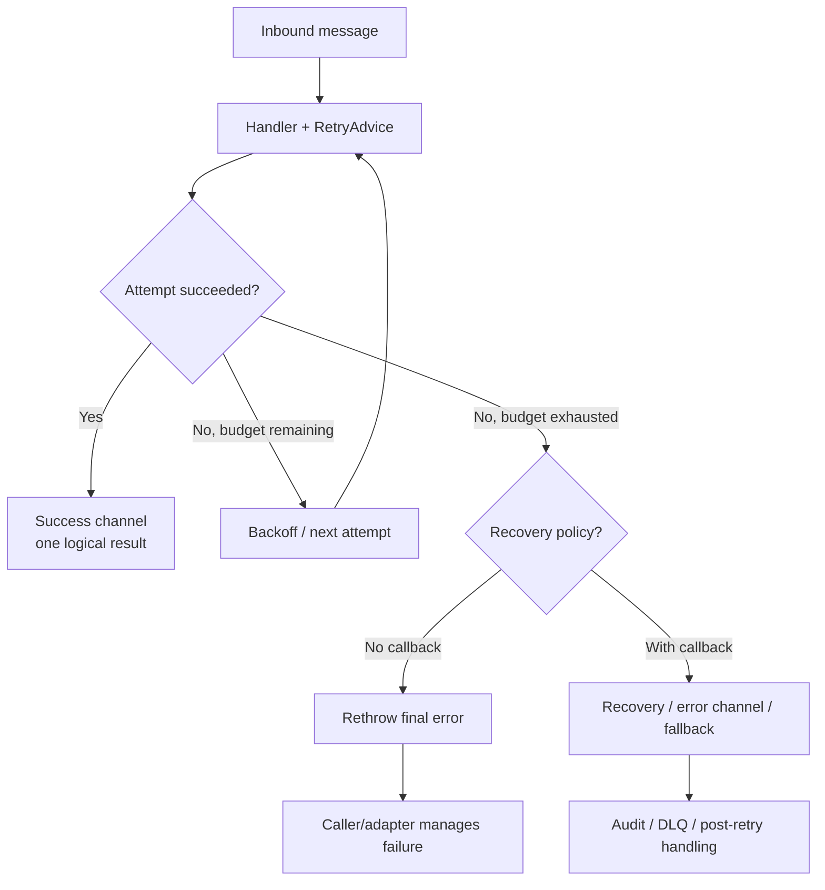
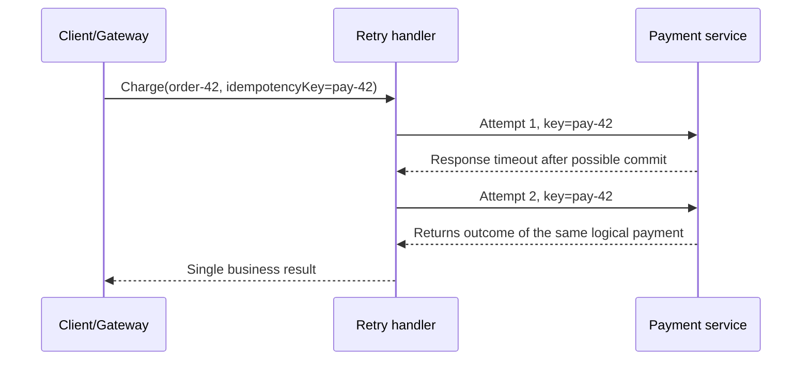

# Testing Post-Retry Success and Terminal Failure

In the **Retry** chapter of **SPRING_INTEGRATION_PATTERN**, an integration system needs to recover when an external service fails transiently, yet also **stop cleanly under control** once all allowed attempts are spent. If you only write a test asserting "eventually a message succeeded," you can miss two serious bugs: the handler being invoked beyond the retry limit, or the final failure being swallowed so upstream believes the business operation succeeded.

This lesson walks through testing **both outcomes of a single retry policy**:

1. **Success after retry:** initial attempts fail with a retryable error, and a later attempt succeeds within budget; only the single success result is forwarded.
2. **Terminal failure:** all allowed attempts fail; the error or recovery message must reach the designated channel or target, with no fake success output and no extra attempts.

Examples use Spring Retry, `RequestHandlerRetryAdvice`, `IntegrationFlow`, and JUnit 5. They also connect to Router, Filter, Transformer, Splitter, Aggregator, Gateway, error channel, and correlation so you see how retries affect the entire Enterprise Integration Patterns flow.

> **Principle:** Retry tests must verify **attempt counts, error types, output results, stopping point, business state, and final error routing**, not merely a single `assertNotNull(result)`.

## 1. Defining Attempt, Retry, and Outcome Clearly

An *attempt* is one execution of the operation wrapped by the retry policy. A retry is a re-execution following an attempt that failed to meet success criteria.

With `maxAttempts = 3` in Spring Retry, **the maximum total attempts is three**, typically the initial call plus at most two retries—not "three retries plus the initial call."

Example:

```text
Scenario A — success after retry
Attempt 1: IOException/TransientFailure
Attempt 2: IOException/TransientFailure
Attempt 3: SUCCESS → returns one success result

Scenario B — terminal failure
Attempt 1: TransientFailure
Attempt 2: TransientFailure
Attempt 3: TransientFailure
           → EXHAUSTED, no attempt 4

Scenario C — non-retryable error
Attempt 1: PermanentBusinessFailure
           → FAIL FAST per configured policy
```

Distinguish these terms:

| Concept | Meaning | What must be asserted |
| --- | --- | --- |
| `attemptCount` | Total callback/handler executions | Exact count, including the initial call |
| `retryable exception` | Error permitted for retry by policy | Another attempt runs while budget remains |
| `non-retryable exception` | Error that should stop immediately | Zero retries if classified properly |
| `success after retry` | A subsequent attempt succeeds | Exactly one logical result is accepted |
| `retry exhausted` | Budget spent without success | Final status/error takes the designated path |
| `recovery callback` | Action after policy ends retries | May return fallback or forward error; test separately |
| `errorChannel` | Infrastructure receiving some flow errors | Does not automatically catch every exception on every channel type |

**Do not treat "retried and succeeded" as proof of correctness.** A service might return `200 OK` on the third attempt after writing data twice during earlier timed-out responses. Business tests must also verify *side effects* and idempotency.

## 2. Writing a Test Contract for Both Branches

Before writing code, build an expectations table:

| Scenario | Failures before success | Expected attempts | Output result | Error path |
| --- | ---: | ---: | --- | --- |
| Immediate success | 0 | 1 | One success result | Not triggered |
| Succeeds on 2nd try | 1 | 2 | One success result | Not triggered |
| Succeeds on final try | 2 | 3 | One success result | Not triggered |
| Retries exhausted | 3 or more | 3 | No success result emitted | Rethrow/recovery per config |
| Permanent error | 1 non-retryable error | 1 if policy excludes it | No success result emitted | Fail fast / recovery |
| Allowed fallback | Retries exhausted | Up to limit | Fallback result **with distinct status** | Per recovery contract |

All numbers in this table assume **`maxAttempts=3`**, one execution per attempt, and no special stateful retry behavior.

Always assert **both sides**:

- *Positive assertion:* a success message/result appears when an attempt succeeds.
- *Negative assertion:* zero success results appear after terminal failure; zero attempts exceed the cap; zero duplicate emissions occur when retried or redelivered.

### Key Distinction: Exhausted Is Not Permanent

"Retry exhausted" only means **the retry policy finished** within the current budget; it does not prove the external system is permanently broken. Remediation may continue via DLQ, reconciliation, scheduled retry, or operator alerts. "Permanent business error" describes the **error category** (e.g., invalid request contract) that generally should not be retried immediately.

## 3. A Deterministic Test Double Model

To avoid flaky real-network failures, tests can use a fake service configured to succeed on call `k` after a scripted number of failures.

```java
import java.util.concurrent.atomic.AtomicInteger;

// Example transient error; real applications must define
// which failures are genuinely safe to retry.
class TransientDownstreamException extends RuntimeException {
    TransientDownstreamException(String message) {
        super(message);
    }
}

final class ScriptedDownstreamService {

    private final AtomicInteger calls = new AtomicInteger();
    private volatile int failuresBeforeSuccess;

    void arrangeFailures(int failures) {
        if (failures < 0) {
            throw new IllegalArgumentException("failures must be >= 0");
        }
        calls.set(0);
        failuresBeforeSuccess = failures;
    }

    String process(String payload) {
        int attempt = calls.incrementAndGet();
        if (attempt <= failuresBeforeSuccess) {
            throw new TransientDownstreamException(
                    "Transient failure at attempt " + attempt);
        }
        return "processed:" + payload;
    }

    int attempts() {
        return calls.get();
    }
}
```

For example, `arrangeFailures(2)` triggers two failures and succeeds on the third attempt; `arrangeFailures(100)` drives a `maxAttempts=3` scenario to exhaustion.

**Limitation:** This is a *test double*, making no real API calls or transactions. Counting uses `AtomicInteger` for clarity; each test must isolate state and never run two tests mutating `failuresBeforeSuccess` on a shared bean simultaneously. Separate tests are required to simulate ACK failures, restarts, and multiple instances.

## 4. Spring Retry Unit Test: Success After Retry

`RetryTemplate` lets you verify the policy independently of channel wiring. Configure **three attempts with no wait between attempts** so unit tests run fast and deterministically:

```java
import org.springframework.retry.support.RetryTemplate;

final class RetryPolicies {
    private RetryPolicies() { }

    static RetryTemplate threeAttemptsForTests() {
        return RetryTemplate.builder()
                .maxAttempts(3)
                .noBackoff()
                .build();
    }
}
```

This configuration is **for tests only**. In production, tune backoff to latency and load; never retry in tight bursts when downstream is overloaded.

Testing success on the final allowed attempt:

```java
import static org.junit.jupiter.api.Assertions.assertEquals;

import org.junit.jupiter.api.Test;
import org.springframework.retry.support.RetryTemplate;

class RetryTemplateSuccessTest {

    @Test
    void succeedsAfterTwoTransientFailures() {
        ScriptedDownstreamService service =
                new ScriptedDownstreamService();
        service.arrangeFailures(2);

        RetryTemplate retry = RetryPolicies.threeAttemptsForTests();

        String result = retry.execute(
                context -> service.process("order-42"));

        assertEquals("processed:order-42", result);
        assertEquals(3, service.attempts());
    }

    @Test
    void succeedsImmediatelyWithoutUnnecessaryRetry() {
        ScriptedDownstreamService service =
                new ScriptedDownstreamService();
        service.arrangeFailures(0);

        String result = RetryPolicies.threeAttemptsForTests()
                .execute(ctx -> service.process("order-43"));

        assertEquals("processed:order-43", result);
        assertEquals(1, service.attempts());
    }
}
```

Each check serves a specific purpose:

- Verifies **one final logical result** with the expected payload.
- Verifies the third attempt executed after two failures, and no fourth attempt ran.
- Verifies immediate success triggers no unnecessary retries.
- Uses no `Thread.sleep` or system-clock dependency, avoiding backoff-induced flakiness.

**Note on `RetryContext`:** inside a callback you can inspect `context.getRetryCount()`, which typically starts at **0 on the first call**. If you log human-readable attempt numbers, convert consistently; in the test above, the service counter tracks actual invocations directly.

## 5. Spring Retry Unit Test: Terminal Failure

Same policy, except the service fails on all three permitted calls:

```java
import static org.junit.jupiter.api.Assertions.*;

import org.junit.jupiter.api.Test;

class RetryTemplateExhaustedTest {

    @Test
    void throwsAfterExactlyThreeFailedAttempts() {
        ScriptedDownstreamService service =
                new ScriptedDownstreamService();
        service.arrangeFailures(100);

        TransientDownstreamException thrown = assertThrows(
                TransientDownstreamException.class,
                () -> RetryPolicies.threeAttemptsForTests()
                        .execute(ctx -> service.process("order-44")));

        assertTrue(thrown.getMessage().contains("attempt 3"));
        assertEquals(3, service.attempts());
    }

    @Test
    void successOnLastAllowedAttemptIsNotExhausted() {
        ScriptedDownstreamService service =
                new ScriptedDownstreamService();
        service.arrangeFailures(2);

        String result = RetryPolicies.threeAttemptsForTests()
                .execute(ctx -> service.process("order-45"));

        assertEquals("processed:order-45", result);
        assertEquals(3, service.attempts());
    }
}
```

No `RecoveryCallback` is configured in these tests, so upon exhaustion the final exception is thrown per `RetryTemplate`'s contract. If your application registers a recovery callback, replace the exception assertion with **the result or error defined by recovery**.

Pay special attention to the boundary between **succeeding on the last attempt** and **failing completely**. That boundary is where off-by-one bugs in `maxAttempts` hide.

### 5.1. Never Swallow Errors and Return "Success"

Bad pattern:

```java
// Anti-pattern: turning a final error into a success response.
try {
    return retry.execute(ctx -> callGateway());
} catch (RuntimeException ex) {
    return "OK"; // Wrong: business operation may not have run.
}
```

If recovery returns a valid fallback, represent it explicitly as `FAILED`/`DEFERRED`/`FALLBACK` and verify callers know it is **not normal business success**.

## 6. Retry Only Errors Worth Retrying

Not every error is solved by trying again:

| Error group | Examples | Typical sound policy |
| --- | --- | --- |
| Transient infra errors | Network reset, temporary 503, retryable deadlock | Bounded retry, backoff, and jitter |
| Rate limiting | 429 from API | Wait per `Retry-After` if present, enforce total deadline |
| Permanent business errors | Malformed order, missing permission, invalid data | Fail fast or route to business error branch |
| Security/auth errors | 401/403 that cannot self-heal via retry | Never retry indefinitely; re-verify credentials |
| Unknown outcome | Request timeout after server may have committed | Query result / idempotency key before resending |
| Program bugs | `NullPointerException`, invariant violation | Classify/investigate; blind retries hide bugs |

Example isolating **only transient errors** with Spring Retry:

```java
import org.springframework.retry.support.RetryTemplate;

RetryTemplate classifiedRetry = RetryTemplate.builder()
        .maxAttempts(3)
        .noBackoff()
        .retryOn(TransientDownstreamException.class)
        .build();
```

This is a **configuration snippet for a method or bean**, showing how to restrict retryable exceptions. With Spring Integration advice, handler exceptions may be wrapped in `MessagingException`; check **cause chains and your exact version's classifier** before assuming the matcher always finds the root exception.

Tests should cover both branches:

1. `TransientDownstreamException` retries up to the limit or until success.
2. `PermanentBusinessException` **does not** continue attempts when excluded by policy.

For real HTTP/SQL errors, base classification rules on error codes and adapter contracts rather than fragile exception message substring matching.

## 7. Integrating with Spring Integration via `RequestHandlerRetryAdvice`

`RequestHandlerRetryAdvice` applies retries to a handler inside an `IntegrationFlow`. For clear testing, place a `DirectChannel` at the input, a `QueueChannel` at the output, and reuse the three-attempt no-backoff `RetryTemplate`.

```java
import org.springframework.context.annotation.Bean;
import org.springframework.context.annotation.Configuration;
import org.springframework.integration.channel.DirectChannel;
import org.springframework.integration.channel.QueueChannel;
import org.springframework.integration.config.EnableIntegration;
import org.springframework.integration.dsl.IntegrationFlow;
import org.springframework.integration.handler.advice.RequestHandlerRetryAdvice;
import org.springframework.retry.support.RetryTemplate;

@Configuration
@EnableIntegration
class RetryIntegrationTestConfig {

    @Bean
    DirectChannel retryInput() {
        return new DirectChannel();
    }

    @Bean
    QueueChannel retryOutput() {
        return new QueueChannel();
    }

    @Bean
    ScriptedDownstreamService scriptedService() {
        return new ScriptedDownstreamService();
    }

    @Bean
    RetryTemplate retryTemplateForTests() {
        return RetryPolicies.threeAttemptsForTests();
    }

    @Bean
    RequestHandlerRetryAdvice handlerRetryAdvice(
            RetryTemplate retryTemplateForTests) {
        RequestHandlerRetryAdvice advice =
                new RequestHandlerRetryAdvice();
        advice.setRetryTemplate(retryTemplateForTests);
        // No RecoveryCallback set:
        // when exhausted, the exception propagates to the synchronous caller.
        return advice;
    }

    @Bean
    IntegrationFlow retryFlow(
            DirectChannel retryInput,
            QueueChannel retryOutput,
            ScriptedDownstreamService scriptedService,
            RequestHandlerRetryAdvice handlerRetryAdvice) {

        return IntegrationFlow.from(retryInput)
                .handle(String.class,
                        (payload, headers) ->
                                scriptedService.process(payload),
                        endpoint -> endpoint.advice(handlerRetryAdvice))
                .channel(retryOutput)
                .get();
    }
}
```

**What this example demonstrates:**

- `retryInput` receives messages synchronously from the test.
- The handler invokes `scriptedService.process(payload)`; advice retries when the callback throws a policy-eligible error.
- On success, one reply with payload `"processed:..."` lands on `retryOutput`.
- When all attempts fail without a recovery callback, the synchronous send fails; **zero success replies** arrive on `retryOutput`.
- `QueueChannel` lets tests observe emitted messages, yet it does not verify business state or external committed effects by itself.

Remember Spring Integration evolves across versions; if your project uses a different DSL or Spring Retry API, adapt to that version. What matters most is keeping **advice boundaries** and test contracts consistent.

### 7.1. Integration Test: Success After Retry

```java
import static org.junit.jupiter.api.Assertions.*;

import org.junit.jupiter.api.Test;
import org.springframework.beans.factory.annotation.Autowired;
import org.springframework.beans.factory.annotation.Qualifier;
import org.springframework.integration.channel.DirectChannel;
import org.springframework.integration.channel.QueueChannel;
import org.springframework.messaging.Message;
import org.springframework.messaging.support.MessageBuilder;
import org.springframework.test.annotation.DirtiesContext;
import org.springframework.test.context.junit.jupiter.SpringJUnitConfig;

@SpringJUnitConfig(RetryIntegrationTestConfig.class)
@DirtiesContext(classMode = DirtiesContext.ClassMode.AFTER_EACH_TEST_METHOD)
class RetryFlowIntegrationTest {

    @Autowired @Qualifier("retryInput")
    DirectChannel input;

    @Autowired @Qualifier("retryOutput")
    QueueChannel output;

    @Autowired
    ScriptedDownstreamService service;

    @Test
    void successAfterTwoFailuresProducesOneReply() {
        service.arrangeFailures(2);

        assertTrue(input.send(
                MessageBuilder.withPayload("order-42").build()));

        Message<?> result = output.receive(1_000);
        assertNotNull(result);
        assertEquals("processed:order-42", result.getPayload());
        assertEquals(3, service.attempts());
        assertNull(output.receive(100));
    }

    @Test
    void exhaustedFailurePropagatesWithoutSuccessReply() {
        service.arrangeFailures(100);

        assertThrows(RuntimeException.class,
                () -> input.send(
                        MessageBuilder.withPayload("order-43").build()));

        assertEquals(3, service.attempts());
        assertNull(output.receive(100));
    }
}
```

**Why `@DirtiesContext`?** Each test needs a clean service counter and failure script. The annotation instructs Spring Test to close/recreate the context as configured so tests do not interfere with one another. In large suites, optimize with per-test factories/instances or controlled resets, and never share mutable scripts across parallel tests.

**Important limitation:** `assertThrows(RuntimeException.class)` intentionally avoids locking onto one specific wrapper because Spring Integration may wrap handler errors in messaging exceptions. In real apps, also assert **root cause, error codes, and failed message metadata**. These examples verify attempt counts and in-JVM channel replies only—they do **not** yet verify transactions, broker ACKs, or external APIs.

### 7.2. Do Not Let a Final Callback Fool Your Tests

When a recovery callback is present, the outcome may no longer be a direct exception. Thus, `assertThrows(...)` alone cannot define terminal failure across the board. Your post-exhaustion contract must specify one of these options:

- **Rethrow:** exception continues up to the caller/adapter.
- **Send to recovery/error channel:** one error message routes to the configured error flow.
- **Return typed fallback:** caller receives `DEFERRED` or `FAILED`, never business success.
- **Park for manual replay/DLQ:** persist failure event durably and ACK only under safe handoff rules.

When routing to a recovery channel, tests must assert **exactly one terminal notification** per logical retry execution and **zero success replies**. If an adapter or broker later redelivers the entire message, a *new retry cycle* may start; never assume system-wide terminal error count is always one without idempotency.

## 8. Where Do Errors Go in Synchronous vs. Asynchronous Flows?

Distinguish `DirectChannel` from asynchronous channels. That distinction determines **where tests should look for terminal failures**.



### 8.1. On Synchronous Paths

When `DirectChannel` invokes a handler synchronously on the same call stack, an unhandled exception normally throws back to `send()` or the calling Gateway. Do not write a test waiting for an `ErrorMessage` on `errorChannel` without actually configuring a channel or dispatcher that emits error messages.

### 8.2. On Asynchronous Paths

When `ExecutorChannel` or an async adapter runs the handler on another thread, the caller may have already returned before the final attempt executes. In that case:

- Tests await processing signals or read error messages on the **configured error path**.
- Never infer handler success from `input.send() == true`.
- Use `PollableChannel.receive(timeout)`, latches, probes/recorders, or Awaitility with bounded timeouts—never guess timing with `sleep`.
- When recovery sends an `ErrorMessage`, verify root cause and failed message, never mistaking an error message for a business reply.
- Distinguish retry advice errors from Aggregator or Resequencer timeouts/expiries; do not assume all such events land on the same error channel automatically.

### 8.3. Recovery Paths Must Never "Whitewash" Business Errors

Suppose an email-sending handler should run only after payment commits. If payment fails permanently yet a recovery callback returns `"OK"`, downstream may send a fake payment confirmation email. Tests should assert **zero business success events** after terminal failure, even when recovery completes cleanly from an operational standpoint.

## 9. Backoff, Timeouts, and Time Budgets

In production, policies normally include backoff; tests must understand how large the total budget can grow.

Suppose:

```text
maxAttempts = 4
delay after attempt #1 = 100 ms
delay after attempt #2 = 200 ms
delay after attempt #3 = 400 ms

Nominal total backoff = 700 ms
Total processing time also includes each attempt's duration,
scheduler timing, queueing, GC, and network overhead.
```

If a Gateway times out after `500 ms` while retry callbacks can take several seconds, the caller abandons waiting while the backend keeps retrying. That triggers **overlapping retries**: the caller resends the whole request while the old handler is still running, multiplying work and load on the external service.

Production-like tests should verify:

1. Whether `maxAttempts` matches the intended budget.
2. Whether backoff matches policy and avoids retry storms.
3. Whether caller, handler, and batch deadlines align consistently.
4. Whether cancellation/interruption on shutdown is handled cleanly.
5. Which branch receives the outcome if the deadline expires mid-retry.
6. Whether retries reuse the idempotency key or check outcome if an external API committed before response timeout.

**Do not sleep a full 700 ms in every unit test.** Test backoff interval calculation separately with a mock/sleeper or deterministic policy. Only select integration/smoke tests need real schedulers to verify wiring and timing within a tolerance window.

## 10. Idempotency: Succeeding After Retry Must Not Execute Side Effects Three Times

A service can appear to fail from the caller's perspective while **already having executed** the effect on the target system. Example:

```text
Attempt 1: card charged; response lost → timeout.
Attempt 2: card charged; response lost → timeout.
Attempt 3: response returns success.

Caller sees success on attempt 3.
Yet without idempotency: customer may be charged 3 times.
```

Therefore, testing "success after retry" in realistic environments requires extra invariants:

- The same logical operation preserves its **idempotency key** across all attempts.
- Downstream processing the same key executes only one side effect or returns the already-recorded outcome.
- ACKs or replies never precede durable business commit/handoff points.
- If an outcome is **UNKNOWN**, never assume the first attempt did nothing.
- If an attempt succeeded right before an app crash, post-restart reprocessing still never doubles the effect.



**Tests should inspect final state in the Payment service or side-effect ledger**, not just assert callback counts in `RetryTemplate`. A handler running three times is valid; three monetary charges are invalid when the contract specifies one.

## 11. Interactions with Other Integration Patterns

| Pattern | What retry can cause | Invariant/test to add |
| --- | --- | --- |
| **Router** | Message re-routed after retry, possibly to another branch if rules depend on state | Route on stable data/version or define clear recovery |
| **Filter** | Message filtered out after already being marked "seen" | Never drop an unprocessed event; test reject/discard paths |
| **Transformer** | Creating a new reply message during retry drops business headers | Preserve correlation/event IDs and payload mapping |
| **Splitter** | Retrying whole batch re-emits already-dispatched parts | Never double effects; preserve valid `batchRunId + sequenceNumber` |
| **Aggregator** | Failed part never arrives, group stalls; exhausted retry leaves group incomplete | Group timeout and missing-part recovery |
| **Resequencer** | Retries cause part `#2` to arrive after part `#3` | Emit in order per policy; do not mistake retry for new sequence |
| **Gateway** | Response times out while backend keeps retrying | Verify deadlines and outcome/idempotency |
| **errorChannel** | Terminal failure wrapped/routed differently across sync/async | Zero lost errors, accurate branch and metadata |
| **Correlation** | Retries mint new message IDs or drop `correlationId` | Same logical message keeps stable correlation and event IDs |

**Specifically:** Retrying part `#2/4` **never creates a new sequence number**. If an entire batch must be retried, decide whether it is a *resume of the old run* or a *brand-new run* before assigning correlation. A Resequencer that only orders by metadata cannot automatically catch every business duplicate.

## 12. Test Matrix to Execute

| Case | Setup condition | Expected result |
| --- | --- | --- |
| Immediate success | Service succeeds | 1 attempt, 1 reply, no terminal error |
| Success after 1 failure | Fail attempt #1 | 2 attempts, accurate reply |
| Success on final attempt | Fail #1, #2; succeed #3 | 3 attempts, not treated as exhausted |
| Exhausted failure | Fail #1, #2, #3 | 3 attempts, error/recovery per contract, 0 success replies |
| Never exceeds limit | Failures before success = 100 | No attempt #4 |
| Non-retryable error | `ValidationException` | 1 attempt per classifier, fail fast |
| Error wrapped in `MessagingException` | Handler/advice receives wrapper exception | Classifier handles per real policy |
| Recovery callback returns fallback | Exhausted 3 attempts | Clear `DEFERRED`/`FAILED` status, no fake success |
| Async terminal error | `ExecutorChannel` or different adapter thread | `ErrorMessage`/recovery arrives on configured channel |
| ACK fails after commit | Broker redelivers whole message | Idempotency blocks duplicate side effects |
| Gateway timeout | Backend processed, caller got no response | Retry queries same outcome or reuses idempotency key |
| Retry with backoff | 3 attempts, deterministic delay | Does not retry early, no long sleeps in unit tests |
| Stop/cancel mid-backoff | Endpoint stops while waiting | Clean interruption policy, clear message state |
| Crash before commit | Service has not committed before restart | Message can be reprocessed safely |
| Crash after commit | Committed then restarted before ACK | Zero duplicate business effects |
| Retry before Splitter | Batch re-runs | Does not re-emit already-committed slots |
| Retry after Splitter | One part needs retry | Correlation/sequence unchanged |
| Exhausted retry inside group | `#2` never reaches Aggregator/Resequencer | Group does not mark complete; clear timeout/recovery |
| Retry succeeds after group expiry | Missing part arrives late | Late arrival handled per contract, no second batch emitted |
| Two consumers retry concurrently | Two instances handle same key | Single committed effect, no lost updates |
| Queue/DLQ replay | Terminal failure replayed | New replay not confused with previously tested retry cycle |

Unit tests for `RetryTemplate` and wiring tests for `RequestHandlerRetryAdvice` should be fast and deterministic. Broker/DB/external API tests require dedicated integration infrastructure with bounded timeouts and diagnostic assertions.

## 13. Common Mistakes When Testing Retries

**1. Confusing `maxAttempts=3` with four calls.** The initial call already counts as attempt one; assert exact call counts.

**2. Asserting only that result is non-null.** The result might be a fallback or an error converted into a fake success string. Assert the outcome's type and semantic meaning.

**3. Forgetting to assert zero output after exhaustion.** A failed message might accidentally enter the success channel, or the handler might return an invalid final value.

**4. Relying on `Thread.sleep`.** Backoff and schedulers introduce jitter/latency; use no-backoff in unit tests and bounded signals/awaits in integration tests.

**5. Testing only retryable errors.** Validation and permission errors must also be tested for fail-fast behavior to avoid wasting resources.

**6. Ignoring exception wrapping.** The messaging layer can wrap exceptions, affecting both the retry classifier and assertions.

**7. Assuming `errorChannel` is always called.** Depends on sync/async mode, adapter, gateway, and recovery callback; verify the configured error path explicitly.

**8. Using `MessageHeaders.ID` as an idempotency key.** Redelivery can create a new message with a different ID, leading to duplicate side effects.

**9. Forgetting stacked retries.** Caller and handler can each have policies that multiply calls unexpectedly. Tests must check *total* attempts across layers.

**10. Not testing terminal failure after partial side effects.** An exception after commit does not mean external transactions/side effects rolled back.

**11. Failing to isolate test state.** Shared counters, leftover queued messages, and uncleaned groups cause order-dependent test failures.

**12. Leaving post-exhaustion handling undefined.** "Throw an exception" is insufficient for background flows; define broker redelivery, recovery/DLQ, reconciliation, or terminal failure disposition.

## 14. Observing Retries in Production

An application audit/metric event might contain:

```json
{
  "flow": "payment-processing",
  "businessEventId": "pay-42",
  "attempt": 3,
  "maxAttempts": 3,
  "outcome": "SUCCESS_AFTER_RETRY",
  "lastFailureType": "TransientDownstreamException",
  "durationMs": 824,
  "idempotencyKey": "pay-42"
}
```

This is an **illustrative application schema**, not headers/metrics automatically emitted by Spring Integration. Never log sensitive payloads, tokens, or payment credentials just for debugging.

Recommended metrics:

| Suggested metric | Purpose |
| --- | --- |
| `retry.attempts.total` | Total attempts executed, including the initial attempt |
| `retry.success_after_retry.total` | Logical operations succeeding after at least one retry |
| `retry.exhausted.total` | Retry cycles ending due to exhausted budget |
| `retry.non_retryable.total` | Operations failing fast |
| `retry.backoff.duration` | Backoff wait time |
| `retry.operation.duration` | Total end-to-end duration from start to outcome |
| `retry.recovery.total` | Invocations of the recovery callback |
| `retry.terminal.error.total` | Logical failures remaining after policy execution |
| `idempotency.duplicate_prevented.total` | Duplicate side effects blocked |
| `gateway.unknown_outcome.total` | Timed-out calls where commit status is unknown |

Avoid high-cardinality metric labels like `businessEventId` or `correlationId`. Keep labels low-cardinality such as `flow`, `exceptionCategory`, and `outcome`; place fine-grained IDs in structured logs/traces.

When a system reports "retries increasing," investigate whether it stems from **transient infra glitches**, **downstream overload**, **an overly aggressive retry policy**, **too short a Gateway timeout**, or **a cross-layer retry loop**. Tweaking attempt counts blindly without knowing the root cause can amplify load and spread outages.

## 15. Test Suite Completion Checklist

1. **Clear budget definition:** `maxAttempts` includes the initial attempt, backoff, and overall deadline.
2. **All three core scenarios:** immediate success, success after retry, and exhausted failure.
3. **Non-retryable errors:** fail fast per classifier without pointless loops.
4. **Exact attempt assertions:** neither under-retried nor over-budget.
5. **Exact outcome assertions:** one business reply on success, zero success replies after terminal failure.
6. **Defined recovery policy:** rethrow, error channel, typed fallback, or DLQ.
7. **Test both sync and async if applicable:** failures observed at the proper boundary.
8. **No real delays in unit tests:** use no-backoff/fake sleeper; test backoff calculation separately.
9. **Preserve correlation/idempotency keys:** partial retries must never invent new sequences or logical events.
10. **Verify side effects and ACKs:** post-retry success does not imply once-only business commit without idempotency.
11. **Inject faults around commit/ACK:** failures before commit, after commit, lost responses, restarts, and replays.
12. **Isolate test state:** controlled service resets, unique group IDs, zero queue/context leakage.
13. **Align timeouts and group lifecycles:** exhausted retries or late successes have clear policies when Aggregator/Resequencer awaits missing parts.
14. **Usable logs and metrics:** attempts, retry success, exhausted, non-retryable, recovery, latency, and idempotency.
15. **Claim only tested scope:** `RetryTemplate` unit tests do not prove broker ACKs, transactions, or end-to-end exactly-once semantics.

**Conclusion:** Quality retry testing must prove both directions: **the system recovers and produces a single logical result once transient errors clear**, and **it stops within budget and routes failures to the right place when recovery within the current pass is impossible**. With Spring Integration, test `RetryTemplate`, `RequestHandlerRetryAdvice`, channels/recovery, attempt counts, and business effects as distinct boundaries; combined with idempotency, timeouts, and correlation, your message flows stay safe across redeliveries, restarts, and multi-layer retries.
