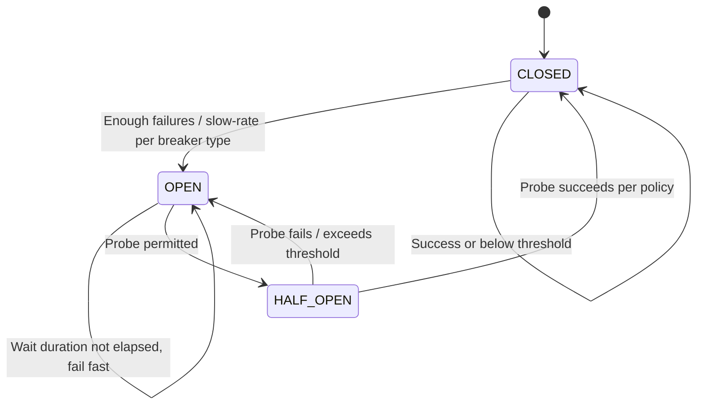
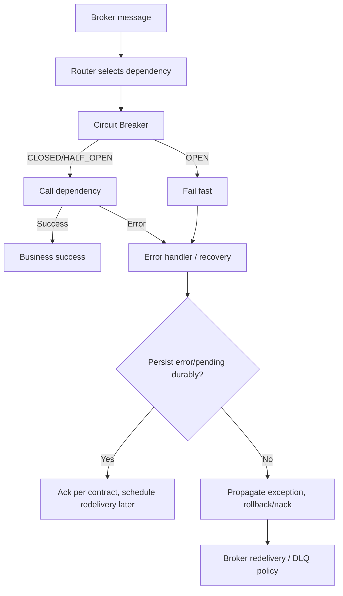

# Testing slow dependencies and failing dependencies in Spring Integration

## 1. The problem: when a partner is slow or broken, how must the message flow react?

In an order processing system, a `ShipmentRequested` message passes through a Filter checking input, a Transformer normalizing data, and a Router choosing a carrier. The handler calls Carrier A's API to create a shipment. Normally the API responds in 100 ms; when overloaded, it may respond after several seconds, time out, return HTTP 503, or abruptly close connections.

If every message keeps waiting or retrying continuously, threads, connections, and queues gradually become exhausted. A **Circuit Breaker** is a protective mechanism that stops calling a troubled dependency, fast-rejects new requests for a set duration, and then probes in a controlled manner once the dependency shows signs of recovery.

The lesson **"Testing slow dependencies and failing dependencies"** belongs to the **Circuit breaker** chapter of the `SPRING_INTEGRATION_PATTERN` module. Its goal is learning to implement Enterprise Integration Patterns with Spring Integration, creating loosely coupled, extensible flows combining Router, Filter, Transformer, Splitter, Aggregator, Gateway, retry, error channel, and correlation, while testing and monitoring branches.

After this lesson, you will be able to:

- Distinguish **slow-but-successful calls**, **timed-out calls**, and **immediate-failure calls**.
- Write tests verifying the `CLOSED → OPEN → HALF_OPEN → CLOSED/OPEN` states of a circuit breaker.
- Verify **fail fast**: when the circuit is open, downstream **is not called**.
- Understand the difference between Spring Integration's built-in breaker and Resilience4j's failure-rate/slow-call-rate breaker.
- Test timeouts, retries, fallbacks, transactions/acks, and side effects when a dependency is flaky.
- Design tests repeatable on CI without relying heavily on `Thread.sleep` and millisecond-exact timing.

## 2. Three dependency behaviors to simulate separately

| Behavior type | Handler observes | Does circuit breaker treat as failure automatically? | Test expectation |
| --- | --- | --- | --- |
| **Fast success** | Result returned, no exception | No | Keep processing, maintain or restore closed state |
| **Slow but successful** | Result arrives late, no exception | **Algorithm-dependent**: Spring Integration's consecutive-failure breaker does not open on latency alone | Measure latency, verify circuit does/does not open per mechanism |
| **Timeout / connection error** | Exception from HTTP/JDBC/client | Can count as failure if exception reaches advice and is recorded by policy | Enough failures trigger OPEN, subsequent requests fail fast |
| **4xx business error** | Client may return result or throw exception | Depends on exception mapping | Should not open breaker on validation errors unless it is a dependency fault |
| **HTTP 503 or 429** | Result/error from client | Depends on mapping, error type, and policy | Verify record/ignore, retry/backoff, and rate limiting |
| **Connection / thread pool exhaustion** | Very long wait or resource error | Breaker does not solve concurrency limits on its own | Combine timeout, bulkhead, and load limits |

**Especially important:** an HTTP client can return a `ResponseEntity` with an error status **without throwing an exception**. If the advice only counts exceptions, an HTTP 503 request like that may be recorded as a "success". Tests must accurately simulate how the adapter translates HTTP statuses into exceptions or business outcomes.

## 3. State machine to verify



- **CLOSED:** allows requests to reach the dependency; records successes, failures, or latency depending on implementation.
- **OPEN:** fast-rejects new requests; downstream invocation count does not increase while blocked.
- **HALF_OPEN:** allows one or a limited number of probe calls. Probe outcomes decide whether to close again or stay open.

Not every library transitions state the same way:

| Mechanism | Open condition | HALF_OPEN | Has slow-call rate threshold? |
| --- | --- | --- | --- |
| Spring Integration `RequestHandlerCircuitBreakerAdvice` | `threshold` **consecutive failures** | After `halfOpenAfter`, tries one call; failure reopens, success closes | **No**, not in this advice's two properties |
| Resilience4j `CircuitBreaker` | Failure rate **or** slow-call rate in sliding window, after `minimumNumberOfCalls` | Limits `permittedNumberOfCallsInHalfOpenState`, evaluates probe outcomes | **Yes**: `slowCallDurationThreshold` and `slowCallRateThreshold` |

In `RequestHandlerCircuitBreakerAdvice`, defaults are `threshold = 5`, `halfOpenAfter = 1000 ms`. These are parameters of the **built-in breaker**, not Resilience4j settings. With Resilience4j, minimum calls, window size, and exception classification policies also affect state. Do not use a Resilience4j expectation set to test Spring Integration's built-in breaker.

## 4. Choosing the right dependency mock and test layer

| Test layer | Tools | Should verify | Insufficient to conclude |
| --- | --- | --- | --- |
| Breaker policy unit test | Fake dependency, JUnit 5, Resilience4j directly | Failure threshold, slow-rate, short-circuit, half-open | Advice is wired to the right handler |
| Spring Integration flow test | `@SpringJUnitConfig`, `DirectChannel`, fake handler | Message traverses `RequestHandlerCircuitBreakerAdvice`, call counts, exceptions | Real HTTP timeouts, broker redelivery |
| HTTP integration test | WireMock/MockWebServer/Toxiproxy or mock server | Delay, 503, connection reset, client-side timeout, fallback | Correct DB/broker transactions |
| Broker/DB integration test | Testcontainers and real adapter/consumer | Ack/rollback/retry/DLQ, idempotency, transactions | All production failure modes |
| Staging/fault injection | Controlled faults on mock or isolated dependency | Load degradation, p95/p99 latency, backlog, and recovery | Absolute guarantees for distributed systems |

Each test should create a **fresh breaker or fresh Spring context**; a breaker is a **stateful** object, and sharing one across tests makes results depend on execution order.

## 5. Configuring Spring Integration's built-in breaker

The example below uses `RequestHandlerCircuitBreakerAdvice`, included in Spring Integration. `FakeCarrier` simulates the dependency, while `DirectChannel` ensures the handler runs synchronously. Resilience4j is not required for this example.

```java
import org.springframework.context.annotation.Bean;
import org.springframework.context.annotation.Configuration;
import org.springframework.integration.channel.DirectChannel;
import org.springframework.integration.dsl.IntegrationFlow;
import org.springframework.integration.handler.advice.RequestHandlerCircuitBreakerAdvice;
import org.springframework.messaging.MessageChannel;

@Configuration
public class CarrierBreakerConfiguration {

    @Bean
    MessageChannel carrierRequests() {
        return new DirectChannel();
    }

    @Bean
    RequestHandlerCircuitBreakerAdvice carrierBreaker() {
        RequestHandlerCircuitBreakerAdvice advice =
                new RequestHandlerCircuitBreakerAdvice();
        advice.setThreshold(2);          // Two consecutive failures open the circuit.
        advice.setHalfOpenAfter(10_000L); // Wait 10 seconds before next probe.
        return advice;
    }

    @Bean
    IntegrationFlow carrierFlow(CarrierClient client,
                                RequestHandlerCircuitBreakerAdvice carrierBreaker) {
        return IntegrationFlow.from("carrierRequests")
                .handle(client, "send",
                        endpoint -> endpoint.advice(carrierBreaker))
                .get();
    }
}

interface CarrierClient {
    void send(String shipmentId);
}
```

**Configuration meaning:** after two consecutive handler exceptions, the breaker opens. Requests arriving over the next 10 seconds are rejected before calling the dependency. A successful call while closed resets the consecutive failure streak. After the wait duration, one request is allowed to probe: if the probe succeeds, the breaker closes; if the probe fails, the circuit reopens.

`setHalfOpenAfter(...)` is measured in **milliseconds**, unlike `Duration` in many Resilience4j APIs. One breaker instance shares state across messages passing through the same endpoint. If Router branches use different dependencies, you typically need **a separate breaker per dependency/endpoint** so Carrier A failures do not trip Carrier B's branch.

## 6. JUnit 5: dependency failure opens circuit and next request fails fast

Testing a breaker's decision should rely on **downstream invocation count**, not only on whether the caller received an exception. When the circuit is open, the caller may still receive an exception, yet the handler **must not execute again**.

Below is a Spring Integration Java DSL test using Spring Test and JUnit 5. `@DirtiesContext` isolates breaker state between test methods.

```java
import java.util.concurrent.atomic.AtomicInteger;

import org.junit.jupiter.api.Test;
import org.springframework.beans.factory.annotation.Autowired;
import org.springframework.beans.factory.annotation.Qualifier;
import org.springframework.context.annotation.Bean;
import org.springframework.context.annotation.Configuration;
import org.springframework.integration.channel.DirectChannel;
import org.springframework.integration.dsl.IntegrationFlow;
import org.springframework.integration.handler.advice.RequestHandlerCircuitBreakerAdvice;
import org.springframework.messaging.MessageChannel;
import org.springframework.messaging.support.GenericMessage;
import org.springframework.test.annotation.DirtiesContext;
import org.springframework.test.context.junit.jupiter.SpringJUnitConfig;

import static org.junit.jupiter.api.Assertions.assertDoesNotThrow;
import static org.junit.jupiter.api.Assertions.assertEquals;
import static org.junit.jupiter.api.Assertions.assertThrows;

@SpringJUnitConfig(classes = CircuitBreakerFlowTest.Config.class)
@DirtiesContext(classMode = DirtiesContext.ClassMode.AFTER_EACH_TEST_METHOD)
class CircuitBreakerFlowTest {

    @Autowired
    @Qualifier("testCarrierInput")
    MessageChannel input;

    @Autowired
    FakeCarrier carrier;

    @Test
    void twoFailuresOpenCircuitAndThirdMessageDoesNotHitCarrier() {
        carrier.fail = true;

        assertThrows(RuntimeException.class, () -> send("shipment-1"));
        assertThrows(RuntimeException.class, () -> send("shipment-2"));
        assertEquals(2, carrier.invocations.get());

        // Breaker is still OPEN, third request must be rejected immediately.
        assertThrows(RuntimeException.class, () -> send("shipment-3"));
        assertEquals(2, carrier.invocations.get());
    }

    @Test
    void slowButSuccessfulCallsDoNotTripConsecutiveFailureBreaker() {
        carrier.slowMillis = 75;

        assertDoesNotThrow(() -> send("shipment-1"));
        assertDoesNotThrow(() -> send("shipment-2"));
        assertDoesNotThrow(() -> send("shipment-3"));

        // No exceptions => all three requests reach the dependency.
        assertEquals(3, carrier.invocations.get());
    }

    void send(String id) {
        input.send(new GenericMessage<>(id));
    }

    static final class FakeCarrier {
        final AtomicInteger invocations = new AtomicInteger();
        volatile boolean fail;
        volatile long slowMillis;

        public void send(String shipmentId) {
            invocations.incrementAndGet();
            if (slowMillis > 0) {
                try {
                    Thread.sleep(slowMillis); // Fake dependency only.
                } catch (InterruptedException ex) {
                    Thread.currentThread().interrupt();
                    throw new IllegalStateException("Interrupted", ex);
                }
            }
            if (fail) {
                throw new IllegalStateException("Carrier unavailable");
            }
        }
    }

    @Configuration
    static class Config {
        @Bean
        MessageChannel testCarrierInput() {
            return new DirectChannel();
        }

        @Bean
        FakeCarrier fakeCarrier() {
            return new FakeCarrier();
        }

        @Bean
        RequestHandlerCircuitBreakerAdvice testBreaker() {
            RequestHandlerCircuitBreakerAdvice advice =
                    new RequestHandlerCircuitBreakerAdvice();
            advice.setThreshold(2);
            advice.setHalfOpenAfter(10_000L);
            return advice;
        }

        @Bean
        IntegrationFlow testFlow(FakeCarrier fakeCarrier,
                                 RequestHandlerCircuitBreakerAdvice testBreaker) {
            return IntegrationFlow.from("testCarrierInput")
                    .handle(fakeCarrier, "send",
                            endpoint -> endpoint.advice(testBreaker))
                    .get();
        }
    }
}
```

### Why not assert exact exception type in the example?

Spring Integration can wrap the original exception in a `MessageHandlingException` or another `MessagingException`, while the breaker itself can reject with `CircuitBreakerOpenException`. The test here uses `RuntimeException` to verify the **error path**, then uses dependency invocation counts to distinguish **real failures** from **short-circuiting**.

In a real project, add an assertion verifying the cause chain contains the expected business/dependency exception (e.g. `IllegalStateException`) on the first two runs, and the open-breaker exception on the third run according to your running version. Never couple tests to log strings or exception messages that easily change on upgrades.

### Why doesn't a "slow but successful" test prove the system handles load well?

The test only proves a **consecutive-failure** breaker does not open on latency alone. It does not prove threads are not held for too long, the Gateway does not time out, or connection pools do not exhaust. Separate timeout and concurrency tests are needed.

## 7. Testing slow dependencies with a slow-call rate mechanism

If the requirement is **opening the circuit when too many calls are slow even if all return successfully**, use a breaker with a slow-call rate mechanism such as Resilience4j, or build a custom policy. Do not set `slowCallRateThreshold` on `RequestHandlerCircuitBreakerAdvice` because the built-in advice **only has** `threshold` and `halfOpenAfter` for its consecutive-failure algorithm.

Resilience4j supports:

- `slowCallDurationThreshold`: a completed call is considered slow when execution time exceeds this threshold.
- `slowCallRateThreshold`: percentage of slow calls that causes the breaker to open.
- `minimumNumberOfCalls`: minimum calls before evaluating the rate.
- `slidingWindowSize` and `slidingWindowType`: statistical scope.
- `permittedNumberOfCallsInHalfOpenState`: maximum probes in half-open.

### JUnit 5 testing slow-call rate **without sleep**

The test below uses Resilience4j APIs to record simulated durations directly; this makes testing the threshold algorithm deterministic. In production, use Resilience4j wrappers/decorators to measure **real** durations and execute all acquire-permission/record-outcome steps.

```java
import java.time.Duration;
import java.util.concurrent.TimeUnit;

import io.github.resilience4j.circuitbreaker.CallNotPermittedException;
import io.github.resilience4j.circuitbreaker.CircuitBreaker;
import io.github.resilience4j.circuitbreaker.CircuitBreakerConfig;
import org.junit.jupiter.api.Test;

import static org.junit.jupiter.api.Assertions.assertEquals;
import static org.junit.jupiter.api.Assertions.assertThrows;

class SlowDependencyCircuitBreakerTest {

    @Test
    void fourCallsWithTwoSlowSuccessesOpenCircuit() {
        CircuitBreakerConfig config = CircuitBreakerConfig.custom()
                .slidingWindowType(
                        CircuitBreakerConfig.SlidingWindowType.COUNT_BASED)
                .slidingWindowSize(4)
                .minimumNumberOfCalls(4)
                .failureRateThreshold(100.0f)
                .slowCallDurationThreshold(Duration.ofMillis(200))
                .slowCallRateThreshold(50.0f)
                .waitDurationInOpenState(Duration.ofSeconds(30))
                .build();

        CircuitBreaker breaker = CircuitBreaker.of("carrier-slow-test", config);

        // Tests statistical algorithm; does not call a real service and does not sleep.
        breaker.onSuccess(250, TimeUnit.MILLISECONDS);
        breaker.onSuccess(300, TimeUnit.MILLISECONDS);
        breaker.onSuccess(20, TimeUnit.MILLISECONDS);
        breaker.onSuccess(30, TimeUnit.MILLISECONDS);

        assertEquals(CircuitBreaker.State.OPEN, breaker.getState());
        assertEquals(2, breaker.getMetrics().getNumberOfSlowCalls());
        assertThrows(CallNotPermittedException.class, breaker::acquirePermission);
    }
}
```

Two of the four calls completed in over 200 ms, so the slow-call rate equals **50%**. Once four calls are recorded, the breaker opens despite **zero exceptions**. This behaves completely differently from `RequestHandlerCircuitBreakerAdvice`.

**Note on "direct recording" tests:** `onSuccess(...)`/`onError(...)` are APIs that record outcomes directly into the state machine. This unit test uses them to produce a controlled snapshot; it is not a runtime replacement for a decorated call. In production, attach Resilience4j **right at the downstream call site**, handle `CallNotPermittedException`, preserve correlation IDs, and measure total latency.

## 8. Testing timeouts: slow does not equal "timeout"

A dependency stalling for 5 seconds may still return valid data. If the HTTP client has a 1-second timeout, the caller receives an exception earlier; the breaker can record that as a failure. Yet **the circuit breaker itself is not a timeout mechanism**.

Time-limit layers to define:

| Limit | Role | What must be tested |
| --- | --- | --- |
| Connect timeout | Bounds connection setup time | Network unreachable—which exception type? |
| Read/response timeout | Bounds waiting for response or data | Server accepts request then stalls intentionally; which error does client throw? |
| Total/overall deadline | Bounds entire operation including retry/backoff | Is time left for the next attempt? |
| Gateway timeout | How long caller waits for reply | Does caller timeout actually stop the backend? |
| Bulkhead/concurrency limit | Prevents too many waiting calls | When full, does it reject or queue per policy? |
| Circuit breaker OPEN | Protects via fail fast | Subsequent calls **do not** reach dependency |

### Integration scenario with an HTTP mock server

Suppose the HTTP client has a **300 ms response timeout**. Use a mock HTTP server configured to respond after 800 ms:

```text
Given:
  HTTP client response timeout = 300 ms
  Mock server delay response = 800 ms
  Spring Integration circuit breaker threshold = 2 failures
  Half-open wait = 10 seconds

When:
  Send request #1 and #2 to handler
  Client throws timeout exceptions for both calls
  Send request #3 immediately

Then:
  #1/#2 reach server, fail by configured timeout
  #3 is rejected by breaker before any HTTP request is sent
  HTTP server receives exactly 2 requests
  Caller gets a controlled error/fallback outcome
  No unbounded retry is triggered by error handling
```

For connection reset, DNS errors, or HTTP 503, create separate stubs. Avoid "simulating timeout" merely by throwing `RuntimeException("timeout")` when you want to test the HTTP client adapter too: introduce real delay or configure network faults via a mock server/proxy to see the **actual** exception passed by the framework into the advice.

**Note:** if the HTTP client retries internally on its own, the server may receive multiple requests per handler invocation. Disable or separately measure client-level retries in tests so you do not confuse server request counts with handler call counts.

## 9. HALF_OPEN and recovery: testing with controlled timing

Things to prove:

1. Once the circuit is OPEN, requests before the probe time do not reach the dependency.
2. When `halfOpenAfter` elapses, **one new request** is allowed to probe; do not assume the breaker calls the dependency in the background on its own.
3. A successful probe returns the built-in breaker to CLOSED; subsequent messages can be sent.
4. A failed probe reopens the breaker; subsequent requests continue to fail fast.
5. With Resilience4j, the number of permitted probes in HALF_OPEN and rate calculation depend on its configuration.

### Avoid testing timing with rigid assumptions

There is no need to assert at exactly 1000.0 ms. For Resilience4j unit tests, you can use the state machine and transition events to verify logic; for `RequestHandlerCircuitBreakerAdvice` integration tests, use a short `halfOpenAfter` within a controlled range and wait for the condition with generous margins. Ensure every test gets a **fresh breaker** and no stray requests interfere and consume the probe slot.

One way to structure the test:

```text
Given: breaker threshold=2, halfOpenAfter=150 ms
When:
  2 dependency calls fail
Then:
  breaker rejects the immediate next call
When:
  wait past halfOpenAfter with margin
  dependency is switched to return success
  send exactly one probe
Then:
  probe hits dependency and succeeds
  subsequent request is permitted through
```

If a test uses `Awaitility` or a waiting utility, execute the **probe only the expected number of times**, avoiding an `untilAsserted(...)` expression that accidentally calls the endpoint repeatedly and mutates breaker state. You can wait via the test harness clock/state, then send a single probe.

## 10. Breaker combined with Retry: advice order changes test outcomes

The two advice nesting patterns below have different meanings:

```text
CircuitBreakerAdvice(
    RetryAdvice(
        handler()
    )
)

RetryAdvice(
    CircuitBreakerAdvice(
        handler()
    )
)
```

| Order | Breaker observes | Risk |
| --- | --- | --- |
| **Breaker outside, Retry inside** | Final outcome of a retry operation; a sequence of multiple attempts may count as just one failure or one success to the breaker | Attempts still hit the dependency multiple times before the breaker opens |
| **Retry outside, Breaker inside** | Can observe each attempt reaching the handler | Once the breaker is OPEN, the outer retry may keep calling the rejected call unless the "open" exception is excluded from retry |

In Spring Integration, outer/inner placement depends on `adviceChain` configuration order. When designing tests, explicitly specify:

- `maxAttempts`/`maxRetries` of the retry policy;
- `threshold` or failure-rate/slow-rate of the breaker;
- per-attempt timeout and overall deadline;
- set of exceptions retried or counted as failures;
- actual number of requests reaching the dependency;
- outcome of recovery callbacks, fallbacks, and broker redelivery.

**Never retry `CircuitBreakerOpenException` or `CallNotPermittedException` endlessly**. The breaker being open is a load-shedding signal; a retry policy that keeps calling immediately on this exception creates a pointless loop and fills logs/queues.

## 11. Fallback, error channel, and broker redelivery

A circuit breaker **rejects calls**; it does not decide a message's fate on its own. In a synchronous flow with `DirectChannel`, exceptions from the breaker can propagate up to the sender. With an inbound JMS/RabbitMQ/Kafka consumer, receiving an exception can cause the container to rollback/nack/seek depending on configuration, triggering immediate redelivery while the circuit is still OPEN.



When a dependency is slow or failing, there are typically three safe directions:

- **Business-meaningful fallback:** e.g. Carrier A fails so the Router switches to Carrier B, but only if switching carriers is valid and does not create two shipments.
- **Deferred processing:** write the message to a waiting/delayed queue, or durably persist `PENDING_RETRY` state for later processing; never "ack and forget".
- **Failure/dead-letter:** route errors to a recovery channel or DLQ per policy; distinguish an in-application error channel from an actual broker DLQ.

If a fallback returns `PENDING` or `DEGRADED`, **never treat it as "shipment created successfully"**. If an earlier HTTP request was actually processed by the dependency before the response timed out, preserve `idempotencyKey` and reconcile before retrying or switching carriers.

## 12. Concurrency, backpressure, and when a breaker is not enough

A breaker does not by itself limit **in-flight** requests while CLOSED. For instance, if a hundred messages call a slow API concurrently, the breaker only receives outcomes after many requests have already tied up threads/connections. Therefore:

| Measure | What to test |
| --- | --- |
| Client timeout | Slow requests terminate at the configured timeout |
| Bulkhead/semaphore | Concurrent calls do not exceed limit |
| Queue capacity / backpressure | When backlog grows, rejects/defers per contract |
| Rate limiter | Does not exceed service quota right after recovery |
| Circuit breaker | Once enough signals arrive, new calls fail fast |
| Retry backoff + jitter | Does not pile concurrent attempts onto a failing dependency |

In concurrency tests, use `CountDownLatch` or a barrier for concurrent calls and measure `maxInFlight`, `rejectedCalls`, active connections, and queue wait time. Do not assume OPEN means 0 in-flight calls: requests admitted by the breaker **before** the circuit opened may still be running.

## 13. Complete test matrix

| ID | Dependency / operation | Condition and behavior to verify |
| --- | --- | --- |
| CB-01 | Fast success | Circuit closed, exactly one downstream call |
| CB-02 | Slow but successful | With consecutive-failure breaker, does not open on latency alone; Gateway SLA measured separately |
| CB-03 | Slower than client timeout | Timeout exception propagates properly; breaker counts failure if policy matches |
| CB-04 | Consecutive connection errors | Reaching `threshold` opens the circuit |
| CB-05 | Already OPEN, new request | Fail fast, downstream invocation count **does not increase** |
| CB-06 | Dependency recovers, HALF_OPEN | Probe succeeds, closes circuit, subsequent requests pass through |
| CB-07 | HALF_OPEN probe fails | Reopens, subsequent requests remain blocked |
| CB-08 | One success amidst failures | Consecutive failure counter resets (built-in breaker) |
| CB-09 | 4xx validation | Not counted as infrastructure failure if contract separates them |
| CB-10 | Resilience4j 50% slow calls after `minimumNumberOfCalls` | Breaker opens even though all calls succeeded |
| CB-11 | Resilience4j below `minimumNumberOfCalls` | Does not open yet on just a few slow/failed calls |
| CB-12 | Retry combined with breaker | Handler attempts, downstream calls, and short-circuiting match advice order |
| CB-13 | Many concurrent messages | In-flight calls do not exhaust resources when paired with bulkhead |
| CB-14 | Consumer receives `CircuitBreakerOpenException` | No infinite tight requeue; deferred retry/DLQ is bounded |
| CB-15 | Fallback to Carrier B | No duplicate side effects across A/B; preserves correlation/idempotency |
| CB-16 | Gateway timeout | Caller gets clear status; downstream may still be processing |
| CB-17 | Recovery recorder fails to write | Never falsely acks as saved; has redelivery plan |
| CB-18 | Multi-node execution | Know whether breaker state is local or synchronized; test failover clearly |

When writing integration tests, record each row in a report with columns: `eventId`, endpoint, dependency mode, breaker state, attempts, downstream calls, fallback outcome, latency, and broker deliveries. Never measure a single metric and assume all branches work properly.

## 14. Observability and diagnosability

Recommended metrics:

- **State transitions:** `CLOSED→OPEN`, `OPEN→HALF_OPEN`, `HALF_OPEN→CLOSED/OPEN`.
- **Permitted/rejected calls:** requests actually reaching the dependency vs. fast-rejected requests.
- **Failure / slow-call rate:** per implementation, noting `minimumNumberOfCalls` and statistical windows.
- **Latency:** p50/p95/p99 of dependency, full Gateway, and queue wait time.
- **Retry/load amplification:** attempts per message, real HTTP calls, broker deliveries.
- **Fallback/recovery:** rate of `DEGRADED`/`PENDING` responses, failure-recording errors, DLQ count.
- **Concurrency:** in-flight calls, requests waiting on connections, thread/queue backlog.

Depending on framework and adapter, metrics may be built in or require custom instrumentation. Resilience4j offers an event publisher and metric binder; do not assume Spring Integration's built-in breaker ships with the same slow-call rate fields as Resilience4j.

To trace across Router/Splitter/Gateway, log `eventId`, `correlationId`, `partId` (if present), dependency name, breaker state, and error type. Do not put individual `eventId`s or payloads into metric labels to avoid high cardinality; use structured logs/tracing with proper access controls.

## 15. Common mistakes

| Mistake | Consequence | Fix |
| --- | --- | --- |
| Assuming built-in breaker opens on slow responses | Test fails expectations; circuit stays CLOSED on successes | Test timeout exceptions or choose a slow-call rate breaker |
| Asserting exceptions only without counting dependency calls | Cannot distinguish real errors from fail fast | Attach fake counter / mock HTTP server |
| Forgetting Resilience4j's `minimumNumberOfCalls` | Breaker stays CLOSED even though several calls fail | Configure minimum calls in tests |
| Sharing a breaker bean across multiple tests | Tests depend on execution order | Isolate Spring context or create fresh breakers |
| Testing HALF_OPEN at exact millisecond timestamps | Flaky tests on CI | Wait with safety margin, restrict probes |
| HTTP mock returns 503 as a successful response | Advice sees no exception | Check client status/error mapping |
| Breaker OPEN yet retry advice keeps retrying "open" error | Pointless log growth and CPU load | Exclude `CircuitBreakerOpenException`/`CallNotPermittedException` from retry |
| Breaker only, no client timeout configured | In-flight requests hold threads for a long time | Timeout + bulkhead + breaker |
| Acking message when returning `PENDING` fallback without durable save | Unprocessed work gets lost | Persist pending/recovery reliably before ack |
| Switching carrier after timeout without reconciliation | Both carriers create a shipment | Idempotency key and provider state verification |
| OPEN then immediately requeuing all messages | Poison loop, backlog, and retry storm | Delayed queue, delivery limit, DLQ |
| Testing one node and assuming cluster-wide protection | Other nodes can still call dependency | Test per-instance state and global rate/concurrency |

## 16. Hands-on exercise

Build the flow `ShipmentRequested → Filter → Transformer → Router`. Carrier A's branch uses `RequestHandlerCircuitBreakerAdvice` with `threshold = 2` and `halfOpenAfter = 1500 ms`; Carrier B is the backup branch with explicit business rules. Build a fake HTTP carrier with modes: **fast/success**, **slow/success**, **timeout**, **HTTP 503**, **connection error**, and **recovery**.

Execute step by step:

1. Send two messages causing connection errors, verify the breaker opens; the third message fails fast **without touching the HTTP server**.
2. Make the fake server slow yet still return results, verify the consecutive-failure breaker does not open on its own; add a response timeout to the client and observe the change.
3. Wait until the HALF_OPEN opportunity, let the probe succeed, then send the next message to confirm the circuit closed; repeat with a failing probe.
4. Use Resilience4j in a separate test with `slowCallRateThreshold = 50%`, `minimumNumberOfCalls = 4`; simulate two slow calls out of four successful calls and confirm the circuit opens.
5. Attach Retry Advice as well and compare both advice orders. Count retries that actually hit the dependency, cases rejected by the breaker, and total timeout duration.
6. Connect a broker test consumer, verify deferred retry or DLQ when the breaker is open, record `eventId` and `correlationId`, and verify no duplicate shipment is created if a response was lost.

**Completion criteria:** tests clearly distinguish latency from exceptions; open thresholds and probe timing behave per library; when OPEN, dependency call counts do not increase; fallback/recovery/ack branches preserve accurate business state; retries do not overload or create duplicate side effects; diagnostic data tracks each message across EIP patterns.

## References

- [Spring Integration — Circuit Breaker Advice](https://docs.spring.io/spring-integration/reference/handler-advice/classes.html#circuit-breaker-advice): `RequestHandlerCircuitBreakerAdvice`, `threshold`, `halfOpenAfter`, and consecutive failure counting mechanism.
- [Spring Integration 6.5 — RequestHandlerCircuitBreakerAdvice API](https://docs.spring.io/spring-integration/docs/6.5.0/api/org/springframework/integration/handler/advice/RequestHandlerCircuitBreakerAdvice.html): setters and exception when circuit is open.
- [Resilience4j — CircuitBreaker](https://resilience4j.readme.io/docs/circuitbreaker): slow-call rate, failure-rate, sliding window, state machine, and half-open probes.
- [Resilience4j — CircuitBreaker API](https://javadoc.io/doc/io.github.resilience4j/resilience4j-circuitbreaker/latest/io/github/resilience4j/circuitbreaker/CircuitBreaker.html): `onSuccess`, `onError`, `acquirePermission`, and metrics.
- [Spring Integration — Testing Support](https://docs.spring.io/spring-integration/reference/testing.html): testing message flows, endpoints, and integration contexts.
