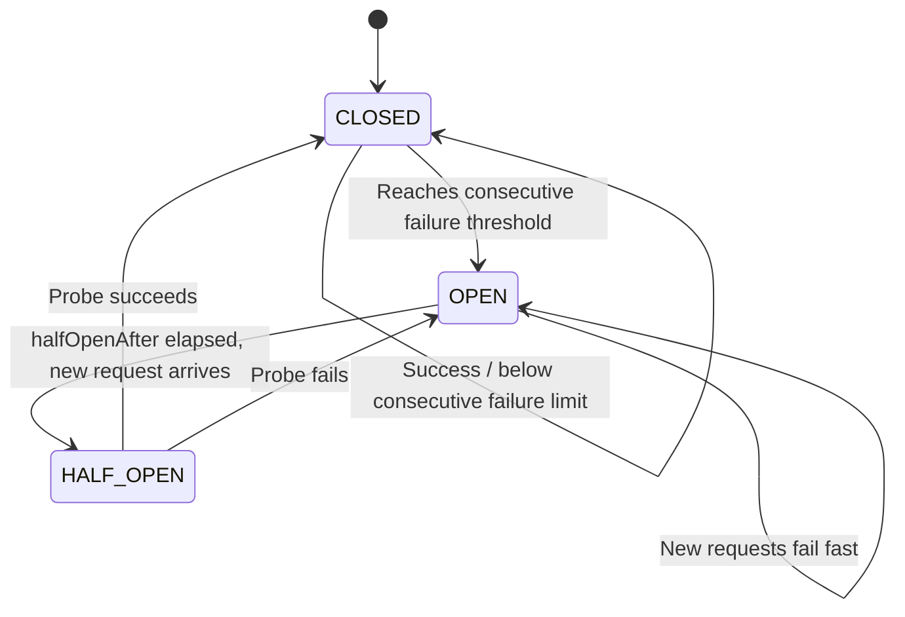
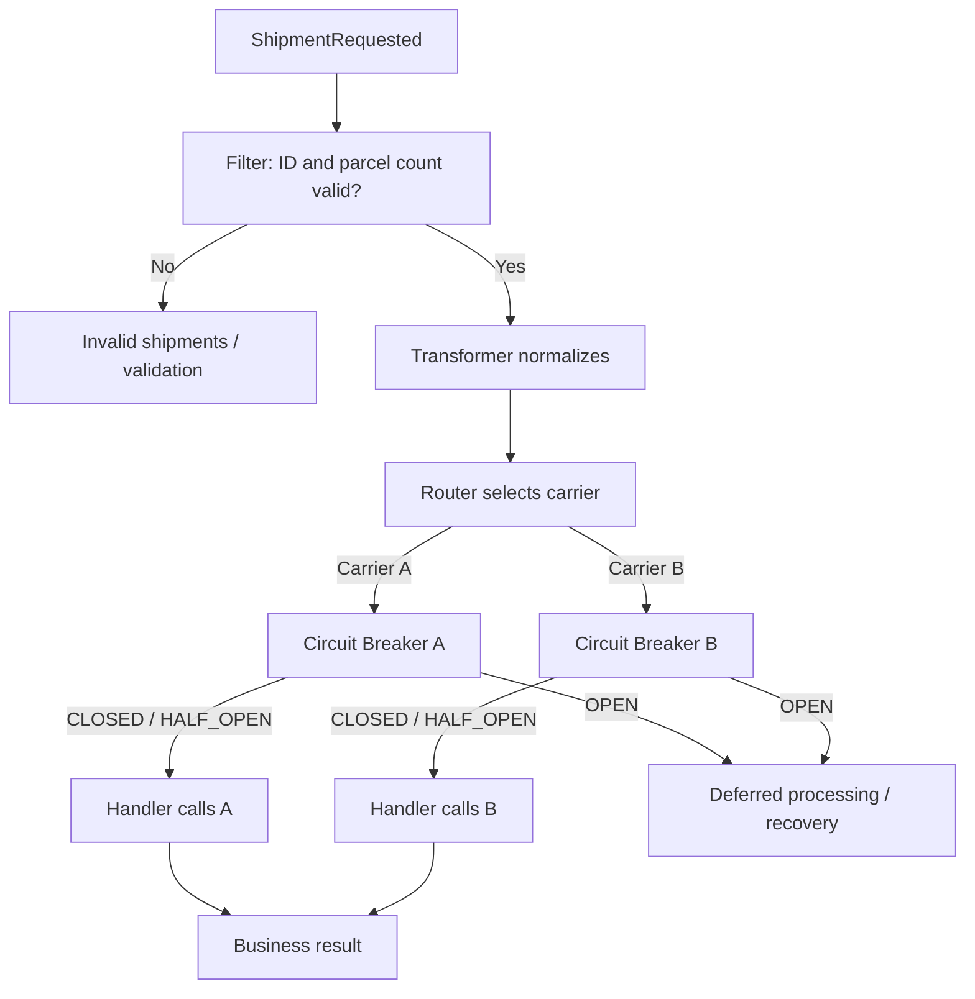

# Distinguishing Circuit Breaker from Filter in Spring Integration

## 1. Both mechanisms can block messages, yet they answer two different questions

A shipping system receives a `ShipmentRequested` event that goes through a Filter checking input data, a Transformer normalizing it, a Router selecting a carrier, and a message handler calling the API to create a shipment. When a message lacks `shipmentId` or has an invalid parcel count, we **should not send it to the carrier**. When a message is valid yet the carrier's API has timed out repeatedly, we **also should not keep calling the carrier immediately**.

The two decisions look similar on the surface: *the message does not reach the dependency*. Yet their causes, states, and handling differ:

- **Filter** answers: "Does **this message** satisfy the conditions to proceed?"
- **Circuit Breaker** answers: "Should **this dependency, at this moment**, still be called, or be temporarily refused to prevent cascading failures?"

This is the lesson **"Distinguishing circuit breaker from filter"**, part of the **Circuit breaker** chapter in the `SPRING_INTEGRATION_PATTERN` module. The module focuses on building Enterprise Integration Patterns with Spring Integration: Router, Filter, Transformer, Splitter, Aggregator, Gateway, retry, error channel, and correlation, testable and observable across every processing branch.

After this lesson, you will be able to:

1. Distinguish the decision criteria and state lifecycle of Filter vs. Circuit Breaker.
2. Configure `MessageFilter` with the Java DSL using `discardChannel` or `throwExceptionOnRejection`.
3. Attach `RequestHandlerCircuitBreakerAdvice` to the exact handler calling a dependency.
4. Explain `CLOSED`, `OPEN`, `HALF_OPEN`, `threshold`, and `halfOpenAfter`.
5. Combine **Filter first, Circuit Breaker at the handler**, handling invalid messages and failing dependencies separately.
6. Test Gateway, broker redelivery, recovery, and duplicate business side effects.

## 2. Core comparison table

| Criterion | Filter | Circuit Breaker |
| --- | --- | --- |
| Question | "May this message proceed?" | "Is the dependency healthy enough to accept calls?" |
| Design pattern | **Message Filter** in EIP | **Circuit Breaker**, resilience/fault-tolerance pattern |
| Decision data | Payload, headers, business conditions | Breaker state and outcomes of prior dependency calls |
| State | Typically evaluates per message; selector can still read external state | Has `CLOSED / OPEN / HALF_OPEN` state machine |
| When rejecting | Discard, route to `discardChannel`, or throw `MessageRejectedException` if configured | Fail fast with an open-circuit exception without calling dependency |
| When it runs | A Filter endpoint in the flow | Advice wrapping the dependency-calling handler |
| Automatically tracks dependency errors? | No | Yes, per breaker algorithm |
| Automatically probes recovery? | No | Yes, once wait duration elapses and a request arrives |
| Automatically routes to backup service? | No; discard is the rejection-handling branch | No; requires separate Router/fallback |
| Goal | Block messages that **should not/must not** be processed on the current branch | Shed load on an **unhealthy dependency** |

**Never use a Filter instead of a Circuit Breaker** simply because both can block requests. A Filter checking a health flag is merely a conditional gate; if you add failure counters, timers, probes, and recovery state yourself, you are effectively rewriting a circuit breaker.

## 3. Filter decides based on message characteristics

In Spring Integration, `MessageFilter` typically delegates to a `MessageSelector` returning `boolean`. A selector can inspect payload or headers:

```java
import org.springframework.integration.core.MessageSelector;
import org.springframework.messaging.Message;

MessageSelector selector = (Message<?> message) -> {
    Object payload = message.getPayload();
    return payload instanceof ShipmentRequest request
            && request.parcelCount() > 0
            && request.shipmentId() != null
            && !request.shipmentId().isBlank();
};
```

Two consecutive messages can receive different outcomes even while the dependency stays in the exact same state:

| Message | Data | Filter outcome |
| --- | --- | --- |
| A | `shipmentId = "S-101"`, `parcelCount = 2` | Passes through |
| B | `shipmentId = ""`, `parcelCount = 2` | Rejected |
| C | `shipmentId = "S-103"`, `parcelCount = 0` | Rejected |
| D | `shipmentId = "S-104"`, `parcelCount = 1` | Passes through |

### Three ways to handle Filter rejections

| Configuration | Behavior | Suitable case |
| --- | --- | --- |
| No `discardChannel`, no throw | Message stops; since Spring Integration 6.1 usually logs a warning by default | Only when intentionally dropping messages |
| `discardChannel = "invalidShipments"` | Message routes to the rejection branch | Recording validation failures, auditing, or returning status |
| `throwExceptionOnRejection = true` | Throws `MessageRejectedException` | Caller must receive an error or consumer handles per error policy |

If you configure **both a discard channel and `throwExceptionOnRejection`**, the message may be sent to the discard channel **and still throw an exception**. That easily causes double error logging or broker redelivery of invalid-validation messages. Never enable both simultaneously without explicitly defining transactions, acks, and effect ordering.

A Filter is not by default a complete validator. For errors needing detailed per-field reporting, a dedicated Validator or validation flow may fit better. Pure, fast selectors with minimal side effects are much easier to test.

## 4. Circuit Breaker decides based on dependency state

`RequestHandlerCircuitBreakerAdvice` is a handler advice in Spring Integration. It counts **consecutive failed calls**, transitions state, and suspends calling the dependency when the circuit opens:



- **CLOSED:** permits the handler to call the dependency. A single success resets the consecutive failure streak.
- **OPEN:** new requests are fast-rejected; the dependency **is not called**.
- **HALF_OPEN:** after the wait period, a new request can probe; success closes the circuit, failure reopens it.

According to official documentation, the built-in breaker has two parameters:

| Property | Meaning | Default value |
| --- | --- | --- |
| `threshold` | Number of **consecutive** failed calls before opening the circuit | `5` |
| `halfOpenAfter` | Wait interval before permitting a probe, **milliseconds** | `1000` |

A slow yet **successful** HTTP response does not open the built-in breaker on its own. If you need protection based on **slow-call rate**, consider Resilience4j's slow-call rate mechanism; or configure sensible client timeouts so an overdue call actually throws an exception observed by the breaker.

### Example with `threshold = 2`

| Call | Does handler run? | Outcome | State afterward |
| --- | --- | --- | --- |
| #1 | Yes | Timeout | CLOSED, one failure |
| #2 | Yes | Timeout | OPEN |
| #3 sent right after | **No** | Fail fast | OPEN |
| #4 after wait duration elapsed | Yes, probe | Success | CLOSED |
| #5 | Yes | Success | CLOSED |

Message #3 may be **completely valid**, yet the handler is not permitted to call the dependency. That is the difference from a message rejected by a Filter because of its data.

## 5. Combined flow: Filter first, Breaker at the handler



Principles:

1. **Filter before calling dependencies:** invalid messages are stopped before consuming time and quota.
2. **Attach the breaker to the right handler:** an advice on Handler A does not automatically protect Handler B.
3. **Separate dependency states:** use separate breakers for A and B when they have independent health.
4. **Proactively design fallbacks:** a breaker does not automatically route to another carrier.
5. **Preserve identity:** `eventId` and `correlationId` must flow through all steps for tracing, recovery, and idempotency.

## 6. Java DSL: Filter combined with Circuit Breaker

The example below uses configuration available in Spring Integration 6.x/7.x: messages rejected by Filter go to `invalidShipments`; valid messages reach the `CarrierClient.send(...)` handler protected by the breaker.

```java
import org.springframework.context.annotation.Bean;
import org.springframework.context.annotation.Configuration;
import org.springframework.integration.channel.DirectChannel;
import org.springframework.integration.channel.QueueChannel;
import org.springframework.integration.dsl.IntegrationFlow;
import org.springframework.integration.handler.advice.RequestHandlerCircuitBreakerAdvice;
import org.springframework.messaging.MessageChannel;
import org.springframework.messaging.PollableChannel;

record ShipmentRequest(String shipmentId, int parcelCount, String eventId) {
    boolean valid() {
        return shipmentId != null && !shipmentId.isBlank()
                && parcelCount > 0
                && eventId != null && !eventId.isBlank();
    }
}

interface CarrierClient {
    void send(ShipmentRequest request);
}

@Configuration
class ShipmentFlowConfiguration {

    @Bean
    MessageChannel shipmentsIn() {
        return new DirectChannel();
    }

    @Bean
    PollableChannel invalidShipments() {
        // For illustration only: not a broker DLQ.
        return new QueueChannel();
    }

    @Bean
    RequestHandlerCircuitBreakerAdvice carrierBreaker() {
        RequestHandlerCircuitBreakerAdvice advice =
                new RequestHandlerCircuitBreakerAdvice();
        advice.setThreshold(2);
        advice.setHalfOpenAfter(10_000L);
        return advice;
    }

    @Bean
    IntegrationFlow shipmentFlow(CarrierClient carrier,
                                 RequestHandlerCircuitBreakerAdvice carrierBreaker) {
        return IntegrationFlow.from("shipmentsIn")
                .filter(ShipmentRequest.class,
                        ShipmentRequest::valid,
                        spec -> spec.discardChannel("invalidShipments"))
                .handle(carrier, "send",
                        endpoint -> endpoint.advice(carrierBreaker))
                .get();
    }
}
```

You must supply a bean implementing `CarrierClient`; the channel and advice beans are declared in the example. An in-memory `QueueChannel` **does not guarantee durable persistence** across restarts. In production, attach a consumer that writes rejections to an appropriate store and verifies save results.

### Message rejected by Filter

```text
ShipmentRequest(shipmentId="", parcelCount=1, eventId="evt-1")
  -> Filter returns false
  -> invalidShipments
  -> CarrierClient.send does NOT run
  -> Breaker on carrier handler is NOT updated
```

### Valid message when breaker is OPEN

```text
ShipmentRequest(shipmentId="S-10", parcelCount=1, eventId="evt-10")
  -> Filter returns true
  -> Handler with Circuit Breaker advice
  -> Breaker OPEN, fails fast
  -> CarrierClient.send does NOT run
  -> Exception follows the source's error/recovery contract
```

The outcome "carrier not called" looks identical, yet **logs, metrics, state, and retry/ack decisions must differ**.

## 7. JUnit 5: proving both blocking causes

The flow test below uses Spring Integration Java DSL, Spring Test, and JUnit 5. It confirms invalid messages go to the discard channel, while valid messages can open the breaker and then get short-circuited. `@DirtiesContext` isolates breaker state between test methods.

```java
import java.util.concurrent.atomic.AtomicInteger;

import org.junit.jupiter.api.Test;
import org.springframework.beans.factory.annotation.Autowired;
import org.springframework.beans.factory.annotation.Qualifier;
import org.springframework.context.annotation.Bean;
import org.springframework.context.annotation.Configuration;
import org.springframework.integration.channel.DirectChannel;
import org.springframework.integration.channel.QueueChannel;
import org.springframework.integration.dsl.IntegrationFlow;
import org.springframework.integration.handler.advice.RequestHandlerCircuitBreakerAdvice;
import org.springframework.messaging.MessageChannel;
import org.springframework.messaging.PollableChannel;
import org.springframework.messaging.support.GenericMessage;
import org.springframework.test.annotation.DirtiesContext;
import org.springframework.test.context.junit.jupiter.SpringJUnitConfig;

import static org.junit.jupiter.api.Assertions.assertEquals;
import static org.junit.jupiter.api.Assertions.assertNotNull;
import static org.junit.jupiter.api.Assertions.assertNull;
import static org.junit.jupiter.api.Assertions.assertThrows;

@SpringJUnitConfig(classes = FilterVsBreakerTest.Config.class)
@DirtiesContext(classMode = DirtiesContext.ClassMode.AFTER_EACH_TEST_METHOD)
class FilterVsBreakerTest {

    @Autowired
    @Qualifier("testInput")
    MessageChannel input;

    @Autowired
    @Qualifier("testRejected")
    PollableChannel rejected;

    @Autowired
    FakeCarrier carrier;

    @Test
    void invalidMessageIsDiscardedWithoutCarrierCall() {
        input.send(new GenericMessage<>(new Request("", 1, "evt-1")));

        assertEquals(0, carrier.calls.get());
        assertNotNull(rejected.receive(0));
        assertNull(rejected.receive(0));
    }

    @Test
    void validMessageReachesBreakerButNotOpenDependency() {
        carrier.fail = true;

        assertThrows(RuntimeException.class, () -> sendValid("evt-a"));
        assertThrows(RuntimeException.class, () -> sendValid("evt-b"));
        assertEquals(2, carrier.calls.get());

        // Valid at Filter yet rejected by OPEN breaker.
        assertThrows(RuntimeException.class, () -> sendValid("evt-c"));
        assertEquals(2, carrier.calls.get());
        assertNull(rejected.receive(0));

        // Invalid message still takes the discard branch.
        input.send(new GenericMessage<>(new Request("", 2, "evt-d")));
        assertNotNull(rejected.receive(0));
        assertEquals(2, carrier.calls.get());
    }

    private void sendValid(String eventId) {
        input.send(new GenericMessage<>(new Request("S-100", 1, eventId)));
    }

    record Request(String shipmentId, int parcelCount, String eventId) {
        boolean valid() {
            return shipmentId != null && !shipmentId.isBlank()
                    && parcelCount > 0
                    && eventId != null && !eventId.isBlank();
        }
    }

    static final class FakeCarrier {
        final AtomicInteger calls = new AtomicInteger();
        volatile boolean fail;

        public void send(Request request) {
            calls.incrementAndGet();
            if (fail) {
                throw new IllegalStateException("Carrier unavailable");
            }
        }
    }

    @Configuration
    static class Config {
        @Bean
        MessageChannel testInput() {
            return new DirectChannel();
        }

        @Bean
        PollableChannel testRejected() {
            return new QueueChannel();
        }

        @Bean
        FakeCarrier fakeCarrier() {
            return new FakeCarrier();
        }

        @Bean
        RequestHandlerCircuitBreakerAdvice testBreaker() {
            RequestHandlerCircuitBreakerAdvice advice =
                    new RequestHandlerCircuitBreakerAdvice();
            advice.setThreshold(2);
            advice.setHalfOpenAfter(30_000L);
            return advice;
        }

        @Bean
        IntegrationFlow testFlow(FakeCarrier carrier,
                                 RequestHandlerCircuitBreakerAdvice testBreaker) {
            return IntegrationFlow.from("testInput")
                    .filter(Request.class, Request::valid,
                            spec -> spec.discardChannel("testRejected"))
                    .handle(carrier, "send",
                            endpoint -> endpoint.advice(testBreaker))
                    .get();
        }
    }
}
```

With `DirectChannel`, execution is synchronous, so you can immediately assert call counts and messages in `QueueChannel`. Handler exceptions may be wrapped by Spring Messaging; the test verifies short-circuiting via **downstream invocation count** rather than checking exception types alone.

Add tests verifying the cause chain contains the dependency error on the first two calls and open-breaker details on the third call per your library version. Never treat `MessageChannel.send(...)` returning as proof that business state committed.

## 8. Why can't a Filter replace a Circuit Breaker?

### Case A — Filter reads a health flag

```java
// Example of a conditional gate, NOT yet a Circuit Breaker:
.filter(ShipmentRequest.class, request -> carrierAvailable.get())
```

When `carrierAvailable` is `false`, every request is rejected. But who decides **when** to flip it back on? If the service recovers without probing, the flow can stay blocked forever. If every message calls an HTTP health check itself, the Filter generates load onto the failing dependency.

A health flag can be useful as a **manual maintenance switch**; it does not provide failure counts, open duration, half-open probes, or reset semantics.

### Case B — Filter used for "fallback"

```text
if carrierAHealthy:
    send to A
else:
    drop message
```

This is not a fallback—it **loses the message's processing path** if there is no safe discard flow. When contracts allow switching carriers, use a Router/error flow. When switching carriers is disallowed, durably persist `PENDING_RETRY`, route to a delayed queue, or return a clear status to the Gateway.

### Case C — Breaker used instead of validation

If you only attach a breaker to the handler without checking `parcelCount`, invalid messages still reach the API. Validation exceptions can count as consecutive failures and trip the circuit, causing **valid** messages to be rejected too.

Use a Filter/Validator before the handler; additionally classify 4xx errors and dependency exceptions. For fine-grained exception classification, consider a breaker configured with appropriate record/ignore exceptions rather than treating every business error as a dependency failure.

## 9. Special case: a Filter with its own advice

In the configuration above, the Circuit Breaker advice attaches to the **carrier handler after the Filter**. However, Spring Integration also permits attaching advice directly to a Filter endpoint.

By default, discard execution and `throwExceptionOnRejection` can run **inside the Filter's advice chain**. If the discard handler throws an error, a Retry advice on the Filter may retry the discard branch as well; if the Filter throws `MessageRejectedException`, an outer advice can observe that exception too.

`discardWithinAdvice = false` moves discard execution or the rejection exception **outside (after)** the advice scope; this matters when you only want the advice to observe selector evaluation.

```java
import org.springframework.integration.annotation.Filter;
import org.springframework.integration.annotation.MessageEndpoint;

@MessageEndpoint
class ShipmentValidationFilter {
    @Filter(
            inputChannel = "beforeValidation",
            outputChannel = "afterValidation",
            discardChannel = "invalidShipments",
            adviceChain = "validationAdvice",
            discardWithinAdvice = "false")
    public boolean accept(ShipmentRequest request) {
        return request.valid();
    }
}
```

This merely illustrates advising filters: you still need to declare the channels and the `validationAdvice` bean, and `ShipmentRequest` comes from the earlier example. **Never attach a Circuit Breaker to a data selector merely checking IDs or quantities.**

## 10. Retry, transactions, and broker redelivery

For a message broker, a "block" decision can lead to different outcomes:

| Situation | Can the message be acked/committed? | What must be designed |
| --- | --- | --- |
| Filter drops without throwing | Possibly if consumer treats processing as done | Was dropping the message intentional? |
| Filter routes to discard channel, recorder succeeds | Possibly per transaction/adapter | Does the recorder persist durably? |
| Filter throws `MessageRejectedException` | May rollback/nack | Avoid infinite redelivery of invalid data |
| Breaker OPEN throws error | May rollback/nack/seek | Avoid tight requeue loops before dependency recovers |
| Breaker OPEN, recovery saves `PENDING_RETRY` and completes | Can ack per contract | Ensure pending save succeeds before ack |
| Gateway hits Filter rejection | May receive no reply, or receive error | Return validation result instead of an ambiguous timeout |
| Gateway hits breaker OPEN | Exception or fallback | Return `UNAVAILABLE`/`PENDING`, never report fake success |

**Filter rejections** usually relate to the message or business rules. **Breaker OPEN** is a temporary condition of a dependency. Redelivery and retry settings should not treat the two cases identically.

Specifically, if a Retry advice wraps outside a breaker and still retries `CircuitBreakerOpenException`, the application can rapidly loop rejected calls without making progress. With broker redelivery, an even larger loop can form. Use backoff, retry limits, deferred processing, and DLQs appropriately.

An HTTP timeout also does not prove downstream never executed side effects. When retrying or switching to another carrier, preserve `idempotencyKey` and reconcile.

## 11. Interaction with Router, Splitter, Aggregator, and Gateway

### Router

Filter decides **whether to proceed**, Router decides **which branch to take**, and Circuit Breaker decides **whether to attempt calling the dependency on that branch**. Carrier A being OPEN does not automatically make the Router switch to B; you must define an explicit fallback policy.

### Splitter and Aggregator

An order with three parcels may be split by a Splitter into three parts. Filter rejects one invalid part, while Circuit Breaker may block a valid part for Carrier A. If the Aggregator waits for all parts without timeout/partial-result/failure-signal mechanisms, the group can stay stuck forever.

Preserve `correlationId`, `sequenceNumber`, and `partId`. A part rejected by Filter may need data correction; a part blocked by Breaker can be reprocessed once the dependency recovers.

### Gateway

A synchronous Gateway needs clear outcomes: rejection should return a validation error; breaker OPEN should return dependency unavailable or pending. A Filter dropping messages without a reply can simply make the Gateway time out. A `PENDING` fallback does not mean the shipment was created.

### Error channel

`errorChannel` delivers `ErrorMessage` for errors routed to asynchronous error-handling mechanisms. A Filter's `discardChannel` normally receives the **rejected message itself**, not an `ErrorMessage` by default. A recovery channel may receive a wrapped `Throwable`. Test the actual payload/headers of each branch.

## 12. Test matrix

| Scenario | Filter | Breaker | Downstream calls | Expectation |
| --- | --- | --- | ---: | --- |
| Valid message, carrier healthy | Accept | CLOSED | 1 | Business success |
| Empty ID, carrier healthy | Reject | Does not run | 0 | Discard/validation |
| Zero parcel count, carrier failing | Reject | Does not run | 0 | Does not increment failure count |
| Valid message, carrier times out first time | Accept | CLOSED, one failure | 1 | Dependency error |
| Valid message, carrier times out second time | Accept | Transitions OPEN | 1 | Circuit opens |
| Valid message sent while OPEN | Accept | OPEN | 0 | Fail fast |
| Invalid message sent while OPEN | Reject | Does not run | 0 | Invalid input not confused with outage |
| Valid message after `halfOpenAfter` | Accept | HALF_OPEN | 1 probe | Closes or reopens depending on outcome |
| Filter throws rejection exception | Reject | Depends on advice position | 0 if breaker sits downstream | Verify rollback/requeue |
| Discard recorder fails | Reject | Depends on advice position | 0 | Do not swallow rejection-save failure |
| Router selects Carrier B while A is OPEN | Accept | Separate Breaker B | Varies | No duplicate side effects |
| Splitter has invalid part and breaker-blocked part | Per part | Per branch | Varies | Aggregator has timeout/failure tracking |
| Recovery saved `PENDING_RETRY` | Accept | OPEN | 0 | Ack only after durable save |

Measure selector executions, messages reaching discard, real requests hitting the dependency, breaker outcomes, and final business state. Never infer behavior from a single exception or `send` return value alone.

## 13. Observability: never merge the two rejection types

Suggested metrics:

- `messages_filtered_total` by endpoint and validation reason group.
- `messages_discarded_total` and `discard_recorder_failures_total`.
- `circuit_breaker_open_rejections_total` by dependency.
- `dependency_attempts_total`, `dependency_failures_total`, and latency.
- `breaker_state_transitions_total` if supported by instrumentation.
- `broker_redeliveries_total`, `pending_retries_total`, and `gateway_timeouts_total`.
- `business_side_effects_total`, `duplicates_prevented_total` when idempotency is present.

These are **application-suggested** metric names, not emitted automatically by the framework. `eventId`, `shipmentId`, and `correlationId` are high-cardinality values; use them in access-controlled structured logs/tracing rather than metric labels.

```text
event=evt-1 stage=filter   outcome=REJECTED reason=INVALID_SHIPMENT_ID
event=evt-2 stage=filter   outcome=ACCEPTED
event=evt-2 stage=carrierA outcome=FAILED   error=CONNECTION_TIMEOUT
event=evt-3 stage=filter   outcome=ACCEPTED
event=evt-3 stage=carrierA outcome=BREAKER_OPEN downstream_calls=0
```

Valid messages rejected by the breaker **must not** increment `messages_filtered_total`; that is not a message-quality error.

## 14. Common mistakes

| Mistake | Consequence | Fix |
| --- | --- | --- |
| Using Filter reading a health flag instead of a breaker | No threshold/probe, easily stays blocked forever | Attach breaker at dependency handler |
| Using Breaker to handle validation | Bad data triggers OPEN, blocking good messages | Filter/Validator before handler |
| Dropping messages while assuming errors were saved | No recovery path remains | Discard flow and durable recorder |
| Expecting automatic fallback routing when Breaker OPENS | Message errors with no next branch | Explicit Router/error/recovery flow |
| Sharing one breaker across all carriers | A's outage blocks B too | Separate breaker state per dependency |
| Unintended advice attached to Filter | Rejections inflate retry/breaker counts | Check `discardWithinAdvice` |
| `throwExceptionOnRejection` causes infinite broker redelivery | Poison message loop | Handle permanent validation errors, DLQ when appropriate |
| Tight broker requeue when OPEN | Retry storm while dependency is still down | Delayed retry and delivery limits |
| Asserting exceptions only without counting handler calls | Cannot prove short-circuiting | Fake counter or mock HTTP server |
| Filter/Breaker used with Gateway lacking reply strategy | Caller only sees timeouts | Return clear invalid/unavailable status |
| Assuming timeout means carrier did not create shipment | Retry/fallback creates two shipments | Idempotency key, reconciliation |
| Aggregator waits for part discarded by Filter | Group hangs | Timeout/partial-result/failure tracking |

## 15. Hands-on exercise

Design the flow `ShipmentRequest → Filter → Transformer → Router → Carrier Handler`. The Filter accepts when `shipmentId` is non-empty, `parcelCount > 0`, and `eventId` is valid. The Router selects Carrier A or B. Both handlers have independent breakers with `threshold = 2` and `halfOpenAfter = 1500 ms`.

Execute:

1. Send an invalid message, verify the discard flow receives it, the carrier is not called, and the breaker's failure count does not increase.
2. Send two valid messages causing Carrier A to time out, verify Breaker A OPENS; the third valid message fails fast. Carrier B can still operate.
3. While A is OPEN, send an invalid message: verify it is still rejected by Filter and not recorded as a dependency outage.
4. Wait for the HALF_OPEN opportunity, let A recover and send a probe to close the circuit; repeat with a failing probe.
5. Try `throwExceptionOnRejection` in a separate test flow; observe ack/rollback compared to normal discard.
6. Add Splitter/Aggregator, simulate one invalid part and one breaker-blocked part; design group timeout and failure outcomes.
7. Test deferred queue/recovery when OPEN, durably persist `PENDING_RETRY`, and preserve `idempotencyKey` across broker redeliveries.

**Completion criteria:** invalid messages are handled properly by Filter; valid messages are rejected by Breaker solely due to dependency state; no downstream calls happen when OPEN; error branches are classified, observed, and recovered; Gateway/broker respond properly; retries/fallbacks do not create duplicate side effects.

## References

- [Spring Integration — Filter](https://docs.spring.io/spring-integration/reference/filter.html): `MessageFilter`, `MessageSelector`, `discardChannel`, and `throwExceptionOnRejection`.
- [Spring Integration — Circuit Breaker Advice](https://docs.spring.io/spring-integration/reference/handler-advice/classes.html#circuit-breaker-advice): `RequestHandlerCircuitBreakerAdvice`, `threshold`, and `halfOpenAfter`.
- [Spring Integration — Advising Filters](https://docs.spring.io/spring-integration/reference/handler-advice/advising-filters.html): advice scope with discard and `discardWithinAdvice`.
- [Spring Integration — Java DSL](https://docs.spring.io/spring-integration/reference/dsl.html): building `IntegrationFlow` with Filter and Service Activator.
- [Spring Integration — Testing](https://docs.spring.io/spring-integration/reference/testing.html): testing flows, endpoints, and messages.
