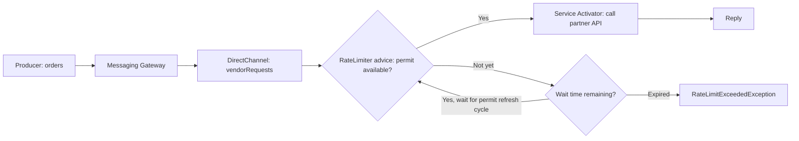
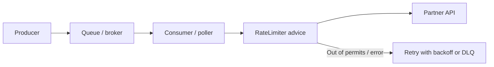

# Rate Limiter for Message Rate Limiting in Spring Integration

> **Module:** `SPRING_INTEGRATION_PATTERN` — Learn to implement Enterprise Integration Patterns with Spring Integration to build loosely coupled and extensible message flows. The module practices Router, Filter, Transformer, Splitter, Aggregator, Gateway, retry, error channel, and correlation, as well as testing and monitoring processing branches.
>
> **Chapter:** Rate limiter · **Topic:** Rate Limiter for message rate limiting.

## 1. Problem to Solve

An order-receiving system may receive hundreds of messages per second, while a shipping partner's API only allows **20 requests/second**. If every message immediately triggers an HTTP request, the system may receive HTTP 429, have its API key blocked, or overload the partner service.

A **Rate Limiter** controls *the frequency allowed to enter a processing step*. In Spring Integration, a rate limiter can be placed right before the `MessageHandler` that calls the partner. When an execution permission (*permit*) is not yet available, the call waits for a configured duration or fails; other processing steps still retain their own responsibilities.

After this lesson, learners can:

1. Distinguish limiting **the number of processing executions over time** from limiting **the number of concurrent executions** and from queuing.
2. Use `RateLimiterRequestHandlerAdvice` to protect a `ServiceActivator`.
3. Explain `limitForPeriod`, `limitRefreshPeriod`, and `timeoutDuration`; predict what happens when permits run out.
4. Combine rate limiting with Gateway, retry, and error handling without accidentally sending above the quota.
5. Determine how to test, monitor, and handle limits in a multi-instance system.

## 2. Where Does the Rate Limiter Sit in the Message Flow?

An illustrative flow:



**The placement of the limit determines what is counted.** If the advice is attached to the handler that calls the API, each entry *into the handler* requires one permit. Operations before the handler (validate, transform, route) do not consume this handler's permits. If one message is split by a Splitter into five messages and all five go through the handler, they normally require five permits.

This is a form of endpoint *cross-cutting behavior*: `RateLimiterRequestHandlerAdvice` wraps the handler invocation. It is not a default rate limiter for every channel in the application.

### Distinguishing Easily Confused Mechanisms

| Mechanism | What does it control? | When the limit is exceeded |
|---|---|---|
| **Rate Limiter** | Number of processing starts within a time window | Waits for a permit with a time limit or throws an error |
| **Bulkhead / semaphore** | Number of concurrent executions in progress | Waits or rejects when concurrency slots are full |
| **QueueChannel / message broker** | Where unconsumed messages are held | Messages can be queued; capacity and durability must be handled |
| **Filter** | Does the message satisfy business conditions? | Drops, rejects, or routes to a discard channel |
| **Circuit Breaker** | Should calls continue to a failing service? | Blocks calls when the circuit is in the open state |
| **Retry** | Should a failed execution be retried? | Generates additional calls if the policy allows |

A rate limiter **does not automatically persist messages in a durable queue**, **does not automatically retry**, and **does not guarantee a maximum of N concurrently running calls**.

## 3. Resilience4j's Permit Model

Spring Integration provides `org.springframework.integration.handler.advice.RateLimiterRequestHandlerAdvice`, based on `io.github.resilience4j.ratelimiter.RateLimiter`.

Three core configuration properties:

| Property | Meaning | Example |
|---|---|---|
| `limitForPeriod` | Number of permits that can be granted in each refresh period | `2` |
| `limitRefreshPeriod` | Length of one permit refresh cycle | `Duration.ofSeconds(1)` |
| `timeoutDuration` | Maximum time a call can wait to acquire a permit | `Duration.ofMillis(200)` |

With the configuration **2 permits/1 second, maximum wait 200 ms**:

- The first two calls still have permits available and enter the handler immediately.
- The third call arrives when permits are exhausted and can wait up to 200 ms. If a refresh period begins in time, it can acquire a permit and run.
- If the timeout expires and there is still no permit, Resilience4j rejects it; Spring Integration's advice throws `RateLimiterRequestHandlerAdvice.RateLimitExceededException` (wrapping `RequestNotPermitted`).
- If `timeoutDuration = Duration.ZERO` is set, the call does not wait for a permit: when permits are exhausted, it fails immediately.

By default, Resilience4j divides time into **permit refresh cycles**. This is not a true "sliding window" guarantee: the last two permits of one cycle and the first two permits of the next cycle can be used very close together. Therefore, distinguish **average rate / cycle-based permit granting** from strict SLAs such as "never more than 2 requests in any sliding 1-second window."

In addition, a permit is acquired **before** calling the handler; the duration the handler runs does not keep the permit "held" like a semaphore. If the API requires at most five concurrent connections, a concurrency limit must also be added.

## 4. Implementation Example with Gateway and Service Activator

Scenario: the system receives order messages through `VendorGateway` and forwards them to a `ServiceActivator` to send to the partner. For ease of learning, the handler below returns a simulated result string; in production, replace the handler body with an HTTP client.

### 4.1. Declaring Dependencies

Example using Gradle with Spring Boot:

```groovy
dependencies {
    implementation "org.springframework.boot:spring-boot-starter-integration"
    implementation "io.github.resilience4j:resilience4j-ratelimiter:VERSION"
}
```

Replace `VERSION` with the Resilience4j version compatible with the Spring Boot/Spring Integration version in use, or manage versions via the project's BOM. `RateLimiterRequestHandlerAdvice` has been in Spring Integration since version 5.2; the example code follows the modern Java API and requires Spring Integration configuration in the application.

### 4.2. Enabling Spring Integration and Scanning Gateways

```java
package com.example.ratelimit;

import org.springframework.boot.SpringApplication;
import org.springframework.boot.autoconfigure.SpringBootApplication;
import org.springframework.integration.annotation.IntegrationComponentScan;
import org.springframework.integration.config.EnableIntegration;

@SpringBootApplication
@EnableIntegration
@IntegrationComponentScan
public class RateLimitApplication {

    public static void main(String[] args) {
        SpringApplication.run(RateLimitApplication.class, args);
    }
}
```

`@IntegrationComponentScan` scans for interfaces annotated with `@MessagingGateway`; regular `@ComponentScan` does not register Gateway interfaces that way.

### 4.3. Gateway: Message Entry Point

File `VendorGateway.java`:

```java
package com.example.ratelimit;

import org.springframework.integration.annotation.MessagingGateway;

@MessagingGateway(defaultRequestChannel = "vendorRequests")
public interface VendorGateway {

    String send(String orderPayload);
}
```

A Gateway lets business code call `gateway.send("order-123")` instead of manually constructing and sending a `Message<?>`. When the handler returns a value, the Gateway receives the reply based on Spring Integration's request-reply context.

### 4.4. Placing the Rate Limiter Advice on the Handler

File `VendorFlowConfig.java`:

```java
package com.example.ratelimit;

import java.time.Duration;

import io.github.resilience4j.ratelimiter.RateLimiterConfig;
import org.springframework.context.annotation.Bean;
import org.springframework.context.annotation.Configuration;
import org.springframework.integration.annotation.ServiceActivator;
import org.springframework.integration.channel.DirectChannel;
import org.springframework.integration.handler.advice.RateLimiterRequestHandlerAdvice;
import org.springframework.messaging.MessageChannel;

@Configuration
public class VendorFlowConfig {

    @Bean
    public MessageChannel vendorRequests() {
        return new DirectChannel();
    }

    @Bean
    public RateLimiterRequestHandlerAdvice vendorRateLimiter() {
        RateLimiterConfig config = RateLimiterConfig.custom()
                .limitForPeriod(2)
                .limitRefreshPeriod(Duration.ofSeconds(1))
                .timeoutDuration(Duration.ofMillis(200))
                .build();

        return new RateLimiterRequestHandlerAdvice(config, "vendor-api");
    }

    @ServiceActivator(
            inputChannel = "vendorRequests",
            adviceChain = "vendorRateLimiter")
    public String callVendor(String payload) {
        // Demo: replace with an actual HTTP call when deploying.
        return "accepted: " + payload;
    }
}
```

**Reading the configuration:**

1. `vendorRequests()` creates a `DirectChannel`. The handler invocation happens on the message-sending thread, unless another asynchronous component is involved.
2. `vendorRateLimiter()` creates an advice bean named `vendorRateLimiter`. `adviceChain` references this **bean name**.
3. `callVendor()` is the rate-limited handler; at most two permits are granted per one-second cycle for the limiter on the current instance.
4. When a permit is acquired, the handler returns `"accepted: ..."`. The Gateway can receive that string as its result.
5. When a permit cannot be acquired before 200 ms expires, the handler is not called; the exception propagates back to the caller in the synchronous flow.

**Important point:** in this example only `callVendor()` is rate-limited. If there is another handler calling the same partner API without attaching an advice that uses **the same shared RateLimiter**, that handler will not share the permit budget. Reuse a single limiter for the same quota budget, rather than creating a new limiter for each message.

### 4.5. How to Test Manually

From a Spring bean injected with `VendorGateway`, call consecutively:

```java
String first = gateway.send("order-001");
String second = gateway.send("order-002");
String third = gateway.send("order-003");
```

The first two calls usually receive `accepted: ...`. The third call, **if still within the cycle whose permits are exhausted**, will wait up to 200 ms and then may receive a new permit or be rejected. Actual results depend on when the cycle starts and execution speed, so do not use this example as an absolute timing test.

To observe rejection behavior more clearly in a test environment, temporarily configure `limitForPeriod(1)`, `limitRefreshPeriod(Duration.ofMinutes(1))`, and `timeoutDuration(Duration.ZERO)`: two back-to-back calls will typically cause the second call to be rejected. Revert the configuration to match the real quota before deploying.

## 5. When the Limit Is Exceeded: Wait, Fail, or Queue Messages?

Decide based on the business semantics of the message.

### Approach A — Short Wait Then Return Error (request-reply)

Use when the sender is waiting for a result, such as an HTTP request going through a Gateway. `timeoutDuration` allows waiting within the latency budget. When time runs out, return a controlled error and let the calling layer decide whether to resend later.

- Pros: easy to understand, bounded wait time at the point of permit acquisition.
- Trade-off: with `DirectChannel`, the message-sending thread **is blocked while waiting for a permit**. Many threads waiting simultaneously can cause resource exhaustion.
- Observation: distinguish *internal rate limit* from HTTP 429 returned by the **partner**. HTTP 429 can still happen because limits are shared by other applications or quotas change.

### Approach B — Reject Immediately (fail fast)

Use `timeoutDuration(Duration.ZERO)` if the system needs fast responses or upstream already has a queuing/retry mechanism. The caller can receive a "temporarily overloaded" status and apply appropriate backoff.

Do not retry immediately in an unbounded loop: doing so can amplify request volume and keep pressure on the system.

### Approach C — Hold Messages in a Queue and Consume at a Controlled Rate

If orders must eventually be processed and must not be lost, design a separate consumer that pulls messages from a broker/queue and pushes them into the rate-limited handler:



In this case, you must also design **acknowledgment**, **retry**, **dead-letter queue**, **idempotency key**, **durability**, and **queue depth monitoring**. An in-memory `QueueChannel` is not durable across restarts by default; for important data, consider a message broker or a durable message store.

A rate limiter attached to a handler **does not automatically turn an "out of permits" error into re-queuing the message**. It is the consumer/poller and error-handling policy that decide whether to retry, route to a DLQ, or retain.

## 6. Combining Rate Limiter with Other Enterprise Integration Patterns

**Gateway:** provides a convenient calling API for the business layer. When using `DirectChannel`, a rate limiter rejection typically surfaces as an exception on the caller side; Gateway may unwrap some exception layers depending on configuration.

**Router and Filter:** filter out messages that do not need to call the partner before reaching the handler, reducing permit consumption. If routing to two partners with independent quotas, use separate limiters corresponding to their respective quotas.

**Splitter and Aggregator:** after a Splitter, determine whether the limit is per *child message*, *batch*, or *HTTP request*. If five child messages trigger five HTTP requests, five permits must be accounted for; an Aggregator can combine multiple messages into a single call if the API supports batching, while ensuring group correlation and timeouts.

**Retry:** each retry attempt can become a new HTTP request, so it must be counted toward the quota. The wrapping order between retry advice and rate limiter advice affects whether a retry attempt passes through the limiter. Configure and test so that **every actual call to the partner** must acquire a permit. For HTTP 429, honor `Retry-After` when present and use exponential backoff with jitter.

**Error channel:** with a synchronous flow over `DirectChannel`, exceptions typically propagate back to the message-sending thread. With an asynchronous flow (poller, executor, broker consumer), errors are typically turned into an `ErrorMessage` sent to an error channel configured by the framework or consumer; an explicit error handler is required. Do not assume that all errors will appear in the global `errorChannel` regardless of channel type.

## 7. Single-Instance Limit vs. System-Wide Limit

A `RateLimiterRequestHandlerAdvice` created with `RateLimiterConfig` stores limiter state in the application process. If **three instances** are deployed, each with `limitForPeriod(20)` and `limitRefreshPeriod(1 second)`, each instance can independently grant 20 permits per second. Total traffic can be roughly 60 requests/second, plus boundary burst effects across cycles.

Therefore, clarify whether the partner's quota is:

- **Per instance / separate credentials:** a local limiter per instance may be sufficient.
- **Per shared system-wide API key:** safely divide the quota across instances or use a distributed rate limiter / centralized dispatch point.
- **Per tenant / customer:** consider separate limiters keyed by tenant, while managing limiter lifecycle to avoid unbounded memory growth.

If the total quota is 100 requests/second for four fixed instances and you want to leave a 20% buffer, an initial operational approach is to limit to around **20 permits/second/instance**. This is only a simple budget allocation; skewed load distribution, autoscaling, shared quotas, and cycle-boundary bursts may prevent it from meeting a strict global limit commitment.

Specifically, changing `limitForPeriod` at runtime typically takes effect from the next cycle; changing `timeoutDuration` does not alter the wait time of threads that have already started waiting.

## 8. Observability and Testing

### Metrics and Logs to Collect

- **Remaining permits:** `vendorRateLimiter().getMetrics().getAvailablePermissions()`.
- **Waiting threads count:** `vendorRateLimiter().getMetrics().getNumberOfWaitingThreads()`.
- **Permit acquisition success/failure events:** use Resilience4j's event publisher to count by limiter name.
- **End-to-end latency:** from when a message enters the Gateway / queue until a reply is received, separating permit wait time and partner call time if possible.
- **Overload signals:** HTTP 429, rate limit error counts, queue depth, message age, retry counts, and DLQ.

Avoid logging full payloads if the data may be sensitive. Prefer message ID, correlation ID, business type, limiter name, and failure reason.

### Minimum Test Scenario Suite

| Scenario | Setup | Result to Verify |
|---|---|---|
| Permits available | `limitForPeriod=2`, one request | Handler is called, Gateway receives reply |
| Out of permits, no wait | `limitForPeriod=1`, long refresh, timeout = 0, send two consecutive requests | Only the request with a permit enters the handler; the other is rejected |
| Out of permits, with wait | Timeout large enough to reach the next refresh | Request waits and can proceed when a permit is granted |
| Handler actually fails | Handler throws an exception even after acquiring a permit | Business error is still propagated/handled by the flow; limiter does not replace retry |
| Multiple sending threads | Send concurrently exceeding quota | Handler entries do not exceed permits granted in the corresponding cycle |
| Multiple instances | Two apps with local limiters of the same name | Each app's metrics/permits are independent; do not infer a global quota |
| Asynchronous flow | Message via poller or executor | Errors go to the right channel/handling strategy, no silent message loss |

A stable way to test is to use a dedicated limiter for the test with **one permit**, a sufficiently long refresh period, and `timeoutDuration = Duration.ZERO`; send two quick requests, count how many times the stub handler is called, and check the exception. For real-time tests, avoid relying on short `Thread.sleep` and system clocks if possible; account for the possibility of the refresh period aligning with test boundaries.

### Pre-Production Checklist

1. Confirm whether quota is per **API key**, tenant, node, or endpoint; clarify burst behavior and partner reset intervals.
2. Attach advice to the exact handler making quota-consuming requests; review Router, Splitter, and retry branches.
3. Choose `timeoutDuration` aligned with the latency budget and the number of threads that can be held waiting.
4. Clearly decide whether excess messages are rejected, retried later, or kept in a queue; ensure error handling and idempotency mechanisms exist.
5. Test with multiple instances and autoscaling; measure actual outbound request rate, HTTP 429s, and backlog after load testing.

## 9. Hands-On Exercises

**Exercise 1 — Protecting an API:** extend the example to call a stub HTTP endpoint allowing at most three calls/second; configure the limiter accordingly. Create two scenarios `timeoutDuration = 0` and `timeoutDuration = 500 ms`, recording the actual number of requests reaching the stub and the Gateway response time.

**Exercise 2 — Multiple Branches:** use a Router to send messages with header `partner=A` to handler A (5 requests/second) and `partner=B` to handler B (2 requests/second). Each handler has its own limiter; verify that overloading branch A does not automatically consume B's permits.

**Exercise 3 — Ensuring Eventual Processing:** replace the synchronous sender with a queue or broker, add a consumer with backoff retry and DLQ. Simulate an input rate three times faster than outbound capacity; plot queue depth, message age, and error rate over time.

**Self-Check Questions:**

- If `limitForPeriod=10`, `limitRefreshPeriod=1s`, does that guarantee there are never 11 requests in *any* sliding 1-second window? Why or why not?
- Why can retrying inside the scope of a single permit cause the actual number of HTTP requests to exceed the number of permits?
- Why is adding a `QueueChannel` not enough to guarantee messages are processed after an application restart?
- How should a service running four replicas and sharing one API key measure and protect its global quota?

## 10. References

- [Spring Integration — Rate Limiter Advice](https://docs.spring.io/spring-integration/reference/handler-advice/classes.html): built-in advice and `@ServiceActivator` example.
- [Spring Integration — Annotation Support](https://docs.spring.io/spring-integration/reference/configuration/annotations.html): `@IntegrationComponentScan` and endpoint annotations.
- [Spring Integration — Messaging Gateways](https://docs.spring.io/spring-integration/reference/gateway.html): request-reply and exception propagation through Gateway.
- [Spring Integration — Error Handling](https://docs.spring.io/spring-integration/reference/error-handling.html): errors in synchronous and asynchronous flows.
- [Resilience4j — RateLimiter](https://resilience4j.readme.io/docs/ratelimiter): permit-granting mechanism, configuration, and metrics.
