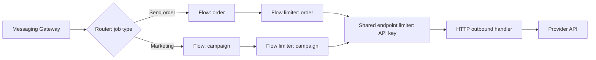
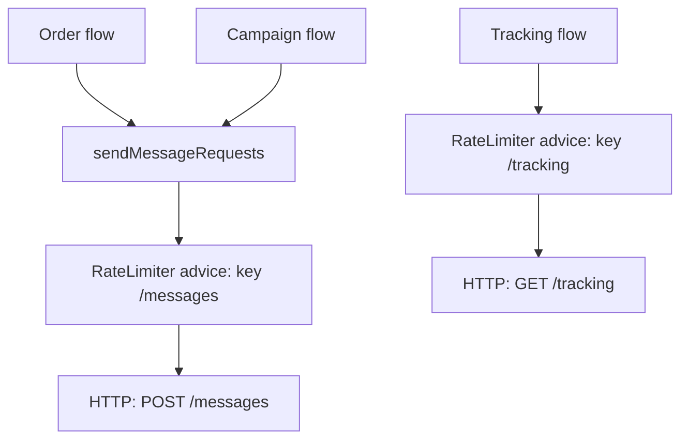
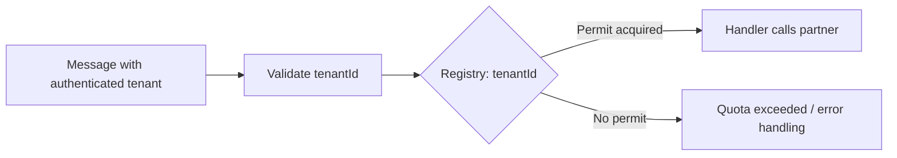
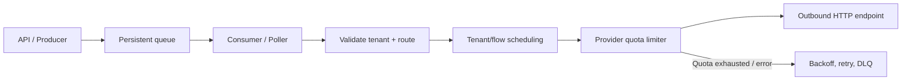

# Rate Limiting by Flow, Tenant, or Endpoint in Spring Integration

> **Module:** `SPRING_INTEGRATION_PATTERN` — Learn to implement Enterprise Integration Patterns with Spring Integration to build loosely coupled and extensible message flows. Practice Router, Filter, Transformer, Splitter, Aggregator, Gateway, retry, error channel, and correlation, as well as testing and monitoring processing branches.
>
> **Chapter:** Rate limiter · **Topic:** Rate limiting by flow, tenant, or endpoint.

## 1. Why Define the Scope of a Rate Limiter?

Suppose a system integrates with a messaging partner. The system has three message sources:

- **Order confirmation** flow: requires high speed and low latency.
- **Marketing notification** flow: high volume but can wait.
- **Status lookup** flow: calls a different API of the same partner.

Four tenants share the system. The partner specifies a maximum of **30 requests/second per API key**, while the business also wants to prevent one tenant from consuming all resources. If an arbitrary limiter is attached to each handler, total calls may exceed the partner's quota. If a single limiter is shared for everything, a tenant sending many messages can force other tenants to wait.

This lesson answers three questions:

1. **By flow:** how many processing executions is each business flow allocated?
2. **By tenant:** how many resources is each customer/tenant allowed to consume?
3. **By endpoint:** what limits apply to each partner API or API group, and do flows need to share that limit?

The core design principle is that **the rate limiter must be attached to the actual unit of quota consumption**. One message passing through a Router does not necessarily correspond to one HTTP request: a Transformer may produce no requests; a Splitter may produce many requests; an Aggregator may combine many messages into one request. Placing a limiter before or after these steps counts different things.

## 2. Distinguishing Three Scope Types

| Scope | Typical limit key | Problem solved | Considerations |
|---|---|---|---|
| **Flow** | `flow:order-confirmation` | Allocate a dedicated budget for each business flow | If multiple flows call the same API key, per-flow limits do not automatically protect the total quota |
| **Tenant** | `tenant:org-123` | Fairness and load isolation across customers | Must validate tenants, control the number of created keys, and define tiered policies |
| **Endpoint** | `provider-a:send` or `api-key-7` | Respect limits imposed by the target system | Provider limits may apply to an entire group of endpoints/credentials, not just a single URL |

**Endpoint** here should be understood clearly:

- *Spring Integration endpoint* is the component connecting a channel to a message handler, such as `@ServiceActivator`.
- *Remote API endpoint* is the external API being called, such as `POST /messages` or `GET /tracking`.

When referring to a partner's "per-endpoint quota," the quota key must reflect **how the partner counts requests**, which may be a specific endpoint, an endpoint group, an API key, or an account. Never assume one URL equals one independent limit.

### Illustrating Limiter Placement in the Flow



The diagram shows two independent goals: limiting each flow's budget and protecting the **total** number of requests sent via the API key. With only `L1` and `L2`, both flows combined can still exceed the shared quota. With only `E`, total requests are bounded, but there is no mechanism to guarantee fairness between the two flows.

In practice, rate limiting **does not automatically schedule fair turns**. To achieve priority or fairness across flows/tenants, you also need a scheduler, queues, dedicated consumers, or admission coordination.

## 3. Core Mechanism of Resilience4j RateLimiter

Spring Integration supports `RateLimiterRequestHandlerAdvice` based on Resilience4j. The advice checks for a permit right before the message handler executes.

Common parameters:

| Configuration | Explanation | Example |
|---|---|---|
| `limitForPeriod` | Number of permits granted in one period | 10 |
| `limitRefreshPeriod` | Length of the permit refresh period | 1 second |
| `timeoutDuration` | Maximum time to wait for a permit | 100 ms |

For example, 10 permits per second does not mean "never more than 10 requests in **any** sliding 1-second interval." Resilience4j grants permits by refresh period, so calls on both sides of a period boundary can arrive very close together.

When permits run out:

- If `timeoutDuration` is non-zero, the caller can wait up to the configured duration.
- If `timeoutDuration = Duration.ZERO`, the call is rejected immediately.
- With `DirectChannel`, waiting for a permit holds the message-sending thread; with a poller/`ExecutorChannel`, examine the execution configuration and consumer exception handling.
- Permits limit **the frequency of handler starts**, not the number of concurrently running requests. To limit concurrency, add a semaphore/bulkhead or a dedicated pool.

A standard Resilience4j rate limiter maintains state **within the JVM process**. If the application runs multiple replicas, each replica has its own permits unless global quota coordination is applied.

## 4. Per-Flow Limiting with Static Advice

The easiest case to implement: flow names and quotas are known at startup. We create two `RateLimiterRequestHandlerAdvice` beans and attach them to two corresponding `ServiceActivator`s.

### 4.1. Dependencies

Gradle example using Spring Boot and Spring Integration:

```groovy
dependencies {
    implementation "org.springframework.boot:spring-boot-starter-integration"
    implementation "io.github.resilience4j:resilience4j-ratelimiter:VERSION"
}
```

Replace `VERSION` with the Resilience4j version compatible with the Spring Framework/Spring Integration version in your project; this can be managed via a BOM. The Java example below uses annotation-based Spring Integration.

### 4.2. Enabling Integration and Gateways

```java
package com.example.integration;

import org.springframework.boot.SpringApplication;
import org.springframework.boot.autoconfigure.SpringBootApplication;
import org.springframework.integration.annotation.IntegrationComponentScan;
import org.springframework.integration.config.EnableIntegration;

@SpringBootApplication
@EnableIntegration
@IntegrationComponentScan
public class IntegrationApplication {
    public static void main(String[] args) {
        SpringApplication.run(IntegrationApplication.class, args);
    }
}
```

`@IntegrationComponentScan` registers `@MessagingGateway` interfaces. Example invoking two flows:

```java
package com.example.integration;

import org.springframework.integration.annotation.MessagingGateway;

@MessagingGateway(defaultRequestChannel = "orderOut")
public interface OrderGateway {
    String sendOrder(String orderId);
}
```

```java
package com.example.integration;

import org.springframework.integration.annotation.MessagingGateway;

@MessagingGateway(defaultRequestChannel = "campaignOut")
public interface CampaignGateway {
    String sendCampaign(String campaignId);
}
```

### 4.3. Two Flows, Two Independent Quotas

```java
package com.example.integration;

import java.time.Duration;

import io.github.resilience4j.ratelimiter.RateLimiterConfig;
import org.springframework.context.annotation.Bean;
import org.springframework.context.annotation.Configuration;
import org.springframework.integration.annotation.ServiceActivator;
import org.springframework.integration.channel.DirectChannel;
import org.springframework.integration.handler.advice.RateLimiterRequestHandlerAdvice;
import org.springframework.messaging.MessageChannel;

@Configuration
public class PerFlowConfiguration {

    @Bean
    public MessageChannel orderOut() {
        return new DirectChannel();
    }

    @Bean
    public MessageChannel campaignOut() {
        return new DirectChannel();
    }

    @Bean
    public RateLimiterRequestHandlerAdvice orderFlowLimit() {
        return new RateLimiterRequestHandlerAdvice(
                config(5), "flow-orders");
    }

    @Bean
    public RateLimiterRequestHandlerAdvice campaignFlowLimit() {
        return new RateLimiterRequestHandlerAdvice(
                config(2), "flow-campaigns");
    }

    private RateLimiterConfig config(int permitsPerSecond) {
        return RateLimiterConfig.custom()
                .limitForPeriod(permitsPerSecond)
                .limitRefreshPeriod(Duration.ofSeconds(1))
                .timeoutDuration(Duration.ofMillis(100))
                .build();
    }

    @ServiceActivator(inputChannel = "orderOut",
                      adviceChain = "orderFlowLimit")
    public String sendOrder(String orderId) {
        // Stub: replace with an actual HTTP client / outbound gateway.
        return "order sent: " + orderId;
    }

    @ServiceActivator(inputChannel = "campaignOut",
                      adviceChain = "campaignFlowLimit")
    public String sendCampaign(String campaignId) {
        // Stub: replace with an actual HTTP client / outbound gateway.
        return "campaign sent: " + campaignId;
    }
}
```

In each one-second cycle on **one application instance**, the order flow has at most 5 permits and the marketing flow has at most 2 permits. When the marketing flow runs out of permits, the order flow still has its own permit pool.

**Limitation of the example:** if both handlers ultimately call the same API key that only allows **6 requests/second**, a combined 5 + 2 = 7 permits/second can still exceed the provider's quota. You need a shared coordination point or a lower total budget configuration, accounting for other flows and bursts.

A flow can pass through multiple handlers. Whichever handler has the advice attached is checked on every entry to **that handler**. If a handler only transforms the payload and forwards it, limiting there may not reflect the number of outbound requests. Prefer placing the limiter close to the actual API call step when the goal is to protect the API.

## 5. Rate Limiting by Remote Endpoint or API Key

Suppose the provider has two APIs:

- `POST /messages`: maximum **10 requests/second** per API key.
- `GET /tracking`: maximum **30 requests/second** per API key.

If two flows, such as `order` and `campaign`, both call `POST /messages`, they must share **the same budget**. Avoid creating two independent limiter objects just because they share the same name string.

### 5.1. A Shared Endpoint Handler

A clear option is to merge outbound branches sharing the same quota into one channel and one handler:



Simplified configuration:

```java
@Bean
public RateLimiterRequestHandlerAdvice sendMessageQuota() {
    RateLimiterConfig config = RateLimiterConfig.custom()
            .limitForPeriod(10)
            .limitRefreshPeriod(Duration.ofSeconds(1))
            .timeoutDuration(Duration.ZERO)
            .build();
    return new RateLimiterRequestHandlerAdvice(
            config, "provider-a-messages-key-1");
}

@ServiceActivator(
    inputChannel = "sendMessageRequests",
    adviceChain = "sendMessageQuota")
public String sendMessage(String messageBody) {
    return remoteClient.postMessage(messageBody);
}
```

`remoteClient` in the snippet above is an application-provided client. The snippet illustrates **where** to place the advice; to run it, declare the `MessageChannel sendMessageRequests` and the corresponding client bean.

The benefit of this approach: regardless of which flow the message came from, **every entry into the shared handler** must request a permit from the same limiter.

### 5.2. If Handlers Cannot Be Merged

When multiple independent handlers still share an API key, a mechanism to **share quota state** is needed instead of each handler creating its own limiter. You can share one Resilience4j `RateLimiter` retrieved from a `RateLimiterRegistry` under the same quota key and check permits at each HTTP call site, or organize a shared outbound gateway/dispatcher. When sharing a single `RateLimiterRequestHandlerAdvice` bean across multiple endpoints, verify how advice initialization and advice chain ordering behave in the exact Spring Integration version in use.

**Do not use identical names as proof of shared quota.** A name is just an identifier if the underlying limiter objects are actually distinct. Moreover, "the same key" across two JVMs still does not constitute shared state.

### 5.3. Choosing Keys Based on Real Quota Documentation

Example keys:

```text
provider-a / key=shared-01 / POST /messages
provider-a / key=shared-01 / GET /tracking
provider-a / key=shared-01 / all-endpoints
provider-b / account=acct-42 / all-endpoints
```

If the partner counts **total quota across the entire API key**, use `provider-a:key:shared-01` as the overall protection key; if there are separate per-endpoint quotas, add endpoint keys. If quota is counted per account and different API keys still share one limit, key by account.

Distinguish *self-imposed limits* (e.g., marketing 2 req/s) from *partner-enforced limits* (e.g., API key 10 req/s). They serve different purposes and may need to be combined.

## 6. Dynamic Rate Limiting by Tenant

The number of tenants can grow over time. It is impractical to declare a `@Bean RateLimiterRequestHandlerAdvice` for every tenant in code. Instead, use `RateLimiterRegistry` to look up or create a limiter by tenant key.

Example flow:



### 6.1. Creating a Registry with a Default Configuration

```java
package com.example.integration;

import java.time.Duration;

import io.github.resilience4j.ratelimiter.RateLimiterConfig;
import io.github.resilience4j.ratelimiter.RateLimiterRegistry;
import org.springframework.context.annotation.Bean;
import org.springframework.context.annotation.Configuration;
import org.springframework.integration.channel.DirectChannel;
import org.springframework.messaging.MessageChannel;

@Configuration
public class TenantLimitConfiguration {

    @Bean
    public MessageChannel tenantOut() {
        return new DirectChannel();
    }

    @Bean
    public RateLimiterRegistry tenantRateLimiters() {
        RateLimiterConfig config = RateLimiterConfig.custom()
                .limitForPeriod(3)
                .limitRefreshPeriod(Duration.ofSeconds(1))
                .timeoutDuration(Duration.ZERO)
                .build();
        return RateLimiterRegistry.of(config);
    }
}
```

The registry returns the same limiter by name within **the same JVM's registry**, so every message with the same tenant ID consumes from the same budget of three permits/second.

### 6.2. Gateway Passing an Authenticated Tenant

```java
package com.example.integration;

import org.springframework.integration.annotation.MessagingGateway;
import org.springframework.messaging.handler.annotation.Header;
import org.springframework.messaging.handler.annotation.Payload;

@MessagingGateway(defaultRequestChannel = "tenantOut")
public interface TenantGateway {

    String send(@Payload String payload,
                @Header("tenantId") String tenantId);
}
```

**In a real application, `tenantId` must be derived from trusted authentication/authorization information.** The API above only illustrates passing context through a message header. Do not take an arbitrary tenant ID from a body or header supplied by an untrusted caller and use it as a quota key, because they can change the ID to get a fresh budget.

### 6.3. Looking Up the Limiter in the Handler

```java
package com.example.integration;

import io.github.resilience4j.ratelimiter.RateLimiter;
import io.github.resilience4j.ratelimiter.RateLimiterRegistry;
import org.springframework.integration.annotation.ServiceActivator;
import org.springframework.messaging.Message;
import org.springframework.stereotype.Component;

@Component
public class TenantOutboundHandler {

    private final RateLimiterRegistry registry;

    public TenantOutboundHandler(RateLimiterRegistry registry) {
        this.registry = registry;
    }

    @ServiceActivator(inputChannel = "tenantOut")
    public String send(Message<String> message) {
        // Assumes the header was set from an authenticated source.
        String tenantId = message.getHeaders().get("tenantId", String.class);

        if (tenantId == null
                || !tenantId.matches("[a-zA-Z0-9_-]{1,64}")) {
            throw new IllegalArgumentException("Invalid tenantId");
        }

        RateLimiter limiter = registry.rateLimiter("tenant:" + tenantId);

        if (!limiter.acquirePermission()) {
            throw new TenantQuotaExceededException(tenantId);
        }

        // Stub: in production, replace with an outbound HTTP call.
        return "sent for " + tenantId + ": " + message.getPayload();
    }

    public static class TenantQuotaExceededException
            extends RuntimeException {
        public TenantQuotaExceededException(String tenantId) {
            super("Tenant quota exceeded: " + tenantId);
        }
    }
}
```

In this example:

1. Tenant `A` is granted three permits per second on the running instance.
2. Sending four consecutive messages for A in the same cycle: only the first three messages can acquire permits; the fourth message is rejected if the new cycle has not started.
3. Tenant `B` uses a different limiter, so B's requests do not consume A's permits.
4. `timeoutDuration(Duration.ZERO)` rejects out-of-permit requests immediately, which fits upstreams with their own retry/queue policies.

The example uses `RateLimiter.acquirePermission()` directly in the handler to **select a limiter per message**. That achieves the same limiting goal without using `RateLimiterRequestHandlerAdvice` as in the static flow case. You can build a custom advice to dynamically choose a limiter; only do so when you need to share that logic across multiple handlers.

### 6.4. Why Should You Not Create a New Limiter Per Message?

A common mistake:

```java
// WRONG: creates a new quota on every call, never accumulating usage.
RateLimiter limiter = RateLimiter.of(
        "tenant:" + tenantId, defaultConfig);
limiter.acquirePermission();
```

Creating new state each time means previous requests no longer affect the quota of subsequent requests. A registry or cache of limiters keyed by **stable quota keys** is required to accumulate usage.

Conversely, a registry holding state by name also introduces lifecycle management concerns: a client could send millions of arbitrary tenant keys if left unchecked. Validate tenants first, cap the number of active tenants/objects, consider eviction policies when a tenant is deactivated, and plan how to clean up unused state. Removing a limiter must not arbitrarily "reset the quota" for an active tenant.

## 7. Combining Multiple Quota Layers

Suppose the partner allows at most 10 requests/second on an API key. The system wants to limit each tenant to at most 3 requests/second and the marketing flow to at most 2 requests/second.

| Layer | Key | Example quota | Role |
|---|---|---|---|
| Total provider | `provider-a:api-key-1` | 10/s | Stay within the API key budget |
| Tenant | `tenant:org-123` | 3/s | Prevent one tenant from consuming all capacity |
| Flow | `flow:marketing` | 2/s | Protect other higher-priority flows |

If there are four tenants, each allowed three permits/second, the potential total of **12 requests/second** still exceeds the provider's 10/s limit. Therefore, a tenant limiter **does not replace** a total provider limiter.

### Permit Acquisition Order Matters

A natural approach is to request permits sequentially:

```text
message → [tenant permit] → [flow permit] → [provider permit] → HTTP
```

However, if a tenant permit is acquired and the provider permit fails, the tenant permit has usually **already been consumed**. Acquiring permits across multiple separate limiters does not form an atomic transaction with rollback. Changing the order only changes which permit may be consumed first.

To build a fair and efficient system:

- Use a shared **dispatcher/consumer** going through a common outbound budget when the provider quota is a hard constraint.
- If you need to guarantee that a tenant/flow cannot starve others, organize **per-tenant or priority-group queues**, scheduled with weighted round-robin, fair queueing, or an equivalent mechanism.
- Define a clear policy when a permit cannot be acquired at a layer: return an error, requeue with backoff, or move to a DLQ.
- Design for idempotency because retries can cause messages to be redelivered and sent twice without a business key.

In multi-replica systems, enforcing an accurate **global** quota per API key requires a centralized dispatcher, a distributed coordinator/limiter with shared state, or controlled static budget splitting with headroom. All approaches must be tested under autoscaling.

## 8. Placing the Limiter Properly in Enterprise Integration Patterns

| Pattern | Risk if limiter is misplaced | Recommendation |
|---|---|---|
| **Router** | Two branches call the same API but count quotas separately | Place a shared quota after merging branches or share the same limiter |
| **Filter** | Dropped messages still consume permits if limited before the Filter | Filter out messages that do not need outbound calls before acquiring permits |
| **Transformer** | Counts transformation runs instead of actual HTTP calls | Limit close to the outbound handler |
| **Splitter** | One inbound message splits into N requests | Account for N permits if N requests are actually made |
| **Aggregator** | N messages are combined into one batch API call | Count by batch requests, while also accounting for item-based quota if the provider requires it |
| **Gateway** | Calling thread is blocked waiting for a permit | Bound `timeoutDuration` and respect the caller's latency budget |
| **Retry** | One permit can cover multiple HTTP retries if advice order is wrong | Ensure every outbound attempt acquires a permit |
| **Error channel** | Errors are sent to the wrong place, losing messages or looping retries | Configure exception handling according to synchronous/asynchronous flow semantics |
| **Correlation** | Tenant/message metadata is lost during split/aggregate | Preserve trusted tenant ID and correlation ID across the flow |

For example: an inbound message is split by a Splitter into 50 notifications, and each notification calls `POST /messages`. A limiter placed **before the Splitter** counts one permit for 50 calls. A limiter placed at the outbound handler counts 50 permits, which is right if the provider limits by request count. If the provider instead counts 50 "recipient units" inside one batch request, you need a mechanism to count the **cost/weight** of each request rather than assuming one message equals one permit.

For retries, account for `Retry-After` when the partner returns HTTP 429, exponential backoff with jitter, and a cap on retry attempts. An internal rate limiter running out of permits and the partner returning HTTP 429 are **two different situations** and require separate metrics.

## 9. Synchronous, Asynchronous, and Durability

### Synchronous Flow

With `DirectChannel`, the handler executes on the message-sending thread. If the limiter has a wait timeout, the caller thread can be held until it gets a permit or times out. If quota is exceeded and there is no error handling, the exception usually propagates back to the Gateway/caller.

An HTTP API that needs to respond within 300 ms should not be configured to wait 2 seconds for a permit just because of a partner limit: that can cause timeouts at the HTTP layer first, prompting users to retry while the old message is still being processed downstream.

### Asynchronous or Broker-Backed Flow

To avoid holding incoming request threads, messages can be accepted into a broker/durable queue with a rate-limited consumer sending outbound requests:



**Note:** an in-memory `QueueChannel` does not guarantee message survival across restarts by default. If zero order loss is required, configure a durable broker or message store, timely acknowledgment, and error handling when the handler fails.

In asynchronous flows, exceptions may be published as an `ErrorMessage` to an error channel, or handled by the consumer/broker adapter according to retry/ack policies. Do not assume everything automatically goes to the global `errorChannel`; verify the exact endpoint and delivery mechanism in use.

## 10. Operating with Multiple Instances, Tenants, and Changing Quotas

**Example:** a provider allows 40 req/s account-wide, the app has 4 replicas, and each replica configures a 20 req/s limiter. The total can reach roughly 80 req/s, **double the quota**. The same key `tenant:org-123` appearing in two JVMs also normally has two independent permit counters.

Common approaches:

1. **Single shared outbound point:** flows send to a shared dispatcher/worker with a single limiter, making quota management easy, though fault tolerance and scalability must be planned.
2. **Distributed rate limiter:** permit state shared via an appropriate service/coordinator; account for latency, network failures, atomicity, and fail-open/fail-closed policies.
3. **Per-replica quota splitting:** total allocated quota is kept below the real quota with headroom for bursts/overhead and updated when replica count changes; operationally simple, but does not auto-balance under skewed load.

Do not infer a global quota merely from **identical limiter names** across pods. Furthermore, a provider may enforce multiple constraints: per API key, endpoint, account, daily limit, and instantaneous burst. Choose an approach that satisfies *all* critical constraints.

**Premium / standard tenants:** different configurations can be applied per tenant, but configurations must come from a trusted administrative data source. If quotas change at runtime, understand how updating a limiter affects the permit cycle and waiting threads. Creating a new limiter with a different name without migrating state can accidentally reset the quota.

**Number of keys:** monitor active limiter counts, tenant churn, memory usage, and state cleanup timing. In large multi-tenant environments, an unchecked local registry can become a memory issue.

## 11. Testing and Observability

### 11.1. Test Scenario Table

| Scenario | Setup | Expected Result |
|---|---|---|
| Two independent flows | Flow A = 1 permit, flow B = 1 permit, long refresh, timeout = 0 | A running out of permits does not exhaust B's permits |
| Two flows sharing an endpoint | Both enter one handler using a 1-permit limiter | Only one outbound attempt passes through in the cycle |
| Two tenants | A and B, each tenant 1 permit | A's second request is rejected; B's first request still succeeds |
| Spoofed tenant ID | Missing header, invalid format, or mismatched caller permissions | Rejected before granting/consuming tenant permits |
| Split message | 1 message generates 5 outbound attempts | Outbound quota is checked 5 times |
| HTTP 429 retry | Stub provider returns 429 with `Retry-After` | Appropriate backoff; each real call goes through the limiter |
| Runtime quota change | Tenant upgrades/changes tier under load | No abnormal quota gap created; verify configuration transition policy |
| Two replicas | Same tenant sends to two apps with local registries | Two separate counters; demonstrates need for global quota |
| Failure in async flow | Consumer runs out of permits or HTTP fails | Message is retried/acked/DLQ'd per policy, no silent loss |

For deterministic tests, configure `limitForPeriod = 1`, a long refresh period, and `timeoutDuration = Duration.ZERO`; send two consecutive messages within one cycle, and assert how many times the outbound stub is called and the exception type. For flow/tenant tests, use **the same registry/limiter instance** across all sends in a single test; avoid tests leaking state into other tests.

For real-time rate-limit tests, avoid relying on short `Thread.sleep` calls to assume cycle boundaries. For concurrency tests, verify **the number of permits granted**, not just response ordering since thread scheduling can vary.

### 11.2. Key Metrics

- **Permits:** available permits, rejected requests, threads waiting for permits; broken down by quota key.
- **Outbound:** actual HTTP requests by provider, endpoint, status code, API key group (with secrets masked).
- **Flow:** end-to-end latency, inbound/outbound message counts, error rate, throughput per flow.
- **Tenant:** rate-limited ratio, latency, and quota utilization by tenant tier; avoid exporting every tenant ID as a Prometheus label if tenant cardinality is unbounded.
- **Queue / retry:** backlog, oldest message age, retry counts, and DLQ.

Resilience4j APIs support inspecting metrics on a limiter, for example:

```java
RateLimiter limiter = registry.rateLimiter("tenant:" + tenantId);

int available = limiter.getMetrics().getAvailablePermissions();
int waiting = limiter.getMetrics().getNumberOfWaitingThreads();
```

You can enable Micrometer/Actuator integration matching your project version or register Resilience4j event listeners. Control cardinality: metrics across millions of tenant IDs can overload the observability system. In logs, use an internal tenant identifier compliant with security policies, message ID, correlation ID, flow name, and reason code; do not log API keys or payloads containing sensitive data.

## 12. Common Design Mistakes

| Mistake | Consequence | Fix |
|---|---|---|
| Creating a new `RateLimiter.of(...)` per message | Quota is continuously reset | Reuse limiters by stable key |
| Using separate limiters for two flows sharing an API key | Combined outbound calls can exceed quota | Shared limiter or overall coordination |
| Trusting a user-supplied tenant ID | Callers can change tenant ID to bypass limits | Derive from authentication/authorization context |
| Attaching the limiter before a Splitter | Counts one message while emitting N HTTP requests | Place outbound quota after the Splitter |
| Having a tenant quota without a provider quota | Sum across tenants can exceed the provider limit | Add a provider budget |
| Acquiring permits across multiple layers and assuming rollback | Wastes permits, reduces throughput | Accept clear semantics or use an appropriate dispatcher |
| Treating a local limiter as a global quota | Each replica grants permits independently | Use distributed coordination, a dispatcher, or quota splitting |
| Waiting too long for a permit in `DirectChannel` | Holds threads, causes cascading request timeouts | Wait briefly or move to a queue/consumer |
| Leaving registry keys unbounded | Increases memory usage and metric cardinality | Validate tenants, manage lifecycle and monitoring |
| Enabling infinite fast retries | Amplifies load and 429 errors | Backoff, jitter, finite retry count |

## 13. Hands-On Exercises

**Exercise 1 — Two Flows, One Provider.** Create an `order` flow with 5 permits/s and a `campaign` flow with 2 permits/s. Have both call a stub provider allowing only 6 requests/s total. Identify why two per-flow limiters are insufficient, then adjust the architecture so total outbound calls per API key are capped.

**Exercise 2 — Multi-Tenant.** Build a Gateway accepting a payload and a tenant ID sourced from authentication. Create a registry with 2 permits/s/tenant, timeout = 0. Send three consecutive messages for tenant A and one message for tenant B; check how many times the handler is called and whether A's exception consumes B's permit.

**Exercise 3 — Retry and Backlog.** Connect a broker consumer to a handler with a 10 req/s provider quota. Generate 100 messages in one second, simulating HTTP 429 and `Retry-After`. Measure message age, queue depth, outbound attempt count, and cases requiring a DLQ.

**Exercise 4 — Distributed.** Run two replicas receiving traffic for the same tenant. Use a load test to show how local limiting differs from a global quota. Propose a shared quota design that handles temporary coordinator unavailability.

**Self-Assessment Questions:**

1. When should a limiter key be `tenantId`, and when should it be `(tenantId, endpoint)` or `(provider, apiKey)`?
2. Why can the sum of four tenant limiters at 3 req/s not guarantee a 10 req/s provider quota?
3. If two flows share the same advice bean or the same registry key on one JVM, what changes? What **does not** change when running two JVMs?
4. Why does acquiring permits from three limiters in sequence not guarantee an "all or nothing" condition?
5. Where should the limiter be placed when one message produces ten HTTP requests after a Splitter?

## 14. References

- [Spring Integration Reference — Request Handler Advice](https://docs.spring.io/spring-integration/reference/handler-advice.html): how advice wraps handlers and ordering rules.
- [Spring Integration Reference — Message Routing](https://docs.spring.io/spring-integration/reference/router.html): branching and coordinating message processing.
- [Spring Integration Reference — Messaging Gateways](https://docs.spring.io/spring-integration/reference/gateway.html): gateways and request-reply.
- [Spring Integration Reference — Error Handling](https://docs.spring.io/spring-integration/reference/error-handling.html): errors in synchronous and asynchronous flows.
- [Resilience4j RateLimiter](https://resilience4j.readme.io/docs/ratelimiter): `RateLimiterConfig`, `RateLimiterRegistry`, permits, and metrics.
