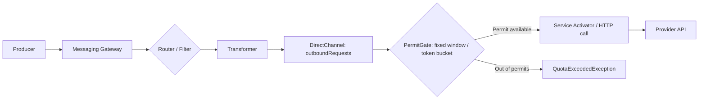
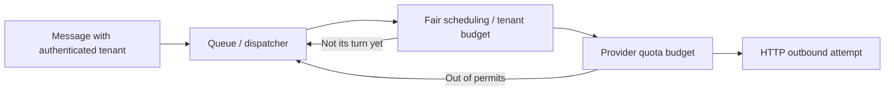

# Token Bucket and Fixed Window in Spring Integration

> **Module:** `SPRING_INTEGRATION_PATTERN` — Learn to implement Enterprise Integration Patterns with Spring Integration to build loosely coupled and extensible message flows. Practice Router, Filter, Transformer, Splitter, Aggregator, Gateway, retry, error channel, and correlation, as well as testing and monitoring processing branches.
>
> **Chapter:** Rate limiter  
> **Topic:** Token bucket and fixed window

## 1. Why Understand the Algorithm Behind a Rate Limiter?

Suppose a system receives order messages and must call a shipping partner's API. The partner allows at most 60 requests/minute. During peak hours, a burst of 20 orders may arrive simultaneously, followed by no new orders for several seconds.

Two common limiting approaches for this situation are:

- **Fixed window:** divides time into fixed intervals and allows at most a set number of requests in each interval.
- **Token bucket:** maintains a "bucket" of tokens with a bounded capacity; tokens are replenished at a steady rate, and each processing attempt consumes tokens.

Both support deciding whether to **allow or reject a processing attempt**, yet produce very different behavior under burst traffic (*burst*). Understanding the difference helps you pick the right algorithm before configuring a Router, Filter, Transformer, Splitter, Aggregator, Gateway, or an outbound handler in Spring Integration.

After this lesson, learners can explain the principles of each algorithm, calculate by hand how many requests can pass along a timeline, implement a thread-safe Java demonstration inside a single JVM, connect it to `@ServiceActivator`, test at window boundaries, and recognize limitations when deploying multiple replicas.

## 2. A Few Concepts to Distinguish

**Rate** is the average speed over time: for example, 10 requests/second or 600 requests/minute. **Burst** is a group of requests arriving within a very short interval. **Permit** is the authorization to enter a processing step; with a token bucket, a permit typically corresponds to one token. **Concurrency** is the number of requests currently being processed simultaneously.

A rate limiter is not synonymous with a semaphore or a thread cap. A handler that receives 10 permits can still process multiple requests concurrently for several seconds. If you need to cap the number of open HTTP connections, combine it with a concurrency limit or connection pool.

You also need to clearly define what *one attempt* is:

| Limiter placement | Unit counted | Example |
|---|---|---|
| Before Splitter | Inbound message | One message generating 5 requests still takes only 1 permit |
| After Splitter, before HTTP handler | Outbound call to partner | Five child messages making HTTP calls require 5 permits |
| Before Aggregator | Component message | N messages for one batch cost N permits |
| After Aggregator, before HTTP handler | Batch/HTTP request | N messages aggregated into 1 HTTP request cost 1 permit |
| At the endpoint making retry requests | Each network attempt | Retries also consume quota |

If the partner bills or enforces quota by **the number of items in a batch** rather than the number of HTTP requests, taking one permit per request may not be enough. In that case, you need a weighted permit policy or a unit-consumption counter.

## 3. Fixed Window: Counting Attempts in Each Fixed Window

### 3.1. Principle

Choose:

- \(W\): length of one window, e.g., 1 second.
- \(L\): maximum number of requests accepted in one window.
- \(C\): counter of requests already accepted in the current window.

At timestamp \(t\), the window index can be defined as:

\[
k = \left\lfloor \frac{t}{W} \right\rfloor
\]

When a request arrives:

1. Compute the request's window \(k\).
2. If a new window has started, reset the counter to 0.
3. If \(C < L\), increment \(C\) and accept.
4. If \(C \geq L\), reject or delegate to the system's wait/retry mechanism.

Example **5 requests/second**:

| Time in window | Used count | New request | Decision |
|---|---:|---|---|
| 0.20 s | 0 | Request A | Allowed, counter = 1 |
| 0.40 s | 1 | Request B | Allowed, counter = 2 |
| 0.60 s | 2 | Next three requests | All three allowed, counter = 5 |
| 0.90 s | 5 | Request F | Rejected |
| 1.00 s | New window | Request G | Allowed, counter = 1 |

The advantage is that the algorithm is simple, easy to measure, and easy to express with an integer counter.

### 3.2. The Window Boundary Problem

A fixed window can allow two clusters of requests right next to each other across a window transition:

```text
Limit: 5 requests / 1-second window

Window [0, 1):                         Window [1, 2):
 0.990 s  ● ● ● ● ●  (5 requests)       1.010 s  ● ● ● ● ●  (5 requests)
          |---------------------|---------------|
                 window boundary: 1.000 s

=> 10 requests accepted within 20 ms.
```

Therefore, "at most 5 requests in each fixed 1-second window" is **not equivalent to** "never more than 5 requests in any sliding 1-second interval." With a fixed window, a sliding interval crossing the boundary can contain nearly \(2L\) requests.

This point is especially important if the partner API enforces a sliding-window quota or a burst-smoothing algorithm. Installing a client-side fixed window can still result in HTTP 429 from the partner.

## 4. Token Bucket: Accumulating Processing Rights, Allowing Controlled Bursts

### 4.1. Principle

A token bucket consists of:

- \(B\): maximum capacity of the bucket (*capacity*), e.g., 5 tokens.
- \(r\): token replenishment rate (*refill rate*), e.g., 1 token/second.
- \(T(t)\): number of tokens currently available at time \(t\), always in \([0, B]\).

At \(\Delta t\) seconds after the previous update, ignoring any tokens consumed during this interval:

\[
T_{\text{new}} = \min(B,\; T_{\text{old}} + r\Delta t)
\]

When a request needs 1 token:

1. Update the token count based on elapsed time.
2. If at least 1 token remains, subtract 1 and allow the request.
3. If there are not enough tokens, reject immediately or wait according to an external policy.

**Sustainable rate** is governed by \(r\); **maximum instantaneous burst** when the bucket is full is governed by \(B\). Over a long interval \(\Delta t\), the number of accepted requests is bounded by approximately \(B + r\Delta t\) if each request consumes one token, with initial tokens not exceeding \(B\).

### 4.2. Calculation Illustration

Set \(B = 5\) tokens, \(r = 1\) token/second, and start with a full bucket:

| Time | State before request | Event | Remaining tokens |
|---|---|---|---:|
| 0.0 s | 5 | Five requests arrive simultaneously, all allowed | 0 |
| 0.3 s | 0.3 | One request needs 1 token, rejected | 0.3 |
| 1.0 s | 1.0 | One request allowed | 0 |
| 2.5 s | 1.5 | One request allowed | 0.5 |
| 7.0 s | 5.0 (hits maximum capacity) | One request allowed | 4.0 |

Fractional token parts reflect refilled capacity not yet sufficient for one request. Another implementation may refill tokens in discrete integer steps; in that case specific acceptance timestamps shift while preserving the core idea of capped capacity and refill rate.

### 4.3. A Token Bucket Does Not Automatically Turn Messages Into a Queue

When tokens are lacking, a program can:

- **Fail fast:** report missing permit immediately without holding a thread.
- **Wait with timeout:** wait for a token to refill or reject when the timeout expires.
- **Queue:** leave messages in a broker/queue so a consumer can retry later.

The token bucket algorithm only describes **when a permit can be granted**. Message durability, retry mechanics, timeouts, backpressure, and preventing lost/duplicate messages are separate design concerns.

## 5. Comparing Token Bucket and Fixed Window

| Criterion | Fixed window | Token bucket |
|---|---|---|
| Main parameters | \(L\) requests / \(W\) duration | \(B\) capacity, \(r\) tokens/second |
| Minimum state | Current window, counter | Available tokens, last refill timestamp |
| Burst at start | Allows up to \(L\) per window | Allows up to \(B\) when bucket is full |
| Time boundary | Can accept \(2L\) near the boundary of two windows | No sudden reset; refills gradually over time |
| Idle time utilization | New window just resets count, does not "accumulate" across windows | Tokens can accumulate up to \(B\) |
| Best suited for | Period-based quotas clearly defined by the provider | Smoothing rate while allowing bounded bursts |
| Limitations | Large bursts at boundaries; differs from sliding window | Requires managing refill timing, state, and burst configuration |

**Parameter selection example:** a system wants an average of 60 requests/minute while allowing sudden bursts of at most 10 concurrent requests. A token bucket can use \(B=10\), \(r=1\) token/second. Replacing it with a fixed window \(L=60\), \(W=60\) seconds would allow all 60 requests at the very start of the minute — unsuitable if the partner expects evenly spread traffic.

Nor should you pick a token bucket if the API contract requires "no more than 10 requests in any sliding 60-second window" without verification; when the requirement is an **exact sliding window**, choose a more suitable algorithm or enforcement mechanism.

## 6. Placing the Algorithm in Spring Integration

We want to limit **each entry into the request-sending handler** rather than counting messages at intermediate steps.



The sample below demonstrates **both algorithms in plain Java**, making it easy to see the exact point where permits are counted. It is suitable for learning or small single-JVM applications. In production applications, consider battle-tested libraries, observability, and state-sharing mechanisms across multiple instances.

The examples use **Java 17+**, `System.nanoTime()` as a **monotonic** clock to measure elapsed time, and `synchronized` to prevent two threads from exceeding the quota together in one JVM. The clock can be injected so tests do not need `Thread.sleep()`.

### 6.1. Unified Interface

File `PermitGate.java`:

```java
package com.example.ratelimiter;

public interface PermitGate {
    // Exactly one outbound attempt consumes one permit.
    boolean tryAcquire();
}
```

This interface only decides whether a permit is available **at the moment of the call**. It does not wait, does not retry automatically, and does not store messages.

### 6.2. Token Bucket with Gradual Refill Over Time

File `TokenBucketGate.java`:

```java
package com.example.ratelimiter;

import java.util.function.LongSupplier;

public final class TokenBucketGate implements PermitGate {
    private static final double NANOS_PER_SECOND = 1_000_000_000.0;

    private final int capacity;
    private final double refillPerSecond;
    private final LongSupplier nanoTicker;

    private double tokens;
    private long lastRefillNanos;

    public TokenBucketGate(
            int capacity,
            double refillPerSecond,
            LongSupplier nanoTicker) {

        if (capacity <= 0
                || !Double.isFinite(refillPerSecond)
                || refillPerSecond <= 0.0) {
            throw new IllegalArgumentException("Invalid bucket settings");
        }

        this.capacity = capacity;
        this.refillPerSecond = refillPerSecond;
        this.nanoTicker = java.util.Objects.requireNonNull(nanoTicker);
        this.tokens = capacity;             // Bucket starts full.
        this.lastRefillNanos = nanoTicker.getAsLong();
    }

    @Override
    public synchronized boolean tryAcquire() {
        long now = nanoTicker.getAsLong();
        long elapsedNanos = now - lastRefillNanos;

        if (elapsedNanos > 0L) {
            double refill = (elapsedNanos / NANOS_PER_SECOND)
                    * refillPerSecond;
            tokens = Math.min(capacity, tokens + refill);
            lastRefillNanos = now;
        }

        if (tokens < 1.0) {
            return false;
        }

        tokens -= 1.0;
        return true;
    }
}
```

**Explanation:**

- `capacity` is the maximum accumulable permits; idle time cannot generate more tokens than this cap.
- `refillPerSecond` controls the long-term rate; for example, 2.5 averages 2.5 tokens/second.
- `System.nanoTime()` is suitable for measuring elapsed time and is unaffected by system wall-clock adjustments.
- `synchronized` makes refilling and consuming tokens a critical section within **one object, one JVM**.
- The example uses `double` for readability; for monetary limits, very large quantities, complex weights, or strict guarantees, use a dedicated library and verify numerical precision.

`tryAcquire()` does not make an HTTP call. Therefore, acquiring a permit cannot be treated as "sent successfully"; it only grants permission to **start an attempt**.

### 6.3. Fixed Window with an Integer Counter

File `FixedWindowGate.java`:

```java
package com.example.ratelimiter;

import java.time.Duration;
import java.util.Objects;
import java.util.function.LongSupplier;

public final class FixedWindowGate implements PermitGate {

    private final int limit;
    private final long windowNanos;
    private final LongSupplier nanoTicker;

    private long activeWindow = Long.MIN_VALUE;
    private int used = 0;

    public FixedWindowGate(
            int limit,
            Duration window,
            LongSupplier nanoTicker) {

        Objects.requireNonNull(window);
        if (limit <= 0 || window.isNegative() || window.isZero()) {
            throw new IllegalArgumentException("Invalid window settings");
        }

        this.windowNanos = window.toNanos();
        this.limit = limit;
        this.nanoTicker = Objects.requireNonNull(nanoTicker);
    }

    @Override
    public synchronized boolean tryAcquire() {
        // Windows are fixed relative to the monotonic clock origin.
        long now = nanoTicker.getAsLong();
        long windowIndex = Math.floorDiv(now, windowNanos);

        if (windowIndex != activeWindow) {
            activeWindow = windowIndex;
            used = 0;
        }

        if (used >= limit) {
            return false;
        }

        used++;
        return true;
    }
}
```

Whenever a new window begins, the counter resets. `Math.floorDiv` divides accurately even when `nanoTime()` is negative due to the JVM's arbitrary time origin. Windows here are **fixed relative to the monotonic clock origin**, not necessarily aligned with a partner's UTC minute/second boundaries. If a provider requires resets at exact 00:00 UTC or the start of every UTC minute, use a variant based on wall-clock timestamps with appropriate clock-change handling.

The code assumes `Duration` can be represented as a `long` number of nanoseconds and `nanoTicker` only advances (like `System.nanoTime`). Unusually huge `Duration` ranges can cause `toNanos()` to throw; in practical configurations, use sensible second/minute intervals.

### 6.4. Selecting the Algorithm via a Spring Bean

Spring Boot example with dependencies compatible with the Spring Integration version in use:

```groovy
dependencies {
    implementation "org.springframework.boot:spring-boot-starter-integration"
}
```

Application enabling integration configuration and Gateway scanning:

```java
package com.example.ratelimiter;

import org.springframework.boot.SpringApplication;
import org.springframework.boot.autoconfigure.SpringBootApplication;
import org.springframework.integration.annotation.IntegrationComponentScan;
import org.springframework.integration.config.EnableIntegration;

@SpringBootApplication
@EnableIntegration
@IntegrationComponentScan
public class RateLimiterApplication {

    public static void main(String[] args) {
        SpringApplication.run(RateLimiterApplication.class, args);
    }
}
```

File `RateLimitConfiguration.java`:

```java
package com.example.ratelimiter;

import java.time.Duration;

import org.springframework.context.annotation.Bean;
import org.springframework.context.annotation.Configuration;
import org.springframework.integration.channel.DirectChannel;
import org.springframework.messaging.MessageChannel;

@Configuration
public class RateLimitConfiguration {

    @Bean
    public MessageChannel outboundRequests() {
        return new DirectChannel();
    }

    @Bean("outboundPermitGate")
    public PermitGate outboundPermitGate() {
        // Token bucket: max burst 5, refills 5 tokens/second.
        return new TokenBucketGate(5, 5.0, System::nanoTime);

        // Try fixed window by swapping the return line:
        // return new FixedWindowGate(
        //        5, Duration.ofSeconds(1), System::nanoTime);
    }
}
```

`@Bean` creates a singleton object in the application context by default. Requests using this **same bean** share the limiter state within a single JVM.

File `PartnerGateway.java`:

```java
package com.example.ratelimiter;

import org.springframework.integration.annotation.MessagingGateway;

@MessagingGateway(defaultRequestChannel = "outboundRequests")
public interface PartnerGateway {
    String send(String payload);
}
```

File `OutboundHandler.java`:

```java
package com.example.ratelimiter;

import org.springframework.beans.factory.annotation.Qualifier;
import org.springframework.integration.annotation.ServiceActivator;
import org.springframework.stereotype.Component;

@Component
public class OutboundHandler {

    private final PermitGate gate;

    public OutboundHandler(
            @Qualifier("outboundPermitGate") PermitGate gate) {
        this.gate = gate;
    }

    @ServiceActivator(inputChannel = "outboundRequests")
    public String sendToProvider(String payload) {
        if (!gate.tryAcquire()) {
            throw new QuotaExceededException(
                    "No permit for provider outbound request");
        }

        // Demo: replace with an actual HTTP attempt.
        return "accepted: " + payload;
    }

    public static final class QuotaExceededException
            extends RuntimeException {
        public QuotaExceededException(String message) {
            super(message);
        }
    }
}
```

Execution flow:

1. Caller invokes `partnerGateway.send("order-123")`.
2. Gateway sends the message into `DirectChannel("outboundRequests")`.
3. `@ServiceActivator` checks a permit from **the single** `outboundPermitGate`.
4. If a permit is available, the handler executes and the Gateway receives the reply; if out of permits, the handler throws `QuotaExceededException`, which normally propagates back to the caller in a synchronous flow.
5. When replacing the stub with an HTTP client, every actual outbound attempt must go through a permit check. Placing retries **inside** the block after `tryAcquire()` can generate multiple HTTP attempts while taking only one permit — avoid this.

**Technical note:** This is a self-written limiter for educational illustration, placed inside the handler. Spring Integration also offers `RateLimiterRequestHandlerAdvice` powered by Resilience4j, which wraps handlers without manually writing `if (!gate.tryAcquire())`. However, Resilience4j's limiter configured via `limitForPeriod` and `limitRefreshPeriod` relies on periodic permit granting, so **do not automatically call it a continuous token bucket like the example above**, nor treat it as a sliding-window limiter. Choose the library and advice setup based on actual quota semantics.

## 7. Deterministic Testing: Controlling Time Instead of Sleeping

To prove the correctness of both algorithms, pass a `LongSupplier` reading time from an `AtomicLong` controlled in the test. That way there is no need to wait 1 real second and no race against machine clock boundaries.

These are JUnit 5 examples; add `testImplementation "org.junit.jupiter:junit-jupiter"` and configure JUnit Platform in your project build if you want to run them.

### 7.1. Token Bucket: Depleting and Refilling Tokens

```java
package com.example.ratelimiter;

import static org.junit.jupiter.api.Assertions.*;

import java.util.concurrent.atomic.AtomicLong;
import org.junit.jupiter.api.Test;

class RateLimiterGateTest {

    @Test
    void tokenBucketRefillsOverTime() {
        AtomicLong nanos = new AtomicLong(0L);
        TokenBucketGate gate =
                new TokenBucketGate(3, 1.0, nanos::get);

        assertTrue(gate.tryAcquire());
        assertTrue(gate.tryAcquire());
        assertTrue(gate.tryAcquire());
        assertFalse(gate.tryAcquire());

        nanos.addAndGet(1_000_000_000L); // 1 second
        assertTrue(gate.tryAcquire());     // Just refilled 1 token
        assertFalse(gate.tryAcquire());    // Consumed that token

        nanos.addAndGet(3_000_000_000L);
        assertTrue(gate.tryAcquire());     // Bucket holds at most 3 tokens
        assertTrue(gate.tryAcquire());
        assertTrue(gate.tryAcquire());
        assertFalse(gate.tryAcquire());
    }

    @Test
    void fixedWindowResetsAtTheBoundary() {
        AtomicLong nanos = new AtomicLong(999_000_000L);
        FixedWindowGate gate = new FixedWindowGate(
                2, java.time.Duration.ofSeconds(1), nanos::get);

        assertTrue(gate.tryAcquire());
        assertTrue(gate.tryAcquire());
        assertFalse(gate.tryAcquire());

        nanos.set(1_001_000_000L); // Only 2 ms after the previous timestamp
        assertTrue(gate.tryAcquire());
        assertTrue(gate.tryAcquire());
        assertFalse(gate.tryAcquire());
        // Allowed 4 requests within 2 ms around the boundary.
    }
}
```

The two tests clearly illustrate **the difference in how permits are replenished**: token bucket refills proportionally to elapsed time, whereas fixed window resets the entire allowance as soon as the window changes.

### 7.2. Concurrency Testing

Because multiple messages can arrive at the same time, test multiple threads calling `tryAcquire()` on **the same limiter**. With a bucket initially holding 5 tokens and a very low refill rate, having 50 threads attempt concurrently at the same ticker value should allow **exactly 5 calls**. If `synchronized` is removed, multiple threads can read stale state simultaneously and grant more tokens than allowed.

In concurrency tests, pin the ticker to a fixed mock timestamp (not auto-incrementing), use an `ExecutorService`, and synchronize the start time with a `CountDownLatch`. Count the number of accepted calls and always shut down the executor after the test. Do not rely on thread response order to evaluate the algorithm; that order depends on the scheduler.

### 7.3. Integration Testing with Gateway

| Scenario | Data | What to verify |
|---|---|---|
| Full bucket | Bucket \(B=3,r=1/s\), three consecutive sends | Three entries into handler |
| Empty bucket | Fourth send immediately | Quota error; HTTP handler is not invoked |
| Refill | Advance mock clock by 1 second | One new request can pass |
| Full window | Window \(L=2,W=1s\), three requests | Only two passes |
| Two-window boundary | Send at 0.999 s and 1.001 s | Reset can allow closely spaced bursts |
| Retry | HTTP stub returns 429 then 200 | Both HTTP attempts must go through separate permit checks |
| Async | Message via poller/queue | Quota error is retried or routed to error handling per policy |

In realistic Gateway tests, use an HTTP stub in place of the partner, count requests **actually sent outbound**, and ensure no hidden retries skew the accepted count.

## 8. Choosing Algorithms by Flow, Tenant, and Endpoint

When designing Enterprise Integration Patterns, the algorithm and **quota state scope** are two independent decisions.

| Scope | Limiter key | Example |
|---|---|---|
| Flow | `flow:checkout` | Order flow uses bucket \(B=10,r=5/s\) |
| Tenant | `tenant:org-17` | Each tenant has a 30 req/min window |
| Endpoint | `provider-a:/messages:api-key-1` | Total quota for flows calling the same API key |
| Endpoint group | `provider-a:api-key-1:all` | Total quota counted across all HTTP paths |

If two flows share an API key, creating two independent limiters with the same settings **does not protect the total quota**. You must share **the same state** within the JVM or use an outbound dispatcher/global quota policy. If multiple tenants share a provider quota, giving each tenant its own bucket still does not guarantee combined outbound calls stay below the provider quota.

For a **per-tenant** token bucket, you can use `ConcurrentHashMap<String, PermitGate>` and `computeIfAbsent` to create one bucket per tenant per JVM. However, derive the tenant ID from an authenticated context to prevent callers from picking arbitrary IDs to bypass quotas; manage lifecycle and cap key count to avoid memory growth. Deleting and recreating state unexpectedly replenishes a tenant's quota.

If you need to protect both the provider quota and per-tenant quotas simultaneously:



The diagram shows a design concept, not a mechanism auto-generated by Spring Integration. In particular, **requesting permits from multiple limiters in sequence is not an atomic transaction**: a tenant-level permit may already be consumed even if the provider level rejects. If fairness and efficient quota utilization are needed, design a dispatcher with explicit send scheduling, considering reservations or a policy-driven scheduler.

## 9. Behavior When Out of Permits: Retry, Error Channel, and Backpressure

### 9.1. Synchronous with DirectChannel

In the handler example above, `tryAcquire()` returns immediately. If a permit is missing, the exception travels back through the Gateway. The outer REST layer can map this error to HTTP 429 or an appropriate business code, though **Spring Integration does not automatically turn exceptions into HTTP 429**.

If another limiter waits for permits, the wait holds the synchronous flow's thread. Set wait timeouts within the Gateway/HTTP request's latency budget to avoid exhausting thread pools.

### 9.2. Async with a Queue or Broker

When important messages must eventually be processed, send messages to a queue and have a consumer attempt to acquire permits:

```text
Producer -> persistent broker -> consumer -> limiter -> outbound API
                                   |
                         insufficient permits / error
                                   |
                         delay + retry / DLQ
```

Pick retry delays based on when tokens or a new window are expected, combined with jitter so consumers do not wake up simultaneously. An in-memory `QueueChannel` does not preserve messages across restarts by default. Critical workloads require a durable broker or message store and proper acknowledgment handling.

### 9.3. Retries Must Pass Through the Limiter on Each Attempt

For example, if the first HTTP request returns 503 and the second succeeds: the provider may count **two requests**. If `tryAcquire()` only runs before the entire retry loop, the system consumes one permit while generating two requests. Place the limiter directly on **each outbound attempt**, or order the advice chain so every retry goes through the limiter.

Internal out-of-permit errors and partner HTTP 429 responses should be distinguished in metrics, retry policies, and alerts. For HTTP 429, prefer honoring `Retry-After` if present, then apply backoff with jitter and a finite retry cap.

### 9.4. Error Channel and Correlation

In synchronous flows, exceptions typically propagate to the caller; in asynchronous flows, errors may be sent as an `ErrorMessage` to an error channel or handled individually by the consumer/broker adapter. Do not assume every error automatically appears in the global `errorChannel`.

When a Splitter creates child messages, preserve the message ID, correlation ID, sequence, and tenant identity needed for retry/idempotency. When an Aggregator forms batches, determine whether quota is measured by **batch request** or **item count** per the API contract.

## 10. Single-JVM Limits and Distributed Systems

Both Java classes in the example only synchronize threads **within one JVM**. With three instances, each having a bucket \(B=5,r=5/s\), the three instances combined can burst 15 requests and sustain roughly 15 requests/second. Likewise, three independent fixed-window counters do not form a single shared quota.

If the partner enforces limits per **system-wide shared API key**, options include:

1. Routing all outbound traffic through **a single dispatcher** holding shared quota state.
2. Using a **distributed rate limiter** with atomic permit acquisition at a shared coordinator (for example, Redis-backed state executed atomically).
3. Allocating local per-replica quotas with headroom; suitable only when replica count, burst, and total budget are tightly controlled.

With a distributed fixed window, separate `GET` then `INCR` operations in Redis can introduce races. The counter, check step, and TTL need an atomic operation per key/window. With a distributed token bucket, both refill and token deduction require atomicity. You must also decide how to handle coordinator unavailability: **fail closed** protects the quota at the expense of availability; **fail open** keeps traffic flowing but risks exceeding the limit.

Clock skew across machines, replica scaling, restarts, retries, and disconnects can all alter quota behavior. Specifically, within one JVM, `System.nanoTime()` works well for elapsed time; **never use `nanoTime` values across multiple JVMs as a shared timestamp** because their origins differ.

## 11. Observability and Practical Configuration

### Metrics

- `allowed_requests_total` and `rejected_requests_total` by limiter name/quota group.
- Remaining tokens (`available_tokens`) or calls used in the current window.
- Actual outbound HTTP attempts, 429/503 response codes, and latency to the provider.
- Queue depth, oldest message age, retry count, and DLQ.
- Quota utilization by flow/tenant/endpoint, while avoiding unbounded tenant IDs as high-cardinality metric labels.

Logs should include a safe quota key, message ID, correlation ID, outcome, and reason code. Never log raw API keys, credentials, or sensitive payloads.

### Configuration Selection Rules

**Step 1:** clarify the provider's exact quota terms: rolling window, UTC fixed window, token bucket, API key, endpoint, account, or item count.

**Step 2:** pick the algorithm matching the semantics: fixed window only when periodic resets are allowed; token bucket when you need a sustained rate cap plus bounded bursts.

**Step 3:** define the state-sharing scope. If two flows share credentials, use a combined budget; if multiple tenants exist, add fairness policies or separate caps.

**Step 4:** decide whether missing permits fail fast or enqueue; design timeouts, backoff, ack/retry, and idempotency.

**Step 5:** test boundaries, concurrency, multiple replicas, restarts, and coordinator failures; measure **actual HTTP attempts**, not just messages before a Router.

## 12. Hands-On Exercises

**Exercise 1 — Simulating the Same Load.** Use 5 permits/second for fixed window, and a token bucket \(B=5,r=5/s\). Send five requests at 0.990 seconds, then five requests at 1.010 seconds. Note how many calls each algorithm accepts and why they should not be equated.

**Exercise 2 — Business-Driven Bursts.** An email-sending API has an average limit of 120 req/min while allowing bursts up to 10. Propose `capacity` and `refillPerSecond` for a token bucket. Explain how many tokens are available after 4 idle seconds, then test with 12 simultaneous requests.

**Exercise 3 — Spring Integration Integration.** Starting from the Gateway/ServiceActivator example, switch the `outboundPermitGate` bean from token bucket to fixed window. Use a stub handler to record executed requests. Test quota exhaustion and exception handling at the caller layer.

**Exercise 4 — After Splitter.** An inbound message contains 100 orders; a Splitter creates 100 child messages and each makes one HTTP request. Place the limiter in the right spot to count 100 outbound attempts. Explain how to preserve correlation ID, handle retries, and avoid duplicate sends.

**Exercise 5 — Multi-Instance.** One API key is shared by four replicas. Each replica has a bucket \(B=10,r=10/s\), while the provider's total quota is 20 requests/second. Explain the possible quota overage and sketch a shared coordination approach.

**Self-Check Questions:**

1. Why can a fixed window `limit=10, period=1s` still let 20 requests pass very close together?
2. A token bucket with `capacity=10, refillRate=1/s` is empty; after 2 seconds, how many permits at one token per request can it grant?
3. What is the difference between consuming a token and holding a semaphore slot?
4. Why does `System.nanoTime()` make sense inside one JVM yet cannot serve as an absolute timestamp shared across instances?
5. If HTTP retries happen three times after acquiring a permit once, what is the impact on the provider quota?
6. If a partner limits at most N requests in **any** sliding 60-second interval, why is a 60-second fixed window not guaranteed to satisfy that requirement?

## 13. References

- [Spring Integration Reference — Request Handler Advice](https://docs.spring.io/spring-integration/reference/handler-advice.html): scope of applying advice to message handlers.
- [Spring Integration Reference — Messaging Gateways](https://docs.spring.io/spring-integration/reference/gateway.html): Gateway and request-reply.
- [Spring Integration Reference — Error Handling](https://docs.spring.io/spring-integration/reference/error-handling.html): synchronous and asynchronous error handling.
- [Resilience4j — RateLimiter](https://resilience4j.readme.io/docs/ratelimiter): permits, cycles, and rate limiter configuration.
- [Bucket4j — Documentation](https://bucket4j.com/): example of a dedicated Java library implementing token buckets.
