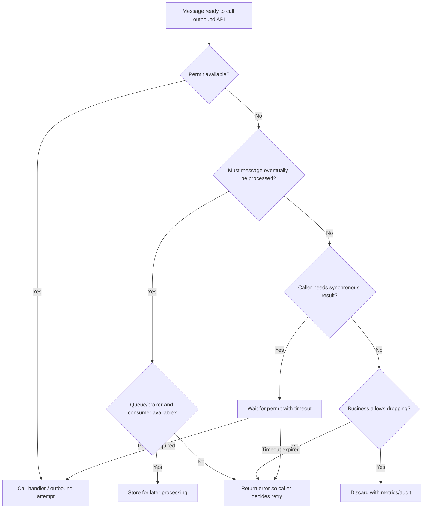
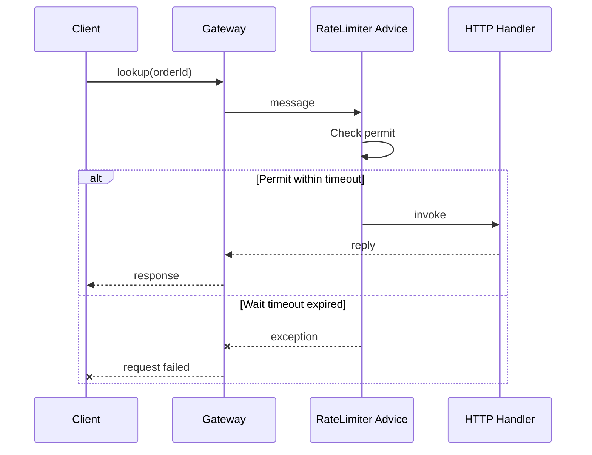
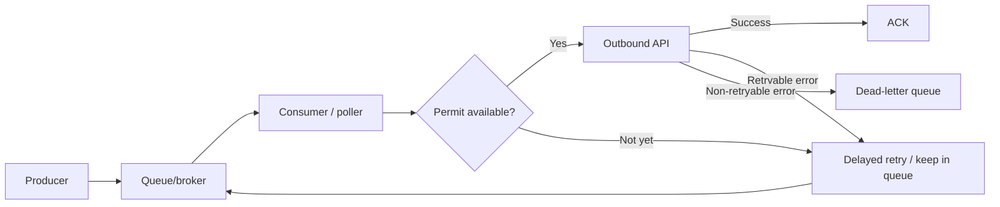
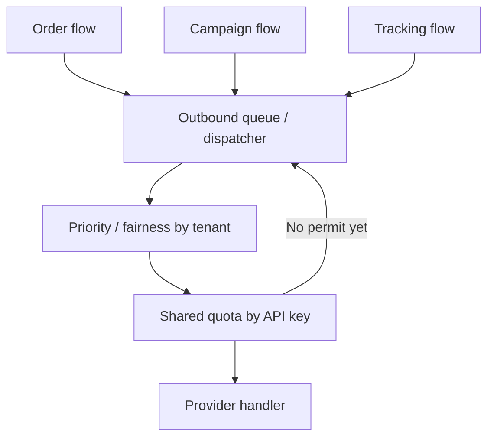

# Blocked, Delayed, or Discarded Messages When Applying a Rate Limiter

> **Module:** `SPRING_INTEGRATION_PATTERN` — Learn to implement Enterprise Integration Patterns with Spring Integration to build loosely coupled and extensible message flows. Practice Router, Filter, Transformer, Splitter, Aggregator, Gateway, retry, error channel, and correlation, as well as testing and monitoring processing branches.
>
> **Chapter:** Rate limiter  
> **Topic:** Blocked, delayed, or discarded messages

## 1. Why Running Out of Permits Is Not Necessarily a Single Error Type

An order system receives **100 messages/second**, whereas the shipping partner's API accepts only **20 requests/second**. A rate limiter controls entries into the API-calling step, yet an important business decision remains: **where do the 80 messages without permits go?**

There are three common behaviors:

1. **Block/wait:** the call pauses to wait for a permit, up to a configured maximum duration.
2. **Delay/defer:** hold the message to process later, typically via a queue/broker and a consumer.
3. **Discard/drop:** intentionally skip further processing of the message when the business allows losing or skipping that message.

A related option is **fail fast/reject**: inform the sender that the current attempt is not accepted. **Rejection is not the same as silent discarding.** If the sender still holds the message and retries according to policy, the message can still be processed later.

This lesson focuses on the *lifecycle of a message when the rate limiter runs out of permits* in the `SPRING_INTEGRATION_PATTERN` module. We use Spring Integration Gateway, Service Activator, Filter, channels, pollers, error handling, and retry to make this behavior explicit.

## 2. Decision Table: Wait, Defer, Reject, or Discard?

| Policy | What happens to the message? | Must the caller wait? | Best suited for |
|---|---|---|---|
| **Wait for permit with timeout** | Message stays in the current processing call and proceeds only when a permit is granted | Yes, if the flow is synchronous | Short request-reply where quota recovers quickly |
| **Fail fast (reject immediately)** | Handler does not run; returns an error for the sender to decide | Almost no wait | Interactive APIs, callers with retry/backoff |
| **Defer via queue/broker** | Message is stored for a consumer to process later | Not necessarily; producer and consumer are decoupled | Orders, critical events, bursty traffic |
| **Intentional discard** | Message stops permanently and can be recorded via a discard flow | Usually no | Sampled telemetry, previews, or droppable status updates |
| **Dead-letter after repeated failures** | Message is moved for investigation/replay | Depends on design | Persistent errors or unprocessable messages |

**Principle:** For messages carrying critical business meaning such as "record payment" or "create order," never drop the message arbitrarily just because the rate limiter ran out of permits. Ensure a retry path, durable queuing, error detection, and duplicate-send prevention.

### Illustrative Decision Tree



The flow above is a **policy selection guide**, not a flow auto-generated by Spring Integration. The endpoints and application themselves must define branches for cases where no permit is granted.

## 3. What Does a Rate Limiter Actually Control?

Spring Integration provides `RateLimiterRequestHandlerAdvice`, which uses Resilience4j RateLimiter to check for a permit before calling a message handler. Resilience4j configuration typically includes:

| Property | Meaning | Example |
|---|---|---|
| `limitForPeriod` | Number of permits granted in a cycle | 2 |
| `limitRefreshPeriod` | Interval at which new permits are granted | 1 second |
| `timeoutDuration` | Maximum time to **wait for a permit** | 150 ms |

Setting `timeoutDuration = Duration.ZERO` means **fail fast** when no permit is available. Setting 150 ms means the call can wait up to 150 ms if needed; if no permit is available when time runs out, the call fails. This is **not the overall HTTP request timeout**. The HTTP client, Gateway, and consumer also have their own timeouts.

Resilience4j grants permits periodically; it does not equate to a durable queue, does not reorder messages, and does not inherently guarantee fairness across tenants. A permit allows starting the handler, not guaranteeing the handler succeeds.

Rate limiting also differs from concurrency limiting: a handler might start 20 times/second while each run takes 5 seconds, leaving many requests active simultaneously. If the partner also caps concurrent connections, add a pool/semaphore/bulkhead.

## 4. Blocking and Waiting: Suitable for Short Synchronous Flows

Suppose an HTTP controller calls a Spring Integration Gateway to check shipping fees. The response must return within 500 ms. If short-term quota will replenish right away, the application can wait up to 100 ms for a permit.



### 4.1. Spring Boot + Spring Integration + Resilience4j Example

Declare dependencies matching your project version:

```groovy
dependencies {
    implementation "org.springframework.boot:spring-boot-starter-integration"
    implementation "io.github.resilience4j:resilience4j-ratelimiter:VERSION"
}
```

Replace `VERSION` with the version managed by your project or a version compatible with Spring Integration/Spring Boot.

File `ShippingApplication.java`:

```java
package com.example.limiter;

import org.springframework.boot.SpringApplication;
import org.springframework.boot.autoconfigure.SpringBootApplication;
import org.springframework.integration.annotation.IntegrationComponentScan;
import org.springframework.integration.config.EnableIntegration;

@SpringBootApplication
@EnableIntegration
@IntegrationComponentScan
public class ShippingApplication {

    public static void main(String[] args) {
        SpringApplication.run(ShippingApplication.class, args);
    }
}
```

File `ShippingGateway.java`:

```java
package com.example.limiter;

import org.springframework.integration.annotation.MessagingGateway;

@MessagingGateway(defaultRequestChannel = "shippingRequests")
public interface ShippingGateway {
    String quote(String orderId);
}
```

File `ShippingFlowConfig.java`:

```java
package com.example.limiter;

import java.time.Duration;

import io.github.resilience4j.ratelimiter.RateLimiterConfig;
import org.springframework.context.annotation.Bean;
import org.springframework.context.annotation.Configuration;
import org.springframework.integration.annotation.ServiceActivator;
import org.springframework.integration.channel.DirectChannel;
import org.springframework.integration.handler.advice.RateLimiterRequestHandlerAdvice;
import org.springframework.messaging.MessageChannel;

@Configuration
public class ShippingFlowConfig {

    @Bean
    public MessageChannel shippingRequests() {
        return new DirectChannel();
    }

    @Bean
    public RateLimiterRequestHandlerAdvice shippingQuotaAdvice() {
        RateLimiterConfig config = RateLimiterConfig.custom()
                .limitForPeriod(2)
                .limitRefreshPeriod(Duration.ofSeconds(1))
                .timeoutDuration(Duration.ofMillis(100))
                .build();
        return new RateLimiterRequestHandlerAdvice(
                config, "shipping-quotes");
    }

    @ServiceActivator(
            inputChannel = "shippingRequests",
            adviceChain = "shippingQuotaAdvice")
    public String quoteHandler(String orderId) {
        // Demo: replace with an HTTP client calling the partner API.
        return "quote-ready: " + orderId;
    }
}
```

When the caller invokes `shippingGateway.quote("order-42")`:

1. `@MessagingGateway` sends the message into `shippingRequests`.
2. `DirectChannel` invokes the handler on the sending thread, unless the flow switches to an executor/async step elsewhere.
3. The advice requests a permit before calling `quoteHandler`.
4. When no permit is available, the thread can **wait up to 100 ms**. If a permit is acquired, the handler returns a reply; if it times out, the error propagates back to the Gateway/caller in the synchronous flow.
5. If the handler makes an HTTP call and HTTP is slow, the HTTP duration **adds onto** the permit wait time. For example, waiting 90 ms and then running HTTP for 400 ms totals nearly 490 ms, not counting overhead.

**Important:** Do not assume "when permits run out, the message automatically goes to the error channel." With `DirectChannel` and synchronous calls, exceptions usually propagate back to the caller. The web application must separately decide the HTTP status, user message, and `Retry-After`.

### 4.2. When Should You Not Block for Long?

Waiting for a permit can make sense when the backlog is small and permits replenish fast. It becomes risky when thousands of concurrent requests arrive:

- HTTP server or worker threads are tied up merely waiting for quota.
- The caller's overall timeout can fire **before** the permit wait timeout.
- Client retries generate duplicate calls, adding pressure to the API.
- Continuously sending tenants/flows can occupy many waiting threads.

Pick `timeoutDuration` based on the real **latency budget**. If the total budget is 500 ms and normal HTTP calls take 300 ms, do not allow a 450 ms quota wait. Consider capping concurrent threads and moving to a queue when absorbing long bursts.

## 5. Reject Immediately: Fail Fast and Error-Return Conventions

If an interactive API needs very fast responses or the caller has a clear retry policy, set:

```java
RateLimiterConfig config = RateLimiterConfig.custom()
        .limitForPeriod(2)
        .limitRefreshPeriod(Duration.ofSeconds(1))
        .timeoutDuration(Duration.ZERO)
        .build();
```

Keep the handler/advice as in section 4, changing only the wait timeout configuration. When permits run out, the handler is not invoked; the advice rejects entry and throws an exception according to the Spring Integration/Resilience4j mechanism in use.

Three types of errors must be distinguished:

| Situation | Rejection point | Appropriate action |
|---|---|---|
| No local permit | Rate limiter before outbound handler | Return a controlled error, retry with backoff if allowed |
| HTTP 429 | Partner API received and rejected the request | Honor `Retry-After` when present, tune client quota |
| HTTP 500 or network error | Partner service / network | Bounded retry, error classification, and idempotency |

An HTTP controller can map internal quota errors to **429 Too Many Requests** for clients, but that is an application decision. Spring Integration neither automatically converts exceptions into HTTP 429 nor adds response headers.

For critical requests, the caller should only treat a transaction as **accepted for processing** once it has received the corresponding acknowledgment. If the server rejects before admitting the message into a queue, do not return a misleading "accepted" or "processing" status.

## 6. Defer: Message Leaves the Request Thread Yet Still Must Be Processed

**Deferring** differs from **waiting for a permit** in where message state is kept. Deferring can store the message in a `QueueChannel`, broker, or message store, and a consumer processes it at another time. When designed properly, the producer does not hold a thread waiting for quota throughout the backlog duration.



### 6.1. Single-JVM Demo with QueueChannel and Poller

This snippet is **independent** of the synchronous example in section 4. It illustrates decoupling message receipt time from processing time; it should not be treated as a durable storage system.

```java
package com.example.limiter;

import org.springframework.context.annotation.Bean;
import org.springframework.context.annotation.Configuration;
import org.springframework.integration.annotation.Poller;
import org.springframework.integration.annotation.ServiceActivator;
import org.springframework.integration.channel.QueueChannel;
import org.springframework.messaging.Message;

@Configuration
public class DeferredFlowConfig {

    @Bean
    public QueueChannel pendingShipments() {
        return new QueueChannel(1000);
    }

    @ServiceActivator(
            inputChannel = "pendingShipments",
            poller = @Poller(
                    fixedDelay = "250",
                    maxMessagesPerPoll = "1"))
    public void sendLater(Message<String> message) {
        // Demo: each poll processes at most one message.
        // Replace with actual outbound call and error policy.
        System.out.println("send shipment: " + message.getPayload());
    }
}
```

To send an event into the queue from another step:

```java
import org.springframework.messaging.support.MessageBuilder;

pendingShipments.send(
        MessageBuilder.withPayload("shipment-123").build());
```

In this configuration, the poller takes at most one message per poll and waits around 250 ms between polls per `fixedDelay`. This is **throttling consumption pace via a poller**, not an exact quota policy in all circumstances: handler execution time, poller concurrency, and retries all affect actual throughput. If you need to guarantee a provider limit, still place a rate limiter on the outbound attempt.

**Important limitations of the demo:**

- An in-memory `QueueChannel` does not guarantee message survival after an application restart.
- When the queue is full, sending additional messages may fail or block depending on the `send` overload and chosen timeout; a backpressure policy is needed at the producer.
- Once the poller has pulled a message from the queue and the handler throws an exception, **never assume the message is automatically re-queued**. Design proper error flows, retries, and persistence.
- If the producer requires confirmation via the partner's HTTP result, simply placing the message in a queue does not mean "sent successfully."

### 6.2. Pattern for Ensuring Eventual Processing with a Broker

In production, for critical orders use a message broker or persistent message store with an acknowledgment strategy. Pseudocode illustrating the consumer's responsibilities:

```text
onDelivery(delivery):
    message = delivery.message
    if !quota.tryAcquire():
        broker.deferOrNackWithDelay(delivery, retryDelay)
        return

    try:
        provider.send(message, idempotencyKey=message.businessId)
        broker.ack(delivery)
    catch TemporaryProviderError:
        broker.deferOrNackWithDelay(delivery, exponentialBackoffWithJitter)
    catch PermanentValidationError:
        broker.moveToDeadLetterAndAckOriginal(delivery)
```

This is **not standard API syntax of Spring Integration or any specific broker**. Deferral, ack/nack, TTL, retry, and DLQ must be implemented according to the broker/adapter in use.

**Message preservation note:** To avoid losing messages on failures between receipt and processing, use a proper delivery/ack mechanism. Normally ACK happens only after completing work the system can confirm. With *at-least-once delivery*, a message can still be redelivered if the consumer crashes after a successful HTTP call but before ACK; therefore use an **idempotency key** and handle duplicates on the partner or application side.

### 6.3. Calculating Backlog

Suppose inbound rate is steady at \(\lambda = 100\) messages/second, while the consumer sends at \(\mu = 20\) messages/second. Without rejecting or dropping messages and with no queue cap, the backlog grows approximately by:

\[
\Delta Q \approx (\lambda-\mu)t = 80t
\]

After 60 seconds, the backlog grows by roughly \(80 \times 60 = 4{,}800\) messages. If **no new messages arrive** afterward and processing remains at 20/second, the consumer needs roughly \(4{,}800/20 = 240\) seconds to drain the backlog.

Long backlogs require monitoring queue depth, message age, growth/drain rate, disk quota, durability, and target processing time. **A queue does not add API-sending capacity**; it only shifts when processing occurs.

## 7. Intentional Discarding with Filter and a Discard Flow

Some messages may be skipped under high load: for example, sampled telemetry, overly frequent heartbeats, or preview notifications with no long-term retention requirement. For these message types, a `Filter` can decide whether to accept or route to a `discardChannel`.

**This is an explicit business decision** and should not be applied to payments, orders, or critical data updates.

### 7.1. Filter Example Using a Non-Waiting Rate Limiter

The snippets below form a **standalone** example; they can be placed in a Spring Integration project with `@EnableIntegration` enabled. Note that the messages are *best-effort* events and do not expect a reply.

```java
package com.example.limiter;

import java.time.Duration;

import io.github.resilience4j.ratelimiter.RateLimiter;
import io.github.resilience4j.ratelimiter.RateLimiterConfig;
import org.springframework.context.annotation.Bean;
import org.springframework.context.annotation.Configuration;
import org.springframework.integration.channel.DirectChannel;
import org.springframework.messaging.MessageChannel;

@Configuration
public class BestEffortChannels {

    @Bean
    public MessageChannel telemetryInput() {
        return new DirectChannel();
    }

    @Bean
    public MessageChannel telemetryAccepted() {
        return new DirectChannel();
    }

    @Bean
    public MessageChannel telemetryDiscarded() {
        return new DirectChannel();
    }

    @Bean
    public RateLimiter telemetryRateLimiter() {
        RateLimiterConfig config = RateLimiterConfig.custom()
                .limitForPeriod(2)
                .limitRefreshPeriod(Duration.ofSeconds(1))
                .timeoutDuration(Duration.ZERO)
                .build();
        return RateLimiter.of("telemetry-best-effort", config);
    }
}
```

```java
package com.example.limiter;

import io.github.resilience4j.ratelimiter.RateLimiter;
import org.springframework.beans.factory.annotation.Qualifier;
import org.springframework.integration.annotation.Filter;
import org.springframework.integration.annotation.ServiceActivator;
import org.springframework.messaging.Message;
import org.springframework.stereotype.Component;

@Component
public class BestEffortFlow {

    private final RateLimiter limiter;

    public BestEffortFlow(
            @Qualifier("telemetryRateLimiter") RateLimiter limiter) {
        this.limiter = limiter;
    }

    @Filter(
            inputChannel = "telemetryInput",
            outputChannel = "telemetryAccepted",
            discardChannel = "telemetryDiscarded")
    public boolean allowTelemetry(Message<String> message) {
        return limiter.acquirePermission();
    }

    @ServiceActivator(inputChannel = "telemetryAccepted")
    public void sendTelemetry(Message<String> message) {
        // Demo: replace with outbound telemetry client.
        System.out.println("sent event: " + message.getHeaders().getId());
    }

    @ServiceActivator(inputChannel = "telemetryDiscarded")
    public void noteDiscard(Message<String> message) {
        // Demo: production uses appropriate metrics or auditing.
        System.out.println("dropped event: " + message.getHeaders().getId());
    }
}
```

When permits run out, `allowTelemetry()` returns `false`, so the `Filter` routes the message to `telemetryDiscarded`. The event does not enter the telemetry-sending handler; the discard branch can still count or record IDs for monitoring. When sending to `telemetryInput` via `DirectChannel`, Filter evaluation and the discard handler run synchronously on the sending thread.

**Distinguishing from fail fast:** In this pattern, `false` is a decision to drop the event and does not throw an exception by itself. If you want the caller to know a request was rejected so it can retry, design an explicit result/exception contract rather than silently using a Filter behind a request-reply Gateway.

**An important warning:** The `Filter` already consumes a permit during the condition check. If a subsequent step retries HTTP multiple times, outbound attempts can exceed the counted permits. For API quotas, place the rate limiter right on **each HTTP attempt**. The Filter example is suitable for sampling/shedding *best-effort* messages; it does not replace a full API protection policy.

### 7.2. When Can You Discard?

All three conditions must hold:

1. Business requirements **allow dropping** a specific message.
2. Operators have visibility into how many messages were dropped, why, and the impact.
3. Dropping the message does not lose a unique event needed to reconstruct state.

Some data can be **coalesced** instead of arbitrarily discarded. For instance, continuous location updates might retain only the latest update per device, provided older events do not carry independent transactional meaning.

## 8. Error Channel, Retry, and Preventing Message Loss

With `DirectChannel` and a synchronous Gateway, exceptions usually return to the caller. In asynchronous flows, errors may travel via `ErrorMessage`, a poller/adapter error channel, or the broker's ack/nack policy. **There is no single error mechanism for all channel types.**

### 8.1. Points to Observe

- **Before sending:** missing permit; the message has not reached the partner.
- **During sending:** timeout or network error; uncertain whether the partner executed it.
- **After sending:** HTTP 2xx followed by a failed broker ACK can cause message redelivery.
- **When retries are exhausted:** route to DLQ or alert human operators depending on business rules.

Logs/metrics should distinguish `RATE_LIMIT_LOCAL`, `HTTP_429_REMOTE`, `HTTP_5XX`, `NETWORK_TIMEOUT`, and `PERMANENT_VALIDATION_ERROR`. A generic "failed" label is insufficient for retry decisions.

### 8.2. Retries Can Cause Quota Overruns

For instance, a message calls the partner, receives HTTP 503, and retries three times. If only one permit is acquired before the whole retry loop, **four HTTP attempts** can be emitted under one permit.

The order of advices in the advice chain determines whether each attempt goes through the limiter. Design and test so that **every actual outbound attempt must acquire a permit**, avoiding infinite retry loops or immediate retries on HTTP 429.

When the partner returns `Retry-After`, prioritize that hint, combined with exponential backoff, jitter, and a retry cap. Delay/retry alone does not guarantee no duplicates; idempotency is required.

### 8.3. Correlation and Splitter/Aggregator

When an inbound message is split by a Splitter into N child messages, each child's API call may require its own permit. Conversely, an Aggregator can combine N messages into one batch request, in which case determine whether quota applies per **request** or per **item in the batch**.

Preserve correlation ID, sequence metadata, business ID, and tenant identity end-to-end for tracing and deduplication. In particular, if a rate limiter sits before a Splitter, one permit can trigger N HTTP attempts; place the API quota close to the actual send step.

## 9. Backpressure, Full Queues, and Choosing Where to Reject

Pushing every message into a queue can shift overload from the HTTP server to the broker without increasing processing capacity. When a queue fills up, an explicit admission policy is needed:

| Policy when queue is full | Meaning | Risks or requirements |
|---|---|---|
| Return "temporarily overloaded" before accepting | Producer retains message ownership | Caller must retry with backoff |
| Briefly wait for queue space | Backpressure to producer | Holds threads; requires a timeout |
| Cap admissions at ingress | Protects memory/disk and total backlog | Requires priority planning and per-tenant quotas |
| Drop best-effort events | Protects system from non-critical load | Only when loss is acceptable and metrics exist |
| Use DLQ for permanently failing messages | Preserves trail for investigation/replay | Requires operational workflow; DLQ is not a holding pen for quota exhaustion |

Do not use a DLQ as a normal quota-waiting queue without a clear replay policy and retention window. Usually, a **delay queue or retry scheduler** is better suited for temporary permit shortages; DLQs are for exceptional cases or exhausted retry policies.

If producers send faster than consumers for prolonged periods, backlogs grow unboundedly without admission control. Minimum operational targets should track: queued message count, oldest message age, p95/p99 wait time, ingest/processing rates, rejection counts, and discarded event counts.

## 10. Rate Limiting by Flow, Tenant, and Endpoint

An application has three flows calling a partner API using **the same API key**. If each flow has its own 10 requests/second limiter, the combined rate can reach 30 requests/second. If the API key's quota is 10 requests/second, that is a flawed design even though each individual flow appears "within quota."

Budgets can be structured as:



Distinguish:

- **Flow quota:** protects processing capacity or internal priorities.
- **Tenant quota:** prevents one customer from monopolizing capacity.
- **Endpoint/API key quota:** accurately enforces the partner's rate-limit contract.

With token buckets or periodic rate limiters, each limiter holds state. Running three replicas with a local `limitForPeriod=10` limiter lets each replica grant permits independently; **identical limiter names do not create a global quota**. You need a centralized dispatcher, a distributed coordinator/limiter, or local quota splitting with headroom and monitoring.

If multiple layered limiters are applied simultaneously (tenant, flow, provider), a permit acquired from an earlier limiter can be consumed even if a later limiter rejects. That is not an atomic transaction; account for wasted permits and fair scheduling policies.

## 11. Testing the Three Behaviors

### 11.1. Required Scenario Table

| Scenario | Setup | Expected result |
|---|---|---|
| Block then acquire permit | `limitForPeriod=1`, short refresh, sufficiently large timeout | Handler is called after acquiring permit |
| Block then timeout expires | Permits exhausted, timeout shorter than refresh time | Handler is not called, caller receives error |
| Fail fast | Permits exhausted, `timeoutDuration=0` | Almost immediate error, no outbound HTTP call |
| Delay via queue | Messages wait in queue while consumer is paused | Once consumer resumes, messages are processed per policy |
| Queue full | Small capacity, producer sends above threshold | Admission/backpressure works properly |
| Discard event | Best-effort limiter out of permits | Message goes to discard channel and never reaches outbound handler |
| Error after dequeue | Consumer handler throws an exception | No silent message loss; retried or DLQ'd per configuration |
| HTTP retry | Stub returns 503 then 200 | Every outbound attempt must be counted against quota |
| Multi-instance | Two replicas with local limiters | Do not assume shared quota; verify combined outbound calls |
| Duplicate message | Broker redelivers after timeout/ACK failure | Idempotency or dedup by business ID works |

### 11.2. A Small, Deterministic Resilience4j Test

To test the **fail fast** mechanism in isolation, create a fresh limiter per test with a very long cycle:

```java
import static org.junit.jupiter.api.Assertions.*;

import java.time.Duration;

import io.github.resilience4j.ratelimiter.RateLimiter;
import io.github.resilience4j.ratelimiter.RateLimiterConfig;
import org.junit.jupiter.api.Test;

class AdmissionTest {

    @Test
    void rejectsWhenPermitIsExhausted() {
        RateLimiterConfig config = RateLimiterConfig.custom()
                .limitForPeriod(1)
                .limitRefreshPeriod(Duration.ofMinutes(1))
                .timeoutDuration(Duration.ZERO)
                .build();

        RateLimiter limiter =
                RateLimiter.of("admission-test", config);

        assertTrue(limiter.acquirePermission());
        assertFalse(limiter.acquirePermission());
    }
}
```

This test only verifies Resilience4j's permit acquisition logic. To verify Spring Integration, add an integration test with a Gateway, a stub handler counting invocations, and assertions on message/error paths. For tests that wait on timeouts, do not use very short `Thread.sleep` calls to guess exact permit-grant boundaries; configure clear long periods/timeouts or use appropriate time-control tools.

### 11.3. End-to-End Test Script

A system receives 100 messages/second while having only 20 permits/second:

1. Run in **fail fast** mode. Measure rejected requests, response times, and verify actual outbound attempts.
2. Switch to **queue/broker**. Measure backlog, oldest message age, and drain time after stopping the producer.
3. Have the broker redeliver a message after HTTP succeeds but before ACK. Verify idempotency.
4. For telemetry flows where loss is allowed, enable **Filter discard** and record metrics by reason code.
5. Increase replica count and verify the provider quota system-wide, not just per JVM.

## 12. Observability and Operations Checklist

### Recommended Metrics

- `rate_limit_permit_acquired_total` and `rate_limit_rejected_total` by quota/flow.
- `rate_limit_wait_duration`: permit wait duration; p50/p95/p99.
- `message_deferred_total`, `queue_depth`, `oldest_message_age`, `retry_attempts_total`.
- `message_discarded_total` with explicit reasons: `BEST_EFFORT_QUOTA`, `EXPIRED`, or `FILTER_POLICY`.
- Actual HTTP requests sent, 429/503 statuses, and partner latency.
- `dlq_message_total`, replayed messages, and redelivery rate.

Never put raw API keys, tokens, or personal data into logs. In large multi-tenant setups, avoid attaching millions of tenant IDs as uncontrolled metric labels, which inflates cardinality.

### Pre-Production Checklist

1. Confirm whether the partner's quota applies per endpoint, API key, account, or globally; distinguish request rate from concurrency.
2. Identify which messages **must be processed** and which **can be dropped**. Document the policy in a business contract.
3. Place the limiter close to outbound attempts; inspect Router, Splitter, Aggregator, and retry branches.
4. If blocking, choose timeouts fitting the Gateway/caller wait budget.
5. If deferring, use a queue/broker with required durability, ack/nack/retry, and idempotency; have a plan for full queues.
6. If discarding, include a discard channel/metrics and ensure critical messages are never routed there by mistake.
7. Monitor backlog and quota errors under heavy load; verify system-wide quota when running multiple replicas.

## 13. Hands-On Exercises

**Exercise 1 — Bounded Wait.** Configure a two-permits/second limiter with `timeoutDuration=100 ms` on a synchronous Gateway. Send multiple requests closely spaced, verify only requests acquiring permits enter the handler, and verify the caller receives an error when the wait times out.

**Exercise 2 — Deferring with QueueChannel.** Create a `QueueChannel(20)` and a poller taking only one message every 500 ms. Send 30 messages and determine at what point the producer experiences backpressure. Then explain why a persistent broker is needed when messages must survive restarts.

**Exercise 3 — Controlled Discard.** Create a `Filter` for best-effort telemetry, a one-permit/second limiter, and a `discardChannel`. Verify the discard metric increments when sending three messages at once. Explain why this pattern is unsuitable for payment transactions.

**Exercise 4 — Quota-Compliant Retry.** Use an HTTP stub that returns `503` once and then `200`. Implement retry with backoff, ensuring each attempt goes through the quota limiter. Count both permit acquisitions and HTTP attempts.

**Exercise 5 — Crash Before ACK.** Design a consumer reading messages from a broker and calling an API. Simulate an app crash after HTTP 2xx but before ACK, then let the broker redeliver. Explain how to use an idempotency key to prevent duplicate side effects.

**Self-Assessment Questions:**

1. Why can a limiter's `timeoutDuration` not replace the HTTP client's timeout?
2. How does rejecting a message for lack of permits differ from silently discarding a message?
3. Why is an in-memory `QueueChannel` insufficient for eventual processing after a restart?
4. If a consumer has dequeued a message and the handler fails, why must you not assume the message is still in the queue?
5. With 100 messages/second inbound and 20 messages/second consumer throughput, how much does the backlog grow after 2 minutes if the queue is unbounded and load stays constant?
6. If retries make three HTTP attempts after acquiring a permit once, is a quota based on actual requests protected?

## 14. References

- [Spring Integration Reference — Request Handler Advice](https://docs.spring.io/spring-integration/reference/handler-advice.html): advice wrapping message handlers.
- [Spring Integration Reference — Channels](https://docs.spring.io/spring-integration/reference/channel.html): DirectChannel, QueueChannel, and channel characteristics.
- [Spring Integration Reference — Message Filter](https://docs.spring.io/spring-integration/reference/filter.html): Filter, acceptance conditions, and discard channel.
- [Spring Integration Reference — Poller](https://docs.spring.io/spring-integration/reference/polling-consumer.html): scheduled consumers.
- [Spring Integration Reference — Error Handling](https://docs.spring.io/spring-integration/reference/error-handling.html): exceptions, ErrorMessage, and error channels.
- [Resilience4j RateLimiter](https://resilience4j.readme.io/docs/ratelimiter): permit mechanism, timeouts, and metrics.
