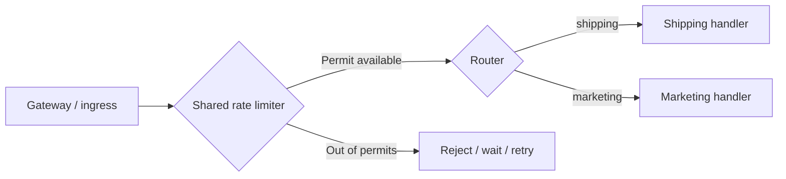
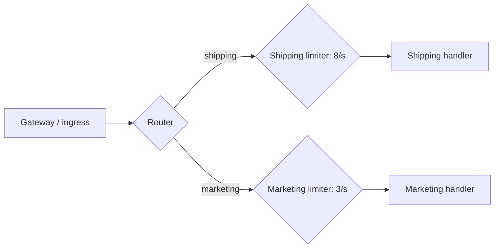
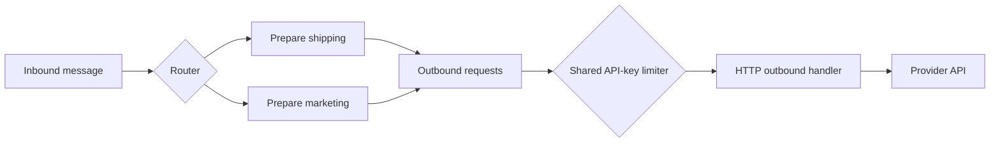
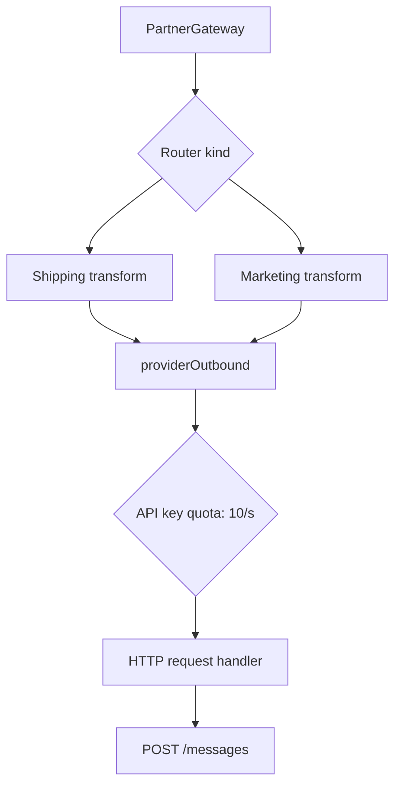
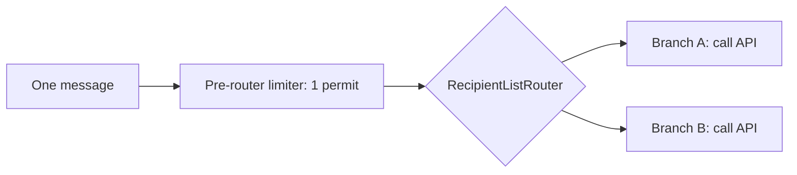
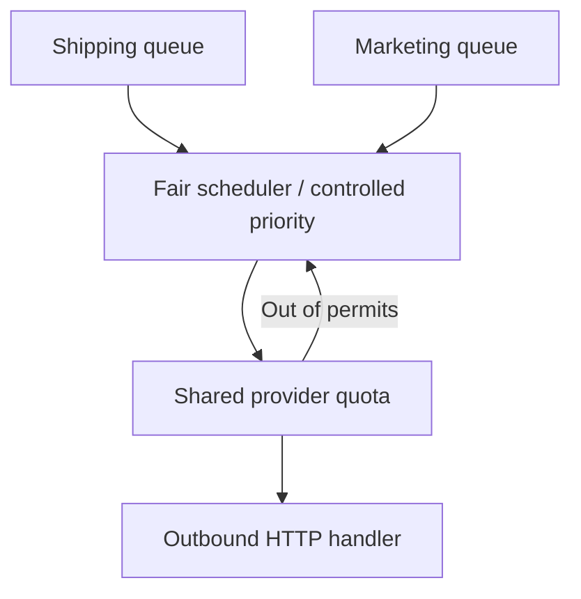
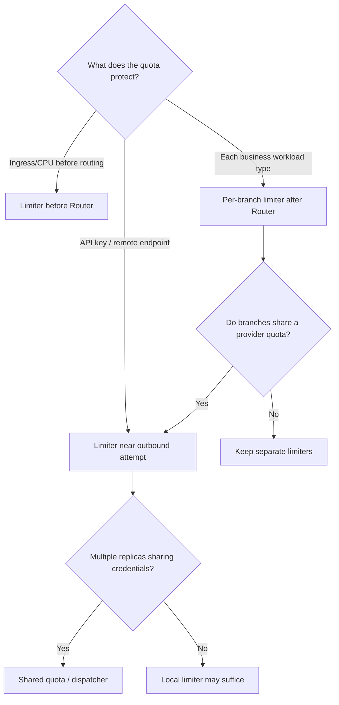

# Rate Limiting Before or After a Router in Spring Integration?

> **Module:** `SPRING_INTEGRATION_PATTERN` — Learn to implement Enterprise Integration Patterns with Spring Integration to build loosely coupled and extensible message flows. Practice Router, Filter, Transformer, Splitter, Aggregator, Gateway, retry, error channel, and correlation, as well as testing and monitoring processing branches.
>
> **Chapter:** Rate limiter  
> **Topic:** Rate limiting before or after a router

## 1. Problem: Where You Place the Limiter Changes the Meaning of the Quota

A system receives customer messages and uses a **Router** to forward each message to one of two flows:

- `shipping`: sends delivery requests, requiring early responses.
- `marketing`: sends campaigns, which can be deferred.

Both flows may call **the same partner API key**, limited to 10 outbound requests/second. The system also wants to allocate a dedicated budget to marketing so it does not consume all capacity needed by shipping.

Should permits be controlled **before the Router**, **after the Router**, or at **the final API-calling handler**?

The answer depends on what needs to be measured and counted:

- Before the Router: every message admitted into the routing stage can consume a permit, regardless of which branch it takes.
- After the Router: each branch can use its own limiter; only messages reaching that branch consume that branch's permits.
- At a shared outbound handler after branches merge: every entry into the request-sending handler shares the target API's budget.
- Combining multiple layers: you can have both per-flow budgets and a total API-key quota; keep in mind that sequential permit checks **do not provide atomic rollback**.

**Learning outcomes:** pick a placement matching the real quota, distinguish message count from outbound attempt count, configure an example in Spring Integration, examine multi-destination Router/Filter/Splitter/retry scenarios, and test rate limiter rejection cases.

## 2. Three Common Topologies

### 2.1. Limiter Before Router: Ingress Stream Quota



If the limiter grants 10 permits/second, **the total entries passing that point** are controlled at 10 permits/second per instance. There is no automatic priority mechanism: 10 marketing messages can consume all permits before shipping arrives.

**Pros:** one easy-to-understand choke point, saves downstream routing/branch resources, useful when the quota applies to all inbound messages.

**Limitations:** messages dropped by the Router, malformed messages, or messages resulting in multiple requests after the Router can all make permit count diverge from outbound attempt count. Thus a pre-router limiter **does not guarantee** compliance with a provider's quota unless there is a strict one-message-to-one-request relationship.

### 2.2. Limiter After Router: Per-Branch Budgets



Each message enters only the routed branch (with a single-destination Router), so it only consumes that branch's budget.

**Pros:** easy to tune per workload type, isolates an overloaded branch, records per-flow metrics.

**Limitations:** if both handlers call the same API key with a 10 requests/second quota, configuring 8 + 3 = **11 requests/second** can exceed the partner's quota. Two independent limiters with different names—or even the same name but separate state—do not automatically create a shared total budget.

### 2.3. Limiter at a Shared Outbound Point: Actual API Quota



When each entry into `HTTP outbound handler` corresponds to **one HTTP attempt**, a limiter at this position counts the exact unit providers typically enforce. Branches can still have their own limiters to manage budgets or priorities, while **the total quota** sits at the shared point.

If branches call different APIs with independent quotas, create limiters keyed to each real quota (`provider + API key + endpoint/endpoint group`) and attach them to the corresponding handlers.

## 3. Comparison Table for Choosing Placement

| Criterion | Before Router | After Router per branch | After branch merge, before API |
|---|---|---|---|
| Unit counted | Messages entering a point before branching | Entries into each branch's handler | Entries into the shared outbound handler |
| Controls total messages before routing? | Yes | Not directly | Not directly |
| Isolates per-flow quotas? | No | Yes | No, if using only one limiter |
| Protects a shared API key? | Only if every message produces one attempt and no retries bypass the limiter | No if branch limiters are independent | Yes for attempts passing through that handler |
| Messages dropped by Router | May have already consumed a permit | Never enter a branch so no branch permit used | Never reach outbound so no permit used |
| Router duplicates message to N targets | One permit can cause N executions | Can acquire N permits across N branches | Each outbound attempt acquires a permit |
| When one branch runs out of permits | Blocking affects all branches if sharing one quota | Other branch still has its own quota | Branches contend for the same API quota |
| When running multiple replicas | State local per replica | State local per replica | State local per replica unless coordinated |

All three approaches require verifying **state scope**. Within one JVM, multiple messages sharing one limiter bean share that state. Across JVMs/replicas, identical limiter names do not mean shared permits.

## 4. Two Numerical Examples: Same Traffic, Different Decisions

### Example A — Shared Provider Quota

In one second, shipping has 6 messages and marketing has 6 messages. Each message after routing produces **one** HTTP request. The provider allows 10 requests/second.

| Configuration | Calls that can receive permits | Evaluation |
|---|---|---|
| One 10/s limiter before Router | Up to 10 messages enter Router | Can work if every message produces one HTTP attempt; does not guarantee fairness |
| Two 10/s limiters after Router | Up to 6 + 6 = 12 requests | **Risks exceeding** the 10/s quota |
| Two 5/s limiters after Router | Up to 5 + 5 = 10 requests | Protects total under this assumption, but wastes quota when one branch is idle |
| One 10/s limiter at shared handler | Up to 10 handler entries | Best fit when quota ties to HTTP attempts and all outbound paths pass through the handler |

Note: these numbers represent **periodic permits** in the illustrative rate limiter mechanism, not an exact sliding-window guarantee at every instant. Every retry sending a new request must be counted additionally.

### Example B — Router Duplicating Messages

One inbound message is routed to **two** notification endpoints; each endpoint makes one HTTP attempt.

- If a limiter before the Router grants one permit: downstream can still generate **two** HTTP attempts.
- If limiters sit on the two outbound handlers, each handler needs a permit from its corresponding quota.
- If both endpoints belong to **the same API key quota**, they must share one quota budget even across different routes.

This situation often arises with `RecipientListRouter`, publish-subscribe, or Splitter. Always count **actual requests**, not only original messages.

## 5. How Does Spring Integration Attach a Limiter to a Handler?

Spring Integration implements rate limiting via `RateLimiterRequestHandlerAdvice` backed by Resilience4j. The advice wraps **a single message handler** and requests a permit before invoking that handler.

Main `RateLimiterConfig` parameters:

| Parameter | Meaning | Example |
|---|---|---|
| `limitForPeriod` | Number of permits per cycle | 10 |
| `limitRefreshPeriod` | Length of permit refresh cycle | 1 second |
| `timeoutDuration` | Maximum wait to acquire a permit | 100 ms |

When permits run out, the call can wait if `timeoutDuration` is positive, or fail immediately with `Duration.ZERO`. With `DirectChannel`, waiting occupies the message-sending thread; exceptions usually propagate back toward the Gateway/caller.

**Attaching an advice to `@Router` does not magically make all outbound branches share a quota.** In the example below, we use a `@ServiceActivator` as an *admission* step before the Router and attach advices to the post-Router handlers. This makes each counter's exact location explicit.

## 6. Complete Java Example: Limiting Both Before Router and Per Branch

Illustrative assumptions:

- All messages enter from `PartnerGateway` and pass through `globalIngressQuota` (10 permits/second).
- The Router inspects the `kind` header and sends each message to **only one** of the two branches.
- Shipping has `shippingQuota` (8 permits/second), marketing has `marketingQuota` (3 permits/second).
- For now, each branch returns a simulated string without making real HTTP calls.

This example is meant to compare limiter **placements**. Without a shared HTTP outbound step, do not infer that the two branch limiters protect a provider quota.

### 6.1. Dependencies and Application

Gradle example:

```groovy
dependencies {
    implementation "org.springframework.boot:spring-boot-starter-integration"
    implementation "io.github.resilience4j:resilience4j-ratelimiter:VERSION"
}
```

Choose a `VERSION` compatible with the Spring Boot/Spring Integration version in use, or manage versions via the project's BOM.

```java
package com.example.routingquota;

import org.springframework.boot.SpringApplication;
import org.springframework.boot.autoconfigure.SpringBootApplication;
import org.springframework.integration.annotation.IntegrationComponentScan;
import org.springframework.integration.config.EnableIntegration;

@SpringBootApplication
@EnableIntegration
@IntegrationComponentScan
public class RoutingQuotaApplication {

    public static void main(String[] args) {
        SpringApplication.run(RoutingQuotaApplication.class, args);
    }
}
```

`@IntegrationComponentScan` registers interfaces annotated with `@MessagingGateway`.

### 6.2. Gateway Sending Messages and Routing Header

```java
package com.example.routingquota;

import org.springframework.integration.annotation.MessagingGateway;
import org.springframework.messaging.handler.annotation.Header;
import org.springframework.messaging.handler.annotation.Payload;

@MessagingGateway(defaultRequestChannel = "incomingRequests")
public interface PartnerGateway {

    String submit(@Payload String payload,
                  @Header("kind") String kind);
}
```

Caller example:

```java
String shippingResult = partnerGateway.submit("order-123", "shipping");
String marketingResult = partnerGateway.submit("campaign-567", "marketing");
```

`kind` in this example is just a routing selector. In real systems, if a route carries priority or per-tenant quota implications, obtain this information from an authenticated/authorized source; do not blindly trust arbitrary headers from external callers.

### 6.3. Declaring Channels and Advices

```java
package com.example.routingquota;

import java.time.Duration;

import io.github.resilience4j.ratelimiter.RateLimiterConfig;
import org.springframework.context.annotation.Bean;
import org.springframework.context.annotation.Configuration;
import org.springframework.integration.channel.DirectChannel;
import org.springframework.integration.handler.advice.RateLimiterRequestHandlerAdvice;
import org.springframework.messaging.MessageChannel;

@Configuration
public class RoutingQuotaConfig {

    @Bean
    public MessageChannel incomingRequests() {
        return new DirectChannel();
    }

    @Bean
    public MessageChannel requestsForRouter() {
        return new DirectChannel();
    }

    @Bean
    public MessageChannel shippingRequests() {
        return new DirectChannel();
    }

    @Bean
    public MessageChannel marketingRequests() {
        return new DirectChannel();
    }

    @Bean
    public RateLimiterRequestHandlerAdvice globalIngressQuota() {
        return new RateLimiterRequestHandlerAdvice(
                rateConfig(10), "global-ingress");
    }

    @Bean
    public RateLimiterRequestHandlerAdvice shippingQuota() {
        return new RateLimiterRequestHandlerAdvice(
                rateConfig(8), "shipping-flow");
    }

    @Bean
    public RateLimiterRequestHandlerAdvice marketingQuota() {
        return new RateLimiterRequestHandlerAdvice(
                rateConfig(3), "marketing-flow");
    }

    private RateLimiterConfig rateConfig(int permitsPerSecond) {
        return RateLimiterConfig.custom()
                .limitForPeriod(permitsPerSecond)
                .limitRefreshPeriod(Duration.ofSeconds(1))
                .timeoutDuration(Duration.ZERO)
                .build();
    }
}
```

Here:

- `globalIngressQuota` is attached to the handler **right before the Router**.
- `shippingQuota` and `marketingQuota` are attached to the handlers **after the Router**.
- `Duration.ZERO` makes immediate rejection easy to observe when permits run out.
- The three limiters are three independent budgets on the same application instance.

### 6.4. Creating Endpoints in Order

```java
package com.example.routingquota;

import org.springframework.integration.annotation.Router;
import org.springframework.integration.annotation.ServiceActivator;
import org.springframework.messaging.Message;
import org.springframework.messaging.handler.annotation.Header;
import org.springframework.stereotype.Component;

@Component
public class RoutingHandlers {

    // PRE-ROUTER: this advice runs before calling the Router.
    @ServiceActivator(
            inputChannel = "incomingRequests",
            outputChannel = "requestsForRouter",
            adviceChain = "globalIngressQuota")
    public Message<String> admit(Message<String> message) {
        // Simply forward the message while preserving headers/replyChannel.
        return message;
    }

    @Router(inputChannel = "requestsForRouter")
    public String chooseRoute(@Header("kind") String kind) {
        if ("shipping".equals(kind)) {
            return "shippingRequests";
        }
        if ("marketing".equals(kind)) {
            return "marketingRequests";
        }
        throw new IllegalArgumentException("Unknown kind: " + kind);
    }

    // POST-ROUTER: each branch has its own advice.
    @ServiceActivator(
            inputChannel = "shippingRequests",
            adviceChain = "shippingQuota")
    public String handleShipping(String payload) {
        // Demo: replace with an actual outbound attempt.
        return "shipping accepted: " + payload;
    }

    @ServiceActivator(
            inputChannel = "marketingRequests",
            adviceChain = "marketingQuota")
    public String handleMarketing(String payload) {
        // Demo: replace with an actual outbound attempt.
        return "marketing accepted: " + payload;
    }
}
```

Processing sequence for a message with `kind=shipping`:

1. Gateway sends the message to `incomingRequests`.
2. `globalIngressQuota` requests a permit. If no permit is available, `admit()` **is not called**.
3. If a permit is available, `admit()` returns `Message<String>`, preserving headers and reply channel.
4. Router reads the `kind` header and selects `shippingRequests`.
5. `shippingQuota` requests a permit before `handleShipping()`. When a permit is granted, the handler returns a reply to the Gateway.
6. If `shippingQuota` rejects, the message **has already consumed a `globalIngressQuota` permit**; this permit is normally not refunded.

**Key takeaway:** two limiter layers do not form an "all or nothing" permit transaction. Placing two layers too close together can waste the first quota when the second layer rejects. Evaluate this behavior carefully, especially when the first quota represents real cost or a scarce resource.

The example includes three advice beans for teaching purposes. In real deployments, keep only layers that genuinely enforce a business constraint.

## 7. If the Goal Is a Shared API-Key Quota, How Should the Topology Change?

Suppose both shipping and marketing call `POST /messages` using the same API key. You need to limit at **a single shared API-sending handler**, after the branches finish preparing their payloads.

Recommended diagram:



The shipping/marketing branches can still keep `shippingQuota`/`marketingQuota` if internal budget allocation is needed. However, **the limiter protecting the provider** should sit at the shared outbound handler, so every actual attempt leaving toward the target requests a permit.

Java structure illustrating the change (an **alternative variant** replacing the two reply-returning handlers in section 6; do not register two sets of handlers on the same channel names simultaneously):

```java
// In @Configuration, declare the merged channel:
@Bean
public MessageChannel providerOutbound() {
    return new DirectChannel();
}

@Bean
public RateLimiterRequestHandlerAdvice providerQuota() {
    RateLimiterConfig config = RateLimiterConfig.custom()
            .limitForPeriod(10)
            .limitRefreshPeriod(Duration.ofSeconds(1))
            .timeoutDuration(Duration.ZERO)
            .build();
    return new RateLimiterRequestHandlerAdvice(config, "provider-api-key-1");
}
```

```java
// Methods in a @Component serving as endpoints for this variant:
@ServiceActivator(
        inputChannel = "shippingRequests",
        outputChannel = "providerOutbound",
        adviceChain = "shippingQuota")
public String prepareShipping(String payload) {
    return "SHIP:" + payload;
}

@ServiceActivator(
        inputChannel = "marketingRequests",
        outputChannel = "providerOutbound",
        adviceChain = "marketingQuota")
public String prepareMarketing(String payload) {
    return "PROMO:" + payload;
}

@ServiceActivator(
        inputChannel = "providerOutbound",
        adviceChain = "providerQuota")
public String sendToProvider(String preparedPayload) {
    // Stub: in a real application, call the HTTP client ONCE here.
    return "provider accepted: " + preparedPayload;
}
```

In this variant, if `globalIngressQuota` is still kept before the Router, there are **three quota layers** (ingress, branch, provider). Most systems do not need all three; usually choose per-flow quotas for internal requirements and an API-key quota to protect the partner.

**Regarding retries**, one call to `sendToProvider()` does not necessarily equal one outbound attempt if the HTTP client has an internal retry loop inside the method. Ensure every attempt (including retries) passes through the provider limiter. You can place retries at a layer that calls back through the advised endpoint or use an appropriate per-attempt interceptor. Test advice chain ordering and actual network requests; never assume retries automatically count against the quota.

If one API call sends a batch of N elements, clarify whether the provider counts quota by **request**, **recipient**, or **item**; a limiter granting one permit per method invocation is insufficient if quota is counted per item.

## 8. When Filter and Router Reject Messages

Imagine a malformed inbound message with `kind="unknown"`:

- If the limiter sits before the Router, it may **consume a permit before the Router detects the invalid route**.
- If limiters sit on each valid branch, the message enters no branch and **consumes no branch permits**.
- If a `Filter` validates messages before the limiter, invalid requests can be dropped early to avoid wasting permits.

Suggested topology:

```text
Gateway → Validate/Filter → Router → Transform → Shared outbound limiter → API
               |             |
           reject invalid   route by kind
```

However, filters must follow **business rules**. For messages that must be processed, do not silently "filter them out." Return a controlled error or route to an error/investigation branch. If users can supply priority headers, the router or filter must check permissions so callers cannot route their own messages into a higher-quota flow.

`RateLimiterRequestHandlerAdvice` only enforces limits when the handler is invoked. If the Router is configured to drop messages when no route matches, or routes to `nullChannel`, those messages are not counted at the outbound handler. That is **correct** when the goal is HTTP quota, yet may be **wrong** if the goal is limiting ingress load (for example, protecting against overload right before a complex Router).

## 9. Multi-Recipient Router, Splitter, and Aggregator

### 9.1. RecipientListRouter / Publish-Subscribe

One message received from the Gateway may be routed to two branches at the same time:



If both branches make two HTTP attempts, one permit before the Router is **not enough** for the shared quota. In this case:

- If APIs A and B have separate quotas: limit each outbound handler by its respective quota.
- If both share an API key or total quota: both outbound handlers must share state/quota under the same key, or merge attempts through a dispatcher.
- If branch B only saves internally and does not call an API: branch B does not need to consume provider permits.

### 9.2. Splitter and Aggregator

An order message is split by a Splitter into 30 child messages and each child message calls an API: a limiter before the Splitter counts one permit, while a limiter at outbound counts 30 permits (assuming one attempt per child message).

Conversely, an Aggregator combines 30 messages into **one batch request**. If the provider counts one request as one quota unit, a limiter on the batch handler costs only one permit; if the provider counts 30 recipients, you need a weighted mechanism or an item-based budget.

Preserve `correlationId`, sequence number, and business ID throughout to handle retries, deduplication, and observing failed branches.

## 10. Retry, Error Channel, and Behavior When Out of Permits

### 10.1. Three Options When a Permit Cannot Be Acquired

| Option | Suitable application | Additional configuration needed |
|---|---|---|
| Wait for permit with timeout | Short request-reply with a latency budget | Short enough `timeoutDuration`, limit waiting threads |
| Fail fast | Caller can retry or receive an immediate error | Exception mapping, backoff, error-return policy |
| Defer processing | Message must complete, bursty load | Durable queue/broker, consumer, retry/ack/idempotency |

**A rate limiter does not automatically put messages into a queue.** If the advice times out and throws an exception, retrying or re-queuing depends on the flow/adapter. With `DirectChannel` and a synchronous Gateway, exceptions usually return to the caller. In asynchronous flows (poller, executor, or broker consumer), errors may be turned into an `ErrorMessage` or managed by the adapter's mechanism; do not assume every error goes to the global `errorChannel`.

### 10.2. Retries Must Count All Outbound Attempts

For example, a message passes through a pre-router limiter and the API returns HTTP 503. If retries happen three times **inside the post-Router handler** without passing through the pre-router limiter, one ingress permit can emit four outbound requests.

Therefore:

1. Before the Router, rate limiting controls the rate **passing through the Router**, appropriate when that is the goal.
2. At the outbound handler, rate limiting controls **handler starts**. Inspect how the HTTP client/retries execute inside the handler.
3. To protect a per-attempt provider quota, ensure **every actual HTTP attempt** passes through the provider limiter.
4. For HTTP 429, honor `Retry-After` and use backoff with jitter; do not retry continuously while quota remains exhausted.

### 10.3. Integrity with QueueChannel / Broker

If routing completes and puts messages into an in-memory `QueueChannel`, messages **do not automatically survive restarts**. For transactions requiring guaranteed processing, use a persistent broker or message store with proper acknowledgment/retry.

Once a message is dequeued and the handler fails, never assume the message automatically goes back into the queue. Failures after a successful HTTP call but before ACK can cause broker redelivery; therefore use an **idempotency key** or deduplicate by business ID when the API has side effects.

## 11. Limiter Placement Order and Impact on Fairness

A single shared limiter before the Router is **simple, but not fair by default**. If marketing has 1,000 messages waiting and shipping has 10 messages, who gets the first permit depends on scheduling and arrival order; there is no dedicated priority guarantee for shipping.

Separate branch limiters protect other branches from having **their own branch permits** exhausted, yet do not automatically guarantee the overall provider quota.

When both fairness and a total quota are needed, you can use:



A scheduler can use weighted round-robin or weighted fair queueing with anti-starvation safeguards. This is an **additional application/broker design**, not an automatic feature of RateLimiter advice.

**Placing the limiter on the real budget** matters more than stacking many limiter layers regardless of side effects. Multiple layers requesting permits sequentially are not atomic: if the final layer rejects, permits already taken from earlier layers are normally not refunded.

## 12. Operating with Multiple Replicas and Tenants

Suppose the provider quota is 100 requests/second on a shared API key. The system has four replicas, each configured with `limitForPeriod=100`. As a result, each replica can grant permits independently, and total outbound traffic can approach **400 requests/second** (not counting cycle-boundary bursts).

Common approaches:

- **One shared outbound dispatcher:** easy to control global quota, though high availability and throughput must be designed.
- **Distributed rate limiter:** a shared-state system/mechanism granting permits atomically per quota key; must handle network errors, latency, and fail-open/fail-closed policies.
- **Local budget splitting with headroom:** total allocated capacity is lower than real quota and tracked across replica count changes; simple, though it can underutilize capacity on lightly loaded replicas and is not strict against bursts.

With multi-tenancy, you may need per-`tenantId` quotas to protect individual customers alongside a total `apiKey` quota. **Tenant ID must come from authenticated/authorized context**, not directly from an arbitrary client-supplied header. Separating per-tenant quotas and provider quotas serves two distinct goals; permit acquisition order must be factored into coordination design.

## 13. Testing Limiter Placement

### 13.1. Scenario Matrix

| Scenario | Topology | Result to verify |
|---|---|---|
| Only shipping sends load | Limiter before Router | Entries passing the admission gate stay within granted permits |
| Marketing burst | Shared limiter before Router | Shipping can be rejected even with low volume; no automatic fairness |
| Marketing budget exhausted | Post-Router per-branch limiters | Shipping still has its own branch permits |
| Two branches, same provider | Two independent branch limiters | Combined outbound calls can exceed provider quota |
| Two branches merge into shared outbound | Shared limiter on final handler | Every entry into the shared handler acquires a permit |
| Router sees unknown `kind` | Limiter before Router | Permit may be consumed before routing failure |
| Router has two recipients | Limiter before Router | One permit can generate two outbound attempts |
| Splitter produces N messages | Limiter before/after Splitter | Count actual requests at the final handler |
| Multiple HTTP retries | Retries after pre-router limiter | Verify whether each retry attempt acquires a provider permit |
| Two replicas | Local limiter state | Total permits scale with replicas; shared quota needed if provider enforces global limit |
| Asynchronous flow | `ExecutorChannel` / poller | Permit errors go to the proper error handling/consumer policy |

### 13.2. A Simple Test Independent of Tight Boundary Timing

The test below checks only Resilience4j **permits** in a single JVM as a baseline before running integration tests:

```java
import static org.junit.jupiter.api.Assertions.*;

import java.time.Duration;

import io.github.resilience4j.ratelimiter.RateLimiter;
import io.github.resilience4j.ratelimiter.RateLimiterConfig;
import org.junit.jupiter.api.Test;

class QuotaAdmissionTest {

    @Test
    void onePermitRejectsSecondImmediateCall() {
        RateLimiterConfig cfg = RateLimiterConfig.custom()
                .limitForPeriod(1)
                .limitRefreshPeriod(Duration.ofMinutes(1))
                .timeoutDuration(Duration.ZERO)
                .build();

        RateLimiter limiter = RateLimiter.of("test-route-quota", cfg);

        assertTrue(limiter.acquirePermission());
        assertFalse(limiter.acquirePermission());
    }
}
```

This is **not a Router integration test**. To properly test the Spring Integration topology:

1. Create stub handlers with `AtomicInteger` to count entries into `shipping`, `marketing`, and outbound HTTP.
2. Use a small permit count, a long refresh period, and `timeoutDuration = Duration.ZERO` to reduce clock dependency.
3. Send messages through `PartnerGateway` for each `kind`; assert handler invocation counts and corresponding exception paths.
4. Test the pre-router gate, post-router quotas, invalid routes in Router, and the shared outbound handler variant separately.
5. Test retries using an HTTP stub, counting **actual outbound attempts**; do not count only inbound messages.
6. When testing multiple replicas, send to both apps and compare total attempts under the same API key.

Do not try to pinpoint exact cycle boundaries with `Thread.sleep(10)`, as tests can run near a refresh boundary and become flaky.

### 13.3. Metrics to Observe

Track **permits granted and rejected per quota key**, messages entering the Router, messages routed to each branch, outbound HTTP attempts/statuses (especially 429), permit wait latency, queue backlog, message age, retries, and DLQ.

Distinguish three outcome groups:

- `REJECTED_BEFORE_ROUTE`: message blocked by ingress quota.
- `REJECTED_IN_BRANCH`: message routed but blocked at flow quota.
- `REJECTED_AT_PROVIDER_GATE`: message prepared for outbound but denied an API key permit.

When the partner returns HTTP 429, record `HTTP_429_REMOTE` separately because it is a **partner response**, not a pre-outbound internal rejection.

With large tenant counts, avoid exporting unbounded tenant IDs as very high-cardinality metric labels. Do not log API keys or full sensitive payloads.

## 14. Topology Decision Process

To choose rate limiter placement for a new flow, proceed step by step:

1. **Identify the real quota.** Is the quota at ingress, per flow, per tenant, remote endpoint, API key, or entire account? Does the provider enforce burst or sliding-window rules?
2. **Define one unit of quota.** One incoming message, one handler invocation, one HTTP attempt, one batch, or one item? Are there Splitters, recipient-list routing, or retries?
3. **Find the choke point all quota-consuming calls traverse.** If the quota covers HTTP attempts, prefer placing the limiter right on the shared outbound attempt. If the quota protects ingress, place it early before expensive processing.
4. **Do flows need isolation?** If yes, add branch limiters or a priority-aware scheduler/queue.
5. **Plan for missing permits.** Fail fast, bounded wait, or defer via broker? Never drop critical messages without explicit business approval.
6. **Consider distributed state.** A single-JVM limiter does not protect a total quota across replicas; design permit sharing or budget splitting.
7. **Test against actual output.** Count HTTP attempts and routing/retry traces, not just messages entering the Gateway.

A quick decision flowchart:



## 15. Hands-On Exercises

**Exercise 1 — Two Flows Competing for Quota.** Run the section 6 example with `globalIngressQuota=2`, `shippingQuota=2`, `marketingQuota=2`, long refresh, and timeout 0. Send two marketing messages then one shipping message. Explain why shipping can be rejected before the Router even though shipping quota still has permits.

**Exercise 2 — Branch-Separated Quotas.** Temporarily remove `globalIngressQuota` from the `admit` step, keeping one permit per branch. Send two shipping requests then one marketing request. Record which branch is rejected and which still succeeds.

**Exercise 3 — Merged Outbound.** Move both branches to `providerOutbound` as in section 7. Configure the provider quota to one permit per cycle, send one shipping message and one marketing message. Verify only one call reaches the outbound handler, regardless of flow type.

**Exercise 4 — Multi-Destination Router.** Create a `RecipientListRouter` sending one message to two API-calling handlers. If the provider quota counts total requests, design limiter placement so the single source message triggers two permit acquisitions.

**Exercise 5 — Retries and Errors.** Stub HTTP returns 503 on the first attempt and 200 on the next. Add backoff retry; demonstrate that provider permit acquisitions match outbound attempts. Record quota errors before Router, at the branch, and at the provider gate using three separate metrics.

**Exercise 6 — Multiple Replicas and Tenants.** Two replicas use the same API key with a 10/s quota; each replica attaches a 10/s `RateLimiterRequestHandlerAdvice`. Estimate the total possible throughput; propose a distributed dispatcher or budget-splitting approach with headroom and test that mechanism.

### Self-Assessment Questions

1. When can a pre-router limiter be equivalent in permit count to a post-router limiter?
2. Why can two branch limiters of 8/s and 3/s violate a 10/s provider quota?
3. A `RecipientListRouter` sends the same message to three outbound handlers. How many permits must be counted if the provider enforces quota by request count?
4. If the pre-router limiter granted a permit but a post-router limiter rejected, is the first permit automatically returned?
5. Why can retrying inside an HTTP handler break the one-message–one-request relationship?
6. When should you combine ingress quota, flow quota, and API key quota, and when do too many quota layers add unnecessary complexity?

## 16. References

- [Spring Integration — Router](https://docs.spring.io/spring-integration/reference/router.html): conditional message routing and endpoint configuration.
- [Spring Integration — Request Handler Advice](https://docs.spring.io/spring-integration/reference/handler-advice.html): wrapping handlers with advice, including rate limiting.
- [Spring Integration — Messaging Gateways](https://docs.spring.io/spring-integration/reference/gateway.html): Gateway, request-reply, and exception propagation.
- [Spring Integration — Filter](https://docs.spring.io/spring-integration/reference/filter.html): message filtering and discard paths.
- [Spring Integration — Error Handling](https://docs.spring.io/spring-integration/reference/error-handling.html): synchronous and asynchronous error handling.
- [Resilience4j — RateLimiter](https://resilience4j.readme.io/docs/ratelimiter): permit configuration, cycles, and metrics.
