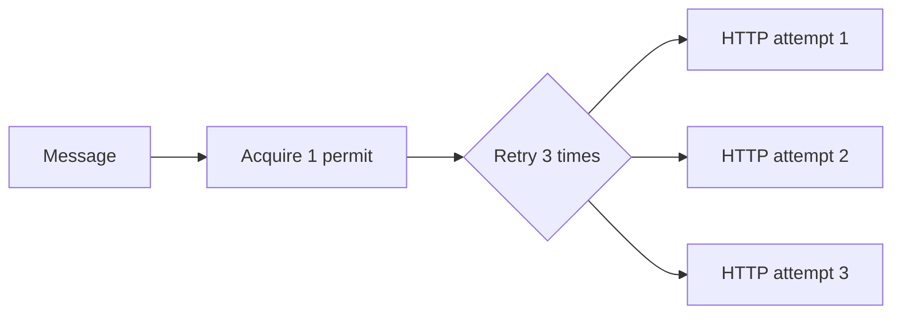
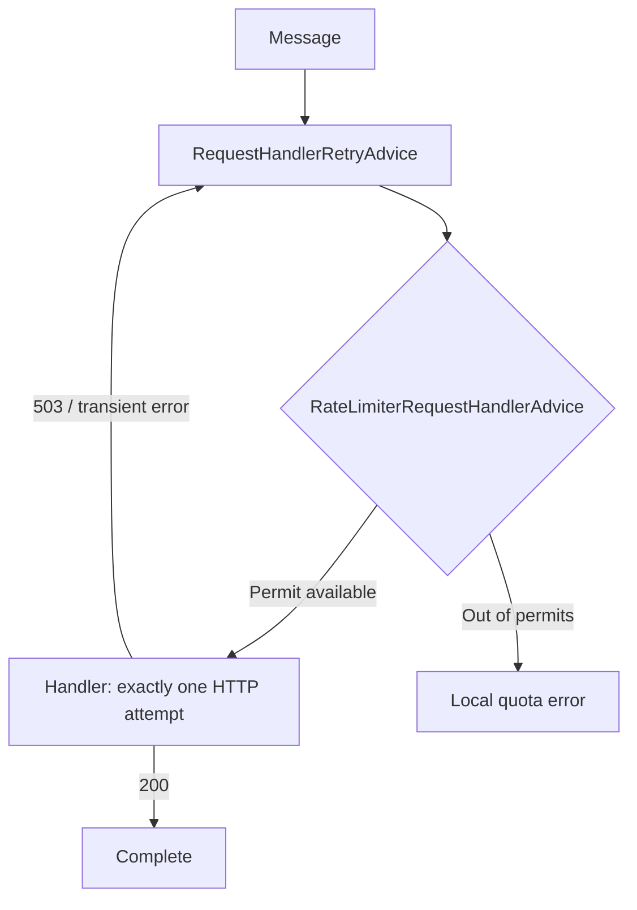
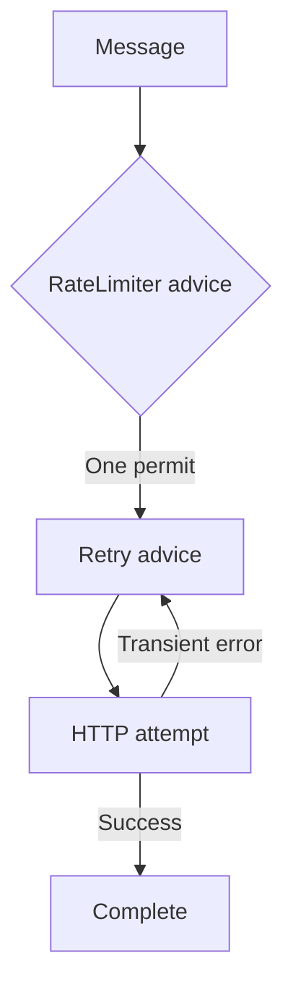
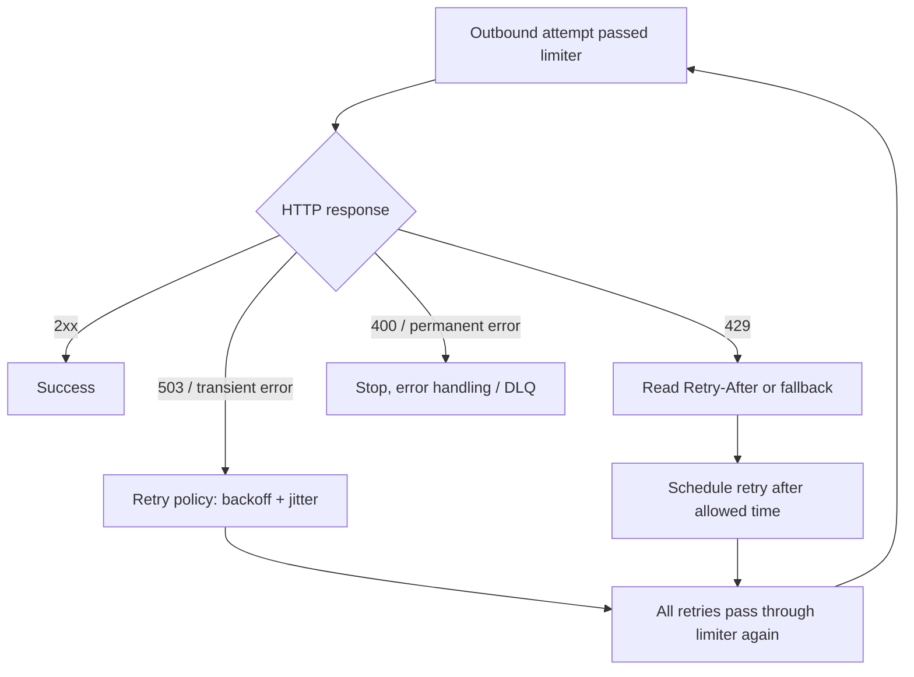
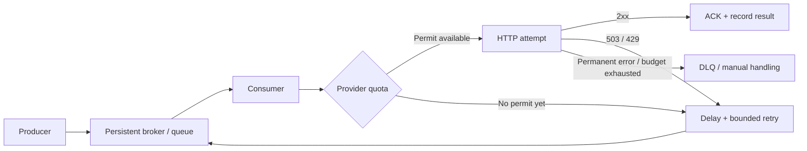

# Combining Rate Limiter with Retry in Spring Integration

> **Module:** `SPRING_INTEGRATION_PATTERN` — Learn to implement Enterprise Integration Patterns with Spring Integration to build loosely coupled and extensible message flows. Practice Router, Filter, Transformer, Splitter, Aggregator, Gateway, retry, error channel, and correlation, as well as testing and monitoring processing branches.
>
> **Chapter:** Rate limiter  
> **Topic:** Combining rate limiter with retry

## 1. Why Must Rate Limiter and Retry Be Designed Together?

A system receives 8 shipment creation requests per second. The shipping partner allows at most **10 HTTP requests/second** per API key. When the network flickers or the partner returns HTTP 503, the application retries failed requests.

One message can generate **multiple actual HTTP calls**:

```text
Message M-101
  ├─ Attempt 1: HTTP 503
  ├─ Attempt 2: timeout
  └─ Attempt 3: HTTP 200
```

If only **one permit is acquired before starting the entire retry process**, the application consumes one permit yet sends three requests to the partner. The permit counter then no longer reflects the quota imposed by the partner. In another scenario, retrying too fast when the rate limiter is out of permits can create an error loop and clog threads.

We must answer clearly:

1. **What does each permit represent?** One business message, one handler invocation, or one HTTP attempt?
2. **Is the limiter inside or outside the retry loop?** That determines whether each attempt is checked against the quota.
3. **Which errors should be retried?** HTTP 503 and transient network errors may need retries, whereas bad payloads or internal out-of-permit errors usually need different handling.
4. **When should retries happen?** Exponential backoff, jitter, `Retry-After`, and permit refresh schedules must be coordinated.
5. **Where is the message held?** A synchronous Gateway may keep the caller waiting; a broker/queue requires ack/nack, delays, and idempotency.

The goal is to ensure **every outbound attempt has permission to send**, without causing a retry storm or losing critical messages.

## 2. Distinguishing Message, Attempt, and Permit

These concepts have distinct relationships:

| Term | Meaning | Example |
|---|---|---|
| **Message** | Unit of information/business intent | Create shipment `order-42` |
| **Handler invocation** | One call by Spring Integration into a handler | `sendToPartner(order)` |
| **Outbound attempt** | One actual client attempt to call HTTP/partner | 1st POST, 2nd POST |
| **Permit** | Authorization for a limiter-protected step to execute | 1 permit per outbound attempt |
| **Retry attempt** | A subsequent attempt after failure | Retry after 503 |
| **Business operation** | The business outcome that must happen per rules | One shipment for `order-42` |

One handler invocation can produce **0 HTTP attempts** (rejected before calling), **1 HTTP attempt** (no internal retry), or **N HTTP attempts** (HTTP client retries internally). Therefore, attaching a Rate Limiter advice to a handler only protects the number of **handler invocations**. To protect real request counts, ensure **every outbound attempt** goes through a rate-limited handler, or enforce quota checks at the HTTP client layer per attempt.

**Calculation example.** If each message is retried up to three calls, the probability of a transient failure per attempt is \(p=0.25\), and assuming independent failures, the expected number of HTTP attempts per message is:

\[
E[A] = 1 + p + p^2 = 1.3125
\]

At 8 messages/second, the expected outbound load is:

\[
8 \times 1.3125 = 10.5\;\text{attempts/second}
\]

This exceeds the 10 requests/second budget even though ingress is only 8 messages/second. In reality, partner errors are often **correlated over time**, so retry storms can be worse than this independent model. The formula merely illustrates expected load rather than predicting every burst accurately.

### An Easily Misconfigured Model



In the model above, all three HTTP attempts can pass under **the same single permit**. If the provider counts requests per call, this is the wrong limiter placement.

## 3. Two Advice Orderings: Retry Wrapping Rate Limiter or Vice Versa?

Spring Integration provides `RequestHandlerRetryAdvice` to retry handler invocations and `RateLimiterRequestHandlerAdvice` to acquire a permit before calling the handler. When both are in `adviceChain`, their **order** changes semantics.

### 3.1. Retry Outside, Limiter Inside



**Meaning:** each time `RetryAdvice` re-invokes the inner chain, it hits `RateLimiterAdvice` before the handler runs. This is typically the right choice if **each handler run performs exactly one HTTP attempt**.

Conceptual declaration order:

```java
@ServiceActivator(
        inputChannel = "providerRequests",
        adviceChain = {"transientRetryAdvice", "providerQuotaAdvice"})
public String callProvider(String payload) {
    // Exactly one HTTP attempt; do not retry again internally.
    return providerClient.sendOnce(payload);
}
```

In this order, the first advice is the outer wrapper and the second advice is the inner wrapper. Verify the behavior in your exact Spring Integration version with an integration test, as the full chain can also be affected by interceptors or retries inside the HTTP client.

**Special note:** if `RetryAdvice` defaults to retrying **every exception**, it can retry out-of-permit errors too — which is usually undesirable. Define a **classifying RetryPolicy** so running out of permits does not become a retry loop.

### 3.2. Limiter Outside, Retry Inside



Reversed order example:

```java
@ServiceActivator(
        inputChannel = "providerRequests",
        adviceChain = {"providerQuotaAdvice", "transientRetryAdvice"})
public String callProvider(String payload) {
    return providerClient.sendOnce(payload);
}
```

Here `RateLimiter` advice wraps **the entire retry block**. One permit can unlock multiple HTTP attempts. This is only appropriate if the quota intentionally counts **one logical operation** rather than actual requests. For normal HTTP-attempt quotas, it can cause quota overruns.

### 3.3. No Ordering Can Save Hidden Retries Inside the HTTP Client

If `providerClient.sendOnce(...)` actually has automatic retries enabled inside the HTTP library or SDK, a single handler invocation can emit multiple requests. In that case even the right `adviceChain` ordering **cannot control individual outbound attempts**.

There are two approaches:

- Disable automatic retries in the SDK so `RetryAdvice` repeats **each single HTTP call**.
- Or check permits via an interceptor/policy inside the HTTP client **before each attempt**, including SDK-triggered retries.

Verification rule: count requests **arriving at the stub server**, not merely how many times the handler is invoked.

## 4. Classify Errors Before Configuring RetryPolicy

Not every exception should be retried.

| Situation | Retry immediately with the same advice? | Recommendation |
|---|---|---|
| Transient HTTP 503/502 | Possibly, bounded | Exponential backoff, jitter, overall timeout |
| Transient network error with unknown outcome | Possibly, cautiously | Idempotency key, backoff, and log uncertainty |
| HTTP 429 from provider | Usually **do not retry immediately** | Honor `Retry-After`, adjust quota, defer |
| **Internal** permit exhaustion | Usually no | Fail fast or delay/requeue until a permit is available |
| HTTP 400 due to bad payload | No | Fix data, reject, or DLQ |
| HTTP 401/403 due to credentials/permissions | Do not retry blindly | Check config, secrets, access rights |
| Potential duplicate data confirmation | Depends on provider contract | Idempotency or status reconciliation |
| Circuit Breaker is open | Do not hot-loop retry | Wait for cooldown or reroute |

Separating exceptions such as `TransientPartnerException`, `RemoteRateLimitException`, and `InvalidPartnerRequestException` helps the retry policy decide cleanly. If the HTTP client throws an exception wrapped by Spring Integration's `MessagingException`, `RetryPolicy` must traverse the **cause chain** or normalize exceptions in an adapter layer.

Never assume HTTP 429 always includes a valid `Retry-After`. Some providers return this header, others do not, or enforce account-wide quotas shared across multiple applications. The policy needs a safe fallback.

## 5. Spring Integration Example: Three Attempts, One Permit Each

The following Java example simulates a provider returning 503 on the first two attempts and succeeding on the third. It uses two advices:

1. `RequestHandlerRetryAdvice` on the **outside**, up to three handler calls.
2. `RateLimiterRequestHandlerAdvice` on the **inside**, checking a permit on **every** handler invocation.

To keep the example clear, we retry **only** on `TransientPartnerException`. Internal out-of-permit errors, bad data, and contract errors are excluded from retries.

### 5.1. Dependencies

Gradle example, choosing versions compatible with your project's Spring Boot/Spring Integration:

```groovy
dependencies {
    implementation "org.springframework.boot:spring-boot-starter-integration"
    implementation "org.springframework.retry:spring-retry"
    implementation "io.github.resilience4j:resilience4j-ratelimiter:VERSION"
}
```

Replace `VERSION` with the Resilience4j version managed by your project (or declare an appropriate BOM). Spring Retry and Resilience4j are two dependencies with distinct roles: **retry attempts** and **quota permits**.

### 5.2. Enabling Integration, Registering Gateway

File `RetryLimiterApplication.java`:

```java
package com.example.integration.retryquota;

import org.springframework.boot.SpringApplication;
import org.springframework.boot.autoconfigure.SpringBootApplication;
import org.springframework.integration.annotation.IntegrationComponentScan;
import org.springframework.integration.config.EnableIntegration;

@SpringBootApplication
@EnableIntegration
@IntegrationComponentScan
public class RetryLimiterApplication {

    public static void main(String[] args) {
        SpringApplication.run(RetryLimiterApplication.class, args);
    }
}
```

File `PartnerGateway.java`:

```java
package com.example.integration.retryquota;

import org.springframework.integration.annotation.MessagingGateway;

@MessagingGateway(defaultRequestChannel = "providerRequests")
public interface PartnerGateway {
    String send(String payload);
}
```

### 5.3. Declaring Channel, RetryAdvice, and RateLimiterAdvice

File `RetryLimiterConfig.java`:

```java
package com.example.integration.retryquota;

import java.time.Duration;
import java.util.Map;

import io.github.resilience4j.ratelimiter.RateLimiterConfig;
import org.springframework.context.annotation.Bean;
import org.springframework.context.annotation.Configuration;
import org.springframework.integration.channel.DirectChannel;
import org.springframework.integration.handler.advice.RateLimiterRequestHandlerAdvice;
import org.springframework.integration.handler.advice.RequestHandlerRetryAdvice;
import org.springframework.messaging.MessageChannel;
import org.springframework.retry.backoff.ExponentialBackOffPolicy;
import org.springframework.retry.policy.SimpleRetryPolicy;
import org.springframework.retry.support.RetryTemplate;

@Configuration
public class RetryLimiterConfig {

    @Bean
    public MessageChannel providerRequests() {
        return new DirectChannel();
    }

    @Bean
    public RateLimiterRequestHandlerAdvice providerQuotaAdvice() {
        RateLimiterConfig config = RateLimiterConfig.custom()
                .limitForPeriod(3)
                .limitRefreshPeriod(Duration.ofSeconds(1))
                .timeoutDuration(Duration.ZERO)
                .build();

        return new RateLimiterRequestHandlerAdvice(
                config, "provider-key-shared");
    }

    @Bean
    public RequestHandlerRetryAdvice transientRetryAdvice() {
        SimpleRetryPolicy policy = new SimpleRetryPolicy(
                3,
                Map.of(TransientPartnerException.class, true),
                true,   // Traverse cause chain when exceptions are wrapped.
                false); // Outside declared classes: do not retry.

        ExponentialBackOffPolicy backoff =
                new ExponentialBackOffPolicy();
        backoff.setInitialInterval(200); // 200 ms
        backoff.setMultiplier(2.0);
        backoff.setMaxInterval(2_000);

        RetryTemplate template = new RetryTemplate();
        template.setRetryPolicy(policy);
        template.setBackOffPolicy(backoff);

        RequestHandlerRetryAdvice advice =
                new RequestHandlerRetryAdvice();
        advice.setRetryTemplate(template);
        return advice;
    }
}
```

Explanation:

- `limitForPeriod(3)`: at most three permits per one-second cycle **on this JVM**. This is an illustrative quota; choose quotas from the real provider contract.
- `timeoutDuration(Duration.ZERO)`: reject immediately when permits are exhausted without holding threads waiting for quota.
- `SimpleRetryPolicy(3, ...)`: at most **three total attempts** (one initial call and at most two retries), not three retries on top of the initial call.
- Only `TransientPartnerException` is retried, even when Spring Integration wraps it in a cause chain; internal quota errors are outside the retry set.
- Default backoff in this configuration is 200 ms before the first retry, 400 ms before the second retry. This is the wait between **transient error retries**, not permit wait time.

Under high concurrent load, synchronous backoff holds the caller's thread. Do not extend synchronous retry duration beyond the Gateway and HTTP ingress latency budget. This `ExponentialBackOffPolicy` **does not automatically read HTTP 429's `Retry-After`**; section 7 covers handling that separately.

### 5.4. Handler Executing Exactly One Outbound Attempt

File `TransientPartnerException.java`:

```java
package com.example.integration.retryquota;

public final class TransientPartnerException extends RuntimeException {

    public TransientPartnerException(String message) {
        super(message);
    }
}
```

File `PartnerClient.java`:

```java
package com.example.integration.retryquota;

public interface PartnerClient {
    // Contract: each call makes AT MOST ONE HTTP attempt.
    // Do not enable hidden retries in the HTTP SDK.
    String sendOnce(String payload);
}
```

File `StubPartnerClient.java` for learning and trial runs:

```java
package com.example.integration.retryquota;

import java.util.concurrent.atomic.AtomicInteger;
import org.springframework.stereotype.Component;

@Component
public class StubPartnerClient implements PartnerClient {

    private final AtomicInteger actualAttempts = new AtomicInteger();

    @Override
    public String sendOnce(String payload) {
        int attempt = actualAttempts.incrementAndGet();

        if (attempt <= 2) {
            // Simulate two consecutive HTTP 503 responses.
            throw new TransientPartnerException(
                    "Simulated HTTP 503 at attempt " + attempt);
        }

        return "provider accepted: " + payload;
    }

    public int getActualAttempts() {
        return actualAttempts.get();
    }
}
```

The stub above counts attempts across the entire bean lifecycle; it is only a simulation for one trial run. When testing multiple cases, create isolated stubs/limiters or reset state via an appropriate test mechanism.

File `PartnerOutboundHandler.java`:

```java
package com.example.integration.retryquota;

import org.springframework.integration.annotation.ServiceActivator;
import org.springframework.stereotype.Component;

@Component
public class PartnerOutboundHandler {

    private final PartnerClient client;

    public PartnerOutboundHandler(PartnerClient client) {
        this.client = client;
    }

    @ServiceActivator(
            inputChannel = "providerRequests",
            adviceChain = {"transientRetryAdvice", "providerQuotaAdvice"})
    public String send(String payload) {
        return client.sendOnce(payload);
    }
}
```

When a caller invokes `gateway.send("order-42")` with sufficient permits available:

1. `RetryAdvice` calls `RateLimiterAdvice`.
2. `RateLimiterAdvice` grants **permit 1**, handler calls client: 503 error.
3. `RetryAdvice` waits for backoff, then calls `RateLimiterAdvice` again.
4. `RateLimiterAdvice` grants **permit 2**, handler calls client: 503 error again.
5. `RetryAdvice` waits again, then calls `RateLimiterAdvice`.
6. `RateLimiterAdvice` grants **permit 3**, handler calls client: succeeds.
7. Gateway receives result `provider accepted: order-42`.

Thus under these conditions there are **3 HTTP attempts and 3 permits**. If permits are insufficient on the second or third attempt, `RateLimiterAdvice` rejects before the HTTP attempt and the retry policy is configured **not to retry out-of-permit errors**. The caller receives the exception along the synchronous error path instead of spinning in a hot loop.

*Demo limitation:* `StubPartnerClient` does not perform real HTTP, so it cannot prove bytes reached a provider; integration tests should replace the stub with a fake HTTP server counting received requests.

### 5.5. Checklist When Applying to a Real HTTP Client

With Java HTTP Client / WebClient / SDK, ensure:

- Disable or control hidden **automatic retries** in the HTTP library.
- Classify HTTP 503/502 and transient network errors into `TransientPartnerException` (or an error type recognized by `RetryPolicy`).
- Do not accidentally turn the advice's `RateLimitExceededException` into a `TransientPartnerException`.
- Every real outbound call, including retries after timeouts, passes through the limiter.
- If the API has side effects, pass a stable **idempotency key** per operation from the first attempt to the last.
- Use HTTP client timeouts and a sensible overall retry duration cap; the limiter's `timeoutDuration` only controls **permit wait time**.

## 6. Running Out of Permits Mid-Retry: What Happens?

Try changing the example's quota from 3 down to **1 permit/long cycle**, keeping `timeoutDuration = 0`. The first attempt gets a permit, sends HTTP, and receives 503. `RetryAdvice` wants to retry, yet on the second attempt `RateLimiterAdvice` has no permits left.

Expected result:

```text
Attempt #1: acquire permit -> send HTTP -> 503
Backoff:    wait 200 ms
Attempt #2: no permit -> rejected before sending HTTP
RetryPolicy: do not retry local quota error
=> Actual HTTP requests: 1
```

This behavior is **safer for quota** than continuing to send HTTP requests, though it means the business operation is incomplete. You must decide whether to **return an error to the caller**, **re-queue the message**, or **defer until the next cycle**, depending on business criticality.

Do not simply bump retries from 3 to 30 to "wait until a permit appears," because:

- It causes many unnecessary policy evaluations.
- It can hold Gateway/poller threads for a long time.
- It easily amplifies load when many messages hit permit exhaustion simultaneously.
- It cannot handle durable backlogs or application restarts.

If the goal is to **wait for quota recovery for eventual processing**, consider controlled queuing/delayed retry at the orchestration layer.

## 7. HTTP 429 and Retry-After: Deferring Using Partner Hints

HTTP **429 Too Many Requests** happens when **the partner received the request** and rejected it under their policy. It differs from **local limiter permit exhaustion** before sending: in a local rejection, the partner never receives a new request.

The partner may return:

```http
HTTP/1.1 429 Too Many Requests
Retry-After: 3
```

This header suggests the client should wait around three seconds before retrying. `Retry-After` may also be an **HTTP-date**. Your calculation must validate the format, cap the wait duration, and handle missing/invalid values.

### Recommended Flow



A retry schedule can be based on:

\[
\text{nextAttemptAt} =
\max(\text{now}+\text{backoff},\ \text{now}+\text{RetryAfter})
\]

The formula assumes both durations are validly computed at the same scheduling instant. If the local limiter still lacks permits at the scheduled time, **never bypass the limiter**; defer further or reject per policy.

### Why Not Retry 429 Immediately in a Tight Loop?

- Each HTTP 429 already consumed **one outbound attempt**.
- Multiple clients retrying simultaneously can cause a *thundering herd*.
- The provider may enforce quotas per API key/account across multiple apps or pods; a single local quota cannot see all load sources.
- If the response specifies a `Retry-After` of several seconds, a long synchronous retry loop can exceed the HTTP caller's timeout.

For work that needs to finish seconds or minutes later, push the message into a broker/delayed retry and maintain idempotency. A static `ExponentialBackOffPolicy` does not automatically honor `Retry-After`; doing so requires dedicated handling in the client, scheduler, or a custom backoff policy.

## 8. Jitter, Retry Budget, and Latency Limits

**Exponential backoff** increases wait times between retries. With `initial=200 ms`, `multiplier=2`, the base schedule is 200 ms, 400 ms, 800 ms, ... up to a cap. **Jitter** adds controlled randomness so multiple clients do not retry in lockstep.

Example **full jitter** formula:

\[
d_n \sim U\left(0,\min(d_{\max},d_0 2^{n-1})\right)
\]

With `d0 = 200 ms`, `dmax = 5 s`, each message picks a random delay between 0 and the cap for that retry attempt. When `Retry-After` is present, the retry timestamp must not be earlier than the provider's instruction, even if jitter yields a smaller delay.

A system should maintain **two budgets**:

1. **Quota budget:** permitted outbound attempts per period.
2. **Retry budget:** maximum retry attempts per operation or system-wide, alongside a deadline/TTL.

Capping retries at three attempts per message does not stop **one million messages retrying at once**. You may need system-wide retry caps, limits on concurrently retrying consumers, and queue capacity limits.

### Calculating Total Timeout

A synchronous Gateway has a 1-second maximum response time. Suppose:

- Each HTTP attempt timeout is 350 ms.
- Backoff between attempts: 200 ms and 400 ms.
- Maximum of three attempts.

Approximate maximum duration:

\[
3 \times 350 + 200 + 400 = 1650\text{ ms}
\]

This figure **excludes permit waits, overhead, and scheduling**. Therefore a three-attempt policy does not fit if the caller truly waits only 1 second. Reduce attempts/timeouts or move to asynchronous processing. Avoid letting an external HTTP client time out and retry on its own while the old request is still running unchecked.

## 9. Retry Does Not Equal Exactly-Once: Idempotency and Ambiguous Failures

When an HTTP call times out, you may **not know** whether the partner executed the business action:

```text
Client                        Provider
  |--- POST /shipments ------->|
  |                            | Shipment created successfully
  |<--- response lost ---------|
  |   Timeout                  |
  |--- Retry POST ------------>|
  |                            | Risk of creating a second shipment
```

If each attempt only checks a permit, **quota is protected**, yet the business action may still run **twice**. These are two separate concerns.

Common solutions:

- Attach a **fixed idempotency key per business operation** to every outbound attempt of the same message.
- The provider recognizes the key and returns the result of the previously executed request.
- If the provider does not support idempotency, persist state and reconcile status by business ID before retrying, depending on API guarantees.
- Log `messageId`, `correlationId`, `businessId`, attempt number, and quota key for observability; never log API keys or sensitive payloads.

**Never generate a new idempotency key per retry.** Changing the key tells the provider the new attempt is an independent operation.

### Client Interface Example with Idempotency Key

```java
public record ShipmentCommand(
        String businessId,
        String recipient,
        String address) {}

public interface ShipmentClient {
    // Single HTTP attempt; HTTP header Idempotency-Key stays constant.
    String createOnce(ShipmentCommand command, String idempotencyKey);
}
```

In the handler, `command.businessId()` can be passed as the key if the business ID is stable/unique and fits the provider contract. If an operation is intentionally re-executed under the same business ID, key by **operation version** rather than reusing indiscriminately.

## 10. Synchronous Gateway, Asynchronous Queue, and Error Channel

### 10.1. Synchronous Request-Reply

With `DirectChannel` and `@MessagingGateway`, synchronous retry/backoff steps run on the message-sending thread. Exceptions after exhausting the policy usually return to the Gateway/caller, possibly wrapped by Spring Integration in `MessagingException` or another exception class.

The HTTP layer wrapping the Gateway must decide which error to return (such as 429 for local quota, 503 for transient partner errors), whether to include `Retry-After`, and whether the caller may retry the whole operation. Never treat an "accepted request" response as meaning the operation succeeded if it has not yet been processed.

### 10.2. Queue and Consumer for Extended Retries

For critical operations whose latency cannot wait multiple seconds:



The steps in the diagram are **design responsibilities of the adapter/broker and application**, not automatic behavior of `RateLimiter` advice.

Clarify:

- **Durable** queue/broker and timely acknowledgment; in-memory `QueueChannel` does not survive restarts on its own.
- Consumers do not ACK a message before persisting the outcome or safely scheduling a retry.
- Once a consumer dequeues a message and the handler fails, never assume the message automatically returns to the queue.
- Retries have attempt caps, TTLs, and delay schedules; permanently failed messages go to a DLQ or an alternative workflow.
- When the provider succeeds but ACK is lost, the message may be redelivered: idempotency is mandatory for critical side effects.

### 10.3. Error Channel Is Not an Automatic Retry Queue

In synchronous flows, errors usually propagate to the caller. With pollers, executors, or broker-driven adapters, exceptions may be wrapped into an `ErrorMessage`, sent to the corresponding error channel, or handled directly by the adapter/consumer. Never assume the global `errorChannel` always receives every error.

An error handler must distinguish:

| Error group | Suggested handling direction |
|---|---|
| Local permit exhausted | Return error or schedule after quota recovers |
| Remote HTTP 429 | Compute timestamp from `Retry-After` then defer |
| HTTP 503 / timeout | Retry with backoff, jitter, budget, and idempotency |
| Payload invalid / missing fields | Reject or DLQ per contract |
| Retry exhausted | DLQ/alert/reconcile; preserve full trace |

## 11. Interactions with Router, Filter, Splitter, Aggregator, and Circuit Breaker

When a Spring Integration flow combines multiple Enterprise Integration Patterns, limiter and retry placement must follow **the real quota unit**.

| Pattern | Common pitfall | Recommendation |
|---|---|---|
| **Router** | Two branches share an API key yet have independent limiters | Merge outbound through one dispatcher or share the provider quota |
| **Filter** | Permit is consumed before the message is filtered out | Filter out messages that do not need sending before acquiring permits |
| **Transformer** | Acquires permits for transforms before any network call | Limit close to the outbound handler |
| **Splitter** | One message becomes N HTTP attempts under one permit | Every outbound attempt must pass through the limiter |
| **Aggregator** | One batch holds N items while provider quota is per item | Account for quota by weight/items if required |
| **Gateway** | Retry/backoff holds thread too long, caller times out first | Budget deadlines; move to async when needed |
| **Error Channel** | Local/remote errors treated identically | Classify reason and route retry/DLQ |
| **Correlation** | Retries lose business ID / idempotency key | Preserve stable context across all attempts |
| **Circuit Breaker** | Keeps retrying while provider circuit is open | Stop hot-loop retries, wait for circuit/queue policy |

A Circuit Breaker can wrap outside or inside the retry loop depending on the measured unit: **each HTTP attempt** or **the entire logical operation**. Choose the policy explicitly and test metrics because advice order affects how many failures are recorded.

If a Splitter produces 10 child messages and each retries up to three attempts, the system can emit **up to 30 HTTP attempts** for one inbound message. A limiter before the Splitter takes one permit and fails to protect that 30-request quota. Placing the limiter on the handler executing each attempt is far easier to verify.

## 12. Quotas by Flow, Tenant, Endpoint, and Multiple Replicas

### 12.1. Scope of Permit Sharing

Suppose flows `orders` and `campaigns` share API key `shared-key-1`. If each flow has a 10/s limiter, combined traffic can exceed the provider's 10/s quota. Retries worsen this because each message can generate multiple requests.

Separate:

- **Flow quota:** protects budgets and priorities across business flows.
- **Tenant quota:** prevents one tenant from consuming too many resources.
- **Provider/API key quota:** caps total outbound attempts using the same credentials.
- **Retry budget:** caps extra attempts generated by failures, independent of provider quota.

For an accurate total quota, all outbound attempts sharing credentials must pass through **a single shared budget state**; identical limiter names do not guarantee two instances share state.

### 12.2. Multiple Replicas

A `RateLimiterRequestHandlerAdvice` created from config normally holds rate limiter state **in the JVM**. With three replicas, each having `limitForPeriod(10)`, total throughput can approach 30 requests/second plus cross-cycle bursts. That is not a global 10/s quota.

Options:

1. Use a shared **outbound dispatcher** coordinating requests from multiple flows.
2. Use a **distributed limiter** with atomic permit granting per quota key.
3. Split budgets across replicas with headroom and update on autoscaling, recognizing this is less flexible under skewed load.

In particular, each replica maintains its own retry backlog; if all three replicas retry at the exact same moment, HTTP 429s can spike. Apply jitter, retry budgets, and monitor total HTTP attempts, not only total inbound messages.

### 12.3. Tenant Identity and Cardinality

Tenant ID must come from trusted authentication/authorization. Never use an arbitrary caller-supplied header to create new limiters because callers can swap tenant IDs to get fresh quotas. Manage per-tenant limiter lifecycle and bound registry/cached key counts. In monitoring, consider aggregating by tenant tier instead of creating Prometheus labels for millions of tenant IDs.

## 13. Testing Rate Limiter Combined with Retry

### 13.1. Recommended Test Matrix

| Scenario | Setup | Expectation |
|---|---|---|
| Immediate success | 1 permit, handler returns 200 | 1 attempt, 1 permit, no retry |
| Two 503 errors | 3 permits, max retries 3 | 3 HTTP attempts, 3 permits, eventually succeeds |
| Out of permits before second retry | 1 permit, 1st handler call returns 503, timeout=0 | Only 1 HTTP attempt; second blocked locally |
| Non-retryable exception | HTTP 400 mapped to permanent exception | Stops immediately, no further attempts |
| HTTP 429 + Retry-After | Provider specifies wait duration | Does not retry before allowed time |
| Hidden retry in SDK | SDK sends extra requests internally | Test catches attempts exceeding permits; fix limiter placement |
| Gateway timeout | Retry/backoff exceeds deadline | Reduce retries or switch to async processing |
| Queue redelivery | HTTP succeeds then ACK is lost | Idempotency prevents duplicate side effects |
| Splitter creates multiple messages | 1 message into 5 children, each with retry | Count quota by total HTTP attempts |
| Multi-instance | Three replicas sharing an API key | Total requests stay within chosen global policy |
| Error channel | Consumer lacks permits | Exception classified properly, requeued/DLQ'd per contract |

### 13.2. Small Test for Fail-Fast Permits

The JUnit 5 example below tests Resilience4j directly:

```java
import static org.junit.jupiter.api.Assertions.*;

import java.time.Duration;
import io.github.resilience4j.ratelimiter.RateLimiter;
import io.github.resilience4j.ratelimiter.RateLimiterConfig;
import org.junit.jupiter.api.Test;

class RateLimiterRetryAdmissionTest {

    @Test
    void secondAttemptHasNoPermit() {
        RateLimiterConfig cfg = RateLimiterConfig.custom()
                .limitForPeriod(1)
                .limitRefreshPeriod(Duration.ofMinutes(1))
                .timeoutDuration(Duration.ZERO)
                .build();

        RateLimiter limiter = RateLimiter.of("test-one-permit", cfg);

        assertTrue(limiter.acquirePermission());  // HTTP attempt #1
        assertFalse(limiter.acquirePermission()); // Attempt #2 must be blocked
    }
}
```

This test only checks the rate limiter. It **does not test advice ordering**. To prove Spring Integration's `RetryAdvice` wraps `RateLimiterAdvice` properly, build an integration test with `PartnerGateway` and an **HTTP stub counting requests**:

1. Configure a quota of 3 permits in a long cycle, max 3 attempts, handler returning 503 twice then 200; assert the stub receives **exactly 3 requests** and Gateway receives the reply.
2. Configure a quota of only 1 permit, max 3 attempts; stub returns 503 on the first call; assert the stub receives **exactly 1 request** and Gateway receives a local permit error on the next attempt.
3. Reverse the advice order **only in a demonstration test** to show the difference: limiter outside retry can allow three HTTP attempts under one permit. Never use the reversed setup in production if quota is per HTTP request.
4. Experimentally enable automatic retries in the HTTP SDK; if the stub receives more requests than handler invocations, it proves permits must be checked inside each SDK attempt.
5. When testing real refreshes and backoff, avoid relying on `Thread.sleep(10)` near cycle boundaries. Use sufficiently long periods or controlled time environments; prevent limiter state from one test leaking into the next.

### 13.3. Metrics and Logs

Separate at least these metrics:

| Metric | Meaning |
|---|---|
| `outbound_attempts_total` | Number of HTTP attempts executed |
| `outbound_attempt_result_total{status}` | Classification of network/HTTP status |
| `rate_limiter_acquired_total` | Permits granted |
| `rate_limiter_rejected_total` | Local permits exhausted |
| `retry_attempts_total` | Extra attempts generated after the initial call |
| `retry_exhausted_total` | Logical operations exhausting their retry budget |
| `remote_http_429_total` | Actual HTTP 429s from the provider |
| `retry_delay_seconds` | Distribution of wait times between attempts |
| `queue_backlog` / `oldest_message_age_seconds` | Asynchronous processing pressure |

If every HTTP attempt must acquire one permit, in a steady flow the number of permitted outbound HTTP attempts must not **exceed** the number of granted permits over the same measurement scope, aside from differences due to instrumentation placement and observation timing. If metrics show HTTP attempts exceeding permits, inspect hidden retries, branches bypassing the limiter, or multiple replicas granting quotas independently.

## 14. Common Mistakes

| Mistake | Consequence | Fix |
|---|---|---|
| Limiter wrapping the entire retry loop | One permit produces multiple HTTP requests | `RetryAdvice` outside, `RateLimiterAdvice` inside, if each handler call is one attempt |
| Retrying every exception | Internal permit exhaustion also retried immediately | Use a classifying `RetryPolicy` |
| Keeping automatic retries inside SDK | Advice counts once while SDK sends multiple times | Disable hidden retries or check quota per client attempt |
| Retrying 429 without honoring `Retry-After` | Continues getting rejected, causes storms | Schedule retry after the allowed timestamp |
| No jitter | Many clients retry at the exact same moment | Backoff with jitter |
| Synchronous retries for too long | Gateway/HTTP caller times out, holds threads | Budget deadlines or move to queue/consumer |
| No idempotency key | Retry after timeout can cause duplicate side effects | Keep one stable key across attempts |
| Limiting only ingress before Router/Splitter | One message produces multiple requests downstream | Place quota on each outbound attempt |
| Each pod has a "same-named" limiter | Total quota exceeds account limit | Distributed dispatcher/limiter |
| ACKing before processing finishes | Crashes can lose messages | Design ack/retry/transactions per broker |
| Infinite retries | Backlog grows uncontrollably | Retry budget, TTL, and DLQ |
| Treating HTTP 503 and 400 identically | Bad-data errors retried uselessly | Separate transient from permanent errors |

## 15. Hands-On Exercises

**Exercise 1 — Advice Ordering.** Use a mock handler returning 503 twice then 200. Configure a three-permit quota, max three attempts. Place `transientRetryAdvice` outside `providerQuotaAdvice`, measure permits and HTTP attempts. Then reverse the order in a test environment to explain the difference.

**Exercise 2 — Out of Permits Mid-Retry.** Keep max three attempts, but set quota to only one permit in a long cycle, `timeoutDuration=0`. The first call returns 503. Verify there is one HTTP attempt, the second attempt is blocked before calling the provider, and no continuous retry loop happens for the permit error.

**Exercise 3 — Handling HTTP 429.** Use an HTTP stub returning `429 Retry-After: 3` then 200. Design a delay scheduler that never retries before three seconds, respects local quota, and adds jitter when multiple messages become due together.

**Exercise 4 — Retry and Idempotency.** Stub simulates successful shipment creation yet drops the response. Retry after timeout with the same idempotency key. Verify the system creates a single shipment despite two HTTP attempts.

**Exercise 5 — Asynchronous Queue.** Send 100 messages to a broker; the consumer has a 10 requests/second provider quota. With the provider returning 503 on 20% of attempts, measure backlog, message age, retry budget, and DLQ. Propose alerts when backlog grows continuously.

**Exercise 6 — Multi-Instance.** Run three replicas calling the same API key, each replica with a 10/s limiter, while the provider allows only 10/s total. Simulate concurrent retries, then design a global limiter or outbound dispatcher so the quota is never exceeded.

### Self-Assessment Questions

1. Why can three HTTP attempts under a single permit violate the provider quota?
2. When `RequestHandlerRetryAdvice` is declared before `RateLimiterRequestHandlerAdvice`, what condition must hold so every retry attempt goes through the limiter?
3. If the HTTP SDK retries automatically inside the handler, what needs to change?
4. How do internal permit exhaustion and provider HTTP 429 differ regarding the number of requests sent?
5. Why cannot `Retry-After` be replaced with a fixed 200 ms backoff?
6. If an API call succeeded yet the response was lost, how do you retry safely with respect to side effects?
7. One message is split by a Splitter into 10 messages, each with up to three attempts: what maximum number of outbound requests should be budgeted?
8. When should retries move to a broker instead of holding a synchronous caller waiting?

## 16. References

- [Spring Integration — Request Handler Advice](https://docs.spring.io/spring-integration/reference/handler-advice.html): configuring advice chains, retry, and rate limiters.
- [Spring Integration — Retry and More](https://docs.spring.io/spring-integration/reference/handler-advice/classes.html): built-in handler advice types.
- [Spring Integration — Messaging Gateways](https://docs.spring.io/spring-integration/reference/gateway.html): request-reply and exception propagation.
- [Spring Integration — Error Handling](https://docs.spring.io/spring-integration/reference/error-handling.html): errors in synchronous and asynchronous flows.
- [Spring Retry](https://github.com/spring-projects/spring-retry): `RetryTemplate`, retry policies, and backoff.
- [Resilience4j — RateLimiter](https://resilience4j.readme.io/docs/ratelimiter): permits, timeouts, and permit refresh periods.
- [HTTP Semantics — Retry-After](https://www.rfc-editor.org/rfc/rfc9110.html#name-retry-after): `Retry-After` header in seconds or HTTP-date.
