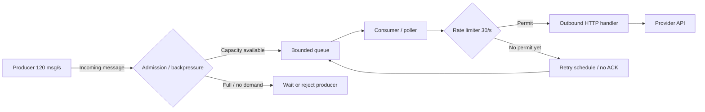
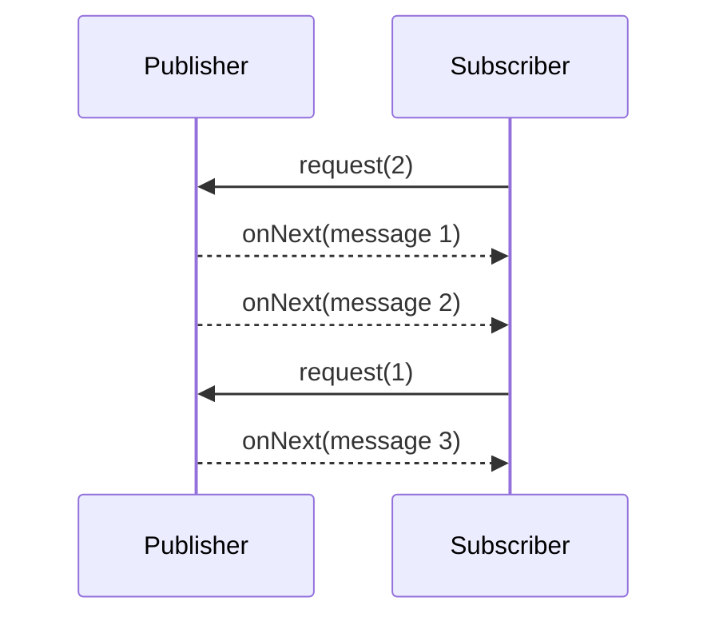
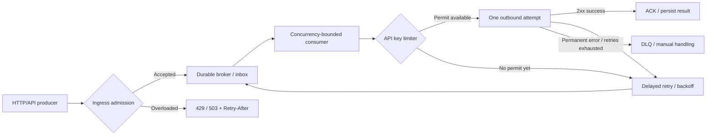

# How Do Backpressure and Rate Limiting Differ?

> **Module:** `SPRING_INTEGRATION_PATTERN` — Learn to implement Enterprise Integration Patterns with Spring Integration to build loosely coupled and extensible message flows. Practice Router, Filter, Transformer, Splitter, Aggregator, Gateway, retry, error channel, and correlation, as well as testing and monitoring processing branches.
>
> **Chapter:** Rate limiter  
> **Topic:** How do backpressure and rate limiting differ?

## 1. Starting Scenario: The Receiver Is Slower Than the Sender

An e-commerce system receives **120 order messages/second**. Each message must be converted into a request sent to a shipping partner, yet the partner API only allows **30 requests/second**.

If the sender keeps emitting 120 messages/second and no message is dropped, the backlog grows by roughly 90 messages/second. Memory, waiting threads, or broker storage will eventually run out.

We need to solve **two distinct questions**:

1. **Rate limiting:** Over a period of time, how many entries into the partner-API calling step are allowed?
2. **Backpressure:** When arrival rate exceeds processing rate, how does the system signal, slow down, pause, or reject the sender so work does not accumulate indefinitely?

A rate limiter controls **the budget of processing attempts over time**. Backpressure is **the mechanism for feeding pressure back from downstream to upstream**; when implemented properly, it aligns arrival rate or queued work with actual capacity.

Both mechanisms often appear together in Spring Integration, yet cannot replace one another.

### After This Lesson, Learners Can

- Distinguish rate limiting, flow control, concurrency limiting, and backpressure.
- Calculate backlog, queue fill time, and latency consequences.
- Identify where backpressure signals can propagate upstream in `DirectChannel`, `QueueChannel`, executors, brokers, and reactive flows.
- Use `RateLimiterRequestHandlerAdvice` to limit an outbound handler and bounded queues to cap waiting messages.
- Choose policies when queues fill up or permits run out: wait with timeout, reject, defer, or drop per business contract.
- Design retries, error handling, acknowledgments, and idempotency so orders are neither lost nor duplicated.
- Test rate limiting and backpressure using end-to-end metrics instead of looking only at configuration.

## 2. Concise Definitions and Core Differences

**Rate limiting** is the process of deciding whether an operation may start based on a budget, such as **10 permits per second** for an API key. Common algorithms include token bucket, fixed window, sliding window, or periodic permit granting.

**Backpressure** arises when a slow/full consumer has a way to **push back** so the data producer stops pushing unboundedly. Signals can take the form of: withholding new demand, time-bounded blocking `send`, bounded queue rejections, HTTP 429/503, pausing consumers, capping in-flight jobs, or throttling the producer.

| Question | Rate limiting | Backpressure |
|---|---|---|
| Primary goal | Keep execution rate at a point within a budget/quota | Prevent inbound load from overwhelming downstream or buffers |
| Trigger condition | Out of permits, period limit reached, or waiting for a permit | No remaining ingest/processing capacity, full buffer, or zero demand |
| Common parameters | Permits/period, refill rate, burst capacity, permit wait timeout | Queue capacity, outstanding demand, concurrency, send timeout, high/low watermarks |
| Signal to upstream | Can error or block, depending on flow | Requires an actual path propagating pressure back upstream |
| Automatically stores messages durably? | No | No; durability depends on broker/store and delivery contract |
| Automatically protects API quota? | Yes if placed on every outbound attempt and scoped properly | No; upstream may be throttled yet still exceed quota over time |
| Automatically prevents unbounded backlog? | No, if ingress keeps pushing into an unbounded queue | Possible, if buffers are bounded and upstream honors the signal |

**Counterexample:** Put a **30 requests/second** rate limiter before an API while letting the producer push into an **unbounded** queue at 120 messages/second. The API stays within quota, yet the queue keeps swelling. The rate limiter works properly while the system still risks running out of memory or disk.

**Opposite example:** A consumer allows only 5 messages processing concurrently and stops requesting more until a slot frees up. That is a form of backpressure/concurrency control, yet if 5 messages finish very quickly, HTTP requests per second can still exceed the provider's quota. A separate rate limiter is needed.

## 3. Visualizing the Relationship Between Producer, Buffer, Consumer, and Quota



The diagram illustrates **architectural responsibilities**, not a flow auto-generated by Spring Integration. Specifically, a consumer failing to acquire a permit **does not mean the message automatically returns to the queue**. Retry/requeue and ACK behavior must be explicitly designed for the channel/broker in use.

### 3.1. Backlog Formula

Notation:

- \(\lambda\): message arrival rate, in messages/second.
- \(\mu\): rate of messages successfully processed and leaving the system, in messages/second.
- \(Q(t)\): number of waiting messages in the backlog at time \(t\).

Over an interval where rates are roughly steady without dropping or redirecting messages:

\[
\Delta Q \approx \max(0,\lambda-\mu)\Delta t
\]

With \(\lambda=120\) and \(\mu=30\):

\[
\Delta Q \approx (120-30)\times 10 = 900
\]

After 10 seconds, the backlog grows by roughly **900 messages**. If the queue starts empty with capacity 900 and rates hold steady, it can fill up in **approximately 10 seconds**. In practice, leave headroom for bursts, retries, in-flight messages, gaps between ingest rate and ACK rate, and operational overhead.

If the sender stops completely after 10 seconds while the consumer continues at 30 messages/second with no errors/retries, it takes roughly **900/30 = 30 seconds** to drain the accumulated backlog.

**Conclusion from the math:** increasing queue capacity only increases **overload survival duration**; it does not eliminate the capacity gap between producer and consumer.

### 3.2. Latency Also Increases

Even while the queue still has space, messages must wait behind earlier ones. With a backlog of 900 and steady processing at 30 messages/second, a message at the tail of the queue may wait around **30 seconds** in a simple FIFO model. This is a throughput estimate, not a latency SLA: concurrency, batching, retries, and priorities can alter ordering.

In steady state, Little's Law relates average work in the system \(L\), completion throughput \(\lambda_{\text{effective}}\), and average residence time \(W\):

\[
L = \lambda_{\text{effective}} W
\]

This formula **does not allow assuming** the system is in steady state when the producer is continuously faster than the consumer. With sustained \(\lambda > \mu\) and no ingress limit, the backlog never reaches steady state.

## 4. Ways Backpressure Propagates in Spring Integration

Spring Integration is built around message channels, handlers, gateways, and adapters. There is no single automatic backpressure mechanism across all channels.

### 4.1. DirectChannel: Propagating Pressure Through the Calling Thread

`DirectChannel` hands the message directly to the subscriber on **the sender's thread**. When the handler is slow or blocked waiting for a permit, the producer's `send()` call also slows down or blocks.

```text
HTTP/Gateway thread
    -> DirectChannel.send(message)
        -> handler: wait for permit / call API
    <- handler finishes or throws exception
    <- send() returns / exception propagates back
```

This can **slow the producer down to downstream pace** if the producer sends sequentially and waits for `send()` to return. However, if thousands of HTTP requests arrive concurrently, thousands of threads can still block waiting for permits at once. `DirectChannel` **does not automatically cap the total number of waiting producers**.

Pay attention to timeouts across layers: permit wait timeout, HTTP client timeout, Gateway timeout, and HTTP ingress deadline. If the caller only has 300 ms while a permit can wait 2 seconds, the configuration is mismatched.

### 4.2. QueueChannel: A Bounded Buffer Creates a Blocking Point

`QueueChannel` is a `PollableChannel`. A consumer uses a poller calling `receive()` to pull messages. You can configure a **bounded capacity** to prevent unbounded queue growth:

```java
@Bean
public QueueChannel pendingOutbound() {
    return new QueueChannel(50);
}
```

With a capacity-50 queue, `send(message, timeoutMillis)` can **wait up to the timeout** when full and return `false` if the message cannot be enqueued. That creates admission/backpressure capability at **the queue send point**.

However, having a buffer does not mean upstream automatically adjusts. The caller must check `send()`'s return value, timeouts, and error paths. If the caller sees `false` and ignores the message without returning an error or persisting it, the system still loses data.

**Durability characteristic:** an in-memory `QueueChannel` does not guarantee message survival across restarts. For orders that must be processed, use a persistent message store or suitable broker alongside a delivery/ACK mechanism.

### 4.3. ExecutorChannel: Asynchrony Can Hide Overload

`ExecutorChannel` uses a `TaskExecutor` to run handlers on worker threads. Producers usually return faster because execution moves to the executor.

If the executor has an **unbounded queue**, the system can accept far more messages than it can process and accumulate backlog in memory. Choose an appropriate thread pool size, queue capacity, and `RejectedExecutionHandler`/rejection policy.

Example policies:

- Cap worker count and queued tasks.
- When the pool/queue fills, return an error to the producer so it can back off or reject cleanly.
- `CallerRunsPolicy` can execute work on the sending thread, slowing producers down in some cases, though behavior during executor shutdown, timeouts, and workload types must be verified.

Switching from `DirectChannel` to an executor **does not increase the throughput of a quota-limited API**.

### 4.4. Broker: Pressure Crossing System Boundaries

Kafka, RabbitMQ, or another broker can hold messages when consumers are slow; producer and consumer are decoupled in time. Yet brokers also have their own capacity, retention, partitions, quotas, and flow control.

To feed pressure upstream effectively, design:

- Producer admission: when backlog grows too large, clients receive slow-down/rejection/smaller-batch signals.
- Consumer flow control: cap concurrency, unacknowledged messages, prefetch, or polled records.
- Delayed retry and DLQ: avoid hot-looping consume-and-requeue when permits are exhausted.
- Storage retention: when disk fills or TTL expires, enforce a clear policy; never assume messages stay forever.

A broker is a **buffer and distribution layer**, not a cure for a producer that is permanently faster than the destination.

### 4.5. Reactive Streams: Backpressure via Demand

In Reactive Streams, a subscriber expresses demand via `Subscription.request(n)`. The publisher must respect demand per the Reactive Streams contract. Project Reactor and Spring Integration's reactive components (such as `FluxMessageChannel` in suitable flows) can use this mechanism.



**`request(2)` does not mean "2 messages/second."** It is the number of items allowed to be emitted based on unconsumed demand, with no notion of time intervals. The publisher can emit both messages almost instantaneously. Therefore, reactive backpressure **does not replace a per-second rate limiter**.

In addition, demand-based backpressure is only meaningful on pipeline segments where producers/publishers and adapters **actually support and honor** the signal. An HTTP webhook, TCP sender, or message broker may keep pushing data per its own protocol; appropriate bridging/ingress admission is required.

## 5. Java Example: Bounded Queue Combined with Outbound Quota

Goals of the example:

1. Accept at most **20 waiting messages** in `QueueChannel`.
2. Use a poller to pull messages from the queue, then use `RateLimiterRequestHandlerAdvice` to limit to **2 outbound handler entries per second**.
3. Keep `send(message, 50)` at the producer so it does not wait indefinitely when the queue is full.
4. Clearly distinguish an **in-memory demo** from a durable production solution.

### 5.1. Dependencies and Startup Configuration

Gradle example with Spring Boot/Spring Integration and Resilience4j:

```groovy
dependencies {
    implementation "org.springframework.boot:spring-boot-starter-integration"
    implementation "io.github.resilience4j:resilience4j-ratelimiter:VERSION"
}
```

Replace `VERSION` with the Resilience4j version compatible with your Spring Boot/Spring Integration versions, or manage dependencies via a BOM.

File `FlowApplication.java`:

```java
package com.example.backpressure;

import org.springframework.boot.SpringApplication;
import org.springframework.boot.autoconfigure.SpringBootApplication;
import org.springframework.integration.config.EnableIntegration;

@SpringBootApplication
@EnableIntegration
public class FlowApplication {
    public static void main(String[] args) {
        SpringApplication.run(FlowApplication.class, args);
    }
}
```

In this example the producer calls a channel bean directly without a `@MessagingGateway` interface; if you declare `@MessagingGateway` interfaces in the same application, register them with `@IntegrationComponentScan` as appropriate.

### 5.2. Bounded QueueChannel and Rate Limiter Advice

File `OutboundConfiguration.java`:

```java
package com.example.backpressure;

import java.time.Duration;

import io.github.resilience4j.ratelimiter.RateLimiterConfig;
import org.springframework.context.annotation.Bean;
import org.springframework.context.annotation.Configuration;
import org.springframework.integration.channel.QueueChannel;
import org.springframework.integration.handler.advice.RateLimiterRequestHandlerAdvice;

@Configuration
public class OutboundConfiguration {

    @Bean
    public QueueChannel pendingOutbound() {
        // At most 20 waiting messages, in memory of this JVM.
        return new QueueChannel(20);
    }

    @Bean
    public RateLimiterRequestHandlerAdvice outboundQuotaAdvice() {
        RateLimiterConfig config = RateLimiterConfig.custom()
                .limitForPeriod(2)
                .limitRefreshPeriod(Duration.ofSeconds(1))
                .timeoutDuration(Duration.ZERO)
                .build();

        return new RateLimiterRequestHandlerAdvice(
                config, "partner-api-key");
    }
}
```

**Important point:** The rate limiter is configured with `timeoutDuration(Duration.ZERO)`, meaning when permits run out, the advice rejects immediately. It **does not automatically put rejected messages back into the queue**. This example introduces the integration structure; section 6 examines operational requirements to preserve messages.

### 5.3. Producer Observing When the Queue Is Full

File `MessageIntake.java`:

```java
package com.example.backpressure;

import org.springframework.beans.factory.annotation.Qualifier;
import org.springframework.integration.channel.QueueChannel;
import org.springframework.messaging.support.MessageBuilder;
import org.springframework.stereotype.Service;

@Service
public class MessageIntake {

    private final QueueChannel pendingOutbound;

    public MessageIntake(
            @Qualifier("pendingOutbound") QueueChannel pendingOutbound) {
        this.pendingOutbound = pendingOutbound;
    }

    public boolean tryAccept(String orderId) {
        if (orderId == null || orderId.isBlank()) {
            throw new IllegalArgumentException("orderId required");
        }

        // QueueChannel.send(message, timeoutMillis) can return false
        // when the queue is full and no slot frees up before the deadline.
        return pendingOutbound.send(
                MessageBuilder.withPayload(orderId).build(),
                50L);
    }
}
```

If `tryAccept("order-123")` returns `true`, it only confirms the message **entered the in-memory queue**; it does **not** mean the partner API processed it, nor does it guarantee survival across a restart.

If it returns `false`, the calling layer must handle it per contract:

- For an HTTP request, return `429 Too Many Requests` or `503 Service Unavailable` with retry/backoff hints.
- For an internal producer, slow down sending, perform bounded retries, or keep the message in a durable source.
- Never reply "accepted for processing" if there is actually nowhere left to hold the message.

### 5.4. Consumer/Poller and Limiting at the Outbound Handler

File `OutboundConsumer.java`:

```java
package com.example.backpressure;

import org.springframework.integration.annotation.Poller;
import org.springframework.integration.annotation.ServiceActivator;
import org.springframework.stereotype.Component;

@Component
public class OutboundConsumer {

    @ServiceActivator(
            inputChannel = "pendingOutbound",
            poller = @Poller(
                    fixedDelay = "250",
                    maxMessagesPerPoll = "1"),
            adviceChain = "outboundQuotaAdvice")
    public void deliver(String orderId) {
        // Demo: replace with exactly one real HTTP attempt.
        System.out.println("sent order: " + orderId);
    }
}
```

The poller checks the queue periodically and pulls at most one message per poll. `fixedDelay = 250 ms` **is not an exact 4 requests/second rate limiter**: handler execution time, task executor configuration, concurrency, and error/retry policies can all alter actual speed.

The advice checks quota **every time the handler is invoked**. If the limiter grants 2 permits/second, within one cycle after two permitted handler entries, the third entry is rejected when no permit is available.

### 5.5. Warning: Messages Can Be Lost After Dequeue

In the `QueueChannel` and poller example:

```text
QueueChannel (currently holding order-3)
   → poller receive(): pulls order-3 out of the queue
   → RateLimiter advice: no permit available
   → exception
   → ??? (must have a recovery strategy)
```

An in-memory `QueueChannel` **does not automatically restore a message to the queue** when the handler has already been invoked after polling and throws an exception. Depending on endpoint/poller configuration, the error may go to an error channel, be logged, or be handled elsewhere, yet **never assume durable retry/requeue exists**.

Therefore, this is **an architectural demo for learning**; production use with mandatory orders requires **a proper delivery/ACK, retry, and persistence mechanism**. One option is a broker with delayed retry and ACK after successful processing, or a dispatcher that only pulls messages once scheduled under the quota. If keeping `QueueChannel`, design a recovery flow and persistent store, and test failure modes before trusting integrity.

Similarly, a message pulled by the poller for an HTTP call that times out may already have been processed by the partner. Retrying requires an **idempotency key**.

## 6. Production Design: Controlled Backpressure Without Message Loss

For messages with business value, usually use a broker or persistent store and a consumer with explicit ACK/retry:



This diagram only shows the business flow. Exact `ack/nack`, delay, retry, and DLQ APIs depend on the broker and Spring Integration adapters in use.

### 6.1. Principles for Retaining Message Ownership

Distinguish states:

| State | Who is responsible for holding the message? | Must guarantee |
|---|---|---|
| Not yet accepted from producer | Producer/upstream | Clear error response, appropriate retry/backoff |
| Persisted message | Broker/store | Retention, replication, disk quota monitoring |
| Consumer processing | Consumer + broker delivery/in-flight mechanism | Visibility timeout, ACK, or redelivery per broker |
| Partner processed successfully | Provider and result-recording system | ACK after processing/recording succeeds |
| Ambiguous outcome due to timeout | Consumer does not know for sure if provider processed it | Idempotency or reconciliation |
| Retries exhausted / permanent failure | DLQ or manual workflow | Preserve investigation trail and have a replay policy |

You cannot promise **exactly-once external side effects** from a durable queue alone. A consumer can make a successful HTTP call and crash before ACK, causing redelivery. A stable idempotency key per business operation avoids executing side effects twice if the provider supports it.

### 6.2. Three Ways to Respond When Downstream Is Overloaded

1. **Block producer briefly:** `send(message, timeout)` or wait for demand. Requires timeouts and thread caps. Fits short pressure spikes when upstream can wait.
2. **Controlled rejection:** HTTP `429`/`503`, admission error, or explicit feedback so upstream slows down; never ACK a message not safely persisted.
3. **Accept then defer:** if the broker has capacity and business rules require eventual processing, persist the message durably, return "accepted," and have the consumer send later within quota.

**Best-effort discard:** for telemetry or droppable events per business rules, use `Filter` and `discardChannel` to count dropped events. Never use "drop" as silent backpressure for payments, orders, or non-reconstructible state.

### 6.3. Safe ACK and Retry When Out of Permits

Pseudocode (not standard API syntax of a specific broker):

```text
onMessage(delivery):
    if !providerQuota.tryAcquire():
        scheduleDelayedDelivery(delivery, nextPermitTime)
        return  // Do not ACK until the message is safely rescheduled.

    try:
        result = provider.sendOnce(
            delivery.payload,
            idempotencyKey=delivery.businessOperationId
        )
        persistResult(result)
        ack(delivery)
    catch RetryableFailure:
        scheduleDelayedDelivery(delivery, exponentialBackoffWithJitter)
    catch PermanentFailure:
        moveToDLQWithTrace(delivery)
```

`scheduleDelayedDelivery` and `moveToDLQWithTrace` must ensure the message remains owned by the broker or an appropriate store under every failure mode; never just "publish a retry message then ACK the original" ignoring a crash between the two steps. Depending on the broker, use negative acknowledgment with delay, delay queues, transactions, or the outbox pattern.

If a broker only supports **immediate** requeue, repeated requeue loops when the limiter has no permits create a hot loop, spiking CPU and broker load. Real delay/backoff or pausing the consumer is needed.

## 7. Coordinating Rate Limiter and Backpressure Across EIP Points

Spring Integration patterns directly affect message counts and actual request counts:

| Pattern | Risk if only one mechanism is used | Appropriate design |
|---|---|---|
| **Gateway** | Caller waits too long for permits, holding threads | Cap deadlines and ingress concurrency; accept async when suitable |
| **Router** | One slow branch grows another branch's backlog if sharing a queue | Per-branch queues/consumers or priority scheduler; shared API-key quota |
| **Filter** | Unneeded messages still consume permits if limited too early | Filter before outbound quota check; reject invalid with clear feedback |
| **Transformer** | Limiting too early counts payload transformations | Place limiter close to the resource/quota needing protection |
| **Splitter** | One message becomes N outbound attempts; one pre-Splitter permit is insufficient | Each outbound attempt checks limiter; post-Splitter queue capacity accounts for N |
| **Aggregator** | Large batch holds many messages waiting; complex timeouts/correlation | Cap group size/timeouts; count quota by batch or item per contract |
| **Retry** | One message spawns many HTTP attempts, amplifying load | Each attempt acquires a permit; retry budget, backoff, jitter |
| **Error Channel** | Post-dequeue errors do not automatically requeue | Classify exceptions and define recovery/ACK policy |
| **Correlation** | Deferral/replay loses business linkage | Preserve business ID, correlation ID, idempotency key, and attempt metadata |

### Rate Limiter Before Router or After Router?

If the goal is protecting **ingress CPU** from overload, early limiting/throttling before the Router can make sense. If the goal is a **remote endpoint's** quota, placing the limiter near the HTTP-calling handler **after the Router** is usually more accurate.

With a multi-destination Router, one message can trigger multiple outbound attempts. With a Splitter, one message can become dozens or hundreds of child messages. Upstream queue capacity must account for **fan-out**; for example, one inbound message generating 100 child messages fills a post-Splitter queue far faster.

If multiple branches share an API key, the provider limit must be shared; giving each branch a 10/s limiter **does not guarantee** a 10/s total. Per-queue backpressure does not automatically know about a shared provider quota without a dispatcher or coordinator.

## 8. Retry, Local Rejection, and HTTP 429

Distinguish three signal groups:

| Situation | Has an outbound attempt been sent? | Handling approach |
|---|---|---|
| Full queue at ingress | No | Reject/throttle upstream or hold at source |
| Local limiter out of permits | No, if limiter sits before the attempt | Wait/reschedule; do not create a hot retry loop |
| HTTP 429 returned by provider | Yes | Honor `Retry-After` if present; lower client quota, add delay |

HTTP 429 from the provider may reflect an account/API-key limit **shared with other applications**. A local limiter cannot see traffic outside its JVM or from other systems, so 429s can still occur even when internal metrics show remaining permits.

When retrying:

- **Every HTTP attempt** (including retries) must pass through the provider quota limiter.
- Do not hot-retry near 0 ms interval when the failure is permit exhaustion or HTTP 429.
- Use exponential backoff with jitter, a retry budget, TTL/deadline, and idempotency.
- Do not ACK the broker before the message is processed or safely rescheduled per policy.
- Keep the same idempotency key when retrying the same business operation.

**Advice order matters:** if `RequestHandlerRetryAdvice` wraps outside `RateLimiterRequestHandlerAdvice`, each retry re-entering the inner handler can pass through the limiter — provided the handler makes **exactly one HTTP attempt** and the HTTP SDK has no hidden retries. If the limiter wraps the entire retry loop, one permit can allow multiple requests.

## 9. Reactive Demand Differs from Per-Second Rate Limiting

A common misconception is treating `Subscription.request(n)` as a rate limiter:

```text
Subscriber: request(5)
Publisher: onNext(m1), onNext(m2), onNext(m3), onNext(m4), onNext(m5)
```

The receiver has authorized up to **five items under unconsumed demand**, yet the publisher can push all five within microseconds. It imposes no requirement to spread five items over one second.

If the provider allows at most **5 HTTP requests/second**, you need independent rate limiting at outbound attempts. If a reactive flow needs to control in-flight concurrency, use demand/concurrency appropriately. Separate **rate**, **burst**, **in-flight concurrency**, and **buffer size** into four distinct parameters:

| Parameter | Question |
|---|---|
| Permits/s | How many attempts are allowed to start each second? |
| Burst capacity | How many attempts can start closely together while permits exist? |
| In-flight concurrency | At most how many requests are currently executing? |
| Buffer capacity | How many waiting messages can be held? |

A flow can have a 5/s rate limit, concurrency 2, and queue capacity 100. There is **no contradiction**: the three limits address three different forms of pressure.

## 10. Testing Backpressure and Rate Limiting Independently

### 10.1. Testing a Bounded Queue Without Sleeping

To verify `QueueChannel` capacity, skip the poller and instantiate the channel directly in a unit test. JUnit 5 example:

```java
import static org.junit.jupiter.api.Assertions.*;

import org.junit.jupiter.api.Test;
import org.springframework.integration.channel.QueueChannel;
import org.springframework.messaging.support.MessageBuilder;

class QueueBackpressureTest {

    @Test
    void boundedQueueRejectsWhenFull() {
        QueueChannel channel = new QueueChannel(2);

        assertTrue(channel.send(
                MessageBuilder.withPayload("order-1").build(), 0));
        assertTrue(channel.send(
                MessageBuilder.withPayload("order-2").build(), 0));

        // 2 messages already waiting: immediate send must fail.
        assertFalse(channel.send(
                MessageBuilder.withPayload("order-3").build(), 0));

        // Consumer takes one message -> space opens up.
        assertNotNull(channel.receive(0));

        assertTrue(channel.send(
                MessageBuilder.withPayload("order-3").build(), 0));
    }
}
```

This test verifies **bounded queue admission** in a single JVM. It **does not prove** messages were sent over HTTP successfully or stored durably.

### 10.2. Testing a Rate Limiter Independent of Refresh Timing

Use a Resilience4j limiter with one permit, a long period, fail fast:

```java
import static org.junit.jupiter.api.Assertions.*;

import java.time.Duration;
import io.github.resilience4j.ratelimiter.RateLimiter;
import io.github.resilience4j.ratelimiter.RateLimiterConfig;
import org.junit.jupiter.api.Test;

class OutboundQuotaTest {

    @Test
    void secondImmediateAttemptIsRejected() {
        RateLimiterConfig config = RateLimiterConfig.custom()
                .limitForPeriod(1)
                .limitRefreshPeriod(Duration.ofMinutes(1))
                .timeoutDuration(Duration.ZERO)
                .build();

        RateLimiter limiter = RateLimiter.of("test-api-key", config);

        assertTrue(limiter.acquirePermission());  // First attempt
        assertFalse(limiter.acquirePermission()); // Second attempt
    }
}
```

This test only verifies **permits**, not Spring Integration advice. Integration tests must count actual HTTP attempts at a stub server, including retries.

### 10.3. Integration Test Matrix

| Case | Setup | Must verify |
|---|---|---|
| Producer faster than consumer | 120 in/s, 30 out/s, bounded queue | Backlog rises to threshold, ingress starts feeling pressure |
| Queue full | Small capacity, `send(msg, 0)` | Caller sees `false` and handles it per contract |
| Permits exhausted | Fail-fast limiter | HTTP handler is not invoked |
| Permits replenished | Next cycle | Consumer resumes processing per policy |
| DirectChannel with wait | Many concurrent callers | Threads/latency and timeouts stay within budget |
| Bounded executor queue | Workers busy, task queue full | Rejection policy signals upstream |
| Poller error after dequeue | Handler throws exception | Message retried/kept/DLQ'd per rules, no silent loss |
| HTTP 503 retry | Two HTTP attempts | Each attempt consumes a permit |
| HTTP 429 | Provider requests `Retry-After` | Retry does not occur before allowed time |
| Provider succeeds then ACK lost | Broker redelivers | Idempotency prevents duplicate side effects |
| Multiple replicas | Same API key and local limiters | Combined outbound respects global quota **if** coordinator/dispatcher exists |
| Reactive demand | `request(2)` | Do not confuse 2 outstanding items with 2 items/s |

**The most important load test:** gradually increase \(\lambda\) above \(\mu\), and observe **where the system throttles admissions or signals upstream**. If charts only show the queue growing endlessly, effective backpressure is missing.

## 11. Observability: Watching Both Rate, Backlog, and Back-Signals

Metrics to collect:

| Metric | Meaning |
|---|---|
| `ingress_messages_total` | Rate of arriving and admitted messages |
| `ingress_rejected_total` | Messages rejected when admission/queue is full |
| `queue_depth` | Number of waiting messages |
| `oldest_message_age_seconds` | Age of the oldest message in the queue |
| `consumer_processing_rate` | Rate of completed messages |
| `rate_limit_acquired_total` | Permits granted |
| `rate_limit_rejected_total` | Rejections due to quota |
| `outbound_http_attempts_total` | HTTP requests actually sent |
| `remote_http_429_total` | Provider responses returning HTTP 429 |
| `producer_block_duration_seconds` | Duration senders are blocked/waiting |
| `retry_attempts_total` and `dlq_depth` | Impact of retries and error handling |
| `inflight_requests` | Outbound requests currently executing |

Three questions must be answered with data:

1. **Is the quota respected?** Measure actual outbound attempts per API key/endpoint, not just permits on a single bean.
2. **Is the backlog bounded?** Are queue depth/oldest age stabilizing or growing continuously?
3. **Is upstream reacting to pressure?** Are admission rejection rates, send latencies, producer slowdowns, or demand signals visible?

A queue staying perpetually near full without upstream slowing down indicates the system is **relocating overload** rather than achieving effective flow control.

In multi-tenant environments, avoid turning arbitrary tenant IDs into high-cardinality Prometheus labels. Never log API keys, credentials, or sensitive payloads.

## 12. Multi-Instance Scope and Shared Quotas

If an API key has a total quota of **30 requests/second** and the app runs three replicas, each with a local 30/s limiter, the combined rate can reach roughly **90 requests/second**. Identical configuration names across three JVMs do not share permits automatically.

Possible solutions:

- **One outbound dispatcher sharing quota** for all messages across replicas.
- **Distributed rate limiter** with shared state and atomic permit acquisition per API key.
- **Budget splitting with headroom** across replicas, updated on autoscale while measuring total actual requests.

At the same time, backpressure must be coordinated at key boundaries: replicas with local bounded queues can still overwhelm a central broker together; monitor broker/storage quotas and aggregate admission, not just per-JVM limits.

When the distributed quota coordinator is unreachable, explicitly choose **fail closed** (protect quota at the expense of availability) or **fail open** (keep sending while risking quota overruns). For critical business flows, this choice ties to the API contract and replay/reconciliation capabilities.

## 13. Common Mistakes

| Mistake | Consequence | Adjustment |
|---|---|---|
| Assuming rate limiters create upstream backpressure automatically | Producer still pushes into an unbounded queue | Bounded buffers and admission feedback |
| Assuming queues increase provider capacity | Backlog and latency keep growing | Shed ingress, throttle producers, or scale destination capacity |
| Ignoring `send() == false` | Messages are lost or callers falsely assume acceptance | Check results and return errors/retain at source |
| Poller pulls message then limiter rejects | Message leaves the queue without being sent | Recovery/ACK/delayed retry via broker or proper dispatcher |
| Using in-memory `QueueChannel` for critical orders | Restarts lose waiting messages | Persistent store or durable broker |
| Using an unbounded executor queue | Heap/latency grows until resource failure | Bound task queues, timeouts, and rejection policies |
| Using Reactive Streams `request(n)` as req/s | Bursts exceed per-second quotas | Combine with a time-based rate limiter |
| Waiting indefinitely for permits in `DirectChannel` | Thread exhaustion, Gateway timeouts | Bounded waits, concurrency caps, or async |
| HTTP client retries internally inside handler | N HTTP attempts under one permit | Pass every attempt through the limiter |
| Multiple pods using identical local quotas | Total requests exceed provider quota | Coordinator/dispatcher or quota allocation |
| Consumer ACKs before safely persisting outcome | Crashes lose work | Proper ACK timing, idempotency, and recovery |
| Using discard for critical orders | Lost business side effects | Explicit rejection or durable delayed retry |

## 14. Hands-On Exercises

**Exercise 1 — Calculating Backlog.** Steady inbound rate is 150 messages/second, consumer quota is 50 requests/second, queue capacity is 2,000 and starts empty. Assuming one HTTP attempt per message, no retries, and no failures, estimate how long until the queue fills and how long it takes to drain the backlog once the producer stops.

**Exercise 2 — Comparing Both Mechanisms.** Create a `QueueChannel(5)` and a 2 permits/second limiter. Send eight consecutive messages. Identify which messages enter the queue, when the producer receives `false`, and why the answer also depends on whether the poller has pulled any messages yet.

**Exercise 3 — Fail Fast vs. Bounded Wait.** Configure `RateLimiterRequestHandlerAdvice` with `timeoutDuration=0` and then `timeoutDuration=100 ms`. Measure handler invocations, how long the caller is blocked, and returned statuses. Explain how this wait differs from `QueueChannel.send(message, timeout)`.

**Exercise 4 — Preserving Messages.** Use a broker supporting ACK and delayed retry. Simulate a consumer receiving a message, running out of permits, and restarting before ACK. Verify the message is redelivered and no continuous hot retry loop occurs.

**Exercise 5 — Reactive Demand.** Use Project Reactor with a publisher and a subscriber requesting batches of three items. Prove demand limits differ from "3 requests/second" by recording item emission timestamps, then add a time-based limiter at the API-calling handler.

**Exercise 6 — Multi-Instance.** Run three replicas each with a 20/s local limiter while the provider allows 20/s total per API key. Design a quota coordinator or outbound dispatcher and load-test from all three replicas. Measure actual total HTTP attempts and backlog.

### Self-Assessment Questions

1. Why can a 30/s outbound limiter work properly while an upstream queue still grows unboundedly?
2. When a `DirectChannel` handler waits 500 ms for a permit, is that a complete backpressure mechanism for thousands of concurrent HTTP requests?
3. `QueueChannel(10)` returns `false` for the eleventh message. Has the system preserved that message?
4. Why does Reactive Streams `request(5)` not mean 5 items per second?
5. Why does a concurrency limit of 2 not automatically protect a 20 requests/second quota?
6. After a poller pulls a message from `QueueChannel` and the handler throws an exception, what must you check to ensure eventual processing?
7. When should a producer receive 429/503, and when should it receive "request recorded"?
8. One message after a Splitter produces 50 outbound requests; where should the limiter and bounded queue be placed to control both quota and backlog?

## 15. References

- [Spring Integration Reference — Message Channels](https://docs.spring.io/spring-integration/reference/channel.html): differences between DirectChannel, QueueChannel, and ExecutorChannel.
- [Spring Integration Reference — Polling Consumer](https://docs.spring.io/spring-integration/reference/polling-consumer.html): pollers and consumption pace.
- [Spring Integration Reference — Rate Limiter Request Handler Advice](https://docs.spring.io/spring-integration/reference/handler-advice.html): advice before message handlers.
- [Spring Integration Reference — Error Handling](https://docs.spring.io/spring-integration/reference/error-handling.html): errors by flow type and error channels.
- [Spring Integration Reference — Reactive Streams](https://docs.spring.io/spring-integration/reference/reactive-streams.html): integrating reactive flow segments.
- [Reactive Streams Specification](https://www.reactive-streams.org/): Publisher/Subscriber demand contract.
- [Resilience4j RateLimiter](https://resilience4j.readme.io/docs/ratelimiter): permit configuration, refresh periods, and metrics.
