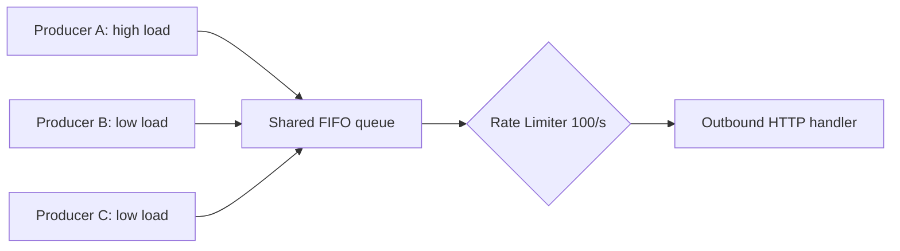
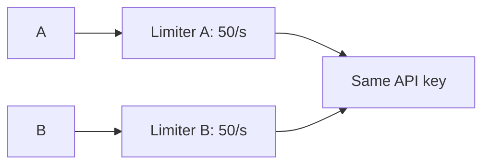
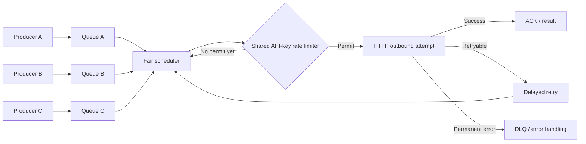

# Fairness Across Multiple Producers When Applying a Rate Limiter

> **Module:** `SPRING_INTEGRATION_PATTERN` — Learn to implement Enterprise Integration Patterns with Spring Integration to build loosely coupled and extensible message flows. Practice Router, Filter, Transformer, Splitter, Aggregator, Gateway, retry, error channel, and correlation, as well as testing and monitoring processing branches.
>
> **Chapter:** Rate limiter  
> **Topic:** Fairness across multiple producers

## 1. Problem: Rate Limiting Is Accurate Yet One Producer Still Starves

A system receives messages from three producers:

- **Producer A:** emits 1,000 messages/second, typically bursting at the start of each second.
- **Producer B:** emits 20 messages/second, needing relatively fast responses.
- **Producer C:** emits 5 messages/second, issuing critical operational commands.

All messages ultimately call the same partner API, yet the partner allows at most **100 HTTP requests/second** per API key.

If a shared 100 permits/second Rate Limiter is placed on the outbound handler, the API quota is capped per handler call. However, A can push thousands of messages into the queue first, forcing B and C to wait a long time even though total requests never exceed the limit. **Meeting the quota does not equate to fairness across producers.**

Conversely, statically dividing 100 permits/second evenly among A, B, and C gives each producer roughly 33 permits/second. When B or C has light load, their unused permits go to waste if the split does not allow borrowing. The system must balance three goals: **honoring the total quota, policy-driven fairness, and utilizing idle capacity effectively**.

This lesson focuses on designing quotas, queues, scheduling, and observing fairness in Spring Integration. After this lesson, learners can:

1. Distinguish fairness of **attempt counts**, **wait times**, **successful completion rates**, and **business priorities**.
2. Explain why FIFO, a single shared limiter, or separate limiters do not automatically guarantee fairness.
3. Design suitable Round Robin, Weighted Round Robin, or Deficit Round Robin schedules.
4. Combine fair scheduling with a shared Rate Limiter placed close to outbound attempts.
5. Apply bounded queues and backpressure per producer; handle retries, ACK, idempotency, Router, and Splitter.
6. Test starvation, global quotas, and fairness using measurable metrics.

## 2. "Fairness" Must Be Defined Before Designing

Fairness does not necessarily mean "every producer gets the exact same number of permits" at every instant. You must know which unit the business wants to be fair on.

| Criterion | Meaning | When useful |
|---|---|---|
| **Equal share** | Each producer with active demand gets a nearly equal share of capacity | Producers with equal priority |
| **Weighted share** | Proportional allocation by weights/service tiers | Premium vs. standard tenants |
| **Work conserving** | If other producers have no demand, active producers can use idle capacity | Increases throughput, avoids wasting quota |
| **No starvation** | Any valid producer with waiting work gets served within a reasonable interval | Critical flows cannot wait indefinitely |
| **Latency fairness** | Evaluates wait time or message age per producer | Protects the experience of low-volume producers |
| **Cost fairness** | Allocates by request cost (item count, CPU time, token count) | Requests vary in size/cost |

A concrete policy might be: "A and B have a 1:1 weight when both have backlog, C gets at least a minimum capacity floor and never starves; if any producer has no work, unused capacity is distributed to active producers."

**Permit fairness** differs from **completion fairness**. If A's messages repeatedly hit HTTP 503 and retry, A may consume many permits while completing little business work. When measuring, separate **permitted outbound attempts** from **completed business operations**.

## 3. Three Models Easily Mistaken for Fair

### 3.1. One Shared Limiter, One FIFO Queue



FIFO generally serves messages in **queue arrival order**, not per producer. If A already queued 1,000 messages, B and C must wait their turn even though they send very little. FIFO is fair to **message arrival order**, not fair at sharing turns among multiple producers.

In practice, ordering can also shift due to multiple partitions, consumers, priorities, retries, or broker mechanics. Never rely on FIFO to promise bounded wait times per producer when upstream rates are uncontrolled.

### 3.2. One Separate Limiter Per Producer



With two producers A and B, configuring 50/s each caps total outbound at 100 permits/s **under the assumption of two local limiters, no extra send paths, and the intended quota model**. Yet if B only needs 5 requests/s, A remains capped at 50/s; the 45 permits/s reserved for B cannot be used by A.

Worse, if each producer gets a **100/s** limiter while the shared API key allows only 100/s total, combined outbound calls can exceed the quota. Separate limiters must be sized against the total budget and changing producer counts; identical limiter names across beans/JVMs do not share state automatically.

### 3.3. One Shared Limiter with Multiple Threads Contending for Permits

If A, B, and C call the same Rate Limiter directly and each has multiple threads, whichever thread arrives right when a permit becomes available can grab it first. **RateLimiter does not guarantee Round Robin across producers or fair FIFO across waiting threads by default.** Outcomes also depend on thread scheduling and each side's traffic rate.

To get **per-producer** fairness, you need a coordination layer that knows which producers are waiting and enforces a turn-sharing policy.

## 4. Recommended Architecture: Per-Producer Queues, Shared Scheduler, Shared Outbound Quota

A clean approach separates:

1. **Admission/backpressure:** accept messages into bounded queues corresponding to each producer/tenant.
2. **Fair scheduler:** decide which producer gets the next turn.
3. **Shared provider limiter:** request an API-key permit before each outbound attempt.
4. **Outcome/recovery:** record success, delayed retry, ACK, or DLQ per the business contract.



This diagram is an **architectural design**. Spring Integration provides channels, endpoints, pollers, Gateways, advices, and error handling; **it does not automatically create per-producer Round Robin scheduling just because Rate Limiter advice is present**.

If there are many producers or they churn constantly, "per-producer queues" can be logical queues inside one broker or key/partition groups rather than one physical broker queue per producer. Cap active keys and manage queue lifecycles.

## 5. Round Robin: Serving Each Producer with Backlog in Turn

With three producers A, B, C and each message consuming **one quota unit**, simple Round Robin selects:

```text
A -> B -> C -> A -> B -> C -> ...
```

If A has 100 messages, B has 100 messages, and C has 100 messages, each side is served in turn. If B runs out of work, the scheduler should **skip B** so capacity is not left idle:

```text
A -> C -> A -> C -> ...   (B has no backlog)
```

Such a scheduler can be **work conserving**: as long as someone needs capacity, turns are not left empty just because another producer is idle.

### 5.1. Turn Progression Table

Given a provider quota of 6 permits/second, and both A and B each have at least 10 backlogged messages.

| Permit turn | FIFO, A queued first | Round Robin A/B |
|---:|---|---|
| 1 | A | A |
| 2 | A | B |
| 3 | A | A |
| 4 | A | B |
| 5 | A | A |
| 6 | A | B |
| **Total** | A=6, B=0 | A=3, B=3 |

Round Robin gives B a chance to send early despite A's large backlog. It does not automatically guarantee A and B's requests take equal time: slow handlers, retry counts, and items per batch can still make **completion latency/throughput** differ.

### 5.2. Limitations of Round Robin

- Fair by **message/turn count** when every message has similar cost.
- If A's request contains 1 item while B's request contains 100 items, one turn each is not fair by **cost**.
- A producer can create multiple fake identities to claim more turns if producer keys are unauthenticated.
- If a message fails and hot-retries, the scheduler may repeat the same request, burning permits without producing successful outcomes.

Therefore, define trusted quota keys, delayed retry mechanisms, and fairness measurements in the right units.

## 6. Weighted Round Robin and Deficit Round Robin

### 6.1. Weighted Round Robin

Suppose the business wants a **3:1** ratio for premium producer A and standard producer B when both have backlogs.

A simple schedule:

```text
A -> A -> A -> B -> A -> A -> A -> B -> ...
```

Over 40 permits with sufficient demand from both sides, A expects around 30 turns and B around 10 turns. If A has no messages, B can use the spare permits if the scheduler is work conserving. **Weights specify sharing ratios during contention**, not necessarily fixed isolated quotas at all times.

Avoid starvation: if a low-weight producer exists, turn allocation must still ensure they get served when they have demand. Strict priority (always picking A whenever A has backlog) can starve B indefinitely.

### 6.2. Varying Cost Per Message: Deficit Round Robin

When messages have different costs—for instance, the provider counts quota by recipient or item count—message-count Round Robin can miss the target.

**Deficit Round Robin (DRR)** is a scheduling approach supporting cost-weighted messages:

- Each producer has a **deficit counter** and a **quantum** (budget added each round).
- Each time a producer is visited, add quantum to its deficit.
- If the head-of-queue message's cost does not exceed the deficit and sending conditions hold, the scheduler can dispatch it and subtract the cost.
- If the deficit is still insufficient, carry the accumulated credit to the next round; when a producer empties its backlog, apply a reset rule to prevent unbounded accumulation while idle.

For example, quantum A=B=5 units; A has many cost-1 messages, B has cost-5 messages. DRR can equalize **cost units** over time rather than forcing strictly one message each.

**Note:** if one outbound request consumes multiple quota units while the attached limiter only grants **one permit per handler invocation**, you need a **cost-aware** permit mechanism at the outbound layer. Switching the scheduler alone to DRR is insufficient to comply with an item-based quota contract.

### 6.3. When to Choose Which Algorithm?

| Situation | Initial choice |
|---|---|
| Few producers, uniform workload | Round Robin |
| Fixed service tiers/weights, nearly equal cost per request | Weighted Round Robin |
| Request cost varies substantially, need cost-based sharing | Deficit Round Robin / weighted fair scheduling |
| Urgent flow with dedicated SLA | Priority queue **with anti-starvation floor** for other flows |
| Many thousands of dynamic producers | Group/tenant-based scheduler, state & scale management; cap key count |

All three algorithms decide **who gets a turn**, while the Rate Limiter decides **when a turn is permitted to call the API**. The two roles complement each other.

## 7. Java Example: A Single-JVM Round Robin Scheduler

The example below uses Java 17+ with no Spring Integration dependency in the algorithm layer so fairness tests stay clear. This is an **in-memory model** for learning and testing. It does not yet include persistence, delayed retries, or ACK.

### 7.1. Defining Messages and Queues

Suppose the system has three pre-configured producers: A, B, C. Never let external requests invent arbitrary producer names to create extra queues or claim extra quota shares.

File `FairMailbox.java`:

```java
package com.example.fairness;

import java.util.ArrayDeque;
import java.util.LinkedHashMap;
import java.util.List;
import java.util.Map;
import java.util.Objects;
import java.util.Queue;

public final class FairMailbox {

    public record Work(String producerId, String businessId, String payload) {
        public Work {
            Objects.requireNonNull(producerId);
            Objects.requireNonNull(businessId);
            Objects.requireNonNull(payload);
        }
    }

    private final Map<String, Queue<Work>> queues = new LinkedHashMap<>();
    private final List<String> order;
    private final int capacityPerProducer;
    private int cursor;

    public FairMailbox(List<String> producerIds, int capacityPerProducer) {
        if (producerIds == null || producerIds.isEmpty()
                || capacityPerProducer <= 0) {
            throw new IllegalArgumentException("Invalid mailbox settings");
        }

        for (String producerId : producerIds) {
            if (producerId == null || producerId.isBlank()
                    || queues.containsKey(producerId)) {
                throw new IllegalArgumentException("Invalid producer ID");
            }
            queues.put(producerId, new ArrayDeque<>());
        }

        order = List.copyOf(queues.keySet());
        this.capacityPerProducer = capacityPerProducer;
    }

    public synchronized boolean offer(Work work) {
        Objects.requireNonNull(work);
        Queue<Work> queue = queues.get(work.producerId());

        if (queue == null) {
            throw new IllegalArgumentException("Unknown producer");
        }
        if (queue.size() >= capacityPerProducer) {
            return false; // This producer's waiting capacity is full.
        }

        queue.add(work);
        return true;
    }

    public synchronized Work pollNext() {
        int count = order.size();

        for (int checked = 0; checked < count; checked++) {
            int index = (cursor + checked) % count;
            Queue<Work> queue = queues.get(order.get(index));

            if (!queue.isEmpty()) {
                cursor = (index + 1) % count;
                return queue.remove();
            }
        }

        return null; // No producer has waiting messages.
    }

    public synchronized int backlog(String producerId) {
        Queue<Work> queue = queues.get(producerId);
        if (queue == null) {
            throw new IllegalArgumentException("Unknown producer");
        }
        return queue.size();
    }
}
```

**Analysis:**

- `LinkedHashMap` and `List.copyOf(...)` keep the A, B, C visit order predictable.
- `cursor` advances to the next producer after each successful turn selection.
- `pollNext()` skips empty queues so turns are never wasted when another producer is waiting.
- `synchronized` protects queue/cursor state across multiple producer threads within **one JVM**.
- `capacityPerProducer` bounds each producer's in-memory backlog: A cannot fill up **B's queue**.
- `pollNext()` **removes the message from the queue**; this class has no mechanism to preserve work if a consumer crashes after polling or HTTP fails. Therefore, do not use it as a durable queue for production orders.

### 7.2. Unit Tests Verifying Fair Turns

JUnit 5 example:

```java
package com.example.fairness;

import static org.junit.jupiter.api.Assertions.*;

import java.util.ArrayList;
import java.util.List;
import org.junit.jupiter.api.Test;

class FairMailboxTest {

    @Test
    void roundRobinSkipsEmptyProducers() {
        FairMailbox box = new FairMailbox(List.of("A", "B", "C"), 10);

        for (int i = 1; i <= 3; i++) {
            assertTrue(box.offer(new FairMailbox.Work("A", "a" + i, "payload")));
            assertTrue(box.offer(new FairMailbox.Work("B", "b" + i, "payload")));
        }

        List<String> selected = new ArrayList<>();
        for (int i = 0; i < 6; i++) {
            selected.add(box.pollNext().producerId());
        }

        assertEquals(List.of("A", "B", "A", "B", "A", "B"), selected);
        assertNull(box.pollNext());
    }

    @Test
    void oneProducerCannotFillTheOtherQueue() {
        FairMailbox box = new FairMailbox(List.of("A", "B"), 2);

        assertTrue(box.offer(new FairMailbox.Work("A", "a1", "x")));
        assertTrue(box.offer(new FairMailbox.Work("A", "a2", "x")));
        assertFalse(box.offer(new FairMailbox.Work("A", "a3", "x")));

        assertTrue(box.offer(new FairMailbox.Work("B", "b1", "x")));
        assertEquals(2, box.backlog("A"));
        assertEquals(1, box.backlog("B"));
    }
}
```

The tests exercise the pure scheduler with no real time or thread sleeps. They verify **turn selection and admission**; they do not yet test Spring Integration Gateway, API quotas, or message durability.

## 8. How to Wire FairMailbox Into Spring Integration?

Spring Integration offers many endpoint and message channel types. One illustrative layout is:

```text
@MessagingGateway -> admission DirectChannel
                         |
                  @ServiceActivator
                         |
               FairMailbox.offer(...)
                         |
                  Fair dispatcher
                         |
             Shared RateLimiter gate
                         |
            @ServiceActivator sending HTTP
```

The **admission** point only receives/records messages into the mailbox. A separate dispatcher picks work from the mailbox before acquiring a permit and calling outbound.

### 8.1. Spring Boot and Channels

Sample dependencies:

```groovy
dependencies {
    implementation "org.springframework.boot:spring-boot-starter-integration"
    implementation "io.github.resilience4j:resilience4j-ratelimiter:VERSION"
}
```

Use a Resilience4j version compatible with your project's Spring Boot/Spring Integration; `VERSION` is a placeholder per your dependency management.

```java
package com.example.fairness;

import java.time.Duration;
import java.util.List;

import io.github.resilience4j.ratelimiter.RateLimiter;
import io.github.resilience4j.ratelimiter.RateLimiterConfig;
import org.springframework.context.annotation.Bean;
import org.springframework.context.annotation.Configuration;
import org.springframework.integration.channel.DirectChannel;
import org.springframework.messaging.MessageChannel;

@Configuration
public class FairFlowConfig {

    @Bean
    public MessageChannel admissionInput() {
        return new DirectChannel();
    }

    @Bean
    public MessageChannel providerOutbound() {
        return new DirectChannel();
    }

    @Bean
    public FairMailbox fairMailbox() {
        return new FairMailbox(List.of("A", "B", "C"), 100);
    }

    @Bean
    public RateLimiter providerQuota() {
        RateLimiterConfig config = RateLimiterConfig.custom()
                .limitForPeriod(10)
                .limitRefreshPeriod(Duration.ofSeconds(1))
                .timeoutDuration(Duration.ZERO)
                .build();

        return RateLimiter.of("provider-api-key", config);
    }
}
```

`providerQuota()` is a shared limiter **within the JVM**. It enforces the API-key budget provided all outbound attempts go through this permit gate. `DirectChannel` lets the dispatcher receive synchronous error results from the handler in the example; it does not automatically retry or guarantee message durability.

### 8.2. Gateway and Admission

```java
package com.example.fairness;

import org.springframework.integration.annotation.MessagingGateway;
import org.springframework.messaging.handler.annotation.Header;
import org.springframework.messaging.handler.annotation.Payload;

@MessagingGateway(defaultRequestChannel = "admissionInput")
public interface ProducerGateway {

    boolean submit(@Payload String payload,
                   @Header("producerId") String producerId);
}
```

To register the Gateway interface, enable `@IntegrationComponentScan` alongside Spring Integration configuration in the application. Startup configuration example:

```java
package com.example.fairness;

import org.springframework.boot.SpringApplication;
import org.springframework.boot.autoconfigure.SpringBootApplication;
import org.springframework.integration.annotation.IntegrationComponentScan;
import org.springframework.integration.config.EnableIntegration;
import org.springframework.scheduling.annotation.EnableScheduling;

@SpringBootApplication
@EnableIntegration
@EnableScheduling
@IntegrationComponentScan
public class FairnessApplication {

    public static void main(String[] args) {
        SpringApplication.run(FairnessApplication.class, args);
    }
}
```

Admission handler:

```java
package com.example.fairness;

import org.springframework.integration.annotation.ServiceActivator;
import org.springframework.messaging.Message;
import org.springframework.stereotype.Component;

@Component
public class ProducerAdmissionHandler {

    private final FairMailbox mailbox;

    public ProducerAdmissionHandler(FairMailbox mailbox) {
        this.mailbox = mailbox;
    }

    @ServiceActivator(inputChannel = "admissionInput")
    public boolean accept(Message<String> message) {
        // producerId must be mapped from an authenticated identity.
        String producerId =
                message.getHeaders().get("producerId", String.class);
        if (producerId == null) {
            throw new IllegalArgumentException("producerId required");
        }

        String businessId = message.getPayload();
        return mailbox.offer(
                new FairMailbox.Work(producerId, businessId, businessId));
    }
}
```

In this demo, `gateway.submit(...)` receives `true` once placed into **the in-memory mailbox**, not when HTTP completes. If `false`, the caller itself must retain the message or handle a controlled error; never return a "processed successfully" status.

**Quota security:** `producerId` is an illustrative header; in applications with untrusted callers, derive the producer from authentication/authorization context. Allowing an actor to self-declare multiple producer IDs lets them claim extra Round Robin turns and bypass per-producer limits.

### 8.3. Dispatcher and Handling Out-of-Permit Situations

This is **design pseudocode** (excluding durable recovery), showing the required ordering:

```text
repeat while dispatcher is active:
    work = durableFairQueue.reserveNextEligibleWork()
    if work is absent:
        wait for work
        continue

    // Single permit operation: checks and consumes atomically.
    if not sharedProviderLimiter.acquirePermission():
        durableFairQueue.releaseReservation(work)
        wait until a later dispatch opportunity
        continue

    try:
        callProviderExactlyOnce(work, stableIdempotencyKey)
        markCompletedAndAck(work)
    catch RetryableException:
        scheduleDelayedRetryWithoutLosingOwnership(work)
    catch PermanentException:
        moveToDLQAndAckAccordingToContract(work)
```

Each message **retains ownership** via the reservation step; permit rejection must **release the reservation** without losing the message. A single `acquirePermission()` both checks availability and consumes the permit on success; never split into `hasPermitNow()` followed by `acquirePermit()` because state can change in between. When HTTP fails, the message enters delayed retry or DLQ per policy, ensuring safe state transitions before ACK.

`durableFairQueue` and the reservation/ACK methods in the pseudocode are **components you implement over a suitable broker/store**, not built-in Spring Integration APIs. `FairMailbox.pollNext()` in section 7 is strictly for algorithm simulation: it removes work immediately on poll and lacks crash recovery. Never use `pollNext()` as-is for critical business messages. Production systems require a durable scheduler with reservations, ACKs, delayed retries, and crash handling, ensuring each real HTTP attempt passes through the shared permit gate once.

### 8.4. Where Does RateLimiterRequestHandlerAdvice Go?

If using `RateLimiterRequestHandlerAdvice` instead of calling `RateLimiter.acquirePermission()` directly, attach the advice **right on the outbound handler**:

```java
@ServiceActivator(
        inputChannel = "providerOutbound",
        adviceChain = "providerQuotaAdvice")
public void callProvider(FairMailbox.Work work) {
    providerClient.sendOnce(work.payload(), work.businessId());
}
```

`providerQuotaAdvice` is an advice bean configured with `RateLimiterConfig` and the matching API-key limit. This is an alternative to acquiring permits manually in the dispatcher: **never acquire permits in both the dispatcher and the advice** for the same attempt unless you intentionally maintain two independent quotas.

Even when using advice, quota rejections after the dispatcher pulls work from a queue **must still be handled safely**. When messages require guaranteed eventual processing, use a broker/queue mechanism that preserves ownership until completion or moves messages into durable delayed retry.

## 9. Backpressure and Per-Producer Backlog Limits

Fair scheduling only decides **who gets a turn**; it does not stop producer A from sending endless messages and exhausting memory. Bounded admission is needed:

```text
Producer A -> Queue A (capacity 100) --+
Producer B -> Queue B (capacity 100) --+--> Fair scheduler
Producer C -> Queue C (capacity 100) --+
```

In the `FairMailbox` example:

- Once A has 100 waiting messages, `offer(A)` returns `false`.
- While B still has room, `offer(B)` continues to accept.
- Combined backlog across the three queues stays at or below 300 messages **excluding in-flight dequeued messages and retry state**.

Also cap total memory/broker usage, since thousands of producers each with a queue can add up. If every producer gets 100 messages and there are 100,000 producers, the theoretical ceiling is 10 million queued messages.

When admission returns `false`:

1. Return a clear signal to the sender requesting backoff.
2. If upstream has durable ownership of the message, it can retry later; never ACK before safely persisting.
3. For HTTP APIs, return 429/503 per contract and `Retry-After` when computable.
4. For **best-effort** events, discard only when business rules allow and emit reason metrics.

Avoid holding Gateway threads for long durations waiting for a Round Robin turn. For long-running work, accept into a durable broker and let consumers deliver results via async/status mechanisms.

## 10. Fairness Under Retries, Errors, and Side Effects

### 10.1. Retries Can Steal Turns from Other Producers

If producer A hits many HTTP 503s and retries continuously, each retry generates another outbound attempt. If the scheduler always gives A's retries high priority, A can consume most permits even while B and C have backlogs.

A sound operational policy can include:

- A dedicated **retry budget** system-wide or per producer.
- Retries only run when backoff matures, never hot-requeued.
- Retries preserve `producerId` so they count against the proper fairness budget.
- Every HTTP retry still passes through the shared provider limiter.
- Cap retry attempts and message age; move permanent failures to a DLQ.

Depending on requirements, the scheduler can measure fairness over **all outbound attempts** or **new business operations**; if prioritizing fresh work, reserve a portion of budget for retries while always protecting the total API-key quota.

### 10.2. Failures After Dequeue and ACK

Once a message is pulled from an in-memory `QueueChannel`, handler failure does not automatically put the message back in the queue. For critical orders, use a broker/persistent store, implement reservation/ack/nack/delayed retry, and test disconnect scenarios.

Even when an HTTP request succeeds, the client may time out before receiving the response or crash before ACK. The message may be redelivered; therefore use an **idempotency key stable per business operation**. Never rotate keys across retry attempts of the same operation.

### 10.3. Error Channel Does Not Automatically Mean Fair Retry

In synchronous flows over `DirectChannel`, errors normally propagate to the caller. With pollers, executors, or broker adapters, errors may be sent as an `ErrorMessage` to a corresponding error channel or handled by the adapter's policy. **Never assume** every error automatically goes to the global `errorChannel` or requeues with the right producer ID.

An error handler must carry producer ID, business ID, correlation ID, attempt count, error type, and retry schedule. Losing `producerId` in an error/retry flow can dump messages into a shared queue and skew fairness.

## 11. How Do Router, Filter, Splitter, and Aggregator Affect Fairness?

| Pattern | Impact on turns/cost | Design recommendation |
|---|---|---|
| **Router** | Two producers may target APIs with different quotas | Enforce fairness at the right shared resource group; each API key has its own scheduler/quota |
| **Filter** | Filtered-out messages should not consume HTTP turns | Filter business conditions before granting outbound permits |
| **Transformer** | May reshape payload size without calling the API yet | Measure cost at the actual resource-consuming step |
| **Splitter** | One message can produce N outbound attempts | Preserve producer identity on child messages; compute fairness by attempts/cost |
| **Aggregator** | Combines many messages into one batch, possibly across producers | Determine quota by request or item; avoid one producer monopolizing batches |
| **Gateway** | Synchronous callers may wait on quota/queues | Choose timeouts and async admission contracts |
| **Retry** | One operation produces multiple attempts | Retries still count toward producer budget, backoff, and idempotency |
| **Error Channel** | Failed messages may exit the scheduler path | Route retries back onto the right schedule, keep context, avoid message loss |
| **Correlation** | Must stitch together child messages/batches/retries | Preserve authenticated `correlationId`, producerId, and businessId |

**Splitter example:** A sends one message containing 1,000 records that a Splitter expands into 1,000 requests. B sends 10 messages, each producing one request. If fairness only measures **messages before the Splitter**, A can claim 1,000 outbound permits from a single initial turn. When the API limits by request count, schedule **after the Splitter** or charge equivalent cost.

**Aggregator example:** one batch has 100 items while the provider counts quota by **recipient/item**. One permit per batch request does not reflect real cost. Use cost/weighted quota accounting while retaining per-message correlation inside the batch for accurate retries/reconciliation.

## 12. Multiple Instances and Distributed Fairness

A Round Robin schedule inside one JVM sees only messages on **that JVM**. With two replicas where producer A mostly hits replica 1 and B hits replica 2, neither replica sees the full combined backlog.

Likewise, if each replica has a 100/s limiter while a shared API key allows only 100/s total, the system can emit **roughly 200 outbound attempts/second** before bursts, even though each JVM respects its local quota.

Options:

| Model | Advantages | Limitations |
|---|---|---|
| **Single shared dispatcher** | Sees every producer's backlog, enforces shared quota easily | Needs proper high availability, partitioning, and scaling |
| **Broker partitioned by producer + coordinated consumer group** | Scalable, preserves per-producer ordering if designed carefully | Cross-partition fairness is not automatic; needs scheduler/coordinator |
| **Distributed quota coordinator** | Atomically grants permits per API key system-wide | Does not solve fairness alone if permit callers lack producer turn-sharing |
| **Static per-replica quota split** | Easy to deploy with fixed replica counts | Wastes capacity under skewed load, hard to autoscale |

**Important:** a distributed rate limiter solves **global quota**, whereas distributed fair scheduling solves **who gets to use the quota**. A system can get one right and still fail at the other.

With dynamic tenants, authenticate producer identity; avoid creating a queue/limiter for every arbitrary user-supplied ID. When quotas/weights change at runtime, preserve in-flight state and message durability so changing IDs cannot accidentally "reset" allocations.

## 13. Measuring Fairness: Beyond Turn Counts, Track Message Age

### 13.1. Metrics to Track

- `admitted_messages_total{producer_group}`: messages admitted into queues.
- `rejected_messages_total{reason}`: messages rejected due to capacity/quota.
- `pending_messages{producer_group}`: current backlog per producer group.
- `oldest_pending_age_seconds{producer_group}`: oldest waiting message.
- `dispatch_attempts_total{producer_group}`: outbound attempts selected.
- `dispatch_success_total{producer_group}`: business operations completed successfully.
- `rate_limit_acquired_total` and `rate_limit_rejected_total` per API key/quota group.
- `retry_attempts_total{producer_group}` and `dlq_messages_total`.
- `dispatch_wait_duration_seconds`: p50/p95/p99 by group.
- `outbound_http_attempts_total` and provider HTTP 429 counts.

If there are millions of producers, **never attach arbitrary `producerId` values** as Prometheus labels because cardinality explodes. Aggregate by service tier, priority group, or controlled sampling; store per-producer details in a dedicated system when reconciliation is needed.

### 13.2. Jain's Fairness Index

A reference metric for resource allocation is **Jain's fairness index**:

\[
J = \frac{(\sum_{i=1}^{n} x_i)^2}{n\sum_{i=1}^{n} x_i^2}
\]

Here \(x_i\) is the measured resource/throughput of producer \(i\) over an analysis window. For two producers **both having continuous backlog and equal weights**:

- If A receives 50 turns and B receives 50 turns: \(J = (100)^2/[2(50^2+50^2)] = 1\).
- If A receives 90 turns and B receives 10 turns: \(J = 100^2/[2(90^2+10^2)] \approx 0.610\).

For \(n\) producers with non-negative values summing above 0, the index ranges from \(1/n\) to 1; 1 indicates equal distribution.

**Do not interpret the index mechanically:** if A wants 90 turns while B only sends 10, getting 90/10 is not necessarily unfair. If A:B weights are 3:1, comparing equal throughput also misses the goal. Check **eligible demand/backlog**, SLAs, and weight-normalized shares before drawing conclusions.

### 13.3. Latency Fairness

Two producers can receive the same number of permits over a minute while B still waits 40 seconds before getting a turn. Therefore track **p95/p99 wait times and oldest message age**, not just total attempt counts.

An operational requirement might state: "While producer B has backlog and the provider quota has throughput, B must receive a turn within at most N dispatch cycles." The bound N depends on active producer count, weights, request cost, backlog, and priority policy. Never promise that bound unless the scheduler/broker actually enforces it.

## 14. Testing Fairness and Anti-Starvation

### 14.1. Test Matrix

| Scenario | Setup | Expectation |
|---|---|---|
| Two producers with backlog | A=100, B=100, Round Robin | Sequence A,B,A,B,… in the single-thread example |
| One empty producer | A=100, B=0, C=50 | Scheduler skips B without wasting turns |
| Large producer floods queue | A exceeds capacity, B sends lightly | A hits admission rejection; B still enters its own queue |
| Producer A has slow requests | A handler slow, B fast | Define fairness by dispatch or completion; do not conflate them |
| Weighted 3:1 | Both A and B have large backlogs | Roughly 3:1 allocation over a sufficiently long window |
| Heterogeneous costs | A cost=1, B cost=5 | Use DRR/weighted cost; do not judge fairness by message count alone |
| Transient error retries | A hits HTTP 503 repeatedly | B does not starve; A retries with backoff/budget |
| API key quota exhausted | Dispatcher has many messages | No quota overrun; unpermitted messages stay safely held |
| Consumer crash after HTTP | ACK not yet completed | Recovery and idempotency prevent duplicate side effects |
| Multi-instance | A/B across two JVMs | Verify shared quota and system-wide effective fairness |

### 14.2. Count Turns Instead of Relying on Thread Scheduling

In `FairMailboxTest`, selection order is verified **deterministically**. Concurrency tests should add concurrent producer threads calling `offer()`, yet avoid asserting OS scheduler thread ordering. Verify instead:

- No per-producer capacity overruns from races.
- No lost messages during offer/poll in the simple model.
- Round Robin dispatch never skips a backlogged queue indefinitely under steady conditions.
- Every message sent to actual outbound acquires a permit.
- On errors/timeouts, recovery paths preserve producer ID and business ID.

With a production broker, use an HTTP stub counting outbound attempts; drive load from multiple backlogged producers; track Jain's index, p99 wait, quota, and message age. Fairness conclusions must tie to **each producer's actual demand** and business targets, not a bare average.

## 15. Common Design Mistakes

| Mistake | Consequence | Fix |
|---|---|---|
| One shared FIFO queue called "fair" | High-volume producer pushes low-volume producer to the back | Logical per-producer queues + scheduler |
| Hard quota split without redistribution | Idle permits are wasted | Work-conserving scheduler |
| Strict priority for one flow | Other producers starve | Floor quota or weighted fairness |
| Giving each producer a 100/s limiter when total quota is 100/s | Exceeds API key quota | Shared total limiter/dispatcher |
| Trusting arbitrary request `producerId` | Callers forge multiple IDs to claim extra turns | Derive identity from auth context |
| Selecting turns before a Splitter | One turn produces N outbound attempts | Place fairness and quota near outbound |
| Hot retries with high priority | Failing producer hogs permits | Retry delays, budgets, and retry-aware fairness |
| Using in-memory `QueueChannel` for mandatory messages | Restarts lose messages | Durable broker/store + ACK/recovery |
| Dequeuing with no recovery | Permit exhaustion/HTTP errors lose work | Safe reservation/requeue, delayed retry |
| Measuring only system-wide attempt counts | Fails to spot B starving | Metrics per producer group and message age |
| Using Jain's index without demand/weights | Misjudges fairness | Normalize by demand and policy |
| Multiple replicas each locally fair | Not necessarily globally fair | Central scheduler/coordinator or distributed verification |

## 16. Hands-On Exercises

**Exercise 1 — FIFO vs. Round Robin.** A and B each have 100 waiting messages; shared quota allows 10 permits per cycle. If A fills FIFO before B, calculate each side's turns in the first 10 permits. Replace with Round Robin and compare Jain's index.

**Exercise 2 — Weighted Round Robin.** A is premium with weight 3, B is standard with weight 1. Both always have backlogs. Write out a 16-turn 3:1 schedule, then describe what should happen when A runs out of messages while B still has backlog.

**Exercise 3 — Per-Producer Bounded Queue.** Use `FairMailbox` with capacity 2 for A/B. Submit three messages from A and one from B. Check admission results and scheduler order. Explain why producer ID must be authenticated.

**Exercise 4 — Retries Must Not Monopolize Quota.** One producer has 100 requests retrying HTTP 503, another producer has 10 fresh requests. Design retry queues/delays so the failing producer cannot consume all permits; every HTTP attempt must still pass through the shared provider quota.

**Exercise 5 — Splitter Producing 100 Requests.** Producer A sends one message with 100 items; producer B sends 10 single-item messages. Place the fairness scheduler before or after the Splitter to be fair by HTTP attempts? If the provider enforces quota by item count, how must cost change?

**Exercise 6 — Distributed Fairness.** Three replicas call an API key with a 30/s total quota. Each replica receives different producers. Sketch an outbound dispatcher or distributed scheduler for weighted turn sharing, shared quota enforcement, and handling crashes before ACK.

### Self-Assessment Questions

1. Why can a shared Rate Limiter honor the quota accurately yet still starve one producer?
2. What is FIFO fair to, and how does it differ from per-producer Round Robin?
3. Must Weighted Round Robin 3:1 always keep 75%/25% even when producer B has no messages?
4. When is Deficit Round Robin more appropriate than plain Round Robin?
5. If a rate limiter already controls permits, why do you still need bounded queues/backpressure at ingress?
6. How do you ensure producer A cannot forge multiple quota identities using fake headers?
7. Why must retries preserve producer identity, business ID, and idempotency key?
8. Why does a distributed limiter with shared state not automatically guarantee fairness across producers?
9. Does a Jain's index of 0.61 always prove an unfair schedule? What data is needed to conclude?
10. Why is an in-memory queue insufficient to guarantee eventual processing after a restart?

## 17. References

- [Spring Integration — Channels](https://docs.spring.io/spring-integration/reference/channel.html): DirectChannel, QueueChannel, and message delivery mechanics.
- [Spring Integration — Message Routing](https://docs.spring.io/spring-integration/reference/router.html): Router, branch orchestration, and route selection.
- [Spring Integration — Polling Consumer](https://docs.spring.io/spring-integration/reference/polling-consumer.html): pollers, consumption pace, and consumer limits.
- [Spring Integration — Request Handler Advice](https://docs.spring.io/spring-integration/reference/handler-advice.html): handler rate limiting and advice chains.
- [Spring Integration — Error Handling](https://docs.spring.io/spring-integration/reference/error-handling.html): exceptions and error channels by flow type.
- [Resilience4j — RateLimiter](https://resilience4j.readme.io/docs/ratelimiter): permits, timeouts, cycles, and metrics.
- [Jain's Fairness Index](https://en.wikipedia.org/wiki/Fairness_measure): reference metric for evaluating fairness when comparing resource allocation.
